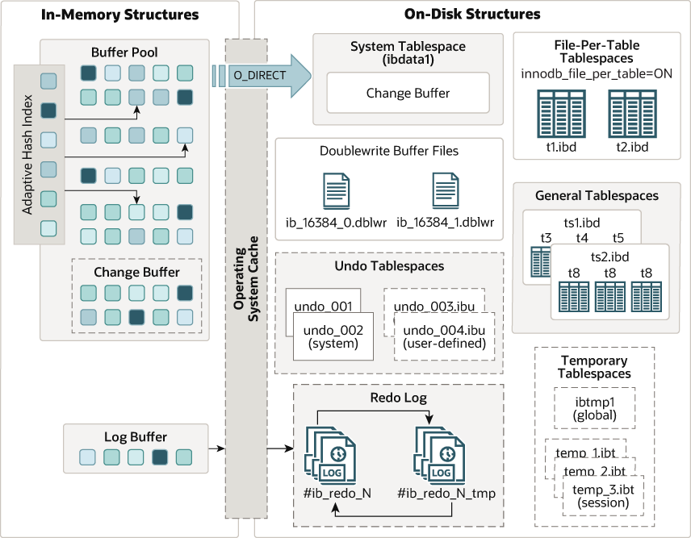

## Table of Contents
1. [Nhiệm vụ của database](#database-missions)
2. [Kiến trúc của database](#database-architecture)
3. [Storage Engines](#storage-engines)
4. [Lựa chọn giữa các database](#compare-databases)
5. [Transactional Processing And Recovery](#transactional-processing-and-recovery)
6. [B-Tree Variants](#b-tree-variants)
7. [Log-Structured Storage](#log-structured-storage)
8. [Key Takeaways](#key-takeaways)
9. [References](#references)

---

## Nhiệm vụ của database

- Lưu trữ dữ liệu với độ tin cậy (reliably) cao.
- Là giải pháp lưu trữ có sẵn, thay vì chúng ta phải tự xây dụng lại từ đầu. Ví dụ như: schema, indexing, query language, indexing, transactions, replication, etc. được xây dụng sẵn.
- Một số database phổ biến hiện nay: MySQL, PostgreSQL, MongoDB, Redis, Cassandra, etc. Mỗi database có những ưu nhược điểm riêng, phù hợp với từng use case khác nhau.
- 

## Kiến trúc của database

Database là 1 hệ thống module với các thành phần như:

- **Transport Layer**: Là điểm tiếp nhận đầu tiên, chịu trách nhiệm giao tiếp giữa Client và Server.
- **Query Processor**: Phân tích cú pháp và tối ưu hóa câu lệnh SQL nhận được từ tầng Transport.
- **Execution Engine**: Đóng vai trò điều phối, thực hiện kế hoạch đã được vạch ra bởi Query Processor.
- **Storage Engine**: Thành phần cốt lõi quản lý dữ liệu vật lý trên ổ đĩa và bộ nhớ (RAM).

*Hình 1.1: Kiến trúc tổng quan của MySQL InnoDB Storage Engine (In-Memory vs On-Disk Structures)*

## Storage Engines

Chịu trách nhiệu **lưu trữ**, **tìm kiếm** và **quản lý** dữ liệu trên ổ đĩa để lưu trữ dữ liệu lâu dài an toàn, đáng tin cậy và bộ nhớ (RAM) tối ưu cho tốc độ đọc và ghi (fsync).

- **Quá trính ghi** (write):
    - **Ghi vào RAM** (Memory Buffer/MemTable): Dữ liệu mới được cập nhật trực tiếp vào một vùng nhớ đệm trên RAM (ví dụ: **Buffer Pool** trong **InnoDB**, **Shared Buffer** trong **PostgreSQL** hoặc **MemTable** trong **RocksDB**).
    - **Ghi WAL** (Write-Ahead Logging): Để đảm bảo không mất dữ liệu nếu server đột ngột sập nguồn, một bản ghi tuần tự (append-only) về thao tác này sẽ được ghi xuống một file nhật ký trên ổ đĩa (Redo Log/WAL).
    - **Background Flush**: Định kỳ, các luồng (thread) chạy ngầm sẽ thu gom các Dirty Pages từ RAM và ghi chúng xuống file dữ liệu chính thức trên ổ đĩa (SSTable hoặc Tablespace) một cách tối ưu nhất.

- **Quá trình đọc** (read):
    - Storage engine sẽ luôn tìm kiếm dữ liệu trên **RAM** trước (**Cache Lookup**).
    - Nếu dữ liệu có sẵn (**Cache Hit**), nó trả về ngay lập tức.
    - Nếu dữ liệu **không** có trong **RAM**, nó phải chặn truy vấn lại, xuống ổ đĩa **đọc** **Page** tương ứng (thông qua việc kéo các OS Blocks), đưa Page đó lên RAM, rồi mới trích xuất dòng dữ liệu trả về cho ứng dụng.

### Các loại Storage Engine phổ biến:

- Nhóm Storage Engine dựa trên B-Tree (B+ Tree)
    - **InnoDB** (MySQL/MariaDB): Storage engine phổ biến nhất thế giới. Hỗ trợ ACID transaction tuyệt đối, khóa cấp dòng (row-level locking), và tự động tối ưu hóa truy vấn bằng Adaptive Hash Index.
    - **PostgreSQL Engine**: Không có một tên gọi riêng biệt như InnoDB, storage engine của Postgres gắn liền với kiến trúc của nó. Nổi tiếng với cơ chế MVCC (Multi-Version Concurrency Control) cực kỳ mạnh mẽ, giúp các truy vấn đọc không bao giờ chặn các truy vấn ghi.
    - **WiredTiger** (MongoDB): Trước đây MongoDB dùng MMAPv1 rất tệ, nhưng từ khi mua lại WiredTiger, hiệu năng đã lột xác. WiredTiger sử dụng B-Tree nhưng hỗ trợ nén dữ liệu cực tốt và xử lý đồng thời (concurrency) cao nhờ cơ chế ticket-based.

- Nhóm Storage Engine dựa trên LSM-Tree (Log-Structured Merge-Tree)
    - **RocksDB** (**Facebook** phát triển): Đây là "vua" của thế giới LSM-Tree hiện nay. Nó không phải là một Database độc lập mà là một thư viện Storage Engine nhúng. Rất nhiều hệ thống lớn đang dùng RocksDB làm nền tảng lưu trữ bên dưới, ví dụ như: Apache Kafka (Kafka Streams), CockroachDB, TiDB, và thậm chí cả MySQL (thông qua engine MyRocks).
    - **Cassandra Storage Engine**: Được thiết kế dựa trên Dynamo của Amazon và BigTable của Google. Nó tối ưu hóa việc phân tán dữ liệu khổng lồ trên nhiều node với tốc độ ghi cực nhanh.
    - **LevelDB** (**Google** phát triển): Người tiền nhiệm của RocksDB. Hiện nay ít dùng cho hệ thống lớn do thiếu tối ưu hóa cho server nhiều core, nhưng vẫn phổ biến trong các ứng dụng mobile (ví dụ IndexedDB trong trình duyệt).

## Lựa chọn giữa các database

Các tiêu chí lựa chọn database:
- Về cách database đó được implement như thế nào
- Ngôn ngữ lập trình sử dụng
- Use case của ứng dụng (ví dụ: read-heavy, write-heavy, real-time analytics, etc.)
- Đánh giá dựa trên benchmark thực tế, ví dụ: TPC-C (Transaction Processing Performance Council - Benchmark C), YCSB (Yahoo! Cloud Service Benchmark), Sysbench, etc.
