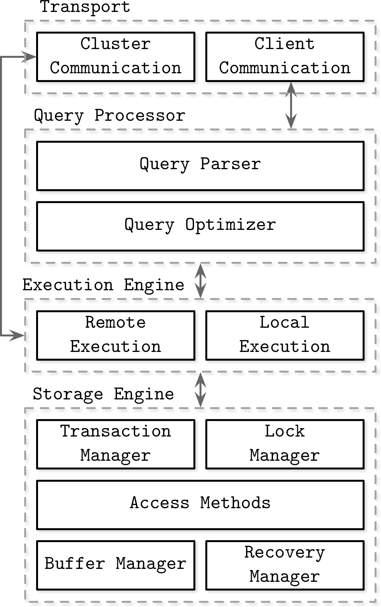
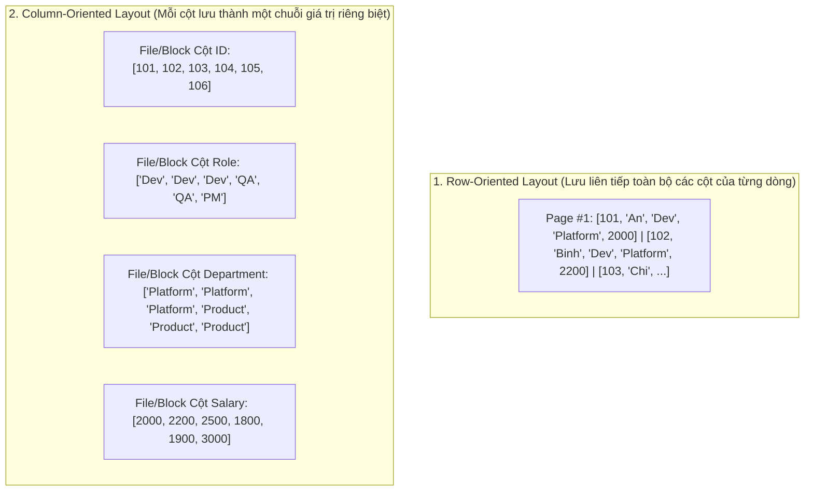
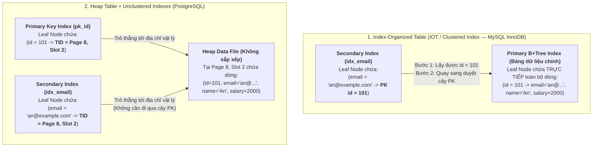
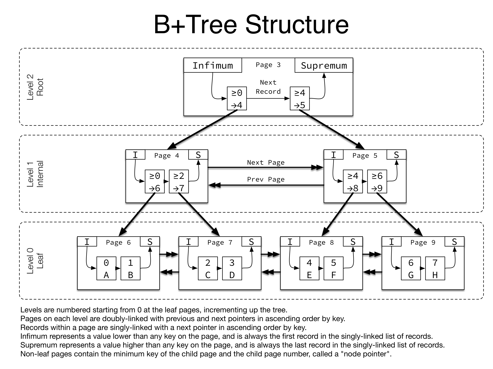
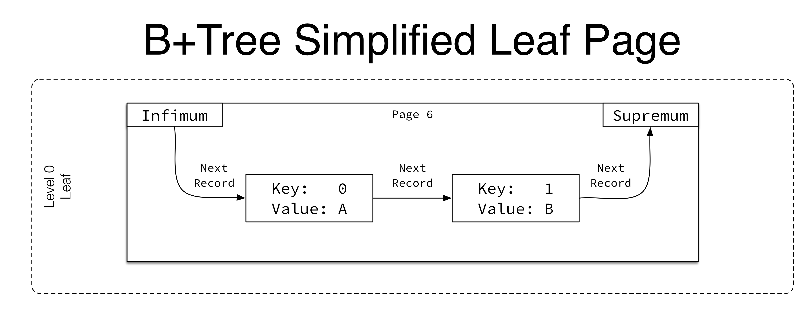
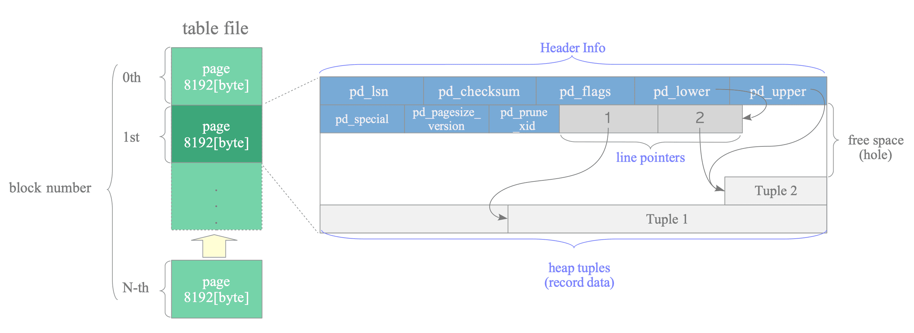
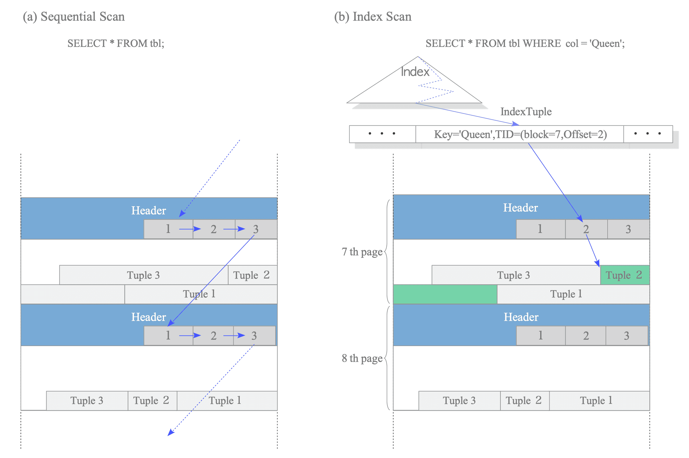
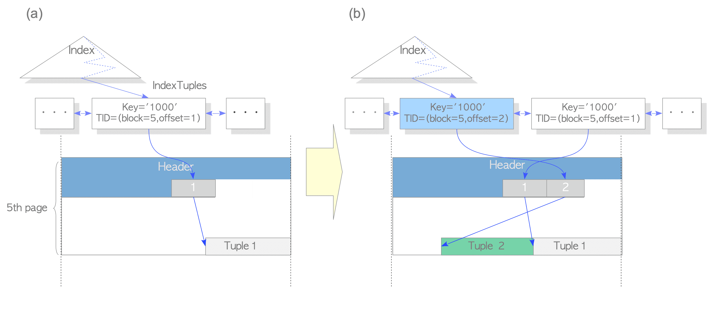
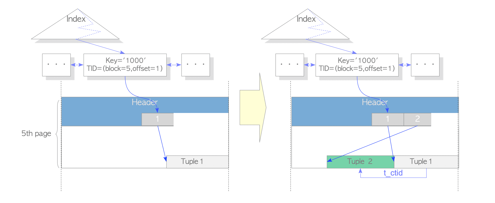
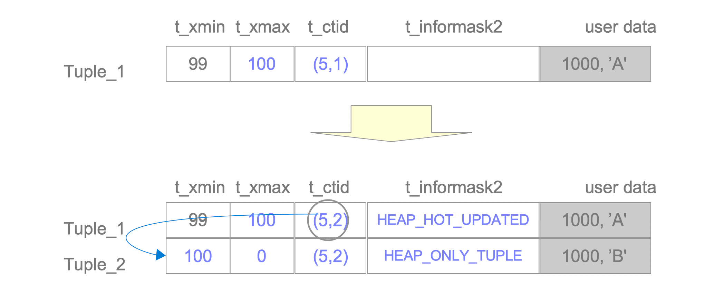

## Table of Contents
1. [Phân loại DBMS: OLTP, OLAP và HTAP](#dbms-classification)
2. [Kiến trúc cơ bản của DBMS và Vòng đời trọn vẹn của một Query](#dbms-architecture)
3. [Memory-Based vs Disk-Based DBMS](#memories-vs-disk-based-dbms)
4. [Row-Oriented vs Column-Oriented DBMS & Kỹ thuật nén dữ liệu cột](#column-vs-row-oriented-dbms)
5. [Data Files và Index Files (Index-Organized Table vs Heap Table)](#data-files-and-index-files)
6. [Ba trụ cột tối ưu Storage Engine: Buffering, Immutability và Ordering](#buffering-immutability-and-ordering)
7. [Tóm tắt & Ghi nhớ cốt lõi (Key Takeaways)](#key-takeaways)

---

## Phân loại DBMS: OLTP, OLAP và HTAP {#dbms-classification}

### Bài toán thực tế: Tại sao không dùng một loại Database cho mọi nhu cầu?
Giả sử một sàn thương mại điện tử đang phục vụ `50.000` khách hàng đặt đơn mỗi giây (mỗi đơn chỉ đọc/ghi đúng vài dòng của khách hàng đó và đòi hỏi phản hồi dưới `5 ms`). Cùng lúc đó, bộ phận tài chính chạy một câu truy vấn báo cáo doanh thu theo từng danh mục sản phẩm suốt 3 năm qua (quét qua `500 triệu` dòng hóa đơn).
- Nếu chạy cả hai trên cùng một cơ sở dữ liệu truyền thống: câu lệnh báo cáo sẽ ngốn sạch băng thông Disk I/O, đẩy toàn bộ dữ liệu giao dịch nóng ra khỏi `Buffer Pool` và làm nghẽn CPU khiến khách hàng không thể thanh toán!
- Do đặc tính truy cập vật lý của hai tác vụ này đối lập nhau hoàn toàn, ngành công nghiệp cơ sở dữ liệu phân tách các DBMS thành 3 nhóm chính theo mẫu tải (**Workload Pattern**):

| Phân loại | Đặc điểm truy vấn (Query Pattern) | Cách tổ chức lưu trữ điển hình | Ví dụ tiêu biểu |
| :--- | :--- | :--- | :--- |
| **OLTP** (*Online Transaction Processing*) | Truy vấn ngắn, độ trễ cực thấp (vài millisecond), đọc/ghi từng bản ghi cụ thể theo khóa (`Point Lookup`, `INSERT`, `UPDATE`, `DELETE`), yêu cầu tính toàn vẹn giao dịch **ACID** cao. | **Row-oriented** (lưu liên tiếp theo từng dòng), sử dụng B+Tree hoặc LSM-Tree. | PostgreSQL, MySQL (InnoDB), Oracle, SQL Server, MongoDB, Apache Cassandra. |
| **OLAP** (*Online Analytical Processing*) | Truy vấn phân tích phức tạp (`GROUP BY`, `SUM`, `AVG`, `JOIN` lớn) quét qua hàng triệu/tỷ dòng nhưng chỉ chạm tới một vài cột, dữ liệu chủ yếu ghi theo lô (Batch Append). | **Column-oriented** (lưu liên tiếp theo từng cột), nén dữ liệu cao (RLE, Dictionary, Bit-Vector). | ClickHouse, Apache Druid, DuckDB, Snowflake, Google BigQuery, Amazon Redshift. |
| **HTAP** (*Hybrid Transactional / Analytical Processing*) | Kết hợp xử lý giao dịch thời gian thực (OLTP) và phân tích dữ liệu (OLAP) trên cùng một hệ thống mà không cần chờ pipeline ETL sao chép qua đêm. | Lưu trữ lai (ví dụ: duy trì đồng thời các node Row-store như *TiKV* cho OLTP và các node Column-store như *TiFlash* cho OLAP qua giao thức Raft). | TiDB, SingleStore (MemSQL), CockroachDB, YugabyteDB, AlloyDB. |

### Từ điển thuật ngữ nhanh cho người mới (Chương 1)
Trước khi đi vào từng thành phần bên trong, hãy điểm qua các thuật ngữ kỹ thuật xuất hiện trong chương này dưới góc nhìn đời thường:

| Thuật ngữ trong sách | Hiểu nôm na cho người mới (Ẩn dụ đời thực) | Trong Database thực tế (PostgreSQL / MySQL / ClickHouse) là gì? |
| :--- | :--- | :--- |
| **`AST` (*Abstract Syntax Tree*)** | Sơ đồ phân tích ngữ pháp câu văn (Chủ ngữ - Vị ngữ - Bổ ngữ) sau khi đọc một câu lệnh SQL. | Cây cấu trúc dữ liệu trong RAM được tạo ra bởi `Parser` từ chuỗi văn bản `SELECT ... FROM ... WHERE ...`. |
| **`System Catalog`** | Cuốn "sổ hộ khẩu" nội bộ của chính Database, ghi rõ trong hệ thống đang có những bảng nào, cột nào, kiểu dữ liệu gì và ai có quyền đọc. | Các bảng hệ thống như `pg_class`, `pg_attribute` trong PostgreSQL hoặc `information_schema` / Data Dictionary trong MySQL. |
| **`Cost-Based Optimizer (CBO)`** | "Google Maps" của Database: tính toán xem đi đường tắt (dùng Index) hay đi đường quốc lộ (quét toàn bảng) tốn ít xăng (Disk I/O + CPU) hơn. | Bộ tối ưu hóa truy vấn dựa trên bảng thống kê (`ANALYZE` statistics / histograms) để chọn kế hoạch thực thi vật lý rẻ nhất. |
| **`Row-Oriented` vs `Column-Oriented`** | **Row-Store**: Lưu từng bộ hồ sơ nhân viên vào từng phong bì riêng. **Column-Store**: Tách riêng 1 xấp giấy chỉ ghi tên, 1 xấp giấy chỉ ghi mức lương. | **Row-Store** (PostgreSQL, MySQL) đọc/ghi trọn 1 dòng cực nhanh; **Column-Store** (ClickHouse, DuckDB, Parquet) tính tổng/trung bình 1 cột trên 1 tỷ dòng cực nhanh. |
| **`SIMD Vectorization`** | Thay vì tính nhẩm từng con số một, CPU dùng một "khay tính toán rộng" nạp cùng lúc 8 hoặc 16 con số lương và cộng tất cả chỉ trong 1 nhịp đồng hồ. | Tập lệnh phần cứng CPU (`AVX-2`, `AVX-512`) được các Column-Store (ClickHouse, DuckDB) tận dụng khi các số của cùng một cột nằm liền kề nhau trên RAM. |
| **`RLE`, `Dictionary`, `Bitmap Encoding`** | Ba mẹo viết tắt để tiết kiệm giấy: ghi `"Platform" x 60.000 lần` (**RLE**), đổi chuỗi dài thành mã số `0, 1, 2` (**Dictionary**), hoặc đánh dấu `0/1` (**Bitmap**). | Các thuật toán nén cột giúp giảm dung lượng đĩa từ `5x – 80x` và cho phép lọc `WHERE` trực tiếp trên dữ liệu nén. |

---

## Kiến trúc cơ bản của DBMS và Vòng đời trọn vẹn của một Query {#dbms-architecture}

> [!NOTE]
> **Cách đọc sơ đồ cho người mới (*Hình 1.1* bên dưới):**
> 1. **Đọc từ Đỉnh xuống Đáy (Theo chiều đi của câu lệnh SQL)**: Câu lệnh `SELECT` từ ứng dụng đi vào cửa ngõ **Transport Subsystem** (trên cùng), chảy xuống **Query Processor** để kiểm tra cú pháp và lập bản đồ đường đi (`Query Optimizer`), rồi giao cho **Execution Engine** điều phối.
> 2. **Đáy sơ đồ (Storage Engine — Trái tim vật lý của Database)**: Gồm 4 mảnh ghép phối hợp chặt chẽ: **Transaction Manager** & **Lock Manager** (giữ trật tự truy cập đồng thời), **Access Methods** (quản lý cấu trúc B+Tree / LSM-Tree trên đĩa) và **Buffer Manager** + **Recovery Manager** (quản lý bộ nhớ đệm RAM và sổ nhật ký khôi phục WAL).


*Hình 1.1: Kiến trúc tổng quan các thành phần của một DBMS (Transport, Query Processor, Execution Engine, Storage Engine)*

### Ví dụ chạy tay (Step-by-Step Walkthrough): Vòng đời câu lệnh `SELECT`
Để hiểu rõ cách các hộp kiến trúc trong *Hình 1.1* phối hợp với nhau, hãy theo dõi trọn vẹn hành trình của câu truy vấn sau từ lúc rời ứng dụng cho đến khi trả kết quả:

```sql
SELECT name, salary FROM users WHERE email = 'an@example.com';
```

#### Bước 1: Transport Subsystem (Tiếp nhận & Điều phối kết nối)
- Ứng dụng gửi chuỗi SQL trên qua kết nối TCP/TLS theo giao thức nhị phân (như *PostgreSQL v3 Wire Protocol* hoặc *MySQL Client/Server Protocol*).
- **Connection Handler** kiểm tra trạng thái phiên làm việc (Session), quyền xác thực (Authentication), giải mã gói tin mạng lấy chuỗi văn bản SQL và chuyển xuống **Query Processor**. (Nếu là hệ thống phân tán và dữ liệu nằm ở node khác, **Cluster Subsystem** sẽ định tuyến yêu cầu qua mạng nội bộ).

#### Bước 2: Query Processor — Parser & Validator (Phân tích cú pháp & Ngữ nghĩa)
- **Lexer & Parser** tách chuỗi SQL thành các từ tố (tokens: `SELECT`, `name`, `,`, `salary`, `FROM`, `users`, `WHERE`, `email`, `=`, `'an@example.com'`) và dựng thành **Cây cú pháp trừu tượng (AST - Abstract Syntax Tree)**:

```text
                  [SELECT Statement]
                  /       |        \
        [TargetList]   [From]     [WhereClause]
          /      \        |           |
       "name"  "salary" "users"   [Equals (=)]
                                   /        \
                               "email"  'an@example.com'
```

- **Validator (Semantic Analyzer)** tra cứu **System Catalog** (bảng siêu dữ liệu nội bộ của DBMS):
  - Bảng `users` có tồn tại không? (Có, `table_id = 1024`).
  - Các cột `name`, `salary`, `email` có thuộc bảng `users` không? Kiểu dữ liệu của `'an@example.com'` (`VARCHAR`) có tương thích với cột `email` không?
  - User hiện tại có quyền `SELECT` trên bảng `users` không?

#### Bước 3: Query Processor — Cost-Based Optimizer (CBO - Tối ưu hóa truy vấn)
- Sau khi AST hợp lệ, Optimizer chuyển nó thành biểu thức đại số quan hệ logic: $\pi_{\text{name, salary}}(\sigma_{\text{email = 'an@example.com'}}(\text{users}))$.
- Tiếp theo, **Cost-Based Optimizer (CBO)** đọc bảng thống kê (**Statistics / Histograms**) của bảng `users` (giả sử bảng có `1.000.000` dòng chiếm `20.000 Pages`, và có một chỉ mục `idx_users_email` cao `3` tầng trên cột `email`) để so sánh chi phí giữa 2 phương án thực thi vật lý:
  - **Phương án 1 (`Full Table Scan / Seq Scan`)**: Đọc tuần tự toàn bộ `20.000 Pages` từ đĩa và kiểm tra điều kiện `email = 'an@example.com'` trên từng dòng $\implies \text{Estimated Cost} = 20.000\text{ I/O units}$.
  - **Phương án 2 (`Index Scan` qua `idx_users_email`)**: Duyệt cây B+Tree `idx_users_email` (`3` tầng) + đọc `1` trang dữ liệu gốc chứa bản ghi $\implies \text{Estimated Cost} = 4\text{ I/O units}$.
- CBO chọn **Phương án 2** vì chi phí thấp hơn 5.000 lần và xuất ra **Physical Execution Plan**:
  `Project(name, salary) <- TableLookup(users) <- IndexScan(idx_users_email, key='an@example.com')`.

#### Bước 4: Execution Engine (Điều phối thực thi kế hoạch)
- **Execution Engine** khởi tạo cây toán tử vật lý (theo mô hình *Iterator / Volcano Model*):
  1. Toán tử gốc `Project` gọi `Next()` xuống toán tử con `TableLookup`.
  2. Toán tử `TableLookup` gọi `Next()` xuống `IndexScan(idx_users_email, 'an@example.com')`.
  3. Các toán tử này phát lời gọi API xuống tầng **Storage Engine** bên dưới để đọc các trang chỉ mục và trang dữ liệu thực tế.

#### Bước 5: Storage Engine (Truy xuất vật lý trên RAM & Disk)
Bên trong Storage Engine, 4 mô-đun chuyên biệt cùng tham gia:
1. **Transaction Manager & Lock Manager**: Cấp một `Snapshot / ReadView` (theo cơ chế MVCC) cho câu lệnh `SELECT` để đảm bảo nó chỉ nhìn thấy dữ liệu đã `COMMIT`, đồng thời xin khóa `AccessShareLock` (khóa bảo vệ cấu trúc bảng để không ai chạy `DROP TABLE` giữa lúc đang đọc).
2. **Access Methods (B+Tree Manager) & Buffer Manager (Cache Manager)**:
   - Yêu cầu đọc Root Page và Internal Page của chỉ mục `idx_users_email`. Hai trang này đang nằm sẵn trong **`Buffer Pool`** trên RAM (**Cache Hit**).
   - Đi xuống Leaf Page của `idx_users_email`, tìm thấy khóa `'an@example.com'` trỏ tới bản ghi của user `An` (giả sử nằm tại `Data Page #8`).
   - Kiểm tra `Buffer Pool`: nếu `Data Page #8` chưa có trong RAM (**Cache Miss**), **Buffer Manager** phát lệnh `pread()` xuống hệ điều hành để nạp `Page #8` từ ổ đĩa lên RAM, giải mã các trường nhị phân lấy ra `name = "An"`, `salary = 2000` và trả ngược lên cho Execution Engine -> Transport Layer -> Client!
3. **Recovery Manager (WAL)**: Với câu lệnh chỉ đọc (`SELECT`), Recovery Manager không cần ghi log mới (trừ trường hợp đặc biệt như *Hint Bits update* trên trang), nhưng đảm bảo mọi trang trong `Buffer Pool` đều nhất quán với trạng thái giao dịch.

---

## Memory-Based vs Disk-Based DBMS {#memories-vs-disk-based-dbms}

### Bài toán: Nếu lắp đủ `512 GB` RAM cho PostgreSQL để chứa trọn `100%` database `100 GB` trong `Buffer Pool`, liệu nó có nhanh bằng một In-Memory DBMS (như Redis, VoltDB, Memcached) không?
Câu trả lời là **KHÔNG — Disk-Based DBMS vẫn chậm hơn nhiều lần!** Sự khác biệt cốt lõi giữa **In-Memory DBMS** và **Disk-Based DBMS** không chỉ nằm ở chỗ dữ liệu đang nằm trên RAM hay trên Disk, mà nằm ở **kiến trúc quản lý bộ nhớ và cách biểu diễn cấu trúc dữ liệu**:

| Khía cạnh kỹ thuật | Disk-Based DBMS (PostgreSQL, MySQL InnoDB) | In-Memory DBMS (Redis, VoltDB, SQL Server Hekaton) |
| :--- | :--- | :--- |
| **Đơn vị quản lý dữ liệu** | Luôn đóng gói dữ liệu vào các **Page kích thước cố định (`8 KB` / `16 KB`)** theo định dạng trên đĩa, ngay cả khi trang đó đang nằm trong RAM (`Buffer Pool`). | Lưu trữ các bản ghi dưới dạng cấu trúc dữ liệu bộ nhớ thuần túy (Hash Table, Skiplist, Radix Tree) cấp phát trực tiếp trên Heap của RAM. |
| **Cách định vị con trỏ (Indirection Overhead)** | Không thể dùng con trỏ bộ nhớ C/C++ trực tiếp (`uint64_t*`). Mọi tham chiếu đều phải đi qua `(Page ID, Slot ID)` -> tra bảng băm `Page Table` của Buffer Pool để tìm địa chỉ khung RAM -> `Pin` trang -> lấy `Latch` -> giải mã offset. | Sử dụng **con trỏ địa chỉ bộ nhớ trực tiếp (Direct 64-bit Memory Pointers)**. Nhảy từ nút chỉ mục sang bản ghi chỉ tốn đúng 1 lệnh CPU dereference con trỏ! |
| **Chi phí Serialization / Deserialization** | Mỗi lần đọc/ghi trường dữ liệu trong Page đều phải căn chỉnh định dạng byte trên đĩa (Slotted Page layout, header flags, checksum). | Không tốn chi phí đóng gói định dạng trang đĩa lúc đang chạy (chỉ tuần tự hóa khi ghi log ra đĩa). |
| **Cơ chế đảm bảo bền vững (Durability)** | Ghi `WAL` + xả các `Dirty Pages` xuống file dữ liệu chính. | **Vẫn bắt buộc phải dùng Disk để đảm bảo Durability!** Ghi nhật ký lệnh nối tiếp (**Append-Only File / Command Log**) kết hợp chụp ảnh bộ nhớ định kỳ (**Periodic Disk Snapshots / RDB**) ở chế độ nền. |

---

## Row-Oriented vs Column-Oriented DBMS & Kỹ thuật nén dữ liệu cột {#column-vs-row-oriented-dbms}

### 1. Sự khác biệt trong cách trải phẳng bảng 2 chiều xuống ổ đĩa 1 chiều
Trong mô hình quan hệ, bảng dữ liệu là một lưới 2 chiều gồm các **Dòng (Rows)** và **Cột (Columns)**. Tuy nhiên, bộ nhớ RAM và ổ đĩa chỉ là một mảng địa chỉ byte **1 chiều tuyến tính**. Do đó, Storage Engine buộc phải chọn một trong hai cách sắp xếp các byte liên tiếp nhau:

Giả sử có bảng `Users` gồm 6 bản ghi như sau:

| `ID` | `Name` | `Role` | `Department` | `Salary` |
| :--- | :--- | :--- | :--- | :--- |
| `101` | `"An"` | `"Dev"` | `"Platform"` | `2000` |
| `102` | `"Binh"` | `"Dev"` | `"Platform"` | `2200` |
| `103` | `"Chi"` | `"Dev"` | `"Platform"` | `2500` |
| `104` | `"Dung"` | `"QA"` | `"Product"` | `1800` |
| `105` | `"Em"` | `"QA"` | `"Product"` | `1900` |
| `106` | `"Phuc"` | `"PM"` | `"Product"` | `3000` |

> [!NOTE]
> **Cách đọc sơ đồ cho người mới (So sánh Row-Oriented vs Column-Oriented bên dưới):**
> 1. **Khối trên (`1. Row-Oriented Layout`)**: Toàn bộ thông tin của nhân viên `101` (`[101, 'An', 'Dev', 'Platform', 2000]`) được xếp liền nhau trước khi đến nhân viên `102`. Nếu chỉ muốn tính tổng cột `Salary`, đầu đọc ổ đĩa vẫn buộc phải bước qua cả `Name`, `Role`, `Department` của từng người.
> 2. **Khối dưới (`2. Column-Oriented Layout`)**: Toàn bộ cột `Salary` của tất cả nhân viên được gom riêng thành một dải liên tiếp `[2000, 2200, 2500, 1800, 1900, 3000]`. Khi tính tổng lương, hệ thống chỉ cần đọc đúng dải số này!



- **Row-Oriented DBMS (Lưu theo dòng — PostgreSQL, MySQL, Oracle)**:
  - **Mental Model**: Giống như lưu từng hồ sơ nhân viên hoàn chỉnh vào từng phong bì riêng biệt.
  - **Tối ưu cho OLTP**: Khi chạy `SELECT * FROM users WHERE id = 101` hoặc `INSERT INTO users VALUES (...)`, toàn bộ các cột của nhân viên `101` nằm sát cạnh nhau trên đúng **1 Page duy nhất** -> chỉ cần 1 lần đọc/ghi đĩa.
  - **Thảm họa cho OLAP**: Khi chạy `SELECT Department, AVG(Salary) FROM users GROUP BY Department` trên bảng có `100` cột và `1 tỷ` dòng, hệ thống buộc phải đọc cả `100` cột của toàn bộ `1 tỷ` dòng từ đĩa lên RAM rồi vứt bỏ `98` cột không dùng tới (lãng phí tới $98\%$ băng thông I/O và bộ nhớ đệm!).
- **Column-Oriented DBMS (Lưu theo cột — ClickHouse, DuckDB, Apache Parquet)**:
  - **Mental Model**: Giống như tách riêng một danh sách chỉ ghi mức lương, một danh sách chỉ ghi phòng ban (đồng bộ vị trí thứ tự ngầm định qua chỉ số mảng `Row Index / Offset` hoặc tường minh qua `Virtual ID`).
  - **Tối ưu cho OLAP**: Với câu truy vấn tính lương trung bình theo phòng ban ở trên, hệ thống **chỉ mở đúng 2 file của cột `Department` và `Salary`**, bỏ qua hoàn toàn `98` cột còn lại! Hơn nữa, vì một mảng toàn các số nguyên `Salary` `[2000, 2200, 2500...]` nằm liền kề nhau trên RAM, CPU có thể nạp từng lô 8–16 số vào thanh ghi **SIMD (AVX-2 / AVX-512)** để thực hiện phép cộng song song trong 1 chu kỳ xung nhịp (**Vectorized Execution**).

### 2. Ví dụ cụ thể 3 kỹ thuật nén dữ liệu cột (Column Compression)
Vì các phần tử trong cùng một cột có cùng kiểu dữ liệu và mức độ lặp lại rất cao (Low Cardinality), Column-Store có thể áp dụng các thuật toán nén chuyên biệt giúp giảm dung lượng đĩa xuống **5x – 20x**, thậm chí thực hiện phép lọc `WHERE` trực tiếp trên dữ liệu đang nén mà không cần giải nén!

Hãy xem cách nén cột `Role` và `Department` của bảng 6 dòng ở trên (và mở rộng ra bảng lớn):

#### Kỹ thuật 1: Run-Length Encoding (RLE — Mã hóa độ dài chuỗi lặp)
- **Nguyên lý**: Khi cột được sắp xếp theo thứ tự (ví dụ sắp xếp theo `Department` hoặc `Role`), các giá trị giống hệt nhau sẽ nằm liên tiếp thành từng dải dài (gọi là một *Run*). Thay vì lặp lại giá trị đó hàng ngàn lần, RLE chỉ lưu cặp `(Giá trị, Số lần lặp liên tiếp)` hoặc `(Giá trị, Vị trí bắt đầu, Số lần lặp)`.
- **Ví dụ con số cụ thể**:
  - Giả sử bảng có `100.000` nhân viên đã sắp xếp theo `Department`: có `60.000` người thuộc `"Platform"`, tiếp theo là `35.000` người thuộc `"Product"`, và `5.000` người thuộc `"HR"`.
  - **Nếu lưu thô (Uncompressed)**: Lưu `100.000` chuỗi ký tự $\approx 800.000\text{ bytes}$ (`800 KB`).
  - **Sau khi nén bằng RLE**: Toàn bộ `100.000` phần tử thu gọn lại chỉ còn đúng **3 bộ số (Triplets)**:

```text
Uncompressed (100.000 phần tử):
["Platform", "Platform", ..., "Platform", "Product", ..., "Product", "HR", ..., "HR"]
 |<--------- 60.000 lần ------------->|   |<---- 35.000 lần ---->|   |<-- 5.000 -->|

Run-Length Encoded (Chỉ 3 phần tử - chiếm chưa tới 50 bytes!):
(Value = "Platform", StartIdx = 0,     Count = 60000)
(Value = "Product",  StartIdx = 60000, Count = 35000)
(Value = "HR",       StartIdx = 95000, Count = 5000)
```

  - Đặc biệt, nếu cần chạy `SELECT COUNT(*) FROM users WHERE Department = 'Platform'`, hệ thống đọc thẳng `Count = 60000` mà không cần duyệt qua 60.000 dòng!

#### Kỹ thuật 2: Dictionary Encoding (Mã hóa từ điển)
- **Nguyên lý**: Khi các giá trị chuỗi dài lặp đi lặp lại nhưng không nằm liên tiếp nhau (hoặc trước khi áp dụng RLE), hệ thống lập một bảng **Từ điển (Dictionary)** ánh xạ mỗi chuỗi phân biệt sang một mã số nguyên nhỏ (`Integer ID`), rồi thay thế toàn bộ cột chuỗi bằng mảng các số nguyên `ID` đó.
- **Ví dụ con số cụ thể**:
  - Xét cột `Department` gồm các chuỗi dài như `"Engineering - Platform"` (`22 bytes`), `"Product Management"` (`18 bytes`), `"Quality Assurance"` (`17 bytes`) trên `1.000.000` dòng:
    - **Chưa nén**: $1.000.000 \times 20\text{ bytes trung bình} \approx \mathbf{20\text{ MB}}$.
    - **Dùng Dictionary Encoding**: Vì toàn công ty chỉ có `3` phòng ban phân biệt, chỉ cần dùng `2 bits` (hoặc `1 byte` integer) cho mỗi dòng:

```text
+-----------------------------------+      +------------------------------------------------+
| BẢNG TỪ ĐIỂN (Dictionary Table)   |      | DỮ LIỆU CỘT ĐÃ MÃ HÓA (Encoded Column Vector) |
+---------+-------------------------+      +------------------------------------------------+
| Dict ID | Chuỗi gốc (String)      |      | Thay vì lưu chuỗi, chỉ lưu mảng mã Dict ID:    |
+---------+-------------------------+      |                                                |
|    0    | "Engineering - Platform"| ---> | [ 0, 0, 0, 1, 2, 1, 0, 2, ... ]                |
|    1    | "Product Management"    |      | (Mỗi phần tử chỉ tốn 2 bits thay vì 20 bytes!) |
|    2    | "Quality Assurance"     |      +------------------------------------------------+
+---------+-------------------------+
```

  - **Sau khi nén**: Bảng từ điển tốn `57 bytes` + mảng `1.000.000` phần tử (`2 bits`/phần tử) tốn $250\text{ KB}$ $\implies$ giảm dung lượng từ **`20 MB` xuống `0.25 MB` (nén gấp 80 lần)**!

#### Kỹ thuật 3: Bit-Vector / Bitmap Encoding (Mã hóa mảng Bit)
- **Nguyên lý**: Với cột có số lượng giá trị phân biệt (**Cardinality**) nhỏ, hệ thống tạo một mảng bit (**Bit-Vector**) có độ dài bằng tổng số dòng $N$ cho mỗi giá trị phân biệt. Tại vị trí thứ $i$, bit bằng `1` nếu dòng thứ $i$ mang giá trị đó, ngược lại bằng `0`.
- **Ví dụ con số cụ thể trên bảng 6 nhân viên (`ID 101..106`)**:
  - Cột `Role` của 6 dòng lần lượt là: `['Dev', 'Dev', 'Dev', 'QA', 'QA', 'PM']`.
  - Hệ thống tạo 3 Bit-Vectors (mỗi vector dài 6 bits ứng với 6 dòng):

```text
Dòng (Row Index):         0     1     2     3     4     5
Giá trị cột Role:      ['Dev','Dev','Dev', 'QA', 'QA', 'PM']
Giá trị cột Dept:      ['Plt','Plt','Plt','Prd','Prd','Prd']
------------------------------------------------------------
Bit-Vector [Role='Dev']:  1     1     1     0     0     0   (6 bits: 111000)
Bit-Vector [Role='QA'] :  0     0     0     1     1     0   (6 bits: 000110)
Bit-Vector [Role='PM'] :  0     0     0     0     0     1   (6 bits: 000001)

Bit-Vector [Dept='Plt']:  1     1     1     0     0     0   (6 bits: 111000)
Bit-Vector [Dept='Prd']:  0     0     0     1     1     1   (6 bits: 000111)
```

  - **Sức mạnh khi truy vấn kết hợp nhiều điều kiện (`WHERE Role = 'QA' AND Dept = 'Prd'`)**:
    - Thay vì duyệt từng dòng và kiểm tra hai phép so sánh chuỗi, CPU chỉ cần thực hiện phép toán logic **`BITWISE AND` (`&`)** trực tiếp giữa hai thanh ghi chứa Bit-Vector:
      `000110 (Role='QA') & 000111 (Dept='Prd') = 000110` $\implies$ xác định ngay lập tức dòng `3` và dòng `4` thỏa mãn điều kiện! Một lệnh CPU `64-bit bitwise AND` có thể lọc đồng thời **64 dòng dữ liệu chỉ trong 1 chu kỳ xung nhịp**.

---

## Data Files và Index Files (Index-Organized Table vs Heap Table) {#data-files-and-index-files}

### 0. Khởi động cho người mới: "Data File" và "Index File" thực chất là gì trên ổ cứng?
Trước khi đi vào các thuật ngữ chuyên sâu như *Clustered Index*, *Heap Table*, *TID* hay *HOT Chain*, hãy bắt đầu từ góc nhìn đơn giản nhất của hệ điều hành và cuốn sách giáo khoa:

- **Hãy tưởng tượng một cuốn sách dày 1.000 trang**:
  - **Phần nội dung chính (Data File)**: Là 1.000 trang giấy chứa toàn bộ câu chữ của cuốn sách.
  - **Phần mục lục tra cứu ở cuối sách (Index File)**: Là vài trang liệt kê các từ khóa theo thứ tự bảng chữ cái A-Z kèm số trang (ví dụ: `"B-Tree" -> Trang 45`, `"WAL" -> Trang 120`).
- **Trên ổ cứng máy tính cũng vậy**: Khi gõ lệnh `CREATE TABLE users (id INT PRIMARY KEY, email VARCHAR, name VARCHAR, salary INT)` và `CREATE INDEX idx_email ON users(email)`, cơ sở dữ liệu phải lưu 2 thứ xuống đĩa:
  1. **Bản thân các dòng dữ liệu** `(101, 'an@example.com', 'An', 2000)` — gọi là **Data**.
  2. **Các cây mục lục B+Tree** giúp tìm nhanh theo `id` hoặc theo `email` mà không phải đọc hết cả bảng — gọi là **Index**.

**Câu hỏi thiết kế lớn nhất chia đôi thế giới Database (MySQL vs PostgreSQL) chính là:**
> *"Ta nên **gộp chung** phần nội dung bảng vào ngay trong cuốn mục lục khóa chính (`id`), hay nên **tách riêng** nội dung bảng ra một xấp giấy độc lập rồi để các cuốn mục lục chỉ số trang vào đó?"*

Hai câu trả lời cho câu hỏi này tạo ra hai kiến trúc kinh điển:
1. **Trường phái 1 — Index-Organized Table (IOT / Clustered Index — đại diện: MySQL InnoDB)**:
   - **Ẩn dụ đời thực**: Giống như một **cuốn Từ điển tiếng Anh**. Trong cuốn từ điển, các từ vựng (`Primary Key: id`) đã được sắp xếp sẵn từ A đến Z, và **ngay bên cạnh từ vựng đó là toàn bộ phần giải nghĩa chi tiết (`email, name, salary`)**! Không hề có một cuốn sách nội dung nào khác nằm riêng ở ngoài — **bản thân cuốn mục lục chính là cuốn sách dữ liệu**!
   - Còn nếu muốn làm thêm một bảng tra cứu phụ theo chủ đề (`Secondary Index: idx_email`), bảng phụ này không ghi số trang giấy (vì cuốn từ điển chính mỗi khi thêm từ mới vào giữa sẽ phải in dãn trang, làm đổi hết số trang!), mà bảng phụ chỉ ghi: **`"an@example.com" -> Hãy đi tra từ khóa chính id = 101 trong cuốn từ điển chính!`**.
2. **Trường phái 2 — Heap Table + Unclustered Indexes (đại diện: PostgreSQL)**:
   - **Ẩn dụ đời thực**: Giống như một **nhà kho gửi đồ có đánh số Tủ và Ngăn kéo (`Page #8, Slot #2`)**. Ai mang thùng hàng (`Row`) tới kho thì nhân viên cứ thấy ngăn nào đang trống là nhét ngay vào đó (không cần sắp xếp theo mã khách hàng `id`). Khu vực chứa thùng hàng lộn xộn đó gọi là **Heap File**.
   - Sau đó, cả cuốn sổ tra cứu theo Mã khách hàng (`Primary Index: pk_id`) lẫn cuốn sổ tra cứu theo Email (`Secondary Index: idx_email`) đều được lập riêng ở quầy lễ tân và **cùng ghi thẳng địa chỉ Tủ + Ngăn kéo vật lý (`TID = Page 8, Slot 2`)** nơi đặt thùng hàng!



---

### Từ điển mini: Giải nghĩa các thuật ngữ lạ trước khi xem sơ đồ thực tế
Khi nhìn vào các sơ đồ cấu trúc trang đĩa thực tế của MySQL InnoDB và PostgreSQL bên dưới, người mới thường gặp một số ký hiệu chuyên ngành. Hãy nắm nhanh ý nghĩa cực kỳ đơn giản của chúng:

| Thuật ngữ trong hình | Thuộc hệ thống | Giải thích dễ hiểu cho người mới |
| :--- | :--- | :--- |
| **`Root` / `Internal` / `Leaf Page`** | Cả hai (B+Tree) | Cây B+Tree giống như cây phả hệ lộn ngược: **Root** là trang gốc trên cùng (cổng vào duy nhất); **Internal** là các trang biển chỉ đường ở tầng giữa; **Leaf** là các trang lá ở tầng đáy (Level 0) nơi thực sự chứa dữ liệu hoặc con trỏ. |
| **`Infimum` & `Supremum`** | MySQL InnoDB | Hai "cột mốc biên giả" mà InnoDB cài sẵn ở mỗi trang lá: `Infimum` đóng vai trò "vạch xuất phát" (nhỏ hơn mọi khóa trong trang), còn `Supremum` là "vạch đích" (lớn hơn mọi khóa trong trang), giúp các dòng dữ liệu nối đuôi nhau từ `Infimum -> dòng 1 -> dòng 2 -> Supremum` không bao giờ bị đứt đoạn. |
| **`Heap Tuple`** | PostgreSQL | Trong học thuật và mã nguồn PostgreSQL, một **dòng dữ liệu (Row / Record)** nằm trong file bảng được gọi là một **Tuple** (hay **Heap Tuple**). |
| **`Line Pointer` (`ItemId`)** | PostgreSQL | Là một "thẻ mục lục mini" dài `4 bytes` nằm ở đầu mỗi trang `8 KB` của PostgreSQL. Thay vì tìm kiếm khắp trang giấy, PostgreSQL nhìn vào `Line Pointer #1, #2` để biết ngay dòng dữ liệu số 1, số 2 đang nằm ở byte thứ mấy dưới đáy trang (`pd_lower` là ranh giới cuối mảng thẻ này, còn `pd_upper` là ranh giới đầu vùng chứa dữ liệu dòng). |
| **`TID` / `ctid` `(block, offset)`** | PostgreSQL | **Tuple Identifier** — "Địa chỉ nhà vật lý" của một dòng trong PostgreSQL, gồm 2 con số: `block` (số thứ tự trang `8 KB` trong file, tính từ 0) và `offset` (số thứ tự thẻ `Line Pointer` trong trang đó, tính từ 1). Ví dụ `TID = (8, 2)` nghĩa là: *"Hãy mở Trang số 8, nhìn vào Thẻ số 2"*. |
| **`t_xmin` & `t_xmax`** | PostgreSQL | Hai con số ẩn đi kèm mỗi dòng dữ liệu để phục vụ đọc/ghi đồng thời (MVCC): `t_xmin` ghi mã giao dịch đã **tạo ra** dòng này; `t_xmax` ghi mã giao dịch đã **xóa hoặc cập nhật** dòng này (nếu dòng đang sống bình thường thì `t_xmax = 0`). |

---

### Ví dụ đối chiếu dữ liệu cụ thể trên bảng `users(id, email, name, salary)`
Giả sử bảng `users` có 3 bản ghi được chèn vào theo thứ tự ngẫu nhiên (`id = 102` vào trước, rồi đến `id = 101`, rồi `id = 103`):
- Lượt chèn 1: `(id = 102, email = 'binh@example.com', name = 'Binh', salary = 1800)`
- Lượt chèn 2: `(id = 101, email = 'an@example.com', name = 'An', salary = 2000)`
- Lượt chèn 3: `(id = 103, email = 'chi@example.com', name = 'Chi', salary = 2500)`

Hãy quan sát tận mắt cách **MySQL InnoDB** và **PostgreSQL** lưu trữ 3 dòng này xuống đĩa và cách chúng xử lý từng câu lệnh `SELECT`, `INSERT`, `UPDATE`:

---

#### 1. Kiến trúc Index-Organized Table (IOT / Clustered Index) — MySQL InnoDB
Trong InnoDB, **không có một Heap File riêng biệt nào cả**: bản thân bảng dữ liệu `users` **chính là cây B+Tree của Primary Key (`id`)** (gọi là **Clustered Index**).

**Cách đọc sơ đồ cấu trúc cây B+Tree của InnoDB dưới đây:**
- Nhìn từ trên xuống dưới: `Level 2 Root` (`Page 3`) là trang gốc. Trong `Page 3` có 2 ô chỉ đường: nếu khóa $\ge 0$ thì rẽ xuống `Page 4`; nếu khóa $\ge 4$ thì rẽ xuống `Page 5`.
- Từ tầng giữa `Level 1 Internal` (`Page 4`, `Page 5`), các mũi tên tiếp tục chỉ xuống tầng đáy `Level 0 Leaf` (`Page 6, 7, 8, 9`).
- Tại tầng đáy `Level 0 Leaf`, mỗi ô vuông chứa số khóa (`0, 1, 2, 3...`) kèm ngay chữ cái dữ liệu (`A, B, C, D...` — chính là toàn bộ các cột của dòng!). Giữa các trang lá có mũi tên hai chiều để quét ngang cực nhanh:



Phóng to một trang lá (`Page 6` ở `Level 0`), ta thấy rõ vạch xuất phát **`Infimum`** nối mũi tên `Next Record` qua từng cặp `(Key: 0, Value: A) -> (Key: 1, Value: B)` rồi kết thúc ở vạch đích **`Supremum`**:



- **Bên trong nút lá của Primary Index (`Clustered Index` trên `id`) với 3 dòng ví dụ**:
  Dù ứng dụng chèn `id = 102` trước rồi mới chèn `id = 101`, InnoDB **tự động chèn dòng `101` vào trước dòng `102`** để giữ đúng thứ tự tăng dần của khóa chính ngay trong trang lá `Page #20`:

```text
[InnoDB Primary B+Tree (Clustered Index) — Leaf Page #20 (16 KB)]
+----------+----------------------+---------------------------------------------------+
| PK (id)  | InnoDB Hidden Header | Toàn bộ các cột còn lại của dòng (Row Payload)    |
+----------+----------------------+---------------------------------------------------+
| [Infimum]| (Mốc đầu trang)      | --- Con trỏ Next Record ---> trỏ vào id = 101     |
| id = 101 | TrxID=50, RollPtr=.. | email = 'an@example.com',   name = 'An',   sal=2000|
| id = 102 | TrxID=48, RollPtr=.. | email = 'binh@example.com', name = 'Binh', sal=1800|
| id = 103 | TrxID=52, RollPtr=.. | email = 'chi@example.com',  name = 'Chi',  sal=2500|
| [Supremum| (Mốc cuối trang)     | --- Kết thúc chuỗi bản ghi trong Leaf Page #20 ---|
+----------+----------------------+---------------------------------------------------+
```

- **Bên trong nút lá của Secondary Index (`idx_email` trên `email`)**:
  - *Câu hỏi cho người mới: Tại sao cây chỉ mục phụ `idx_email` trong InnoDB không lưu luôn địa chỉ trang `Page #20` của dòng dữ liệu, mà lại chỉ lưu con số `id = 101`?*
  - **Lý do vật lý**: Vì trong InnoDB, các dòng dữ liệu phải luôn xếp đúng thứ tự `id`. Giả sử trang `Page #20` đã đầy kín mà lại có người chèn thêm `id = 100`, InnoDB bắt buộc phải **cắt đôi trang `Page #20` (Page Split)** và bốc một nửa số dòng chuyển sang trang mới `Page #95`! Nếu có 5 cây Secondary Index cùng ghi cứng địa chỉ *"Dòng này nằm ở Page #20"*, thì mỗi lần tách trang như vậy, InnoDB sẽ phải đi lục tung cả 5 cây Secondary Index lên để sửa lại số trang từ `#20` sang `#95`!
  - Ngược lại, nếu nút lá của `idx_email` chỉ ghi **`"an@example.com" -> id = 101`**, thì dù dòng `101` có bị dời đi trang nào chăng nữa, mã số `id = 101` của nó vẫn không bao giờ thay đổi — các cây Secondary Index hoàn toàn không phải sửa gì cả!

```text
[InnoDB Secondary B+Tree (idx_email) — Leaf Page #45 (16 KB)]
+----------------------------+------------------------------+
| Indexed Key (email)        | Giá trị khóa chính (PK id)   |
+----------------------------+------------------------------+
| 'an@example.com'           | id = 101                     |
| 'binh@example.com'         | id = 102                     |
| 'chi@example.com'          | id = 103                     |
+----------------------------+------------------------------+
```

- **Ví dụ chạy tay (Dry Run): Chuyện gì xảy ra bên trong InnoDB khi chạy câu lệnh SQL?**
  1. **Tình huống 1 — Tìm theo Khóa chính (`SELECT * FROM users WHERE id = 101`) -> Cực nhanh (1 lần duyệt cây)**:
     - InnoDB đi từ gốc cây Primary B+Tree xuống thẳng trang lá `Page #20` (mất khoảng `3` bước nhảy trang). Ngay tại ô `id = 101` trong `Page #20` đã có sẵn `email = 'an@example.com', name = 'An', salary = 2000`. Lấy ra trả về ngay!
  2. **Tình huống 2 — Tìm theo Chỉ mục phụ (`SELECT name, salary FROM users WHERE email = 'an@example.com'`) -> Phải duyệt 2 cây (`Double Lookup` / `Bookmark Lookup`)**:
     - Vì người dùng hỏi `name` và `salary` nhưng điều kiện lọc lại là `email`, InnoDB phải đi qua **2 chặng**:

```text
[Chặng 1: Tra cây chỉ mục phụ (idx_email) để tìm xem email đó có id bằng bao nhiêu]
  Root Page (#3) ---> Internal Page (#12) ---> Leaf Page (#45)
  => Tìm thấy 'an@example.com' -> Chỉ đọc được: [id = 101]
  (Trong Page #45 hoàn toàn KHÔNG CÓ cột name và salary!)
                                                      |
       +----------------------------------------------+
       v
[Chặng 2: Cầm id = 101 quay sang tra lại từ gốc cây bảng chính (Primary B+Tree)]
  Root Page (#1) ---> Internal Page (#7)  ---> Leaf Page (#20)
  => Tìm thấy [id = 101] -> Đọc toàn bộ dòng lấy ra: name = 'An', salary = 2000
```

   - Như vậy, nếu mỗi cây cao 3 tầng, truy vấn qua Secondary Index trên InnoDB tốn $3 + 3 = \mathbf{6\text{ bước đọc trang}}$!
  3. **Tình huống 3 — Mẹo tối ưu `Covering Index` (`Index-Only Scan`) để cắt bỏ Chặng 2**:
     - Nếu chỉ viết `SELECT id, email FROM users WHERE email = 'an@example.com'` (chỉ lấy `id` và `email`), hoặc nếu đánh chỉ mục gộp `CREATE INDEX idx_email_name_sal ON users(email, name, salary)`, thì ngay khi vừa chạm tới trang lá `Page #45` ở Chặng 1, InnoDB đã có đủ mọi cột cần thiết và trả kết quả ngay lập tức (**chỉ tốn 3 bước**, bỏ qua hoàn toàn Chặng 2!).

> [!WARNING]
> **Bài học xương máu cho người mới dùng MySQL InnoDB**:
> Nhiều lập trình viên mới thường chọn `id VARCHAR(36)` lưu chuỗi `UUID v4` ngẫu nhiên (như `"f47ac10b-58cc-4372-a567-0e02b2c3d479"`) làm `PRIMARY KEY` trong MySQL và thấy database chậm dần rồi sập khi bảng lớn lên. Tại sao?
> 1. **Ghi ngẫu nhiên làm nát trang lá**: Vì InnoDB bắt buộc sắp xếp bảng vật lý theo `id`, mỗi mã UUID ngẫu nhiên mới sinh ra sẽ chọc vào một trang cũ bất kỳ ở giữa bảng, bắt InnoDB phải đọc trang đó từ đĩa lên và **tách đôi trang (`Page Split`)** liên tục thay vì được ghi nối tiếp vào trang cuối cùng như `AUTO_INCREMENT` hay `UUID v7`.
> 2. **Làm phình to mọi Secondary Index**: Vì mọi cây Secondary Index đều chép lại giá trị `Primary Key` vào từng nút lá của nó, khóa chính dài `36 bytes` (hoặc `144 bytes` với `utf8mb4`) sẽ được nhân bản ra toàn bộ 5–10 cây Secondary Index của bảng, ngốn sạch bộ nhớ RAM `Buffer Pool`!

---

#### 2. Kiến trúc Heap Table + Unclustered Indexes — PostgreSQL
Ngược lại hoàn toàn với MySQL InnoDB, PostgreSQL tách rời **File chứa dữ liệu bảng (Heap Table File)** và **Các file chỉ mục (Index Files)**.

**Cách đọc sơ đồ trang dữ liệu `8 KB` của PostgreSQL dưới đây:**
- Bên trái là tệp dữ liệu bảng (`table file`) được cắt thành từng trang bằng nhau, mỗi trang rộng đúng `8192 bytes` (`8 KB`), đánh số thứ tự khối (`block number`) từ `0th, 1st, ... N-th`.
- Phóng to một trang ở bên phải:
  - Trên đỉnh trang là phần thông tin quản lý (`Header Info`) và dãy các ô số `1, 2` màu xám gọi là **`line pointers`** (mảng thẻ mục lục đầu trang, mọc dần từ trái sang phải theo mũi tên `pd_lower`).
  - Dưới đáy trang là các khối chữ nhật xám dài `Tuple 1`, `Tuple 2` chứa nội dung thực sự của từng dòng dữ liệu (**`heap tuples`**), được xếp chồng từ đáy trang ngược lên trên theo mũi tên `pd_upper`.
  - Khoảng trắng ở giữa (`free space hole`) là vùng trống còn lại của trang. Mỗi thẻ `line pointer 1, 2` ở trên đều bắn một mũi tên chỉ thẳng xuống vị trí bắt đầu của `Tuple 1`, `Tuple 2` ở dưới đáy:



- **Bên trong Heap Data File (`Page #8`) với 3 dòng ví dụ**:
  Khi chèn lần lượt `id = 102`, rồi `id = 101`, rồi `id = 103`, PostgreSQL **không hề sắp xếp lại theo `id`** mà cứ nhét thẳng vào các ô trống tiếp theo (`offset = 1, 2, 3`) của `Page #8`:

```text
[PostgreSQL Heap Table — Data Page #8 (8 KB) — Lưu đúng theo thứ tự thời gian chèn!]
+------------------------+-------------------------------------------------------------+
| Địa chỉ vật lý TID     | Toàn bộ dữ liệu dòng (Heap Tuple + MVCC xmin/xmax/t_ctid)   |
+------------------------+-------------------------------------------------------------+
| (block=8, offset=1)    | id = 102, email = 'binh@example.com', name = 'Binh', sal=1800|
| (block=8, offset=2)    | id = 101, email = 'an@example.com',   name = 'An',   sal=2000|
| (block=8, offset=3)    | id = 103, email = 'chi@example.com',  name = 'Chi',  sal=2500|
+------------------------+-------------------------------------------------------------+
```

- **Bên trong nút lá của CẢ Primary Index (`pk_id`) LẪN Secondary Index (`idx_email`)**:
  Trong PostgreSQL, **cây `PRIMARY KEY` và cây `Secondary Index` có cấu trúc giống hệt nhau** (đều là *Unclustered Index*). Nút lá của cả hai cây đều lưu địa chỉ vật lý **`TID = (block, offset)`** dài `6 bytes` chỉ thẳng vào ngăn kéo trong Heap File:

```text
[PostgreSQL Primary Index (pk_id) - Leaf]       [PostgreSQL Secondary Index (idx_email) - Leaf]
+----------+---------------------+              +------------------------+---------------------+
| Key (id) | Địa chỉ vật lý TID  |              | Key (email)            | Địa chỉ vật lý TID  |
+----------+---------------------+              +------------------------+---------------------+
| id = 101 | (block=8, offset=2) |              | 'an@example.com'       | (block=8, offset=2) |
| id = 102 | (block=8, offset=1) |              | 'binh@example.com'     | (block=8, offset=1) |
| id = 103 | (block=8, offset=3) |              | 'chi@example.com',     | (block=8, offset=3) |
+----------+---------------------+              +------------------------+---------------------+
```

- **Cách đọc sơ đồ đường đi I/O trên PostgreSQL dưới đây (`Sequential Scan` vs `Index Scan`)**:
  - **Hình (a) `Sequential Scan` (`SELECT * FROM tbl`)**: Không dùng chỉ mục; PostgreSQL đi tuần tự qua từng trang giấy, nhìn vào thẻ `1 -> 2 -> 3` để đọc lần lượt `Tuple 1, Tuple 2, Tuple 3`.
  - **Hình (b) `Index Scan` (`SELECT * FROM tbl WHERE col = 'Queen'`)**: Đi từ tam giác `Index` ở trên xuống nút lá (`IndexTuple`), đọc được tấm biển chỉ đường `Key='Queen', TID=(block=7, Offset=2)`. Từ đó, một mũi tên xanh phóng thẳng tới **trang số 7 (`7th page`), ô thẻ số `2`**, rồi lấy ra ngay ô màu xanh lá **`Tuple 2`**! Hoàn toàn không phải đi vòng qua cây khóa chính như MySQL InnoDB:



---

#### 3. Điểm yếu khi `UPDATE` trên PostgreSQL và Cơ chế cứu cánh `HOT (Heap-Only Tuple)`
Đọc đến đây, hẳn người mới sẽ thắc mắc: *"Nếu cách chỉ thẳng địa chỉ vật lý `TID = (block, offset)` của PostgreSQL vừa đơn giản vừa không bị duyệt 2 cây như InnoDB, vậy tại sao InnoDB không làm giống PostgreSQL? Thiết kế của PostgreSQL có điểm yếu gì?"*

Điểm yếu lớn nhất của việc để mọi Index trỏ thẳng vào địa chỉ vật lý `TID` sẽ lộ diện ngay khi ứng dụng chạy lệnh **`UPDATE`**!

Hãy xem chuyện gì xảy ra khi chạy lệnh tăng lương cho nhân viên `1000` (cột lương không hề được đánh index):

1. **Trường hợp 1 — Khi `UPDATE` KHÔNG có cơ chế `HOT` (Hãy nhìn vào Hình (a) -> (b) dưới đây)**:
   - **Đặc thù của PostgreSQL**: Khi sửa một dòng (`Tuple 1`), PostgreSQL **không bao giờ xóa đè lên `Tuple 1` cũ** (để các giao dịch khác đang chạy dở vẫn đọc được bản cũ `Tuple 1` theo cơ chế MVCC), mà nó viết thêm một dòng mới hoàn toàn là **`Tuple 2`** (ô màu xanh lá ở Hình b) vào vị trí trống tiếp theo trong trang (`offset = 2`).
   - **Hệ quả tai hại ở Hình (b)**: Vì phiên bản mới `Tuple 2` bây giờ nằm ở địa chỉ mới `TID = (block=5, offset=2)`, cây `Index` ở phía trên buộc phải **chèn thêm một nút lá mới màu xanh dương `Key='1000', TID=(block=5, offset=2)`** để trỏ xuống thẻ số `2`!
   - Hãy tưởng tượng bảng `users` có **10 cây Secondary Index** (theo email, số điện thoại, phòng ban, ngày sinh...): chỉ vì người dùng cập nhật cột `last_login_at` (một cột không liên quan gì đến 10 index kia!), việc sinh ra `Tuple 2` ở `TID` mới sẽ bắt PostgreSQL phải đi **chèn thêm bản ghi mới vào cả 10 cây Index**!



2. **Trường hợp 2 — Cơ chế cứu cánh `HOT (Heap-Only Tuple)` của PostgreSQL**:
   - Để giải quyết bài toán trên, từ phiên bản 8.3, PostgreSQL bổ sung một kỹ thuật cực kỳ thông minh gọi là **HOT (`Heap-Only Tuple` — Bản ghi chỉ nằm trong Heap chứ không đưa lên Index)**.
   - **Điều kiện để kích hoạt HOT**: Khi lệnh `UPDATE` **(1) Không sửa bất kỳ cột nào có đánh Index** (ví dụ chỉ sửa cột `salary`) và **(2) Trang Heap hiện tại (`5th page`) vẫn còn chỗ trống để đặt bản mới `Tuple 2` nằm chung trong cùng một trang với `Tuple 1`**.
   - **Cách hoạt động (Hãy nhìn vào sơ đồ dưới đây)**:
     - Cây `Index` ở trên đỉnh **giữ nguyên 100%, không cần chèn thêm bất kỳ cái gì mới** (vẫn chỉ trỏ về thẻ số `1`: `TID = (block=5, offset=1)`).
     - Khi `Tuple 2` được tạo ở thẻ số `2` dưới đáy trang, bản ghi cũ `Tuple 1` chỉ cần vẽ một mũi tên nối tiếp **`t_ctid`** chỉ sang người kế nhiệm của nó là `Tuple 2` ngay bên cạnh!



   - **Cận cảnh bên trong dòng dữ liệu (Sơ đồ dưới đây)**:
     - Ban đầu chỉ có `Tuple_1` (do giao dịch `99` tạo ra, dữ liệu là `'A'`).
     - Khi giao dịch `100` cập nhật `'A'` thành `'B'`, PostgreSQL đánh dấu `Tuple_1` đã bị thay thế bởi giao dịch `100` (`t_xmax = 100`), gắn nhãn **`HEAP_HOT_UPDATED`** vào `Tuple_1`, và sửa ô địa chỉ `t_ctid` của `Tuple_1` thành **`(5, 2)`** (chỉ sang dòng 2).
     - Dòng mới `Tuple_2` tại vị trí `(5, 2)` được gắn nhãn **`HEAP_ONLY_TUPLE`**. Khi một câu lệnh `SELECT` đi từ cây Index xuống địa chỉ cũ `(5, 1)`, nó thấy nhãn `HEAP_HOT_UPDATED` nên tự động đi theo mũi tên `(5, 2)` sang đọc `Tuple_2` (`'B'`) ngay trong cùng trang RAM đó mà không tốn thêm bất kỳ lần đọc đĩa nào!



> [!TIP]
> **Ứng dụng thực tế khi vận hành PostgreSQL (`fillfactor`)**:
> Vì cơ chế **HOT** chỉ hoạt động khi **trang Heap hiện tại vẫn còn chỗ trống** để chứa bản ghi mới `Tuple 2` trong cùng một trang `8 KB`, đối với các bảng có tần suất `UPDATE` cực cao trên PostgreSQL, các kỹ sư Database thường cấu hình `ALTER TABLE users SET (fillfactor = 80);` (chỉ chèn đầy 80% mỗi trang, chừa lại 20% khoảng trống ở giữa mỗi trang làm quỹ dự phòng cho các lần `HOT UPDATE`!).

---

### Bảng tổng hợp đối chiếu: Index-Organized Table (InnoDB) vs. Heap Table (PostgreSQL)

| Tiêu chí so sánh | Index-Organized Table / Clustered Index (MySQL InnoDB) | Heap Table + Unclustered Indexes (PostgreSQL) |
| :--- | :--- | :--- |
| **Nơi lưu dữ liệu bảng chính** | Nằm **trực tiếp bên trong các nút lá (`Leaf Pages`)** của cây `Primary Key B+Tree`. Không có file Heap riêng. | Nằm trong **Heap File** riêng biệt, các dòng được chèn vào trang còn trống mà không sắp xếp thứ tự. |
| **Con trỏ lưu ở nút lá Secondary Index** | Lưu **giá trị logic của `Primary Key`** (ví dụ `id = 101`). | Lưu **địa chỉ vật lý `TID = (block, offset)`** (`6 bytes`) trỏ thẳng tới vị trí dòng trong Heap File. |
| **Chi phí đọc theo `Primary Key` (`WHERE id = 101`)** | **1 lần duyệt cây B+Tree** ($\approx 3$ trang): Tới nút lá là có sẵn toàn bộ dữ liệu dòng. | **1 lần duyệt cây PK Index + 1 bước nhảy Heap** ($\approx 3 + 1 = 4$ trang): Lấy `TID` từ Index rồi đọc trang Heap. |
| **Chi phí đọc theo `Secondary Index` (`WHERE email = ...`)** | **2 lần duyệt cây B+Tree (`Double Lookup`, $\approx 3 + 3 = 6$ trang)**: Duyệt `idx_email` lấy `id`, rồi duyệt lại cây `PK` từ Root để lấy dòng. | **1 lần duyệt cây Secondary Index + 1 bước nhảy Heap ($\approx 3 + 1 = 4$ trang)**: Lấy `TID` từ `idx_email` rồi nhảy thẳng vào trang Heap. |
| **Hiệu năng quét khoảng trên khóa chính (`WHERE id BETWEEN 100 AND 500`)** | **Cực nhanh (Sequential I/O)**: Các dòng có `id` liên tiếp nằm sát nhau trong cùng một trang lá hoặc các trang lá nối tiếp nhau. | **Chậm hơn (Random I/O)**: Vì các dòng trong Heap không nằm theo thứ tự `id`, việc đọc từ `pk_id` có thể phải nhảy qua nhiều trang Heap khác nhau (trừ khi vừa chạy lệnh `CLUSTER`). |
| **Chi phí khi `UPDATE` một cột không đánh Index (`SET salary = 2100`)** | **Rất nhẹ (In-place Update)**: Sửa trực tiếp tại nút lá của cây Primary Key (ghi bản cũ ra Undo Log), **không cần đụng tới bất kỳ Secondary Index nào**. | **Tạo Tuple mới trong Heap**: Nếu trang còn trống thì dùng **HOT Chain** (không sửa Index); nếu trang đã đầy phải sang trang mới thì **bắt buộc cập nhật lại mọi Index** trên bảng. |
| **Tác động khi chọn `UUID v4` (ngẫu nhiên, 36 bytes) làm `Primary Key`** | **Thảm họa hiệu năng**: Gây `Page Split` ngẫu nhiên trên bảng chính và làm phình to mọi Secondary Index. | **Ít bị ảnh hưởng hơn trên Heap**: Dòng mới vẫn chỉ ghi nối đuôi vào Heap File; các Secondary Index vẫn chỉ lưu `TID` `6 bytes` cố định. |

---

## Ba trụ cột tối ưu Storage Engine: Buffering, Immutability và Ordering {#buffering-immutability-and-ordering}

Ở phần kết Chương 1, Alex Petrov đúc kết rằng bất kể một Storage Engine phức tạp đến đâu, mọi kỹ thuật tối ưu hóa hiệu năng đọc/ghi của nó đều quy về việc phối hợp 3 nguyên lý cơ bản sau:

### 1. Buffering (Đệm dữ liệu trong RAM trước khi chạm vào Disk)
- **Bản chất**: Thay vì thực hiện một thao tác Disk I/O cho mỗi lần đọc/ghi nhỏ lẻ, hệ thống gom (batch) dữ liệu vào một vùng nhớ đệm trên RAM cho đến khi đạt ngưỡng dung lượng hoặc thời gian rồi mới ghi xuống đĩa một lần.
- **Ví dụ thực tế**: `Buffer Pool` và `Change Buffer` trong MySQL InnoDB, `Update Buffers` trên các node của Fractal Tree / B$^\varepsilon$-Tree, hay `Memtable` trong LSM-Tree.
- **Sự đánh đổi**: Tăng vọt thông lượng ghi và giảm hao mòn đĩa, nhưng dữ liệu nằm trên RAM có nguy cơ mất khi sập nguồn -> bắt buộc phải đi kèm nhật ký tuần tự `WAL` để bảo toàn tính `Durability`.

### 2. Immutability (Tính bất biến — Không sửa đè tại chỗ)
- **Bản chất**: Một khi cấu trúc dữ liệu hoặc file đã được ghi xuống đĩa, nó **không bao giờ bị sửa đổi tại chỗ (`In-place Mutation`)**. Mọi thay đổi (`UPDATE`/`DELETE`) đều được biểu diễn bằng cách ghi thêm một phiên bản mới hoặc tạo một trang/file mới.
- **Ví dụ thực tế**: Các file `SSTable` trong LSM-Tree (RocksDB, Cassandra), các trang `Copy-on-Write (CoW)` trong LMDB, hoặc các dòng dữ liệu đa phiên bản trong MVCC.
- **Lợi ích**:
  1. **Loại bỏ tranh chấp khóa khi Đọc**: Các luồng Đọc có thể truy xuất các trang/file bất biến thoải mái mà không sợ một luồng Ghi đang sửa dở làm hỏng dữ liệu.
  2. **Chống lỗi hỏng dữ liệu khi mất điện (Crash-safe)**: Không bao giờ xảy ra tình trạng ghi đè nửa chừng làm hỏng bản ghi gốc đang lành lặn.
  3. **Tận dụng tối đa Sequential I/O**: Việc tạo file mới cho phép ghi tuần tự ở tốc độ băng thông tối đa của ổ cứng.
- **Sự đánh đổi**: Tốn thêm dung lượng lưu trữ các phiên bản cũ và cần tiến trình dọn rác ngầm (`Compaction` hoặc `VACUUM`).

### 3. Ordering (Sắp xếp theo thứ tự khóa)
- **Bản chất**: Duy trì các bản ghi trên đĩa và trong RAM theo đúng thứ tự từ điển của khóa tìm kiếm (`Key Order`).
- **Ví dụ thực tế**: Các trang lá của B+Tree luôn sắp xếp khóa tăng dần; các file `SSTable` trong LSM-Tree cũng sắp xếp toàn bộ khóa tăng dần.
- **Lợi ích**:
  1. Hỗ trợ tìm kiếm nhị phân (**Binary Search** $\mathcal{O}(\log N)$) bên trong từng Page/Block.
  2. Biến các truy vấn quét khoảng (**Range Scan**: `WHERE created_at BETWEEN '2026-01-01' AND '2026-01-31'`) thành thao tác **đọc tuần tự liên tiếp** trên đĩa thay vì phải nhảy ngẫu nhiên qua hàng ngàn vị trí.

---

## Tóm tắt & Ghi nhớ cốt lõi (Key Takeaways) {#key-takeaways}

1. **Sự khác biệt cốt lõi giữa Index-Organized Table (InnoDB) và Heap Table (PostgreSQL) là gì?**
   - Trong **InnoDB (IOT)**, dữ liệu dòng nằm trực tiếp ở nút lá của cây Primary Key (`Clustered Index`), còn nút lá của Secondary Index lưu giá trị `Primary Key`. Do đó, đọc theo Primary Key rất nhanh nhưng đọc qua Secondary Index (nếu không phải Covering Index) phải chịu **Double Lookup** (duyệt 2 cây B+Tree).
   - Trong **PostgreSQL (Heap Table)**, dữ liệu dòng nằm trong Heap File không sắp xếp; cả Primary Index lẫn Secondary Index đều lưu địa chỉ vật lý `TID (Page, Slot)` trỏ thẳng vào Heap File. Đọc qua Secondary Index không bị Double Lookup, nhưng khi `UPDATE` sẽ tạo Tuple mới ở `TID` mới và phải nhờ cơ chế **HOT (Heap-Only Tuple)** để tránh phải cập nhật lại các Index.
2. **Tại sao trong MySQL InnoDB, việc dùng `UUID v4` ngẫu nhiên hoặc chuỗi `VARCHAR` dài làm Primary Key lại làm sụt giảm hiệu năng nghiêm trọng?**
   - Vì hai lý do vật lý: (1) InnoDB lưu bảng theo thứ tự `Primary Key` (Clustered Index) nên khóa ngẫu nhiên khiến mỗi lệnh `INSERT` đâm vào các trang bất kỳ ở giữa cây, gây **Page Split** liên tục, làm phân mảnh trang và biến Sequential I/O thành Random I/O; (2) Mọi **Secondary Index** trong InnoDB đều sao chép giá trị `Primary Key` vào nút lá của chúng, nên nếu `Primary Key` dài `36 bytes`, toàn bộ các Secondary Index trên bảng đó đều bị phình to gấp nhiều lần.
3. **Tại sao Column-Oriented DBMS lại đạt tốc độ vượt trội cho truy vấn phân tích (OLAP)?**
   - Nhờ lưu từng cột thành mảng liên tiếp riêng biệt, Column-Store: (1) Chỉ đọc đúng những cột có mặt trong câu lệnh `SELECT` (giảm 90%+ Disk I/O); (2) Đạt tỷ lệ nén rất cao nhờ dữ liệu cùng cột đồng nhất (**RLE**, **Dictionary Encoding**, **Bitmap Encoding**); và (3) Cho phép CPU xử lý hàng loạt giá trị cùng lúc bằng tập lệnh **SIMD Vectorization**.

### Tài liệu & Nguồn tham khảo
- [Alex Petrov — *Database Internals*, Chapter 1: Introduction and Overview (O'Reilly)](https://www.databass.dev/)
- [Jeremy Cole — *B+Tree index structures in InnoDB* & `innodb_diagrams`](https://blog.jcole.us/2013/01/10/btree-index-structures-in-innodb/)
- [Hironobu Suzuki — *The Internals of PostgreSQL* (Chapter 1: Heap Table Layout & Chapter 7: Heap-Only Tuple / HOT)](https://www.interdb.jp/pg/)
- [MySQL 8.4 Reference Manual — Clustered and Secondary Indexes in InnoDB](https://dev.mysql.com/doc/refman/8.4/en/innodb-index-types.html)
- [Abadi, D., Boncz, P., & Harizopoulos, S. (2013) — *The Design and Implementation of Modern Column-Oriented Database Systems*](https://db.csail.mit.edu/pubs/column-stores.pdf)
- [PostgreSQL Documentation — Heap-Only Tuples (HOT) & Index Access Methods](https://www.postgresql.org/docs/current/storage-hot.html)
