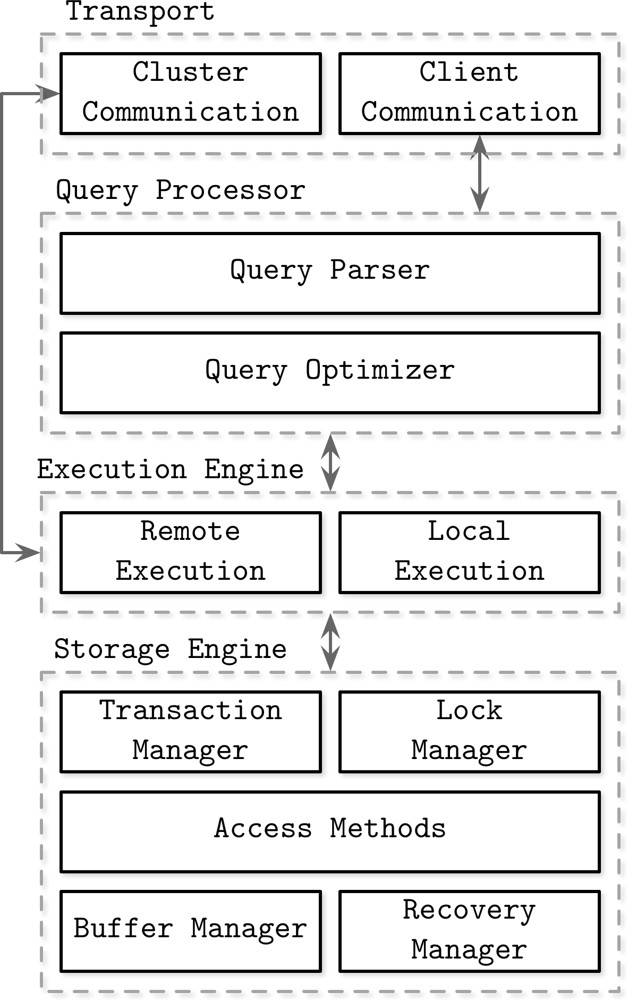
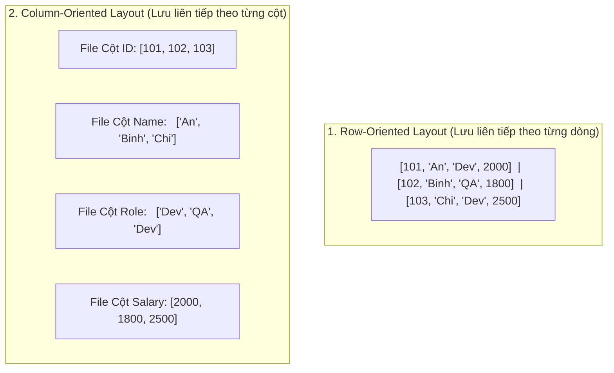
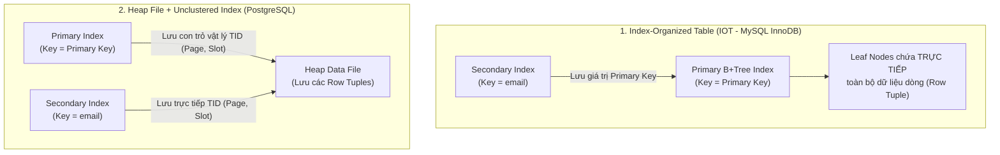

## Table of Contents
1. [Phân loại DBMS: OLTP, OLAP và HTAP](#dbms-classification)
2. [Kiến trúc cơ bản của DBMS và Vòng đời của một Query](#dbms-architecture)
3. [Memory-Based vs Disk-Based DBMS](#memories-vs-disk-based-dbms)
4. [Row-Oriented vs Column-Oriented DBMS](#column-vs-row-oriented-dbms)
5. [Data Files và Index Files (Heap Table vs Index-Organized Table)](#data-files-and-index-files)
6. [Ba trụ cột tối ưu Storage Engine: Buffering, Immutability và Ordering](#buffering-immutability-and-ordering)
7. [Tóm tắt & Ghi nhớ cốt lõi (Key Takeaways)](#key-takeaways)

---

## Phân loại DBMS: OLTP, OLAP và HTAP {#dbms-classification}

Trước khi đi vào cách lưu trữ từng byte trên đĩa, chương 1 phân loại các hệ quản trị cơ sở dữ liệu theo mục đích sử dụng (Workload):

| Phân loại | Đặc điểm truy vấn (Query Pattern) | Cách tổ chức lưu trữ điển hình | Ví dụ tiêu biểu |
| :--- | :--- | :--- | :--- |
| **OLTP** (*Online Transaction Processing*) | Truy vấn ngắn, độ trễ thấp (vài millisecond), đọc/ghi từng bản ghi cụ thể theo khóa (`Point Lookup`, `INSERT`, `UPDATE`), yêu cầu tính toàn vẹn giao dịch cao. | **Row-oriented** (theo dòng), sử dụng B+Tree hoặc LSM-Tree. | PostgreSQL, MySQL (InnoDB), Oracle, SQL Server, MongoDB, Cassandra. |
| **OLAP** (*Online Analytical Processing*) | Truy vấn phân tích phức tạp (`GROUP BY`, `SUM`, `AVG`) quét qua hàng triệu/tỷ dòng nhưng chỉ đọc một vài cột, ít cập nhật đơn lẻ. | **Column-oriented** (theo cột), nén dữ liệu cao (RLE, Dictionary, Delta encoding). | ClickHouse, Apache Druid, DuckDB, Snowflake, Google BigQuery, Amazon Redshift. |
| **HTAP** (*Hybrid Transactional / Analytical Processing*) | Kết hợp xử lý giao dịch thời gian thực (OLTP) và phân tích dữ liệu (OLAP) trên cùng một hệ thống mà không cần chờ pipeline ETL qua đêm. | Lưu trữ lai (ví dụ: có cả bản sao Row-store như TiKV lẫn bản sao Column-store như TiFlash). | TiDB, SingleStore (MemSQL), CockroachDB, YugabyteDB. |

---

## Kiến trúc cơ bản của DBMS và Vòng đời của một Query {#dbms-architecture}

*Hình 1.1: Kiến trúc tổng quan các tầng của một DBMS (Transport, Query Processor, Execution Engine, Storage Engine)*

Khi ứng dụng gửi một câu lệnh `SELECT name FROM users WHERE id = 42;`, truy vấn đi qua 5 thành phần cốt lõi trong DBMS:

1. **Transport Subsystem**: Nhận gói tin từ Client qua TCP/IP, xử lý xác thực và chuyển câu truy vấn cho tầng xử lý bên dưới (đồng thời giao tiếp với **Cluster Subsystem** nếu hệ thống chạy phân tán nhiều node).
2. **Query Processor**:
   - **Query Parser**: Kiểm tra cú pháp SQL, phân tích thành cây cú pháp và xác thực tên bảng `users`, cột `id`, `name` có tồn tại trong Schema Catalog hay không.
   - **Query Optimizer**: Dựa vào chi phí ước lượng (**Cost-based Optimization - CBO**) và thống kê dữ liệu để quyết định dùng chỉ mục `pk_users_id` thay vì quét toàn bảng.
3. **Execution Engine**: Nhận kế hoạch thực thi (Execution Plan) từ Optimizer, điều phối các lời gọi đọc dữ liệu cục bộ (Local Execution) và tổng hợp kết quả.
4. **Storage Engine**: Gồm 4 mô-đun phối hợp chặt chẽ:
   - **Transaction Manager**: Quản lý vòng đời transaction (`BEGIN`, `COMMIT`, `ROLLBACK`) và cấp phát Transaction ID.
   - **Lock Manager**: Quản lý các khóa logic trên dòng/bảng để đảm bảo tính cô lập (`Isolation`) và phát hiện `Deadlock`.
   - **Access Methods (Cache & Flush Manager)**: Quản lý cấu trúc dữ liệu trên đĩa (B-Tree / LSM-Tree) và bộ nhớ đệm `Buffer Pool` trên RAM.
   - **Recovery Manager (WAL)**: Ghi nhật ký `Write-Ahead Log` và khôi phục trạng thái nhất quán sau khi sập nguồn.

---

## Memory-Based vs Disk-Based DBMS {#memories-vs-disk-based-dbms}

Sự khác biệt lớn giữa **In-Memory DBMS** (như Redis, VoltDB, Memcached) và **Disk-Based DBMS** (như PostgreSQL, MySQL) **không chỉ nằm ở chỗ dữ liệu nằm trên RAM hay trên Disk**, mà nằm ở **thiết kế cấu trúc dữ liệu và con trỏ**:

- **Vì sao Disk-Based DBMS dù có đủ RAM chứa `100%` dữ liệu vẫn chậm hơn In-Memory DBMS?**
  - Disk-Based DBMS phải duy trì cấu trúc trang cố định (`Slotted Page`), quản lý `Buffer Pool`, dịch địa chỉ từ `Page ID` sang con trỏ bộ nhớ qua bảng băm, pin/unpin trang và giữ `Latch` trên từng trang.
  - Trong khi đó, **In-Memory DBMS** lưu dữ liệu bằng con trỏ bộ nhớ trực tiếp (Direct Memory Pointers), không cần bước đóng gói/giải mã định dạng trang đĩa (Serialization/Deserialization overhead).
- **Làm sao In-Memory DBMS vẫn đảm bảo không mất dữ liệu (Durability)?**
  - Dù dữ liệu chính nằm hoàn toàn trên RAM, các In-Memory DBMS vẫn sử dụng ổ đĩa để ghi **Append-only Command Log (WAL / AOF)** và chụp **Periodic Snapshots (RDB)** bất đồng bộ xuống đĩa để phục hồi khi khởi động lại.

---

## Row-Oriented vs Column-Oriented DBMS {#column-vs-row-oriented-dbms}

Giả sử có bảng `Users` gồm 3 dòng như sau:

| `ID` | `Name` | `Role` | `Salary` |
| :--- | :--- | :--- | :--- |
| `101` | `"An"` | `"Dev"` | `2000` |
| `102` | `"Binh"` | `"QA"` | `1800` |
| `103` | `"Chi"` | `"Dev"` | `2500` |

Hãy xem cách hai mô hình sắp xếp các byte liên tiếp nhau trên ổ đĩa:

### 1. Row-Oriented DBMS (Lưu theo dòng — PostgreSQL, MySQL)
- **Cấu trúc**: Toàn bộ các cột của cùng một bản ghi (`ID`, `Name`, `Role`, `Salary`) được lưu nằm cạnh nhau liên tiếp trên cùng một `Page`.
- **Khi nào hiệu quả?**: Khi truy vấn cần lấy toàn bộ thông tin của 1 user (`SELECT * FROM users WHERE id = 101`) hoặc `INSERT` thêm 1 user mới — chỉ cần đọc/ghi đúng **1 Page**.
- **Khi nào kém hiệu quả?**: Khi chạy truy vấn thống kê `SELECT AVG(salary) FROM users;` trên bảng có `50` cột và `100` triệu dòng. Hệ thống buộc phải đọc toàn bộ `50` cột của từng dòng từ đĩa lên RAM rồi vứt bỏ `49` cột không dùng tới!

### 2. Column-Oriented DBMS (Lưu theo cột — ClickHouse, Parquet, DuckDB)
- **Cấu trúc**: Toàn bộ các giá trị của cột `Salary` (`[2000, 1800, 2500...]`) được lưu liền kề nhau trong một file/block riêng; cột `Role` nằm ở một block riêng.
- **Lợi thế vượt trội cho OLAP**:
  1. **Giảm thiểu I/O**: Câu lệnh `SELECT AVG(salary) FROM users;` chỉ đọc đúng block của cột `Salary`, bỏ qua hoàn toàn `49` cột còn lại.
  2. **Tỷ lệ nén (Compression) rất cao**: Vì các giá trị trong cùng một cột có cùng kiểu dữ liệu và độ lặp lại cao (như cột `Role` chỉ có `"Dev"`, `"QA"`), kỹ thuật nén **Run-Length Encoding (RLE)** hoặc **Dictionary Encoding** giúp thu nhỏ dung lượng xuống hàng chục lần.
  3. **Vectorized Execution (SIMD)**: CPU có thể nạp cả một mảng số nguyên `Salary` liên tiếp vào thanh ghi SIMD để cộng hàng loạt giá trị trong 1 chu kỳ xung nhịp.
- **Nhược điểm**: Thao tác `INSERT` hoặc `UPDATE` 1 dòng đơn lẻ rất tốn kém vì phải chạm vào hàng chục file cột khác nhau.

---

## Data Files và Index Files (Heap Table vs Index-Organized Table) {#data-files-and-index-files}

Một quyết định thiết kế quan trọng của mọi Storage Engine là: **File dữ liệu (Data File) và File chỉ mục (Index File) tách rời nhau hay gộp làm một?**

### 1. Index-Organized Table (IOT / Clustered Index) — Điển hình: MySQL InnoDB
- Bản thân bảng dữ liệu **chính là cây B+Tree của Primary Key (Clustered Index)**. Các node lá (Leaf Nodes) của cây Primary Key lưu trữ **trực tiếp toàn bộ các cột của dòng dữ liệu**.
- **Secondary Index (Non-clustered Index)** trong InnoDB không lưu địa chỉ vật lý của dòng (vì khi cây Primary Key bị tách node `Split`, dòng dữ liệu sẽ di chuyển sang trang khác!). Thay vào đó, **node lá của Secondary Index lưu giá trị của `Primary Key`**.
- **Hệ quả quan trọng**:
  - Truy vấn theo `Primary Key` rất nhanh (đi 1 lần từ Root xuống Leaf là lấy được toàn bộ dòng).
  - Nhưng truy vấn qua `Secondary Index` (khi không phải là Covering Index) phải chịu **2 lần duyệt cây B+Tree (Double Lookup)**: duyệt cây Secondary Index để lấy `Primary Key`, rồi mang `Primary Key` đó quay sang duyệt tiếp cây Clustered Index từ gốc xuống lá!
  - Nếu chọn `Primary Key` có kích thước lớn (ví dụ `VARCHAR(255)`), mọi Secondary Index trên bảng đó đều bị phình to theo vì phải lưu kèm `Primary Key` ở tất cả các node lá.

### 2. Heap Table với Con trỏ vật lý (`TID / RID`) — Điển hình: PostgreSQL
- Dữ liệu dòng được lưu trong **Heap File** (không sắp xếp theo thứ tự khóa). Mỗi bản ghi có một định danh vị trí vật lý gọi là **`TID` (Tuple ID = `(PageNumber, SlotNumber)`)**.
- Cả **Primary Key Index** lẫn **Secondary Index** trong PostgreSQL đều có vai trò ngang nhau: node lá của chúng đều trỏ thẳng tới địa chỉ vật lý **`TID`** trong Heap File!
- **Hệ quả quan trọng**:
  - Truy vấn qua Secondary Index chỉ cần duyệt 1 cây B-Tree rồi nhảy thẳng tới `PageNumber` trong Heap File (không cần duyệt lại cây Primary Key).
  - Ngược lại, khi một dòng bị `UPDATE`, PostgreSQL tạo một Tuple mới ở vị trí `TID` mới, dẫn đến việc có thể phải cập nhật nhiều index cùng lúc (trừ khi tối ưu được bằng cơ chế **HOT - Heap-Only Tuple** khi cột bị sửa không nằm trong index và trang hiện tại còn chỗ trống).

---

## Ba trụ cột tối ưu Storage Engine: Buffering, Immutability và Ordering {#buffering-immutability-and-ordering}

Alex Petrov chỉ ra rằng hầu như mọi cấu trúc Storage Engine hiện đại đều xoay quanh việc điều chỉnh 3 núm vặn thiết kế này:

1. **Buffering (Đệm trong bộ nhớ)**:
   - Gom nhiều thao tác ghi nhỏ lẻ trong RAM trước khi thực hiện Disk I/O (như `Buffer Pool` trong B-Tree, `Write Buffer` trong WiredTiger, hay `Memtable` trong LSM-Tree).
   - Đánh đổi: Tăng tốc độ ghi và giảm hao mòn đĩa, nhưng cần cơ chế `WAL` để phòng trường hợp mất điện khi dữ liệu đang nằm trong buffer.
2. **Immutability (Tính bất biến)**:
   - Thay vì sửa đè dữ liệu tại chỗ (`Update-in-place`), cấu trúc bất biến chỉ cho phép ghi tạo file mới (`SSTable` trong LSM-Tree, hoặc tạo trang mới trong `Copy-on-Write B-Tree`).
   - Lợi ích: Không cần giữ khóa (`Latch/Lock`) trên dữ liệu đang được đọc bởi các luồng khác, tránh lỗi ghi nửa chừng (partial write corruption) và tận dụng tối đa tốc độ ghi tuần tự của ổ đĩa.
3. **Ordering (Sắp xếp theo thứ tự khóa)**:
   - Lưu các bản ghi theo đúng thứ tự sắp xếp của khóa (`Key Order`) trên đĩa giúp hỗ trợ **Range Scan** (`WHERE id BETWEEN 100 AND 200` hoặc `ORDER BY created_at`) chỉ bằng một thao tác đọc tuần tự liên tiếp thay vì nhảy ngẫu nhiên khắp ổ đĩa.

---

## Tóm tắt & Ghi nhớ cốt lõi (Key Takeaways) {#key-takeaways}

1. **Sự khác biệt cốt lõi giữa Clustered Index và Non-clustered (Secondary) Index là gì?**
   - **Clustered Index** quyết định trực tiếp thứ tự sắp xếp vật lý của dữ liệu dòng trên đĩa (do đó mỗi bảng chỉ có thể có **tối đa 1 Clustered Index**). **Non-clustered Index** là một cấu trúc chỉ mục tách biệt hoàn toàn, chỉ lưu cột được đánh index kèm con trỏ (`Primary Key` trong InnoDB hoặc `TID` trong PostgreSQL) dẫn về bản ghi gốc.
2. **Tại sao trong MySQL InnoDB, việc dùng `UUID` ngẫu nhiên hoặc chuỗi dài làm Primary Key lại làm giảm hiệu năng nghiêm trọng?**
   - Vì hai lý do: (1) InnoDB tổ chức bảng theo kiểu **IOT (Clustered Index)** nên khóa ngẫu nhiên khiến việc chèn bản ghi mới đâm vào các trang giữa của B+Tree, gây **Page Split** liên tục và phân mảnh đĩa; (2) Mọi **Secondary Index** đều sao chép giá trị `Primary Key` vào node lá, khiến toàn bộ Secondary Index bị phình to và tốn bộ nhớ `Buffer Pool`.
3. **Khi nào nên chọn Column-Oriented Database thay vì Row-Oriented Database?**
   - Khi bài toán thuộc nhóm **OLAP / Analytics / Data Warehouse**: dữ liệu chủ yếu được ghi theo lô (batch append) và các câu truy vấn thường tính toán tổng hợp (`SUM`, `COUNT`, `AVG`, `GROUP BY`) trên một tập nhỏ các cột trong tổng số hàng chục/hàng trăm cột của bảng.

### Tài liệu & Nguồn tham khảo
- [MySQL 8.4 Reference Manual — Clustered and Secondary Indexes in InnoDB](https://dev.mysql.com/doc/refman/8.4/en/innodb-index-types.html)
- [Abadi, D., Boncz, P., & Harizopoulos, S. (2013) — *The Design and Implementation of Modern Column-Oriented Database Systems*](https://db.csail.mit.edu/pubs/column-stores.pdf)
- [PostgreSQL Documentation — Heap-Only Tuples (HOT) & Index Access Methods](https://www.postgresql.org/docs/current/storage-hot.html)
