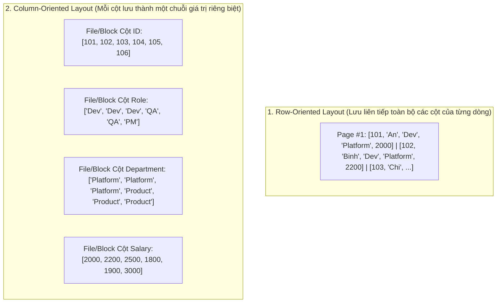
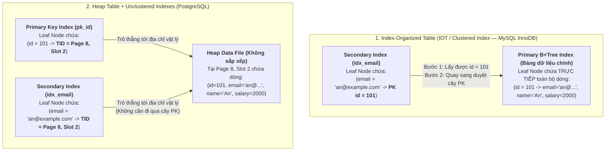

## Table of Contents
1. [Phân loại DBMS: OLTP, OLAP và HTAP](#dbms-classification)
2. [Kiến trúc cơ bản của DBMS và Vòng đời trọn vẹn của một Query](#dbms-architecture)
3. [Memory-Based vs Disk-Based DBMS](#memories-vs-disk-based-dbms)
4. [Row-Oriented vs Column-Oriented DBMS & Kỹ thuật nén dữ liệu cột](#column-vs-row-oriented-dbms)
5. [Data Files và Index Files (Index-Organized Table vs Heap Table)](#data-files-and-index-files)
6. [Ba trụ cột tối ưu Storage Engine: Buffering, Immutability và Ordering](#buffering-immutability-and-ordering)
7. [Tóm tắt & Ghi nhớ cốt lõi (Key Takeaways)](#key-takeaways)

---

## Phân loại DBMS: OLTP, OLAP và HTAP {#dbms-classification}

### Bài toán thực tế: Tại sao không dùng một loại Database cho mọi nhu cầu?
Giả sử một sàn thương mại điện tử đang phục vụ `50.000` khách hàng đặt đơn mỗi giây (mỗi đơn chỉ đọc/ghi đúng vài dòng của khách hàng đó và đòi hỏi phản hồi dưới `5 ms`). Cùng lúc đó, bộ phận tài chính chạy một câu truy vấn báo cáo doanh thu theo từng danh mục sản phẩm suốt 3 năm qua (quét qua `500 triệu` dòng hóa đơn).
- Nếu chạy cả hai trên cùng một cơ sở dữ liệu truyền thống: câu lệnh báo cáo sẽ ngốn sạch băng thông Disk I/O, đẩy toàn bộ dữ liệu giao dịch nóng ra khỏi `Buffer Pool` và làm nghẽn CPU khiến khách hàng không thể thanh toán!
- Do đặc tính truy cập vật lý của hai tác vụ này đối lập nhau hoàn toàn, ngành công nghiệp cơ sở dữ liệu phân tách các DBMS thành 3 nhóm chính theo mẫu tải (**Workload Pattern**):

| Phân loại | Đặc điểm truy vấn (Query Pattern) | Cách tổ chức lưu trữ điển hình | Ví dụ tiêu biểu |
| :--- | :--- | :--- | :--- |
| **OLTP** (*Online Transaction Processing*) | Truy vấn ngắn, độ trễ cực thấp (vài millisecond), đọc/ghi từng bản ghi cụ thể theo khóa (`Point Lookup`, `INSERT`, `UPDATE`, `DELETE`), yêu cầu tính toàn vẹn giao dịch **ACID** cao. | **Row-oriented** (lưu liên tiếp theo từng dòng), sử dụng B+Tree hoặc LSM-Tree. | PostgreSQL, MySQL (InnoDB), Oracle, SQL Server, MongoDB, Apache Cassandra. |
| **OLAP** (*Online Analytical Processing*) | Truy vấn phân tích phức tạp (`GROUP BY`, `SUM`, `AVG`, `JOIN` lớn) quét qua hàng triệu/tỷ dòng nhưng chỉ chạm tới một vài cột, dữ liệu chủ yếu ghi theo lô (Batch Append). | **Column-oriented** (lưu liên tiếp theo từng cột), nén dữ liệu cao (RLE, Dictionary, Bit-Vector). | ClickHouse, Apache Druid, DuckDB, Snowflake, Google BigQuery, Amazon Redshift. |
| **HTAP** (*Hybrid Transactional / Analytical Processing*) | Kết hợp xử lý giao dịch thời gian thực (OLTP) và phân tích dữ liệu (OLAP) trên cùng một hệ thống mà không cần chờ pipeline ETL sao chép qua đêm. | Lưu trữ lai (ví dụ: duy trì đồng thời các node Row-store như *TiKV* cho OLTP và các node Column-store như *TiFlash* cho OLAP qua giao thức Raft). | TiDB, SingleStore (MemSQL), CockroachDB, YugabyteDB, AlloyDB. |

---

## Kiến trúc cơ bản của DBMS và Vòng đời trọn vẹn của một Query {#dbms-architecture}


*Hình 1.1: Kiến trúc tổng quan các thành phần của một DBMS (Transport, Query Processor, Execution Engine, Storage Engine)*

### Ví dụ chạy tay (Step-by-Step Walkthrough): Vòng đời câu lệnh `SELECT`
Để hiểu rõ cách các hộp kiến trúc trong *Hình 1.1* phối hợp với nhau, hãy theo dõi trọn vẹn hành trình của câu truy vấn sau từ lúc rời ứng dụng cho đến khi trả kết quả:

```sql
SELECT name, salary FROM users WHERE email = 'an@example.com';
```

#### Bước 1: Transport Subsystem (Tiếp nhận & Điều phối kết nối)
- Ứng dụng gửi chuỗi SQL trên qua kết nối TCP/TLS theo giao thức nhị phân (như *PostgreSQL v3 Wire Protocol* hoặc *MySQL Client/Server Protocol*).
- **Connection Handler** kiểm tra trạng thái phiên làm việc (Session), quyền xác thực (Authentication), giải mã gói tin mạng lấy chuỗi văn bản SQL và chuyển xuống **Query Processor**. (Nếu là hệ thống phân tán và dữ liệu nằm ở node khác, **Cluster Subsystem** sẽ định tuyến yêu cầu qua mạng nội bộ).

#### Bước 2: Query Processor — Parser & Validator (Phân tích cú pháp & Ngữ nghĩa)
- **Lexer & Parser** tách chuỗi SQL thành các từ tố (tokens: `SELECT`, `name`, `,`, `salary`, `FROM`, `users`, `WHERE`, `email`, `=`, `'an@example.com'`) và dựng thành **Cây cú pháp trừu tượng (AST - Abstract Syntax Tree)**:

```text
                  [SELECT Statement]
                  /       |        \
        [TargetList]   [From]     [WhereClause]
          /      \        |           |
       "name"  "salary" "users"   [Equals (=)]
                                   /        \
                               "email"  'an@example.com'
```

- **Validator (Semantic Analyzer)** tra cứu **System Catalog** (bảng siêu dữ liệu nội bộ của DBMS):
  - Bảng `users` có tồn tại không? (Có, `table_id = 1024`).
  - Các cột `name`, `salary`, `email` có thuộc bảng `users` không? Kiểu dữ liệu của `'an@example.com'` (`VARCHAR`) có tương thích với cột `email` không?
  - User hiện tại có quyền `SELECT` trên bảng `users` không?

#### Bước 3: Query Processor — Cost-Based Optimizer (CBO - Tối ưu hóa truy vấn)
- Sau khi AST hợp lệ, Optimizer chuyển nó thành biểu thức đại số quan hệ logic: $\pi_{\text{name, salary}}(\sigma_{\text{email = 'an@example.com'}}(\text{users}))$.
- Tiếp theo, **Cost-Based Optimizer (CBO)** đọc bảng thống kê (**Statistics / Histograms**) của bảng `users` (giả sử bảng có `1.000.000` dòng chiếm `20.000 Pages`, và có một chỉ mục `idx_users_email` cao `3` tầng trên cột `email`) để so sánh chi phí giữa 2 phương án thực thi vật lý:
  - **Phương án 1 (`Full Table Scan / Seq Scan`)**: Đọc tuần tự toàn bộ `20.000 Pages` từ đĩa và kiểm tra điều kiện `email = 'an@example.com'` trên từng dòng $\implies \text{Estimated Cost} = 20.000\text{ I/O units}$.
  - **Phương án 2 (`Index Scan` qua `idx_users_email`)**: Duyệt cây B+Tree `idx_users_email` (`3` tầng) + đọc `1` trang dữ liệu gốc chứa bản ghi $\implies \text{Estimated Cost} = 4\text{ I/O units}$.
- CBO chọn **Phương án 2** vì chi phí thấp hơn 5.000 lần và xuất ra **Physical Execution Plan**:
  `Project(name, salary) <- TableLookup(users) <- IndexScan(idx_users_email, key='an@example.com')`.

#### Bước 4: Execution Engine (Điều phối thực thi kế hoạch)
- **Execution Engine** khởi tạo cây toán tử vật lý (theo mô hình *Iterator / Volcano Model*):
  1. Toán tử gốc `Project` gọi `Next()` xuống toán tử con `TableLookup`.
  2. Toán tử `TableLookup` gọi `Next()` xuống `IndexScan(idx_users_email, 'an@example.com')`.
  3. Các toán tử này phát lời gọi API xuống tầng **Storage Engine** bên dưới để đọc các trang chỉ mục và trang dữ liệu thực tế.

#### Bước 5: Storage Engine (Truy xuất vật lý trên RAM & Disk)
Bên trong Storage Engine, 4 mô-đun chuyên biệt cùng tham gia:
1. **Transaction Manager & Lock Manager**: Cấp một `Snapshot / ReadView` (theo cơ chế MVCC) cho câu lệnh `SELECT` để đảm bảo nó chỉ nhìn thấy dữ liệu đã `COMMIT`, đồng thời xin khóa `AccessShareLock` (khóa bảo vệ cấu trúc bảng để không ai chạy `DROP TABLE` giữa lúc đang đọc).
2. **Access Methods (B+Tree Manager) & Buffer Manager (Cache Manager)**:
   - Yêu cầu đọc Root Page và Internal Page của chỉ mục `idx_users_email`. Hai trang này đang nằm sẵn trong **`Buffer Pool`** trên RAM (**Cache Hit**).
   - Đi xuống Leaf Page của `idx_users_email`, tìm thấy khóa `'an@example.com'` trỏ tới bản ghi của user `An` (giả sử nằm tại `Data Page #8`).
   - Kiểm tra `Buffer Pool`: nếu `Data Page #8` chưa có trong RAM (**Cache Miss**), **Buffer Manager** phát lệnh `pread()` xuống hệ điều hành để nạp `Page #8` từ ổ đĩa lên RAM, giải mã các trường nhị phân lấy ra `name = "An"`, `salary = 2000` và trả ngược lên cho Execution Engine -> Transport Layer -> Client!
3. **Recovery Manager (WAL)**: Với câu lệnh chỉ đọc (`SELECT`), Recovery Manager không cần ghi log mới (trừ trường hợp đặc biệt như *Hint Bits update* trên trang), nhưng đảm bảo mọi trang trong `Buffer Pool` đều nhất quán với trạng thái giao dịch.

---

## Memory-Based vs Disk-Based DBMS {#memories-vs-disk-based-dbms}

### Bài toán: Nếu lắp đủ `512 GB` RAM cho PostgreSQL để chứa trọn `100%` database `100 GB` trong `Buffer Pool`, liệu nó có nhanh bằng một In-Memory DBMS (như Redis, VoltDB, Memcached) không?
Câu trả lời là **KHÔNG — Disk-Based DBMS vẫn chậm hơn nhiều lần!** Sự khác biệt cốt lõi giữa **In-Memory DBMS** và **Disk-Based DBMS** không chỉ nằm ở chỗ dữ liệu đang nằm trên RAM hay trên Disk, mà nằm ở **kiến trúc quản lý bộ nhớ và cách biểu diễn cấu trúc dữ liệu**:

| Khía cạnh kỹ thuật | Disk-Based DBMS (PostgreSQL, MySQL InnoDB) | In-Memory DBMS (Redis, VoltDB, SQL Server Hekaton) |
| :--- | :--- | :--- |
| **Đơn vị quản lý dữ liệu** | Luôn đóng gói dữ liệu vào các **Page kích thước cố định (`8 KB` / `16 KB`)** theo định dạng trên đĩa, ngay cả khi trang đó đang nằm trong RAM (`Buffer Pool`). | Lưu trữ các bản ghi dưới dạng cấu trúc dữ liệu bộ nhớ thuần túy (Hash Table, Skiplist, Radix Tree) cấp phát trực tiếp trên Heap của RAM. |
| **Cách định vị con trỏ (Indirection Overhead)** | Không thể dùng con trỏ bộ nhớ C/C++ trực tiếp (`uint64_t*`). Mọi tham chiếu đều phải đi qua `(Page ID, Slot ID)` -> tra bảng băm `Page Table` của Buffer Pool để tìm địa chỉ khung RAM -> `Pin` trang -> lấy `Latch` -> giải mã offset. | Sử dụng **con trỏ địa chỉ bộ nhớ trực tiếp (Direct 64-bit Memory Pointers)**. Nhảy từ nút chỉ mục sang bản ghi chỉ tốn đúng 1 lệnh CPU dereference con trỏ! |
| **Chi phí Serialization / Deserialization** | Mỗi lần đọc/ghi trường dữ liệu trong Page đều phải căn chỉnh định dạng byte trên đĩa (Slotted Page layout, header flags, checksum). | Không tốn chi phí đóng gói định dạng trang đĩa lúc đang chạy (chỉ tuần tự hóa khi ghi log ra đĩa). |
| **Cơ chế đảm bảo bền vững (Durability)** | Ghi `WAL` + xả các `Dirty Pages` xuống file dữ liệu chính. | **Vẫn bắt buộc phải dùng Disk để đảm bảo Durability!** Ghi nhật ký lệnh nối tiếp (**Append-Only File / Command Log**) kết hợp chụp ảnh bộ nhớ định kỳ (**Periodic Disk Snapshots / RDB**) ở chế độ nền. |

---

## Row-Oriented vs Column-Oriented DBMS & Kỹ thuật nén dữ liệu cột {#column-vs-row-oriented-dbms}

### 1. Sự khác biệt trong cách trải phẳng bảng 2 chiều xuống ổ đĩa 1 chiều
Trong mô hình quan hệ, bảng dữ liệu là một lưới 2 chiều gồm các **Dòng (Rows)** và **Cột (Columns)**. Tuy nhiên, bộ nhớ RAM và ổ đĩa chỉ là một mảng địa chỉ byte **1 chiều tuyến tính**. Do đó, Storage Engine buộc phải chọn một trong hai cách sắp xếp các byte liên tiếp nhau:

Giả sử có bảng `Users` gồm 6 bản ghi như sau:

| `ID` | `Name` | `Role` | `Department` | `Salary` |
| :--- | :--- | :--- | :--- | :--- |
| `101` | `"An"` | `"Dev"` | `"Platform"` | `2000` |
| `102` | `"Binh"` | `"Dev"` | `"Platform"` | `2200` |
| `103` | `"Chi"` | `"Dev"` | `"Platform"` | `2500` |
| `104` | `"Dung"` | `"QA"` | `"Product"` | `1800` |
| `105` | `"Em"` | `"QA"` | `"Product"` | `1900` |
| `106` | `"Phuc"` | `"PM"` | `"Product"` | `3000` |



- **Row-Oriented DBMS (Lưu theo dòng — PostgreSQL, MySQL, Oracle)**:
  - **Mental Model**: Giống như lưu từng hồ sơ nhân viên hoàn chỉnh vào từng phong bì riêng biệt.
  - **Tối ưu cho OLTP**: Khi chạy `SELECT * FROM users WHERE id = 101` hoặc `INSERT INTO users VALUES (...)`, toàn bộ các cột của nhân viên `101` nằm sát cạnh nhau trên đúng **1 Page duy nhất** -> chỉ cần 1 lần đọc/ghi đĩa.
  - **Thảm họa cho OLAP**: Khi chạy `SELECT Department, AVG(Salary) FROM users GROUP BY Department` trên bảng có `100` cột và `1 tỷ` dòng, hệ thống buộc phải đọc cả `100` cột của toàn bộ `1 tỷ` dòng từ đĩa lên RAM rồi vứt bỏ `98` cột không dùng tới (lãng phí tới $98\%$ băng thông I/O và bộ nhớ đệm!).
- **Column-Oriented DBMS (Lưu theo cột — ClickHouse, DuckDB, Apache Parquet)**:
  - **Mental Model**: Giống như tách riêng một danh sách chỉ ghi mức lương, một danh sách chỉ ghi phòng ban (đồng bộ vị trí thứ tự ngầm định qua chỉ số mảng `Row Index / Offset` hoặc tường minh qua `Virtual ID`).
  - **Tối ưu cho OLAP**: Với câu truy vấn tính lương trung bình theo phòng ban ở trên, hệ thống **chỉ mở đúng 2 file của cột `Department` và `Salary`**, bỏ qua hoàn toàn `98` cột còn lại! Hơn nữa, vì một mảng toàn các số nguyên `Salary` `[2000, 2200, 2500...]` nằm liền kề nhau trên RAM, CPU có thể nạp từng lô 8–16 số vào thanh ghi **SIMD (AVX-2 / AVX-512)** để thực hiện phép cộng song song trong 1 chu kỳ xung nhịp (**Vectorized Execution**).

### 2. Ví dụ cụ thể 3 kỹ thuật nén dữ liệu cột (Column Compression)
Vì các phần tử trong cùng một cột có cùng kiểu dữ liệu và mức độ lặp lại rất cao (Low Cardinality), Column-Store có thể áp dụng các thuật toán nén chuyên biệt giúp giảm dung lượng đĩa xuống **5x – 20x**, thậm chí thực hiện phép lọc `WHERE` trực tiếp trên dữ liệu đang nén mà không cần giải nén!

Hãy xem cách nén cột `Role` và `Department` của bảng 6 dòng ở trên (và mở rộng ra bảng lớn):

#### Kỹ thuật 1: Run-Length Encoding (RLE — Mã hóa độ dài chuỗi lặp)
- **Nguyên lý**: Khi cột được sắp xếp theo thứ tự (ví dụ sắp xếp theo `Department` hoặc `Role`), các giá trị giống hệt nhau sẽ nằm liên tiếp thành từng dải dài (gọi là một *Run*). Thay vì lặp lại giá trị đó hàng ngàn lần, RLE chỉ lưu cặp `(Giá trị, Số lần lặp liên tiếp)` hoặc `(Giá trị, Vị trí bắt đầu, Số lần lặp)`.
- **Ví dụ con số cụ thể**:
  - Giả sử bảng có `100.000` nhân viên đã sắp xếp theo `Department`: có `60.000` người thuộc `"Platform"`, tiếp theo là `35.000` người thuộc `"Product"`, và `5.000` người thuộc `"HR"`.
  - **Nếu lưu thô (Uncompressed)**: Lưu `100.000` chuỗi ký tự $\approx 800.000\text{ bytes}$ (`800 KB`).
  - **Sau khi nén bằng RLE**: Toàn bộ `100.000` phần tử thu gọn lại chỉ còn đúng **3 bộ số (Triplets)**:

```text
Uncompressed (100.000 phần tử):
["Platform", "Platform", ..., "Platform", "Product", ..., "Product", "HR", ..., "HR"]
 |<--------- 60.000 lần ------------->|   |<---- 35.000 lần ---->|   |<-- 5.000 -->|

Run-Length Encoded (Chỉ 3 phần tử - chiếm chưa tới 50 bytes!):
(Value = "Platform", StartIdx = 0,     Count = 60000)
(Value = "Product",  StartIdx = 60000, Count = 35000)
(Value = "HR",       StartIdx = 95000, Count = 5000)
```

  - Đặc biệt, nếu cần chạy `SELECT COUNT(*) FROM users WHERE Department = 'Platform'`, hệ thống đọc thẳng `Count = 60000` mà không cần duyệt qua 60.000 dòng!

#### Kỹ thuật 2: Dictionary Encoding (Mã hóa từ điển)
- **Nguyên lý**: Khi các giá trị chuỗi dài lặp đi lặp lại nhưng không nằm liên tiếp nhau (hoặc trước khi áp dụng RLE), hệ thống lập một bảng **Từ điển (Dictionary)** ánh xạ mỗi chuỗi phân biệt sang một mã số nguyên nhỏ (`Integer ID`), rồi thay thế toàn bộ cột chuỗi bằng mảng các số nguyên `ID` đó.
- **Ví dụ con số cụ thể**:
  - Xét cột `Department` gồm các chuỗi dài như `"Engineering - Platform"` (`22 bytes`), `"Product Management"` (`18 bytes`), `"Quality Assurance"` (`17 bytes`) trên `1.000.000` dòng:
    - **Chưa nén**: $1.000.000 \times 20\text{ bytes trung bình} \approx \mathbf{20\text{ MB}}$.
    - **Dùng Dictionary Encoding**: Vì toàn công ty chỉ có `3` phòng ban phân biệt, chỉ cần dùng `2 bits` (hoặc `1 byte` integer) cho mỗi dòng:

```text
+-----------------------------------+      +------------------------------------------------+
| BẢNG TỪ ĐIỂN (Dictionary Table)   |      | DỮ LIỆU CỘT ĐÃ MÃ HÓA (Encoded Column Vector) |
+---------+-------------------------+      +------------------------------------------------+
| Dict ID | Chuỗi gốc (String)      |      | Thay vì lưu chuỗi, chỉ lưu mảng mã Dict ID:    |
+---------+-------------------------+      |                                                |
|    0    | "Engineering - Platform"| ---> | [ 0, 0, 0, 1, 2, 1, 0, 2, ... ]                |
|    1    | "Product Management"    |      | (Mỗi phần tử chỉ tốn 2 bits thay vì 20 bytes!) |
|    2    | "Quality Assurance"     |      +------------------------------------------------+
+---------+-------------------------+
```

    - **Sau khi nén**: Bảng từ điển tốn `57 bytes` + mảng `1.000.000` phần tử (`2 bits`/phần tử) tốn $250\text{ KB}$ $\implies$ giảm dung lượng từ **`20 MB` xuống `0.25 MB` (nén gấp 80 lần)**!

#### Kỹ thuật 3: Bit-Vector / Bitmap Encoding (Mã hóa mảng Bit)
- **Nguyên lý**: Với cột có số lượng giá trị phân biệt (**Cardinality**) nhỏ, hệ thống tạo một mảng bit (**Bit-Vector**) có độ dài bằng tổng số dòng $N$ cho mỗi giá trị phân biệt. Tại vị trí thứ $i$, bit bằng `1` nếu dòng thứ $i$ mang giá trị đó, ngược lại bằng `0`.
- **Ví dụ con số cụ thể trên bảng 6 nhân viên (`ID 101..106`)**:
  - Cột `Role` của 6 dòng lần lượt là: `['Dev', 'Dev', 'Dev', 'QA', 'QA', 'PM']`.
  - Hệ thống tạo 3 Bit-Vectors (mỗi vector dài 6 bits ứng với 6 dòng):

```text
Dòng (Row Index):         0     1     2     3     4     5
Giá trị cột Role:      ['Dev','Dev','Dev', 'QA', 'QA', 'PM']
Giá trị cột Dept:      ['Plt','Plt','Plt','Prd','Prd','Prd']
------------------------------------------------------------
Bit-Vector [Role='Dev']:  1     1     1     0     0     0   (6 bits: 111000)
Bit-Vector [Role='QA'] :  0     0     0     1     1     0   (6 bits: 000110)
Bit-Vector [Role='PM'] :  0     0     0     0     0     1   (6 bits: 000001)

Bit-Vector [Dept='Plt']:  1     1     1     0     0     0   (6 bits: 111000)
Bit-Vector [Dept='Prd']:  0     0     0     1     1     1   (6 bits: 000111)
```

  - **Sức mạnh khi truy vấn kết hợp nhiều điều kiện (`WHERE Role = 'QA' AND Dept = 'Prd'`)**:
    - Thay vì duyệt từng dòng và kiểm tra hai phép so sánh chuỗi, CPU chỉ cần thực hiện phép toán logic **`BITWISE AND` (`&`)** trực tiếp giữa hai thanh ghi chứa Bit-Vector:
      `000110 (Role='QA') & 000111 (Dept='Prd') = 000110` $\implies$ xác định ngay lập tức dòng `3` và dòng `4` thỏa mãn điều kiện! Một lệnh CPU `64-bit bitwise AND` có thể lọc đồng thời **64 dòng dữ liệu chỉ trong 1 chu kỳ xung nhịp**.

---

## Data Files và Index Files (Index-Organized Table vs Heap Table) {#data-files-and-index-files}

### Bài toán thiết kế cốt lõi: Lưu dữ liệu bảng và chỉ mục chung hay riêng?
Khi tạo một bảng `users` có khóa chính `PRIMARY KEY (id)` và một chỉ mục phụ `CREATE INDEX idx_email ON users(email)`, Storage Engine tổ chức file dữ liệu chính (**Data File**) và file chỉ mục (**Index File**) như thế nào? Có hai trường phái kiến trúc kinh điển được sử dụng bởi hai hệ quản trị cơ sở dữ liệu phổ biến nhất thế giới là **MySQL (InnoDB)** và **PostgreSQL**:



### Ví dụ đối chiếu dữ liệu cụ thể trên bảng `users(id, email, name, salary)`
Giả sử bảng `users` có 3 bản ghi như sau:
- `(id = 101, email = 'an@example.com', name = 'An', salary = 2000)`
- `(id = 102, email = 'binh@example.com', name = 'Binh', salary = 1800)`
- `(id = 103, email = 'chi@example.com', name = 'Chi', salary = 2500)`

Hãy quan sát tận mắt từng byte bên trong **Nút lá (Leaf Node)** của Primary Index và Secondary Index ở cả hai hệ thống:

#### 1. Kiến trúc Index-Organized Table (IOT / Clustered Index) — MySQL InnoDB
Trong InnoDB, **không có một Heap File riêng biệt nào cả**: bản thân bảng dữ liệu `users` **chính là cây B+Tree của Primary Key (`id`)** (gọi là **Clustered Index**).
- **Nội dung nút lá của Primary Index (`Clustered Index` trên `id`)**: Lưu khóa chính `id` kèm **toàn bộ các cột còn lại của dòng dữ liệu** ngay tại nút lá:

```text
[InnoDB Primary B+Tree — Leaf Page #20]
+----------+-------------------------------------------------------------+
| PK (id)  | Toàn bộ dữ liệu dòng (Row Payload + Transaction Metadata)   |
+----------+-------------------------------------------------------------+
| id = 101 | email = 'an@example.com',   name = 'An',   salary = 2000    |
| id = 102 | email = 'binh@example.com', name = 'Binh', salary = 1800    |
| id = 103 | email = 'chi@example.com',  name = 'Chi',  salary = 2500    |
+----------+-------------------------------------------------------------+
```

- **Nội dung nút lá của Secondary Index (`idx_email` trên `email`)**:
  - *Tại sao Secondary Index trong InnoDB không lưu con trỏ địa chỉ trang vật lý (như `Page #20, Slot #1`)?* Vì trong IOT, dữ liệu dòng nằm ngay trong các trang lá của cây B+Tree chính. Mỗi khi chèn thêm dòng mới làm đầy trang lá `Page #20`, cây Primary B+Tree sẽ thực hiện **Page Split** và di chuyển một nửa số dòng sang một trang mới `Page #95`! Nếu có 5 Secondary Index cùng lưu địa chỉ trang vật lý, mỗi lần Page Split sẽ phải tìm và sửa lại toàn bộ 5 cây Secondary Index đó.
  - Để tránh cơn ác mộng bảo trì con trỏ khi Page Split, InnoDB quy định: **Nút lá của Secondary Index chỉ lưu giá trị của cột được đánh index kèm theo giá trị logic của `Primary Key` (`id`)**:

```text
[InnoDB Secondary B+Tree (idx_email) — Leaf Page #45]
+----------------------------+------------------------------+
| Indexed Key (email)        | Con trỏ logic: Giá trị PK id |
+----------------------------+------------------------------+
| 'an@example.com'           | id = 101                     |
| 'binh@example.com'         | id = 102                     |
| 'chi@example.com'          | id = 103                     |
+----------------------------+------------------------------+
```

- **Phân tích hệ quả thực tế trên InnoDB**:
  1. **Tại sao truy vấn qua Secondary Index tốn 2 lần duyệt cây (Double Lookup / Bookmark Lookup)?**
     - Khi chạy `SELECT name, salary FROM users WHERE email = 'an@example.com'`:
       - **Lần duyệt cây 1**: Đi từ Root xuống Leaf của cây `idx_email` (`Page #45`), tìm `'an@example.com'` -> chỉ thu được `id = 101` (chưa hề có `name` và `salary`!).
       - **Lần duyệt cây 2**: Mang `id = 101` quay sang cây **Primary B+Tree**, đi lại từ Root xuống Leaf (`Page #20`) để tìm dòng `id = 101` và đọc `name = 'An', salary = 2000`.
     - Như vậy, nếu cả hai cây đều cao 3 tầng, truy vấn qua Secondary Index phải đi qua $3 + 3 = \mathbf{6\text{ bước duyệt trang}}$!
  2. **Khi nào đạt được Covering Index (Index-Only Scan) để tránh Double Lookup?**
     - Nếu truy vấn chỉ lấy `SELECT id, email FROM users WHERE email = 'an@example.com'` (vì `id` đã có sẵn ở nút lá của `idx_email`), hoặc nếu thiết lập **Composite Index** `CREATE INDEX idx_email_name_sal ON users(email, name, salary)`, lúc này nút lá của Secondary Index đã chứa đủ toàn bộ các cột mà câu lệnh `SELECT` yêu cầu. InnoDB trả kết quả ngay từ nút lá của Secondary Index mà **không cần chạm vào cây Primary B+Tree lần thứ hai**!

---

#### 2. Kiến trúc Heap Table + Unclustered Indexes — PostgreSQL
Trong PostgreSQL, dữ liệu bảng được lưu trong một file riêng gọi là **Heap File** (các dòng được chèn vào bất kỳ trang nào còn chỗ trống mà không ép buộc sắp xếp theo thứ tự khóa chính). Mỗi dòng dữ liệu tại một vị trí vật lý được định danh bằng **`TID` (*Tuple Identifier* hay `ctid`) = `(PageNumber, SlotNumber)`**.
- **Nội dung trong Heap Data File (`Page #8`)**:

```text
[PostgreSQL Heap Table — Data Page #8]
+-------------------+-------------------------------------------------------------+
| Địa chỉ vật lý TID| Toàn bộ dữ liệu dòng (Heap Tuple)                           |
+-------------------+-------------------------------------------------------------+
| (Page 8, Slot 1)  | id = 102, email = 'binh@example.com', name = 'Binh', sal=1800|
| (Page 8, Slot 2)  | id = 101, email = 'an@example.com',   name = 'An',   sal=2000|
| (Page 8, Slot 3)  | id = 103, email = 'chi@example.com',  name = 'Chi',  sal=2500|
+-------------------+-------------------------------------------------------------+
```

- **Nội dung nút lá của CẢ Primary Index (`pk_id`) LẪN Secondary Index (`idx_email`)**:
  - Trong PostgreSQL, **mọi Index đều là Unclustered Index (Secondary Index)** và có địa vị ngang hàng nhau: nút lá của cả `pk_id` lẫn `idx_email` đều lưu trực tiếp con trỏ vật lý **`TID = (PageNumber, SlotNumber)`** trỏ thẳng vào Heap File!

```text
[PostgreSQL Primary Index (pk_id) - Leaf]     [PostgreSQL Secondary Index (idx_email) - Leaf]
+----------+-------------------+              +------------------------+-------------------+
| Key (id) | Con trỏ vật lý TID|              | Key (email)            | Con trỏ vật lý TID|
+----------+-------------------+              +------------------------+-------------------+
| id = 101 | (Page 8, Slot 2)  |              | 'an@example.com'       | (Page 8, Slot 2)  |
| id = 102 | (Page 8, Slot 1)  |              | 'binh@example.com'     | (Page 8, Slot 1)  |
| id = 103 | (Page 8, Slot 3)  |              | 'chi@example.com'      | (Page 8, Slot 3)  |
+----------+-------------------+              +------------------------+-------------------+
```

- **Phân tích hệ quả thực tế trên PostgreSQL**:
  1. **Không bị Double Tree Lookup khi đọc qua Secondary Index**:
     - Khi chạy `SELECT name, salary FROM users WHERE email = 'an@example.com'`, PostgreSQL duyệt cây `idx_email` (3 tầng) lấy ra `TID = (Page 8, Slot 2)`, sau đó nhảy thẳng một bước (`O(1)` file offset) tới **Page #8, Slot #2** trong Heap File để lấy `name = 'An', salary = 2000` (tổng cộng chỉ tốn $3 + 1 = \mathbf{4\text{ bước}}$ thay vì 6 bước như InnoDB).
  2. **Điểm yếu khi `UPDATE` trên PostgreSQL và Cơ chế cứu cánh `HOT (Heap-Only Tuple)`**:
     - *Vấn đề*: Do kiến trúc MVCC của PostgreSQL không ghi đè bản ghi cũ tại chỗ, khi chạy `UPDATE users SET salary = 2100 WHERE id = 101`, PostgreSQL phải tạo một bản ghi mới (`New Tuple`) ở một vị trí mới — giả sử tại `TID mới = (Page 8, Slot 4)` hoặc sang một trang khác `(Page 99, Slot 1)`.
     - Nếu theo cách thông thường: dù câu lệnh `UPDATE` chỉ sửa cột `salary` (một cột **không hề được đánh index**), nhưng vì địa chỉ vật lý `TID` của dòng `101` đã thay đổi từ `(Page 8, Slot 2)` sang `TID mới`, PostgreSQL sẽ buộc phải đi cập nhật lại **tất cả các Index trên bảng** (cả `pk_id` lẫn `idx_email` và hàng chục index khác nếu có) để trỏ tới `TID` mới — gây **Write Amplification** cực lớn!
     - *Giải pháp **HOT (`Heap-Only Tuple`)** của PostgreSQL*: Nếu câu lệnh `UPDATE` **(1) không làm thay đổi bất kỳ cột nào có trong Index** (ví dụ chỉ sửa `salary`) và **(2) trang Heap hiện tại (`Page #8`) vẫn còn đủ chỗ trống để chứa bản ghi mới tại `Slot 4`**, PostgreSQL sẽ **KHÔNG cập nhật bất kỳ Index nào cả**!
     - Thay vào đó, các Index bên ngoài vẫn giữ nguyên con trỏ tới `(Page 8, Slot 2)`. Bên trong `Page #8`, bản ghi cũ tại `Slot 2` lưu một con trỏ nối tiếp nội bộ (**HOT Chain Pointer**) trỏ sang `Slot 4` cùng trang. Khi đọc theo Index vào `(Page 8, Slot 2)`, hệ thống chỉ cần trượt sang `Slot 4` ngay trong cùng trang RAM đó mà không tốn thêm bất kỳ Disk I/O nào!

```text
[Cơ chế HOT (Heap-Only Tuple) bên trong PostgreSQL Heap Page #8 khi UPDATE salary = 2100]
Index (pk_id & idx_email) ---> Vẫn chỉ trỏ tới (Page 8, Slot 2) — Không cần sửa Index!
                                      |
                                      v
+---------------------------------------------------------------------------------------+
| Heap Page #8                                                                          |
|  [Slot 2 (Old Tuple)]: id=101, salary=2000 (xmax=Tx50) ---(HOT Chain)---> [Slot 4]    |
|  [Slot 4 (New Tuple - Heap-Only)]: id=101, salary=2100 (xmin=Tx50)                    |
+---------------------------------------------------------------------------------------+
```

---

## Ba trụ cột tối ưu Storage Engine: Buffering, Immutability và Ordering {#buffering-immutability-and-ordering}

Ở phần kết Chương 1, Alex Petrov đúc kết rằng bất kể một Storage Engine phức tạp đến đâu, mọi kỹ thuật tối ưu hóa hiệu năng đọc/ghi của nó đều quy về việc phối hợp 3 nguyên lý cơ bản sau:

### 1. Buffering (Đệm dữ liệu trong RAM trước khi chạm vào Disk)
- **Bản chất**: Thay vì thực hiện một thao tác Disk I/O cho mỗi lần đọc/ghi nhỏ lẻ, hệ thống gom (batch) dữ liệu vào một vùng nhớ đệm trên RAM cho đến khi đạt ngưỡng dung lượng hoặc thời gian rồi mới ghi xuống đĩa một lần.
- **Ví dụ thực tế**: `Buffer Pool` và `Change Buffer` trong MySQL InnoDB, `Update Buffers` trên các node của Fractal Tree / B$^\varepsilon$-Tree, hay `Memtable` trong LSM-Tree.
- **Sự đánh đổi**: Tăng vọt thông lượng ghi và giảm hao mòn đĩa, nhưng dữ liệu nằm trên RAM có nguy cơ mất khi sập nguồn -> bắt buộc phải đi kèm nhật ký tuần tự `WAL` để bảo toàn tính `Durability`.

### 2. Immutability (Tính bất biến — Không sửa đè tại chỗ)
- **Bản chất**: Một khi cấu trúc dữ liệu hoặc file đã được ghi xuống đĩa, nó **không bao giờ bị sửa đổi tại chỗ (`In-place Mutation`)**. Mọi thay đổi (`UPDATE`/`DELETE`) đều được biểu diễn bằng cách ghi thêm một phiên bản mới hoặc tạo một trang/file mới.
- **Ví dụ thực tế**: Các file `SSTable` trong LSM-Tree (RocksDB, Cassandra), các trang `Copy-on-Write (CoW)` trong LMDB, hoặc các dòng dữ liệu đa phiên bản trong MVCC.
- **Lợi ích**:
  1. **Loại bỏ tranh chấp khóa khi Đọc**: Các luồng Đọc có thể truy xuất các trang/file bất biến thoải mái mà không sợ một luồng Ghi đang sửa dở làm hỏng dữ liệu.
  2. **Chống lỗi hỏng dữ liệu khi mất điện (Crash-safe)**: Không bao giờ xảy ra tình trạng ghi đè nửa chừng làm hỏng bản ghi gốc đang lành lặn.
  3. **Tận dụng tối đa Sequential I/O**: Việc tạo file mới cho phép ghi tuần tự ở tốc độ băng thông tối đa của ổ cứng.
- **Sự đánh đổi**: Tốn thêm dung lượng lưu trữ các phiên bản cũ và cần tiến trình dọn rác ngầm (`Compaction` hoặc `VACUUM`).

### 3. Ordering (Sắp xếp theo thứ tự khóa)
- **Bản chất**: Duy trì các bản ghi trên đĩa và trong RAM theo đúng thứ tự từ điển của khóa tìm kiếm (`Key Order`).
- **Ví dụ thực tế**: Các trang lá của B+Tree luôn sắp xếp khóa tăng dần; các file `SSTable` trong LSM-Tree cũng sắp xếp toàn bộ khóa tăng dần.
- **Lợi ích**:
  1. Hỗ trợ tìm kiếm nhị phân (**Binary Search** $\mathcal{O}(\log N)$) bên trong từng Page/Block.
  2. Biến các truy vấn quét khoảng (**Range Scan**: `WHERE created_at BETWEEN '2026-01-01' AND '2026-01-31'`) thành thao tác **đọc tuần tự liên tiếp** trên đĩa thay vì phải nhảy ngẫu nhiên qua hàng ngàn vị trí.

---

## Tóm tắt & Ghi nhớ cốt lõi (Key Takeaways) {#key-takeaways}

1. **Sự khác biệt cốt lõi giữa Index-Organized Table (InnoDB) và Heap Table (PostgreSQL) là gì?**
   - Trong **InnoDB (IOT)**, dữ liệu dòng nằm trực tiếp ở nút lá của cây Primary Key (`Clustered Index`), còn nút lá của Secondary Index lưu giá trị `Primary Key`. Do đó, đọc theo Primary Key rất nhanh nhưng đọc qua Secondary Index (nếu không phải Covering Index) phải chịu **Double Lookup** (duyệt 2 cây B+Tree).
   - Trong **PostgreSQL (Heap Table)**, dữ liệu dòng nằm trong Heap File không sắp xếp; cả Primary Index lẫn Secondary Index đều lưu địa chỉ vật lý `TID (Page, Slot)` trỏ thẳng vào Heap File. Đọc qua Secondary Index không bị Double Lookup, nhưng khi `UPDATE` sẽ tạo Tuple mới ở `TID` mới và phải nhờ cơ chế **HOT (Heap-Only Tuple)** để tránh phải cập nhật lại các Index.
2. **Tại sao trong MySQL InnoDB, việc dùng `UUID v4` ngẫu nhiên hoặc chuỗi `VARCHAR` dài làm Primary Key lại làm sụt giảm hiệu năng nghiêm trọng?**
   - Vì hai lý do vật lý: (1) InnoDB lưu bảng theo thứ tự `Primary Key` (Clustered Index) nên khóa ngẫu nhiên khiến mỗi lệnh `INSERT` đâm vào các trang bất kỳ ở giữa cây, gây **Page Split** liên tục, làm phân mảnh trang và biến Sequential I/O thành Random I/O; (2) Mọi **Secondary Index** trong InnoDB đều sao chép giá trị `Primary Key` vào nút lá của chúng, nên nếu `Primary Key` dài `36 bytes`, toàn bộ các Secondary Index trên bảng đó đều bị phình to gấp nhiều lần.
3. **Tại sao Column-Oriented DBMS lại đạt tốc độ vượt trội cho truy vấn phân tích (OLAP)?**
   - Nhờ lưu từng cột thành mảng liên tiếp riêng biệt, Column-Store: (1) Chỉ đọc đúng những cột có mặt trong câu lệnh `SELECT` (giảm 90%+ Disk I/O); (2) Đạt tỷ lệ nén rất cao nhờ dữ liệu cùng cột đồng nhất (**RLE**, **Dictionary Encoding**, **Bitmap Encoding**); và (3) Cho phép CPU xử lý hàng loạt giá trị cùng lúc bằng tập lệnh **SIMD Vectorization**.

### Tài liệu & Nguồn tham khảo
- [Alex Petrov — *Database Internals*, Chapter 1: Introduction and Overview (O'Reilly)](https://www.databass.dev/)
- [MySQL 8.4 Reference Manual — Clustered and Secondary Indexes in InnoDB](https://dev.mysql.com/doc/refman/8.4/en/innodb-index-types.html)
- [Abadi, D., Boncz, P., & Harizopoulos, S. (2013) — *The Design and Implementation of Modern Column-Oriented Database Systems*](https://db.csail.mit.edu/pubs/column-stores.pdf)
- [PostgreSQL Documentation — Heap-Only Tuples (HOT) & Index Access Methods](https://www.postgresql.org/docs/current/storage-hot.html)
