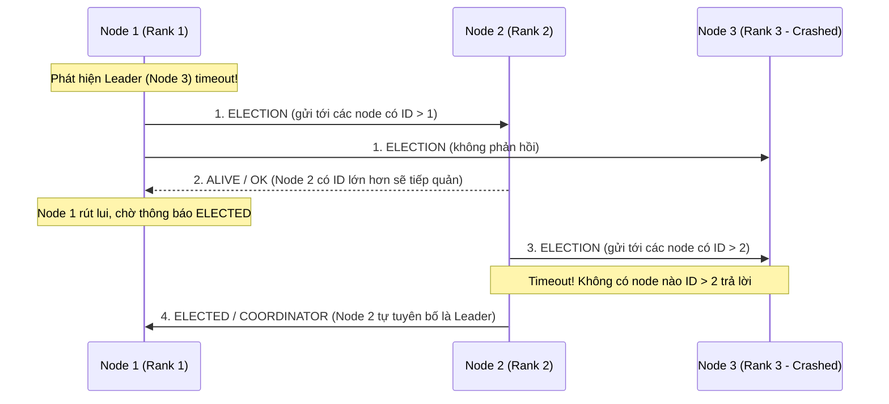
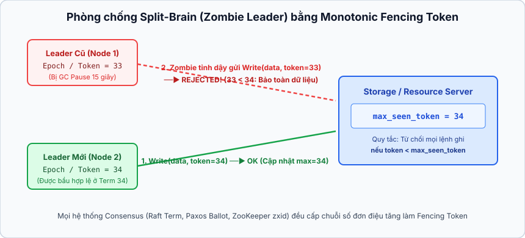
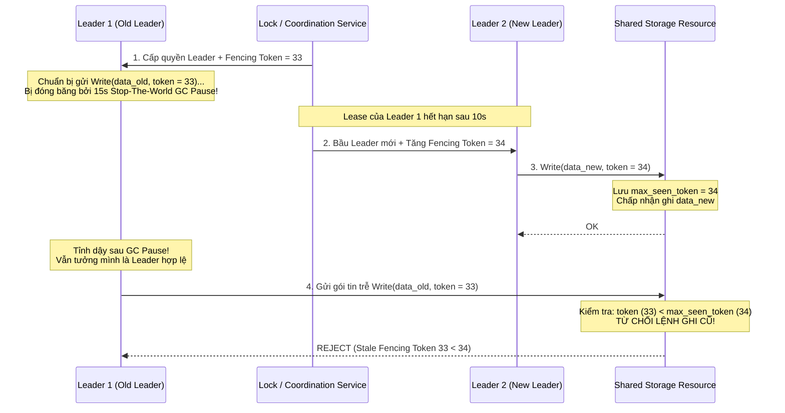

## Table of Contents
1. [Tại sao Hệ thống phân tán cần có Leader?](#why-distributed-systems-use-a-leader)
2. [Các thuật toán bầu chọn Leader cổ điển (Classic Leader Election Algorithms)](#classic-leader-election-algorithms)
3. [Thảm họa Split-Brain và Cơ chế bảo vệ bằng Fencing Token](#split-brain-and-fencing-tokens)
4. [Cơ chế Lease-Based Leadership và Rủi ro lệch đồng hồ](#lease-based-leadership)
5. [Tóm tắt & Ghi nhớ cốt lõi (Key Takeaways)](#key-takeaways)

---

## Tại sao Hệ thống phân tán cần có Leader? {#why-distributed-systems-use-a-leader}

Trong các hệ thống phân tán không có nút điều phối trung tâm (*Leaderless*, như kiến trúc kiểu Dynamo), mọi nút đều có thể tiếp nhận thao tác ghi, dẫn đến nguy cơ xung đột dữ liệu đồng thời (*write conflicts*) đòi hỏi cơ chế giải quyết xung đột phức tạp lúc đọc (*Read Repair*, *Vector Clocks*, hoặc *Last-Write-Wins*).

Để đơn giản hóa việc đồng bộ hóa, phần lớn các hệ quản trị cơ sở dữ liệu phân tán áp dụng mô hình **Single-Leader (Primary-Backup / Master-Replica)**:

- **Tập trung hóa thứ tự thao tác ghi (Total Order Broadcast)**: Mọi thao tác làm thay đổi trạng thái (`INSERT`, `UPDATE`, `DELETE`, hoặc thay đổi cấu hình cụm) đều phải đi qua **chỉ có đúng `1` nút Leader** tại một thời điểm. Leader chịu trách nhiệm quyết định thứ tự tuần tự của các giao dịch trong nhật ký nhân bản (*Replication Log*) và phát tán xuống các nút **Followers (Replicas)**, loại bỏ hoàn toàn xung đột ghi giữa các nút.
- **Đánh đổi kiến trúc (Bottleneck & Single Point of Failure tạm thời)**:
  - Bởi vì mọi luồng ghi đều phải đi qua Leader, nút này dễ trở thành **nút cổ chai về thông lượng (Throughput Bottleneck)** khi quy mô tải ghi vượt quá khả năng xử lý của một máy chủ đơn lẻ (do đó các hệ thống thực tế thường chia dữ liệu thành nhiều phân vùng / *Shard*, mỗi Shard có một Leader riêng thông qua **Multi-Raft** hoặc **Multi-Paxos**).
  - Nếu Leader bị sập hoặc mất kết nối, toàn bộ hệ thống sẽ rơi vào trạng thái không thể ghi dữ liệu cho đến khi bộ phát hiện lỗi nhận diện được sự cố và hoàn tất thuật toán **Leader Election (Bầu chọn Leader mới)**.

### Hai thuộc tính bắt buộc của thuật toán Leader Election

Một thuật toán bầu chọn Leader đúng đắn phải thỏa mãn hai điều kiện:

1. **Safety (Tính an toàn - Uniqueness)**: Tại bất kỳ thời điểm (hoặc trong cùng một nhiệm kỳ/Epoch) nào, có **tối đa chỉ có đúng `1` Leader** được công nhận trong toàn cụm. Việc vi phạm tính chất này dẫn tới lỗi **Split-Brain** (hai nút cùng tin rằng mình là Leader và ghi đè dữ liệu của nhau).
2. **Liveness (Tính sống - Termination)**: Khi Leader hiện tại gặp sự cố, quá trình bầu chọn cuối cùng phải kết thúc trong thời gian hữu hạn và chọn ra được một nút khỏe mạnh làm Leader mới.

---

## Các thuật toán bầu chọn Leader cổ điển (Classic Leader Election Algorithms) {#classic-leader-election-algorithms}

Trước khi các giao thức đồng thuận dựa trên đa số phiếu (*Quorum-based Consensus* như Raft và Paxos) trở thành tiêu chuẩn, nhiều thuật toán bầu chọn Leader cổ điển đã được thiết kế dựa trên thứ tự định danh của nút hoặc cấu trúc liên kết mạng.

### 1. Thuật toán Bully (Bully Algorithm - Garcia-Molina, `1982`)

Thuật toán Bully giả định mỗi nút trong cụm được gán một mã định danh riêng biệt có thể sắp thứ tự (**Node ID / Rank**), và mọi nút đều biết danh sách ID của tất cả các nút khác. Quy tắc cốt lõi là **nút còn sống có ID lớn hơn sẽ "bắt nạt" (*bully*) các nút có ID nhỏ hơn để giành quyền làm Leader**:

- **Quy trình `3` loại bản tin (`ELECTION`, `ALIVE`, `ELECTED`)**:
  1. Khi một nút `P` phát hiện Leader hiện tại không phản hồi, `P` bắt đầu cuộc bầu chọn bằng cách gửi bản tin `ELECTION` tới tất cả các nút có `ID > ID(P)`.
  2. Nếu không có bất kỳ nút nào có ID cao hơn trả lời bản tin `ALIVE` trong khoảng thời gian chờ `T`, nút `P` tự tuyên bố chiến thắng và phát quảng bá bản tin `ELECTED` (`COORDINATOR`) tới toàn bộ các nút có `ID < ID(P)`.
  3. Ngược lại, nếu có ít nhất một nút `Q` (với `ID(Q) > ID(P)`) phản hồi `ALIVE`, nút `P` lập tức rút lui và chờ nhận thông báo `ELECTED`. Nút `Q` sau đó tự khởi xướng vòng `ELECTION` của riêng nó lên các nút có ID cao hơn nữa cho đến khi tìm ra nút sống có ID cao nhất.
- **Nhược điểm nghiêm trọng trong thực tế**:
  - **Vi phạm Safety khi đứt cáp mạng (Split-Brain)**: Nếu cụm bị chia cắt thành `2` phân vùng mạng độc lập (**Network Partition**), phân vùng chứa các nút ID thấp sẽ không nhận được phản hồi `ALIVE` từ phân vùng kia và tự bầu ra một Leader riêng, dẫn đến việc tồn tại song song `2` Leader cùng lúc.
  - **Hiện tượng cướp quyền liên tục (Flapping / Preemption)**: Nếu nút có ID cao nhất bị lỗi phần cứng chập chờn (cứ sống dậy vài giây rồi lại treo), mỗi lần tỉnh dậy nó lại dùng quyền ID cao nhất để ép bầu chọn lại, làm gián đoạn toàn cụm.

### 2. Các biến thể cải tiến và Thuật toán Invitation / Ring

Để giảm số lượng tin nhắn `O(N^2)` trong trường hợp xấu của Bully Algorithm và xử lý các kịch bản mạng khác nhau, bốn biến thể sau thường được sử dụng:

- **Next-In-Line Failover**: Khi Leader hiện tại còn hoạt động, nó đính kèm danh sách xếp hạng các nút dự phòng kế tiếp (*failover list*) vào mỗi nhịp Heartbeat. Khi Leader sập, các nút không cần gửi bản tin `ELECTION` tới toàn cụm mà chỉ cần liên hệ trực tiếp với ứng viên đứng đầu danh sách dự phòng đó.
- **Candidate / Ordinary Optimization**: Chia tập hợp các nút thành hai nhóm: một nhóm nhỏ các nút **Candidates (Ứng viên)** có đủ tài nguyên phần cứng được phép làm Leader, và nhóm còn lại là **Ordinary Nodes** chỉ đóng vai trò Follower/Voter. Nhờ thu hẹp tập ứng viên, số lượng bản tin trao đổi giảm mạnh và tránh được việc bầu nhầm một nút yếu làm Leader.
- **Invitation Algorithm (Thuật toán Lời mời)**: Được thiết kế cho môi trường có thể bị phân mảnh mạng. Mỗi nút khi bị cô lập có thể tự tạo một nhóm gồm chính nó làm Leader. Định kỳ, các Leader của các nhóm khác nhau sẽ gửi bản tin `INVITATION` để mời nhóm khác **hợp nhất (*merge*)** lại thành một nhóm lớn hơn dưới sự điều phối của chỉ có đúng `1` Leader chung.
- **Ring Algorithm (Thuật toán Vòng tròn logic - Chang & Roberts)**: Các nút được sắp xếp thành một vòng tròn logic (`N_1 -> N_2 -> ... -> N_k -> N_1`). Khi phát hiện mất Leader, nút khởi xướng tạo một bản tin `ELECTION` chứa ID của mình và chuyển tiếp theo chiều kim đồng hồ cho nút kế tiếp còn sống. Mỗi nút trên đường đi đều thêm ID của mình vào danh sách trong bản tin (hoặc chỉ giữ lại ID lớn nhất). Khi bản tin đi hết một vòng quay về nút khởi xướng, nút có ID lớn nhất trong danh sách sẽ được công bố làm Leader mới qua một vòng bản tin `ELECTED`.

| Thuật toán | Cấu trúc liên kết | Độ phức tạp tin nhắn | Hạn chế chính khi áp dụng thực tế |
| :--- | :--- | :--- | :--- |
| **Bully Algorithm** | Mạng kết nối đầy đủ (All-to-All) | `O(N^2)` (trường hợp xấu) | Dễ gây Split-Brain khi có Network Partition; nhạy cảm với Flapping ở node có ID cao. |
| **Next-In-Line** | Dựa trên danh sách dự phòng từ Leader cũ | `O(N)` | Phụ thuộc vào tính cập nhật của danh sách dự phòng trước khi Leader cũ chết. |
| **Invitation Algorithm** | Các phân nhóm động tự hợp nhất | Phụ thuộc số nhóm hợp nhất | Tồn tại nhiều Leader độc lập trong thời gian mạng bị phân mảnh trước khi Merge. |
| **Ring Algorithm** | Vòng tròn logic một chiều | `O(N)` (tối thiểu `2` vòng quanh Ring) | Độ trễ bầu chọn cao do phải chờ gói tin đi tuần tự qua từng nút dọc theo vòng tròn. |

---

## Thảm họa Split-Brain và Cơ chế bảo vệ bằng Fencing Token {#split-brain-and-fencing-tokens}

Ngay cả khi hệ thống sử dụng thuật toán bầu chọn an toàn dựa trên đa số phiếu (*Quorum*), việc **bầu ra được một Leader hợp lệ không có nghĩa là Leader cũ đã thực sự dừng hoạt động**. Đây là nguồn gốc của một trong những lỗi phá hủy dữ liệu nguy hiểm trong hệ thống phân tán: **Split-Brain do tiến trình bị tạm dừng (Process Pause / Zombie Leader)**.

### Kịch bản thực tế: GC Pause biến Leader cũ thành Zombie Leader

Giả sử hệ thống sử dụng dịch vụ khóa/điều phối có thời hạn (Lease) để đảm bảo tại một thời điểm chỉ có `1` nút được ghi vào Storage Server dùng chung:

1. **Bước `1`**: **Leader 1** giành được quyền làm Leader (kèm theo Lease có hạn `10` giây) và bắt đầu chuẩn bị gửi một lệnh ghi dữ liệu xuống Storage Server.
2. **Bước `2`**: Ngay trước khi gói tin TCP được đẩy ra khỏi card mạng, tiến trình JVM/Go trên **Leader 1** bước vào một đợt **Stop-The-World Garbage Collection (GC Pause)** kéo dài `15` giây (hoặc bị hệ điều hành ảo hóa tạm dừng CPU / chờ trang bộ nhớ Swap). Trong suốt `15` giây này, mọi luồng trên Leader 1 bị đóng băng hoàn toàn nên nó không biết thời gian đã trôi qua.
3. **Bước `3`**: Sau `10` giây không nhận được Heartbeat từ Leader 1, Lease hết hạn. Các nút còn lại trong cụm tiến hành bầu chọn và bầu **Leader 2** làm Leader mới hợp lệ. Leader 2 bắt đầu ghi dữ liệu mới vào Storage Server.
4. **Bước `4` (Thảm họa xảy ra)**: Ở giây thứ `15`, đợt GC Pause trên **Leader 1** kết thúc! Luồng thực thi của Leader 1 tiếp tục chạy từ đúng dòng lệnh ngay trước khi bị đóng băng — lúc này nó **vẫn tin rằng mình đang là Leader hợp pháp** và đẩy gói tin ghi cũ kỹ từ `15` giây trước xuống Storage Server, **ghi đè và làm hỏng (*corrupt*) dữ liệu mới mà Leader 2 vừa cập nhật**!

### Giải pháp triệt để: Monotonic Fencing Tokens (Epoch / Term / Generation Number)

Để ngăn chặn hoàn toàn các gói tin "bóng ma" từ Zombie Leader, hệ thống không bao giờ được phép chỉ dựa vào việc bản thân nút gửi tự kiểm tra quyền Leader của mình, mà **chính tài nguyên đích (Storage Server) phải trực tiếp xác thực thứ tự thế hệ của Leader** thông qua **Fencing Token**:

1. **Cấp phát số hiệu đơn điệu tăng dần**: Mỗi khi dịch vụ điều phối cấp quyền Leader (hoặc mỗi khi cụm bước sang một vòng bầu chọn mới), nó bắt buộc phải tăng một bộ đếm nguyên đơn điệu gọi là **Fencing Token** (trong Raft gọi là `Term`, trong Zab/ZooKeeper gọi là `zxid` / `epoch`, trong Kafka gọi là `Controller Epoch`, trong HDFS gọi là `Generation Stamp`). Ví dụ: Leader 1 nhận `token = 33`, khi bầu sang Leader 2 thì nhận `token = 34`.
2. **Đính kèm Token vào mọi thao tác I/O**: Mọi yêu cầu ghi gửi từ Leader tới Storage Server đều phải mang theo `token` của nhiệm kỳ hiện tại.
3. **Kiểm tra chặn ở phía Storage (Server-side Fencing)**: Storage Server luôn lưu giữ giá trị token lớn nhất mà nó từng nhìn thấy (`max_seen_token`).
   - Khi Leader 2 gửi lệnh ghi kèm `token = 34`, Storage Server cập nhật `max_seen_token = 34` và thực thi lệnh ghi.
   - Khi Leader 1 tỉnh dậy sau GC Pause và gửi lệnh ghi trễ mang `token = 33`, Storage Server so sánh thấy `33 < 34` và **lập tức từ chối thao tác ghi này** (`Stale Epoch / Fenced Off`), đồng thời báo cho Leader 1 biết nó đã bị truất quyền để tự hạ cấp xuống thành Follower (*step down*).

---

## Cơ chế Lease-Based Leadership và Rủi ro lệch đồng hồ {#lease-based-leadership}

Để giảm chi phí đọc trong các hệ thống Single-Leader, nếu mỗi truy vấn đọc (`READ`) đều phải gửi tin nhắn hỏi một vòng đa số các nút (*Quorum Read*) để xác nhận xem Leader hiện tại có còn là Leader hợp lệ hay không thì độ trễ đọc sẽ rất cao.

**Lease-Based Leadership (Quyền Leader dựa trên hợp đồng thuê theo thời gian)** được đưa ra để cho phép Leader phục vụ truy vấn đọc trực tiếp từ bộ nhớ cục bộ của mình (*Local Read*) mà không cần hỏi ý kiến các Follower:

- **Nguyên lý hoạt động**: Khi các Follower bầu chọn hoặc gia hạn cho Leader, chúng quy ước thông qua một **Lease** có thời hạn `Δ t`: *"Trong khoảng thời gian `Δ t` tính từ lúc cấp Lease, các Follower đảm bảo sẽ không bầu cho bất kỳ một Leader nào khác"*.
- **Nguy cơ vi phạm Safety do Clock Drift**:
  - Giả sử Follower sử dụng đồng hồ của nó để đếm ngược thời gian hết hạn Lease `Δ t`, còn Leader cũng dùng đồng hồ cục bộ của riêng mình để kiểm tra xem Lease còn hiệu lực hay không (`t_now < t_start + Δ t`).
  - Ngay cả khi cả hai bên đều sử dụng **Monotonic Clock** (đảm bảo không bị nhảy lùi bởi NTP), tinh thể thạch anh trên máy của Follower vẫn có thể chạy nhanh hơn tinh thể thạch anh trên máy của Leader (**Clock Drift**), hoặc luồng kiểm tra thời gian trên Leader bị tạm dừng ngay sau bước kiểm tra điều kiện `if (now < lease_expiry)`.
  - Nếu đồng hồ của Follower hết hạn trước trong khi đồng hồ của Leader vẫn báo Lease còn hạn, Follower sẽ bầu ra Leader mới trong khi Leader cũ vẫn trả về dữ liệu cũ kỹ cho truy vấn đọc (vi phạm tính **Linearizability**).
- **Cách phòng vệ trong thực tế**:
  1. Thiết lập khoảng đệm an toàn (*Guard Band*): Thời gian hiệu lực Lease mà Leader tự tính cho mình phải ngắn hơn đáng kể so với thời gian chờ tối thiểu trước khi Follower bắt đầu bầu chọn mới (`Δ t_leader << Δ t_follower - max_clock_drift`).
  2. Kết hợp Lease với **Fencing Token / Read Index** ở tầng lưu trữ để đảm bảo mọi thao tác ghi hoặc đọc đòi hỏi tính nhất quán tuyệt đối đều được kiểm chứng qua số hiệu Epoch/Term.

---

## Tóm tắt & Ghi nhớ cốt lõi (Key Takeaways) {#key-takeaways}

- **Vai trò và đánh đổi của Leader**: Sử dụng chỉ có đúng `1` Leader giúp tuần tự hóa toàn bộ thao tác ghi và loại bỏ xung đột dữ liệu, nhưng biến Leader thành nút cổ chai về thông lượng và đòi hỏi cơ chế **Leader Election** khi nút điều phối gặp sự cố.
- **Hạn chế của các thuật toán bầu chọn cổ điển**: Các thuật toán như **Bully Algorithm**, **Next-In-Line**, **Invitation** hay **Ring Algorithm** giải quyết bài toán chọn nút điều phối dựa trên thứ hạng ID hoặc cấu trúc vòng, nhưng **không chống chịu được lỗi Split-Brain khi xảy ra Network Partition** (không giống các thuật toán dựa trên Quorum như Raft/Paxos sẽ được phân tích ở các chương sau).
- **Split-Brain do GC Pause và vai trò bắt buộc của Fencing Token**: Một Leader bị đóng băng bởi Stop-The-World GC Pause hoặc nghẽn mạng có thể tỉnh dậy sau khi cụm đã bầu Leader mới và gửi các lệnh ghi trễ làm hỏng dữ liệu. Giải pháp bắt buộc là đính kèm một số hiệu tăng đơn điệu (**Fencing Token / Term / Epoch**) vào mỗi lệnh ghi để hệ thống lưu trữ đích tự động từ chối mọi yêu cầu mang Token cũ ($\text{token} < \text{max\_seen\_token}$).
- **Rủi ro của Lease-Based Leadership**: Cơ chế Lease phụ thuộc trực tiếp vào tốc độ trôi của đồng hồ vật lý giữa các máy chủ; nếu không tính đến giới hạn **Clock Drift**, khoảng trễ thực thi luồng và không kết hợp cùng **Fencing Token**, hệ thống vẫn có nguy cơ phục vụ dữ liệu cũ hoặc ghi chồng lấp khi hết hạn Lease.

### Tài liệu & Nguồn tham khảo
- [Martin Kleppmann — *How to do distributed locking* (Fencing Tokens & GC Pauses)](https://martin.kleppmann.com/2016/02/08/how-to-do-distributed-locking.html)
- [Gray, C., & Cheriton, D. (1989) — *Leases: An Efficient Fault-Tolerant Mechanism for Distributed File Cache Consistency*](https://dl.acm.org/doi/10.1145/74850.74870)
- [Garcia-Molina, H. (1982) — *Elections in a Distributed Computing System* (Bully & Invitation Algorithms)](https://ieeexplore.ieee.org/document/1675885)
