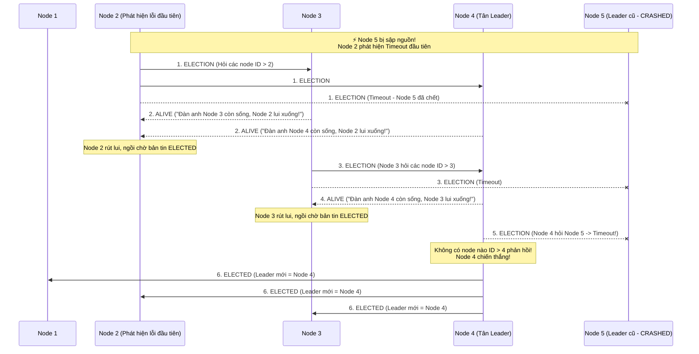
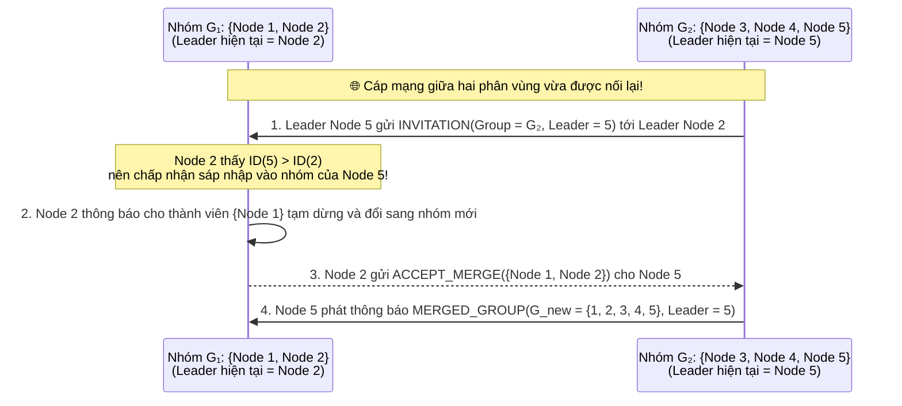
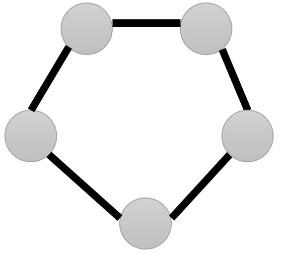
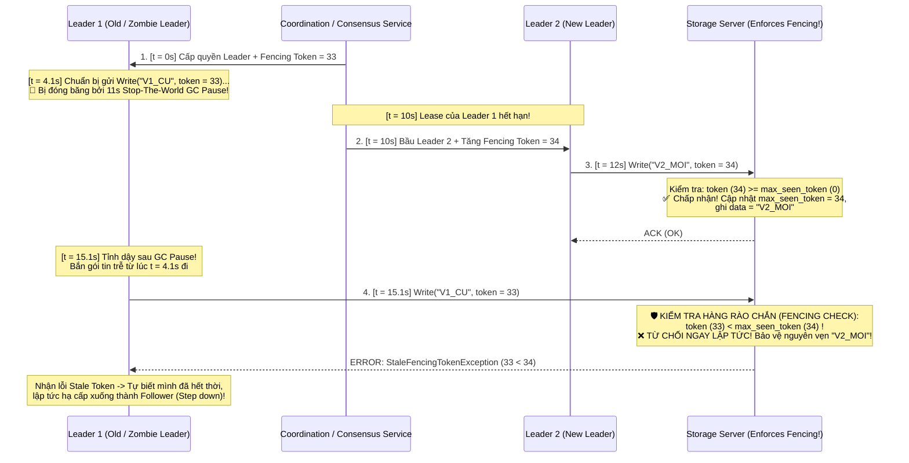

## Table of Contents
1. [Tại sao Hệ thống phân tán cần có Leader?](#why-distributed-systems-use-a-leader)
2. [Các thuật toán bầu chọn Leader cổ điển (Classic Leader Election Algorithms)](#classic-leader-election-algorithms)
3. [Thảm hoạ Split-Brain và Cơ chế bảo vệ bằng Fencing Token](#split-brain-and-fencing-tokens)
4. [Cơ chế Lease-Based Leadership và Rủi ro lệch đồng hồ](#lease-based-leadership)
5. [Tóm tắt & Ghi nhớ cốt lõi (Key Takeaways)](#key-takeaways)

---

## Tại sao Hệ thống phân tán cần có Leader? {#why-distributed-systems-use-a-leader}

### 1. Bài toán thực tế & Mental Model: Điều gì xảy ra nếu mọi node đều tự ý quyết định?

Hãy tưởng tượng một phòng giao dịch ngân hàng có `5` nhân viên thu ngân (`Node 1` đến `Node 5`) cùng quản lý một cuốn sổ cái tài khoản. Khách hàng đang có số dư `$100`. Nếu hai yêu cầu rút `$80` đến cùng một lúc tại hai quầy khác nhau (`Node 1` và `Node 2`) trong một hệ thống **Không có người điều phối trung tâm (Leaderless)**:
- Để giảm độ trễ, nếu cả `Node 1` lẫn `Node 2` đều tự kiểm tra sổ cục bộ thấy còn `$100 >= $80` và lập tức cho rút tiền, tài khoản sẽ bị rút âm thành `-$60`!
- Để tránh xung đột trong mô hình Leaderless, mỗi giao dịch sẽ phải tự thương lượng đa số phiếu với các node khác, hoặc chấp nhận ghi chồng lấp rồi giải quyết xung đột phức tạp lúc đọc (như *Vector Clocks / Siblings* ở Chương 8).

Để triệt tiêu hoàn toàn xung đột ghi ngay từ đầu, phần lớn các hệ quản trị cơ sở dữ liệu quan hệ và NewSQL hiện đại (PostgreSQL Replication, MySQL Group Replication, MongoDB, etcd, Kafka, CockroachDB, Spanner) áp dụng kiến trúc **Single-Leader (Primary-Backup / Master-Replica / Active-Passive)**:

- **Mental Model của Leader**: Giống như **người điều hành phiên đấu giá trung tâm** cầm chiếc búa gỗ trong hội trường. Mọi người tham gia (*Clients*) có thể nhìn bảng giá từ các màn hình phụ (*Followers / Read Replicas*), nhưng **mọi lệnh đặt giá làm thay đổi trạng thái (`INSERT / UPDATE / DELETE`) bắt buộc phải đi qua tay vị chủ toạ (`Leader`)**.
- **Vai trò kỹ thuật của Leader**:
  1. **Tuần tự hoá các thao tác ghi (Total Order Broadcast / Serialization Point)**: Leader xếp mọi giao dịch đồng thời vào một hàng đợi tuần tự chung trong nhật ký nhân bản (**Replication Log**: vị trí `index = 1, 2, 3, ...`). Nhờ đó, các **Followers** chỉ việc áp dụng đúng thứ tự đã được Leader đóng dấu mà không bao giờ xảy ra xung đột.
  2. **Điều phối tác vụ toàn cục**: Khởi tạo việc chia tách phân vùng (*Shard Splitting*), cân bằng tải (*Rebalancing*), hoặc quản lý khoá phân tán (*Distributed Locks*).

### 2. Sự đánh đổi kiến trúc và Hai thuộc tính sống còn của Leader Election

Việc tập trung quyền quyết định vào một nút Leader đơn lẻ mang lại sự đơn giản cho luồng ghi, nhưng đi kèm hai thách thức lớn:
1. **Nút cổ chai về hiệu năng (Throughput Bottleneck)**: Nếu toàn bộ cụm cơ sở dữ liệu khổng lồ chỉ có đúng `1` máy chủ làm Leader, CPU và băng thông mạng của máy đó sẽ nhanh chóng bị bão hoà.
   - *Giải pháp thực tế*: Chia nhỏ dữ liệu thành hàng nghìn phân vùng (**Partitions / Shards / Ranges / Tablets**). Mỗi phân vùng bầu ra một Leader riêng biệt nằm rải rác trên khắp các máy chủ vật lý (kiến trúc **Multi-Raft** trong CockroachDB/TiKV hoặc **Multi-Paxos** trong Spanner). Nhờ vậy, mỗi máy chủ vừa là Leader của một số Shard, vừa là Follower của các Shard khác!
2. **Điểm sập tạm thời (Temporary Single Point of Failure)**: Khi nút đang giữ vai trò Leader bị cháy nguồn, mất mạng hoặc treo cứng, toàn bộ luồng ghi của phân vùng đó sẽ bị gián đoạn cho đến khi cụm hoàn tất quy trình **Bầu chọn Leader mới (Leader Election)**.

Một thuật toán **Leader Election** được coi là đúng đắn khi và chỉ khi thoả mãn hai điều kiện toán học:
- **Safety (Tính an toàn — Uniqueness / At-most-one Leader)**: Tại bất kỳ thời điểm (hoặc trong cùng một nhiệm kỳ `Term / Epoch`) nào, toàn cụm chỉ được phép có **tối đa đúng `1` Leader**. Nếu có từ `2` node trở lên cùng tin rằng mình là Leader hợp pháp, hệ thống rơi vào thảm hoạ **Split-Brain (Đa nhân cách / Phân liệt não bộ)**, dẫn tới ghi đè và phá huỷ dữ liệu của nhau.
- **Liveness (Tính sống — Termination / Eventual Election)**: Khi Leader cũ gặp sự cố, thuật toán bầu chọn cuối cùng phải kết thúc trong khoảng thời gian hữu hạn và chọn ra được một node khoẻ mạnh làm Leader mới.

---

## Các thuật toán bầu chọn Leader cổ điển (Classic Leader Election Algorithms) {#classic-leader-election-algorithms}

Trước khi đi vào các thuật toán đồng thuận phức tạp dựa trên đa số phiếu (như Paxos và Raft ở Chương 12–14), Chương 10 của sách *Database Internals* phân tích 5 thuật toán bầu chọn cổ điển dựa trên **Thứ hạng định danh (Node ID Rank)** và **Cấu trúc liên kết mạng (Topology)**.

Để dễ dàng so sánh bản chất của cả 5 thuật toán, chúng ta sẽ chạy tay từng bước (**Step-by-Step Worked Examples**) trên **cùng một cụm gồm 5 máy chủ**:
$$\text{Cluster} = \{\text{Node } 1,\ \text{Node } 2,\ \text{Node } 3,\ \text{Node } 4,\ \text{Node } 5\}$$
Trong đó mã định danh tăng dần `ID(1) < ID(2) < ID(3) < ID(4) < ID(5)`. Ban đầu, **`Node 5`** (node có ID lớn nhất) đang giữ vai trò là **Leader**.

---

### 1. Thuật toán Bully (Bully Algorithm — Hector Garcia-Molina, `1982`)

#### Bài toán thực tế & Mental Model
Làm thế nào để các node tự chọn ra người chỉ huy mới khi biết rõ cấp bậc (`Rank / ID`) của nhau?
**Mental Model của Bully Algorithm** đúng như tên gọi của nó ("Kẻ bắt nạt"): **Kẻ mạnh hơn (có ID lớn hơn) còn sống luôn có quyền quát nạt và tước quyền ứng cử của kẻ yếu hơn (có ID nhỏ hơn)**.

Giao thức sử dụng đúng **3 loại bản tin**:
1. `ELECTION`: Gửi từ một node có ID thấp lên các node có ID cao hơn để hỏi: *"Tôi định làm Leader đây, có đàn anh nào còn sống không?"*
2. `ALIVE` (hoặc `OK`): Bản tin trả lời của node có ID cao hơn: *"Tôi còn sống và có ID lớn hơn anh! Anh hãy lui xuống để tôi lo việc bầu cử!"*
3. `ELECTED` (hoặc `COORDINATOR`): Bản tin tuyên bố chiến thắng gửi từ tân Leader xuống toàn bộ các node có ID thấp hơn: *"Không còn ai lớn hơn tôi sống sót, từ giờ tôi là Leader mới!"*



#### Ví dụ chạy tay từng bước (Worked Example 1): Khi `Node 5` sập và `Node 2` phát hiện đầu tiên

Hãy theo dõi từng bước truyền tin và đếm chính xác số lượng gói tin trên mạng:

| Bước | Sự kiện & Hành động của các Node | Các gói tin gửi đi trên mạng | Số bản tin | Trạng thái các Node sau bước này |
| :---: | :--- | :--- | :---: | :--- |
| **Bước 1** | **`Node 5` sập nguồn!** `Node 2` là người đầu tiên phát hiện `Node 5` không phản hồi Heartbeat. `Node 2` khởi xướng bầu cử bằng cách gửi `ELECTION` cho tất cả các node có `ID > 2` (tức `{3, 4, 5}`). | • `Node 2 -> Node 3`: `ELECTION`<br/>• `Node 2 -> Node 4`: `ELECTION`<br/>• `Node 2 -> Node 5`: `ELECTION` *(rơi vì 5 đã chết)* | `3` | `Node 2` bấm giờ chờ phản hồi `ALIVE`. |
| **Bước 2** | Cả `Node 3` và `Node 4` đều còn sống và nhận được `ELECTION` từ đàn em `Node 2`. Cả hai lập tức gửi `ALIVE` để "bắt nạt" (bully) `Node 2` phải rút lui. | • `Node 3 -> Node 2`: `ALIVE`<br/>• `Node 4 -> Node 2`: `ALIVE` | `2` | `Node 2` nhận được `ALIVE` nên từ bỏ ý định làm Leader, chuyển sang chờ thông báo `ELECTED`. |
| **Bước 3** | Vì vừa trấn áp `Node 2`, cả `Node 3` và `Node 4` đều có trách nhiệm tự mở vòng bầu cử của riêng mình lên các node có ID cao hơn chúng:<br/>• `Node 3` gửi `ELECTION` cho `{4, 5}`.<br/>• `Node 4` gửi `ELECTION` cho `{5}`. | • `Node 3 -> Node 4`: `ELECTION`<br/>• `Node 3 -> Node 5`: `ELECTION` *(rơi)*<br/>• `Node 4 -> Node 5`: `ELECTION` *(rơi)* | `3` | `Node 3` và `Node 4` cùng chờ phản hồi từ các đàn anh của mình. |
| **Bước 4** | `Node 4` nhận được `ELECTION` từ `Node 3`, liền trả lời `ALIVE` để bắt `Node 3` rút lui. Trong khi đó, lời gọi của `Node 4` tới `Node 5` bị Timeout (vì `Node 5` đã chết). | • `Node 4 -> Node 3`: `ALIVE` | `1` | `Node 3` nhận được `ALIVE` từ `Node 4` nên rút lui. Chỉ còn đúng `Node 4` trụ lại! |
| **Bước 5** | Sau khi hết thời gian chờ `T` mà không thấy `Node 5` trả lời, **`Node 4` biết chắc mình là node sống có ID lớn nhất**. `Node 4` tự phong làm Leader và gửi `ELECTED(4)` cho toàn bộ các node có `ID < 4` (`{1, 2, 3}`). | • `Node 4 -> Node 1`: `ELECTED(4)`<br/>• `Node 4 -> Node 2`: `ELECTED(4)`<br/>• `Node 4 -> Node 3`: `ELECTED(4)` | `3` | Toàn cụm `{1, 2, 3, 4}` thống nhất **`Node 4` là Leader mới**! *(Tổng cộng tốn `12` bản tin; nếu `Node 1` là người phát hiện đầu tiên sẽ tốn tới `20` bản tin — độ phức tạp **$O(N^2)$**)*. |

#### Kịch bản thảm hoạ của Bully Algorithm: Tại sao đứt cáp mạng gây ra Split-Brain?
Giả sử `Node 5` không hề chết, nhưng một chiếc máy xúc làm đứt cáp quang giữa hai phòng máy, chia cụm 5 node thành **2 phân vùng mạng cô lập (Network Partition)**:
- **Phân vùng Trái**: `{Node 1, Node 2, Node 3}`
- **Phân vùng Phải**: `{Node 4, Node 5}`

Hãy xem Bully Algorithm phá vỡ tính **Safety** như thế nào:
1. Bên Phân vùng Phải `{4, 5}`: **`Node 5`** vẫn đang sống khoẻ mạnh và tiếp tục giữ ngôi vị **Leader ở nhánh phải**, vẫn nhận lệnh ghi dữ liệu từ các Client kết nối vào nhánh phải.
2. Bên Phân vùng Trái `{1, 2, 3}`: `Node 3` không liên lạc được với `Node 5`. `Node 3` gửi `ELECTION` tới `Node 4` và `Node 5`. Do cáp mạng giữa hai phân vùng đã đứt, các bản tin `ELECTION` này không thể sang được bên phải, và đương nhiên `Node 3` không nhận được bất kỳ gói `ALIVE` nào sau thời gian chờ `T`!
3. Theo đúng luật Bully, `Node 3` tưởng rằng cả `4` và `5` đều đã chết nên gửi `ELECTED(3)` cho `Node 1, Node 2` và tự phong mình làm **Leader ở nhánh trái**!
4. **Hậu quả**: Hệ thống xuất hiện **2 Leader hoạt động song song (`Node 3` và `Node 5`)** — tức lỗi **Split-Brain** kinh điển! Nguyên nhân gốc rễ là Bully Algorithm đánh đồng việc *"không nhận được phản hồi trong thời gian `T`"* với việc *"node kia đã chết"*, hoàn toàn không có khái niệm đòi hỏi **Đa số phiếu (Majority Quorum $\ge \lfloor N/2 \rfloor + 1 = 3$ phiếu)**.

---

### 2. Next-In-Line Failover (Danh sách kế vị dự phòng)

#### Bài toán thực tế & Mental Model
Trong Bully Algorithm, mỗi khi Leader sập, các node lại phải nháo nhào gửi hàng chục gói tin $O(N^2)$ hỏi han khắp nơi xem ai còn sống. Tại sao vị vua đương nhiệm (`Leader` hiện tại) lúc còn sống không lập sẵn một **"Bản di chúc / Danh sách Thái tử kế vị" (Failover List)** và gửi kèm vào mỗi nhịp Heartbeat hàng ngày?

#### Ví dụ chạy tay từng bước (Worked Example 2) trên cụm 5 Node
1. **Lúc `Node 5` còn sống**: Trong mỗi gói `HEARTBEAT` gửi xuống `{1, 2, 3, 4}`, `Node 5` đính kèm danh sách các node đang sống xếp theo thứ tự ưu tiên kế vị:
   $$\text{FailoverList} = [\text{Node } 4,\ \text{Node } 3,\ \text{Node } 2,\ \text{Node } 1]$$
2. **Khi `Node 5` sập nguồn**:
   - Giả sử `Node 2` phát hiện `Node 5` bị timeout đầu tiên.
   - Thay vì phát tán `ELECTION` cho tất cả các node lớn hơn mình như Bully, `Node 2` nhìn vào `FailoverList` gần nhất và thấy ứng viên đứng đầu danh sách kế vị là **`Node 4`**.
   - `Node 2` chỉ cần gửi **đúng `1` bản tin thông báo trực tiếp** `PROMOTE / YOU_ARE_NEXT` tới `Node 4`.
   - `Node 4` nhận tin, kiểm tra lại lần cuối xem `Node 5` đã chết thật chưa, rồi lập tức gửi `ELECTED(4)` cho `{1, 2, 3}` (`3` bản tin).
   - *(Nếu chẳng may `Node 4` cũng chết cùng lúc với `Node 5`, `Node 2` mới lùi xuống vị trí kế tiếp trong danh sách là `Node 3`)*.
3. **Độ phức tạp**: Giảm mạnh từ **$O(N^2)$** xuống chỉ còn **$O(N)$** bản tin!

---

### 3. Candidate / Ordinary Nodes Optimization (Tách biệt Ứng viên và Cử tri thường)

#### Bài toán thực tế & Mental Model
Trong một cụm gồm `50` node, nếu cho phép cả `50` node đều có quyền tranh cử làm Leader thì vừa tốn băng thông bầu cử, vừa có nguy cơ bầu trúng một máy chủ cấu hình yếu (ít RAM, ổ cứng chậm) lên làm Leader. Giải pháp là chia cụm thành hai tầng vai trò rõ rệt:
- **Candidate Nodes (Nhóm Ứng viên — số lượng rất nhỏ)**: Các máy chủ cấu hình mạnh được phép trở thành Leader.
- **Ordinary Nodes (Nhóm Nút thường)**: Chỉ đóng vai trò lưu trữ/xử lý và tuân theo Leader, không bao giờ tự ứng cử.

#### Ví dụ chạy tay từng bước (Worked Example 3) trên cụm 5 Node
Giả sử trong 5 node, quản trị viên cấu hình:
- Tập **Candidates** = `{Node 3, Node 4, Node 5}`
- Tập **Ordinary Nodes** = `{Node 1, Node 2}`

Khi Leader hiện tại là `Node 5` bị sập và nút thường **`Node 1`** phát hiện ra đầu tiên:
1. **Bước 1**: Vì `Node 1` chỉ là *Ordinary Node*, nó không được phép tự ứng cử. `Node 1` gửi bản tin thông báo `LEADER_DEAD` (hoặc `ELECTION_REQUEST`) tới tập **Candidates** còn lại là `{Node 3, Node 4}`.
2. **Bước 2**: Chỉ có các node bên trong tập nhỏ `{Node 3, Node 4}` trao đổi với nhau (hoặc `Node 1` thu thập phản hồi từ `{3, 4}`), chọn ra ứng viên có Rank cao nhất còn sống là **`Node 4`**.
3. **Bước 3**: `Node 4` phát thông báo `ELECTED(4)` xuống cho toàn cụm `{1, 2, 3}`. Nhờ giới hạn cuộc đua trong nhóm nhỏ Candidates, số lượng bản tin giảm từ $O(N^2)$ xuống $O(C \cdot N)$ với $C \ll N$.

---

### 4. Invitation Algorithm (Thuật toán Lời mời / Election by Merge)

#### Bài toán thực tế & Mental Model
Trong Bully Algorithm, việc có 2 phân vùng mạng hoạt động độc lập bị coi là lỗi. Tuy nhiên, trong một số hệ thống phân tán ưu tiên tính sẵn sàng cao (hoặc mạng di động / Ad-hoc / phân cụm tự trị), người ta **chấp nhận cho mỗi phân vùng mạng bị cô lập tự có một Leader riêng để duy trì hoạt động cục bộ**, nhưng ngay khi cáp mạng được nối lại, **các nhóm nhỏ phải tự động tìm thấy nhau và sáp nhập (Merge) lại thành một nhóm thống nhất dưới quyền chỉ huy của đúng 1 Leader chung**!

Đó chính là tư tưởng của **Invitation Algorithm** (cũng do Garcia-Molina đề xuất năm `1982`): mỗi node ban đầu là Leader của một nhóm chỉ gồm chính nó; sau đó các Leader gửi thiệp mời (`INVITATION`) để hợp nhất các nhóm lại với nhau.



#### Ví dụ chạy tay từng bước (Worked Example 4): Hợp nhất 2 phân vùng mạng trên cụm 5 Node
Giả sử do sự cố đứt cáp trước đó, cụm 5 node đang bị tách thành **2 nhóm độc lập**:
- **Nhóm `G_A = {Node 1, Node 2}`** do **`Node 2`** làm Leader (với mã định danh nhóm `GroupID = 2.1`).
- **Nhóm `G_B = {Node 3, Node 4, Node 5}`** do **`Node 5`** làm Leader (với mã định danh nhóm `GroupID = 5.1`).

Khi đường cáp mạng giữa hai bên được sửa xong, quy trình hợp nhất diễn ra qua 4 bước cụ thể:
1. **Bước 1 — Thăm dò định kỳ giữa các Leader (`Check Peers`)**:
   Định kỳ, các Leader (đặc biệt là Leader có ID cao như `Node 5`) gửi bản tin hỏi thăm tới các node nằm ngoài nhóm hiện tại của mình (`Node 1, Node 2`) xem ai đang là Leader của họ. `Node 2` trả lời: *"Tôi đang là Leader của nhóm `G_A = {1, 2}`"*.
2. **Bước 2 — Gửi lời mời sáp nhập (`INVITATION`)**:
   Vì `ID(Node 5) > ID(Node 2)`, `Node 5` khởi tạo một mã nhóm mới `GroupID = 5.2` và gửi bản tin `INVITATION(Leader = 5, GroupID = 5.2)` cho `Node 2`. *(Nếu cả hai cùng gửi lời mời cùng lúc, bên nào có ID lớn hơn sẽ được ưu tiên làm chủ nhóm gộp)*.
3. **Bước 3 — Chuyển giao thành viên (`ACCEPT / REORGANIZE`)**:
   `Node 2` nhận lời mời từ `Node 5`, lập tức từ bỏ chức Leader của nhóm nhỏ `G_A` và gửi thông báo cho cấp dưới của mình là `Node 1` rằng: *"Chúng ta đang sáp nhập vào nhóm `5.2` của Leader `Node 5`"*. Sau đó cả `Node 1` và `Node 2` gửi xác nhận `JOIN(GroupID = 5.2)` về cho `Node 5`.
4. **Bước 4 — Hoàn tất thống nhất (`MERGED COORDINATOR`)**:
   `Node 5` cập nhật danh sách thành viên đầy đủ `G_merged = {1, 2, 3, 4, 5}` và phát bản tin xác nhận cuối cùng xuống cả 4 Follower `{1, 2, 3, 4}`. Toàn cụm quay trở về trạng thái chỉ có đúng `1` Leader là `Node 5`!

---

### 5. Ring Algorithm (Thuật toán Vòng tròn logic — Chang & Roberts, `1979`)

#### Bài toán thực tế & Mental Model
Thay vì cho các node gửi tin nhắn chằng chịt tới tất cả mọi người (All-to-All), điều gì xảy ra nếu ta xếp tất cả các node thành **một vòng tròn logic khép kín một chiều**?
$$N_1 \longrightarrow N_2 \longrightarrow N_3 \longrightarrow N_4 \longrightarrow N_5 \longrightarrow N_1$$
Mỗi node $i$ chỉ cần gửi tin nhắn cho **đúng 1 người hàng xóm kế tiếp theo chiều kim đồng hồ** (`next_alive_neighbor`). Nếu người hàng xóm kế tiếp trực tiếp không phản hồi (đã chết), node $i$ chỉ việc nhảy cóc (*skip*) sang người kế tiếp nữa trên vòng tròn!



#### Ví dụ chạy tay từng bước (Worked Example 5): Trace gói tin đi quanh vòng tròn khi `Node 5` chết

Giả sử 5 node được xếp theo vòng tròn: **`Node 1 -> Node 2 -> Node 3 -> Node 4 -> Node 5 -> Node 1`**.
Đột nhiên Leader hiện tại là **`Node 5` bị sập nguồn**, và **`Node 2`** là người phát hiện ra đầu tiên. Hãy theo dõi hành trình của bức thư bầu cử đi hết 2 vòng quanh chiếc bàn tròn:

```text
Vòng tròn vật lý ban đầu:   [Node 1] ---> [Node 2] ---> [Node 3] ---> [Node 4] ---> (Node 5: DEAD)
                                ^                                                      |
                                +-----------------(Node 4 nhảy cóc qua 5)--------------+

VÒNG 1 (Thu thập ứng viên):
  Node 2 khởi tạo:  ELECTION([2])
    --> tới Node 3: ELECTION([2, 3])
    --> tới Node 4: ELECTION([2, 3, 4])
    --> (Node 4 gọi Node 5 bị Timeout! Node 4 nhảy cóc qua 5 để gửi thẳng về Node 1)
    --> tới Node 1: ELECTION([2, 3, 4, 1])
    --> quay về đúng Node 2! (Node 2 thấy số 2 của mình đã nằm trong mảng -> Kết thúc Vòng 1!)

VÒNG 2 (Công bố Tân Leader = max([2, 3, 4, 1]) = Node 4):
  Node 2 phát đi:   ELECTED(leader = 4)
    --> tới Node 3 --> tới Node 4 --> (nhảy qua 5) --> tới Node 1 --> quay về Node 2 (Hoàn tất!)
```

Chi tiết từng bước chuyển tiếp gói tin:
1. **Bước 1 (`Node 2` khởi xướng)**:
   `Node 2` tạo gói tin `ELECTION` mang theo một danh sách các ứng viên đang sống, ghi tên mình vào đầu tiên: **`ELECTION(candidates = [2])`**, rồi gửi cho người kế tiếp bên phải là `Node 3`.
2. **Bước 2 (`Node 3` ký tên và chuyển tiếp)**:
   `Node 3` nhận được `ELECTION([2])`, nối thêm ID của mình vào đuôi danh sách thành **`ELECTION([2, 3])`**, rồi gửi tiếp sang `Node 4`.
3. **Bước 3 (`Node 4` ký tên và Nhảy cóc qua xác `Node 5`)**:
   `Node 4` nhận gói tin, nối thêm ID của mình thành **`ELECTION([2, 3, 4])`**.
   Theo cấu hình vòng tròn, `Node 4` cố gửi gói tin này cho `Node 5`. Tuy nhiên, sau thời gian chờ ngắn không thấy `Node 5` nhận, `Node 4` biết `Node 5` đã chết nên **nhảy cóc qua `Node 5`** và gửi thẳng gói **`ELECTION([2, 3, 4])`** về cho nút kế tiếp là **`Node 1`**!
4. **Bước 4 (`Node 1` ký tên và khép vòng)**:
   `Node 1` nhận gói tin, nối thêm ID của mình thành **`ELECTION([2, 3, 4, 1])`**, rồi gửi cho người kế tiếp là `Node 2`.
5. **Bước 5 (Chốt kết quả tại `Node 2` và Phát thông báo Vòng 2)**:
   Khi `Node 2` nhận được gói `ELECTION([2, 3, 4, 1])`, nó kiểm tra thấy ID `2` của chính mình đã nằm ở đầu danh sách — nghĩa là gói tin đã đi trọn `1` vòng qua tất cả các node đang sống!
   `Node 2` tính giá trị lớn nhất trong mảng:
   $$\text{New Leader} = \max([2, 3, 4, 1]) = \mathbf{4\ (\text{Node } 4)}$$
   `Node 2` lập tức gửi gói tin thông báo **`ELECTED(leader = 4)`** đi thêm `1` vòng nữa (`2 -> 3 -> 4 -> 1 -> 2`) để tất cả các node cập nhật Leader mới là `Node 4`.

> [!TIP]
> **Tối ưu hoá Chang & Roberts (`1979`)**:
> Thay vì gửi cả một mảng danh sách `[2, 3, 4, 1]` dài $O(N)$ phần tử bên trong gói tin, thuật toán Chang & Roberts cải tiến chỉ gửi **1 con số đơn lẻ là ID lớn nhất từng thấy trên đường đi**: `Node 2` gửi `ELECTION(2)` $\rightarrow$ `Node 3` thấy `3 > 2` nên đổi thành `ELECTION(3)` $\rightarrow$ `Node 4` thấy `4 > 3` nên đổi thành `ELECTION(4)` $\rightarrow$ `Node 1` thấy `1 < 4` nên giữ nguyên `ELECTION(4)` chuyển về `Node 2`. Nếu có một node khác (như `Node 1`) cũng vô tình phát hiện lỗi cùng lúc và phát ra gói `ELECTION(1)`, khi gói `ELECTION(1)` đi tới `Node 2` (nơi đã thấy ID `2 > 1`), gói `ELECTION(1)` sẽ bị **nuốt bỏ ngay lập tức** để tiết kiệm băng thông!

---

### Bảng tổng hợp đối chiếu 5 thuật toán Leader Election cổ điển

| Thuật toán | Cấu trúc mạng | Chi phí gói tin (Cụm $N$ node) | Điểm mạnh nổi bật | Điểm yếu chí mạng trong Production |
| :--- | :--- | :--- | :--- | :--- |
| **1. Bully Algorithm** | All-to-All (Kết nối đầy đủ) | **$O(N^2)$** (Tệ nhất khi Node ID nhỏ nhất phát hiện lỗi) | Đơn giản, bầu xong nhanh nếu node có ID cao tự phát hiện lỗi. | **Dễ bị Split-Brain** khi đứt cáp mạng; bị **Flapping** nếu node có ID cao nhất cứ chết đi sống lại. |
| **2. Next-In-Line Failover** | All-to-All + Danh sách dự phòng từ Leader | **$O(N)$** | Cắt giảm triệt để bão bản tin bầu cử xuống tuyến tính. | Nếu cả Leader lẫn ứng viên đầu tiên trong danh sách chết cùng lúc thì phải lùi dần theo Timeout. |
| **3. Candidate / Ordinary** | Phân tầng vai trò | **$O(C \cdot N)$** (với $C \ll N$ là số ứng viên) | Tránh bầu nhầm máy yếu làm Leader; giảm tải bản tin. | Nếu toàn bộ $C$ máy Candidate đều sập, cụm mất khả năng có Leader dù các máy Ordinary vẫn sống. |
| **4. Invitation (Merge)** | Các phân nhóm tự trị động | Phụ thuộc số nhóm hợp nhất | Hoạt động được ngay cả khi mạng bị chia cắt rồi nối lại. | Trong lúc mạng bị chia cắt, tồn tại **nhiều Leader song song** (không đảm bảo Uniqueness toàn cục). |
| **5. Ring (Chang & Roberts)** | Vòng tròn logic một chiều | **$O(N)$** (`2N` bước cho 2 vòng quanh Ring) | Không cần Broadcast; tải mạng trên mỗi node cực kỳ đồng đều. | **Độ trễ bầu cử rất cao** (phải chờ gói tin đi tuần tự qua từng node một); nếu vòng tròn bị đứt ở 2 điểm có thể làm gãy đường đi. |

---

## Thảm hoạ Split-Brain và Cơ chế bảo vệ bằng Fencing Token {#split-brain-and-fencing-tokens}

### 1. Bài toán thực tế & Mental Model: Tại sao bầu được Leader mới an toàn rồi mà dữ liệu vẫn bị phá huỷ?

Giả sử hệ thống đã từ bỏ các thuật toán cổ điển ở trên và nâng cấp lên sử dụng một dịch vụ điều phối/bầu chọn hiện đại dựa trên đa số phiếu (như **ZooKeeper, etcd, Consul** hoặc **Raft/Paxos**) để cấp quyền Leader thông qua một hợp đồng thuê có thời hạn (**Lease = `10 giây`**).

Nhiều lập trình viên tin rằng: *"Chỉ cần dùng ZooKeeper/etcd bầu Leader là không bao giờ còn lỗi Split-Brain nữa!"*
**Đây là một sai lầm chết người!** Hãy nhớ lại bài học ở Chương 8 và Chương 9: một tiến trình đang chạy trên hệ điều hành bất kỳ lúc nào cũng có thể bị **đóng băng hoàn toàn (Process Pause)** trong nhiều giây rồi đột ngột tỉnh dậy mà không hề biết thời gian đã trôi qua! Các nguyên nhân gây đóng băng phổ biến gồm:
1. **Stop-The-World Garbage Collection (GC Pause)** trên JVM (Java/Scala/Kotlin), Go runtime hoặc .NET (có thể kéo dài từ vài trăm mili-giây tới hàng chục giây nếu Heap lớn hàng chục GB).
2. **Ảo hoá / Cloud Hypervisor Pause**: Máy ảo (VM) bị tạm dừng CPU trong lúc *Live Migration* giữa hai máy chủ vật lý, hoặc bị *CPU Throttling* khi hết hạn mức Container Cgroups trên Kubernetes.
3. **OS Page Fault / Disk Thrashing**: Luồng thực thi chạm vào một vùng nhớ đã bị hệ điều hành đẩy xuống phân vùng Swap trên đĩa chậm, hoặc bị treo trong lời gọi hệ thống `fsync()` khi ổ đĩa mạng (EBS/SAN) bị nghẽn.
4. **Gói tin TCP bị giữ chân trong hàng đợi mạng (Delayed Network Packet)**: Bản thân tiến trình không bị treo, nhưng gói tin lệnh ghi do nó bắn ra bị kẹt trong bộ đệm của Switch/NIC và đến đích chậm hơn `15` giây!

Khi **Leader cũ (`Leader 1`)** bị đóng băng quá thời hạn Lease `10` giây, cả cụm bầu ra **Leader mới (`Leader 2`)**. Thế nhưng lúc `Leader 1` tỉnh dậy sau cơn hôn mê, bộ nhớ của nó vẫn giữ nguyên trạng thái ngay trước lúc ngủ — nó biến thành một **"Zombie Leader" (Leader xác sống)** vẫn đinh ninh mình là vua hợp pháp và bắn lệnh ghi cũ kỹ xuống ổ đĩa, **ghi đè nát bét dữ liệu mới của `Leader 2`**!

---

### 2. Ví dụ chạy tay theo trục thời gian (`t = 0s` đến `t = 15s`): Giải phẫu sự cố Zombie Leader phá huỷ dữ liệu

Hãy theo dõi từng giây của thảm hoạ này khi hệ thống **KHÔNG có cơ chế Fencing** (ví dụ: `Leader 1` và `Leader 2` cùng cập nhật số dư tài khoản hoặc metadata bảng trên **Shared Storage Server**):

| Mốc thời gian | Trạng thái tại `Leader 1` (Leader cũ) | Dịch vụ điều phối (Coordination / Lease Service) | Trạng thái tại `Leader 2` (Leader mới) | Dữ liệu trên `Storage Server` |
| :---: | :--- | :--- | :--- | :--- |
| **`t = 0s`** | Nhận quyền làm Leader với Lease có hạn `10s` (hết hạn lúc `t = 10s`). | Đang cấp Lease cho `Leader 1`. | Đang là Follower đứng chờ. | Giá trị ban đầu:<br/>`data = "V0"` |
| **`t = 4s`** | Chuẩn bị thực thi lệnh ghi `Write(data = "V1_CU")`. Kiểm tra biến cục bộ `is_leader == true` $\rightarrow$ Đúng! | Lease của `Leader 1` vẫn còn hạn (`4s < 10s`). | — | `data = "V0"` |
| **`t = 4.1s` (GC Pause!)** | **Ngay sau dòng lệnh `if (is_leader)`, trước khi gói tin kịp rời khỏi hàm gửi mạng, JVM trên `Leader 1` bước vào đợt Stop-The-World GC Pause kéo dài `11 giây`!** | Không thấy Heartbeat gia hạn từ `Leader 1`. | — | `data = "V0"` |
| **`t = 10s`** | *(Vẫn đang bị đóng băng hoàn toàn ở dòng lệnh gửi mạng, không biết thời gian đã trôi qua)*. | **Lease của `Leader 1` chính thức hết hạn!** Bắt đầu bầu chọn Leader mới. | Được bầu làm **Tân Leader hợp pháp** từ `t = 10s`! | `data = "V0"` |
| **`t = 12s`** | *(Vẫn đang bị đóng băng trong GC Pause)*. | `Leader 2` đang giữ quyền hợp lệ. | Thực hiện giao dịch mới của khách hàng: gửi lệnh `Write(data = "V2_MOI")` xuống Storage Server và báo Commit thành công cho khách! | **`data = "V2_MOI"`**<br/>*(Đã cập nhật bản mới)* |
| **`t = 15.1s` (Thảm hoạ!)** | **Tỉnh dậy sau `11s` GC Pause!** CPU chạy tiếp dòng lệnh ngay sau `if (is_leader)`: đẩy gói tin **`Write(data = "V1_CU")`** từ `11` giây trước xuống Storage Server! | — | Không hề biết `Leader 1` vừa bắn lén gói tin cũ. | Storage Server nhận lệnh từ `Leader 1`, ghi đè thành:<br/>**`data = "V1_CU"`**!<br/>*(Dữ liệu `"V2_MOI"` bị xoá sổ hoàn toàn — **Lost Update / Data Corruption**!)* |

---

### 3. Giải pháp bắt buộc: Monotonic Fencing Tokens (Số hiệu Hàng rào chắn đơn điệu)

Tại sao thảm hoạ ở `t = 15.1s` lại xảy ra? Bởi vì **Storage Server mù quáng tin vào lệnh ghi mà không kiểm tra xem người gửi thuộc nhiệm kỳ (thế hệ) nào!**

Để chặn đứng mọi Zombie Leader, Martin Kleppmann và Alex Petrov chỉ ra nguyên tắc thiết kế bắt buộc: **Mọi quyền làm Leader đều phải đi kèm một con số nguyên tăng đơn điệu tuyệt đối gọi là `Fencing Token` (hay `Epoch` / `Term` / `Generation Number`), và chính tài nguyên đích (Storage Server) phải là người kiểm tra con số này!**



#### Cách thức hoạt động của Fencing Token qua 3 quy tắc thép:
1. **Quy tắc 1 (Tại dịch vụ bầu chọn)**: Mỗi khi quyền Leader được trao mới, bộ đếm thế hệ phải tăng ít nhất `1` đơn vị:
   - `Leader 1` nhận **`token = 33`**.
   - Khi bầu sang `Leader 2`, nó nhận **`token = 34`** (`34 > 33`).
2. **Quy tắc 2 (Trên đường truyền)**: Mọi gói tin RPC đọc/ghi do Leader gửi đi đều bắt buộc phải đính kèm `token` trong phần Header: `Write(payload, fencing_token)`.
3. **Quy tắc 3 (Tại Storage Server đích)**: Storage Server duy trì bền vững một biến `max_seen_token` (nhãn token lớn nhất từng xử lý):
   ```text
   // Logic kiểm tra Fencing Token bắt buộc tại Storage Server:
   function handle_write(payload, request_token):
       if (request_token < this.max_seen_token):
           // Phát hiện gói tin bóng ma từ Zombie Leader của nhiệm kỳ cũ!
           return REJECT("Stale Fencing Token: " + request_token + " < " + this.max_seen_token)
       
       this.max_seen_token = request_token
       persist_to_disk(payload, this.max_seen_token)
       return ACK_OK
   ```

**Các tên gọi thực tế của Fencing Token trong các hệ thống Production**:
- **Raft (etcd, TiKV, CockroachDB, Consul)**: Gọi là **`Term`** (`currentTerm`).
- **Multi-Paxos**: Gọi là **`Ballot Number` / `Proposal Number`**.
- **Apache ZooKeeper (Zab Protocol)**: Gọi là **`Epoch`** (nằm ở 32-bit cao của mã giao dịch 64-bit `zxid`).
- **Apache Kafka**: Gọi là **`Controller Epoch`** (cho Kafka Controller) và **`Leader Epoch`** (cho Partition Leader) cùng **`Producer Epoch`** (trong tính năng Exactly-Once Semantics của Kafka Producer).
- **Apache Hadoop HDFS / HBase**: Gọi là **`Generation Stamp`**.

---

## Cơ chế Lease-Based Leadership và Rủi ro lệch đồng hồ {#lease-based-leadership}

### 1. Bài toán thực tế & Mental Model: Làm sao để Leader phục vụ lệnh Đọc (`READ`) mà không cần hỏi ý kiến cả cụm mỗi lần?

Một nút Leader đã có **Fencing Token** để bảo vệ các thao tác **Ghi (`WRITE`)** vì thao tác ghi đi qua các Replica hoặc Storage Server (nơi kiểm tra `max_seen_token`).
Nhưng còn các thao tác **Đọc (`READ`)** thì sao?
- Trong thực tế, `80% - 95%` tải của cơ sở dữ liệu là truy vấn `READ`.
- Nếu mỗi lần Client gửi lệnh `SELECT` tới `Leader 1`, `Leader 1` chỉ đọc ngay trong RAM cục bộ của mình rồi trả lời luôn mà không hỏi các Follower, thì chuyện gì xảy ra nếu `Leader 1` đang bị đứt cáp mạng cô lập với phần còn lại của cụm (trong khi cụm đã bầu `Leader 2` và ghi dữ liệu mới sang `Leader 2`)? Lúc đó `Leader 1` sẽ trả về **dữ liệu cũ kỹ (Stale Read — vi phạm Linearizability)**!
- Ngược lại, nếu mỗi lệnh `SELECT` đều bắt `Leader 1` phải gửi một vòng tin nhắn Heartbeat hỏi đa số các Follower (*Quorum Read / ReadIndex*) để xác nhận *"Tôi vẫn còn là Leader chứ?"* rồi mới dám trả kết quả cho Client, thì độ trễ đọc sẽ tăng vọt vì tốn thêm `1` vòng khứ hồi mạng (RTT)!

Để cho phép Leader trả lời truy vấn `READ` ngay lập tức từ bộ nhớ cục bộ (**`0 ms` network RTT**) mà vẫn cố gắng tránh Stale Read, Cary Gray và David Cheriton (`1989`) đã đề xuất cơ chế **Lease-Based Leadership (Quyền Leader dựa trên hợp đồng thuê theo thời gian)**.

**Mental Model của Lease**:
Hãy hình dung các Follower ký một bản hợp đồng quy ước với `Leader 1`:
> *"Tính từ thời điểm cấp Lease $t_0$, trong vòng **$\Delta T = 10\text{ giây}$** tiếp theo, chúng tôi (các Follower) **tuyệt đối sẽ không bỏ phiếu bầu cho bất kỳ một ai khác làm Leader**. Vì vậy, trong suốt 10 giây đó, anh (`Leader 1`) có thể yên tâm 100% rằng không thể có `Leader 2` nào xuất hiện, và anh được phép trả lời mọi lệnh `READ` ngay lập tức từ bộ nhớ cục bộ của mình!"*

---

### 2. Ví dụ tính toán bằng số: Tại sao Clock Drift (Độ trôi đồng hồ) lại phá vỡ Lease?

Ý tưởng của Lease nghe có vẻ hoàn hảo, nhưng nó ẩn chứa một lỗ hổng vật lý chí mạng: **Thời hạn $\Delta T = 10\text{ giây}$ được đo bằng hai chiếc đồng hồ phần cứng khác nhau trên hai máy chủ khác nhau!**
- **Trên máy `Leader 1`**: Nó dùng đồng hồ cục bộ $C_{\text{leader}}$ để kiểm tra xem hợp đồng thuê còn hiệu lực hay không.
- **Trên các máy `Follower`**: Chúng dùng đồng hồ cục bộ $C_{\text{follower}}$ để đếm ngược xem đã hết $\Delta T = 10\text{ giây}$ hay chưa để bắt đầu bầu Leader mới.

Ngay cả khi cả hai bên đều tuân thủ quy tắc ở Chương 8 là sử dụng **Monotonic Clock (`CLOCK_MONOTONIC`)** để không bị NTP vặn ngược, tinh thể thạch anh trên hai máy vẫn có thể chạy nhanh/chậm lệch nhau (**Clock Drift**)! Hãy tính thử một kịch bản thực tế với con số cụ thể:

```text
Giả sử thời hạn Lease quy ước là ΔT = 10.000 giây (10000 ms).
Do lỗi nhiệt độ bo mạch hoặc sai số thạch anh / ảo hoá:
  • Đồng hồ của Leader 1 chạy CHẬM hơn giờ chuẩn: mới đếm được 9.900 giây khi thực tế đã qua 10.000 giây.
  • Đồng hồ của Follower chạy NHANH hơn giờ chuẩn: đã đếm tới 10.000 giây khi thực tế mới qua 9.800 giây!

Trục thời gian thực tế tuyệt đối (True Physical Time):
|-- t = 0.0s: Cấp Lease (10s) cho Leader 1
|
|-- t = 9.80s: Đồng hồ của Follower ĐÃ ĐẾM ĐỦ 10.0s!
|              -> Các Follower tuyên bố Lease của Leader 1 đã hết hạn!
|              -> Các Follower bầu ngay Leader 2 lên nắm quyền!
|              -> [t = 9.85s] Client A ghi giá trị mới `x = "MOI"` vào Leader 2!
|
|-- t = 9.90s: Đồng hồ của Leader 1 MỚI ĐẾM ĐƯỢC 9.80s (< 10.0s)!
|              -> Leader 1 vẫn tin chắc chắn Lease của mình còn hạn 200ms nữa!
|              -> Client B gửi lệnh READ(x) tới Leader 1.
|              -> Leader 1 đọc từ RAM cục bộ và trả về `x = "CU"` (VI PHẠM LINEARIZABILITY)!
|
|-- t = 10.10s: Đồng hồ của Leader 1 mới đếm tới 10.0s và nhận ra Lease hết hạn (Đã quá muộn!).
```

Ngoài ra, ngay cả khi đồng hồ thạch anh chỉ lệch rất ít, luồng thực thi trên `Leader 1` vẫn có thể bị tạm dừng (GC Pause hoặc Context Switch) ngay tại khe hở giữa hai dòng code sau:
```text
// Lỗ hổng Time-of-Check to Time-of-Use (TOCTOU) trong Lease-Based Read:
if (monotonic_now() < lease_expiration_time) {
    // <--- Nếu bị GC Pause hoặc Context Switch 500ms ngay tại dòng này,
    //      khi chạy xuống dòng dưới thì Lease đã hết hạn từ lâu!
    return local_storage.read(key);
}
```

### 3. Cách các hệ cơ sở dữ liệu hiện đại (CockroachDB, Spanner, etcd) bảo vệ Lease an toàn

Để sử dụng **Leader Lease** trong thực tế mà không bị Clock Drift đánh bại, các hệ thống công nghiệp áp dụng 3 lớp phòng thủ kết hợp:

1. **Thiết lập Khoảng đệm an toàn (Guard Band / Clock Drift Bound $\epsilon_{\text{drift}}$)**:
   Hệ thống đặt ra một cận trên bảo thủ cho tốc độ trôi lệch đồng hồ tối đa $\epsilon_{\text{drift}}$ (ví dụ trong CockroachDB, `max_offset` mặc định là `250 ms`–`500 ms`).
   - Khi Follower hứa sẽ chờ ít nhất $\Delta T_{\text{follower}} = 10000\text{ ms}$ mới bầu Leader mới.
   - Bản thân `Leader 1` tự trừ đi khoảng đệm an toàn và chỉ dám sử dụng Lease trong khoảng thời gian ngắn hơn:
     $$\Delta T_{\text{leader}} = \Delta T_{\text{follower}} - 2 \cdot \epsilon_{\text{drift}} - \text{network\_delay} \quad (\text{ví dụ chỉ dùng trong } 9000\text{ ms})$$
2. **Tự sát chủ động khi lệch đồng hồ vượt ngưỡng (Self-Fencing / Clock Offset Monitor)**:
   Daemon trên mỗi node liên tục đo độ lệch đồng hồ giữa mình với các node khác trong cụm. Nếu một node phát hiện đồng hồ của mình bị trôi lệch vượt quá `max_offset` (ví dụ `> 500 ms`), tiến trình cơ sở dữ liệu trên node đó **lập tức tự huỷ Lease hoặc tự tắt tiến trình (`panic / abort`)** để bảo vệ tuyệt đối tính **Safety** của dữ liệu toàn cụm!
3. **Luôn kết hợp Lease với Fencing Token (Epoch/Term) ở tầng Storage**:
   Lease chỉ được dùng để tối ưu tốc độ đọc/điều phối; mọi thao tác ghi xuống đĩa bắt buộc vẫn phải đi qua kiểm tra **Monotonic Fencing Token** để đảm bảo không một Zombie Leader nào có thể ghi đè dữ liệu.

---

## Tóm tắt & Ghi nhớ cốt lõi (Key Takeaways) {#key-takeaways}

- **Bản chất của kiến trúc Single-Leader**: Tập trung mọi thao tác ghi qua chỉ đúng `1` nút Leader giúp tuần tự hoá thứ tự giao dịch (**Total Order**) và loại bỏ hoàn toàn xung đột ghi đồng thời. Để tránh biến một máy chủ đơn lẻ thành nút cổ chai, các hệ thống hiện đại chia dữ liệu thành nhiều phân vùng (*Shards*), mỗi phân vùng có một Leader riêng (**Multi-Raft / Multi-Paxos**).
- **5 Thuật toán bầu chọn cổ điển và Giới hạn của chúng**:
  - **Bully Algorithm** ($O(N^2)$ bản tin) dùng Rank ID để nút lớn trấn áp nút nhỏ; **Next-In-Line Failover** ($O(N)$) đính kèm danh sách kế vị vào Heartbeat; **Candidate/Ordinary** thu hẹp nhóm ứng viên; **Invitation Algorithm** cho phép các phân vùng tự bầu Leader rồi hợp nhất (*Merge*) khi nối mạng lại; **Ring Algorithm (Chang & Roberts)** ($O(N)$) chuyển tiếp gói tin dọc theo vòng tròn logic.
  - **Điểm yếu cốt lõi**: Các thuật toán cổ điển này không dựa trên **Đa số phiếu (Majority Quorum)** nên không thể tự bảo vệ tính **Safety (Uniqueness)** khi xảy ra chia cắt mạng (**Network Partition**), dễ dẫn đến **Split-Brain**.
- **Zombie Leader do GC Pause và Cơ chế bắt buộc Fencing Token**:
  - Một Leader hợp pháp có thể bị đóng băng hàng chục giây bởi *Stop-The-World GC Pause* hoặc nghẽn mạng; khi tỉnh dậy sau khi cụm đã bầu Leader mới, nó biến thành **Zombie Leader** và bắn các gói tin ghi trễ làm hỏng dữ liệu mới.
  - Giải pháp triệt để và bắt buộc là cấp phát **Monotonic Fencing Token (`Term / Epoch / zxid`)** tăng đơn điệu cho mỗi nhiệm kỳ Leader, và **bắt buộc Storage Server đích phải từ chối mọi yêu cầu mang `token < max_seen_token`**.
- **Lease-Based Leadership và Clock Drift**:
  - Cơ chế **Lease** giúp Leader phục vụ lệnh `READ` trực tiếp từ RAM cục bộ mà không tốn vòng mạng hỏi Quorum. Tuy nhiên, vì thời hạn Lease được đo trên các đồng hồ vật lý độc lập, hiện tượng **Clock Drift** có thể làm Lease ở Follower hết hạn trước khi Leader nhận ra. Hệ thống thực tế bắt buộc phải trừ hao khoảng đệm an toàn (**Guard Band**), giám sát giới hạn lệch đồng hồ và kết hợp chặt chẽ với **Fencing Token**.

### Tài liệu & Nguồn tham khảo
- [Petrov, A. (2019) — *Database Internals: A Deep Dive into How Distributed Data Systems Work*, Chapter 10: Leader Election (O'Reilly Media)](https://www.databass.dev/)
- [Garcia-Molina, H. (1982) — *Elections in a Distributed Computing System* (Bully & Invitation Algorithms, IEEE Transactions on Computers)](https://ieeexplore.ieee.org/document/1675885)
- [Chang, E., & Roberts, R. (1979) — *An Improved Algorithm for Decentralized Extrema-Finding in Circular Configurations of Processes (Ring Election)* (CACM)](https://dl.acm.org/doi/10.1145/359104.359108)
- [Kleppmann, M. (2016) — *How to do distributed locking (Fencing Tokens & Process Pauses)*](https://martin.kleppmann.com/2016/02/08/how-to-do-distributed-locking.html)
- [Gray, C., & Cheriton, D. (1989) — *Leases: An Efficient Fault-Tolerant Mechanism for Distributed File Cache Consistency* (SOSP)](https://dl.acm.org/doi/10.1145/74850.74870)
