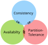
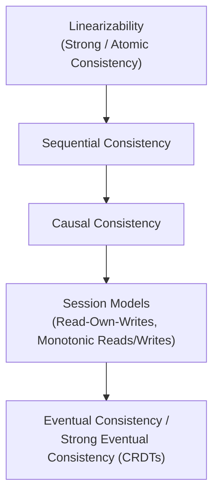
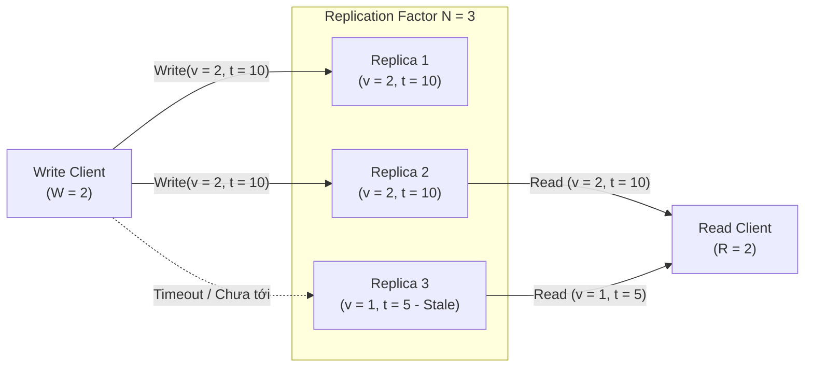

## Table of Contents
1. [Định lý CAP và PACELC](#cap-and-pacelc)
2. [Hệ thống phân cấp Consistency Models](#consistency-hierarchy)
3. [Session Consistency Models](#session-models)
4. [Eventual Consistency và CRDTs](#eventual-consistency-crdts)
5. [Tunable Consistency và Quorum (R + W > N)](#tunable-quorum)
6. [Tóm tắt & Ghi nhớ cốt lõi (Key Takeaways)](#key-takeaways)

---

Khi sao chép dữ liệu (**Replication**) qua nhiều node vật lý nhằm tăng khả năng chịu lỗi và mở rộng thông lượng đọc, khoảng trễ truyền tin qua mạng khiến các bản sao (**Replicas**) không thể cập nhật tức thời cùng một thời điểm. Chương 11 đi sâu vào các mô hình **Consistency** (quan hệ giữa trạng thái dữ liệu nhìn thấy từ phía client và thời gian thực) cùng các phương pháp phối hợp **Quorum**.

---

## Định lý CAP và PACELC {#cap-and-pacelc}

### Vì sao phát biểu "Chọn 2 trong 3 (CA, CP, AP)" gây hiểu lầm?

Định lý **CAP** (Brewer, chứng minh bởi Gilbert & Lynch) xét 3 thuộc tính trong hệ thống phân tán:
- **Consistency (`C` - tức Linearizability)**: Mọi thao tác đọc đều trả về giá trị của lần ghi thành công gần về mặt thời gian thực hoặc báo lỗi.
- **Availability (`A`)**: Mọi request gửi tới một node không bị sập đều phải nhận được phản hồi (không được phép trả lỗi hủy thao tác do thiếu kết nối liên mạng).
- **Partition Tolerance (`P`)**: Hệ thống tiếp tục vận hành dù mạng giữa các node bị đứt đoạn làm rơi hoặc trễ gói tin bất định.

Cách diễn giải *"Chọn 2 trong 3 (CA, CP, AP)"* không chính xác trong thực tế vì **Network Partition (`P`) là sự cố vật lý tất yếu trên mạng bất đồng bộ** — không một kiến trúc phân tán nào có thể "từ chối `P`" để chọn hệ thống "CA thuần túy". Do đó, bài toán thực sự là: **Khi xảy ra phân mảnh mạng (`P`), hệ thống chọn đánh đổi giữa `C` và `A` như thế nào?**

- **CP (Consistency under Partition)**: Hủy bỏ request (trả lỗi timeout/unavailable) ở phía phân vùng thiểu số hoặc khi không đủ Quorum nhằm bảo toàn **Linearizability**.
- **AP (Availability under Partition)**: Cho phép mọi node tiếp tục phục vụ đọc/ghi độc lập dù mất liên lạc, chấp nhận trả về dữ liệu cũ (**Stale Read**) hoặc phát sinh xung đột ghi (**Write Conflict**) cần giải quyết sau khi mạng thông suốt trở lại.


*Hình 11.1: Ba đỉnh của Định lý CAP: khi xảy ra Network Partition (P), hệ thống buộc phải chọn giữa Consistency (CP) và Availability (AP)*

### Định lý PACELC

Ngay cả khi mạng hoạt động bình thường (không có Partition), hệ thống phân tán vẫn phải trả giá cho việc sao chép dữ liệu. Daniel Abadi mở rộng CAP thành **PACELC**:

> **If Partition (`P`)** `->` chọn giữa **Availability (`A`)** và **Consistency (`C`)**; **Else (`E` - khi mạng bình thường)** `->` chọn giữa **Latency (`L`)** và **Consistency (`C`)**.

| Hệ thống | Phân loại PACELC | Giải thích cơ chế |
| :--- | :--- | :--- |
| **Spanner / CockroachDB / etcd** | **PC/EC** | Khi đứt mạng thì chặn thao tác ở phía thiểu số để giữ Consistency (**PC**); khi mạng bình thường vẫn phải chờ đồng thuận đa số node trước khi trả lời nên chịu độ trễ cao hơn để đổi lấy Consistency (**EC**). |
| **Cassandra / DynamoDB (mặc định)** | **PA/EL** | Khi đứt mạng vẫn cho phép đọc/ghi (**PA**); khi mạng bình thường có thể phản hồi ngay khi ghi xong số node tối thiểu nhằm tối ưu độ trễ thấp (**EL**). |
| **MongoDB (tùy cấu hình Write/Read Concern)** | **PA/EC** hoặc **PC/EC** | Linh hoạt điều chỉnh mức độ chờ xác nhận từ Primary/Majority. |

---

## Hệ thống phân cấp Consistency Models {#consistency-hierarchy}

Khác với chữ `C` trong ACID (vốn chỉ *Application Invariants* — các ràng buộc toàn vẹn bảng dữ liệu), **Consistency Model** trong hệ thống phân tán là bản hợp đồng giữa hệ thống lưu trữ và tiến trình client, quy định thứ tự xuất hiện hợp lệ của các thao tác Đọc/Ghi.



### 1. Linearizability (Strong / Atomic Consistency)

**Linearizability** tạo ra ảo giác chỉ có **đúng 1 bản sao dữ liệu đơn lẻ** (**Single-Copy Illusion**) gắn chặt với **đồng hồ thời gian thực (Real-Time Wall Clock)**:
- Mỗi thao tác đọc hoặc ghi đều có một điểm thực thi nguyên tử (**Linearization Point**) nằm giữa thời điểm bắt đầu gọi (**Invocation**) và thời điểm nhận kết quả (**Completion**).
- **Quy tắc thời gian thực**: Một khi bất kỳ client nào hoàn tất thao tác ghi giá trị mới `v_2` (hoặc bất kỳ client nào đã đọc thấy `v_2`), thì **tất cả** các thao tác đọc bắt đầu sau thời điểm đó của mọi client khác bắt buộc phải nhìn thấy `v_2` (hoặc giá trị mới hơn), không bao giờ được lùi về `v_1`.

```
Time (Wall Clock) ------------------------------------------------->
Client 1:  |--- Write(x = 1) ---|
Client 2:                  |------ Read(x) -> 1 ------|
Client 3:                                         |--- Read(x) -> 1 ---| (Bắt buộc trả về 1, trả về 0 là vi phạm Linearizability)
```

- **Chi phí**: Đòi hỏi giao thức đồng thuận (**Consensus** như Raft/Paxos) hoặc đọc/ghi Quorum kết hợp đồng bộ hóaRead Repair trước khi trả kết quả. Theo chứng minh của Attiya & Welch, độ trễ của cả Read và Write trong hệ thống Linearizable luôn bị chặn dưới bởi độ trễ truyền tin mạng thực tế giữa các node.

### 2. Sequential Consistency

Được Lamport định nghĩa năm 1979, **Sequential Consistency** nới lỏng ràng buộc thời gian thực của Linearizability:
- Mọi thao tác từ tất cả các client đều được sắp xếp vào một **thứ tự toàn cục chung (Single Global Order)** sao cho mọi node đều nhìn thấy cùng một chuỗi sự kiện giống hệt nhau.
- Thứ tự toàn cục này phải tôn trọng **Program Order** (thứ tự lệnh trong code của từng client riêng lẻ).
- Tuy nhiên, nếu hai thao tác nằm trên hai client khác nhau và không giao tiếp với nhau, hệ thống được phép xếp thứ tự của chúng lệch với thời gian thực tế trên đồng hồ vật lý.

### 3. Causal Consistency

Thay vì ép buộc mọi sự kiện không liên quan phải xếp vào chung một hàng đợi toàn cục như Sequential Consistency, **Causal Consistency** chỉ áp đặt thứ tự trên các thao tác **có quan hệ nhân quả (Happens-Before `->`)**:
- Nếu sự kiện `A` gây ra sự kiện `B` (ví dụ: câu hỏi `Post Question` `->` câu trả lời `Reply Answer`, hoặc Client đọc giá trị từ `A` rồi mới tính toán để ghi `B`), mọi node trong cụm bắt buộc phải nhìn thấy `A` trước `B`.
- Các thao tác đồng thời không có quan hệ nhân quả (**Concurrent Operations**: `A || C`) có thể được các node khác nhau nhìn thấy theo thứ tự khác nhau (`A` trước `C` hoặc `C` trước `A`).
- **Lưu ý quan trọng**: Causal Consistency là mô hình Consistency mạnh tối đa vẫn có thể duy trì khả năng sẵn sàng (**Available**) khi xảy ra Network Partition. Để theo dõi quan hệ nhân quả, hệ thống sử dụng **Logical Clocks** (Lamport Timestamps hoặc **Vector Clocks**).

### Bảng đối chiếu các mô hình Consistency

| Mô hình Consistency | Ràng buộc thứ tự | Phụ thuộc Real-Time Clock | Hoạt động khi bị Network Partition? | Chi phí phối hợp mạng |
| :--- | :--- | :--- | :--- | :--- |
| **Linearizability** | Toàn cục + Thời gian thực | Có | Không (CP) | Rất cao (Consensus / 2 vòng mạng) |
| **Sequential Consistency** | Toàn cục + Program Order | Không | Không | Cao (Cần sắp thứ tự toàn cục) |
| **Causal Consistency** | Cục bộ theo đồ thị nhân quả | Không | Có (AP) | Thấp (Truyền kèm metadata Vector Clock) |
| **Eventual Consistency** | Hội tụ cuối cùng khi ngừng ghi | Không | Có (AP) | Thấp (Phản hồi cục bộ ngay) |

---

## Session Consistency Models {#session-models}

Trong thực tế, việc nhìn từ góc độ của một **Session** (phiên kết nối của một người dùng cụ thể) giúp tránh các lỗi trải nghiệm người dùng nghiêm trọng mà không cần chi phí đắt đỏ của Linearizability:

1. **Read-Own-Writes (Read-Your-Writes)**: Sau khi một client cập nhật dữ liệu (ví dụ: đổi ảnh đại diện), các lần đọc tiếp theo của chính client đó phải thấy bản cập nhật vừa ghi (không bị điều hướng sang một Replica cũ chưa kịp đồng bộ).
2. **Monotonic Reads**: Nếu một client đã đọc thấy phiên bản dữ liệu tại thời điểm `t_2`, các lần đọc sau đó của client này không bao giờ được trả về phiên bản cũ hơn tại `t_1 < t_2` (tránh hiện tượng tin nhắn vừa hiện ra trên màn hình sau khi F5 lại biến mất do đọc trúng Replica chậm).
3. **Monotonic Writes**: Các thao tác ghi từ cùng một client phải được tuần tự hóa và áp dụng theo đúng thứ tự phát lệnh trên mọi Replica.
4. **Writes-Follow-Reads (Session Causality)**: Nếu một client đọc giá trị `v_1` rồi dựa vào đó phát lệnh ghi `v_2`, thì trên mọi Replica, hiệu lực của `v_1` phải được áp dụng trước `v_2`.

---

## Eventual Consistency và CRDTs {#eventual-consistency-crdts}

### Eventual Consistency vs Strong Eventual Consistency (SEC)

- **Eventual Consistency**: Đảm bảo rằng nếu không có thêm thao tác ghi mới nào phát sinh, sau một khoảng thời gian đồng bộ nền, tất cả các Replica cuối cùng sẽ hội tụ về cùng một giá trị. Tuy nhiên, nó không quy định làm thế nào để giải quyết xung đột khi hai node cùng ghi đồng thời (thường dẫn đến mất dữ liệu nếu dùng cơ chế **Last-Write-Wins - LWW** dựa trên đồng hồ vật lý bị lệch).
- **Strong Eventual Consistency (SEC)**: Bổ sung điều kiện mạnh hơn: bất kỳ hai Replica nào đã nhận được **cùng một tập hợp các bản cập nhật** (dù nhận theo thứ tự hoàn toàn khác nhau) đều sẽ lập tức ở trong trạng thái giống hệt nhau mà không cần phối hợp hay rollback.

### CRDTs (Conflict-Free Replicated Data Types)

Để đạt được SEC một cách tự động về mặt toán học, hệ thống sử dụng **CRDTs**:

1. **State-based CRDT (CvRDT - Convergent Replicated Data Types)**:
   - Mỗi node lưu giữ toàn bộ trạng thái cục bộ và định kỳ gửi trạng thái này sang node khác để trộn thông qua hàm **Merge (`⊔`)**.
   - Để kết quả hội tụ bất kể thứ tự mạng hay gói tin bị lặp, tập trạng thái phải tạo thành một **Join-Semilattice** và hàm `merge(A, B)` bắt buộc phải thỏa mãn 3 tính chất đại số:
     - **Giao hoán (Commutative)**: `A ⊔ B = B ⊔ A` (không phụ thuộc thứ tự gói tin đến).
     - **Kết hợp (Associative)**: `(A ⊔ B) ⊔ C = A ⊔ (B ⊔ C)` (gộp theo nhóm nào trước cũng ra cùng kết quả).
     - **Lũy đẳng (Idempotent)**: `A ⊔ A = A` (nhận trùng một bản tin nhiều lần không làm sai lệch trạng thái).

2. **Operation-based CRDT (CmRDT - Commutative Replicated Data Types)**:
   - Thay vì gửi toàn bộ state, node phát tán các thao tác cập nhật (**Operations**).
   - Các thao tác chỉ cần tính **Giao hoán (Commutative)**, nhưng đòi hỏi tầng mạng truyền tin phải đảm bảo **không làm rơi và không nhân bản thông điệp** (thường cần Causal Broadcast).

3. **Các cấu trúc CRDT điển hình**:
   - **G-Counter (Grow-Only Counter)**: Thay vì lưu một con số tổng dễ bị ghi đè khi cộng đồng thời, mỗi node `i` trong cụm `N` node chỉ được phép tăng ô đếm riêng của mình trong mảng vector `V[i]`. Khi `merge(V1, V2)`, hệ thống lấy `max(V1[i], V2[i])` tại từng vị trí `i`, còn giá trị tổng của bộ đếm là `sum(i=1..N) V[i]`.
   - **PN-Counter (Positive-Negative Counter)**: Ghép 2 G-Counter độc lập: mảng `P` chuyên đếm số lần tăng (`Increment`) và mảng `N` chuyên đếm số lần giảm (`Decrement`). Giá trị thực tế bằng `sum P[i] - sum N[i]`.
   - **LWW-Element-Set**: Mỗi phần tử gắn kèm timestamp trong tập `Add-Set` và `Remove-Set`, cho phép xóa rồi thêm lại phần tử dựa trên so sánh timestamp.

---

## Tunable Consistency và Quorum (R + W > N) {#tunable-quorum}

Trong các hệ thống Leaderless theo kiến trúc Dynamo (như Apache Cassandra, Riak, ScyllaDB), dữ liệu được sao chép lên **`N`** node (**Replication Factor = `N`**). Client có thể điều chỉnh linh hoạt mức độ Consistency trên từng câu truy vấn thông qua hai tham số:
- **`W` (Write Quorum)**: Số lượng Replica tối thiểu phải xác nhận đã ghi thành công trước khi Coordinator báo thành công về cho Client.
- **`R` (Read Quorum)**: Số lượng Replica tối thiểu phải phản hồi trong một truy vấn đọc trước khi Coordinator tổng hợp và trả dữ liệu về cho Client.

### Nguyên lý giao nhau (`R + W > N`)

Theo nguyên lý chuồng bồ câu (**Pigeonhole Principle**), nếu thiết lập **`R + W > N`**, tập hợp `W` node vừa nhận bản ghi mới và tập hợp `R` node được đọc lên **bắt buộc phải giao nhau tại ít nhất 1 node**.



**Ví dụ cụ thể với `N = 3, W = 2, R = 2` (`2 + 2 = 4 > 3`)**:
1. Client ghi giá trị mới `(v = 2, timestamp = 10)`. Coordinator gửi lệnh ghi tới cả 3 node, nhận được xác nhận từ `Replica 1` và `Replica 2` (đủ `W = 2`) rồi báo thành công ngay mà không chờ `Replica 3` (đang giữ bản cũ `v = 1, timestamp = 5`).
2. Ngay sau đó, một Client khác thực hiện đọc với `R = 2` và tình cờ liên lạc với `Replica 2` cùng `Replica 3`.
3. Coordinator nhận về hai phiên bản: `(v = 2, t = 10)` từ `Replica 2` và `(v = 1, t = 5)` từ `Replica 3`. Nhờ so sánh timestamp, Coordinator chọn phiên bản mới hơn là `v = 2` trả về cho Client.

Các cấu hình thường gặp khác:
- **`W = 1, R = N`**: Tối ưu tốc độ ghi cực nhanh, nhưng đọc chậm và không chịu được dù chỉ 1 node chết khi đọc.
- **`W = N, R = 1`**: Đọc cực nhanh từ 1 node bất kỳ, nhưng chỉ cần 1 node bảo trì là không thể ghi.
- **`W = ⌊ N/2 ⌋ + 1, R = ⌊ N/2 ⌋ + 1` (Majority Quorum)**: Cân bằng cả đọc lẫn ghi, chịu được tối đa `⌊ (N-1)/2 ⌋` node lỗi.

### Vì sao Strict Quorum (`R + W > N`) VẪN KHÔNG đạt Linearizability?

Một hiểu lầm rất phổ biến là chỉ cần cấu hình `R + W > N` (ví dụ `QUORUM` trong Cassandra) là hệ thống đạt **Linearizability**. Trên thực tế, nếu không có **Synchronous Read Repair** trước khi trả kết quả đọc hoặc giao thức chống ghi một phần, Quorum vẫn vi phạm Linearizability trong tình huống sau:

```
Giả sử N = 3 (Replica A, B, C), W = 2, R = 2. Giá trị ban đầu x = 0 trên cả A, B, C.

Thời điểm t1: Writer bắt đầu ghi x = 1.
              - Ghi x = 1 thành công vào Replica A.
              - Bản tin gửi tới Replica B đang bị trễ trên đường truyền, tới C bị rơi.
              (Lúc này: A giữ x=1, B giữ x=0, C giữ x=0. Lệnh Write vẫn đang chạy, chưa xong!)

Thời điểm t2: Reader 1 đọc từ {Replica A, Replica B} (đủ R = 2):
              - Nhận x = 1 từ A và x = 0 từ B -> Reader 1 thấy giá trị mới x = 1 và hoàn tất!

Thời điểm t3: Reader 2 bắt đầu đọc SAU KHI Reader 1 đã hoàn tất, nhưng đọc từ {Replica B, Replica C} (cũng đủ R = 2):
              - Nhận x = 0 từ B và x = 0 từ C -> Reader 2 nhận kết quả x = 0!
```

Tại đây, `Reader 2` bắt đầu đọc sau khi `Reader 1` đã nhìn thấy `x = 1`, nhưng `Reader 2` lại đọc ra giá trị cũ `x = 0` — **vi phạm trực tiếp định nghĩa Linearizability**! Để khắc phục dị thường này, `Reader 1` bắt buộc phải thực hiện **Blocking Read Repair** (ghi đè giá trị `x = 1` sang `Replica B` và chờ xác nhận thành công) **trước khi** trả kết quả `x = 1` về cho ứng dụng, để mọi truy vấn đọc Quorum sau đó đều nhìn thấy `x = 1`.

Ngoài ra, nếu hệ thống dùng **Sloppy Quorum** (khi các node chính bị phân mảnh mạng, Coordinator tạm ghi sang các node lân cận không thuộc tập `N` ban đầu qua cơ chế Hinted Handoff), tập đọc `R` và tập ghi `W` hoàn toàn có thể không giao nhau cho tới khi quá trình đồng bộ hoàn tất.

### Witness Replicas

Để giảm chi phí lưu trữ đĩa mà vẫn duy trì khả năng lập Quorum số lẻ (ví dụ tránh Split-Brain giữa 2 Datacenter), một số hệ thống sử dụng **Witness Replica**: node này không lưu toàn bộ bản sao dữ liệu hoàn chỉnh mà chỉ lưu metadata/log để tham gia bỏ phiếu xác nhận Quorum và hỗ trợ khôi phục khi xảy ra sự cố.

---

## Tóm tắt & Ghi nhớ cốt lõi (Key Takeaways) {#key-takeaways}

- **CAP & PACELC**: Phân mảnh mạng (`P`) là điều không tránh khỏi, nên lựa chọn thực chất khi đứt mạng là **CP** (từ chối phục vụ để giữ Linearizability) hay **AP** (ưu tiên phản hồi dù dữ liệu có thể cũ). Ngay cả khi mạng ổn định (`E`), hệ thống vẫn phải đánh đổi giữa **Latency (`L`)** và **Consistency (`C`)**.
- **Linearizability vs Sequential vs Causal**: Linearizability đòi hỏi thứ tự toàn cục bám sát đồng hồ thời gian thực; Sequential Consistency chỉ cần một thứ tự toàn cục tôn trọng Program Order của từng tiến trình; Causal Consistency chỉ sắp thứ tự các sự kiện có quan hệ nhân quả và là mô hình mạnh tối đa vẫn giữ được tính Available khi phân mảnh mạng.
- **CRDTs**: Cho phép các bản sao tự động hội tụ về cùng một trạng thái (**Strong Eventual Consistency**) mà không cần khóa hay đồng thuận nhờ hàm `merge` có tính giao hoán, kết hợp và lũy đẳng.
- **Quorum (`R + W > N`)**: Đảm bảo tập đọc và tập ghi có ít nhất 1 node giao nhau, nhưng **chưa đủ để đạt Linearizability** nếu thiếu cơ chế **Blocking Read Repair** khi có thao tác ghi đang diễn ra dở dang.

### Tài liệu & Nguồn tham khảo
- [DeCandia, G., et al. (2007) — *Dynamo: Amazon's Highly Available Key-value Store* (SOSP)](https://www.allthingsdistributed.com/files/amazon-dynamo-sosp2007.pdf)
- [Abadi, D. (2012) — *Consistency Tradeoffs in Modern Distributed Database System Design: CAP is Only Part of the Story (PACELC)*](https://www.cs.umd.edu/~abadi/papers/abadi-pacelc.pdf)
- [Shapiro, M., et al. (2011) — *Conflict-Free Replicated Data Types (CRDTs)*](https://hal.inria.fr/inria-00609399/document)
