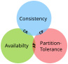
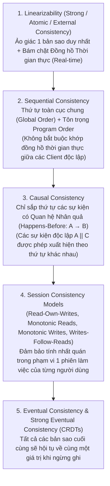
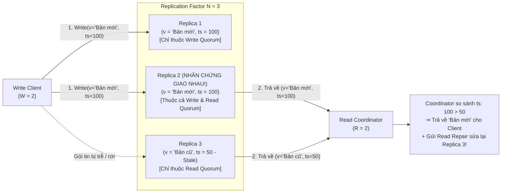

## Table of Contents
1. [Định lý CAP và PACELC](#cap-and-pacelc)
2. [Hệ thống phân cấp Consistency Models](#consistency-hierarchy)
3. [Session Consistency Models](#session-models)
4. [Eventual Consistency và CRDTs](#eventual-consistency-crdts)
5. [Tunable Consistency và Quorum (R + W > N)](#tunable-quorum)
6. [Tóm tắt & Ghi nhớ cốt lõi (Key Takeaways)](#key-takeaways)

---

## Định lý CAP và PACELC {#cap-and-pacelc}

### 0. Khởi động cho người mới: Bài toán "Cuốn sổ cái chung giữa 3 văn phòng Hà Nội — Singapore — Tokyo"

Hãy tưởng tượng một ngân hàng hoặc một tài liệu Google Doc có **3 bản sao cuốn sổ cái (`Replicas`)** đặt tại 3 văn phòng: **Hà Nội**, **Singapore** và **Tokyo** để nếu 1 văn phòng mất điện thì 2 văn phòng kia vẫn phục vụ khách hàng bình thường.

Khi một khách hàng ở **Hà Nội** nộp vào tài khoản `100 USD` (nâng số dư từ `0 USD` lên `100 USD`), giám đốc chi nhánh Hà Nội đứng trước hai lựa chọn nghiệt ngã:
- **Cách 1 — Chờ cả 3 văn phòng cùng ký xác nhận rồi mới in biên lai cho khách (`Strong Consistency / Linearizability`)**:
  - Nhân viên ở Hà Nội phải gọi điện sang cả Singapore và Tokyo, chờ cả 2 nơi ghi xong con số `100 USD` vào sổ của họ rồi mới quay ra báo với khách: *"Giao dịch thành công!"*.
  - **Ưu điểm**: Ngay giây tiếp theo, dù khách hàng gọi điện cho bạn ở Tokyo ra cây ATM tra cứu số dư, cây ATM ở Tokyo chắc chắn hiện đúng `100 USD`!
  - **Cái giá phải trả**: Khách ở Hà Nội phải đứng chờ đường truyền cáp quang quốc tế (`Latency` cao); tệ hơn, nếu tuyến cáp biển đi Tokyo bị cá mập cắn đứt (**Network Partition**), chi nhánh phải khóa sổ ngừng giao dịch để tránh lệch số liệu (`Hy sinh Availability`)!
- **Cách 2 — Ghi vào sổ Hà Nội xong là in biên lai báo thành công ngay trong `1 ms`, rồi gửi thư sang Singapore và Tokyo sau (`Eventual Consistency`)**:
  - **Ưu điểm**: Nhanh như chớp! Kể cả khi cáp quang biển bị đứt, chi nhánh Hà Nội và Tokyo vẫn độc lập nhận khách bình thường (`100% Availability`, `Latency` cực thấp).
  - **Cái giá phải trả**: Trong vài giây bức thư đang bay sang Tokyo, nếu người bạn ở Tokyo ra cây ATM kiểm tra số dư, màn hình ở Tokyo vẫn hiện con số cũ từ hôm qua là **`0 USD` (`Stale Read`)**!

Toàn bộ Chương 11 xoay quanh việc định lượng chính xác những cam kết giữa **"Đọc được dữ liệu mới đến mức nào?"** và **"Hệ thống trả lời nhanh & sẵn sàng đến mức nào?"**. Hãy nắm vững bảng từ điển dưới đây trước khi bước vào từng mô hình:

#### Bảng Từ Điển Thuật Ngữ Nhanh Cho Người Mới (Beginner's Visual Glossary)

| Thuật ngữ trong sách | Hiểu nôm na cho người mới (Ẩn dụ đời thực) | Trong Database phân tán thực tế (CockroachDB / TiKV / Cassandra / etcd / DynamoDB) là gì? |
| :--- | :--- | :--- |
| **`CAP Theorem`**<br/>*(Consistency, Availability, Partition Tolerance)* | Khi cáp quang giữa chi nhánh Hà Nội và Tokyo bị đứt (**Partition - P**), ngân hàng buộc phải chọn 1 trong 2:<br/>• **CP (Consistency)**: Đóng cửa chi nhánh bị cô lập để không bao giờ báo sai số dư.<br/>• **AP (Availability)**: Cho cả 2 chi nhánh tiếp tục giao dịch độc lập, chấp nhận sổ sách hai bên tạm thời lệch nhau. | • Nhóm **`CP` (etcd, ZooKeeper, CockroachDB, TiKV, Google Spanner)**: Dùng Raft/Paxos; nhánh nào mất đa số phiếu (*Quorum*) sẽ tự động từ chối phục vụ để bảo vệ dữ liệu tuyệt đối.<br/>• Nhóm **`AP` (Apache Cassandra, Amazon Dynamo, Riak)**: Mọi node còn sống vẫn nhận lệnh Đọc/Ghi độc lập dù đứt mạng liên vùng. |
| **`PACELC Theorem`**<br/>*(Nếu đứt mạng: chọn A hay C; nếu mạng bình thường: chọn Latency hay Consistency)* | Mở rộng định lý CAP cho cả 99.99% thời gian **khi mạng KHÔNG bị đứt (`Else`)**: Ngay cả lúc cáp quang bình thường, hệ thống vẫn phải chọn giữa **Trả lời tức thì trong 1ms (`Latency - L`)** hay **Chờ sao chép qua mạng sang các máy khác để dữ liệu luôn chuẩn (`Consistency - C`)**. | • **CockroachDB / Spanner / TiKV (`PC/EC`)**: Đứt mạng chọn `C`, mạng bình thường cũng chọn `C` (chấp nhận tốn vài ms đồng bộ Raft).<br/>• **Cassandra / DynamoDB Eventual Read (`PA/EL`)**: Đứt mạng chọn `A`, mạng bình thường ưu tiên độ trễ cực thấp `L`.<br/>• **MongoDB Replica Set**: Cho phép cấu hình linh hoạt qua `writeConcern` và `readConcern`. |
| **`Linearizability`**<br/>*(Tính tuyến tính hoá / Nhất quán tức thời theo thời gian thực)* | Cả thế giới như cùng nhìn vào **đúng 1 chiếc bảng đen duy nhất**. Hễ người A vừa đặt phấn xuống viết xong số `1` (hoặc bất kỳ ai đã nhìn thấy số `1` trên bảng) tại lúc `10:00:00.005`, thì từ mili-giây `.006` trở đi, mọi người khác trên Trái Đất nhìn lên bảng bắt buộc phải thấy số `1`! | Mức nhất quán cao cấp trong **etcd, Google Spanner, CockroachDB, TiKV** hoặc **DynamoDB `ConsistentRead=true`**: Bắt buộc phải có khi làm khoá phân tán (*Distributed Lock*), bầu cử Leader, chống trùng tên tài khoản (`UNIQUE`), và giao dịch ngân hàng. |
| **`Sequential Consistency`**<br/>*(Nhất quán tuần tự)* | Giống như xem truyền hình trực tiếp có độ trễ vài giây: Nhà ở Tokyo có thể xem chậm hơn nhà ở Hà Nội 3 giây, nhưng **thứ tự các bàn thắng trong trận đấu mà cả hai nhà nhìn thấy phải giống hệt nhau 100%** (và tôn trọng thứ tự hành động của từng cầu thủ). | Mô hình đọc từ các **Read Replicas** nhân bản theo một nhật ký chung (**PostgreSQL WAL Streaming, MySQL Binlog, ZooKeeper Async Read**): Người đọc trên Replica có thể thấy dữ liệu trễ vài mili-giây so với Primary, nhưng mọi thay đổi luôn diễn ra theo đúng một trình tự lịch sử duy nhất. |
| **`Causal Consistency`**<br/>*(Nhất quán nhân quả)* | Trên mạng xã hội: Các bài đăng không liên quan (ảnh con mèo ở VN và ảnh bóng đá ở Brazil) hiện lên theo thứ tự nào cũng được; nhưng **Câu hỏi (`Nguyên nhân`) bắt buộc phải luôn hiện ra trước Câu trả lời (`Kết quả`)** ở mọi nơi trên thế giới! | Mức nhất quán mạnh tối đa mà vẫn sống sót khi đứt mạng (`AP`), được hỗ trợ trong **MongoDB Causal Consistency Sessions** và các hệ thống dùng **Vector Clocks / HLC**: Không bao giờ để người dùng nhìn thấy bình luận trả lời trước khi nhìn thấy bài viết gốc. |
| **`Session Guarantees`**<br/>*(Read-Your-Writes, Monotonic Reads, Monotonic Writes, Writes-Follow-Reads)* | 4 quyền lợi tối thiểu của **một người dùng trong phiên đăng nhập của chính họ**:<br/>1. *Read-Your-Writes*: Tự sửa tên mình xong bấm F5 phải thấy ngay tên mới.<br/>2. *Monotonic Reads*: Đã nhìn thấy tin nhắn mới rồi thì bấm F5 không bao giờ được lùi về màn hình cũ lúc chưa có tin nhắn.<br/>3. *Monotonic Writes*: Gửi lệnh sửa nháp rồi lệnh chốt bài thì máy chủ phải chạy đúng thứ tự đó.<br/>4. *Writes-Follow-Reads*: Đọc câu hỏi xong bấm trả lời thì câu trả lời không được chạy trước câu hỏi. | Khi ứng dụng Web/Mobile đặt nhiều **PostgreSQL / MySQL / MongoDB Read Replicas** sau Load Balancer: Lập trình viên phải dùng **Sticky Session** (gắn cố định 1 user vào 1 Replica) hoặc truyền kèm vị trí log `last_seen_lsn / clusterTime` để tránh lỗi "F5 xong thấy mất dữ liệu vừa lưu". |
| **`Eventual Consistency & Tunable Quorum`**<br/>*(`N, W, R` với `R + W > N` trong Cassandra / DynamoDB)* | Cất bản hợp đồng vào **`N = 3` tủ hồ sơ**. Lúc cất (`Write`), bắt buộc bỏ vào ít nhất **`W = 2` tủ**. Lúc đi tìm đọc (`Read`), bắt buộc mở kiểm tra ít nhất **`R = 2` tủ**. Vì $2 + 2 > 3$, kiểu gì trong 2 tủ mở ra cũng có **ít nhất 1 tủ chứa bản hợp đồng mới nhất**! | Cơ chế **Tunable Quorum** kinh điển của **Apache Cassandra, ScyllaDB, Riak**: Cho phép lập trình viên chọn `ONE` ($W=1, R=1$ — cực nhanh nhưng có thể đọc cũ) hoặc `QUORUM` ($W=2, R=2$ trên $N=3$ — giao nhau chắc chắn). Tuy nhiên muốn đạt *Linearizability* tuyệt đối thì phải bật thêm **Blocking Read Repair** hoặc **Lightweight Transactions (Paxos)**. |
| **`CRDTs`**<br/>*(Conflict-Free Replicated Data Types: CvRDT vs CmRDT, PN-Counter, LWW-Element-Set)* | Các cấu trúc dữ liệu "tự biết giảng hoà bằng toán học": Dù 3 chi nhánh bị đứt cáp mạng suốt 1 tuần và mỗi nơi tự bấm cộng/trừ lượt Like hoặc thêm/xoá giỏ hàng độc lập, ngay khi nối mạng lại, hàm `merge()` sẽ gộp cả 3 bản về **cùng một kết quả chính xác 100%** mà không mất một thao tác nào! | Được tích hợp sẵn trong **Redis Enterprise (Active-Active Geo-Distribution), Riak DT (Data Types), Azure Cosmos DB, Akka Distributed Data**: Sử dụng `G-Counter / PN-Counter` (tách mảng Cộng và mảng Trừ riêng rồi lấy `max` từng ô) và `LWW-Element-Set / OR-Set` cho tập hợp. |

---

### 1. Bài toán thực tế & Mental Model: Cái giá vật lý của việc nhân bản dữ liệu (Replication)

Tại sao không lưu toàn bộ dữ liệu trên một máy chủ đơn lẻ cho đơn giản? Bởi vì một máy chủ đơn lẻ không thể chống chịu được hỏng hóc phần cứng (**Fault Tolerance**), không đủ sức phục vụ hàng trăm nghìn lượt đọc mỗi giây (**Read Scalability**), và không thể đặt dữ liệu gần người dùng ở nhiều châu lục để giảm độ trễ mạng (**Data Locality**).

Để đạt được 3 mục tiêu đó, hệ thống buộc phải sao chép dữ liệu (**Replication**) sang nhiều máy chủ vật lý gọi là các **Replicas**. Thế nhưng, ngay khoảnh khắc có từ `2` bản sao trở lên (`Replica 1` và `Replica 2`), một mâu thuẫn vật lý căn bản xuất hiện: **Tốc độ truyền tin qua cáp mạng là hữu hạn**. Khi một Client gửi lệnh cập nhật `x = 1` vào `Replica 1`, phải mất một khoảng thời gian $\Delta t > 0$ bản cập nhật đó mới bay qua mạng tới được `Replica 2`.
- Nếu đúng vào khoảng thời gian đang bay đó (hoặc khi sợi cáp mạng giữa `Replica 1` và `Replica 2` bị đứt), một Client khác gửi lệnh đọc `x` vào `Replica 2`, hệ thống phải làm gì?
  - **Lựa chọn 1 (Bảo vệ tính Nhất quán — Consistency)**: Bắt Client phải chờ cho đến khi `Replica 1` và `Replica 2` đồng bộ xong, hoặc trả về lỗi từ chối phục vụ (`ERROR: Unavailable`) nếu cáp mạng đang đứt.
  - **Lựa chọn 2 (Bảo vệ tính Sẵn sàng — Availability)**: Cho phép `Replica 2` trả lời ngay lập tức bằng giá trị hiện có trong máy của nó (`x = 0`), chấp nhận việc khách hàng nhìn thấy dữ liệu cũ (**Stale Read**).

Đó chính là bản chất vật lý đằng sau **Định lý CAP** (do Eric Brewer đề xuất năm `2000` và được Seth Gilbert cùng Nancy Lynch chứng minh toán học năm `2002`).

### 2. Giải phẫu Định lý CAP: Tại sao phát biểu "Chọn 2 trong 3 (CA, CP, AP)" gây hiểu lầm?

Định lý CAP định nghĩa chính xác 3 thuộc tính của một hệ thống lưu trữ phân tán:
1. **Consistency (`C` — ở đây được định nghĩa chặt chẽ là `Linearizability` / Atomic Consistency)**: Mọi thao tác đọc trên bất kỳ node nào đều phải trả về giá trị của lần ghi thành công gần nhất theo thời gian thực (hoặc trả về lỗi nếu không thể đảm bảo).
2. **Availability (`A` — Tính sẵn sàng `100%`)**: Mọi yêu cầu (đọc hoặc ghi) gửi tới một node **không bị sập (non-failing node)** đều bắt buộc phải nhận được một phản hồi hợp lệ (không trả về lỗi huỷ thao tác vì lý do mất liên lạc với các node khác).
3. **Partition Tolerance (`P` — Khả năng chịu phân mảnh mạng)**: Hệ thống vẫn tiếp tục vận hành ngay cả khi mạng truyền thông giữa các node bị chia cắt thành các phân vùng cô lập làm rơi hoặc trễ toàn bộ gói tin đi qua ranh giới phân vùng.

> [!NOTE]
> **Cách đọc sơ đồ cho người mới:**
> 1. **Nhìn vào đỉnh `Partition Tolerance (P)` của tam giác**: Trong thế giới mạng vật lý thực tế, đứt cáp hay nghẽn Switch giữa các phòng máy là điều chắc chắn xảy ra, nên mọi hệ thống phân tán đều bắt buộc phải neo giữ đỉnh `P`.
> 2. **Theo dõi hai cạnh nối từ `P` sang `Consistency (C)` và `Availability (A)`**: Khi sự cố đứt mạng (`P`) ập đến, kiến trúc sư chỉ được đi theo 1 trong 2 cạnh này:
>    - **Cạnh `CP` (`Consistency + Partition Tolerance`)**: Chấp nhận trả lỗi từ chối phục vụ ở nhánh bị mất liên lạc để đảm bảo không ai đọc/ghi sai dữ liệu (ví dụ: CockroachDB, TiKV, etcd, Spanner).
>    - **Cạnh `AP` (`Availability + Partition Tolerance`)**: Cho phép mọi máy còn sống tiếp tục nhận lệnh Đọc/Ghi độc lập dù đang đứt cáp, chấp nhận dữ liệu giữa hai nhánh tạm thời lệch nhau (ví dụ: Cassandra, Dynamo, Riak).
> 3. **Kết quả ở cạnh đáy `CA` (Không có `P`)**: Chỉ tồn tại khi hoàn toàn không có mạng phân tán (tức cơ sở dữ liệu chạy trên `1` máy chủ đơn lẻ như PostgreSQL/MySQL Single-Node).


*Hình 11.1: Ba đỉnh của Định lý CAP: khi xảy ra Network Partition (P), hệ thống buộc phải chọn giữa Consistency (CP) và Availability (AP)*

> [!IMPORTANT]
> **Tại sao không tồn tại hệ thống "CA" trong thực tế phân tán?**
> Cách vẽ 3 vòng tròn giao nhau và nói *"Hãy chọn 2 trong 3: CA, CP hoặc AP"* là một cách diễn đạt dễ gây hiểu lầm. Trên mạng vật lý thực tế (Ethernet/IP), **Network Partition (`P`) không phải là một tính năng để kiến trúc sư có quyền "chọn hay không chọn"** — đứt cáp, hỏng Switch hay nghẽn mạng là sự cố khách quan chắc chắn sẽ xảy ra! Một hệ thống "không chịu được Partition (CA)" thực chất chỉ có thể là **một máy chủ đơn lẻ (Single-Node)** không có mạng phân tán.
> Do đó, phát biểu chuẩn xác của Định lý CAP là:
> **Trong một hệ thống phân tán, khi sự cố chia cắt mạng (`P`) xảy ra, hệ thống bắt buộc phải chọn hy sinh hoặc Consistency (để lấy `AP`) hoặc Availability (để lấy `CP`)!**

Hãy xem diễn biến cụ thể trên cụm 2 node (`Node 1` ở Hà Nội và `Node 2` ở TP.HCM) khi cáp quang Bắc — Nam bị đứt (`P` xảy ra):
- **Kiến trúc `CP` (Consistency under Partition — ví dụ: etcd, ZooKeeper, Spanner, HBase)**:
  Nếu Client ghi `x = 1` vào `Node 1`, `Node 1` không thể nhân bản sang `Node 2` nên từ chối ghi (hoặc nếu cụm 3 node có `{Node 1, Node 2}` ở miền Bắc tạo thành đa số phiếu Quorum `2/3` thì miền Bắc vẫn cho ghi, nhưng `Node 3` bị cô lập ở miền Nam sẽ **tự động từ chối mọi truy vấn đọc/ghi và trả lỗi `Unavailable`** để tuyệt đối không trả về dữ liệu cũ).
- **Kiến trúc `AP` (Availability under Partition — ví dụ: Amazon Dynamo, Apache Cassandra, Riak, CouchDB)**:
  Dù cáp Bắc — Nam bị đứt, cả `Node 1` ở Hà Nội lẫn `Node 2` ở TP.HCM vẫn vui vẻ nhận mọi lệnh Đọc và Ghi của người dùng ở từng miền (đạt `100% Availability`), chấp nhận việc hai miền tạm thời nhìn thấy dữ liệu khác nhau và sẽ đồng bộ hoà giải xung đột (*Reconciliation*) sau khi cáp được nối lại.

---

### 3. Định lý PACELC (Daniel Abadi, `2012`) — Bức tranh toàn diện cả khi mạng bình thường

Định lý CAP chỉ nói về chuyện **khi mạng bị đứt (`P`)** — vốn chỉ chiếm một tỷ lệ thời gian rất nhỏ (ví dụ `0.01%` thời gian trong năm). Thế còn trong `99.99%` thời gian **khi mạng hoàn toàn khoẻ mạnh bình thường**, hệ thống phân tán có phải đánh đổi gì không?

Năm `2012`, Giáo sư Daniel Abadi (Đại học Maryland) đã mở rộng CAP thành công thức **PACELC** cực kỳ súc tích:

$$\textbf{If Partition (P)} \longrightarrow \text{Chọn } \textbf{A}\text{ (Availability) hay }\textbf{C}\text{ (Consistency)}; \qquad \textbf{Else (E — Mạng bình thường)} \longrightarrow \text{Chọn } \textbf{L}\text{ (Latency thấp) hay }\textbf{C}\text{ (Consistency mạnh)}$$

- **Tại sao khi mạng bình thường (`Else`) vẫn phải chọn giữa Latency (`L`) và Consistency (`C`)?**
  Ngay cả khi không có đoạn cáp nào bị đứt, để đảm bảo dữ liệu đọc ra luôn mới nhất (**Consistency `C`**), mỗi thao tác ghi bắt buộc phải gửi gói tin qua mạng chờ các Replica khác xác nhận (tốn `10 ms - 150 ms` độ trễ mạng). Ngược lại, nếu muốn phản hồi khách hàng ngay lập tức trong `1 ms` (**Latency thấp `L`**), node tiếp nhận chỉ cần ghi vào bộ nhớ của riêng nó rồi trả lời `OK` ngay, còn việc sao chép sang các Replica khác thì đẩy xuống chạy ngầm bất đồng bộ (*Asynchronous Replication*) — chấp nhận rủi ro khách hàng đọc trúng Replica khác sẽ thấy dữ liệu cũ!

| Hệ cơ sở dữ liệu | Phân loại PACELC | Hành xử khi Đứt mạng (`P`: Chọn `A` hay `C`?) | Hành xử khi Mạng bình thường (`E`: Chọn `L` hay `C`?) |
| :--- | :---: | :--- | :--- |
| **Google Spanner / CockroachDB / etcd / ZooKeeper** | **`PC / EC`** | **Chọn `C`**: Chặn đứng thao tác ở phân vùng thiểu số để không bao giờ lộ dữ liệu sai lệch. | **Chọn `C`**: Mọi lệnh ghi đều phải chờ đồng thuận đa số phiếu (Raft/Paxos Quorum) trước khi trả lời Client $\rightarrow$ Chịu độ trễ (Latency) cao hơn. |
| **Apache Cassandra / Amazon Dynamo / Riak** *(cấu hình mặc định)* | **`PA / EL`** | **Chọn `A`**: Mọi node còn sống vẫn tiếp tục nhận lệnh Đọc/Ghi độc lập. | **Chọn `L`**: Cho phép ghi/đọc với mức Quorum thấp (như `ONE` hoặc nhân bản bất đồng bộ) để đạt độ trễ cực thấp vài mili-giây. |
| **MongoDB** *(cấu hình `w: "majority"`, `readConcern: "majority"`)* | **`PC / EC`** | **Chọn `C`**: Primary nếu rơi vào phân vùng thiểu số sẽ tự hạ cấp (*step down*), ngừng nhận ghi. | **Chọn `C`**: Chờ đa số node ghi xong mới trả lời. *(Nếu đổi cấu hình sang `w: 1` và đọc từ Secondary thì sẽ chuyển thành **`PA / EL`** hoặc **`PC / EL`**)*. |
| **PNUTS (Yahoo!)** | **`PC / EL`** | **Chọn `C`**: Khi phân mảnh mạng thì khoá bản ghi chính. | **Chọn `L`**: Khi mạng bình thường cho phép đọc từ bản sao cục bộ gần nhất để giảm độ trễ. |

---

## Hệ thống phân cấp Consistency Models {#consistency-hierarchy}

### 1. Bài toán thực tế & Mental Model: Phân biệt chữ `C` trong ACID và Consistency Model trong Hệ phân tán

Rất nhiều kỹ sư nhầm lẫn hai khái niệm cùng viết tắt là chữ **`C` (Consistency)**:
- **Consistency trong ACID (Single-Node Database)**: Là tính toàn vẹn theo quy tắc nghiệp vụ của ứng dụng (*Application-level Invariants*), ví dụ: *"Tổng số dư của mọi tài khoản trước và sau giao dịch chuyển tiền phải không đổi"*, hoặc *"Khoá ngoại `user_id` phải tồn tại trong bảng `users`"*.
- **Consistency Model trong Hệ thống phân tán (Data Consistency / Coherence)**: Là **bản hợp đồng giữa Hệ thống lưu trữ và các Client** quy định: *"Khi có nhiều tiến trình cùng Đọc và Ghi đồng thời lên một biến dữ liệu `x` được nhân bản trên nhiều máy chủ, những giá trị nào được phép xuất hiện trong kết quả trả về của lệnh `Read(x)` và theo thứ tự nào?"*

Các mô hình Consistency phân tán được xếp từ **Nghiêm ngặt nhất (dễ lập trình nhất cho ứng dụng, nhưng đắt đỏ nhất về độ trễ mạng)** xuống **Lỏng lẻo nhất (tốc độ cực nhanh, luôn sẵn sàng, nhưng đẩy gánh nặng xử lý dữ liệu cũ về phía ứng dụng)**:

> [!NOTE]
> **Cách đọc sơ đồ cho người mới:**
> 1. **Nhìn theo chiều mũi tên từ đỉnh xuống đáy (`1 -> 2 -> 3 -> 4 -> 5`)**: Càng ở tầng trên cùng, dữ liệu càng "chuẩn tức thì" nhưng tốc độ ghi càng chậm (do các máy chủ phải chờ nhau qua mạng); càng xuống tầng dưới, tốc độ phản hồi càng nhanh và luôn sẵn sàng nhưng người đọc có thể nhìn thấy dữ liệu trễ vài giây.
> 2. **Theo dõi bước chuyển từ tầng `1 (Linearizability)` xuống tầng `2 (Sequential)` và `3 (Causal)`**: Tầng `1` bắt buộc bám chặt đồng hồ thời gian thực toàn cầu; tầng `2` bỏ yêu cầu đồng hồ thực nhưng giữ chung một cuốn lịch sử toàn cục; tầng `3` chỉ giữ thứ tự cho những sự kiện có quan hệ Nguyên nhân — Kết quả (`A -> B`).
> 3. **Kết quả ở tầng `4 (Session)` và tầng `5 (Eventual / CRDTs)`**: Tầng `4` đảm bảo từng người dùng đơn lẻ không gặp hiện tượng "ma ám" khi bấm F5, còn tầng `5` đảm bảo mọi máy chủ cuối cùng sẽ tự động hội tụ về cùng một kết quả.



---

### 2. Linearizability (Strong / Atomic / External Consistency)

#### Bài toán thực tế & Mental Model
Hãy tưởng tượng trận chung kết World Cup vừa kết thúc: **`Client A`** cập nhật tỷ số chung cuộc `Write(score = "2-1")` vào cơ sở dữ liệu và màn hình của `Client A` đã hiện thông báo `"Cập nhật thành công!"`. Ngay khoảnh khắc tiếp theo, `Client A` quay sang nói trực tiếp với người đồng nghiệp ngồi cạnh là **`Client B`**: *"Tỷ số cập nhật xong rồi đấy, mở điện thoại lên xem đi!"*.
Nếu `Client B` mở ứng dụng lên gọi lệnh `Read(score)` mà hệ thống lại điều hướng `Client B` vào một Replica chậm và hiển thị tỷ số cũ `"0-0"`, `Client B` sẽ lập tức nhận ra hệ thống bị lỗi!

**Mental Model của Linearizability (Herlihy & Wing, `1990`)**:
Hệ thống phân tán dù có `100` bản sao (Replicas) ở bên dưới nhưng tạo ra cho thế giới bên ngoài **ảo giác hoàn hảo rằng chỉ có đúng `1` bản sao dữ liệu (`Single-Copy Illusion`)**, và mọi thao tác Đọc/Ghi đều có hiệu lực tức thì tại một **điểm thời gian nguyên tử (`Linearization Point` — ký hiệu là dấu `*`)** nằm ở giữa lúc gửi yêu cầu (*Invocation*) và lúc nhận kết quả (*Completion*) trên **trục thời gian thực vật lý (Real-Time Wall Clock)**.

> [!IMPORTANT]
> **Quy tắc Vàng của Linearizability (Real-Time Recency Guarantee)**:
> Một khi bất kỳ thao tác ghi `Write(x = v_new)` nào đã **hoàn tất trả kết quả về cho Client** tại thời điểm $t_1$ (hoặc một thao tác đọc của bất kỳ Client nào đã **nhìn thấy giá trị `v_new`** tại thời điểm $t_1$), thì **MỌI thao tác đọc bắt đầu tại thời điểm $t_2 > t_1$ của tất cả các Client trên toàn hệ thống bắt buộc phải trả về `v_new` (hoặc một giá trị còn mới hơn nữa)** — tuyệt đối không bao giờ được lùi về trả giá trị cũ `v_old`!

#### Ví dụ chạy tay trên Biểu đồ Trục thời gian (Timeline Diagram)

Giả sử giá trị ban đầu của biến `x` là **`0`**. Hãy quan sát hai biểu đồ thời gian thực dưới đây (trong đó mỗi đoạn thẳng `|--- Op ---|` biểu diễn khoảng thời gian từ lúc Client bắt đầu gọi hàm qua mạng cho tới lúc hàm trả kết quả về, và dấu `*` là điểm thực thi nguyên tử *Linearization Point*):

> [!NOTE]
> **Cách đọc sơ đồ cho người mới (Cách đọc biểu đồ thanh ghi Không gian — Thời gian):**
> 1. **Hiểu ý nghĩa của đoạn thẳng `|----- Op -----|`**: Vạch đứng đầu tiên `|` là lúc ứng dụng **bắt đầu bấm nút gửi lệnh** qua mạng (*Invocation*); vạch đứng cuối cùng `|` là lúc ứng dụng **nhận được kết quả trả về** (*Completion*). Vì gói tin đi qua mạng mất vài mili-giây, mọi lệnh Đọc/Ghi đều là một **khoảng thời gian có độ dài** chứ không phải một chấm tức thời!
> 2. **Tìm dấu hoa thị `*` (`Linearization Point`) bên trong mỗi thanh**: Linearizability quy định rằng trong khoảng từ lúc gửi đến lúc nhận của mỗi lệnh, phải chọn ra được đúng 1 khoảnh khắc nguyên tử `*` mà lệnh đó thực sự phát huy tác dụng.
> 3. **Dóng thẳng hàng các dấu `*` từ trái sang phải theo trục thời gian**:
>    - Dấu `*` của `Client D` nổ ra đầu tiên (khi `A` chưa kịp chạm tới dấu `*` của mình) $\implies$ `D` đọc được giá trị ban đầu `0` là hoàn toàn hợp lệ!
>    - Tiếp theo, dấu `*` của `Client A` nổ ra, đổi biến `x` thành `1`.
>    - Kể từ vạch của dấu `*` trên `Client A` trở về bên phải, dấu `*` của cả `Client B` và `Client C` đều nằm sau nên bắt buộc phải đọc ra `1`!

```text
TRƯỜNG HỢP 1: HỢP LỆ — ĐẠT LINEARIZABILITY (Điểm nguyên tử * xếp thành 1 hàng thẳng tắp theo thời gian thực)
Trục thời gian thực (Real-Time Wall Clock) -------------------------------------------------------------->

Client A (Writer):     |----- Write(x = 1) ----*----|
Client B (Reader 1):              |---- Read(x) ---*--> trả về 1 ----|
Client C (Reader 2):                                       |--- Read(x) --*--> trả về 1 ---|
Client D (Reader 3):          |-- Read(x) -*-> trả về 0 --|

Giải thích tại sao Trường hợp 1 hợp lệ:
  • Tại sao Client D đọc ra 0 vẫn hợp lệ? Vì khoảng thời gian thực thi của Client D chồng lấp (overlap)
    với lúc lệnh Write(x = 1) của Client A vẫn đang chạy dở dang (chưa xong). Điểm nguyên tử (*) của D
    nằm TRƯỚC điểm nguyên tử (*) của A!
  • Điểm nguyên tử (*) của Client B nằm ngay SAU điểm (*) của Client A -> B đọc thấy 1.
  • Client C bắt đầu gọi Read(x) SAU KHI cả Client A (đã ghi xong 1) và Client B (đã đọc thấy 1) hoàn tất
    -> Client C bắt buộc phải đọc thấy 1 (và thực tế đã trả về 1 -> HỢP LỆ!).
```

```text
TRƯỜNG HỢP 2: VI PHẠM LINEARIZABILITY (Dù có Quorum nhưng thiếu đồng bộ điểm nguyên tử!)
Trục thời gian thực (Real-Time Wall Clock) -------------------------------------------------------------->

Client A (Writer):     |------------------- Write(x = 1) -------------------|
Client B (Reader 1):         |--- Read(x) ---> trả về 1 ---|
Client C (Reader 2):                                           |--- Read(x) ---> trả về 0 (LỖI!) ---|
                                                               ^
                                    (Bắt đầu gọi SAU KHI Client B đã nhìn thấy x = 1,
                                     nhưng lại trả về giá trị cũ x = 0 -> VI PHẠM LINEARIZABILITY!)
```

- **Những bài toán thực tế BẮT BUỘC phải có Linearizability**:
  1. **Distributed Locks & Leader Election (etcd, ZooKeeper)**: Khi một node chiếm khoá, mọi node khác kiểm tra ngay sau đó phải thấy khoá đã có chủ.
  2. **Ràng buộc chống trùng lặp (Uniqueness Constraints — như đăng ký `username` không trùng lặp hoặc đặt ghế máy bay/phòng khách sạn cuối cùng)**: Không thể cho phép hai người cùng đăng ký thành công một `username` giống hệt nhau.
  3. **Giao dịch tài chính có giao tiếp ngoài luồng (*Out-of-band communication*)**: Chuyển tiền xong chụp màn hình gửi cho người nhận kiểm tra số dư ngay lập tức.

---

### 3. Sequential Consistency (Nhất quán tuần tự — Leslie Lamport, `1979`)

#### Bài toán thực tế & Mental Model
Linearizability đòi hỏi các sự kiện phải tuân theo **đồng hồ thời gian thực vật lý** (buộc các node phải liên tục phối hợp chờ nhau hoặc có đồng hồ nguyên tử TrueTime). Nếu ta nới lỏng yêu cầu đồng hồ thời gian thực đi một chút thì sao?

**Mental Model của Sequential Consistency**:
Hãy hình dung tất cả các thao tác của mọi Client vẫn được xếp vào **một dòng thời gian toàn cục chung (Single Global Timeline)** sao cho **mọi người đọc trên toàn hệ thống đều nhìn thấy các sự kiện diễn ra theo cùng một bộ phim có thứ tự cảnh quay giống hệt nhau**, và các hành động của từng cá nhân riêng lẻ luôn giữ đúng thứ tự trước sau của người đó (**Program Order**). Tuy nhiên, nếu hai người ở hai nơi độc lập cùng phát hành động mà không nói chuyện với nhau, hệ thống được phép tự do sắp xếp người này đứng trước hoặc đứng sau người kia trong bộ phim chung mà **không cần khớp với đồng hồ bấm giờ vật lý bên ngoài**!

#### Ví dụ chạy tay trên Biểu đồ Trục thời gian (Timeline Diagram)

Hãy xét kịch bản: Ban đầu biến `x = 0`.
- **`Client A`** thực hiện tuần tự 2 lệnh theo **Program Order**: ghi `Write(x = 1)` rồi sau đó ghi `Write(x = 2)`.
- **`Client B`** và **`Client C`** là hai người đọc liên tục kiểm tra giá trị của `x`.

> [!NOTE]
> **Cách đọc sơ đồ cho người mới:**
> 1. **Nhìn vào dòng `Client A (Writer)` ở trên cùng**: `Client A` lần lượt viết `x = 1`, rồi một lúc sau viết tiếp `x = 2`. Thứ tự lịch sử do `A` tạo ra là: `0 -> 1 -> 2`.
> 2. **Theo dõi lệnh `Read(x) -> 0` đầu tiên của `Client B`**: Nếu xét theo đồng hồ thời gian thực (dóng thẳng từ trên xuống), `Client B` bắt đầu đọc sau khi `Client A` đã ghi xong `x = 1`, nhưng `B` vẫn nhận được số cũ `0` (do Replica của `B` nhận bản sao chậm vài mili-giây) $\implies$ Không đạt Linearizability.
> 3. **Kết quả kiểm tra Sequential Consistency trên cả `Client B` và `Client C`**: Hãy đọc dãy kết quả từ trái sang phải của `Client B` (`0 -> 1 -> 2`) và của `Client C` (`0 -> 1 -> 2`). Cả hai người đọc đều xem đúng một cuốn phim biến đổi theo thứ tự `0 ===> 1 ===> 2` mà không ai bị nhảy cóc hay đảo lộn thứ tự `2` trước `1` $\implies$ **Đạt chuẩn Sequential Consistency**!

```text
TRƯỜNG HỢP 1: ĐẠT SEQUENTIAL CONSISTENCY (nhưng KHÔNG đạt Linearizability)
Trục thời gian thực (Real-Time Wall Clock) -------------------------------------------------------------->

Client A (Writer):   |-- Write(x = 1) --|          |-- Write(x = 2) --|
Client B (Reader 1):                         |-- Read(x) -> 0 --|  |-- Read(x) -> 1 --|  |-- Read(x) -> 2 --|
Client C (Reader 2):                                 |-- Read(x) -> 0 --|  |-- Read(x) -> 1 --|  |-- Read(x) -> 2 --|

Phân tích:
  • Tại sao KHÔNG đạt Linearizability? Vì lệnh Read(x) đầu tiên của Client B bắt đầu SAU KHI Write(x = 1)
    của Client A đã hoàn tất trên đồng hồ thực tế, nhưng Client B vẫn đọc ra giá trị cũ `0` (do độ trễ nhân bản).
  • Tại sao VẪN ĐẠT Sequential Consistency?
    Vì cả Client B lẫn Client C đều nhìn thấy chính xác CÙNG MỘT TRÌNH TỰ BIẾN ĐỔI TOÀN CỤC của x:
       x = 0   ===>   x = 1   ===>   x = 2
    Trình tự này hoàn toàn tôn trọng Program Order của Client A (Write(x=1) xảy ra trước Write(x=2))!
```

```text
TRƯỜNG HỢP 2: VI PHẠM SEQUENTIAL CONSISTENCY (Hai người đọc thấy 2 lịch sử toàn cục ngược nhau!)
Giả sử có 2 người đăng bài độc lập:
  • Client W1 ghi: Write(post_A)
  • Client W2 ghi: Write(post_B)

Nếu:
  • Reader 1 đọc thấy:  [post_A] xuất hiện trước, rồi mới tới [post_B]
  • Reader 2 đọc thấy:  [post_B] xuất hiện trước, rồi mới tới [post_A]
==> VI PHẠM SEQUENTIAL CONSISTENCY! Vì không tồn tại một thứ tự toàn cục (Single Global Order) duy nhất
    nào mà trong đó post_A vừa đứng trước post_B lại vừa đứng sau post_B!
```

---

### 4. Causal Consistency (Nhất quán nhân quả)

#### Bài toán thực tế & Mental Model
Trong Ví dụ 2 ở trên, nếu `Client W1` ở Việt Nam đăng một bức ảnh mèo (`post_A`), và cùng lúc đó `Client W2` ở Brazil đăng một bức ảnh bóng đá (`post_B` — hoàn toàn không liên quan gì tới `post_A`), thì việc người dùng ở châu Á thấy `post_A` hiện lên trước `post_B`, còn người dùng ở Nam Mỹ thấy `post_B` hiện lên trước `post_A` có gây ra lỗi logic nào không? **Hoàn toàn không!** Việc ép hai bài đăng độc lập ở hai đầu Trái Đất phải xếp chung một hàng đợi toàn cục như *Sequential Consistency* là sự lãng phí băng thông không cần thiết.

Thế nhưng, nếu dưới bức ảnh `post_A` có một cuộc hội thoại bình luận:
- **Bình luận `Q` (của An)**: *"Ai làm rơi chiếc ví ở sảnh tầng 1 thế?"*
- **Bình luận `R` (của Bình — trả lời sau khi đã đọc `Q`)**: *"Của tôi đấy, cảm ơn nhé!"*

Nếu một người dùng thứ ba (`Reader`) mở trang bình luận lên mà hệ thống lại hiển thị câu trả lời **`R` ("Của tôi đấy, cảm ơn nhé!")** ở phía trên, rồi một lúc sau mới hiện câu hỏi **`Q` ("Ai làm rơi chiếc ví...")** ở phía dưới, người đọc sẽ hoàn toàn bối rối vì **trật tự Nguyên nhân — Kết quả đã bị đảo ngược**!

**Mental Model của Causal Consistency**:
> **"Những sự kiện có quan hệ nhân quả (`Nguyên nhân -> Kết quả`, tức $A \to B$) thì MỌI NODE trên toàn thế giới bắt buộc phải nhìn thấy theo đúng thứ tự $A$ trước, $B$ sau. Còn những sự kiện xảy ra độc lập không biết tới nhau ($A \parallel C$) thì mỗi node được tự do hiển thị theo bất kỳ thứ tự nào thuận tiện nhất!"**

#### Ví dụ chạy tay trên Biểu đồ Trục thời gian (Timeline Diagram)

Xét 3 sự kiện:
- **`Q`**: An đăng câu hỏi (`Post("Ai rơi ví?")`).
- **`R`**: Bình đọc thấy `Q`, rồi đăng câu trả lời (`Reply("Của tôi!")`). Do đó ta có quan hệ nhân quả bắt buộc: **`Q -> R`**.
- **`C`**: Cường ở một nhóm khác đăng một thông báo độc lập (`Post("Trời mưa to quá!")`), không hề đọc `Q` hay `R`. Do đó **`C || Q`** và **`C || R`**.

> [!NOTE]
> **Cách đọc sơ đồ cho người mới:**
> 1. **Nhìn vào phần trên đường kẻ ngang**: Có một mũi tên nhân quả nối từ lúc `Client An` ghi câu hỏi **`Q`** sang lúc `Client Bình` đọc `Q` rồi ghi câu trả lời **`R`** (`Q -> R`). Trong khi đó, dòng `Client Cường` ghi **`C`** ("Trời mưa!") hoàn toàn đứng riêng, không có mũi tên nào nối với `Q` hay `R`.
> 2. **Theo dõi 3 dòng `Replica 1, 2, 3` ở phần dưới**: Hãy kiểm tra vị trí của `[Q]` và `[R]` — dù thông báo độc lập `[C]` có chen vào cuối (`[Q] -> [R] -> [C]`), chen vào đầu (`[C] -> [Q] -> [R]`), hay chen vào giữa (`[Q] -> [C] -> [R]`), thì **câu hỏi `[Q]` luôn luôn xuất hiện trước câu trả lời `[R]`** nên cả 3 Replica đều hợp lệ (`✅`)!
> 3. **Kết quả ở dòng cuối `Replica 4 (Lỗi!)`**: Do gói tin của `[R]` bay qua mạng tới `Replica 4` nhanh hơn gói tin của `[Q]`, `Replica 4` cho hiển thị câu trả lời **`[R]` trước câu hỏi `[Q]`** $\implies$ Đảo ngược nhân quả, **vi phạm Causal Consistency (`❌`)**!

```text
Biểu đồ kiểm tra tính đúng đắn của Causal Consistency trên các Replica:

Client An:      |-- Ghi Q ("Ai rơi ví?") --|
                                           \ (Quan hệ nhân quả Q -> R)
Client Bình:                                v--> |-- Đọc Q --| --> |-- Ghi R ("Của tôi!") --|

Client Cường:          |-- Ghi C ("Trời mưa!") --|  (Hoàn toàn độc lập: C || Q và C || R)
---------------------------------------------------------------------------------------------------------
• Replica 1 (Hà Nội) hiển thị thứ tự:    [Q]  --->  [R]  --->  [C]   (✅ HỢP LỆ: vì Q đứng trước R)
• Replica 2 (Tokyo) hiển thị thứ tự:     [C]  --->  [Q]  --->  [R]   (✅ HỢP LỆ: vì Q vẫn đứng trước R)
• Replica 3 (New York) hiển thị thứ tự:  [Q]  --->  [C]  --->  [R]   (✅ HỢP LỆ: vì Q vẫn đứng trước R)
• Replica 4 (Lỗi!) hiển thị thứ tự:      [R]  --->  [Q]  --->  [C]   (❌ VI PHẠM CAUSAL CONSISTENCY:
                                                                       vì kết quả R lại hiện ra trước nguyên nhân Q!)
```

> [!TIP]
> **Vị trí đặc biệt của Causal Consistency trong Định lý CAP**:
> Các nhà khoa học máy tính (Mahajan, Alvisi, Dahlin `2011`) đã chứng minh rằng: **Causal Consistency là mô hình nhất quán mạnh tối đa có thể đạt được mà vẫn đảm bảo tính Sẵn sàng (`Available`) khi xảy ra phân mảnh mạng (`Network Partition` — nhánh AP)**. Để cài đặt Causal Consistency, hệ thống sử dụng **Vector Clocks** hoặc đính kèm mã định danh của các bản ghi tiền thân (*Causal Dependencies*) vào mỗi gói tin ghi: một Replica khi nhận được bản ghi kết quả `R` (có ghi chú `depends_on = Q`) sẽ tạm giữ `R` trong bộ đệm chờ cho đến khi nó nhận và áp dụng xong nguyên nhân `Q`!

---

### Bảng tổng hợp so sánh các mô hình Consistency chính

| Mô hình Consistency | Quy tắc sắp xếp thứ tự | Phụ thuộc Đồng hồ Thời gian thực? | Sống sót khi bị Network Partition (AP)? | Công cụ / Thuật toán cài đặt điển hình |
| :--- | :--- | :---: | :---: | :--- |
| **Linearizability** | Toàn cục + Bám chặt thời gian thực vật lý ($t_{\text{real}}$). | **Có** | **Không (`CP`)** | Raft, Multi-Paxos, Zab, Google TrueTime (`2ε`), Strict Quorum + Blocking Read Repair. |
| **Sequential Consistency** | Toàn cục chung cho mọi node + Tôn trọng Program Order. | **Không** | **Không (`CP`)** | Single-Leader Replication (đọc tuần tự từ log), Total Order Broadcast (ZooKeeper đọc bất đồng bộ có `zxid` đơn điệu). |
| **Causal Consistency** | Cục bộ theo đồ thị nhân quả ($A \to B$). Cho phép $A \parallel C$ khác thứ tự. | **Không** | **Có (`AP`)** | Vector Clocks, Version Vectors, Hybrid Logical Clocks (HLC), Causal Broadcast. |
| **Eventual Consistency** | Không đảm bảo thứ tự tức thời; hội tụ cuối cùng khi ngừng ghi. | **Không** | **Có (`AP`)** | Anti-Entropy Gossip, Read Repair, Last-Write-Wins (LWW), CRDTs. |

---

## Session Consistency Models {#session-models}

### Bài toán thực tế & Mental Model: Đảm bảo trải nghiệm hợp lý cho từng người dùng đơn lẻ

Trong các hệ thống phân tán ưu tiên hiệu năng đọc cao (như mạng xã hội, thương mại điện tử), người dùng thường gửi lệnh **Ghi (`WRITE`)** vào **Leader (Primary)** nhưng lại gửi lệnh **Đọc (`READ`)** phân tán ngẫu nhiên qua bộ cân bằng tải (*Load Balancer*) vào hàng chục **Read Replicas (Followers)** được nhân bản bất đồng bộ.

Nếu không cần tới chi phí đắt đỏ của Linearizability giữa những người dùng xa lạ với nhau, mỗi cá nhân người dùng bên trong **chính phiên đăng nhập của họ (`Client Session`)** vẫn đòi hỏi tối thiểu **4 bảo đảm nhất quán phiên (Session Guarantees — Terry et al., `1994`)** dưới đây để giao diện ứng dụng không bị "ma ám":

---

### 1. Read-Own-Writes (Read-Your-Writes Consistency)

- **Định nghĩa**: Một khi người dùng (trong cùng một Session) đã thực hiện một thao tác cập nhật dữ liệu $W(x = v_1)$ thành công, mọi thao tác đọc $R(x)$ tiếp theo của **chính người dùng đó** bắt buộc phải nhìn thấy giá trị $v_1$ (hoặc giá trị mới hơn).
- **Kịch bản lỗi thực tế nếu vi phạm**:
  Người dùng vừa cập nhật mật khẩu mới hoặc sửa tên hiển thị trên trang Hồ sơ cá nhân rồi bấm *"Lưu"* (lệnh ghi đi vào `Primary DB`). Trình duyệt tự động tải lại trang để hiển thị thông tin mới, nhưng Load Balancer lại điều hướng lệnh `SELECT` đó sang `Replica 2` (nơi chưa nhận được bản cập nhật từ Primary). Màn hình vẫn hiện tên cũ! Người dùng hoang mang tưởng mình chưa bấm nút Lưu nên bấm lặp lại nhiều lần.

> [!NOTE]
> **Cách đọc sơ đồ cho người mới:**
> 1. **Theo dõi mũi tên `1. UPDATE bio = "Senior Engineer"`**: Người dùng gửi lệnh sửa hồ sơ vào máy chủ chính `Primary DB`.
> 2. **Theo dõi mũi tên `2. F5 tải lại trang` và đường truyền dọc `(Đang đồng bộ chậm...)`**: Ngay khi người dùng tải lại trang để xem thành quả, lệnh đọc `SELECT bio` bị điều hướng sang máy phụ `Replica 2` trong lúc bản cập nhật từ `Primary DB` vẫn còn đang trên đường bay xuống `Replica 2`.
> 3. **Kết quả ở mũi tên `3`**: `Replica 2` trả về chức danh cũ `"Intern"`, làm người dùng tưởng hệ thống bị hỏng không lưu được dữ liệu của chính mình!

```text
Minh hoạ lỗi khi VI PHẠM Read-Own-Writes:
  [User Session A] --- 1. UPDATE bio = "Senior Engineer" ---> [Primary DB] (Đã lưu bio mới)
                                                                    |
  [User Session A] --- 2. F5 tải lại trang (SELECT bio) ----+       | (Đang đồng bộ chậm...)
                                                            |       v
                                                            +---> [Replica 2 (Chưa kịp cập nhật!)]
                                                                    |
  [User Session A] <-- 3. Trả về bio cũ "Intern" (LỖI!) ------------+
```

- **Cách cài đặt trong thực tế**:
  1. **Định tuyến theo chủ sở hữu**: Những dữ liệu mà chỉ chủ tài khoản mới có quyền sửa (như trang *Chỉnh sửa hồ sơ của chính mình*) thì luôn đọc từ `Primary`, còn khi người khác vào xem hồ sơ đó thì mới đọc từ `Read Replicas`.
  2. **Theo dõi dấu thời gian sửa đổi cuối**: Sau khi ghi, Server trả về cho Client nhãn thời gian/vị trí log `last_write_lsn = 1050`. Ở lần đọc tiếp theo, Client gửi kèm `min_lsn = 1050`; nếu Replica nhận truy vấn thấy `local_lsn < 1050`, nó sẽ chờ đồng bộ tới `1050` rồi mới trả lời (hoặc chuyển tiếp truy vấn về Primary).

---

### 2. Monotonic Reads (Đọc đơn điệu — Không bao giờ "du hành ngược về quá khứ")

- **Định nghĩa**: Nếu trong một Session, người dùng tại thời điểm $t_1$ đã đọc và nhìn thấy giá trị $v_2$ của dữ liệu, thì tại mọi lần đọc tiếp theo $t_2 > t_1$, người dùng đó **không bao giờ được phép nhận lại giá trị cũ hơn $v_1$** (với $v_1$ là phiên bản trước của $v_2$).
- **Kịch bản lỗi thực tế nếu vi phạm**:
  Người dùng mở hộp thư chat: lần đầu tải trang, truy vấn rơi vào **`Replica 1` (đã đồng bộ mới nhất)** nên nhìn thấy tin nhắn mới của sếp vừa gửi: *"Chiều nay họp lúc 14:00 nhé"*. Người dùng bấm F5 làm mới trang, lần này Load Balancer theo kiểu *Round-Robin* lại đẩy truy vấn sang **`Replica 2` (đang bị trễ Replication Lag `5` giây)** — tin nhắn của sếp đột nhiên **biến mất hoàn toàn khỏi màn hình** như chưa từng tồn tại!

> [!NOTE]
> **Cách đọc sơ đồ cho người mới:**
> 1. **Nhìn vào dòng đầu tiên (`Tại t = 1s`)**: Người dùng đọc trúng `Replica 1` đang ở mốc nhật ký mới `LSN = 500`, nên đã nhìn thấy tận mắt tin nhắn mới `v₂`.
> 2. **Theo dõi dòng thứ hai (`Tại t = 2s`)**: Một giây sau, người dùng bấm làm mới trang nhưng bị chuyển sang `Replica 2` đang tụt hậu ở mốc nhật ký cũ `LSN = 480`.
> 3. **Kết quả**: Màn hình của người dùng bị "quay ngược thời gian" về trạng thái cũ `v₁`, làm tin nhắn `v₂` vừa đọc được bỗng dưng biến mất!

```text
Minh hoạ lỗi khi VI PHẠM Monotonic Reads:
  • Tại t = 1s:  [User Session A] ---> Đọc từ [Replica 1 (LSN = 500)] ---> Thấy tin nhắn MỚI v₂!
  • Tại t = 2s:  [User Session A] ---> Đọc từ [Replica 2 (LSN = 480)] ---> Lại trả về trạng thái CŨ v₁ (Mất tin nhắn v₂)!
```

- **Cách cài đặt trong thực tế**:
  1. **Sticky Sessions (Session Affinity)**: Dùng hàm băm `hash(session_id) % num_replicas` trên Load Balancer để cố định mọi truy vấn đọc của một phiên người dùng luôn đi vào **cùng một Replica cố định** (trừ khi Replica đó bị sập).
  2. **Client-side Version Tracking**: Client lưu lại `highest_seen_version = 500` từ lần đọc trước và đính kèm vào mọi lệnh đọc sau (`READ WHERE replica_version >= 500`).

---

### 3. Monotonic Writes (Ghi đơn điệu)

- **Định nghĩa**: Nếu cùng một Session phát ra hai lệnh ghi liên tiếp $W_1$ rồi đến $W_2$, thì trên **tất cả mọi Replica**, lệnh $W_1$ bắt buộc phải được thực thi trước rồi mới đến $W_2$ (không bao giờ được áp dụng ngược thứ tự thành $W_2$ rồi mới đè $W_1$ lên).
- **Kịch bản lỗi thực tế nếu vi phạm**:
  Trong hệ thống Leaderless hoặc Multi-Leader, người dùng thực hiện 2 thao tác liên tiếp: (1) Tạo thư mục `mkdir("/docs")` (gửi tới `Coordinator 1`), rồi ngay sau đó (2) Lưu file `create_file("/docs/report.pdf")` (gửi tới `Coordinator 2`). Nếu gói tin của thao tác (2) bay tới `Replica 3` nhanh hơn gói tin của thao tác (1), `Replica 3` sẽ báo lỗi do chưa có thư mục `/docs`, hoặc nếu là hai lệnh sửa cùng một bài viết (`Sửa nháp v1` $\to$ `Chốt bản chính thức v2`), việc `v1` đến sau và ghi đè lên `v2` sẽ làm mất bản chốt cuối cùng của người dùng!
- **Cách cài đặt trong thực tế**: Tuần tự hoá các lệnh ghi của cùng một Session qua cùng một nút điều phối, hoặc gắn số thứ tự tuần tự (`Session Sequence Number: seq = 1, 2, 3...`) để các Replica áp dụng đúng thứ tự `seq`.

---

### 4. Writes-Follow-Reads (Session Causality)

- **Định nghĩa**: Nếu một người dùng đọc thấy kết quả của một thao tác ghi $W_1$ (có thể do người khác tạo ra), và dựa trên thông tin vừa đọc được đó người dùng phát lệnh ghi mới $W_2$, thì trên mọi Replica trong cụm, $W_1$ bắt buộc phải được áp dụng trước $W_2$ ($W_1 \to W_2$).
- **Kịch bản lỗi thực tế nếu vi phạm**:
  Đây chính là kịch bản Hỏi — Đáp trong Causal Consistency nhìn từ góc độ Session của người trả lời: Bình đọc thấy câu hỏi $W_1$ từ `Replica 1` rồi gửi câu trả lời $W_2$. Hệ thống phải đảm bảo rằng khi nhân bản $W_2$ sang `Replica 3`, `Replica 3` phải có mặt $W_1$ trước khi cho phép $W_2$ hiển thị!

---

## Eventual Consistency và CRDTs {#eventual-consistency-crdts}

### 1. Bài toán thực tế & Mental Model: Làm sao để các node tự động gộp dữ liệu mà không bao giờ mất mát hay xung đột?

Khi hai bản sao (`Replica A` và `Replica B`) cùng nhận lệnh ghi đồng thời lúc đứt mạng (**AP System**), đến khi mạng thông suốt trở lại, hai bản sao phải đối mặt với câu hỏi: **Làm thế nào để hợp nhất (*Merge*) hai trạng thái khác nhau về chung một kết quả thống nhất?**

- **Cách tiếp cận ngây thơ (Last-Write-Wins — LWW)**: So sánh nhãn thời gian vật lý của hai bản ghi, bản nào có timestamp lớn hơn thì giữ lại, bản kia **vứt vào sọt rác**. Như đã phân tích ở Chương 8, nếu hai người cùng bấm nút *"Tăng lượt Like"* hoặc *"Thêm sản phẩm vào giỏ hàng"* trên hai node khác nhau, cơ chế LWW sẽ **âm thầm xoá mất 1 trong 2 thao tác**!
- **Eventual Consistency (Nhất quán cuối cùng)**: Chỉ đảm bảo ở mức yếu rằng *"Nếu tất cả các Client dừng ghi, cuối cùng mọi Replica sẽ có cùng một giá trị"*, nhưng không quy định rõ quá trình hợp nhất có làm mất dữ liệu hay cần phải chạy giao thức đồng thuận phức tạp hay không.
- **Strong Eventual Consistency (SEC) và CRDTs (Conflict-Free Replicated Data Types — Shapiro et al., `2011`)**:
  Đặt ra một mục tiêu toán học tuyệt đẹp: **Thiết kế các cấu trúc dữ liệu đặc biệt (Bộ đếm, Tập hợp, Đồ thị, Văn bản cộng tác) sao cho bất kỳ hai Replica nào khi nhận được cùng một tập hợp các bản cập nhật — bất kể nhận theo thứ tự nào hay nhận trùng lặp bao nhiêu lần — đều TỰ ĐỘNG hội tụ về trạng thái giống hệt nhau 100% mà không cần khoá (Lock-free) và không mất một thao tác nào!**

### 2. Hai họ CRDT: State-based (CvRDT) vs Operation-based (CmRDT)

| Đặc điểm | State-based CRDT (CvRDT — Convergent) | Operation-based CRDT (CmRDT — Commutative) |
| :--- | :--- | :--- |
| **Cách truyền dữ liệu giữa các Node** | Mỗi node định kỳ gửi **toàn bộ trạng thái dữ liệu cục bộ ($S_i$)** sang node khác để gộp bằng hàm **`merge(S1, S2)`** (ký hiệu toán học $S_1 \sqcup S_2$). | Mỗi node chỉ gửi **từng thao tác biến đổi nhỏ (`op`, ví dụ `add("item_A")`)** sang các node khác. |
| **Điều kiện Toán học bắt buộc** | Tập trạng thái phải lập thành một **Nửa dàn hội (Join-Semilattice)**, trong đó hàm `merge(A, B)` phải thoả mãn **3 tính chất đại số**:<br/>1. **Giao hoán (Commutative)**: $A \sqcup B = B \sqcup A$<br/>2. **Kết hợp (Associative)**: $(A \sqcup B) \sqcup C = A \sqcup (B \sqcup C)$<br/>3. **Luỹ đẳng (Idempotent)**: $A \sqcup A = A$ | Các thao tác cập nhật chỉ cần thoả mãn tính **Giao hoán (Commutative)**: thực thi `op1` rồi `op2` cho kết quả giống hệt thực thi `op2` rồi `op1`. **(KHÔNG đòi hỏi tính Idempotent!)** |
| **Yêu cầu đối với tầng mạng bên dưới** | **Cực kỳ dễ tính**: Mạng có thể làm rơi gói tin, gửi lộn xộn thứ tự, hoặc gửi trùng gói tin `10` lần thì nhờ tính **Idempotent ($A \sqcup A = A$)** kết quả vẫn đúng tuyệt đối! | **Đòi hỏi tầng mạng khắt khe**: Kênh truyền bắt buộc phải đảm bảo **Exactly-once Causal Delivery** (không được làm mất tin và **tuyệt đối không được gửi trùng tin**, vì nếu gửi trùng lệnh `+1` hai lần kết quả sẽ bị cộng thừa!). |

---

### 3. Ví dụ chạy tay bằng số (Step-by-Step Numerical Worked Examples) cho 3 cấu trúc CRDT kinh điển

Hãy chạy tay từng bước trên một cụm gồm **3 Replica: `Node A` (vị trí `idx = 0`), `Node B` (vị trí `idx = 1`), `Node C` (vị trí `idx = 2`)** trong lúc mạng bị đứt hoàn toàn rồi sau đó nối lại và gọi hàm `merge()`!

#### A. G-Counter (Grow-Only Counter — Bộ đếm chỉ tăng)

- **Tại sao bộ đếm số nguyên thông thường bị lỗi khi `merge`?**
  Giả sử bộ đếm lượt xem bài viết ban đầu là `0` trên cả 3 node. Khi đứt mạng, `Node A` tăng thêm `2` lượt xem (lưu số `2`), còn `Node B` tăng thêm `3` lượt xem (lưu số `3`). Khi nối mạng lại, nhìn vào hai con số đơn lẻ `2` và `3`, hệ thống không biết nên lấy `max(2, 3) = 3` (bị mất `2` lượt của A) hay lấy `2 + 3 = 5` (nếu gộp lần thứ hai `5 + 3 = 8` sẽ bị cộng trùng vì phép cộng không có tính luỹ đẳng $x + x \ne x$!).
- **Cấu trúc của G-Counter**:
  Thay vì lưu 1 con số, mỗi node lưu một mảng gồm $N = 3$ phần tử **`V = [vA, vB, vC]`**.
  - **Quy tắc bất khả xâm phạm**: `Node A` chỉ được phép cộng vào ô `V[0]`; `Node B` chỉ được cộng vào ô `V[1]`; `Node C` chỉ được cộng vào ô `V[2]`.
  - **Hàm đọc giá trị tổng (`value()`)**: Bằng tổng tất cả các ô trong mảng:
    $$\text{value}(V) = \sum_{i=0}^{N-1} V[i] = v_A + v_B + v_C$$
  - **Hàm hợp nhất (`merge(V1, V2)`)**: Lấy giá trị lớn nhất tại từng vị trí tương ứng (phép `max` vừa giao hoán, vừa kết hợp, vừa luỹ đẳng $\max(x, x) = x$!):
    $$\text{merge}(V_1, V_2)[i] = \max(V_1[i],\ V_2[i])$$

**Bảng chạy tay từng bước G-Counter trên 3 Node (`A, B, C`)**:

| Bước | Sự kiện xảy ra | Trạng thái mảng tại `Node A` | Trạng thái mảng tại `Node B` | Trạng thái mảng tại `Node C` |
| :---: | :--- | :---: | :---: | :---: |
| **Khởi tạo** | Ban đầu 0 lượt xem trên cả 3 node. | `[0, 0, 0]` *(Tổng = 0)* | `[0, 0, 0]` *(Tổng = 0)* | `[0, 0, 0]` *(Tổng = 0)* |
| **Bước 1 (Đứt mạng!)** | Mạng bị chia cắt hoàn toàn! Khách hàng truy cập vào từng node độc lập:<br/>• `Node A` nhận **`+2`** lượt xem.<br/>• `Node B` nhận **`+3`** lượt xem.<br/>• `Node C` nhận **`+1`** lượt xem. | Tăng ô 0 (`vA`):<br/>**`[2, 0, 0]`**<br/>*(Đọc cục bộ = 2)* | Tăng ô 1 (`vB`):<br/>**`[0, 3, 0]`**<br/>*(Đọc cục bộ = 3)* | Tăng ô 2 (`vC`):<br/>**`[0, 0, 1]`**<br/>*(Đọc cục bộ = 1)* |
| **Bước 2** | `Node A` nhận thêm **`+1`** lượt xem nữa; đồng thời gửi bản sao `[2, 0, 0]` trước đó sang cho `Node B`. | Tăng ô 0 (`vA`):<br/>**`[3, 0, 0]`**<br/>*(Đọc cục bộ = 3)* | `merge([0, 3, 0], [2, 0, 0])`<br/>$= [\max(0,2), \max(3,0), \max(0,0)]$<br/>$= $ **`[2, 3, 0]`** *(Tổng = 5)* | Vẫn đang cô lập:<br/>**`[0, 0, 1]`**<br/>*(Đọc cục bộ = 1)* |
| **Bước 3 (Hội tụ toàn cục)** | Mạng thông suốt hoàn toàn! Cả 3 node trao đổi trạng thái với nhau (kể cả khi `Node B` nhận trùng gói tin của `Node A` nhiều lần):<br/>$\max([3,0,0],\ [2,3,0],\ [0,0,1])$ | **`[3, 3, 1]`**<br/>**Tổng = `3 + 3 + 1 = 7`** | **`[3, 3, 1]`**<br/>**Tổng = `3 + 3 + 1 = 7`** | **`[3, 3, 1]`**<br/>**Tổng = `3 + 3 + 1 = 7`** |

---

#### B. PN-Counter (Positive-Negative Counter — Bộ đếm vừa Cộng vừa Trừ)

- **Bài toán thực tế**: G-Counter chỉ biết cộng thêm (`increment`) vì hàm `merge` dùng phép `max()` — nếu một node tự giảm ô của mình từ `3` xuống `2`, khi `merge` với node khác đang giữ số cũ `3`, phép `max(2, 3) = 3` sẽ làm mất phép trừ đó! Vậy làm sao để hỗ trợ cả lệnh tăng (`increment`) lẫn lệnh giảm (`decrement`, ví dụ đếm số lượng người đang xem Livestream hoặc số lượng hàng tồn kho)?
- **Cấu trúc của PN-Counter**:
  Ghép **2 bộ G-Counter độc lập** vào trong cùng một cấu trúc dữ liệu:
  - Vector **`P = [pA, pB, pC]`**: Chỉ chuyên đếm tổng số lượng đã **Cộng thêm (`Increment`)** tại từng node.
  - Vector **`N = [nA, nB, nC]`**: Chỉ chuyên đếm tổng số lượng đã **Trừ đi (`Decrement`)** tại từng node (khi cần trừ đi `k` đơn vị, node tăng ô tương ứng của mình trong mảng **`N`** lên `+k`!).
  - **Giá trị thực tế của PN-Counter**:
    $$\text{value}(P, N) = \sum_{i=0}^{k-1} P[i] - \sum_{i=0}^{k-1} N[i]$$
  - **Hàm hợp nhất (`merge`)**: Hợp nhất riêng mảng $P$ bằng `max` và hợp nhất riêng mảng $N$ bằng `max`!

**Bảng chạy tay từng bước PN-Counter trên 3 Node (`A, B, C`)**:

> [!NOTE]
> **Cách đọc sơ đồ cho người mới:**
> 1. **Nhìn vào trạng thái khởi tạo ở dòng trên cùng**: Mỗi máy chủ giữ 2 mảng 3 ô: mảng `P = [0, 0, 0]` chuyên ghi số lần Cộng, và mảng `N = [0, 0, 0]` chuyên ghi số lần Trừ.
> 2. **Theo dõi mục `1` (Lúc đứt mạng)**: Mỗi node chỉ được sửa đúng vị trí cột của mình (`Node A` sửa cột 1, `Node B` sửa cột 2, `Node C` sửa cột 3). Ví dụ `Node B` cộng `2` rồi trừ `3` thì ghi `P_B = [0, 2, 0]` và `N_B = [0, 3, 0]` (lưu ý: số lần trừ được lưu thành số dương `+3` trong mảng `N`!).
> 3. **Kết quả ở mục `2` và `3` (Khi nối mạng gọi `merge()`)**: Hệ thống gộp riêng mảng `P` bằng phép `max` từng cột ra `[5, 2, 4]` (tổng cộng = `11`), và gộp riêng mảng `N` bằng phép `max` từng cột ra `[1, 3, 0]` (tổng trừ = `4`). Lấy `11 - 4 = 7`, khớp tuyệt đối 100% với tổng thực tế của cả 3 máy!

```text
Trạng thái khởi tạo trên cả 3 node:
  P = [0, 0, 0],  N = [0, 0, 0]   ===>  Giá trị = sum(P) - sum(N) = 0 - 0 = 0

1. Trong lúc đứt mạng, các thao tác Cộng/Trừ diễn ra độc lập:
   • Tại Node A: Cộng +5, sau đó Trừ -1
       -> P_A = [5, 0, 0],  N_A = [1, 0, 0]   (Giá trị tại A = 5 - 1 = 4)
   • Tại Node B: Cộng +2, sau đó Trừ -3
       -> P_B = [0, 2, 0],  N_B = [0, 3, 0]   (Giá trị tại B = 2 - 3 = -1)
   • Tại Node C: Cộng +4 (không trừ)
       -> P_C = [0, 0, 4],  N_C = [0, 0, 0]   (Giá trị tại C = 4 - 0 = 4)

2. Khi mạng nối lại, cả 3 node gọi hàm merge():
   • Gộp mảng Dương (P):
       P_merged = max([5, 0, 0], [0, 2, 0], [0, 0, 4]) = [5, 2, 4]   -> sum(P) = 5 + 2 + 4 = 11
   • Gộp mảng Âm (N):
       N_merged = max([1, 0, 0], [0, 3, 0], [0, 0, 0]) = [1, 3, 0]   -> sum(N) = 1 + 3 + 0 = 4

3. Kết quả hội tụ trên toàn bộ 3 node:
   • Giá trị cuối cùng = sum(P_merged) - sum(N_merged) = 11 - 4 = 7
   • Kiểm chứng thực tế: (+5 - 1) + (+2 - 3) + (+4) = 4 - 1 + 4 = 7 (Chính xác tuyệt đối 100%!)
```

---

#### C. LWW-Element-Set (Last-Write-Wins Element Set — Tập hợp cho phép Thêm và Xoá nhiều lần)

- **Bài toán thực tế**: Nếu dùng một tập hợp chỉ thêm (*G-Set*: `merge(A, B) = A ∪ B`) thì không thể xoá phần tử. Nếu thêm một tập hợp chứa các phần tử đã xoá (*2P-Set / Two-Phase Set*: có `Add-Set` và `Remove-Set` / Tombstone), thì một phần tử sau khi đã bị đưa vào `Remove-Set` sẽ **vĩnh viễn không bao giờ có thể được thêm lại vào tập hợp nữa**!
- **Cấu trúc của LWW-Element-Set**:
  Mỗi phần tử trong **`Add-Set (A)`** và **`Remove-Set (R)`** đều được đính kèm một nhãn thời gian **`(element, timestamp)`**:
  - Khi thêm phần tử `x` tại thời điểm `t`: đưa `(x, t)` vào `Add-Set` (nếu đã có `x` trong `Add-Set` thì giữ lại timestamp lớn hơn).
  - Khi xoá phần tử `x` tại thời điểm `t`: đưa `(x, t)` vào `Remove-Set`.
  - **Hàm hợp nhất `merge`**: Lấy phép hợp (`Union`) của các `Add-Set` và các `Remove-Set` (giữ lại timestamp lớn nhất cho mỗi phần tử trong từng tập).
  - **Điều kiện một phần tử `x` đang có mặt trong tập hợp (`lookup(x) == true`)**:
    Phần tử `x` có trong `Add-Set`, và (hoặc `x` chưa từng có trong `Remove-Set`, hoặc **nhãn thời gian thêm mới lớn hơn nhãn thời gian xoá**: $t_{\text{add}}(x) > t_{\text{remove}}(x)$)!

**Ví dụ chạy tay LWW-Element-Set (Quản lý danh sách sản phẩm yêu thích)**:
1. **`t = 10` (Tại `Node 1`)**: Người dùng thêm `"iPhone"` và `"MacBook"`:
   - `Add-Set_1 = {("iPhone", 10), ("MacBook", 10)}`, `Remove-Set_1 = {}`.
2. **`t = 20` (Tại `Node 2` — lúc đang đứt mạng)**: Người dùng xoá `"iPhone"` và thêm `"iPad"`:
   - `Add-Set_2 = {("iPad", 20)}`, `Remove-Set_2 = {("iPhone", 20)}`.
3. **`t = 30` (Tại `Node 1` — người dùng đổi ý thêm lại `"iPhone"`!)**:
   - `Add-Set_1` cập nhật thành `{("iPhone", 30), ("MacBook", 10)}`.
4. **Khi hai node gọi hàm `merge()`**:
   - `Add-Set_merged = {("iPhone", max(10, 30) = 30), ("MacBook", 10), ("iPad", 20)}`.
   - `Remove-Set_merged = {("iPhone", 20)}`.
   - **Xét từng phần tử**:
     - `"MacBook"`: $t_{\text{add}} = 10$, không có trong `Remove-Set` $\implies$ **Còn tồn tại**.
     - `"iPad"`: $t_{\text{add}} = 20$, không có trong `Remove-Set` $\implies$ **Còn tồn tại**.
     - `"iPhone"`: $t_{\text{add}} = 30 > t_{\text{remove}} = 20$ $\implies$ **Được khôi phục thành công!**
   - Tập hợp kết quả cuối cùng trên mọi node: **`{"iPhone", "MacBook", "iPad"}`**. *(Nếu không muốn phụ thuộc vào đồng hồ thời gian cho Set, các hệ thống thực tế còn dùng biến thể **OR-Set / Observed-Remove Set** gắn mã định danh không trùng lặp UUID cho mỗi lần thêm và chỉ xoá đúng các UUID đã nhìn thấy).*

---

## Tunable Consistency và Quorum (R + W > N) {#tunable-quorum}

### 1. Bài toán thực tế & Mental Model: Cơ chế bầu đa số phiếu linh hoạt trong các hệ thống kiểu Dynamo (Cassandra, ScyllaDB, Riak)

Trong các hệ cơ sở dữ liệu **Leaderless (Không có Leader cố định)** lấy cảm hứng từ bài báo **Amazon Dynamo (`2007`)**, một bản ghi dữ liệu được nhân bản lên **$N$ máy chủ (Replication Factor = $N$)**. Khi Client gửi yêu cầu Đọc hoặc Ghi tới bất kỳ node nào trong cụm (node nhận yêu cầu đó được gọi là **Coordinator**), Coordinator sẽ chuyển tiếp lệnh tới toàn bộ $N$ Replica phụ trách bản ghi đó.

Nhưng **Coordinator phải chờ bao nhiêu Replica trả lời xong thì mới báo thành công về cho Client?**
Hệ thống cho phép lập trình viên tự điều chỉnh (**Tunable Consistency**) trên từng câu truy vấn thông qua 2 con số:
- **`W` (Write Quorum / Write Consistency Level)**: Số lượng Replica tối thiểu phải xác nhận đã ghi xong trước khi Coordinator trả về `OK` cho Client ghi.
- **`R` (Read Quorum / Read Consistency Level)**: Số lượng Replica tối thiểu phải gửi dữ liệu phản hồi trước khi Coordinator chọn ra bản ghi mới nhất trả về cho Client đọc.

**Mental Model — Nguyên lý Chuồng bồ câu (Pigeonhole Principle)**:
Nếu có tất cả **$N$ chiếc ghế** (tương ứng $N$ Replica), trong lúc Ghi ta đánh dấu lên **$W$ chiếc ghế**, và trong lúc Đọc ta kiểm tra **$R$ chiếc ghế**. Nếu tổng số ghế được ghi và số ghế được đọc lớn hơn tổng số ghế hiện có:
$$R + W > N$$
thì theo toán học tập hợp, **tập hợp $W$ node vừa được ghi và tập hợp $R$ node được đọc lên BẮT BUỘC phải đè lên nhau (giao nhau) tại ít nhất $1$ node!** Node giao nhau đó chính là "nhân chứng sống" giữ phiên bản dữ liệu mới nhất (mang nhãn `timestamp / version` cao nhất) giúp Coordinator nhận diện đâu là dữ liệu mới!

> [!NOTE]
> **Cách đọc sơ đồ cho người mới:**
> 1. **Nhìn vào `Write Client (W = 2)` ở bên trái**: Khi ghi bản mới `ts = 100`, Client gửi tới cả 3 máy nhưng chỉ cần `2` máy đầu tiên (`Replica 1` và `Replica 2`) xác nhận xong là báo thành công (gói tin sang `Replica 3` bị trễ nên `Replica 3` vẫn giữ bản cũ `ts = 50`).
> 2. **Theo dõi `Read Coordinator (R = 2)` ở bên phải**: Khi có người vào đọc với `R = 2`, giả sử Coordinator hỏi trúng `Replica 2` và `Replica 3`. Nhờ $R + W = 2 + 2 = 4 > 3$, tập Đọc `{2, 3}` và tập Ghi `{1, 2}` **bắt buộc giao nhau tại `Replica 2` (ô ở giữa)**!
> 3. **Kết quả ở hộp dưới cùng**: `Read Coordinator` nhận về cả bản mới (`ts = 100` từ `Replica 2`) lẫn bản cũ (`ts = 50` từ `Replica 3`). Nó chỉ việc so sánh `100 > 50` để trả `"Bản mới"` về cho khách, đồng thời tiện tay gửi lệnh **Read Repair** sang cập nhật lại cho `Replica 3`!



### 2. Các cấu hình Quorum phổ biến với $N = 3$ (hoặc $N = 5$)

| Cấu hình (`N, W, R`) | Kiểm tra `R + W > N` | Đặc tính Latency & Khả năng chịu lỗi (Fault Tolerance) | Ứng dụng thực tế điển hình |
| :--- | :---: | :--- | :--- |
| **`N = 3, W = 2, R = 2`**<br/>*(Cassandra `QUORUM`)* | $2 + 2 = 4 > 3$<br/>(**Strict Quorum**) | Chịu được **`1` node chết** cho cả Đọc lẫn Ghi. Cân bằng hoàn hảo giữa độ trễ và tính nhất quán. | Cấu hình chuẩn mực cho dữ liệu giao dịch/nghiệp vụ quan trọng. |
| **`N = 5, W = 3, R = 3`**<br/>*(Majority Quorum)* | $3 + 3 = 6 > 5$<br/>(**Strict Quorum**) | Chịu được tới **`2` node chết** cùng lúc mà không làm gián đoạn hệ thống hay mất dữ liệu mới. | Các hệ thống yêu cầu độ sẵn sàng cực cao (High Availability) qua nhiều rack/AZ. |
| **`N = 3, W = 1, R = 3`**<br/>*(Fast Write / `ONE` - `ALL`)* | $3 + 1 = 4 > 3$<br/>(**Strict Quorum**) | **Ghi cực nhanh** (chỉ cần 1 node xong là trả lời; chịu được 2 node chết lúc ghi). Nhưng **Đọc rất chậm và mong manh**: chỉ cần `1` node bảo trì là mọi lệnh Đọc bị lỗi! | Hệ thống thu thập Log / IoT Telemetry (ghi liên tục hàng triệu dòng, rất hiếm khi đọc). |
| **`N = 3, W = 3, R = 1`**<br/>*(Fast Read / `ALL` - `ONE`)* | $1 + 3 = 4 > 3$<br/>(**Strict Quorum**) | **Đọc cực nhanh** từ 1 node gần nhất (chịu được 2 node chết lúc đọc). Nhưng **Ghi rất mong manh**: chỉ cần `1` node sập là không thể Ghi! | Hệ thống lưu cấu hình, danh mục sản phẩm (rất ít khi sửa, nhưng đọc hàng triệu lần/giây). |
| **`N = 3, W = 1, R = 1`**<br/>*(Weak / Non-Strict Quorum)* | $1 + 1 = 2 \ngtr 3$<br/>(**Không giao nhau!**) | Cả Đọc và Ghi đều cực nhanh và luôn sẵn sàng, nhưng tập Đọc và tập Ghi có thể trượt qua nhau $\implies$ **Có thể đọc phải dữ liệu cũ (Stale Read)**! | Đếm lượt xem, gợi ý sản phẩm, bộ nhớ đệm tạm thời. |

---

### 3. Ví dụ chạy tay chứng minh: Tại sao Strict Quorum (`N = 3, W = 2, R = 2`) VẪN VI PHẠM Linearizability nếu không có Blocking Read Repair?

Một câu hỏi phỏng vấn Senior/Staff Distributed Systems Engineer kinh điển là:
> *"Nếu tôi cấu hình Apache Cassandra với `Replication Factor N = 3`, `Write Consistency = QUORUM (W = 2)` và `Read Consistency = QUORUM (R = 2)`, vậy $R + W = 4 > 3$. Hệ thống của tôi đã đạt **Linearizability** chưa?"*

Câu trả lời chính xác trong sách *Database Internals* là: **CHƯA! Strict Quorum ($R + W > N$) một mình nó KHÔNG ĐẢM BẢO Linearizability!**

Hãy chạy tay từng mili-giây kịch bản dưới đây trên 3 node **`Replica A`, `Replica B`, `Replica C`** (ban đầu cả 3 node đều đang lưu giá trị cũ **`x = 0, ts = 1`**) khi một lệnh Ghi đang diễn ra dở dang và hệ thống **không có Blocking Read Repair**:

| Mốc thời gian | Thao tác của Client & Coordinator | Trạng thái trên `Replica A` | Trạng thái trên `Replica B` | Trạng thái trên `Replica C` | Phân tích tính Linearizability |
| :---: | :--- | :---: | :---: | :---: | :--- |
| **`t = 0 ms`** | Trạng thái ban đầu trước khi ghi. | `x = 0` (`ts=1`) | `x = 0` (`ts=1`) | `x = 0` (`ts=1`) | Cả 3 node đồng nhất `x = 0`. |
| **`t = 10 ms`** | **`Writer`** bắt đầu gửi lệnh `Write(x = 1, ts = 2)` với `W = 2` tới cả 3 node:<br/>• Gói tin tới **`Replica A`** rất nhanh (`12 ms`) và đã ghi xong.<br/>• Gói tin tới **`Replica B`** bị trễ trên mạng (đến lúc `90 ms` mới tới).<br/>• Gói tin tới **`Replica C`** cũng bị trễ trên mạng (đến lúc `100 ms` mới tới). | **`x = 1` (`ts=2`)**<br/>*(Đã cập nhật mới!)* | `x = 0` (`ts=1`)<br/>*(Gói tin ghi vẫn đang bay trên mạng)* | `x = 0` (`ts=1`)<br/>*(Gói tin ghi vẫn đang bay trên mạng)* | Lệnh `Write(x = 1)` của Writer mới xong được `1/3` node (chưa đủ `W = 2`), nên Writer vẫn đang chờ. |
| **`t = 30 ms`** | **`Reader 1`** thực hiện lệnh `Read(x)` với **`R = 2`**, tình cờ hỏi trúng cặp **`{Replica A, Replica B}`**:<br/>• Nhận từ `A`: `(x = 1, ts = 2)`<br/>• Nhận từ `B`: `(x = 0, ts = 1)`<br/>So sánh `ts = 2 > ts = 1`, Coordinator trả kết quả **`x = 1`** về cho `Reader 1` hoàn tất tại `t = 40 ms`! *(Giả sử Read Repair chạy bất đồng bộ ở nền nên chưa kịp sửa `B`)*. | **`x = 1` (`ts=2`)** | `x = 0` (`ts=1`)<br/>*(Chưa được sửa đồng bộ!)* | `x = 0` (`ts=1`) | **Tại `t = 40 ms`: Thế giới bên ngoài (`Reader 1`) ĐÃ NHÌN THẤY giá trị mới `x = 1`!** Theo định nghĩa Linearizability, mọi lệnh đọc bắt đầu sau `t = 40 ms` bắt buộc phải thấy `x = 1`! |
| **`t = 50 ms` (LỖI XẢY RA!)** | **`Reader 2`** bắt đầu gọi lệnh `Read(x)` lúc `t = 50 ms` (**SAU KHI `Reader 1` đã hoàn tất đọc ra `1`**), cũng với **`R = 2`**, nhưng tình cờ hỏi trúng cặp **`{Replica B, Replica C}`**:<br/>• Nhận từ `B`: `(x = 0, ts = 1)`<br/>• Nhận từ `C`: `(x = 0, ts = 1)`<br/>Cả hai đều trả về `0`, nên Coordinator trả kết quả **`x = 0`** về cho `Reader 2` lúc `t = 60 ms`! | **`x = 1` (`ts=2`)** | `x = 0` (`ts=1`) | `x = 0` (`ts=1`) | **💥 VI PHẠM LINEARIZABILITY!**<br/>`Reader 2` bắt đầu đọc sau khi `Reader 1` đã cầm trên tay kết quả `x = 1`, nhưng `Reader 2` lại đọc ra giá trị quá khứ `x = 0`! |
| **`t = 90 ms`** | Gói tin ghi của `Writer` cuối cùng cũng bay tới `Replica B` (đủ `W = 2`, lệnh Write hoàn tất). | **`x = 1` (`ts=2`)** | **`x = 1` (`ts=2`)** | `x = 0` (`ts=1`) | Dù lúc này Write hoàn tất, sự cố đọc lùi thời gian ở `t = 50 ms` đã xảy ra! |

> [!NOTE]
> **Cách đọc sơ đồ cho người mới:**
> 1. **Nhìn vào thanh `Writer` kéo dài từ `t = 10ms` đến `t = 90ms`**: Trong suốt khoảng thời gian này, lệnh ghi `x = 1` mới chỉ chạm tới `Replica A` (lúc `12ms`), còn gói tin đi tới `Replica B` và `C` vẫn đang bay lơ lửng trên mạng.
> 2. **Theo dõi `Reader 1` (`t = 30ms -> 40ms`)**: Vì hỏi cặp `{A, B}`, `Reader 1` thấy `x = 1` trên `A` nên nhận kết quả **`1`** tại `t = 40ms`.
> 3. **Phát hiện điểm gãy Linearizability ở `Reader 2` (`t = 50ms -> 60ms`)**: `Reader 2` bắt đầu đọc lúc `t = 50ms` (sau khi `Reader 1` đã cầm kết quả `1` trên tay từ lúc `40ms`), nhưng vì hỏi cặp `{B, C}` khi gói tin ghi chưa bay tới `B`, `Reader 2` lại nhận về kết quả cũ **`0`**! Để vá lỗ hổng này, `Reader 1` ở bước trước bắt buộc phải chờ chép `x = 1` sang `B` xong (**Blocking Read Repair**) rồi mới được trả kết quả ra ngoài.

```text
Biểu đồ Trục thời gian minh hoạ sự vi phạm Linearizability của Quorum (N=3, W=2, R=2):

Time (ms) ---- 0 -------- 10 ----------- 30 ------ 40 ------ 50 ------ 60 ------------ 90 -------->
Writer:                   |------------ Write(x = 1, W = 2) [A xong lúc 12ms, B xong lúc 90ms] ---|
Reader 1 (hỏi {A, B}):                   |-- Read(x) -> 1 --|
Reader 2 (hỏi {B, C}):                                       |-- Read(x) -> 0 (LỖI!) --|
                                                             ^
                                    (Reader 2 bắt đầu tại t=50ms > t=40ms, nhưng lại đọc ra 0!)
```

#### Cách khắc phục để biến Strict Quorum thành Linearizable (Thuật toán ABD — Attiya, Bar-Noy, Dolev `1995`)

Làm thế nào để ngăn chặn lỗi ở `t = 50 ms` mà không cần bầu Leader?
Tại bước `t = 30 ms`, khi Coordinator của **`Reader 1`** đọc từ `{Replica A, Replica B}` và phát hiện `Replica A` có `(x = 1, ts = 2)` còn `Replica B` đang giữ bản cũ `(x = 0, ts = 1)`, Coordinator **TUYỆT ĐỐI KHÔNG ĐƯỢC trả ngay kết quả `x = 1` về cho `Reader 1`**!
Thay vào đó, Coordinator của `Reader 1` bắt buộc phải thực hiện **Blocking / Synchronous Read Repair (Sửa lỗi đọc đồng bộ)**:
1. Coordinator gửi lệnh ghi `(x = 1, ts = 2)` xuống các Replica để đảm bảo có đủ ít nhất một Quorum **`W = 2` node** (tức cả `Replica A` và `Replica B`) đã lưu bền vững `(x = 1, ts = 2)`.
2. **Chỉ sau khi `Replica B` đã xác nhận `ACK` cập nhật xong `(x = 1, ts = 2)`**, Coordinator mới trả kết quả `x = 1` về cho `Reader 1`!
3. Nhờ vậy, khi `Reader 2` vào đọc tại `t = 50 ms` từ cặp `{Replica B, Replica C}`, bản thân `Replica B` lúc này **chắc chắn đã giữ giá trị mới `(x = 1, ts = 2)`**, nên `Reader 2` cũng sẽ nhận được `x = 1` — bảo toàn hoàn hảo tính **Linearizability**!

---

### 4. Sloppy Quorum (Hinted Handoff) và Witness Replicas

#### A. Sloppy Quorum & Hinted Handoff — Hy sinh giao nhau tạm thời để cứu Availability
- **Bài toán thực tế**: Giả sử một bản ghi có tập $N = 3$ node chủ sở hữu cố định trên vòng băm (*Consistent Hashing Ring*) là `{Replica A, Replica B, Replica C}`. Nếu xảy ra sự cố mạng làm cả `Replica B` và `Replica C` cùng mất kết nối tạm thời, theo quy tắc **Strict Quorum (`W = 2`)**, vì chỉ còn đúng `Replica A` sống (`1 < 2`), hệ thống sẽ phải từ chối lệnh ghi của khách hàng!
- **Cơ chế Sloppy Quorum ("Quorum lỏng lẻo")**:
  Thay vì báo lỗi từ chối ghi, Coordinator vẫn nhận lệnh ghi vào `Replica A`, đồng thời chọn tạm một node khoẻ mạnh khác nằm kế tiếp trên vòng băm (ví dụ **`Node D`** — vốn không phải chủ sở hữu của bản ghi này) để gửi bản ghi kèm theo một tờ giấy nhắn (**Hint / Hinted Handoff**): *"Giữ hộ bản ghi này cho `Replica B`, khi nào thấy `B` sống lại thì chuyển trả cho nó rồi xoá đi!"*.
- **Hệ quả quan trọng**: Khi dùng Sloppy Quorum (đủ `W = 2` gồm `{Replica A, Node D}`), nếu một Client khác vào đọc từ `{Replica B, Replica C}` ngay khi chúng vừa kết nối lại nhưng chưa kịp nhận bàn giao Hinted Handoff từ `Node D`, **Client đọc sẽ không thấy dữ liệu mới**! Do đó, Sloppy Quorum chỉ là cơ chế tăng **Availability và Durability** lúc ghi chứ **không đảm bảo giao nhau `R + W > N`**.

#### B. Witness Replicas (Tie-Breaker / Arbiter Nodes) — Tiết kiệm chi phí đĩa và băng thông
- **Bài toán thực tế**: Để chịu được `1` node lỗi bằng Quorum, ta cần tối thiểu $N = 3$ node. Nhưng nếu dữ liệu có dung lượng hàng trăm Terabyte, việc lưu trữ đầy đủ `3` bản sao dữ liệu hoàn chỉnh (*Full Data Replicas*) tốn gấp `3` lần chi phí ổ đĩa SSD NVMe và băng thông mạng liên vùng (đặc biệt khi triển khai qua 2 Datacenter lớn và cần 1 điểm thứ 3 để phá thế hoà 50-50 khi đứt mạng).
- **Cơ chế Witness Replica (như trong Google Spanner, VMware vSAN, MongoDB Arbiter)**:
  Thay vì cả 3 node đều lưu dữ liệu đầy đủ, cụm sử dụng **`2` Full Data Replicas** (lưu toàn bộ SSTables/B-Tree và phục vụ truy vấn) cộng với **`1` Witness Replica** (chỉ lưu phần nhật ký giao dịch / metadata phiên bản rất nhẹ, không lưu dữ liệu gốc toàn phần).
  - Trong điều kiện bình thường, Witness tham gia bỏ phiếu để tạo thành đa số phiếu Quorum (`2/3`) với chi phí lưu trữ gần như bằng `0`.
  - Khi `1` trong `2` Full Data Replica bị sập, Witness cung cấp bằng chứng phiên bản mới nhất để Full Data Replica còn lại tiếp tục phục vụ đọc/ghi an toàn mà không bị Split-Brain!

---

## Tóm tắt & Ghi nhớ cốt lõi (Key Takeaways) {#key-takeaways}

- **Định lý CAP và PACELC**:
  - Phân mảnh mạng (**Network Partition — `P`**) là sự cố vật lý tất yếu, nên không tồn tại hệ thống phân tán "CA". Khi xảy ra đứt mạng (`P`), hệ thống bắt buộc phải chọn giữa **Consistency (`CP` — từ chối phục vụ ở phía thiếu Quorum để bảo vệ tính đúng đắn)** và **Availability (`AP` — tiếp tục nhận đọc/ghi độc lập và chấp nhận dữ liệu lệch tạm thời)**.
  - **PACELC** chỉ ra rằng ngay cả khi mạng bình thường (`Else — E`), hệ thống vẫn phải đánh đổi giữa **Latency thấp (`L`)** và **Consistency mạnh (`C`)**.
- **Hệ thống phân cấp Consistency Models**:
  - **Linearizability**: Nghiêm ngặt bậc cao — tạo ảo giác chỉ có `1` bản sao đơn lẻ gắn chặt với đồng hồ thời gian thực; một khi giá trị mới đã được ghi xong hoặc được đọc thấy, mọi lượt đọc bắt đầu sau đó trên toàn hệ thống bắt buộc phải thấy giá trị mới đó.
  - **Sequential Consistency**: Mọi node đều nhìn thấy các thao tác diễn ra theo **cùng một thứ tự toàn cục (Single Global Order)** và tôn trọng **Program Order** của từng tiến trình, nhưng không bắt buộc khớp với đồng hồ vật lý giữa các tiến trình độc lập.
  - **Causal Consistency**: Chỉ bắt buộc giữ đúng thứ tự đối với các sự kiện có **quan hệ nhân quả (`Nguyên nhân -> Kết quả`: $A \to B$)**, cho phép các sự kiện độc lập ($A \parallel C$) xuất hiện theo thứ tự khác nhau. Đây là mô hình mạnh tối đa vẫn giữ được tính Available (`AP`) khi đứt mạng.
  - **4 Session Guarantees (`Read-Own-Writes`, `Monotonic Reads`, `Monotonic Writes`, `Writes-Follow-Reads`)**: Bảo vệ trải nghiệm hợp lý cho từng người dùng bên trong phiên làm việc của họ thông qua Sticky Sessions hoặc theo dõi `last_seen_version`.
- **CRDTs và Strong Eventual Consistency**:
  - Cho phép các Replica tự động hợp nhất dữ liệu không xung đột nhờ hàm `merge` thoả mãn 3 tính chất **Giao hoán, Kết hợp, Luỹ đẳng** (trong State-based CRDT như **G-Counter**, **PN-Counter**, **LWW-Element-Set**).
- **Tunable Quorum (`R + W > N`)**:
  - Đảm bảo tập ghi `W` và tập đọc `R` giao nhau tại ít nhất `1` node, nhưng **chưa đủ để đạt Linearizability** nếu thiếu **Blocking Read Repair** (sửa đồng bộ các Replica cũ trước khi trả kết quả đọc khi có lệnh ghi đang diễn ra dở dang).

### Tài liệu & Nguồn tham khảo
- [Petrov, A. (2019) — *Database Internals: A Deep Dive into How Distributed Data Systems Work*, Chapter 11: Replication and Consistency (O'Reilly Media)](https://www.databass.dev/)
- [Gilbert, S., & Lynch, N. (2002) — *Brewer's Conjecture and the Feasibility of Consistent, Available, Partition-Tolerant Web Services (CAP Theorem Proof)* (ACM SIGACT News)](https://dl.acm.org/doi/10.1145/564585.564601)
- [Abadi, D. (2012) — *Consistency Tradeoffs in Modern Distributed Database System Design: CAP is Only Part of the Story (PACELC)* (IEEE Computer)](https://www.cs.umd.edu/~abadi/papers/abadi-pacelc.pdf)
- [Herlihy, M. P., & Wing, J. M. (1990) — *Linearizability: A Correctness Condition for Concurrent Objects* (ACM TOPLAS)](https://dl.acm.org/doi/10.1145/78969.78972)
- [Terry, D. B., et al. (1994) — *Session Guarantees for Weakly Consistent Replicated Data* (PDIS)](https://dl.acm.org/doi/10.1109/PDIS.1994.331722)
- [Shapiro, M., Preguiça, N., Baquero, C., & Zawirski, M. (2011) — *Conflict-Free Replicated Data Types (CRDTs)* (SSS)](https://hal.inria.fr/inria-00609399/document)
- [DeCandia, G., et al. (2007) — *Dynamo: Amazon's Highly Available Key-value Store* (SOSP)](https://www.allthingsdistributed.com/files/amazon-dynamo-sosp2007.pdf)
