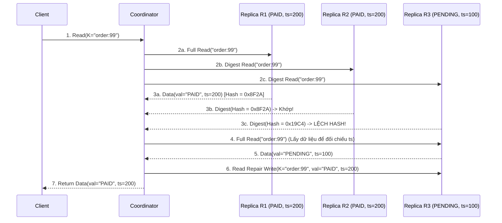
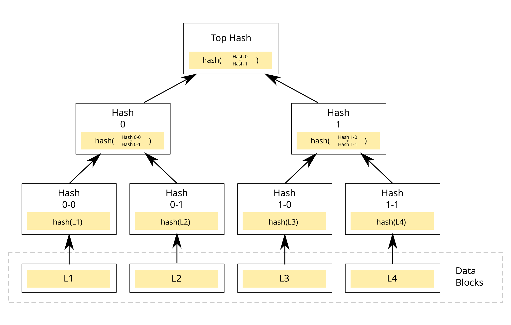
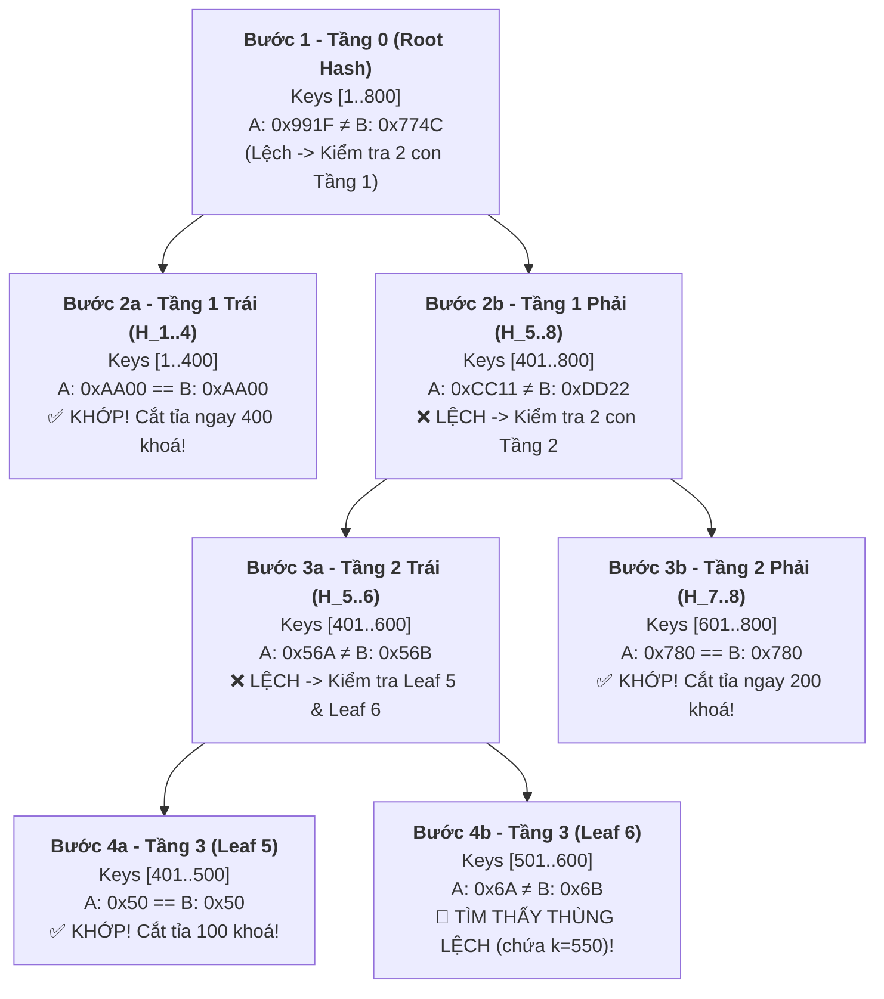
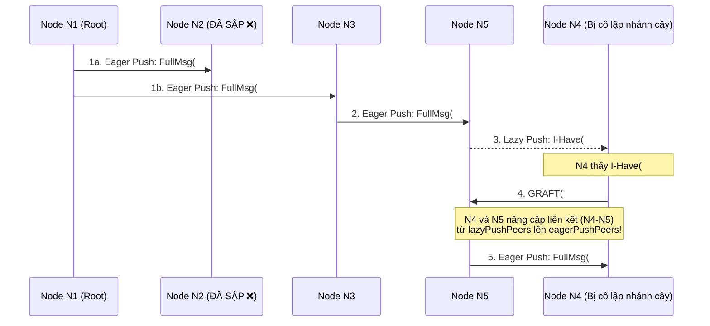

## Table of Contents
1. [Vì sao các Replica bị lệch dữ liệu (Replica Divergence)?](#why-replicas-diverge)
2. [Sửa lỗi trực tiếp & Cơ hội: Read Repair và Hinted Handoff](#foreground-repair)
3. [Đồng bộ nền Anti-Entropy với Merkle Trees (Hash Trees)](#merkle-trees)
4. [Gossip Dissemination và Epidemic Broadcast Trees (Plumtree)](#gossip-and-plumtree)
5. [Tóm tắt & Ghi nhớ cốt lõi (Key Takeaways)](#key-takeaways)

---

Trong các hệ thống lưu trữ phân tán phi tập trung (**Leaderless / Dynamo-style** như Apache Cassandra, ScyllaDB, Riak, Amazon DynamoDB), không có một node Leader cố định đứng ra tuần tự hoá mọi thay đổi. Khi ghi với Quorum ($W < N$), luôn có khả năng một số bản sao (**Replicas**) bỏ lỡ bản cập nhật do rớt gói tin, nghẽn mạng tạm thời hoặc khởi động lại server. Chương 12 giải quyết hai bài toán nền tảng của hệ thống phân tán:
1. **Anti-Entropy**: Làm thế nào để phát hiện và đồng bộ các bản sao bị lệch dữ liệu về cùng một trạng thái thống nhất mà không làm nghẽn băng thông mạng?
2. **Dissemination (Phát tán thông tin)**: Làm thế nào để truyền tải thông tin trạng thái hoặc sự kiện khắp cụm hàng nghìn server một cách nhanh chóng, chịu lỗi cao và ít dư thừa gói tin?

---

## Vì sao các Replica bị lệch dữ liệu (Replica Divergence)? {#why-replicas-diverge}

### Bài toán thực tế & Mental Model

Trong vật lý thống kê, **Entropy** là thước đo mức độ hỗn loạn của một hệ thống cô lập. Theo định luật thứ hai của nhiệt động lực học, entropy luôn có xu hướng tăng dần theo thời gian trừ khi có năng lượng bên ngoài tác động vào để lập lại trật tự.

Trong cơ sở dữ liệu phân tán, các bản sao dữ liệu trên nhiều server cũng chịu quy luật tương tự: nếu chỉ gửi lệnh ghi qua mạng mà không có cơ chế đối chiếu và sửa lỗi, các bản sao sẽ ngày càng sai khác nhau (**Replica Divergence**). Quá trình chủ động so sánh, tìm điểm lệch và đồng bộ các bản sao để giảm mức độ hỗn loạn về `0` được gọi là **Anti-Entropy**.

```text
Thời điểm t = 0 (Đồng bộ):       R1: [v1]    R2: [v1]    R3: [v1]   (Entropy = 0)
Thời điểm t = 1 (Write W=2):     R1: [v2]    R2: [v2]    R3: [v1]   (R3 rớt gói tin -> Lệch!)
Thời điểm t = 2 (Write W=2):     R1: [v2]    R2: [v3]    R3: [v3]   (R1 GC pause -> Lệch chéo!)
                                      │           │           │
                                      ▼           ▼           ▼
                    Cần cơ chế Anti-Entropy để hội tụ tất cả về [v3]!
```

Các nguyên nhân thực tế dẫn đến lệch bản sao bao gồm:
- **Ghi Quorum một phần ($W < N$)**: Với hệ số nhân bản $N = 3$ và mức ghi $W = 2$, Coordinator báo ghi thành công cho Client ngay khi 2 node xác nhận. Node thứ 3 có thể bị rớt gói tin mạng hoặc đang tạm dừng thu gom rác bộ nhớ (GC pause) nên vẫn giữ giá trị cũ.
- **Sự cố sập node tạm thời (Transient Node Failure)**: Một server bị tắt nguồn bảo trì, khởi động lại hệ điều hành hoặc thay dây mạng trong `15 phút` rồi bật lại sẽ thiếu toàn bộ các lệnh ghi diễn ra trong khoảng thời gian đó.
- **Network Partition & Bit Rot**: Đứt kết nối mạng tạm thời giữa các Rack/Availability Zone khiến một nhóm node không nhận được lệnh ghi, hoặc lỗi phần cứng làm hỏng các khối dữ liệu cục bộ trên ổ đĩa.

Để đưa các bản sao hội tụ về cùng một trạng thái (**Eventual Consistency**), các hệ quản trị cơ sở dữ liệu kết hợp hai lớp phòng thủ bổ trợ cho nhau:

| Lớp cơ chế | Kỹ thuật đại diện | Thời điểm kích hoạt | Đối tượng dữ liệu mục tiêu |
| :--- | :--- | :--- | :--- |
| **1. Foreground / Opportunistic Repair** | **Read Repair**, **Hinted Handoff** | Ngay trong luồng xử lý request Đọc/Ghi của Client | Dữ liệu nóng (**Hot Data**) thường xuyên được truy vấn hoặc các node vừa mới khôi phục sau sự cố ngắn hạn |
| **2. Background Active Anti-Entropy** | **Merkle Trees (Hash Trees)** | Chạy nền định kỳ theo lịch bảo trì (`nodetool repair`) | Toàn bộ kho dữ liệu trên đĩa, đặc biệt cứu nguy cho dữ liệu lạnh (**Cold / Archival Data**) hiếm khi được đọc |

---

## Sửa lỗi trực tiếp & Cơ hội: Read Repair và Hinted Handoff {#foreground-repair}

### 1. Read Repair (Đồng bộ ngay trong luồng Đọc)

#### Bài toán thực tế: Tại sao cần Read Repair và Digest Read?
Giả sử một bản ghi đơn hàng được ghi với $N = 3, W = 2$. Hai node `R1, R2` đã lưu trạng thái mới `"PAID"`, trong khi `R3` bị rớt mạng nên vẫn giữ trạng thái cũ `"PENDING"`. Ngay sau đó, Client gửi truy vấn đọc đơn hàng này với mức Quorum $R = 2$ hoặc $R = 3$.

Khi **Coordinator** thu thập phản hồi từ các Replica để phục vụ lượt đọc của Client, bản thân Coordinator đã nhìn thấy tận mắt sự lệch pha giữa các node. Thay vì chỉ chọn bản ghi mới nhất trả về cho Client rồi làm ngơ trước node đang giữ dữ liệu cũ, Coordinator tận dụng ngay cơ hội này để gửi một lệnh ghi sửa lỗi (**Read Repair Write**) xuống node lạc hậu.

Tuy nhiên, nếu mỗi lượt đọc Coordinator đều yêu cầu cả $R$ node gửi toàn bộ nội dung bản ghi (ví dụ một tài liệu JSON nặng `500 KB`) qua mạng nội bộ, băng thông mạng sẽ bị tiêu tốn gấp $R$ lần một cách lãng phí (vì đa số trường hợp các bản sao đều giống hệt nhau). Để giải quyết bài toán băng thông này, các hệ thống như Cassandra và Dynamo sử dụng kỹ thuật **Digest Read** (Đọc mã băm tóm tắt):
1. Coordinator gửi yêu cầu đọc **toàn bộ dữ liệu (Full Data Read)** tới **1 Replica đơn lẻ** (thường chọn node có độ trễ mạng thấp nhất dựa trên Dynamic Snitch).
2. Đồng thời, Coordinator chỉ yêu cầu **`R - 1` Replica còn lại** tính và gửi về **mã băm của dữ liệu (Digest / Hash)** (chỉ nặng vài chục byte, ví dụ `16 bytes` MD5/Murmur3).
3. Nếu tất cả các mã băm khớp với mã băm của bản dữ liệu đầy đủ, Coordinator kết luận các bản sao hoàn toàn đồng bộ và lập tức trả dữ liệu về cho Client.
4. Nếu phát hiện bất kỳ mã băm nào bị lệch, Coordinator mới yêu cầu các node gửi toàn bộ dữ liệu để so sánh nhãn thời gian (`timestamp` hoặc `Vector Clock`), chọn ra giá trị mới nhất trả cho Client và phát lệnh **Read Repair** ghi đè lên các node mang dữ liệu cũ.



#### Ví dụ chạy tay từng bước (Step-by-Step Dry Run): Read Repair kèm Digest Read

Xét một cụm lưu trữ có hệ số nhân bản $N = 3$ gồm ba node `R1`, `R2`, `R3` cùng chịu trách nhiệm quản lý khoá `K = "order:99"`:
- Trước đó, lệnh cập nhật đơn hàng sang trạng thái đã thanh toán (`val = "PAID", ts = 200`) được ghi thành công vào `R1` và `R2`, nhưng bị rớt gói tin khi gửi tới `R3`.
- Trạng thái vật lý trên đĩa của 3 node hiện tại là:
  - `R1`: `("order:99" -> val = "PAID", ts = 200)` — mã băm $\text{Hash}(\text{"PAID"}, 200) = \text{0x8F2A}$.
  - `R2`: `("order:99" -> val = "PAID", ts = 200)` — mã băm $\text{Hash}(\text{"PAID"}, 200) = \text{0x8F2A}$.
  - `R3`: `("order:99" -> val = "PENDING", ts = 100)` — mã băm $\text{Hash}(\text{"PENDING"}, 100) = \text{0x19C4}$.

Khi Client gửi truy vấn `SELECT status FROM orders WHERE id = 'order:99'` tới Coordinator (với các node tham gia đọc là `R1, R2, R3`), luồng gói tin diễn ra từng bước như sau:

- **Bước 1 — Phát yêu cầu đọc kết hợp (Full Read + Digest Read)**:
  - Coordinator thấy `R1` phản hồi sớm nhất nên gửi gói tin `FULL_READ(key="order:99")` tới `R1`.
  - Cùng lúc đó, Coordinator gửi gói tin siêu nhẹ `DIGEST_READ(key="order:99")` tới `R2` và `R3`.
- **Bước 2 — Thu thập phản hồi và kiểm tra mã băm**:
  - `R1` trả về dữ liệu đầy đủ: `Payload = {val: "PAID", ts: 200}`. Coordinator tự băm gói dữ liệu này được $\text{Hash}_{R1} = \text{0x8F2A}$.
  - `R2` trả về mã băm: `Digest = 0x8F2A`.
  - `R3` trả về mã băm: `Digest = 0x19C4`.
  - Coordinator đối chiếu: $\text{Hash}_{R1} (\text{0x8F2A}) == \text{Digest}_{R2} (\text{0x8F2A}) \neq \text{Digest}_{R3} (\text{0x19C4})$. Phát hiện có sự bất đồng bộ tại `R3`!
- **Bước 3 — Giải quyết xung đột (Conflict Resolution)**:
  - Vì chỉ dựa vào mã băm `0x19C4` thì Coordinator chưa thể biết dữ liệu trên `R3` là cũ hơn hay mới hơn `R1` (nhỡ đâu `R3` mới là node đơn lẻ nhận được bản ghi `ts = 300`?), Coordinator gửi tiếp `FULL_READ(key="order:99")` tới `R3`.
  - `R3` trả về `{val: "PENDING", ts: 100}`.
  - Coordinator so sánh nhãn thời gian theo quy tắc **Last-Write-Wins (LWW)**: $\max(200, 200, 100) = 200$. Giá trị đúng đắn mới nhất là `val = "PAID", ts = 200`, còn `R3` đang bị lạc hậu (`ts = 100 < 200`).
- **Bước 4 — Thực thi Read Repair**:
  - Coordinator tạo lệnh ghi sửa lỗi `WRITE(key="order:99", val="PAID", ts=200)` gửi thẳng tới `R3`.
  - `R3` cập nhật Memtable và WAL lên `(val = "PAID", ts = 200)`. Từ giây phút này, cả 3 node `R1, R2, R3` đều hội tụ về cùng trạng thái `(val = "PAID", ts = 200)`.

#### Sự khác biệt giữa Blocking Read Repair và Async Read Repair

Ở **Bước 4** của ví dụ trên, Coordinator có hai lựa chọn chiến lược về thời điểm trả kết quả `{val: "PAID", ts: 200}` về cho Client:

| Tiêu chí | Blocking (Synchronous) Read Repair | Asynchronous (Background) Read Repair |
| :--- | :--- | :--- |
| **Cơ chế hoạt động** | Coordinator gửi lệnh `Read Repair Write` tới `R3`, **chờ `R3` ghi đĩa xong và trả về `ACK`**, rồi mới trả kết quả đọc cho Client. | Coordinator **trả ngay kết quả `{val: "PAID", ts: 200}` cho Client**, đồng thời đẩy lệnh `Read Repair Write` cho `R3` vào một thread chạy ngầm (fire-and-forget). |
| **Tính nhất quán (Monotonic Reads)** | **Đảm bảo Monotonic Reads**: Ngay khi Client nhận được kết quả `"PAID"`, bản sao `R3` chắc chắn đã được sửa xong. Nếu мили-giây tiếp theo Client đọc lại và rơi trúng tập Quorum `{R2, R3}`, cả hai đều đã có `"PAID"`. | **Có cửa sổ rủi ro đọc lùi**: Nếu mạng tới `R3` bị trễ khiến lệnh sửa chạy ngầm chưa tới nơi mà Client thực hiện đọc lần 2 ngay lập tức, có rủi ro nhìn thấy dữ liệu cũ nếu mức đọc thấp ($R = 1$). |
| **Ảnh hưởng tới độ trễ (Latency)** | Độ trễ đọc của Client bị kéo dài thêm 1 vòng mạng (1 RTT) chờ ghi xong trên node lạc hậu. | Độ trễ đọc thấp hơn vì không phải chờ bước ghi sửa lỗi hoàn tất. |

---

### 2. Hinted Handoff (Ghi gửi nhờ kèm gợi ý)

#### Bài toán thực tế & Mental Model
Hãy hình dung một nhân viên bưu tá (**Coordinator**) cần phát 3 bức thư giống nhau tới 3 căn hộ `R1, R2, R3`. Khi tới nơi, căn hộ `R1` và `R2` mở cửa nhận thư, nhưng chủ căn hộ `R3` vừa chạy ra ngoài mua đồ 5 phút (**Transient Failure** — khởi động lại máy hoặc rớt mạng ngắn hạn). Thay vì vứt bức thư của `R3` đi (khiến sau đó phải dùng Read Repair hoặc quét lại cả toà nhà), người bưu tá dán một tờ giấy ghi chú (**Hint**: *"Thư này của phòng R3, sẽ giao lại ngay khi chủ nhà về"*) rồi cất tạm vào túi của mình. Vài phút sau, thấy đèn phòng `R3` sáng lên, người bưu tá lập tức mang bức thư đó sang trao tận tay `R3`.

#### Ví dụ chạy tay từng bước: Hinted Handoff cho khoá `K = "order:99"`
1. **Sự cố xảy ra khi Ghi (`t = 200`)**:
   - Client gửi lệnh ghi `Write(K="order:99", val="SHIPPED", ts=300)` với mức Quorum $W = 2$ tới `Coordinator`.
   - `Coordinator` gửi bản ghi tới cả 3 Replica `R1, R2, R3`.
   - `R1` và `R2` ghi thành công và trả về `ACK` $\rightarrow$ Đã đủ $W = 2$, `Coordinator` báo `Write OK` về cho Client.
   - Tuy nhiên, `R3` đang bị reboot nên kết nối tới `R3` bị timeout.
2. **Ghi Hint cục bộ (`t = 201`)**:
   - Phát hiện `R3` không phản hồi, `Coordinator` tạo một bản ghi **Hint** lưu xuống thư mục đĩa cục bộ của chính `Coordinator` (ví dụ bảng `system.hints`):
     ```text
     Hint Record = {
       target_node_id: "R3_UUID",
       key:            "order:99",
       mutation:       { val: "SHIPPED", ts: 300 },
       created_at:     201,
       ttl:            10800s (3 giờ)
     }
     ```
3. **Phát hiện phục hồi & Bàn giao (`Handoff` tại `t = 500`)**:
   - Tại thời điểm `t = 500`, `R3` khởi động xong và gửi bản tin nhịp tim qua giao thức **Gossip** báo rằng `R3` đã `UP`.
   - Tiến trình chạy nền trên `Coordinator` nhận tín hiệu `R3 UP`, lập tức đọc các bản ghi Hint có `target_node_id == "R3_UUID"` từ đĩa và phát lại (**Replay**) lệnh `Write(K="order:99", val="SHIPPED", ts=300)` sang `R3`.
   - Khi `R3` xác nhận đã lưu bền vững xuống đĩa, `Coordinator` xoá bản ghi Hint khỏi ổ đĩa của mình.

> [!IMPORTANT]
> **Lưu ý về tính đúng đắn của Quorum**: Một bản ghi **Hint** nằm trên `Coordinator` **KHÔNG được tính là một bản sao hợp lệ để凑 (gộp) vào Quorum $W$**. Ví dụ với $N = 3, W = 2$, nếu cả `R2` và `R3` đều đang sập (chỉ có `R1` sống), lệnh ghi với $W = 2$ bắt buộc phải báo lỗi thất bại (`WriteTimeoutException`), dù `Coordinator` có thể viết Hint hay không (trừ khi hệ thống cấu hình chế độ `Sloppy Quorum` như trong thiết kế Dynamo gốc, chấp nhận đánh đổi tính nhất quán lấy tính sẵn sàng ghi cực đại).

#### Tại sao có Read Repair và Hinted Handoff rồi vẫn BẮT BUỘC phải có Merkle Trees?
Cả hai cơ chế Foreground Repair trên đều có những điểm mù chí mạng không thể tự khắc phục:
1. **Điểm mù của Read Repair đối với dữ liệu lạnh (Cold Data)**: Read Repair chỉ chạy khi có truy vấn đọc chạm vào đúng khoá đó. Trong một hệ thống thương mại điện tử, đơn hàng `"order:99"` sau khi giao xong sẽ nằm im trong kho lưu trữ suốt 2 năm mà không ai đọc tới. Nếu 1 node bị mất bản ghi này, rồi nhiều tháng sau 2 node còn lại lần lượt hỏng ổ cứng hoặc mất dữ liệu khi thay thế node, bản ghi đó sẽ biến mất vĩnh viễn hoặc sống dậy từ cõi chết (**Zombie Data** khi xoá bằng Tombstone mà không kịp đồng bộ trước khi hết `gc_grace_seconds`).
2. **Điểm mù của Hinted Handoff khi node sập dài hạn**: Nếu `R3` bị hỏng nguồn trong 10 tiếng, mà `Coordinator` cứ lưu mọi lệnh ghi của `R3` vào đĩa của mình thì ổ đĩa của `Coordinator` sẽ nhanh chóng bị đầy tràn. Do đó, mọi hệ thống đều đặt giới hạn thời gian lưu Hint (ví dụ `max_hint_window_in_ms = 3 giờ` trong Cassandra). Quá 3 giờ, `Coordinator` ngừng ghi Hint mới và xoá các Hint quá hạn. Khi `R3` sống lại sau 10 tiếng, khoảng trống dữ liệu 7 tiếng bị mất không thể khôi phục bằng Hinted Handoff.

---

## Đồng bộ nền Anti-Entropy với Merkle Trees (Hash Trees) {#merkle-trees}

### Bài toán thực tế & Mental Model: Tìm một hạt cát khác màu giữa hai bãi biển

Khi một node nghỉ quá thời gian lưu Hint hoặc trong đợt bảo dưỡng định kỳ hàng tuần, hai server `Node A` và `Node B` cần đối chiếu kho dữ liệu để tìm xem giữa `100.000.000` (100 triệu) khoá đang lưu trên đĩa, có những khoá nào bị lệch nhau.

- **Cách ngây thơ (Naive Flat Hash List)**: `Node A` băm từng khoá một tạo ra danh sách 100 triệu cặp `(Key, Hash)` (mỗi cặp tốn khoảng `32 bytes`) rồi gửi qua mạng cho `Node B` so sánh. Mỗi lần đối chiếu giữa hai phân vùng sẽ tiêu tốn $10^8 \times 32\text{ bytes} \approx 3.2\text{ GB}$ băng thông mạng! Nếu cụm có hàng trăm phân vùng cùng chạy đồng bộ, toàn bộ mạng nội bộ sẽ bị tê liệt hoàn toàn, trong khi thực tế `99.999%` các khoá giữa hai node là giống hệt nhau.
- **Mental Model của Merkle Tree (Trò chơi tìm kiếm nhị phân bằng mã băm)**:
  Thay vì đọc từng dòng trong một cuốn từ điển dày 800 trang qua điện thoại để tìm 1 chữ viết sai chính tả, hai người A và B chỉ cần:
  1. So sánh **1 mã băm tổng của cả cuốn sách 800 trang**. Nếu giống nhau $\rightarrow$ Cúp máy ngay, cả hai cuốn giống nhau 100%!
  2. Nếu khác nhau, chia đôi cuốn sách: đọc mã băm của **nửa đầu (trang 1–400)** và **nửa sau (trang 401–800)**. Thấy nửa đầu khớp nhau $\rightarrow$ Bỏ qua luôn 400 trang đầu!
  3. Tiếp tục chia đôi nửa sau thành (trang 401–600) và (trang 601–800)... Chỉ sau vài câu hỏi ($\log_2 N$ bước), hai bên chỉ đích danh trang sách đơn lẻ bị lệch mà không cần truyền nội dung của 799 trang còn lại!

### Cấu trúc toán học của Merkle Tree

Được Ralph Merkle phát minh năm 1979, **Merkle Tree (Hash Tree)** là một cây nhị phân trong đó mỗi node là một mã băm mật mã học (hoặc hàm băm phân phối đều như SHA-256, MD5, Murmur3):
1. **Tầng lá (Leaf Nodes)**: Không gian khoá (**Key Range / Token Range**) được chia thành $M = 2^d$ thùng nhỏ cố định (**Buckets / Leaves**). Mỗi lá $L_i$ gom toàn bộ các bản ghi $(k, v, \text{ts})$ thuộc dải khoá của thùng đó và tính một mã băm tổng hợp:
   $$\text{Hash}(L_i) = H\big((k_1, v_1, \text{ts}_1) \;\Vert\; (k_2, v_2, \text{ts}_2) \;\Vert\; \dots\big)$$
2. **Tầng trung gian và Đỉnh (Internal Nodes & Root Hash)**: Mỗi node cha không lưu dữ liệu gốc mà chỉ băm chuỗi ghép từ mã băm của hai node con trái và phải:
   $$\text{Hash}(\text{Parent}) = H\big(\text{Hash}(\text{Left Child}) \;\Vert\; \text{Hash}(\text{Right Child})\big)$$
3. **Tính chất lan truyền ngược (Bottom-Up Propagation)**: Nhờ tính chất kháng va chạm của hàm băm, chỉ cần **1 byte của 1 khoá bất kỳ** ở tầng lá thay đổi, mã băm của lá đó sẽ thay đổi, kéo theo toàn bộ các node cha trên đường đi từ lá đó lên tới **Root Hash** đều thay đổi theo; trong khi tất cả các nhánh không chứa khoá đó giữ nguyên mã băm!


*Hình 12.1: Cấu trúc Merkle Tree (Hash Tree): các khối dữ liệu ở tầng lá được băm đệ quy từ dưới lên tới đỉnh Top Hash (Root Hash)*

---

### Ví dụ chạy tay bằng con số cụ thể (Step-by-Step Dry Run): Truy tìm 1 khoá lệch trong 800 khoá

Giả sử `Node A` và `Node B` cùng quản lý dải khoá nguyên từ `1` đến `800`. Hệ thống chia dải khoá này thành **8 thùng lá (`Leaf 1` đến `Leaf 8`)**, mỗi lá phụ trách đúng `100` khoá liên tiếp:
- `Leaf 1`: `[1..100]`
- `Leaf 2`: `[101..200]`
- `Leaf 3`: `[201..300]`
- `Leaf 4`: `[301..400]`
- `Leaf 5`: `[401..500]`
- `Leaf 6`: `[501..600]`
- `Leaf 7`: `[601..700]`
- `Leaf 8`: `[701..800]`

**Giả thiết sự cố**: Trong tổng số 800 khoá, có tới 799 khoá giống hệt nhau giữa `Node A` và `Node B`. Chỉ có **đơn lẻ 1 khoá `k = 550`** (nằm trong dải `[501..600]` của **`Leaf 6`**) là bị lệch:
- Trên `Node A`: `k = 550` có giá trị `"v2"` $\rightarrow$ mã băm của `Leaf 6` trên `Node A` là `0x6A`.
- Trên `Node B`: `k = 550` vẫn giữ giá trị cũ `"v1"` $\rightarrow$ mã băm của `Leaf 6` trên `Node B` là `0x6B` (khác `0x6A`!).

Hãy quan sát toàn bộ cây Merkle được dựng trên `Node A` và `Node B`:

```text
=====================================================================================
                         CÂY MERKLE TRÊN NODE A vs NODE B
             (Chỉ lệch đơn lẻ khoá k = 550 nằm trong thùng Leaf 6)
=====================================================================================

TẦNG 0 (ROOT):                       [ Root Hash ]
                               Node A: 0x991F != Node B: 0x774C  (LỆCH -> Đi xuống Tầng 1)
                                    /                          \
                                   /                            \
TẦNG 1:                [ H_1..4 (Keys 1..400) ]          [ H_5..8 (Keys 401..800) ]
                        Node A: 0xAA00 == Node B: 0xAA00  Node A: 0xCC11 != Node B: 0xDD22
                        (KHỚP 100% -> CẮT TỈA NGAY!)      (LỆCH -> Đi xuống Tầng 2 nhánh phải)
                           /                  \                      /                  \
                          /                    \                    /                    \
TẦNG 2:          [H_1..2 (1..200)]    [H_3..4 (201..400)]  [H_5..6 (401..600)]    [H_7..8 (601..800)]
                    (Đã bỏ qua)          (Đã bỏ qua)        A: 0x56A != B: 0x56B   A: 0x780 == B: 0x780
                                                            (LỆCH -> Xuống Lá)     (KHỚP -> CẮT TỈA!)
                                                               /            \
                                                              /              \
TẦNG 3 (LÁ):                                          [Leaf 5: 401..500]  [Leaf 6: 501..600]
                                                       A: 0x50 == B: 0x50  A: 0x6A != B: 0x6B
                                                       (KHỚP -> Bỏ qua)    (LỆCH! Chứa k = 550)
```



#### Trace chi tiết từng bản tin đối chiếu qua mạng giữa `Node A` và `Node B`

| Bước | Cấp độ cây | Dải khoá kiểm tra | Mã băm trên `Node A` | Mã băm trên `Node B` | Kết quả đối chiếu & Hành động cắt tỉa (Pruning) |
| :---: | :--- | :--- | :---: | :---: | :--- |
| **1** | **Tầng 0 (`Root Hash`)** | `[1..800]` | `0x991F` | `0x774C` | **Lệch (`!=`)**: Phát hiện có ít nhất 1 khoá không khớp trong toàn bộ 800 khoá. Yêu cầu đối chiếu 2 node con ở **Tầng 1** (`H_1..4` và `H_5..8`). |
| **2** | **Tầng 1 (`Level 1 Hash`)** | Nhánh trái `H_1..4`: `[1..400]`<br/>Nhánh phải `H_5..8`: `[401..800]` | `0xAA00`<br/>`0xCC11` | `0xAA00`<br/>`0xDD22` | - `H_1..4` **Khớp (`==`)**: **Cắt tỉa ngay lập tức toàn bộ 400 khoá từ `1..400`** (`Leaf 1, 2, 3, 4`) — không tốn thêm 1 byte mạng nào cho nửa trái!<br/>- `H_5..8` **Lệch (`!=`)**: Chỉ đi sâu xuống 2 con của nhánh phải ở **Tầng 2** (`H_5..6` và `H_7..8`). |
| **3** | **Tầng 2 (`Level 2 Hash`)** | Nhánh `H_5..6`: `[401..600]`<br/>Nhánh `H_7..8`: `[601..800]` | `0x56A`<br/>`0x780` | `0x56B`<br/>`0x780` | - `H_7..8` **Khớp (`==`)**: **Cắt tỉa ngay 200 khoá từ `601..800`** (`Leaf 7, 8`)!<br/>- `H_5..6` **Lệch (`!=`)**: Chỉ đi sâu xuống 2 thùng lá con của `H_5..6` là **`Leaf 5`** và **`Leaf 6`**. |
| **4** | **Tầng 3 (`Leaf Hash`)** | `Leaf 5`: `[401..500]`<br/>`Leaf 6`: `[501..600]` | `0x50`<br/>`0x6A` | `0x50`<br/>`0x6B` | - `Leaf 5` **Khớp (`==`)**: **Cắt tỉa tiếp 100 khoá từ `401..500`**!<br/>- `Leaf 6` **Lệch (`!=`)**: **Khoanh vùng chính xác lỗi nằm trong thùng `Leaf 6` (`[501..600]`)**! |
| **5** | **Đồng bộ dữ liệu** | Chỉ thùng `Leaf 6`: `[501..600]` | `k=550: "v2"` | `k=550: "v1"` | Hai node chỉ trao đổi và đồng bộ dữ liệu thuộc thùng `Leaf 6`, cập nhật `k = 550` trên `Node B` lên `"v2"`. |

> [!TIP]
> **Đánh giá hiệu quả định lượng**:
> - Thay vì phải quét và gửi mã băm của cả `800` khoá, hai node chỉ cần trao đổi tổng cộng **4 gói tin điều hướng nhỏ** (gồm `1` Root Hash + `2` mã băm Tầng 1 + `2` mã băm Tầng 2 + `2` mã băm Tầng 3 = **7 mã băm**, tổng dung lượng chưa tới `250 bytes`!) để loại bỏ `700/800` khoá (`87.5%` kho dữ liệu) và chỉ đích danh thùng `Leaf 6` chứa khoá `k = 550`.
> - Tổng quát hoá với cây có $M$ thùng lá: số bước trao đổi chỉ là $\log_2(M)$ và số lượng mã băm cần gửi khi có 1 khoá lệch chỉ là $1 + 2\log_2(M) = O(\log M)$.

### Các đánh đổi kỹ thuật khi triển khai Merkle Tree trong thực tế

1. **Tại sao không cập nhật Merkle Tree ngay trên mỗi lệnh Write?**:
   Nếu mỗi khi có một lệnh ghi vào đĩa mà hệ thống lại tính lại mã băm từ lá lên Root Hash, thì Root Hash sẽ trở thành điểm nghẽn tranh chấp (Contention Point), và vì dữ liệu trong LSM-Tree nằm rải rác trên nhiều SSTable chưa được gộp (Compaction), việc xác định giá trị cuối cùng của mọi khoá trong một thùng lá để băm theo thời gian thực là quá tốn kém. Do đó, Merkle Tree không được duy trì liên tục trong bộ nhớ mà chỉ được **xây dựng theo yêu cầu (On-demand / Lazily built)** khi chạy tiến trình Anti-Entropy Repair nền (thường kết hợp với một pha Major/Validation Compaction để đọc tuần tự qua các SSTable).
2. **Độ sâu của cây (Tree Depth) vs Độ phân giải thùng lá (Bucket Granularity)**:
   - Nếu cây quá nông (ít lá, ví dụ chỉ có `64` lá cho `100 triệu` khoá): mỗi thùng lá chứa tới `1.56 triệu` khoá. Khi phát hiện 1 thùng lá bị lệch vì 1 khoá đơn lẻ, hai node vẫn phải truyền tới `1.56 triệu` khoá trong thùng đó qua mạng (**Over-streaming**).
   - Nếu cây quá sâu (ví dụ độ sâu $d = 25 \implies 33.5\text{ triệu}$ lá): bản thân cấu trúc cây Merkle trong bộ nhớ RAM sẽ ngốn hàng Gigabyte RAM cho mỗi phân vùng.
   - Trong thực tế (như Apache Cassandra), độ sâu của Merkle Tree cho mỗi Token Range thường được giới hạn ở mức **$d = 15$ (tương đương $2^{15} = 32.768$ lá)** đến **$d = 20$ ($1.048.576$ lá)** để cân bằng hoàn hảo giữa dung lượng RAM lưu cây và kích thước mỗi thùng lá.

---

## Gossip Dissemination và Epidemic Broadcast Trees (Plumtree) {#gossip-and-plumtree}

### Bài toán thực tế & Mental Model

Trong một cụm cơ sở dữ liệu phân tán quy mô lớn gồm $N = 1.000$ server (như Cassandra, ScyllaDB, Consul, CockroachDB), mỗi giây đều có các thông tin vận hành quan trọng cần được toàn bộ các node trong cụm biết tới:
- *"Node #42 vừa mới gia nhập cụm ở địa chỉ IP `10.0.4.42`"*
- *"Node #17 không phản hồi nhịp tim, nghi ngờ đã sập"*
- *"Bảng `orders` vừa được thêm cột mới `discount_code`, phiên bản schema hiện tại là `v12`"*
- *"Tải CPU và dung lượng đĩa còn trống của từng node là bao nhiêu?"*

Nếu dùng một máy chủ trung tâm để phát thông báo tới $999$ node còn lại, máy chủ đó sẽ trở thành **Single Point of Failure (SPOF)** và bị nghẽn cổ chai băng thông mạng. Ngược lại, nếu mỗi node đều gửi thông báo trực tiếp tới tất cả các node khác (**All-to-All Heartbeat**), số lượng gói tin mỗi giây sẽ bùng nổ theo bậc hai $O(N^2) = 1.000.000$ gói tin/giây!

**Giải pháp — Giao thức Gossip (Epidemic Protocol)**:
Lấy cảm hứng từ cách tin đồn lan truyền trong văn phòng hoặc virus lây lan trong quần thể sinh học (Demers et al., Xerox PARC 1987):
- Định kỳ mỗi chu kỳ thời gian cố định (ví dụ `1 giây/lần`), mỗi server chỉ chọn ngẫu nhiên một số lượng nhỏ cố định $k$ server khác (**Fanout $k$**, thường $k = 1$ đến $3$) để trao đổi thông tin mới.
- Giống như cấp số nhân $1 \to 3 \to 9 \to 27 \to 81 \to 243 \to 729 \to 1000$, chỉ sau **$\approx \log_k(N)$ vòng**, thông tin đã lan toả tới toàn bộ 1.000 node mà mỗi node chỉ phải gửi đúng $k$ gói tin mỗi vòng!

Theo mô hình dịch tễ học **SIR (Susceptible - Infected - Removed)**, mỗi node trong cụm đối với một thông điệp cụ thể sẽ đi qua 3 trạng thái:
1. **Susceptible (`S` — Chưa nhiễm / Chưa biết tin)**: Node chưa từng nhận được thông điệp mới.
2. **Infected (`I` — Đang nhiễm / Đang phát tán)**: Node đã nhận được thông điệp và đang tích cực truyền tiếp (Gossip) thông điệp đó cho các node ngẫu nhiên khác ở mỗi chu kỳ.
3. **Removed / Recovered (`R` — Đã ngừng lây)**: Node đã nắm rõ thông điệp nhưng ngừng phát tán tiếp sau khi nhận thấy các node xung quanh đều đã biết tin.

---

### 1. Phân tích định lượng 3 chế độ Anti-Entropy Gossip: `Push`, `Pull`, và `Push-Pull`

Khi Node `A` chọn ngẫu nhiên Node `B` để Gossip ở mỗi chu kỳ, có 3 cách thức trao đổi dữ liệu với hiệu quả hội tụ rất khác nhau ở từng giai đoạn:

1. **Chế độ `Push` (Đẩy tin đi)**:
   - Nếu `A` đang ở trạng thái **Infected** (có tin mới), `A` chọn ngẫu nhiên `B` và gửi trạng thái của mình sang cho `B`.
   - **Tại sao `Push` rất nhanh ở giai đoạn đầu nhưng lại cực kỳ chậm ở giai đoạn cuối?**:
     - Ở **giai đoạn đầu** (khi mới có 1 vài node biết tin, đa số cụm đang là `Susceptible`), bất kỳ node nào mà `A` chọn ngẫu nhiên gần như chắc chắn chưa biết tin $\rightarrow$ số node biết tin tăng gấp đôi sau mỗi vòng!
     - Nhưng ở **giai đoạn cuối (End-game)**, giả sử **`90%` số node trong cụm đã biết tin (`Infected`)**, chỉ còn **`10%` node chưa biết (`Susceptible`)**. Lúc này, `900` node đã biết tin cùng chọn ngẫu nhiên đối tác để `Push`, nhưng cứ 10 lần bắn thì có tới **9 lần bắn trúng vào các node đã biết tin rồi** (lãng phí băng thông vô ích), và xác suất một node chưa biết tin bị bỏ sót qua một vòng là $(1 - \frac{1}{N})^{0.9N} \approx e^{-0.9} \approx 40.6\%$. Do đó, `Push` cần tổng cộng $O(\log N)$ vòng nhưng phần đuôi kéo dài rất lâu để phủ kín 10% cuối cùng.

2. **Chế độ `Pull` (Kéo tin về)**:
   - Mỗi node (đặc biệt là các node chưa biết tin hoặc muốn cập nhật) chủ động chọn ngẫu nhiên một node `B` và hỏi: *"Có tin gì mới hơn mốc thời gian $t$ không? Cho tôi xin!"*.
   - **Tại sao `Pull` chậm ở đầu nhưng lại bứt tốc cực nhanh ở giai đoạn cuối (`90%` đã biết tin)?**:
     - Ở **giai đoạn đầu** (khi chỉ có `1/1000` node có tin mới), việc các node chưa biết tin đi hỏi ngẫu nhiên có xác suất trúng node có tin mới chỉ là $0.1\%$ $\rightarrow$ khởi đầu rất ì ạch.
     - Nhưng ở **giai đoạn cuối**, khi **`90%` cụm đã có tin mới**, mỗi node trong số `10%` chưa biết tin (`Susceptible`) chủ động gọi hỏi 1 node ngẫu nhiên trong cụm sẽ có ngay **xác suất `90%` hỏi trúng một node đã biết tin** và kéo được tin về ngay lập tức! Tỷ lệ các node chưa biết tin sụt giảm theo hàm mũ bậc hai (**Quadratic Convergence**): nếu ở vòng $t$ còn tỷ lệ $s_t$ node chưa biết tin, thì sang vòng $t + 1$, một node chưa biết tin chỉ còn chưa biết nếu nó hỏi nhầm đúng vào một node khác cũng chưa biết tin, tức là:
       $$s_{t+1} = (s_t)^2$$

3. **Chế độ `Push-Pull` (Kết hợp Đẩy và Kéo — Chuẩn công nghiệp)**:
   - Trong 1 vòng liên lạc giữa `A` và `B`, `A` vừa đẩy tin mới của mình cho `B` (**Push**), vừa kéo tin mà `B` có nhưng `A` chưa có về (**Pull**).
   - **Hiệu quả toán học**: Kết hợp sự bùng nổ cấp số nhân $2^t$ của `Push` ở nửa đầu (cho đến khi $\ge 50\%$ cụm biết tin) với tốc độ bình phương $s_{t+1} = s_t^2$ của `Pull` ở nửa cuối!

#### Ví dụ định lượng so sánh tốc độ hội tụ ở giai đoạn cuối (khi `90%` cụm đã biết tin)

Giả sử cụm có $N = 10.000$ server. Tại vòng hiện tại, đã có $9.000$ node biết tin ($90\%$), còn lại $1.000$ node chưa biết tin ($s_0 = 10\% = 0.10$). Hãy xem số lượng node còn mù thông tin giảm xuống như thế nào qua các vòng tiếp theo giữa `Push` và `Pull` (với Fanout $k = 1$):

| Vòng tiếp theo (sau mốc 90%) | Tỷ lệ chưa biết tin với **`Push`** ($s_{t+1} \approx s_t \cdot e^{-(1 - s_t)}$) | Tỷ lệ chưa biết tin với **`Pull` / `Push-Pull`** ($s_{t+1} = s_t^2$) | Số node chưa biết tin (trên $10.000$ node) với **`Push-Pull`** |
| :---: | :---: | :---: | :---: |
| **Vòng +0 (Bắt đầu ở 90%)** | $10.0\%$ ($1.000$ node) | $10.0\%$ ($s_0 = 0.1$) | **$1.000$ node** |
| **Vòng +1** | $\approx 4.06\%$ ($406$ node) | $(0.1)^2 = \mathbf{1.0\%}$ | **$100$ node** (90% số node còn sót đã lấy được tin!) |
| **Vòng +2** | $\approx 1.56\%$ ($156$ node) | $(0.01)^2 = \mathbf{0.01\%}$ | **$1$ node** |
| **Vòng +3** | $\approx 0.58\%$ ($58$ node) | $(0.0001)^2 = \mathbf{0.000001\%}$ | **$0$ node (Hội tụ 100% toàn cụm!)** |

> [!IMPORTANT]
> Nhờ cơ chế bình phương tỷ lệ sót $s_{t+1} = s_t^2$ ở giai đoạn nửa sau, giao thức **`Push-Pull` Gossip** chỉ cần thêm **$O(\log \log N)$** vòng ở pha cuối để dọn sạch toàn bộ các node còn sót lại (trong khi `Push` thuần tuý cần thêm $O(\log N)$ vòng).

---

### 2. Cơ chế Rumor-Mongering (Lan truyền tin đồn có điểm dừng)

Khác với Anti-Entropy Gossip (chạy liên tục vĩnh viễn ở chế độ nền để đồng bộ bảng trạng thái), **Rumor-Mongering** được dùng khi một sự kiện mới phát sinh (ví dụ một lệnh xoá khẩn cấp hoặc thông báo cấu hình) cần được phát tán nhanh rồi tự động tắt đi để không tốn băng thông mãi mãi.

Cơ chế dừng tự nhiên (**Feedback / Blind Counter**) của Rumor-Mongering hoạt động như sau:
1. Khi Node `A` lần đầu nhận được tin đồn $M$, `A` chuyển từ `Susceptible (S)` sang `Infected (I)` và bắt đầu truyền $M$ cho các node ngẫu nhiên ở mỗi chu kỳ.
2. Mỗi lần `A` gửi tin đồn $M$ cho một node `B` mà nhận được phản hồi từ `B` là: *"Tin $M$ này tôi đã biết từ trước rồi!"*, `A` hiểu rằng tin đồn đã bắt đầu bão hoà trong cụm.
3. Với **xác suất $\frac{1}{k}$** (hoặc sau khi gặp đúng $k$ node liên tiếp đều đã biết tin, gọi là ngưỡng phản hồi $k$), Node `A` quyết định **ngừng phát tán tin $M$** và chuyển sang trạng thái **`Removed (R)`**.
4. Hệ số $k$ điều chỉnh sự đánh đổi giữa **Băng thông (Message Overhead)** và **Độ phủ (Reliability)**: $k$ càng lớn thì xác suất còn sót node chưa biết tin ($s_\infty \approx e^{-(k+1)}$) càng tiến sát về `0`, đổi lại số bản tin trùng lặp gửi qua mạng tăng lên.

---

### 3. Thuật toán Plumtree (Epidemic Broadcast Trees)

#### Bài toán thực tế: Tại sao cần lai ghép Cây khung (Spanning Tree) với Gossip?

Hãy nhìn vào hai thái cực của việc phát tán bản tin trong mạng phân tán:
- **Thái cực 1 — Cây khung cố định (Spanning Tree Multicast)**: Xây dựng một cây phân cấp từ gốc xuống lá. Mỗi khi có bản tin mới, node cha chỉ gửi đúng 1 lần xuống các node con.
  - *Ưu điểm*: **Độ phức tạp bản tin tối ưu tuyệt đối** ($N - 1$ bản tin cho $N$ node, không có bất kỳ bản tin trùng lặp nào) và độ trễ thấp.
  - *Nhược điểm chí mạng*: **Rất mong manh trước lỗi sập máy**. Chỉ cần 1 node trung gian ở nhánh trên bị sập, toàn bộ các node con cháu bên dưới nhánh đó bị cắt đứt liên lạc hoàn toàn!
- **Thái cực 2 — Gossip thuần tuý (Epidemic Broadcast)**: Mỗi node bắn ngẫu nhiên cho $k$ node khác.
  - *Ưu điểm*: **Khả năng chịu lỗi cực cao** (nửa cụm sập vẫn truyền được tin).
  - *Nhược điểm*: **Lãng phí băng thông khủng khiếp (High Message Redundancy)** do ở các vòng cuối, một node phải nhận đi nhận lại cùng một gói dữ liệu nặng từ hàng chục node khác.

**Giải pháp của Plumtree (`Push-Lazy-Push Multicast Tree` — Leitão et al., 2007)**:
Plumtree kết hợp hoàn hảo cả hai thế giới bằng cách chia các kết nối lân cận của mỗi node thành 2 tập hợp:
1. **`eagerPushPeers` (Các liên kết thuộc Cây khung chính — Tree Links)**: Dùng cơ chế **Eager Push** — gửi ngay lập tức **toàn bộ nội dung gói tin (`Full Payload`)** dọc theo các nhánh cây để đạt độ trễ thấp nhất và không bị trùng lặp.
2. **`lazyPushPeers` (Các liên kết dự phòng ngoài cây — Non-Tree Gossip Links)**: Dùng cơ chế **Lazy Push** — chỉ gửi thông báo tóm tắt siêu nhẹ **`I-Have(MessageID)`** (chỉ chứa ID của bản tin, không chứa dữ liệu nặng). Nếu các nhánh cây hoạt động bình thường, các node nhận được `I-Have(MessageID)` sẽ phớt lờ vì đã nhận được bản tin đầy đủ qua đường cây chính rồi. Nhưng nếu một nhánh cây bị gãy, thông báo `I-Have` chính là "phao cứu sinh" giúp node bị cô lập phát hiện ra mình bị thiếu tin, chủ động kéo dữ liệu về và **tự động nối lại cây (`Graft`)**!

---

#### Ví dụ chạy tay từng bước (Step-by-Step Dry Run): Plumtree truyền tin và tự chữa lành cây khi Node sập

Xét một cụm gồm 6 node: `N1` (Nguồn phát tin), `N2`, `N3`, `N4`, `N5`, `N6`.
Giả sử ban đầu cây khung chính (**Tree Links — nét liền `===`**) và các liên kết Gossip dự phòng (**Lazy Links — nét đứt `---`**) được thiết lập như sau:

```text
================================================================================
TRẠNG THÁI CÂY PLUMTREE BAN ĐẦU (TRƯỚC KHI CÓ SỰ CỐ)
================================================================================
 Chú thích:   ═══►  Liên kết Cây khung (eagerPushPeers - gửi Full Payload)
              - -►  Liên kết Dự phòng (lazyPushPeers   - chỉ gửi I-Have(MsgID))

                                 [ N1 (Root) ]
                                 //          \\
                   Eager Push   //            \\   Eager Push
                               ▼               ▼
                            [ N2 ]           [ N3 ]
                             //               //  \\
               Eager Push   //   Eager Push  //    \\  Eager Push
                           ▼                ▼       ▼
                        [ N4 ] ◄ - - - - [ N5 ]   [ N6 ]
                               Lazy Link
                         (N4 và N5 là lazyPushPeers của nhau)
```

- Danh sách liên kết của từng node:
  - `N1`: `eager = {N2, N3}`, `lazy = {}`
  - `N2`: `eager = {N1, N4}`, `lazy = {N3}`
  - `N3`: `eager = {N1, N5, N6}`, `lazy = {N2}`
  - `N4`: `eager = {N2}`, `lazy = {N5}`
  - `N5`: `eager = {N3}`, `lazy = {N4, N6}`
  - `N6`: `eager = {N3}`, `lazy = {N5}`

Bây giờ, hãy trace từng bước qua 3 tình huống vận hành cốt lõi của Plumtree:

##### Tình huống 1: Truyền tin bình thường (`Msg #101`) và Cắt tỉa nhánh thừa (`Prune`)
1. **Bước 1 (`Eager Push` từ gốc)**: `N1` phát bản tin `Msg #101` (nặng `1 MB`). `N1` gửi toàn bộ `FullMsg(#101)` dọc theo `eagerPushPeers` xuống `N2` và `N3`.
2. **Bước 2 (`Eager Push` xuống lá & `Lazy Push` chéo)**:
   - `N2` nhận `FullMsg(#101)` lần đầu tiên $\rightarrow$ đẩy tiếp `FullMsg(#101)` dọc theo nhánh cây xuống `N4`, đồng thời xếp lịch gửi bản tin siêu nhẹ `I-Have(#101)` (`16 bytes`) qua liên kết dự phòng sang `N3`.
   - `N3` nhận `FullMsg(#101)` lần đầu tiên $\rightarrow$ đẩy tiếp `FullMsg(#101)` xuống `N5` và `N6`, đồng thời gửi `I-Have(#101)` sang `N2`.
   - `N5` nhận `FullMsg(#101)` từ `N3` $\rightarrow$ gửi thông báo `I-Have(#101)` qua liên kết dự phòng sang `N4` và `N6`.
3. **Bước 3 (Xử lý `I-Have` khi cây lành lặn)**:
   - Khi `N4` nhận được `I-Have(#101)` từ `N5`, `N4` kiểm tra bộ nhớ thấy mình **đã nhận được `FullMsg(#101)` từ `N2` rồi** $\rightarrow$ `N4` bỏ qua thông báo `I-Have(#101)` mà không cần tải lại gói tin `1 MB`!
   - *(Cơ chế **`Prune` — Cắt tỉa chu trình thừa**)*: Giả sử ban đầu do cấu hình dư thừa, liên kết giữa `N4` và `N5` cũng đang được để ở `eagerPushPeers` khiến `N4` nhận được `FullMsg(#101)` từ `N2` trước, rồi ngay sau đó lại nhận thêm một bản `FullMsg(#101)` đầy đủ thứ hai từ `N5`. Phát hiện nhận trùng gói dữ liệu đầy đủ, `N4` lập tức gửi lệnh **`PRUNE`** trả lại cho `N5`, và cả hai chuyển liên kết `(N4 <-> N5)` từ `eagerPushPeers` xuống `lazyPushPeers` để loại bỏ vòng lặp!

##### Tình huống 2: Node trung gian `N2` bị sập! Quá trình tự chữa lành cây bằng `I-Have` và `Graft`
Giả sử ngay trước khi `N1` phát bản tin mới **`Msg #102`**, server **`N2` bị sập nguồn đột ngột (Crash)**! Lúc này nhánh cây từ `N2` xuống `N4` bị đứt gãy hoàn toàn. Hãy xem `N4` tự động cứu lấy mình và nối lại vào cây như thế nào:



Trace từng bước khôi phục:
1. **Bước 1 (`N1` phát `Msg #102`)**:
   - `N1` gửi `FullMsg(#102)` cho `N2` và `N3`. Do `N2` đã sập nên nhánh trái tắt ngấm; `N4` không nhận được gì từ `N2`.
   - Trong khi đó ở nhánh phải, `N3` nhận `FullMsg(#102)` và chuyển tiếp `Eager Push` xuống cho `N5` và `N6` bình thường.
2. **Bước 2 (`Lazy Push` phát huy tác dụng)**:
   - Sau khi `N5` nhận được `FullMsg(#102)`, theo đúng quy trình, `N5` gửi bản tin tóm tắt **`I-Have(#102)`** qua liên kết `lazyPushPeers` sang cho hàng xóm là `N4`.
3. **Bước 3 (`N4` phát hiện mất gói tin trên cây chính)**:
   - `N4` nhận được `I-Have(#102)` từ `N5`. `N4` tra cứu lịch sử nhận tin của mình và giật mình phát hiện: *"Mình chưa từng nhận được nội dung của `Msg #102`!"*
   - Để tránh trường hợp đường cây chính chỉ bị trễ vài mili-giây so với đường Gossip, `N4` bật một bộ đếm thời gian ngắn (**Missing Message Timer**). Khi hết thời gian chờ mà vẫn không thấy `N2` gửi `FullMsg(#102)` xuống, `N4` kết luận nhánh cây phía trên mình đã bị đứt!
4. **Bước 4 (`Graft` — Ghép cành tự chữa lành cây)**:
   - `N4` tra xem ai là người đầu tiên gửi thông báo `I-Have(#102)` cho mình $\rightarrow$ chính là **`N5`**.
   - `N4` lập tức chuyển `N5` từ danh sách `lazyPushPeers` sang danh sách **`eagerPushPeers`** (kết nạp `N5` làm cha mới trên cây khung!), đồng thời gửi bản tin **`GRAFT(MsgID = #102)`** sang cho `N5`.
5. **Bước 5 (`N5` nối nhánh và bù dữ liệu)**:
   - Khi nhận được `GRAFT(#102)` từ `N4`, `N5` cũng lập tức chuyển `N4` từ `lazyPushPeers` lên **`eagerPushPeers`** của mình, và gửi trả toàn bộ nội dung **`FullMsg(#102)`** sang cho `N4`.
   - **Kết quả sau khi tự chữa lành**: Không chỉ bản tin `Msg #102` được cứu thành công, mà từ bản tin `Msg #103` trở đi, dữ liệu từ `N1 -> N3 -> N5` sẽ chảy thẳng sang `N4` qua đường `Eager Push` mới nối mà không cần chờ timeout nữa!

```text
================================================================================
TRẠNG THÁI CÂY PLUMTREE SAU KHI N2 SẬP VÀ N4 GRAFT VÀO N5
================================================================================
                                 [ N1 (Root) ]
                                 //          \\
                                //            \\   Eager Push
                               ▼               ▼
                         [ N2 (DEAD) ]       [ N3 ]
                                             //  \\
                                Eager Push  //    \\  Eager Push
                                           ▼       ▼
                        [ N4 ] ◄════════ [ N5 ]   [ N6 ]
                              GRAFT THÀNH CÔNG!
                     (Liên kết N5══►N4 đã trở thành Tree Link mới)
```

---

## Tóm tắt & Ghi nhớ cốt lõi (Key Takeaways) {#key-takeaways}

- **Hai lớp phòng thủ Anti-Entropy**: Các hệ thống phân tán Leaderless luôn kết hợp **Foreground Repair** (*Read Repair*, *Hinted Handoff* — sửa lỗi nhanh ngay trong luồng đọc/ghi cho dữ liệu nóng và sự cố ngắn hạn) với **Background Anti-Entropy** (*Merkle Trees* — quét định kỳ toàn bộ đĩa để bảo vệ dữ liệu lạnh và khôi phục sau sự cố sập node dài hạn).
- **Read Repair & Digest Reads**: Để tránh lãng phí băng thông gấp $R$ lần trên mỗi truy vấn đọc, Coordinator chỉ đọc dữ liệu đầy đủ từ 1 node và đọc mã băm (**Digest**) từ $R - 1$ node còn lại. Chỉ khi mã băm lệch nhau, Coordinator mới thu thập dữ liệu đầy đủ, chọn bản mới nhất và phát lệnh **Read Repair Write** (theo chế độ **Blocking** đảm bảo Monotonic Reads hoặc **Async** tối ưu độ trễ).
- **Merkle Trees (Hash Trees)**: Cây băm nhị phân giúp hai node đối chiếu hàng triệu khoá chỉ trong $O(\log M)$ bước trao đổi mạng. Nhờ cơ chế **cắt tỉa nhánh khớp (Subtree Pruning)** ngay từ các tầng trên, hai node bỏ qua ngay lập tức `99.9%` các dải khoá giống nhau và chỉ truyền dữ liệu tại đúng thùng lá có mã băm bị lệch.
- **Gossip `Push`, `Pull`, `Push-Pull` & Plumtree**:
  - Trong Anti-Entropy Gossip, **`Push`** lây lan nhanh ở giai đoạn đầu nhưng đuối sức ở giai đoạn cuối (khi `90%` node đã biết tin thì 9/10 lần bắn bị trùng); **`Pull`** giúp các node chưa biết tin chủ động hỏi trúng `90%` node đã biết tin, giảm tỷ lệ sót theo bình phương $s_{t+1} = s_t^2$. Kết hợp **`Push-Pull`** đạt tốc độ hội tụ $O(\log \log N)$ ở pha cuối.
  - **Plumtree** nhúng cây khung phát tán nhanh (**Eager Push** gửi `Full Payload` trên `Tree Links`, cắt nhánh thừa bằng **`Prune`**) lên trên mạng lưới Gossip dự phòng (**Lazy Push** gửi `I-Have(MsgID)` trên `Non-Tree Links`), cho phép tự động nối lại nhánh cây bị đứt bằng lệnh **`Graft`** khi có node trung gian bị sập.

### Tài liệu & Nguồn tham khảo
- [Petrov, A. (2019) — *Database Internals: A Deep Dive into How Distributed Data Systems Work*, Chapter 12: Anti-Entropy and Dissemination (O'Reilly Media)](https://www.databass.dev/)
- [Leitão, J., Pereira, J., & Rodrigues, L. (2007) — *Epidemic Broadcast Trees (Plumtree)* (IEEE SRDS)](https://asc.di.fct.unl.pt/~jleitao/pdf/srds07-leitao.pdf)
- [Demers, A., et al. (1987) — *Epidemic Algorithms for Replicated Database Maintenance* (ACM PODC / Xerox PARC)](https://dl.acm.org/doi/10.1145/41840.41841)
- [Apache Cassandra Documentation — *Anti-Entropy Repair, Read Repair & Hinted Handoff*](https://cassandra.apache.org/doc/latest/cassandra/operating/repair.html)
