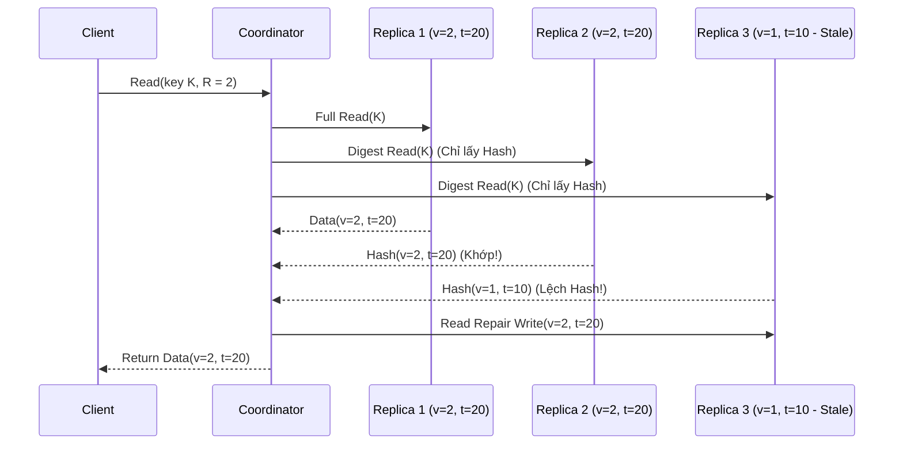
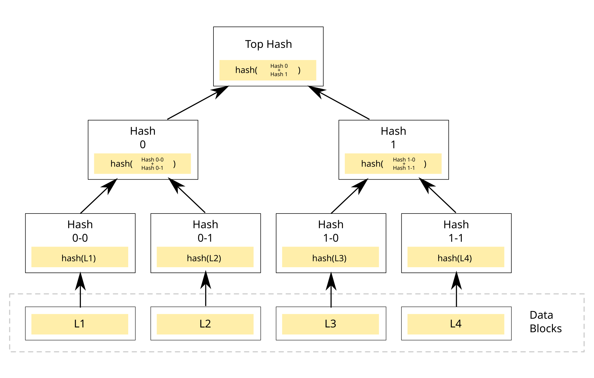
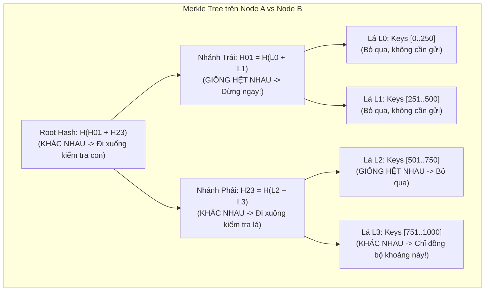

## Table of Contents
1. [Vì sao các Replica bị lệch dữ liệu (Replica Divergence)?](#why-replicas-diverge)
2. [Sửa lỗi trực tiếp & Cơ hội: Read Repair và Hinted Handoff](#foreground-repair)
3. [Đồng bộ nền Anti-Entropy với Merkle Trees](#merkle-trees)
4. [Gossip Dissemination và Epidemic Broadcast Trees (Plumtree)](#gossip-and-plumtree)
5. [Tóm tắt & Ghi nhớ cốt lõi (Key Takeaways)](#key-takeaways)

---

Trong các hệ thống lưu trữ phân tán phi tập trung (**Leaderless / Dynamo-style** như Apache Cassandra, ScyllaDB, Riak, Amazon DynamoDB), không có một node Leader cố định đứng ra tuần tự hóa mọi thay đổi. Khi ghi với Quorum (`W < N`), luôn có khả năng một số bản sao (**Replicas**) bỏ lỡ bản cập nhật do rớt gói tin, nghẽn mạng tạm thời hoặc khởi động lại máy chủ. Chương 12 giải quyết hai bài toán cốt lõi: làm thế nào để phát hiện và đồng bộ các bản sao bị lệch (**Anti-Entropy**), và làm thế nào để phát tán thông tin trạng thái khắp cụm máy chủ quy mô lớn (**Dissemination**).

---

## Vì sao các Replica bị lệch dữ liệu (Replica Divergence)? {#why-replicas-diverge}

Trong vật lý thống kê, **Entropy** là thước đo mức độ hỗn loạn của hệ thống. Trong cơ sở dữ liệu phân tán, các bản sao có xu hướng ngày càng sai khác nhau theo thời gian nếu không được đồng bộ do:
- **Ghi Quorum một phần (`W < N`)**: Với `N = 3, W = 2`, lệnh ghi thành công ngay khi 2 node xác nhận; node thứ 3 có thể bị rớt gói tin mạng hoặc đang GC pause nên vẫn giữ giá trị cũ.
- **Sự cố sập node tạm thời (Transient Node Failure)**: Một node bị tắt nguồn bảo trì trong `15 phút` rồi bật lại sẽ thiếu toàn bộ các lệnh ghi diễn ra trong khoảng thời gian đó.
- **Network Partition & Bit Rot**: Mất kết nối giữa các Rack/Availability Zone hoặc lỗi hỏng dữ liệu cục bộ trên đĩa.

Để đưa các bản sao hội tụ về cùng một trạng thái (**Anti-Entropy**), các hệ thống kết hợp hai lớp cơ chế:
1. **Foreground / Opportunistic Repair** (*Read Repair*, *Hinted Handoff*): Tận dụng ngay luồng đọc/ghi của ứng dụng để vá nhanh các bản sao bị trễ.
2. **Background Active Anti-Entropy** (*Merkle Trees*): Tiến trình chạy nền định kỳ quét và đối chiếu toàn bộ kho dữ liệu giữa các node để đồng bộ cả những dữ liệu lạnh hiếm khi được đọc.

---

## Sửa lỗi trực tiếp & Cơ hội: Read Repair và Hinted Handoff {#foreground-repair}

### 1. Read Repair (Đồng bộ ngay trong luồng Đọc)

Khi một **Coordinator** nhận truy vấn đọc từ Client với mức Quorum `R`, thay vì chỉ lấy kết quả rồi bỏ qua các node trả về dữ liệu cũ, Coordinator tận dụng chính lượt đọc này để cập nhật lại những bản sao lạc hậu.

#### Tối ưu băng thông bằng Digest Reads
Nếu đọc toàn bộ giá trị (ví dụ một blob JSON kích thước `500 KB`) từ cả `R` node qua mạng thì băng thông nội bộ sẽ bị lãng phí gấp `R` lần. Do đó, Coordinator thực hiện **Digest Read**:
1. Gửi yêu cầu lấy **toàn bộ dữ liệu (Full Data Read)** tới **1 Replica** (thường chọn node có độ trễ mạng thấp).
2. Đồng thời gửi yêu cầu lấy **mã băm (Digest / Hash)** tới **`R - 1` Replica** còn lại.
3. Nếu tất cả các mã băm trả về khớp với bản băm của dữ liệu đầy đủ, Coordinator lập tức trả dữ liệu về cho Client.
4. Nếu phát hiện mã băm của một node nào đó khác biệt, Coordinator mới yêu cầu các node gửi toàn bộ dữ liệu để tìm phiên bản mới hơn (dựa trên timestamp hoặc Vector Clock), trả giá trị mới về cho Client và gửi lệnh **Read Repair Write** tới các node chứa bản cũ.

#### Blocking vs Asynchronous Read Repair
- **Blocking (Synchronous) Read Repair**: Coordinator chờ ghi đè xong bản mới lên các node lạc hậu trong tập đọc rồi mới trả kết quả cho Client — đảm bảo **Monotonic Reads** và tính chất đọc nhất quán cho các truy vấn tiếp theo, nhưng làm tăng độ trễ đọc nếu có node phản hồi chậm.
- **Asynchronous Read Repair**: Trả kết quả ngay cho Client sau khi tìm được giá trị mới, đồng thời đẩy tác vụ sửa lỗi xuống chạy ngầm.

### 2. Hinted Handoff (Ghi gửi nhờ kèm gợi ý)

Khi Coordinator thực hiện lệnh ghi tới tập `N` Replica nhưng một node đích (ví dụ `Replica 3`) đang không phản hồi (do mất mạng tạm thời hoặc đang khởi động lại):
1. Coordinator lưu tạm bản ghi đó vào một thư mục cục bộ trên đĩa của chính Coordinator (hoặc một node khỏe mạnh khác), gọi là **Hint** (gồm dữ liệu cập nhật, định danh `Target Node ID = Replica 3`, timestamp và thời hạn sống `TTL`).
2. Ngay khi phát hiện `Replica 3` đã sống lại (thông qua giao thức Gossip / Failure Detector), Coordinator đọc các bản ghi **Hint** từ đĩa và phát lại (**Replay / Handoff**) sang `Replica 3`, sau đó xóa Hint đi.

#### Hạn chế của Read Repair và Hinted Handoff
Tại sao có cả Read Repair lẫn Hinted Handoff rồi mà vẫn bắt buộc phải có **Background Anti-Entropy (Merkle Trees)**?
- **Điểm mù của Read Repair (Cold Data)**: Read Repair chỉ kích hoạt trên những key được đọc. Đối với dữ liệu lịch sử ít được truy vấn (**Cold / Archival Keys**), nếu 1 node bị mất bản ghi rồi sau đó 2 node còn lại gặp sự cố ổ cứng sau nhiều tháng, dữ liệu sẽ mất vĩnh viễn vì chưa từng có lượt đọc nào kích hoạt Read Repair.
- **Điểm mù của Hinted Handoff**: Để tránh tràn ổ đĩa của Coordinator khi một node chết hẳn, các bản ghi Hint luôn bị giới hạn thời gian lưu trữ (ví dụ `max_hint_window_in_ms = 3 giờ` trong Cassandra). Nếu `Replica 3` ngừng hoạt động quá `3 giờ`, hoặc bản thân máy chủ giữ Hint bị hỏng ổ đĩa trước khi kịp bàn giao, các bản cập nhật đó sẽ bị bỏ qua hoàn toàn.

---

## Đồng bộ nền Anti-Entropy với Merkle Trees {#merkle-trees}

Khi một node nghỉ quá thời gian lưu Hint hoặc cần kiểm tra đồng bộ định kỳ, hai node `A` và `B` phải đối chiếu xem kho dữ liệu hàng tỷ key của chúng đang khác nhau ở những key nào.

### Tại sao không thể gửi danh sách Hash phẳng qua mạng?
Giả sử một phân vùng chứa `100,000,000` (100 triệu) key. Ngay cả khi chỉ gửi cặp `(Key, Hash)` dài `32 bytes` cho mỗi key, mỗi lần đối chiếu giữa hai node sẽ tiêu tốn hơn `3.2 GB` băng thông mạng — làm nghẽn hoàn toàn đường truyền cụm máy chủ.

### Cấu trúc và cơ chế đối chiếu của Merkle Tree (Hash Tree)

Để tìm chính xác vùng dữ liệu bị lệch chỉ với **`O(log K)`** bước trao đổi qua mạng, Ralph Merkle đề xuất cấu trúc **Merkle Tree** (cây băm nhị phân):
1. Toàn bộ không gian khóa (**Key Range / Token Range**) mà hai node cùng phụ trách được chia thành các khoảng nhỏ cố định (**Leaves / Buckets**) sắp xếp theo thứ tự từ điển hoặc mã băm token.
2. Mỗi **Node lá (Leaf Node)** tính mã băm mật mã học (như SHA-256 hoặc Murmur3) từ toàn bộ các cặp `(Key, Value, Timestamp)` nằm trong khoảng khóa của lá đó.
3. Mỗi **Node cha (Internal Node)** không lưu dữ liệu mà chỉ lưu mã băm kết hợp từ hai node con trực tiếp của nó:

$$
\text{Hash}(\text{Parent}) = \text{Hash}\big(\text{Hash}(\text{Left Child}) \;\Vert\; \text{Hash}(\text{Right Child})\big)
$$

4. Quá trình đệ quy lên đến đỉnh tạo ra một mã băm đơn lẻ đại diện cho toàn bộ phân vùng dữ liệu: **Root Hash**.

*Hình 12.1: Cấu trúc Merkle Tree (Hash Tree): các khối dữ liệu ở tầng lá được băm đệ quy từ dưới lên tới đỉnh Top Hash (Root Hash)*

### Quy trình so sánh đệ quy `O(log N)`
1. **Bước 1 (So sánh Root Hash)**: Node `A` gửi `Root Hash` (`32 bytes`) sang Node `B`.
   - Nếu `Root Hash` của `A` bằng `Root Hash` của `B`: Cả hai node **đồng bộ `100%`** trên hàng triệu key! Quá trình kiểm tra kết thúc ngay lập tức sau đúng `32 bytes` trao đổi.
2. **Bước 2 (Khoanh vùng nhánh lệch)**: Nếu `Root Hash` khác nhau, Node `A` yêu cầu 2 mã băm con ở tầng kế tiếp (`H01` và `H23`).
   - Trong sơ đồ trên, nhánh trái `H01` giống hệt nhau giữa `A` và `B` `->` toàn bộ nửa kho dữ liệu bên trái (`Keys [0..500]`) hoàn toàn khớp nhau và được **cắt tỉa (Pruned)** ngay, không cần kiểm tra sâu hơn.
   - Nhánh phải `H23` khác nhau `->` chỉ đi sâu xuống các con của `H23` (`L2` và `L3`).
3. **Bước 3 (Đồng bộ tại lá)**: Phát hiện chỉ có lá `L3` (`Keys [751..1000]`) có mã băm khác nhau `->` hai node chỉ trao đổi và đồng bộ các bản ghi nằm trong khoảng `[751..1000]`.

**Lưu ý vận hành thực tế**: Việc tính toán lại Merkle Tree đòi hỏi đọc toàn bộ dữ liệu trên đĩa (I/O-intensive), nên không thể cập nhật cây liên tục trên mỗi lệnh ghi. Thay vào đó, các hệ thống như Cassandra chỉ dựng Merkle Tree theo chu kỳ bảo dưỡng nền (ví dụ thông qua lệnh `nodetool repair`) và giới hạn độ sâu của cây (thường từ `15` đến `20` tầng, tương ứng `32,768` đến `1,048,576` lá) để tránh tốn quá nhiều bộ nhớ RAM cho bản thân cấu trúc cây.

---

## Gossip Dissemination và Epidemic Broadcast Trees (Plumtree) {#gossip-and-plumtree}

Trong cụm máy chủ hàng trăm đến hàng nghìn node, làm thế nào để truyền tải thông tin trạng thái cụm (danh sách thành viên, trạng thái sống/chết, schema metadata) tới mọi node mà không có một máy chủ trung tâm chịu tải?

### 1. Gossip Protocol (Giao thức lan truyền dịch tễ)

Lấy cảm hứng từ mô hình toán học về sự lây lan dịch bệnh trong quần thể (**Epidemic Algorithms** - Demers et al.), mỗi node định kỳ mỗi giây (ví dụ `1 lần/giây`) chọn ngẫu nhiên **`k` node** khác trong cụm (**Fanout `k`**, thường `k = 1 ... 3`) để trao đổi thông tin mới.

Các cá thể (node) trong mô hình dịch tễ trải qua 3 trạng thái (**SIR Model**):
- **Susceptible (`S` - Chưa nhiễm)**: Node chưa từng nhận được thông điệp mới.
- **Infected (`I` - Đang nhiễm và lây lan)**: Node vừa nhận được thông điệp mới và đang tích cực gửi tiếp (Gossip) thông điệp đó cho các node ngẫu nhiên khác ở mỗi chu kỳ.
- **Removed / Recovered (`R` - Đã ngừng lây)**: Node đã biết thông điệp nhưng ngừng phát tán tiếp sau khi thấy các node xung quanh đều đã biết.

#### Hai biến thể Gossip chính
- **Anti-Entropy Gossip**: Định kỳ trao đổi toàn bộ bảng trạng thái (hoặc tóm tắt phiên bản theo kiểu Push / Pull / Push-Pull) để đảm bảo hội tụ tuyệt đối với xác suất `100%`, phù hợp để đồng bộ metadata định kỳ.
- **Rumor-Mongering (Dissemination Gossip)**: Chỉ phát tán những sự kiện vừa mới xảy ra. Khi một node đang ở trạng thái **Infected** gửi tin đồn cho một node khác mà node kia báo *"Đã biết rồi"*, node gửi sẽ giảm xác suất tiếp tục truyền tin với tỷ lệ `1/k` và chuyển sang trạng thái **Removed** để tiết kiệm băng thông.
- **Tốc độ hội tụ**: Chỉ mất **`O(log N)`** vòng Gossip để một bản tin lan tới toàn bộ `N` node trong cụm, đồng thời cực kỳ bền vững trước sự cố đứt mạng (ngay cả khi `50%` gói tin bị rớt, thông điệp vẫn đi vòng qua các nhánh ngẫu nhiên khác để tới đích).

### 2. Hybrid Gossip / Epidemic Broadcast Trees (Plumtree)

Mặc dù Gossip thuần túy có khả năng chịu lỗi rất cao, việc các node chọn đối tác hoàn toàn ngẫu nhiên gây ra **độ dư thừa bản tin rất lớn (Message Overhead)**: ở giai đoạn cuối, cùng một node bị nhận đi nhận lại một bản tin từ hàng chục node khác. Ngược lại, nếu truyền tin theo một **Cây khung cố định (Spanning Tree Broadcast)** thì không bị trùng lặp bản tin và có độ trễ thấp, nhưng chỉ cần 1 node nhánh trên cây bị chết là toàn bộ nhánh con bên dưới mất liên lạc.

Thuật toán **Plumtree (Push-Lazy-Push Multicast Tree)** kết hợp cả hai thế mạnh bằng cách nhúng một cây khung truyền tin tốc độ cao lên trên nền mạng lưới Gossip dự phòng:

| Cơ chế trong Plumtree | Đối tượng liên kết | Loại bản tin gửi đi | Vai trò & Mục đích |
| :--- | :--- | :--- | :--- |
| **Eager Push** | Các liên kết thuộc cây khung chính (**Tree Links**) | Toàn bộ nội dung bản tin (**Full Payload**) | Đẩy bản tin đi tức thời dọc theo cây khung với độ trễ tối thiểu và không gửi trùng lặp. |
| **Lazy Push** | Các liên kết lân cận ngoài cây (**Non-Tree / Gossip Links**) | Chỉ gửi định danh tóm tắt (**`I-Have(MessageID)`**) | Phát tán ngầm danh sách ID bản tin siêu nhẹ để làm kênh dự phòng kiểm tra mất gói. |
| **Pull & Graft (Tự chữa lành cây)** | Kích hoạt khi nhận được `I-Have(ID)` mà chưa từng nhận bản tin gốc | Yêu cầu lấy dữ liệu (**`Graft(MessageID)`**) | Khi một nhánh cây bị đứt làm bản tin chính không tới được, node nhận thấy `I-Have(ID)` sẽ chủ động kéo bản tin đầy đủ về và **nối lại nhánh cây (Graft)** qua đường dẫn sống đó; ngược lại nếu nhận trùng bản tin đầy đủ từ hai nhánh thì dùng lệnh **`Prune`** để cắt bớt nhánh thừa. |

---

## Tóm tắt & Ghi nhớ cốt lõi (Key Takeaways) {#key-takeaways}

- **Read Repair & Digest Reads**: Sửa lỗi bản sao lạc hậu ngay trong luồng đọc bằng cách chỉ đọc dữ liệu đầy đủ từ 1 node và đọc mã băm (**Digest**) từ `R - 1` node còn lại để tiết kiệm băng thông mạng; tuy nhiên không thể sửa được các dữ liệu lạnh (**Cold Data**) hiếm khi được truy vấn.
- **Hinted Handoff**: Lưu tạm bản ghi (**Hint**) trên Coordinator khi node đích mất kết nối ngắn hạn và phát lại khi node sống dậy, nhưng luôn bị giới hạn bởi cửa sổ thời gian lưu Hint.
- **Merkle Trees**: Cây băm phân cấp cho phép hai node đối chiếu hàng triệu key chỉ trong **`O(log N)`** bước mạng: nếu `Root Hash` khớp nhau thì kết thúc ngay lập tức; nếu lệch thì chỉ đi sâu xuống đúng nhánh con có mã băm khác biệt.
- **Gossip & Plumtree**: Gossip truyền tin theo cấp số nhân hoàn tất trong `O(log N)` chu kỳ với khả năng chịu lỗi mạng vượt trội; **Plumtree** tối ưu hơn nữa bằng cách kết hợp **Eager Push** (đẩy dữ liệu đầy đủ trên cây khung) với **Lazy Push** (gửi thông báo `I-Have` qua Gossip để tự động khôi phục nhánh cây khi có node sập).

### Tài liệu & Nguồn tham khảo
- [Leitão, J., Pereira, J., & Rodrigues, L. (2007) — *Epidemic Broadcast Trees (Plumtree)*](https://asc.di.fct.unl.pt/~jleitao/pdf/srds07-leitao.pdf)
- [Demers, A., et al. (1987) — *Epidemic Algorithms for Replicated Database Maintenance* (Xerox PARC)](https://dl.acm.org/doi/10.1145/41840.41841)
- [Apache Cassandra Documentation — Anti-Entropy Repair & Merkle Trees](https://cassandra.apache.org/doc/latest/cassandra/operating/repair.html)
