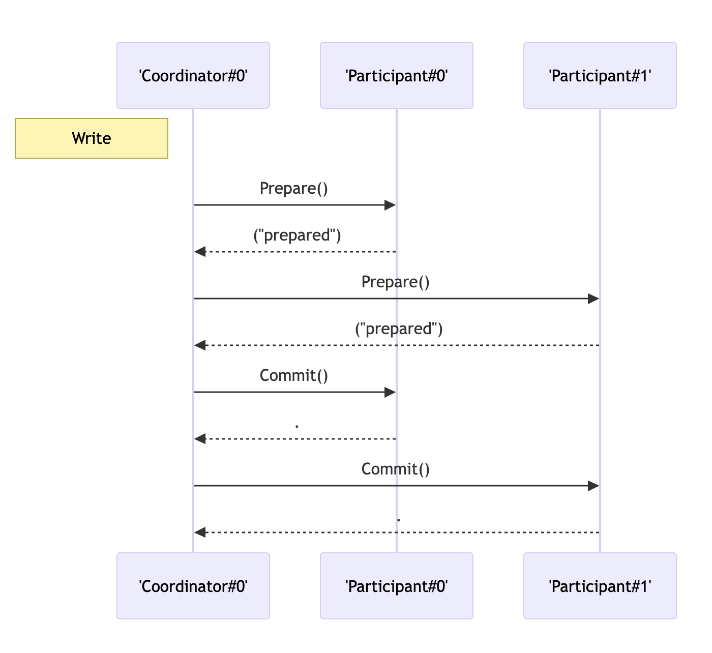
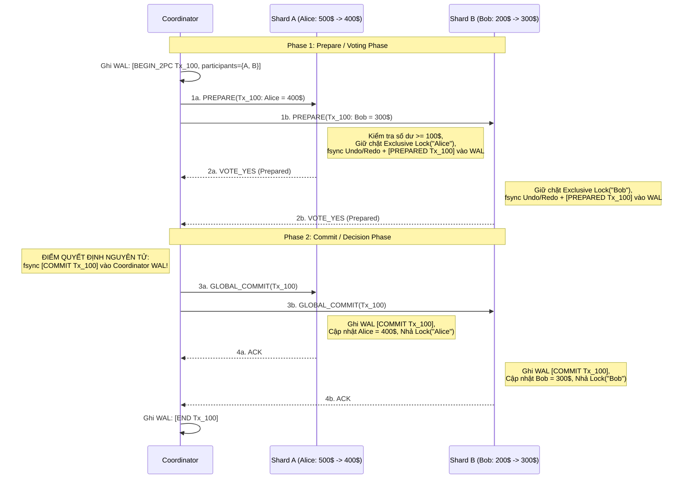
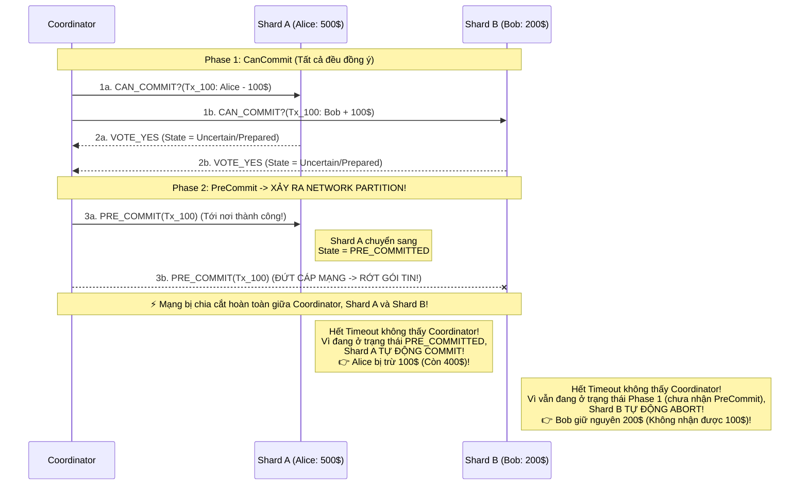
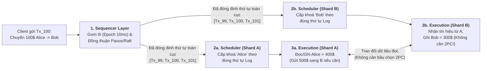
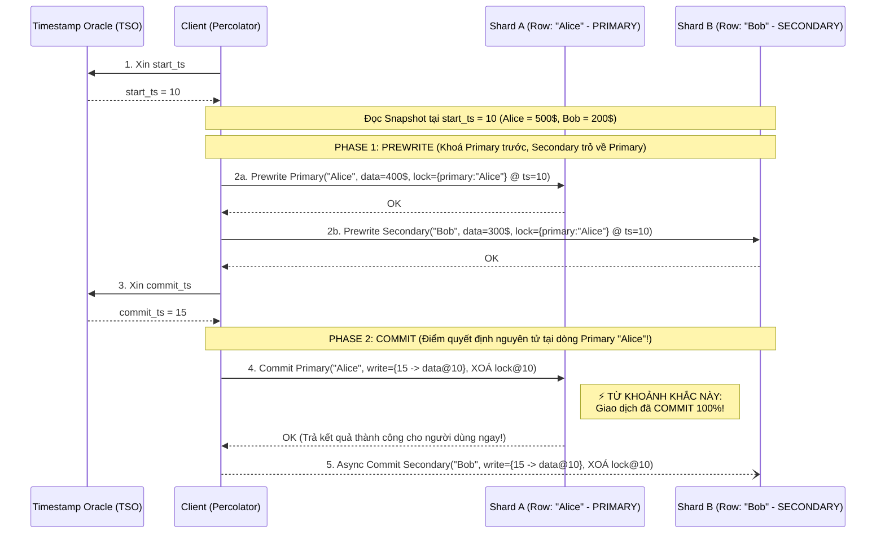

## Table of Contents
1. [Bài toán Atomic trên nhiều Node phân tán](#distributed-atomicity)
2. [Two-Phase Commit (2PC) và Điểm yếu Blocking](#two-phase-commit)
3. [Three-Phase Commit (3PC) và Rủi ro Split-Brain](#three-phase-commit)
4. [Các kiến trúc Giao dịch Phân tán hiện đại: Spanner, Calvin, Percolator](#modern-architectures)
5. [Tóm tắt & Ghi nhớ cốt lõi (Key Takeaways)](#key-takeaways)

---

Khi quy mô dữ liệu vượt quá khả năng lưu trữ và xử lý của một server đơn lẻ, cơ sở dữ liệu buộc phải chia nhỏ dữ liệu ra nhiều phân vùng vật lý độc lập (**Sharding / Partitioning**). Tuy nhiên, một khi dữ liệu nằm rải rác trên nhiều server, cơ chế khoá cục bộ (Local Locks) và Write-Ahead Log (WAL) của từng máy không còn đủ để đảm bảo tính nguyên tử (**Atomicity**) và cô lập (**Isolation**) cho các giao dịch chạm tới nhiều phân vùng. Chương 13 giải phẫu các giao thức **Atomic Commitment** kinh điển (**2PC**, **3PC**) và cách ba kiến trúc cơ sở dữ liệu phân tán hiện đại (**Google Spanner**, **Calvin**, **Google Percolator**) giải quyết bài toán giao dịch phân tán.

---

## Bài toán Atomic trên nhiều Node phân tán {#distributed-atomicity}

### Bài toán thực tế & Mental Model

Trên một cơ sở dữ liệu đơn máy (Single-Node RDBMS như PostgreSQL hay MySQL), việc đảm bảo tính nguyên tử (**All-or-Nothing**) cho một giao dịch rất đơn giản: toàn bộ các trang dữ liệu và tệp nhật ký **Write-Ahead Log (WAL)** đều nằm trên cùng một ổ đĩa dưới sự kiểm soát của một nhân hệ điều hành đơn lẻ. Khi ghi bản ghi `COMMIT` xuống đĩa WAL thành công, giao dịch chính thức hoàn tất.

Nhưng khi hệ thống được chia tải (**Sharded**) thành nhiều server vật lý qua mạng:
- Không có bộ nhớ chung (**Shared Nothing**) và không có một tệp WAL chung đơn lẻ.
- Mỗi phân vùng có thể gặp sự cố độc lập: `Shard A` vừa ghi đĩa thành công thì `Shard B` bị đầy ổ cứng, vi phạm ràng buộc toàn vẹn (Constraint Violation), dính Deadlock, hoặc đứt cáp mạng ngay giữa chừng.

> [!IMPORTANT]
> **Phân biệt Atomic Commitment (Chương 13) và Consensus (Chương 14)**:
> - **Consensus (Paxos / Raft)**: Các bản sao cùng biểu quyết để sao chép một giá trị giống nhau; chỉ cần **đa số Quorum ($\lfloor N/2 \rfloor + 1$)** node đồng ý là thành công (chấp nhận số ít node đang sập).
> - **Atomic Commitment (2PC / 3PC)**: Mỗi phân vùng (**Participant / Cohort**) nắm giữ một mảnh dữ liệu khác nhau của giao dịch; do đó bắt buộc phải có **sự đồng thuận tuyệt đối 100% (Unanimity)** từ tất cả các Participant:
>   - Chỉ khi **100% Participant** đều bỏ phiếu đồng ý và đủ khả năng ghi bền vững $\rightarrow$ toàn bộ mới được **Commit**.
>   - Nếu **bất kỳ 1 Participant nào** báo lỗi, từ chối hoặc sập trước khi bỏ phiếu $\rightarrow$ toàn bộ các Participant còn lại bắt buộc phải **Abort (Rollback)**.

### Bài toán xuyên suốt toàn chương: Giao dịch chuyển tiền từ Alice sang Bob

Để dễ dàng so sánh bản chất của từng giao thức từ cổ điển đến hiện đại, toàn bộ chương này sẽ dùng chung **một bài toán chuẩn đơn lẻ** để chạy tay từng bước:

```text
================================================================================
              BÀI TOÁN XUYÊN SUỐT: GIAO DỊCH CHUYỂN TIỀN TX_100
================================================================================
  Giao dịch Tx_100: Chuyển 100$ từ tài khoản Alice sang tài khoản Bob

  ┌──────────────────────────────────┐      ┌──────────────────────────────────┐
  │             SHARD A              │      │             SHARD B              │
  │  (Lưu tài khoản từ A -> M)       │      │  (Lưu tài khoản từ N -> Z)       │
  ├──────────────────────────────────┤      ├──────────────────────────────────┤
  │  Khoá: "Alice"                   │      │  Khoá: "Bob"                     │
  │  Số dư ban đầu: 500$             │      │  Số dư ban đầu: 200$             │
  │  Thao tác: Alice = 500 - 100     │      │  Thao tác: Bob = 200 + 100       │
  │  Số dư kỳ vọng: 400$             │      │  Số dư kỳ vọng: 300$             │
  └──────────────────────────────────┘      └──────────────────────────────────┘

  Yêu cầu Atomicity:
  - Hoặc cả hai cùng cập nhật thành công: (Alice = 400$, Bob = 300$) -> Tổng = 700$
  - Hoặc cả hai cùng giữ nguyên:          (Alice = 500$, Bob = 200$) -> Tổng = 700$
  - TUYỆT ĐỐI KHÔNG ĐƯỢC XẢY RA:          (Alice = 400$, Bob = 200$) -> Mất 100$!
================================================================================
```

---

## Two-Phase Commit (2PC) và Điểm yếu Blocking {#two-phase-commit}

### Mental Model của Two-Phase Commit (2PC)

Hãy hình dung **2PC** giống như một **lễ cưới tại nhà thờ**:
1. **Phase 1 — Prepare / Voting Phase (Linh mục hỏi từng người)**:
   - Linh mục (**Coordinator**) hỏi chú rể (**Shard A**): *"Con có đồng ý lấy cô dâu không?"* $\rightarrow$ Chú rể đáp: *"Con đồng ý (`VOTE_YES`)"*.
   - Linh mục hỏi cô dâu (**Shard B**): *"Con có đồng ý lấy chú rể không?"* $\rightarrow$ Cô dâu đáp: *"Con đồng ý (`VOTE_YES`)"*.
   - **Quy tắc sống còn**: Một khi chú rể hoặc cô dâu đã nói *"Con đồng ý (`VOTE_YES`)"*, người đó đã bước vào trạng thái **Prepared (`In-Doubt`)** — tức là đã trao toàn quyền quyết định cho Linh mục, không được phép tự ý bỏ trốn khỏi nhà thờ nữa mà bắt buộc phải đứng yên tại chỗ chờ Linh mục tuyên bố kết quả cuối cùng!
2. **Phase 2 — Commit / Decision Phase (Linh mục tuyên bố)**:
   - Khi thấy cả hai đều đã nói `VOTE_YES`, Linh mục ghi vào sổ hộ tịch (**Coordinator WAL**): `COMMIT`, rồi dõng dạc tuyên bố: *"Ta tuyên bố hai con là vợ chồng (`GLOBAL_COMMIT`)"*.
   - Ngược lại, nếu một trong hai người nói `VOTE_NO` (hoặc ngất xỉu trước khi trả lời), Linh mục ghi `ABORT` và tuyên bố huỷ hôn lễ (`GLOBAL_ABORT`) để người kia được tự do ra về.


*Hình 13.1: Hai giai đoạn Voting Phase (Prepare) và Completion Phase (Commit) giữa Coordinator và các Cohorts trong giao thức 2PC*



---

### Ví dụ chạy tay từng bước: Trạng thái tệp WAL và Khoá trong 2PC

Hãy theo dõi chính xác những gì được ép ghi xuống ổ cứng (`fsync` vào tệp **WAL**) và trạng thái khoá dòng (**Row Locks**) trên `Coordinator`, `Shard A` và `Shard B` ở từng mốc thời gian khi chạy giao dịch `Tx_100` (chuyển `100$` từ `Alice` sang `Bob`):

| Bước thời gian | Trạng thái trên `Coordinator` | Trạng thái trên `Shard A` (`Alice`) | Trạng thái trên `Shard B` (`Bob`) |
| :--- | :--- | :--- | :--- |
| **Trước khi chạy** | WAL: *(Trống)* | - Dữ liệu: `Alice = 500$`<br/>- Lock: `None`<br/>- WAL: *(Trống)* | - Dữ liệu: `Bob = 200$`<br/>- Lock: `None`<br/>- WAL: *(Trống)* |
| **Bước 1: Thực thi nhánh & Gửi `PREPARE`** | - Ghi WAL: `[BEGIN_2PC Tx_100, Cohorts={A,B}]`<br/>- Gửi `PREPARE(Tx_100)` tới `Shard A` và `Shard B`. | - Giữ **`X-Lock("Alice")`**<br/>- Kiểm tra `500$ >= 100$` (Hợp lệ)<br/>- Ghi Undo (`500$`) & Redo (`400$`) vào bộ đệm. | - Giữ **`X-Lock("Bob")`**<br/>- Tính số dư mới `200$ + 100$ = 300$`<br/>- Ghi Undo (`200$`) & Redo (`300$`) vào bộ đệm. |
| **Bước 2: Bỏ phiếu `VOTE_YES` (Kết thúc Phase 1)** | Nhận được `VOTE_YES` từ cả `Shard A` và `Shard B`. | - **`fsync` xuống đĩa WAL**:<br/>  `[UNDO: Alice=500, REDO: Alice=400]`<br/>  `[PREPARED Tx_100]`<br/>- Vẫn **giữ chặt `X-Lock("Alice")`**!<br/>- Trạng thái: **`IN-DOUBT`**<br/>- Gửi `VOTE_YES` về Coordinator. | - **`fsync` xuống đĩa WAL**:<br/>  `[UNDO: Bob=200, REDO: Bob=300]`<br/>  `[PREPARED Tx_100]`<br/>- Vẫn **giữ chặt `X-Lock("Bob")`**!<br/>- Trạng thái: **`IN-DOUBT`**<br/>- Gửi `VOTE_YES` về Coordinator. |
| **Bước 3: Coordinator chốt quyết định (Đầu Phase 2)** | - **`fsync` xuống đĩa WAL**:<br/>  **`[COMMIT Tx_100]`**<br/>  *(Khoảnh khắc bản ghi này chạm đĩa của Coordinator, giao dịch `Tx_100` đã chính thức được Commit không thể đảo ngược!)*<br/>- Gửi `GLOBAL_COMMIT(Tx_100)` cho `A` và `B`. | Đang chờ lệnh từ Coordinator (Mọi truy vấn khác chạm vào dòng `"Alice"` đều bị chặn lại bởi `X-Lock("Alice")`). | Đang chờ lệnh từ Coordinator (Mọi truy vấn khác chạm vào dòng `"Bob"` đều bị chặn lại bởi `X-Lock("Bob")`). |
| **Bước 4: Hoàn tất & Nhả khoá (Cuối Phase 2)** | Nhận đủ `ACK` từ `A` và `B` $\rightarrow$ Ghi WAL `[END Tx_100]`. | - **`fsync` xuống đĩa WAL**: `[COMMIT Tx_100]`<br/>- Áp dụng `Alice = 400$`<br/>- **Nhả `X-Lock("Alice")`**<br/>- Gửi `ACK` về Coordinator. | - **`fsync` xuống đĩa WAL**: `[COMMIT Tx_100]`<br/>- Áp dụng `Bob = 300$`<br/>- **Nhả `X-Lock("Bob")`**<br/>- Gửi `ACK` về Coordinator. |

---

### Phân tích chi tiết 3 Kịch bản sập máy (Crash Scenarios) trong 2PC

Tại sao setiap bản ghi `[PREPARED Tx_100]` và `[COMMIT Tx_100]` đều phải `fsync` xuống đĩa trước khi gửi gói tin mạng? Hãy phân tích 3 kịch bản sập máy thực tế để thấy cơ chế phục hồi và điểm tử huyệt của 2PC:

#### Kịch bản (a): Participant (`Shard A`) bị sập TRƯỚC khi gửi `VOTE_YES`
- **Diễn biến**: `Coordinator` gửi `PREPARE(Tx_100)` tới `Shard A` và `Shard B`. `Shard B` đã ghi `[PREPARED Tx_100]` vào WAL và trả về `VOTE_YES`. Nhưng `Shard A` bị mất điện ngay trước khi kịp ghi `[PREPARED Tx_100]` xuống đĩa.
- **Xử lý**:
  - Trên `Coordinator`: Hết thời gian chờ (Timeout) mà không nhận được phiếu của `Shard A`. Vì chưa có sự đồng thuận 100%, `Coordinator` được quyền đơn phương quyết định huỷ giao dịch: ghi `[ABORT Tx_100]` vào WAL và gửi `GLOBAL_ABORT(Tx_100)` cho `Shard B`.
  - Trên `Shard B`: Nhận lệnh `GLOBAL_ABORT`, dùng bản ghi Undo (`Bob = 200$`) trong WAL để khôi phục, ghi `[ABORT Tx_100]` và nhả khoá `X-Lock("Bob")`.
  - Trên `Shard A` (khi khởi động lại): Đọc tệp WAL của mình, thấy không có bản ghi `[PREPARED Tx_100]` nào cả $\rightarrow$ `Shard A` tự động Rollback mọi thay đổi dở dang của `Tx_100`.
- **Kết quả**: **An toàn và Không bị treo (Non-blocking)**! Số dư vẫn là `(Alice = 500$, Bob = 200$)`.

#### Kịch bản (b): `Coordinator` bị sập TRƯỚC khi ghi `[COMMIT Tx_100]` vào WAL
- **Diễn biến**: `Shard A` và `Shard B` đều đã gửi `VOTE_YES`, nhưng `Coordinator` bị sập nguồn ngay trước khi kịp `fsync` bản ghi `[COMMIT Tx_100]` xuống đĩa WAL của `Coordinator`.
- **Xử lý**:
  - Trong lúc `Coordinator` đang tắt máy, cả `Shard A` và `Shard B` đều đã ở trạng thái `PREPARED` nên phải đứng chờ.
  - Khi `Coordinator` khởi động lại và đọc tệp WAL của chính mình: thấy có `[BEGIN_2PC Tx_100]` nhưng **chưa có `[COMMIT Tx_100]`** $\rightarrow$ `Coordinator` biết chắc chắn mình chưa từng gửi `GLOBAL_COMMIT` cho bất kỳ ai. Do đó, `Coordinator` ghi `[ABORT Tx_100]` vào WAL và phát lệnh `GLOBAL_ABORT(Tx_100)` tới cả `Shard A` và `Shard B` để giải phóng khoá!

#### Kịch bản (c) — Điểm yếu Blocking chí mạng của 2PC: `Coordinator` và `Shard A` cùng sập SAU khi các Shard đã `VOTE_YES`!

Đây là kịch bản kinh điển chứng minh **2PC là một giao thức Blocking (chặn đứng hệ thống)**:

```text
================================================================================
        KỊCH BẢN BLOCKING CHÍ MẠNG TRONG 2PC (SHARD B BỊ KẸT IN-DOUBT)
================================================================================

  Coordinator                     Shard A (Alice)                Shard B (Bob)
  ───────────                     ───────────────                ─────────────
       │                                 │                             │
       ├──────── PREPARE(Tx_100) ───────►│                             │
       ├──────── PREPARE(Tx_100) ────────┼────────────────────────────►│
       │                                 │ WAL: [PREPARED Tx_100]      │ WAL: [PREPARED Tx_100]
       │◄─────── VOTE_YES ───────────────┤ (Đang giữ X-Lock("Alice"))  │ (Đang giữ X-Lock("Bob"))
       │◄─────── VOTE_YES ───────────────┼─────────────────────────────┤
       │                                 │                             │
  💥 SẬP NGUỒN!                     💥 SẬP NGUỒN!                      ❓ BỊ CÔ LẬP!
  (Không rõ đã ghi                  (Không thể liên lạc                Shard B tự hỏi:
   COMMIT hay ABORT                  để hỏi trạng thái)                "Tx_100 đã Commit hay Abort?"
   trước khi sập?)                                                     -> KẸT CỨNG IN-DOUBT!
```

Hãy đặt mình vào vị trí của **`Shard B`** (đang quản lý tài khoản của `Bob`, đã ghi `[PREPARED Tx_100]` vào WAL và đang giữ khoá độc quyền `X-Lock("Bob")`):
1. `Shard B` chờ mãi không thấy `Coordinator` gửi kết quả Phase 2 (`Coordinator` đã sập).
2. `Shard B` thử gọi trực tiếp sang đồng nghiệp là `Shard A` để hỏi xem `Shard A` đã nhận được lệnh gì từ `Coordinator` chưa (*Cooperative Termination Protocol*), nhưng **`Shard A` cũng đã sập hoặc đứt mạng**!
3. Lúc này, `Shard B` rơi vào thế **tiến thoái lưỡng nan (In-Doubt Dilemma)**:
   - **Tại sao `Shard B` KHÔNG DÁM tự ý Abort (nhả khoá và giữ nguyên `Bob = 200$`)?**
     Vì nhỡ đâu một tích tắc trước khi sập, `Coordinator` đã kịp ghi `[COMMIT Tx_100]` và gửi `GLOBAL_COMMIT` cho `Shard A`, khiến `Shard A` đã thực sự trừ tiền `Alice = 400$`, nhả khoá và báo giao dịch thành công cho người dùng rồi thì sao? Nếu `Shard B` tự ý Abort thì `Alice` mất `100$` mà `Bob` không nhận được tiền!
   - **Tại sao `Shard B` CŨNG KHÔNG DÁM tự ý Commit (cộng tiền `Bob = 300$`)?**
     Vì từ góc nhìn của `Shard B`, nó chỉ biết bản thân nó đã bỏ phiếu `VOTE_YES`, chứ nó hoàn toàn **không biết `Shard A` đã bỏ phiếu `VOTE_YES` hay `VOTE_NO` ở Phase 1**! Nhỡ đâu ở Phase 1, tài khoản `Alice` không đủ tiền nên `Shard A` đã bỏ phiếu `VOTE_NO` và tự Abort ngay lập tức rồi thì sao? Nếu `Shard B` tự ý Commit thì `Alice` vẫn còn `500$` mà `Bob` tự nhiên được cộng thêm `100$` từ hư không!
4. **Hậu quả thảm khốc**:
   Để không làm sai lệch tiền bạc (**bảo vệ Safety**), `Shard B` không còn bất kỳ lựa chọn nào khác ngoài việc **đóng băng tại chỗ và ngâm chặt khoá `X-Lock("Bob")` vô thời hạn** (có thể là hàng giờ đồng hồ cho đến khi máy chủ `Coordinator` được sửa phần cứng và khởi động lại để đọc đĩa WAL)! Trong suốt thời gian đó, mọi giao dịch khác trong hệ thống muốn chuyển tiền cho `Bob` hoặc đọc số dư của `Bob` đều bị treo cứng dây chuyền.

---

## Three-Phase Commit (3PC) và Rủi ro Split-Brain {#three-phase-commit}

### Ý tưởng của 3PC: Tại sao cần thêm bước đệm `PreCommit`?

Nhìn lại kịch bản Blocking của 2PC ở trên, nguyên nhân khiến `Shard B` bị kẹt không dám tự quyết định khi hết Timeout là vì: **Khi `Shard B` đang ở trạng thái `Prepared`, nó không hề biết tất cả các Shard khác đã đồng ý `VOTE_YES` hay chưa, trong khi một Shard khác có thể đã bước sang trạng thái `Committed` rồi!**

Năm 1981, Dale Skeen và Michael Stonebraker đề xuất giao thức **Three-Phase Commit (3PC)** nhằm biến Atomic Commitment thành **Non-Blocking Protocol** bằng hai thay đổi:
1. Chèn thêm một pha thông báo trung gian gọi là **`PreCommit`** nằm giữa `CanCommit` (Prepare) và `DoCommit` (Commit).
2. Đặt quy tắc tự động xử lý khi hết **Timeout**:
   - **Phase 1 (`CanCommit?`)**: `Coordinator` hỏi `Shard A` và `Shard B` xem có sẵn sàng chuyển `100$` từ `Alice` sang `Bob` không. Cả hai khoá dòng và trả lời `VOTE_YES`. *(Lưu ý: ở thời điểm này, chưa ai được phép Commit, và nếu hết Timeout ở đây thì các Shard tự động **Abort**).*
   - **Phase 2 (`PreCommit`)**: Khi `Coordinator` nhận đủ 100% phiếu `VOTE_YES`, thay vì ra lệnh Commit ngay, `Coordinator` gửi thông báo **`PRE_COMMIT`** tới cả `Shard A` và `Shard B` để truyền đi thông điệp: *"Tất cả các bên đều đã bỏ phiếu `YES` rồi! Hãy bước vào trạng thái `PreCommitted`!"*. Các Shard xác nhận bằng bản tin `ACK`.
   - **Phase 3 (`DoCommit`)**: Sau khi nhận đủ `ACK` của pha `PreCommit`, `Coordinator` mới phát lệnh `DO_COMMIT` cuối cùng. Nếu một Shard đã bước vào trạng thái **`PreCommitted`** mà thấy `Coordinator` bị sập (hết Timeout), Shard đó biết chắc chắn 100% rằng không có ai bỏ phiếu `NO` ở Phase 1, nên quy tắc của 3PC cho phép nó **tự động Commit (Auto-Commit on Timeout)** mà không cần chờ `Coordinator` sống lại!

---

### Ví dụ chạy tay: Kịch bản Network Partition phá vỡ tính Atomicity trong 3PC

Trên lý thuyết (trong mạng đồng bộ hoàn hảo nơi không bao giờ có chuyện gói tin bị trễ quá hạn và bộ phát hiện lỗi không bao giờ nhầm lẫn), 3PC giải quyết được bài toán Blocking. Nhưng trong **mạng thực tế bất đồng bộ (Asynchronous Network)** có hiện tượng **Network Partition (Đứt cáp mạng chia cắt cụm)** hoặc trễ mạng, quy tắc *"Tự động Abort nếu chưa nhận `PreCommit`"* và *"Tự động Commit nếu đã nhận `PreCommit`"* của 3PC sẽ gây ra thảm hoạ **Split-Brain (Nửa Commit, Nửa Abort)**:



Hãy trace từng bước thảm hoạ mất tiền trong ví dụ chuyển `100$` từ `Alice` (`Shard A`) sang `Bob` (`Shard B`) khi dùng 3PC:

1. **Bước 1 — Hoàn tất Phase 1 (`CanCommit`)**:
   - `Coordinator` gửi `CAN_COMMIT?(Tx_100)` tới `Shard A` và `Shard B`.
   - `Shard A` khoá dòng `Alice`, kiểm tra số dư `500$ >= 100$` và trả lời `VOTE_YES`.
   - `Shard B` khoá dòng `Bob` và trả lời `VOTE_YES`.
   - Hiện tại cả `Shard A` và `Shard B` đều đang ở trạng thái cuối Phase 1 (chưa nhận được `PRE_COMMIT`).
2. **Bước 2 — Sự cố đứt mạng ngay giữa Phase 2 (`PreCommit`)**:
   - `Coordinator` nhận đủ 2 phiếu `VOTE_YES`, nên bắt đầu gửi thông điệp `PRE_COMMIT(Tx_100)` cho `Shard A` và `Shard B`.
   - Gói tin `PRE_COMMIT(Tx_100)` gửi tới **`Shard A` đến nơi thành công** $\rightarrow$ `Shard A` chuyển sang trạng thái **`PRE_COMMITTED`** và gửi trả `ACK`.
   - Tuy nhiên, đúng tích tắc đó, **switch mạng gặp sự cố (Network Partition)** khiến gói tin `PRE_COMMIT(Tx_100)` gửi tới **`Shard B` bị rớt**, đồng thời `Coordinator` cũng bị cô lập khỏi cả `Shard A` và `Shard B`!
3. **Bước 3 — Hai nửa phân vùng tự hành động ngược chiều nhau khi hết Timeout**:
   - **Tại `Shard B` (`Bob`)**: Bộ đếm thời gian chờ (Timeout) hết hạn. `Shard B` kiểm tra trạng thái cục bộ của mình: thấy mình mới chỉ gửi `VOTE_YES` ở Phase 1 chứ **chưa hề nhận được thông báo `PRE_COMMIT`**. Theo đúng quy tắc Non-blocking của 3PC (vì nghĩ rằng có thể `Shard A` đã bỏ phiếu `NO` và `Coordinator` đã chết ở Phase 1), `Shard B` **tự động thực thi `ABORT`**: huỷ giao dịch, nhả khoá và giữ nguyên số dư **`Bob = 200$`**!
   - **Tại `Shard A` (`Alice`)**: Bộ đếm thời gian chờ `DO_COMMIT` cũng hết hạn mà không liên lạc được với `Coordinator` hay `Shard B`. `Shard A` kiểm tra trạng thái cục bộ của mình: thấy mình **đã ở trạng thái `PRE_COMMITTED`**. Theo đúng quy tắc Non-blocking của 3PC, `Shard A` **tự động thực thi `COMMIT`**: trừ tiền của `Alice` xuống **`Alice = 400$`** và nhả khoá!
4. **Hậu quả cuối cùng**:
   - `Alice` còn **`400$`** (đã bị trừ `100$`), trong khi `Bob` vẫn là **`200$`** (không nhận được đồng nào)! Tổng số tiền trong ngân hàng bốc hơi mất `100$`, **phá vỡ hoàn toàn tính nguyên tử (Atomicity / Safety)** của cơ sở dữ liệu!

> [!WARNING]
> **Bài học cốt lõi từ 2PC và 3PC**:
> - **2PC** chọn bảo vệ **Safety (Tính đúng đắn tuyệt đối)** bằng mọi giá, chấp nhận hy sinh **Liveness (Bị treo khoá / Blocking)** khi Coordinator sập.
> - **3PC** cố gắng đạt **Liveness (Không bị treo khoá)** bằng Timeout, nhưng lại đánh mất **Safety (Gây Split-Brain lệch dữ liệu)** khi mạng bị phân mảnh.
> - Trong ngành cơ sở dữ liệu, mất Safety (mất tiền, lệch bảng kế toán) là điều không thể chấp nhận được. Đó là lý do **3PC không được sử dụng trong thực tế**, mà các hệ quản trị cơ sở dữ liệu hiện đại chọn giữ lại khung **2PC** rồi dùng **Consensus (Paxos/Raft)** hoặc **Deterministic Log** để khắc phục điểm yếu Blocking của nó!

---

## Các kiến trúc Giao dịch Phân tán hiện đại: Spanner, Calvin, Percolator {#modern-architectures}

Làm thế nào để vừa có được tính **Safety tuyệt đối** của 2PC, lại vừa **không bao giờ bị treo khoá vô thời hạn (Non-Blocking)** khi một máy chủ bị sập? Ba kiến trúc kinh điển của kỷ nguyên NewSQL là **Google Spanner**, **Calvin** và **Google Percolator** đã giải quyết bài toán chuyển `100$` từ `Alice` sang `Bob` theo 3 triết lý hoàn toàn khác biệt.

---

### 1. Google Spanner: `2PL + 2PC + Paxos + TrueTime`

Google Spanner (cùng họ kiến trúc với CockroachDB và YugabyteDB) giữ nguyên mô hình **Strict Two-Phase Locking (Strict 2PL)** kết hợp **Two-Phase Commit (2PC)** truyền thống, nhưng xoá sổ hoàn toàn tử huyệt của 2PC bằng hai vũ khí: **Paxos Replication Groups** và **TrueTime API**.

#### a. Xoá bỏ Single Point of Failure của 2PC bằng cách chạy 2PC trên các cụm Paxos Group

Trong 2PC cổ điển, `Coordinator`, `Shard A` và `Shard B` là từng máy chủ vật lý đơn lẻ — chỉ cần máy `Coordinator` cháy nguồn là cả giao dịch bị treo cứng.

Trong **Google Spanner**:
- Mỗi phân vùng dữ liệu (`Shard A` chứa `Alice`, `Shard B` chứa `Bob`) không phải là 1 máy chủ đơn lẻ, mà là một **nhóm đồng thuận Paxos (`Paxos Group`)** gồm `3` hoặc `5` máy chủ đặt tại nhiều Availability Zone khác nhau.
- Bản thân vai trò **`Coordinator`** cũng không phải là 1 máy chủ đơn lẻ, mà do **Paxos Leader của một nhóm Paxos** đảm nhận, và mọi trạng thái khoá / bản ghi WAL của 2PC (`[PREPARED]`, `[COMMIT]`) đều được **sao chép qua giao thức đồng thuận Paxos** lên đa số máy chủ trong nhóm đó!

```text
================================================================================
         KIẾN TRÚC GOOGLE SPANNER: CHẠY 2PC GIỮA CÁC CỤM PAXOS GROUP
================================================================================

   [ Cụm Paxos: SHARD A (Alice) ]              [ Cụm Paxos: SHARD B (Bob) ]
       (Đóng vai Coordinator)                     (Đóng vai Participant)
  ┌──────────────────────────────┐            ┌──────────────────────────────┐
  │  ★ Leader A1 (Coord Leader)  │◄══ 2PC ═══►│  ★ Leader B1 (Cohort Leader) │
  │    ├─► Replica A2 (Paxos)    │  Prepare/  │    ├─► Replica B2 (Paxos)    │
  │    └─► Replica A3 (Paxos)    │   Commit   │    └─► Replica B3 (Paxos)    │
  └──────────────────────────────┘            └──────────────────────────────┘
   * Nếu Leader A1 bị sập ngay giữa lúc đang chạy 2PC:
     Replica A2 đắc cử Leader mới chỉ sau vài trăm ms, đọc lại Paxos Log
     và tiếp tục hoàn tất 2PC với Shard B mà KHÔNG BAO GIỜ bị kẹt In-Doubt!
```

**Điều gì xảy ra nếu máy chủ Coordinator (`Leader A1`) bị nổ nguồn ngay sau khi `Shard B` vừa trả lời `VOTE_YES`?**
- Không giống 2PC cổ điển phải chờ kỹ sư vào phòng máy thay nguồn cho `A1`, hai máy còn sống trong nhóm Paxos của `Shard A` là `A2` và `A3` phát hiện `A1` mất nhịp tim, lập tức bầu `A2` lên làm **Coordinator Leader mới** chỉ trong vài trăm mili-giây.
- Vì mọi bước ghi log trước đó đều đã được đồng thuận trên Quorum của nhóm Paxos `Shard A`, `A2` nắm rõ 100% trạng thái của giao dịch `Tx_100` và lập tức gửi lệnh `GLOBAL_COMMIT` hoặc `GLOBAL_ABORT` sang cho `Shard B` để nhả khoá ngay lập tức!

---

#### b. Bài toán Đồng hồ lệch (Clock Skew) và cơ chế `TrueTime + Commit Wait`

##### Tại sao cần TrueTime? (Bài toán External Consistency / Linearizability)
Để cho phép các giao dịch chỉ đọc (**Read-Only Transactions** như sao kê ngân hàng, báo cáo tài chính, sao lưu toàn cục) có thể đọc dữ liệu tại một mốc thời gian mà **không cần xin bất kỳ khoá đọc nào (Lock-Free Snapshot Reads)** và không làm chậm các giao dịch ghi, Spanner sử dụng **MVCC (Multi-Version Concurrency Control)** gắn nhãn thời gian (**Timestamp**) cho mọi phiên bản dữ liệu.

Nhưng để đảm bảo **External Consistency (Strict Serializability)** trên phạm vi toàn cầu, hệ thống phải thoả mãn bất biến:
> **Bất biến External Consistency**: Nếu giao dịch $T_2$ bắt đầu thực thi **sau khi** giao dịch $T_1$ đã báo Commit thành công về mặt thời gian thực tuyệt đối ($t_{\text{start}}(T_2) > t_{\text{commit}}(T_1)$), thì nhãn thời gian được gán cho $T_2$ bắt buộc phải lớn hơn nhãn thời gian của $T_1$:
> $$s_2 > s_1$$

Tại sao không thể dùng đồng hồ hệ thống thông thường (`NTP` / `System.currentTimeMillis()`) của các máy chủ để gán nhãn thời gian $s_1, s_2$?
- Vì các tinh thể thạch anh trên bo mạch chủ luôn chạy nhanh hoặc chậm hơn nhau (**Clock Drift**), khiến đồng hồ giữa hai máy chủ ở Mỹ và Châu Á có thể lệch nhau từ vài chục đến vài trăm mili-giây.
- Nếu đồng hồ của máy chủ xử lý $T_1$ đang chạy **nhanh hơn thực tế** (ví dụ đang chỉ `108 ms`), còn đồng hồ của máy chủ xử lý $T_2$ (bắt đầu sau khi $T_1$ đã xong) lại đang chạy **chậm hơn thực tế** (mới chỉ `103 ms`), thì $s_2 (103) < s_1 (108)$! Khi đó, một truy vấn đọc tại mốc `105 ms` sẽ nhìn thấy kết quả của $T_2$ mà lại không nhìn thấy kết quả của $T_1$ (dù $T_1$ là nguyên nhân sinh ra $T_2$) — phá vỡ quan hệ nhân quả!

##### Cơ chế của TrueTime API và Quy tắc Commit Wait

Thay vì cố tạo ra một đồng hồ không có sai số (điều bất khả thi theo vật lý), Google lắp đặt các bộ thu **GPS** và **Đồng hồ nguyên tử Rubidium (Atomic Clocks)** tại mọi trung tâm dữ liệu, và thiết kế **TrueTime API** trả về **một khoảng thời gian $[t_{\text{earliest}}, t_{\text{latest}}]$** đảm bảo chắc chắn thời gian thực tuyệt đối của vũ trụ ($t_{\text{abs}}$) luôn nằm bên trong khoảng đó, với nửa độ rộng sai số tối đa là $\epsilon$:

$$\text{TT.now()} = [t_{\text{earliest}}, \; t_{\text{latest}}], \quad \text{trong đó } t_{\text{earliest}} \le t_{\text{abs}} \le t_{\text{latest}} \text{ và } \epsilon = \frac{t_{\text{latest}} - t_{\text{earliest}}}{2}$$

Để đảm bảo tuyệt đối $s_1 < t_{\text{commit}}(T_1) < t_{\text{start}}(T_2) \le s_2$ bất chấp đồng hồ giữa các châu lục lệch nhau tối đa $2\epsilon$, Spanner áp dụng 2 quy tắc vàng cho mọi giao dịch ghi $T_1$:
1. **Quy tắc chọn nhãn thời gian (Start Rule)**: Khi Coordinator bắt đầu pha Commit cho $T_1$, nó gọi `TT.now()` và chọn nhãn thời gian commit $s_1 \ge \text{TT.now().latest}$ (mốc muộn nhất có thể của khoảng sai số hiện tại).
2. **Quy tắc chờ hết sai số trước khi nhả khoá (`Commit Wait`)**: Trước khi được phép nhả khoá 2PL và trả kết quả *"Commit thành công"* cho Client, Coordinator **bắt buộc phải tạm dừng và chờ (Wait) cho đến khi gọi `TT.now()` thấy $\text{TT.now().earliest} > s_1$**!
   - Vì $s_1 = t_{\text{latest\_ban\_đầu}} = t_{\text{abs}} + \epsilon$, còn $\text{TT.now().earliest} = t_{\text{abs\_mới}} - \epsilon$, nên để $\text{TT.now().earliest} > s_1$, Coordinator phải chờ đúng một khoảng thời gian bằng **$2\epsilon$**!
   - Ngay khoảnh khắc `TT.now().earliest > s_1` thoả mãn, thời gian thực tuyệt đối của Trái Đất chắc chắn đã vượt qua $s_1$ ($t_{\text{abs}} \ge \text{TT.now().earliest} > s_1$).

---

#### Ví dụ chạy tay bằng con số cụ thể (Step-by-Step Dry Run): TrueTime & Commit Wait với $\epsilon = 4\text{ ms}$

Giả sử sai số đồng hồ của cụm Spanner hiện tại là **$\epsilon = 4\text{ ms}$** (nên độ rộng khoảng bất định của `TT.now()` luôn là $2\epsilon = 8\text{ ms}$).
Xét giao dịch **$T_1$** (chuyển `100$` từ `Alice` sang `Bob` tại Datacenter Mỹ). Ngay sau khi `Bob` nhìn thấy thông báo nhận được tiền trên màn hình điện thoại, `Bob` lập tức bấm thực hiện giao dịch **$T_2$** (dùng `100$` vừa nhận để mua hàng tại Datacenter Singapore).

Hãy theo dõi từng mili-giây theo đồng hồ thực tế của vũ trụ ($t_{\text{abs}}$) và khoảng trả về của `TT.now()`:

```text
==========================================================================================
        TIMELINE CHẠY TAY TRUETIME & COMMIT WAIT (VỚI SAI SỐ ε = 4ms, 2ε = 8ms)
==========================================================================================

Thời gian thực (t_abs):  100ms     104ms                108ms                112ms    113ms
───────────────────────────┼─────────┼────────────────────┼────────────────────┼────────┼──►
                           │         │                    │                    │        │
[1] Tại t_abs = 104ms:     ◄───4ms───►◄─────── 4ms ──────►│                    │        │
    Coordinator của T1     [100ms ───────── TT.now() ──── 108ms]               │        │
    gọi TT.now() nhận                │                    │                    │        │
    khoảng [100ms, 108ms].           │                    ▼                    │        │
    👉 Chọn nhãn commit:             │               s1 = 108ms                │        │
       s1 = TT.now().latest = 108ms  │                                         │        │
                                     │                                         │        │
[2] COMMIT WAIT (8ms):               ├═══════ Chờ đủ 2ε = 8ms (104->112) ═════►│        │
    (Song song với chạy              │  (Tại t_abs = 112ms, gọi lại TT.now()   │        │
     Paxos & 2PC)                    │   trả về khoảng [108ms, 116ms];         │        │
                                     │   sang 112.1ms -> [109ms, 117ms]        │        │
                                     │   Thoả mãn: earliest (109ms) > s1 (108ms)!)      │
                                     │                                         ▼        │
[3] Tại t_abs = 112.1ms:             │                                    T1 NHẢ KHOÁ & │
    Thời gian thực (112.1ms)         │                                    BÁO THÀNH CÔNG│
    ĐÃ CHẮC CHẮN > s1 (108ms)!       │                                                  │
                                                                                        ▼
[4] Tại t_abs = 113ms (Singapore):                                         T2 bắt đầu sau T1!
    T2 gọi TT.now() tại Singapore (dù đồng hồ Singapore chạy chậm hết cỡ -4ms):
    TT.now() tại Singapore trả về [109ms, 117ms].
    👉 T2 chọn nhãn commit s2 >= TT.now().latest = 117ms.
    ✅ ĐẢM BẢO TUYỆT ĐỐI: s2 (117ms) > s1 (108ms) mà 2 Datacenter KHÔNG CẦN HỎI NHAU!
==========================================================================================
```

Trace chi tiết từng bước bằng con số:
1. **Bước 1 — Chọn nhãn thời gian $s_1$ (`t_abs = 104 ms`)**:
   - Giao dịch $T_1$ (`Alice -> Bob`) đã giữ khoá 2PL trên cả `Shard A` và `Shard B`.
   - Tại thời điểm thực tế $t_{\text{abs}} = 104\text{ ms}$, Coordinator của $T_1$ gọi `TT.now()`. Do sai số $\epsilon = 4\text{ ms}$, `TT.now()` trả về đoạn **`[100 ms, 108 ms]`**.
   - Coordinator gán nhãn thời gian commit cho $T_1$ bằng đầu mút lớn nhất:
     $$s_1 = \text{TT.now().latest} = \mathbf{108\text{ ms}}$$
2. **Bước 2 — Thực thi Commit Wait chờ qua khoảng bất định $2\epsilon = 8\text{ ms}$ (`t_abs` từ `104 ms` đến `112 ms`)**:
   - Tại thời điểm $t_{\text{abs}} = 104\text{ ms}$, thời gian thực mới là `104 ms`, nhưng nhãn của $T_1$ đã được đóng dấu là `108 ms` (nằm ở tương lai `4 ms` nữa!). Nếu Coordinator trả kết quả cho `Bob` ngay lúc `104 ms`, thì $T_1$ sẽ có nhãn thời gian lớn hơn thời điểm nó kết thúc thực tế.
   - Do đó, Coordinator vừa chạy đồng thuận Paxos để ghi bản ghi commit với nhãn $s_1 = 108\text{ ms}$, vừa **đợi (`Commit Wait`)** cho đến khi `TT.now().earliest > 108 ms`.
   - Khi thời gian thực trôi thêm $2\epsilon = 8\text{ ms}$ (tới mốc **$t_{\text{abs}} = 112.1\text{ ms}$**), Coordinator gọi lại `TT.now()` và nhận được đoạn **`[109 ms, 117 ms]`**.
   - Lúc này: $\text{TT.now().earliest} = 109\text{ ms} > s_1 (108\text{ ms})$ $\rightarrow$ điều kiện **Commit Wait hoàn tất**! Coordinator lập tức nhả khoá trên `Alice`, `Bob` và báo giao dịch $T_1$ thành công!
3. **Bước 3 — Giao dịch $T_2$ bắt đầu ở châu lục khác (`t_abs = 113 ms`)**:
   - Đúng `1 ms` sau khi $T_1$ xong (tại $t_{\text{abs}} = 113\text{ ms}$), `Bob` khởi tạo giao dịch $T_2$ ở Singapore.
   - Dù đồng hồ ở Singapore có bị trôi chậm tối đa $-\epsilon = -4\text{ ms}$ đi chăng nữa, thì khi $T_2$ gọi `TT.now()` tại $t_{\text{abs}} = 113\text{ ms}$, giá trị $\text{TT.now().latest}$ tại Singapore chắc chắn $\ge t_{\text{abs}} = 113\text{ ms}$ (cụ thể nếu khoảng là `[109 ms, 117 ms]` thì $s_2 \ge 117\text{ ms}$).
   - **Kết quả**: $s_2 (117\text{ ms}) > s_1 (108\text{ ms})$ luôn luôn đúng 100%! Nhờ đó, bất kỳ truy vấn **Lock-Free Snapshot Read** nào đọc tại mốc `t = 117 ms` đều nhìn thấy cả giao dịch `Alice -> Bob` ($s_1 = 108\text{ ms}$) lẫn giao dịch mua hàng của `Bob` ($s_2 = 117\text{ ms}$) theo đúng trình tự nhân quả mà không cần đặt bất kỳ khoá đọc nào!

---

### 2. Calvin: Giao dịch Phân tán Tất định (Deterministic Distributed Transactions)

#### Bài toán thực tế & Mental Model

Hãy nhìn vào lý do tại sao Spanner và các hệ thống 2PC truyền thống phải giữ khoá dòng trong thời gian dài:
- Trong hệ thống truyền thống, cơ sở dữ liệu **vừa giữ khoá dòng, vừa thực thi logic giao dịch, rồi mới chạy 2PC và Paxos qua mạng ở bước cuối cùng** để hỏi xem các node có đồng ý Commit hay không. Mọi độ trễ mạng của 2PC và Commit Wait đều nằm gọn **bên trong thời gian ngâm khoá (Lock Holding Time)**!

Năm 2012, nhóm nghiên cứu của Daniel Abadi tại Đại học Yale đề xuất kiến trúc **Calvin** (được hiện thực hoá trong **FaunaDB**) với một góc nhìn đảo ngược hoàn toàn:
> **Ý tưởng cốt lõi của Calvin**: *"Nếu tất cả các phân vùng và tất cả các bản sao đều thống nhất thứ tự thực thi các giao dịch `[Tx_1, Tx_2, Tx_3, ...]` **TRƯỚC KHI** bắt đầu chạy, và hàm xử lý giao dịch là **hoàn toàn tất định (Deterministic)**, thì mọi node chắc chắn sẽ tính ra cùng một kết quả giống hệt nhau — và do đó **KHÔNG CẦN chạy 2PC** nữa!"*



#### Ví dụ chạy tay từng bước: Giao dịch chuyển `100$` (`Alice -> Bob`) trên kiến trúc Calvin

Hãy trace hành trình của giao dịch `Tx_100` (chuyển `100$` từ `Alice` ở `Shard A` sang `Bob` ở `Shard B`, kèm theo một giao dịch cạnh tranh `Tx_101` rút `50$` từ `Alice`) đi qua 3 tầng của Calvin:

1. **Bước 1 — Tầng `Sequencer Layer` (Chốt thứ tự vào `Deterministic Input Log` trước khi chạy)**:
   - Client gửi toàn bộ mã lệnh của `Tx_100` (`Read("Alice"), Read("Bob"), Write("Alice", -100), Write("Bob", +100)`) dưới dạng một gói lệnh trọn vẹn (**One-Shot Transaction / Stored Procedure**) vào tầng **Sequencer**.
   - Tầng Sequencer gom các giao dịch nhận được trong mỗi khung thời gian `10 ms` (**Epoch**) và dùng giao thức đồng thuận (Paxos/Raft) để ghi nối đuôi vào một nhật ký đầu vào toàn cục (**Deterministic Input Log**).
   - Giả sử lô Log số `#50` vừa được chốt có thứ tự bất biến là: **`[Tx_100 (Alice -> Bob), Tx_101 (Alice rút 50$)]`**.
   - Ngay tại bước này, mọi giá trị không tất định như thời gian hiện tại `NOW()` hay số ngẫu nhiên `UUID()` đều được Sequencer tính sẵn và đóng cứng thành hằng số bên trong bản ghi Log của `Tx_100`.
2. **Bước 2 — Tầng `Scheduler Layer` (Cấp phát khoá tất định — `Deterministic Locking`)**:
   - Cả `Shard A` và `Shard B` đều đọc lô Log `#50` (`[Tx_100, Tx_101]`).
   - Một luồng **Single-threaded Lock Manager** trên mỗi Shard đọc tuần tự từng giao dịch trong Log và cấp phát khoá theo **đúng thứ tự xuất hiện trong Log**:
     - Trên `Shard A`: Cấp khoá `X-Lock("Alice")` cho `Tx_100` trước; còn `Tx_101` (cũng cần khoá `"Alice"`) được xếp vào hàng đợi ngay sau `Tx_100`.
     - Trên `Shard B`: Cấp khoá `X-Lock("Bob")` cho `Tx_100`.
   - **Tại sao không bao giờ xảy ra Deadlock?**: Vì cả `Shard A` và `Shard B` đều cấp phát khoá theo đúng một thứ tự toàn cục đơn lẻ `[Tx_100, Tx_101]` trong Log, không bao giờ có chuyện `Shard A` cấp khoá cho `Tx_100` trước còn `Shard B` lại cấp khoá cho một giao dịch khác theo thứ tự ngược lại!
3. **Bước 3 — Tầng `Execution Threads` (Thực thi hoàn toàn không cần 2PC!)**:
   - Khi `Tx_100` đã nhận được khoá ở cả hai Shard, các luồng Worker bắt đầu thực thi:
     - `Shard A` đọc số dư `Alice = 500$`, kiểm tra điều kiện `500$ >= 100$` (đủ tiền!). `Shard A` gửi thông điệp dữ liệu `{status: "OK", amount: 100$}` sang cho `Shard B`, đồng thời trừ tiền `Alice = 400$` và **nhả ngay khoá `X-Lock("Alice")` cho `Tx_101` chạy tiếp**!
     - `Shard B` nhận được thông điệp từ `Shard A`, cộng tiền `Bob = 200$ + 100$ = 300$` và nhả khoá `X-Lock("Bob")`!
   - **Tại sao không cần 2PC để hỏi xem `Shard B` có bị sập nguồn hay đầy đĩa không?**:
     - Giả sử `Shard A` kiểm tra thấy `Alice` chỉ có `30$` (`< 100$`, lỗi nghiệp vụ **Deterministic Abort**): `Shard A` gửi thông báo `{status: "INSUFFICIENT_FUNDS"}` sang `Shard B` và cả hai cùng huỷ giao dịch một cách tất định.
     - Còn nếu máy chủ `Shard B` bị **sập nguồn đột ngột (Non-deterministic Crash)** ngay lúc đang cộng tiền cho `Bob`? `Shard A` **không cần Rollback**! Bởi vì đầu vào `Tx_100` đã nằm bền vững trong `Deterministic Input Log` rồi; khi bản sao dự phòng của `Shard B` tiếp quản (hoặc khi `Shard B` khởi động lại và chạy lại Log từ đầu), nó chắc chắn sẽ chạy lại đúng lệnh `Tx_100` và ra đúng kết quả `Bob = 300$`!

#### Điểm yếu của Calvin: Bài toán `Dependent Transactions` và `Reconnaissance Queries`
Để `Scheduler` ở Bước 2 có thể cấp phát toàn bộ khoá theo đúng thứ tự Log **trước khi** giao dịch bắt đầu chạy, Calvin bắt buộc phải **biết trước 100% danh sách các khoá cần Đọc và Ghi (`Read/Write Set`)** ngay từ khi giao dịch bước vào Sequencer!
- Với giao dịch `Chuyển 100$ từ Alice sang Bob`, tập khoá `{ "Alice", "Bob" }` đã biết rõ từ đầu nên chạy cực nhanh.
- Nhưng với một **Giao dịch phụ thuộc dữ liệu (`Dependent Transaction`)** mà khoá cần sửa chỉ được biết sau khi đọc một bảng chỉ mục phụ (Secondary Index), ví dụ: *"Chuyển `100$` từ `Alice` cho **người dùng nào có số điện thoại `0901234567`**"* (chưa biết người đó là `Bob` ở `Shard B` hay `Charlie` ở `Shard C`!), Calvin phải xử lý bằng kỹ thuật **Optmistic Reconnaissance Query (Truy vấn trinh sát)**:
  1. **Pha 1 (Trinh sát không khoá)**: Chạy một truy vấn đọc không khoá vào bảng chỉ mục số điện thoại để tìm ra chủ nhân của số `0901234567` là `Bob`.
  2. **Pha 2 (Đóng gói vào Sequencer kèm kiểm tra)**: Gửi giao dịch với tập khoá cố định `{"Alice", "Bob", "idx:0901234567"}` vào `Sequencer Log`. Khi thực thi thật sự dưới khoá tất định, nó kiểm tra lại xem `idx:0901234567` có còn trỏ về `Bob` hay không; nếu vừa bị người khác đổi sang `Charlie`, giao dịch phải Abort và chạy lại từ Pha 1!

---

### 3. Google Percolator: Client-Driven 2PC (Kiến trúc nền tảng của TiKV / TiDB)

#### Bài toán thực tế & Mental Model

Năm 2010, Google cần cập nhật chỉ mục tìm kiếm web theo từng phần (Incremental Indexing) trên nền hệ thống lưu trữ **Bigtable**. Bigtable chỉ cung cấp tính nguyên tử trên **1 dòng đơn lẻ (Single-Row Transaction)**, không có Coordinator trung tâm cho giao dịch đa dòng. Làm thế nào để xây dựng giao dịch **ACID đa dòng (Snapshot Isolation)** ngay ở tầng thư viện **Client**, sao cho ngay cả khi máy Client bị sập giữa chừng thì cũng không làm treo khoá các dòng dữ liệu khác?

**Giải pháp của Google Percolator (và cũng là giao thức giao dịch cốt lõi của TiKV / TiDB, Neo4j, CockroachDB đời đầu)**:
- Sử dụng một **Timestamp Oracle (TSO)** để cấp phát nhãn thời gian tăng dần nghiêm ngặt (`start_ts` và `commit_ts`).
- **Neo toàn bộ trạng thái sống/chết của giao dịch vào đúng 1 dòng đơn lẻ gọi là `Primary Lock`**:
  - Trong giao dịch chuyển `100$` từ `Alice` sang `Bob`, Client chọn dòng **`"Alice"` làm `Primary Lock`**, và chọn các dòng còn lại (**`"Bob"`**) làm **`Secondary Lock`**.
  - Khoá trên dòng `"Bob"` lưu một con trỏ chỉ thẳng về dòng `"Alice"`: `primary = "Alice"`.
  - Ở Phase 2 (`Commit`), Client chỉ cần thực hiện **1 thao tác nguyên tử trên dòng `"Alice"`**: xoá `Primary Lock` và ghi nhãn `commit_ts` vào cột `write` của `"Alice"`. **Khoảnh khắc dòng `"Alice"` được mở khoá và có bản ghi `write`, toàn bộ giao dịch (kể cả dòng `"Bob"`) được coi là đã Commit 100%!**



---

#### Ví dụ chạy tay từng bước: Bảng trạng thái 3 cột vật lý (`data`, `lock`, `write`) của Percolator

Trong Percolator, mỗi dòng dữ liệu (`"Alice"` và `"Bob"`) được lưu trữ kèm nhãn thời gian trên **3 cột vật lý (Column Families)**:
1. Cột **`data`**: Lưu giá trị thực tế của bản ghi tại thời điểm `start_ts` (ví dụ `10: "400$"`).
2. Cột **`lock`**: Lưu khoá tạm thời trong khi đang chạy 2PC, chứa con trỏ về khoá chính (ví dụ `10: Primary("Alice")`).
3. Cột **`write`**: Lưu dấu xác nhận giao dịch đã Commit tại thời điểm `commit_ts`, trỏ ngược về vị trí dữ liệu ở `start_ts` (ví dụ `15: data@10` — nghĩa là *"Giao dịch bắt đầu lúc `ts=10` đã chính thức được Commit lúc `ts=15`; hãy đọc giá trị ở cột `data` dòng `ts=10`"*).

Giả sử ban đầu (tại `ts = 5`), số dư của `Alice = 500$` (đã commit tại `ts = 6`) và `Bob = 200$` (đã commit tại `ts = 6`).
Bây giờ, giao dịch chuyển `100$` từ `Alice` sang `Bob` bắt đầu với **`start_ts = 10`** và sau đó nhận **`commit_ts = 15`**. Hãy quan sát sự biến đổi của 3 cột `data`, `lock`, `write` qua từng bước:

##### Bước 0: Trạng thái ban đầu trước giao dịch (Đã có dữ liệu gốc `start_ts = 5`, `commit_ts = 6`)

| Khoá (Row Key) | Cột `data` *(Giá trị gốc)* | Cột `lock` *(Khoá 2PC đang giữ)* | Cột `write` *(Bản ghi đã Commit hiển thị cho người đọc)* |
| :--- | :--- | :--- | :--- |
| **`"Alice"`** *(Shard A)* | `5: 500$` | *(Trống)* | `6: data@5` *(Đọc thấy `500$`)* |
| **`"Bob"`** *(Shard B)* | `5: 200$` | *(Trống)* | `6: data@5` *(Đọc thấy `200$`)* |

##### Bước 1: `Prewrite` — Phase 1 của 2PC tại `start_ts = 10`
Client chọn **`"Alice"` làm Primary Lock**, còn **`"Bob"` làm Secondary Lock** (chứa con trỏ `primary = "Alice"`).
- Trên mỗi dòng, Client kiểm tra xung đột **Write-Write Conflict**:
  - Có bản ghi nào trong cột `write` có `commit_ts > 10` không? (Không có, mới nhất là `6`).
  - Có khoá nào đang nằm trong cột `lock` ở bất kỳ timestamp nào không? (Không có).
- Thoả mãn cả hai, Client ghi dữ liệu mới vào cột `data@10` và đặt khoá vào cột `lock@10`:

| Khoá (Row Key) | Cột `data` | Cột `lock` | Cột `write` |
| :--- | :--- | :--- | :--- |
| **`"Alice"`** *(Primary)* | `5: 500$`<br/>**`10: 400$`** *(Mới ghi)* | **`10: {type: PRIMARY, primary: "Alice", ttl: 3000ms}`** | `6: data@5` |
| **`"Bob"`** *(Secondary)* | `5: 200$`<br/>**`10: 300$`** *(Mới ghi)* | **`10: {type: SECONDARY, primary: "Alice", ttl: 3000ms}`** | `6: data@5` |

*(Lưu ý: Tại thời điểm này, vì cột `write` chưa có bản ghi cho `10`, dữ liệu `400$` và `300$` vẫn hoàn toàn vô hình với các giao dịch khác!)*

##### Bước 2: `Commit Primary` — Điểm quyết định nguyên tử tại `commit_ts = 15`
Client xin được **`commit_ts = 15`** từ TSO, sau đó gửi lệnh Commit tới **đơn lẻ dòng Primary `"Alice"`**.
`Shard A` kiểm tra xem `lock@10` trên `"Alice"` còn tồn tại không (còn!), rồi thực hiện thao tác nguyên tử trên dòng `"Alice"`: **Ghi `15: data@10` vào cột `write` và XOÁ `lock@10` khỏi cột `lock`**:

| Khoá (Row Key) | Cột `data` | Cột `lock` | Cột `write` |
| :--- | :--- | :--- | :--- |
| **`"Alice"`** *(Primary)* | `5: 500$`<br/>`10: 400$` | ***(Đã xoá `lock@10`!)*** | `6: data@5`<br/>**`15: data@10`** *(ĐÃ COMMIT! Đọc thấy `400$`)* |
| **`"Bob"`** *(Secondary)* | `5: 200$`<br/>`10: 300$` | **`10: {type: SECONDARY, primary: "Alice"}`** *(Vẫn còn khoá!)* | `6: data@5` |

> [!IMPORTANT]
> **Tại sao ngay ở Bước 2 (khi `"Bob"` vẫn còn nguyên khoá và chưa có `write@15`), giao dịch đã được coi là Commit 100%?**
> Bởi vì mọi khoá Secondary trên `"Bob"` đều có con trỏ `primary: "Alice"`. Bất kỳ ai nhìn thấy khoá trên `"Bob"` đều bắt buộc phải nhìn sang dòng `"Alice"` để hỏi số phận của giao dịch — và vì dòng `"Alice"` đã có bản ghi `write` (`15: data@10`), câu trả lời cho toàn bộ giao dịch chắc chắn là **ĐÃ COMMIT**!

##### Bước 3: `Async Commit Secondary` — Dọn khoá trên `"Bob"`
Client trả kết quả thành công về cho ứng dụng, đồng thời gửi lệnh bất đồng bộ tới `Shard B` để xoá `lock@10` trên `"Bob"` và ghi `15: data@10` vào cột `write` của `"Bob"`:

| Khoá (Row Key) | Cột `data` | Cột `lock` | Cột `write` |
| :--- | :--- | :--- | :--- |
| **`"Alice"`** *(Primary)* | `5: 500$`<br/>`10: 400$` | *(Trống)* | `6: data@5`<br/>`15: data@10` *(Đọc thấy `400$`)* |
| **`"Bob"`** *(Secondary)* | `5: 200$`<br/>`10: 300$` | ***(Đã xoá `lock@10`!)*** | `6: data@5`<br/>**`15: data@10`** *(Đọc thấy `300$`)* |

---

#### Trace 2 Kịch bản tự chữa lành khi Client bị sập giữa chừng (`Roll-Back` vs `Roll-Forward`)

Giả sử máy **Client bị mất điện đột ngột** khi chưa kịp dọn khoá trên dòng `"Bob"` (`lock@10` vẫn đang nằm trên dòng `"Bob"`).
Đúng lúc đó, một giao dịch đọc mới **`T_read`** với nhãn thời gian **`start_ts = 20`** đến đọc số dư của **`"Bob"`**:
- Quy tắc đọc của `T_read (start_ts = 20)`: Để đọc snapshot tại `ts = 20`, `T_read` phải kiểm tra xem trên dòng `"Bob"` có khoá nào trong cột `lock` nằm trong đoạn `[0 .. 20]` hay không.
- `T_read` phát hiện dòng `"Bob"` đang bị chặn bởi khoá **`lock@10 = {type: SECONDARY, primary: "Alice"}`** ($10 \le 20$)!
- Thay vì bị treo vô hạn chờ chiếc máy Client đã chết sống lại, **`T_read` đọc con trỏ `primary: "Alice"` và tự mình gửi RPC sang `Shard A` để kiểm tra dòng `"Alice"`**. Sẽ có đúng 2 kịch bản xảy ra:

```text
==========================================================================================
   CƠ CHẾ TỰ ĐỘNG DỌN KHOÁ (LAZY LOCK CLEANUP) KHI T_read (start_ts=20) CHẠM VÀO "Bob"
==========================================================================================

   T_read (start_ts = 20) đọc dòng "Bob"
   └──► Phát hiện "Bob" đang dính Secondary Lock tại ts = 10: { primary: "Alice" }
        └──► T_read nhìn theo con trỏ sang kiểm tra dòng Primary "Alice" (tại ts = 10):
             │
             ├──► KỊCH BẢN 1: Trên "Alice" VẪN CÒN Primary Lock @10 (Client chết ở Bước 1, hết TTL)
             │    1. T_read XOÁ Primary Lock @10 trên "Alice" & xoá data@10 của "Alice" (ROLL-BACK!).
             │    2. T_read quay về XOÁ Secondary Lock @10 trên "Bob" & xoá data@10 của "Bob".
             │    3. T_read đọc giá trị cũ hợp lệ của "Bob" tại write@6 -> Bob = 200$!
             │
             └──► KỊCH BẢN 2: Trên "Alice" ĐÃ CÓ bản ghi write `15: data@10` (Client chết ở Bước 2)
                  1. T_read biết giao dịch cũ ĐÃ COMMIT tại commit_ts = 15!
                  2. T_read giúp "Bob" ROLL-FORWARD: Ghi `15: data@10` vào cột write của "Bob"
                     và XOÁ Secondary Lock @10 trên "Bob".
                  3. Vì 15 <= 20 (start_ts của T_read), T_read đọc giá trị mới -> Bob = 300$!
==========================================================================================
```

1. **Kịch bản 1 — Tự động `Roll-Back` (Khi Client sập ở cuối Bước 1, TRƯỚC khi kịp Commit dòng Primary `"Alice"`)**:
   - `T_read` kiểm tra dòng `"Alice"` và thấy trên cột `lock` của `"Alice"` **vẫn còn nguyên `10: {type: PRIMARY, primary: "Alice"}`** và thời hạn sống (`TTL`) của khoá đã hết hạn (chứng tỏ Client đã chết trước khi bước sang Phase 2).
   - `T_read` lập tức thực hiện thao tác nguyên tử trên dòng `"Alice"`: **Xoá `Primary Lock @10`** và ghi dấu Rollback tại `10` trên `"Alice"`. (Từ giây phút `Primary Lock` trên `"Alice"` bị xoá mà không có bản ghi `write`, giao dịch cũ vĩnh viễn không bao giờ có thể Commit được nữa, kể cả khi máy Client cũ bất ngờ tỉnh lại!).
   - Tiếp theo, `T_read` xoá nốt `Secondary Lock @10` và dữ liệu rác `data@10 (300$)` trên dòng `"Bob"`, rồi đọc bản ghi đã commit trước đó (`6: data@5`) $\rightarrow$ nhận kết quả chính xác **`Bob = 200$`**!
2. **Kịch bản 2 — Tự động `Roll-Forward` (Khi Client sập ở cuối Bước 2, SAU khi đã Commit dòng Primary `"Alice"`)**:
   - `T_read` kiểm tra dòng `"Alice"` và thấy `Primary Lock @10` không còn nữa, mà trong cột `write` của `"Alice"` **đã xuất hiện bản ghi `15: data@10`**!
   - `T_read` hiểu ngay rằng giao dịch chuyển tiền thực chất **đã Commit thành công tại `commit_ts = 15`** trước khi Client sập, chỉ là Client chưa kịp sang mở khoá cho `"Bob"`.
   - `T_read` đóng vai "người tốt việc tốt" (**Roll-Forward**): lấy đúng con số `commit_ts = 15` từ dòng `"Alice"`, ghi bản ghi **`15: data@10`** vào cột `write` của dòng `"Bob"`, xoá `Secondary Lock @10` trên `"Bob"`, rồi đọc giá trị mới tại `data@10` $\rightarrow$ nhận kết quả chính xác **`Bob = 300$`**!

---

### Bảng tổng hợp so sánh 3 kiến trúc: Google Spanner vs Calvin vs Google Percolator

| Tiêu chí | Google Spanner | Calvin (FaunaDB) | Google Percolator (TiDB / TiKV) |
| :--- | :--- | :--- | :--- |
| **Mô hình Isolation mặc định** | **Strict Serializability** (*External Consistency*) | **Strict Serializability** | **Snapshot Isolation (SI)** |
| **Cách thức chạy 2PC** | Chạy 2PC truyền thống nhưng mỗi Shard và Coordinator là một **Paxos Group** | **Loại bỏ hoàn toàn 2PC** nhờ đồng thuận thứ tự đầu vào (`Deterministic Input Log`) trước khi thực thi | **Client-Driven 2PC** không cần Coordinator trung tâm, neo trạng thái nguyên tử vào **1 dòng `Primary Lock`** |
| **Cách xử lý khi Coordinator / Client sập** | Nhóm Paxos của Coordinator bầu Leader mới trong vài trăm ms để tiếp tục 2PC | Các bản sao chạy lại đúng chuỗi lệnh tất định từ Log mà không cần Rollback | Truy vấn đọc tiếp theo (`T_read`) nhìn vào dòng `Primary Lock` để tự động **Roll-Forward** hoặc **Roll-Back** |
| **Cơ chế đồng bộ thời gian** | Phần cứng **TrueTime** (`GPS + Atomic Clock`, $\epsilon \le 7\text{ ms}$) kèm **Commit Wait ($2\epsilon$)** | Không cần đồng hồ chuẩn xác (thứ tự thời gian được định nghĩa bởi vị trí trong Sequencer Log) | Cần dịch vụ **Timestamp Oracle (TSO)** tập trung cấp phát `start_ts` và `commit_ts` |
| **Hỗ trợ Interactive Transactions?** | **Có** (Client có thể đọc, suy nghĩ rồi mới gửi lệnh ghi và Commit) | **Không** (Phải gửi trọn gói One-Shot; nếu phụ thuộc dữ liệu phải dùng *Reconnaissance Query*) | **Có** (Hỗ trợ đầy đủ giao dịch tương tác SQL thông thường) |

---

## Tóm tắt & Ghi nhớ cốt lõi (Key Takeaways) {#key-takeaways}

- **Two-Phase Commit (2PC)**: Đảm bảo sự đồng thuận 100% (Unanimity) giữa các phân vùng qua 2 pha `Prepare` và `Commit`. Điểm quyết định nguyên tử nằm ở khoảnh khắc Coordinator ghi bản ghi `[COMMIT]` vào WAL của chính mình. Tuy nhiên, 2PC là một **Blocking Protocol**: nếu Coordinator và một Participant cùng sập sau khi các Participant khác đã trả lời `VOTE_YES`, các Participant còn sống bị kẹt cứng ở trạng thái **In-Doubt** và ngâm khoá dòng vô thời hạn.
- **Three-Phase Commit (3PC)**: Bổ sung pha đệm `PreCommit` và cơ chế tự quyết khi hết Timeout để chống treo khoá, nhưng thất bại trong mạng bất đồng bộ thực tế: khi xảy ra **Network Partition** ngay giữa pha `PreCommit`, nhánh chưa nhận được `PreCommit` tự động Abort trong khi nhánh đã nhận `PreCommit` tự động Commit, gây mất tính nguyên tử (**Split-Brain**).
- **Google Spanner**: Giải quyết bài toán Coordinator sập của 2PC bằng cách biến mỗi phân vùng và Coordinator thành một cụm **Paxos Group**. Đồng thời, kết hợp phần cứng **TrueTime** ($\text{TT.now()} = [t_{\text{earliest}}, t_{\text{latest}}]$) với quy tắc **Commit Wait** (chờ đủ $2\epsilon$ cho đến khi $\text{TT.now().earliest} > s_1$) để đảm bảo $s_2 > s_1$ trên phạm vi toàn cầu (**External Consistency**) và hỗ trợ **Lock-Free Snapshot Reads**.
- **Calvin**: Dùng giao thức đồng thuận chốt cứng thứ tự các giao dịch vào **Deterministic Input Log** ngay ở tầng đầu vào (`Sequencer`), sau đó cấp khoá tất định theo đúng thứ tự Log (`Scheduler`) và thực thi hoàn toàn **không cần 2PC**, đánh đổi bằng việc phải biết trước tập khoá Đọc/Ghi (hoặc phải chạy *Reconnaissance Query* cho các giao dịch phụ thuộc dữ liệu).
- **Google Percolator**: Triển khai 2PC trực tiếp từ phía Client trên 3 cột vật lý (`data`, `lock`, `write`) bằng cách chọn 1 dòng làm **Primary Lock** và cho mọi **Secondary Lock** trỏ về dòng Primary đó. Nhờ vậy, bước Commit toàn cục thu gọn về 1 thao tác nguyên tử trên dòng Primary, và bất kỳ giao dịch nào chạm phải khoá mồ côi của một Client đã chết đều có thể tra cứu dòng Primary để tự động **Roll-Back** hoặc **Roll-Forward**.

### Tài liệu & Nguồn tham khảo
- [Petrov, A. (2019) — *Database Internals: A Deep Dive into How Distributed Data Systems Work*, Chapter 13: Distributed Transactions (O'Reilly Media)](https://www.databass.dev/)
- [Corbett, J. C., et al. (2012) — *Spanner: Google's Globally-Distributed Database* (USENIX OSDI)](https://research.google/pubs/spanner-googles-globally-distributed-database/)
- [Thomson, A., Diamond, T., Weng, S.-C., Ren, K., Shao, P., & Abadi, D. J. (2012) — *Calvin: Fast Distributed Transactions for Partitioned Database Systems* (ACM SIGMOD)](https://cs.yale.edu/homes/dna/papers/calvin-sigmod12.pdf)
- [Peng, D., & Dabek, F. (2010) — *Large-scale Incremental Processing Using Distributed Transactions and Notifications (Google Percolator)* (USENIX OSDI)](https://research.google/pubs/large-scale-incremental-processing-using-distributed-transactions-and-notifications/)
