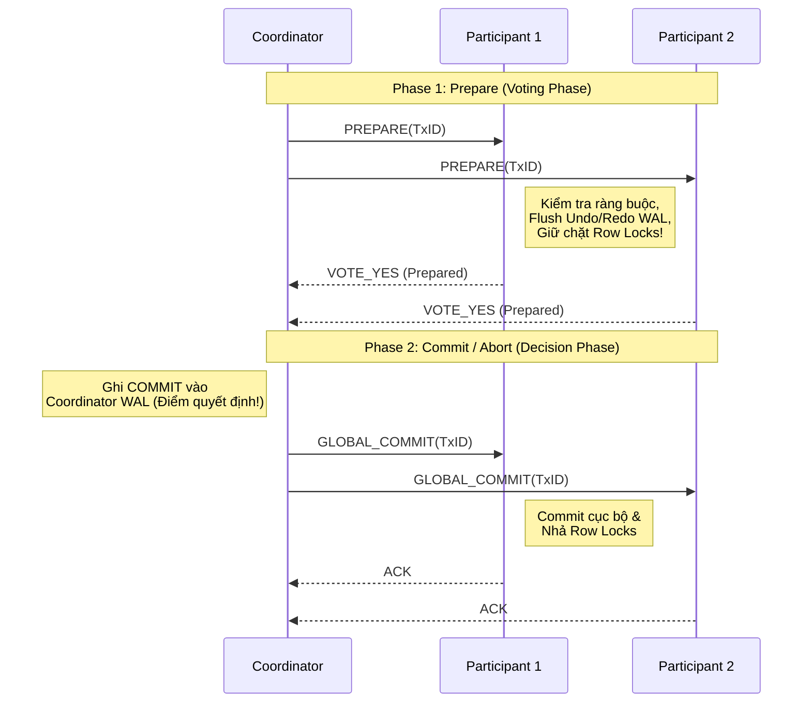
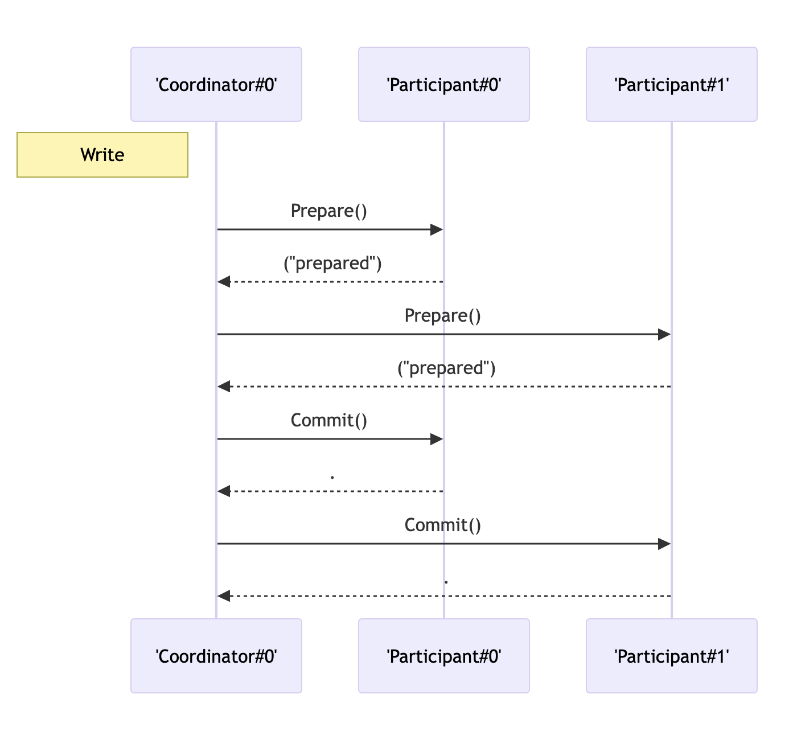
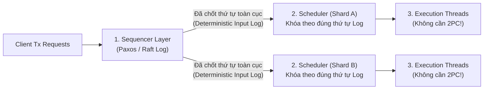

## Table of Contents
1. [Bài toán Atomic trên nhiều Node phân tán](#distributed-atomicity)
2. [Two-Phase Commit (2PC) và Điểm yếu Blocking](#two-phase-commit)
3. [Three-Phase Commit (3PC) và Rủi ro Split-Brain](#three-phase-commit)
4. [Các kiến trúc Giao dịch Phân tán hiện đại: Spanner, Calvin, Percolator](#modern-architectures)
5. [Tóm tắt & Ghi nhớ cốt lõi (Key Takeaways)](#key-takeaways)

---

Khi quy mô dữ liệu vượt quá khả năng lưu trữ và xử lý của một máy chủ đơn lẻ, cơ sở dữ liệu buộc phải chia nhỏ dữ liệu ra nhiều phân vùng độc lập (**Sharding / Partitioning**). Tuy nhiên, một khi dữ liệu nằm rải rác trên nhiều node vật lý, cơ chế khóa cục bộ và Write-Ahead Log (WAL) của từng node không còn đủ để đảm bảo tính nguyên tử (**Atomicity**) và cô lập (**Isolation**) cho các giao dịch chạm tới nhiều phân vùng. Chương 13 đi sâu vào các giao thức **Atomic Commitment** kinh điển (**2PC**, **3PC**) và cách các hệ thống NewSQL hiện đại (**Spanner**, **Calvin**, **Percolator**) giải quyết bài toán giao dịch phân tán.

---

## Bài toán Atomic trên nhiều Node phân tán {#distributed-atomicity}

Khác với **Consensus** (nơi các node bầu chọn để thống nhất một giá trị chung, chỉ cần đa số `⌊ N/2 ⌋ + 1` node đồng ý là đủ), bài toán **Atomic Commitment** cho một giao dịch phân tán đòi hỏi **sự đồng thuận tuyệt đối 100% (Unanimity)** của tất cả các phân vùng tham gia (**Participants / Cohorts**):
- Nếu tất cả các Participant đều có thể thực thi nhánh giao dịch của mình mà không vi phạm ràng buộc toàn vẹn hay lỗi ổ đĩa `->` giao dịch được **Commit** trên toàn bộ các node.
- Nếu **bất kỳ 1 Participant nào** báo lỗi, vi phạm khóa ngoại, xung đột khóa hoặc sập máy trước khi bỏ phiếu `->` toàn bộ các Participant còn lại bắt buộc phải **Abort (Rollback)**.

---

## Two-Phase Commit (2PC) và Điểm yếu Blocking {#two-phase-commit}

Được Jim Gray mô hình hóa, **Two-Phase Commit (2PC)** chia quá trình hoàn tất một giao dịch phân tán thành 2 pha rõ rệt dưới sự điều phối của một **Coordinator (Transaction Manager)**:

*Hình 13.1: Hai giai đoạn Voting Phase (Prepare) và Completion Phase (Commit) giữa Coordinator và các Cohorts trong giao thức 2PC*

### Quy trình 2 pha của 2PC
1. **Phase 1: Prepare (Giai đoạn bỏ phiếu)**:
   - Coordinator gửi thông điệp `PREPARE(TxID)` tới tất cả các Participant liên quan.
   - Mỗi Participant kiểm tra xem giao dịch có xung đột hay vi phạm ràng buộc không. Nếu hợp lệ, Participant **ép ghi (fsync) toàn bộ Redo và Undo log của giao dịch xuống đĩa cứng (WAL)**, tiếp tục **giữ chặt các khóa dòng (Row Locks)** và trả lời `VOTE_YES`.
   - Một khi Participant đã trả lời `VOTE_YES`, nó bước vào trạng thái **In-Doubt (Prepared)**: nó đã từ bỏ quyền tự quyết — không được phép tự ý Abort cũng không được tự ý Commit cho đến khi nhận được lệnh chính thức từ Coordinator.
2. **Phase 2: Commit / Abort (Giai đoạn ra quyết định)**:
   - Nếu nhận đủ `VOTE_YES` từ **tất cả** các Participant, Coordinator ghi bản ghi `COMMIT` xuống WAL của chính mình (đây là điểm quyết định nguyên tử của toàn giao dịch), sau đó phát lệnh `GLOBAL_COMMIT` tới mọi Participant.
   - Ngược lại, chỉ cần có 1 phiếu `VOTE_NO` hoặc quá thời gian chờ (**Timeout**), Coordinator ghi `ABORT` và gửi lệnh `GLOBAL_ABORT` tới mọi Participant.
   - Khi nhận được lệnh từ Coordinator, từng Participant ghi kết quả xuống WAL cục bộ, thực thi Commit/Rollback, **nhả các khóa dòng** và gửi `ACK` về cho Coordinator.

### Vì sao 2PC là một giao thức Blocking (Điểm yếu chí mạng)?

2PC đảm bảo an toàn dữ liệu (**Safety**), nhưng lại vi phạm tính sống (**Liveness**) vì là một **Blocking Protocol** khi xảy ra sự cố kép ở thời điểm nhạy cảm:

1. Giả sử cả `Participant 1` và `Participant 2` đều đã trả lời `VOTE_YES` ở cuối Phase 1 và đang **giữ khóa độc quyền (Exclusive Locks)** trên các dòng dữ liệu nóng.
2. Ngay lúc này, **Coordinator bị sập nguồn** trước khi kịp gửi `GLOBAL_COMMIT` cho `Participant 2`, đồng thời **`Participant 1` cũng bị mất kết nối mạng hoặc sập máy**.
3. Lúc này, `Participant 2` rơi vào thế tiến thoái lưỡng nan (**Blocked In-Doubt**):
   - `Participant 2` **không dám tự ý Abort**: vì nhỡ đâu trước khi sập, Coordinator đã kịp gửi `GLOBAL_COMMIT` cho `Participant 1` và `Participant 1` đã thực sự Commit rồi trả kết quả cho người dùng?
   - `Participant 2` **cũng không dám tự ý Commit**: vì nhỡ đâu `Participant 1` đã bỏ phiếu `VOTE_NO` ngay từ Phase 1 nên Coordinator đã quyết định Abort?
4. **Hệ quả thực tế**: `Participant 2` bắt buộc phải **treo vô thời hạn và ngâm toàn bộ Row Locks trên các dòng dữ liệu đó** cho đến khi Coordinator khởi động lại và đọc lại WAL, làm tắc nghẽn dây chuyền các giao dịch khác muốn đọc/ghi vào các dòng này.

---

## Three-Phase Commit (3PC) và Rủi ro Split-Brain {#three-phase-commit}

Để loại bỏ tính chất Blocking của 2PC mà không cần chờ Coordinator hồi phục, Skeen và Stonebraker đề xuất **Three-Phase Commit (3PC)** bằng cách tách Phase 2 thành một bước đệm trung gian (**`PreCommit`**) và áp dụng quy tắc tự quyết khi quá hạn (**Non-blocking Timeout**):

1. **Phase 1 (`CanCommit?`)**: Coordinator hỏi các node xem có sẵn sàng không.
2. **Phase 2 (`PreCommit`)**: Nếu tất cả trả lời `YES`, Coordinator gửi thông báo `PreCommit` tới mọi Participant để báo rằng *"Tất cả mọi người đều đã đồng ý YES, chuẩn bị tinh thần Commit nhé"*, rồi chờ mọi node xác nhận `ACK`.
3. **Phase 3 (`DoCommit`)**: Coordinator gửi lệnh `DoCommit` cuối cùng.
   - Nếu Coordinator sập **trước** khi Participant nhận được `PreCommit`, các Participant hết timeout sẽ tự động **Abort**.
   - Nếu Coordinator sập **sau** khi Participant đã nhận được `PreCommit`, các Participant hết timeout sẽ tự động **Commit** (vì biết chắc không ai bỏ phiếu `NO`).

### Vì sao 3PC thất bại khi xảy ra Network Partition?

3PC giả định mô hình mạng đồng bộ có giới hạn thời gian truyền tin tuyệt đối (**Synchronous Network with Perfect Failure Detector**). Trong mạng thực tế bất đồng bộ khi xảy ra **Network Partition (Đứt cáp mạng chia đôi cụm)**:
- Nhóm **Phân vùng A** chứa các Participant đã kịp nhận được gói tin `PreCommit` trước khi mạng đứt `->` khi hết timeout không thấy Coordinator, nhóm A tự động **Commit**!
- Nhóm **Phân vùng B** chứa các Participant bị rớt gói tin `PreCommit` do nghẽn mạng `->` khi hết timeout vẫn ở trạng thái Phase 1 nên nhóm B tự động **Abort**!
- **Kết quả**: Nửa cụm thì Commit, nửa cụm thì Abort (**Split-Brain / Mất tính Atomicity**)! Do đánh mất tính **Safety** khi đứt mạng, 3PC hầu như không được sử dụng trong các hệ quản trị cơ sở dữ liệu thực tế.

---

## Các kiến trúc Giao dịch Phân tán hiện đại: Spanner, Calvin, Percolator {#modern-architectures}

Thay vì dùng 3PC, các cơ sở dữ liệu phân tán hiện đại (**NewSQL**) khắc phục điểm yếu của 2PC theo 3 hướng kiến trúc khác nhau.

### 1. Google Spanner: 2PL + 2PC + Paxos + TrueTime

Google Spanner (cùng họ với CockroachDB, YugabyteDB) vẫn sử dụng **Two-Phase Locking (2PL)** kết hợp **2PC**, nhưng giải quyết triệt để điểm nghẽn Coordinator chết bằng hai đột phá:

#### a. Thay thế từng Node đơn lẻ bằng một cụm Paxos Group
- Trong 2PC truyền thống, Coordinator là một máy chủ đơn lẻ (**Single Point of Failure**).
- Trong Spanner, mỗi phân vùng dữ liệu (**Split / Tablet**) và bản thân **Coordinator** không phải là 1 máy vật lý mà là một **nhóm đồng thuận Paxos (Paxos Replication Group)** gồm `3` hoặc `5` máy chủ.
- Nếu máy chủ Leader của nhóm Coordinator bị sập ngay giữa lúc đang chạy 2PC, các máy còn lại trong nhóm Paxos sẽ lập tức bầu Leader mới từ log đã sao chép và hoàn tất 2PC chỉ trong vài trăm mili-giây mà không bao giờ bị treo khóa vô thời hạn!

#### b. TrueTime API và Commit Wait (Đảm bảo External Consistency / Strict Serializability)
Làm thế nào để gán nhãn thời gian (**Timestamp**) cho các giao dịch phân tán trên toàn cầu sao cho nếu Giao dịch `T_2` bắt đầu sau khi Giao dịch `T_1` đã Commit về mặt thời gian thực, thì `TS(T_2) > TS(T_1)` mà không cần các máy chủ phải liên lạc hỏi nhau?

- Mọi đồng hồ thạch anh thông thường đều bị trôi nhịp (**Clock Drift**). Thay vì trả về một con số thời gian giả định chính xác tuyệt đối, **TrueTime API** trang bị đồng hồ nguyên tử (**Atomic Clocks**) và bộ thu **GPS** tại mỗi Datacenter, trả về một **khoảng thời gian chắc chắn chứa thời điểm thực tế**:

$$
\text{TT.now()} = [t_{\text{earliest}}, t_{\text{latest}}], \quad \epsilon = \frac{t_{\text{latest}} - t_{\text{earliest}}}{2} \le 7\text{ ms}
$$

- **Quy tắc Commit Wait**: Khi một Coordinator chọn nhãn thời gian commit $s = \text{TT.now().latest}$ cho giao dịch $T_1$, Coordinator **chưa được phép trả kết quả hay nhả khóa ngay**, mà bắt buộc phải **chờ cho đến khi $\text{TT.now().earliest} > s$** (tức là chờ qua toàn bộ khoảng bất định $2\epsilon \approx 14\text{ ms}$).
- Nhờ **Commit Wait**, tại thời điểm `T_1` hoàn tất và hiện kết quả cho người dùng, thời gian thực tuyệt đối trên trái đất chắc chắn đã lớn hơn `s`. Do đó, bất kỳ giao dịch `T_2` nào bắt đầu sau đó trên bất kỳ châu lục nào khi gọi `TT.now().latest` cũng chắc chắn nhận được nhãn thời gian `s_2 > s`!
- **Lợi ích to lớn**: Cho phép thực hiện **Lock-Free Snapshot Reads** tại bất kỳ thời điểm nào trong quá khứ hoặc hiện tại trên toàn cầu mà không cần giữ khóa đọc hay chặn các giao dịch ghi.

---

### 2. Calvin: Giao dịch Phân tán Tất định (Deterministic Distributed Transactions)

Được đề xuất bởi Daniel Abadi và ứng dụng trong **FaunaDB**, **Calvin** đặt câu hỏi ngược lại: *Tại sao phải vừa giữ khóa dữ liệu vừa chạy 2PC qua mạng trong lúc đang thực thi giao dịch?*

Cơ chế cốt lõi của **Calvin**:
1. **Sequencing Layer (Đồng thuận thứ tự đầu vào trước khi chạy)**: Thay vì chạy giao dịch rồi mới dùng Paxos/2PC để đồng thuận kết quả ở cuối như Spanner, Calvin dùng giao thức đồng thuận (Paxos/Raft) **ngay ở đầu vào** để ghi toàn bộ danh sách các lệnh giao dịch vào một nhật ký thứ tự toàn cục theo từng lô thời gian ngắn (**Epochs** `10 ms`).
2. **Deterministic Locking (Khóa tất định ở Scheduler)**: Một khi thứ tự các giao dịch `[T_1, T_2, T_3, ...]` đã được đóng đinh trong Log, mọi phân vùng và mọi bản sao đều đọc Log này và cấp phát khóa theo **đúng thứ tự tuần tự tuyệt đối đó** (không bao giờ xảy ra Deadlock).
3. **Loại bỏ hoàn toàn 2PC**: Vì mọi hàm xử lý được thiết kế **Tất định (Deterministic)** (loại bỏ các yếu tố ngẫu nhiên như `RAND()`, `NOW()` bằng cách tính sẵn từ tầng Sequencer), nếu một node bị lỗi đĩa, nó chỉ cần chạy lại đúng chuỗi lệnh từ Log là ra kết quả giống hệt các node khác — do đó các phân vùng **không cần bước bỏ phiếu 2PC** để hỏi xem node kia có bị lỗi hệ thống hay không!
4. **Hạn chế của Calvin**: Để bộ lập lịch biết cần khóa những dòng nào từ trước khi thực thi, Calvin yêu cầu phải biết trước toàn bộ tập khóa Đọc/Ghi (**Read/Write Set**) của giao dịch. Nếu tập khóa phụ thuộc vào kết quả đọc trung gian, Calvin phải chạy một truy vấn thăm dò (**Reconnaissance Query**) trước để tìm danh sách khóa rồi mới đưa vào Sequencer, và không hỗ trợ các giao dịch tương tác giữ khóa mở chờ phía Client suy nghĩ (**Interactive Transactions**).

---

### 3. Google Percolator: Client-Driven 2PC không có Coordinator trung tâm

Được Google thiết kế để chạy các giao dịch ACID đa dòng ngay trên nền bảng phân tán Bigtable (và là kiến trúc nền tảng của **TiKV / TiDB**), **Percolator** thực hiện **Snapshot Isolation** thông qua **2PC điều phối trực tiếp từ phía Client** mà không cần một dịch vụ Coordinator chuyên trách:

1. **Timestamp Oracle (TSO)**: Một dịch vụ tập trung cấp phát nhãn thời gian tăng dần nghiêm ngặt (`start_ts` khi bắt đầu đọc và `commit_ts` khi chuẩn bị commit).
2. **Kỹ thuật Primary Lock (Neo trạng thái nguyên tử vào 1 dòng)**:
   - Mỗi dòng dữ liệu trên Bigtable/TiKV có 3 cột vật lý cho mỗi giá trị: cột `data` (chứa dữ liệu gắn kèm `start_ts`), cột `write` (ghi nhận giao dịch đã commit tại `commit_ts` trỏ về `start_ts`), và cột **`lock`** (chứa khóa tạm thời trong lúc chạy 2PC).
   - Khi một giao dịch cần sửa 3 dòng `R_1, R_2, R_3`, Client chọn **1 dòng làm `Primary Lock`** (ví dụ `R_1`) và các dòng còn lại (`R_2, R_3`) làm **`Secondary Locks`**. Tất cả các `Secondary Locks` đều lưu con trỏ trỏ thẳng về địa chỉ của `Primary Lock` (`R_1`).
3. **Quy trình Prewrite (Phase 1) và Commit (Phase 2)**:
   - **Phase 1 (`Prewrite`)**: Client ghi dữ liệu mới vào cột `data` và đặt khóa vào cột `lock` trên tất cả các dòng `R_1, R_2, R_3` (sử dụng tính nguyên tử trên đơn dòng của Bigtable). Nếu bất kỳ dòng nào đã bị khóa bởi giao dịch khác hoặc có bản ghi `write` mới hơn `start_ts`, giao dịch lập tức hủy bỏ.
   - **Phase 2 (`Commit` nguyên tử tại Primary)**: Client xin `commit_ts` từ TSO, sau đó thực hiện thao tác nguyên tử trên **dòng Primary (`R_1`)**: ghi bản ghi `write` tại `commit_ts` và **xóa `Primary Lock` trên `R_1`**.
   - **Điểm quyết định nguyên tử**: Khoảnh khắc `Primary Lock` trên `R_1` được thay thế bằng bản ghi `write`, toàn bộ giao dịch coi như **đã Commit 100%**! Sau đó Client mới thong thả đi xóa các `Secondary Locks` trên `R_2, R_3` bất đồng bộ.
4. **Tự động dọn khóa khi Client sập (Lazy Lock Cleanup)**:
   - Nếu Client bị sập nguồn ngay sau khi khóa xong `R_1, R_2, R_3`? Khi một giao dịch khác (`T_new`) đọc trúng dòng `R_2` đang bị dính `Secondary Lock`, `T_new` không bị treo vô hạn!
   - Thay vào đó, `T_new` đọc con trỏ trong `Secondary Lock` để nhảy sang kiểm tra dòng **`Primary Lock` (`R_1`)**:
     - Nếu trên `R_1` đã có bản ghi `write` (tức là giao dịch cũ đã kịp Commit ở Primary trước khi Client sập) `->` `T_new` tự động giúp **Roll-Forward** (hoàn tất Commit) cho dòng `R_2` rồi đọc giá trị mới!
     - Nếu trên `R_1` vẫn còn nằm nguyên `Primary Lock` đã hết hạn TTL (chứng tỏ Client đã chết trước khi kịp Commit) `->` `T_new` xóa thẳng `Primary Lock` trên `R_1` để **Roll-Back** giao dịch cũ và dọn khóa trên `R_2`!

### Bảng so sánh Spanner vs Calvin vs Percolator

| Tiêu chí | Google Spanner | Calvin (FaunaDB) | Google Percolator (TiDB / TiKV) |
| :--- | :--- | :--- | :--- |
| **Mô hình Isolation** | Strict Serializability (External Consistency) | Strict Serializability | Snapshot Isolation (SI) |
| **Cách xử lý 2PC** | Chạy 2PC qua các cụm Paxos Group | Loại bỏ hoàn toàn 2PC nhờ sắp thứ tự tất định trước | Client tự chạy 2PC dựa vào neo **Primary Lock** |
| **Đồng bộ thời gian** | **TrueTime** (GPS + Atomic Clock, `ε ≤ 7 ms`) | Không cần đồng hồ chuẩn xác (thứ tự do Sequencer Log) | Cần **Timestamp Oracle (TSO)** tập trung |
| **Interactive Transactions?** | Hỗ trợ đầy đủ | Không (Phải gửi trọn gói One-Shot / Stored Procedure) | Hỗ trợ đầy đủ |

---

## Tóm tắt & Ghi nhớ cốt lõi (Key Takeaways) {#key-takeaways}

- **Two-Phase Commit (2PC)**: Đảm bảo tính nguyên tử trên nhiều phân vùng thông qua pha `Prepare` và `Commit`, nhưng là một **Blocking Protocol** — nếu Coordinator sập sau khi các Participant đã vào trạng thái `Prepared` (`In-Doubt`), các Participant buộc phải ngâm khóa dòng chờ đợi.
- **Three-Phase Commit (3PC)**: Thêm pha `PreCommit` và cơ chế tự quyết theo Timeout để tránh treo khóa, nhưng thất bại (gây **Split-Brain**) khi xảy ra phân mảnh mạng bất đồng bộ (**Network Partition**).
- **Google Spanner**: Khắc phục điểm yếu 2PC bằng cách biến mỗi phân vùng và Coordinator thành một cụm **Paxos**, kết hợp **TrueTime API** và cơ chế **Commit Wait** (`2ε`) để đạt được **Strict Serializability** cùng khả năng đọc Snapshot không cần khóa trên quy mô toàn cầu.
- **Calvin**: Đảo ngược quy trình bằng cách dùng giao thức đồng thuận chốt cứng thứ tự đầu vào của giao dịch (**Deterministic Input Log**) trước khi thực thi, giúp loại bỏ hoàn toàn pha 2PC trong lúc giữ khóa.
- **Google Percolator**: Triển khai 2PC ngay từ phía Client mà không cần Coordinator trung tâm bằng cách neo quyết định nguyên tử vào một **Primary Lock** đơn lẻ, cho phép các truy vấn đọc khác tự động dọn khóa (**Roll-Forward** hoặc **Roll-Back**) nếu Client bị sập giữa chừng.

### Tài liệu & Nguồn tham khảo
- [Corbett, J. C., et al. (2012) — *Spanner: Google's Globally-Distributed Database (TrueTime & 2PC over Paxos)*](https://research.google/pubs/spanner-googles-globally-distributed-database/)
- [Thomson, A., et al. (2012) — *Calvin: Fast Distributed Transactions for Partitioned Database Systems*](https://cs.yale.edu/homes/dna/papers/calvin-sigmod12.pdf)
- [Peng, D., & Dabek, F. (2010) — *Large-scale Incremental Processing Using Distributed Transactions and Notifications (Google Percolator)*](https://research.google/pubs/large-scale-incremental-processing-using-distributed-transactions-and-notifications/)
