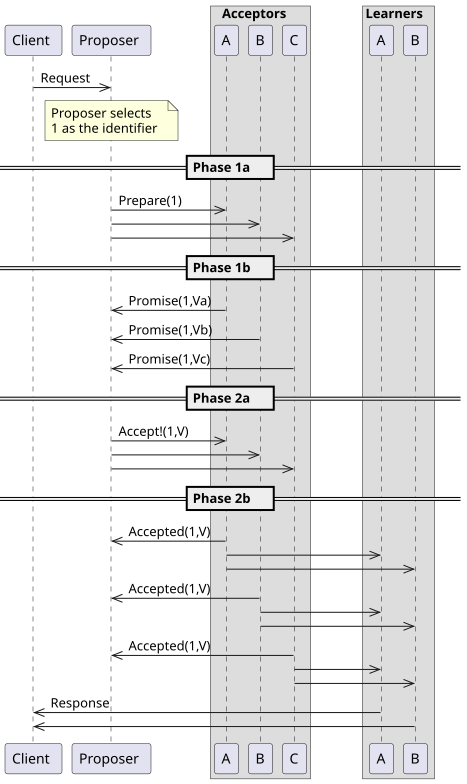
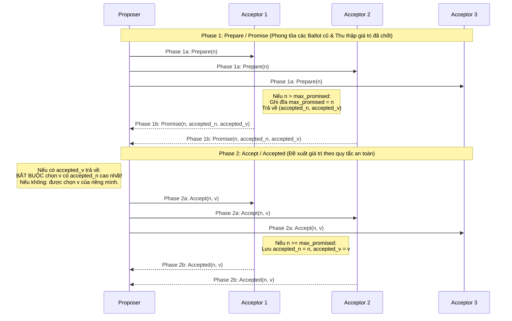
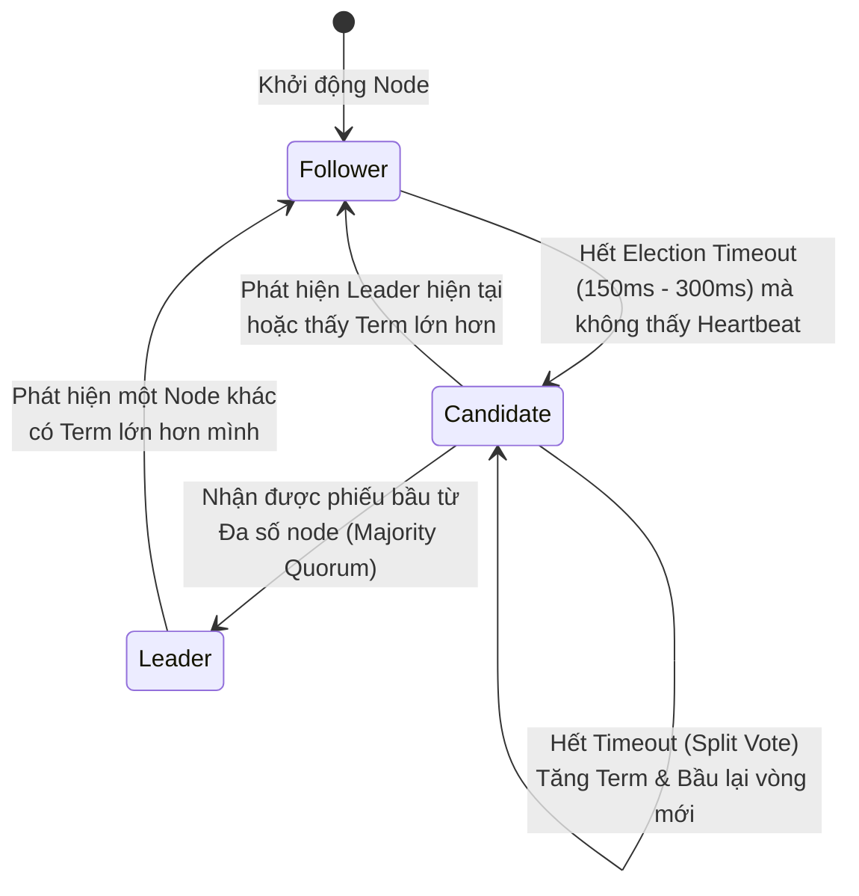

## Table of Contents
1. [Bài toán Consensus và 4 Thuộc tính Cốt lõi](#what-is-consensus)
2. [Hệ thống phân cấp Broadcast và Atomic Broadcast](#broadcast-hierarchy)
3. [Paxos và Multi-Paxos](#paxos-and-multi-paxos)
4. [Thuật toán Đồng thuận Raft](#raft-consensus)
5. [ZAB (ZooKeeper Atomic Broadcast) và Byzantine Consensus (PBFT)](#zab-and-pbft)
6. [Bảng so sánh các Thuật toán Consensus](#consensus-comparison)
7. [Tóm tắt & Ghi nhớ cốt lõi (Key Takeaways)](#key-takeaways)

---

Đồng thuận phân tán (**Consensus**) là nền tảng cốt lõi của hầu hết các hệ thống dữ liệu hiện đại: từ bầu chọn Leader, quản lý cấu hình cụm (etcd, ZooKeeper, Consul), khóa phân tán cho tới sao chép máy trạng thái (**Replicated State Machines**) trong Google Spanner, CockroachDB, TiKV và Kafka (KRaft). Chương 14 giải phẫu cơ chế hoạt động nội tại của **Paxos**, **Multi-Paxos**, **Raft**, **ZAB** và **PBFT**.

---

## Bài toán Consensus và 4 Thuộc tính Cốt lõi {#what-is-consensus}

Trong một cụm các tiến trình giao tiếp qua mạng bất đồng bộ có thể bị trễ gói tin hoặc sập node, một thuật toán **Consensus** cho phép các node đề xuất các giá trị khác nhau và cuối cùng thống nhất chọn ra **đúng 1 giá trị chung**.

Mọi thuật toán Consensus đúng đắn bắt buộc phải thỏa mãn 4 thuộc tính sau:
1. **Agreement (Tính thống nhất - Safety)**: Không có hai node đúng đắn nào quyết định chọn hai giá trị khác nhau.
2. **Validity / Non-Triviality (Tính hợp lệ - Safety)**: Giá trị được quyết định bắt buộc phải là giá trị đã được ít nhất một node trong cụm đề xuất (thuật toán không được phép gán cứng một hằng số mặc định như `null` cho mọi lần chạy).
3. **Integrity (Tính toàn vẹn - Safety)**: Mỗi node chỉ được đưa ra quyết định tối đa 1 lần cho một lượt đồng thuận (không được rút lại hoặc tự ý đổi quyết định sau khi đã chốt).
4. **Termination (Tính kết thúc - Liveness)**: Mọi node còn sống cuối cùng đều phải đi đến quyết định.

> **Nhắc lại Định lý FLP (Fischer-Lynch-Paterson)**: Trong mạng bất đồng bộ hoàn toàn, không một thuật toán tất định nào có thể đảm bảo đồng thời cả **Safety** (`Agreement`, `Validity`, `Integrity`) lẫn **Liveness** (`Termination`) nếu có dù chỉ 1 node sập. Do đó, mọi thuật toán thực tế (Paxos, Raft, ZAB) đều **bảo toàn tuyệt đối Safety trong mọi kịch bản mạng** (kể cả khi đứt mạng hay trễ gói tin bất định), và sử dụng cơ chế Timeout ngẫu nhiên hoặc bầu Leader ổn định để đạt được **Liveness** ngay khi mạng ổn định tạm thời (**Partial Synchrony**).

---

## Hệ thống phân cấp Broadcast và Atomic Broadcast {#broadcast-hierarchy}

Truyền phát thông điệp (**Broadcast**) và Đồng thuận (**Consensus**) có mối liên hệ mật thiết về mặt toán học, xếp theo 4 cấp độ từ yếu đến mạnh:

1. **Best-Effort Broadcast**: Node gửi phát bản tin tới tất cả các node. Nếu **node gửi không bị sập**, mọi node sống đều nhận được bản tin; nhưng nếu node gửi sập giữa chừng khi mới gửi cho một nửa cụm, nửa còn lại sẽ không bao giờ nhận được.
2. **Reliable Broadcast (Eager Reliable Broadcast)**: Khắc phục điểm yếu trên bằng cách khi một node nhận được bản tin lần đầu, nó tự động chuyển tiếp (re-broadcast) cho các node khác. Đảm bảo: **Tất cả các node còn sống** hoặc cùng nhận được bản tin, hoặc không node nào nhận được (kể cả khi node gửi gốc sập giữa chừng). Tuy nhiên, một node vừa nhận bản tin và kịp ghi xuống đĩa rồi sập ngay trước khi kịp chuyển tiếp vẫn có thể tạo ra sự sai lệch với các node còn sống.
3. **Uniform Reliable Broadcast**: Đảm bảo mạnh hơn: nếu **bất kỳ một node nào** (kể cả node vừa xử lý bản tin xong liền sập ngay lập tức) đã phân phối (deliver) bản tin cho ứng dụng, thì toàn bộ các node còn sống cũng bắt buộc phải nhận được bản tin đó. Để đạt tính chất **Uniform**, một node không được phép áp dụng bản tin ngay khi vừa nhận, mà phải chờ cho đến khi bản tin đó được xác nhận bởi một **Quorum đa số**.
4. **Total Order Broadcast (Atomic Broadcast)**: Là **Uniform Reliable Broadcast** cộng thêm tính chất **Total Order** — mọi node trong cụm đều nhận và áp dụng tất cả các bản tin theo **cùng một thứ tự tuần tự giống hệt nhau**.

> **Tính tương đương toán học (Chandra & Toueg)**: **Total Order Broadcast** và **Consensus** là hai bài toán tương đương nhau! Nếu có một hộp đen giải quyết được Consensus cho từng vị trí log thứ `1, 2, 3 ...`, ta lập tức xây dựng được Total Order Broadcast (Replicated Log); ngược lại, nếu có Total Order Broadcast, mọi node chỉ cần lấy bản tin đầu tiên xuất hiện trong luồng làm giá trị quyết định của Consensus.

---

## Paxos và Multi-Paxos {#paxos-and-multi-paxos}

Được Leslie Lamport thiết kế, **Paxos** là thuật toán đồng thuận nền tảng cho các hệ thống chịu lỗi dừng (**Crash-Fault Tolerant - CFT**) với $2f + 1$ node (chịu được tối đa $f$ node sập).

### Ba vai trò trong Paxos
Trong thực tế, mỗi máy chủ vật lý thường kiêm nhiệm cả 3 vai trò:
- **Proposer**: Nhận yêu cầu từ Client, khởi xướng đề xuất giá trị $v$ kèm theo số thứ tự lượt bầu chọn (**Ballot / Proposal Number $n$**).
- **Acceptor**: Các node giữ phiếu bầu và lưu trữ trạng thái bền vững trên đĩa; các Acceptor tạo thành các tập **Majority Quorum** ($Q = f + 1$).
- **Learner**: Nhận kết quả sau khi một giá trị đã được đa số Acceptor chấp thuận để thực thi và trả về cho Client.

**Cấu trúc số phiếu bầu $n$ (Ballot Number)**: Để không bao giờ có hai Proposer trùng số phiếu bầu, $n$ được ghép từ số thứ tự vòng tăng dần và định danh riêng biệt của từng node: $n = (\text{round\_number}, \text{node\_id})$ (so sánh theo thứ tự từ điển: ưu tiên $\text{round\_number}$ lớn hơn, nếu bằng nhau thì so sánh $\text{node\_id}$).

---

### Quy trình 2 pha của Basic (Single-Decree) Paxos

Basic Paxos đồng thuận trên **1 giá trị đơn lẻ** thông qua 2 pha (2 vòng mạng - 2 RTT):

#### Phase 1: Prepare & Promise
- **Phase 1a (`Prepare(n)`)**: Proposer chọn số phiếu bầu `n` lớn hơn mọi số đã biết và gửi thông điệp `Prepare(n)` tới đa số Acceptor.
- **Phase 1b (`Promise`)**: Khi một Acceptor nhận được `Prepare(n)`:
  - Nếu `n` **nhỏ hơn hoặc bằng** số phiếu cao nhất mà Acceptor này từng hứa (`max_promised`), Acceptor từ chối (`NACK`) để chặn đứng các Proposer cũ bị trễ mạng.
  - Nếu `n > max_promised`, Acceptor cập nhật `max_promised = n` (ép ghi bền vững xuống đĩa cứng), quy ước **từ nay về sau sẽ từ chối mọi thông điệp có số phiếu nhỏ hơn `n`**, đồng thời gửi trả về thông điệp `Promise(n, accepted_n, accepted_v)` chứa cặp số phiếu và giá trị cao nhất mà Acceptor này từng chấp nhận ở Phase 2 trước đó (hoặc `(null, null)` nếu chưa từng chấp nhận giá trị nào).

#### Phase 2: Accept & Accepted
- **Phase 2a (`Accept(n, v)`) — Quy tắc cốt lõi bảo vệ Safety**:
  Sau khi nhận đủ `Promise` từ một đa số Quorum (`f + 1` Acceptor), Proposer quyết định giá trị `v` để gửi đi:
  - **Trường hợp 1**: Nếu tất cả các Acceptor trong Quorum đều trả về `(null, null)` (chưa có ai từng chấp nhận giá trị nào), Proposer được tự do gửi giá trị `v` mới của Client trong lệnh `Accept(n, v)`.
  - **Trường hợp 2 (QUAN TRỌNG)**: Nếu trong các phản hồi `Promise` có bất kỳ Acceptor nào trả về một giá trị `accepted_v` khác `null`, Proposer **phải vứt bỏ giá trị mới của mình** và **BẮT BUỘC chọn giá trị `accepted_v` đi kèm với số phiếu `accepted_n` lớn nhất** trong tập phản hồi để gửi đi trong lệnh `Accept(n, v)`!
- **Phase 2b (`Accepted`)**: Khi Acceptor nhận được `Accept(n, v)`, nếu `n >= max_promised` (chưa bị một Proposer nào khác xen ngang bằng số phiếu lớn hơn trong lúc chờ mạng), Acceptor lưu bền vững `accepted_n = n, accepted_v = v` xuống đĩa và xác nhận `Accepted(n, v)`. Khi đa số Acceptor đã xác nhận, giá trị `v` chính thức được chọn (**Chosen / Committed**) vĩnh viễn!

---

### Tại sao Proposer mới BẮT BUỘC phải kế thừa giá trị có `accepted_n` cao nhất?

Giả sử cụm có 3 Acceptor (`A_1, A_2, A_3`, đa số Quorum là `2`):
1. `Proposer 1` chạy với phiếu `n = 1`, vượt qua Phase 1 và gửi `Accept(1, "X")` tới `A_1, A_2`. Cả `A_1` và `A_2` đều đã lưu `("X")` vào đĩa (vậy giá trị `"X"` **đã đạt đủ đa số Quorum 2/3** và được coi là đã chốt!). Tuy nhiên `Proposer 1` bị sập ngay sau đó.
2. Lúc này `Proposer 2` thức dậy với số phiếu `n = 2` và muốn đề xuất giá trị `"Y"`. `Proposer 2` gửi `Prepare(2)` tới tập Quorum gồm `{A_2, A_3}`.
3. Do hai tập đa số `{A_1, A_2}` và `{A_2, A_3}` **luôn giao nhau tại ít nhất 1 node** (chính là `A_2`), `A_2` sẽ báo cho `Proposer 2` biết trong bản tin `Promise`: *"Tôi đã từng chấp nhận giá trị `"X"` ở phiếu số `1`!"*.
4. Nhờ quy tắc bắt buộc kế thừa giá trị có phiếu cao nhất, `Proposer 2` phải đổi sang gửi `Accept(2, "X")` thay vì `"Y"` `->` giá trị `"X"` đã chốt ở bước 1 không bao giờ bị ghi đè mất!

---

### Vấn đề Dueling Proposers (Livelock) và Giải pháp Multi-Paxos

Trong Basic Paxos, nếu hai Proposer cùng chạy song song mà không ai nhường ai, hệ thống có thể rơi vào vòng lặp vô tận (**Dueling Proposers / Livelock**):
- `Proposer 1` gửi `Prepare(1)` thành công `->` trước khi `Proposer 1` kịp gửi `Accept(1, v1)`, `Proposer 2` xen ngang gửi `Prepare(2)` khiến các Acceptor hứa nâng mức chặn lên `2` `->` lệnh `Accept(1, v1)` của `Proposer 1` bị từ chối `->` `Proposer 1` tức giận nâng phiếu lên `Prepare(3)` chặn ngược lại lệnh `Accept(2, v2)` của `Proposer 2`... Cứ thế kéo dài mãi mà không giá trị nào được chốt!

#### Multi-Paxos: Rút gọn từ 2 RTT xuống 1 RTT cho chuỗi Log liên tiếp
Trong thực tế, cơ sở dữ liệu không chỉ đồng thuận 1 giá trị mà cần đồng thuận trên một chuỗi vô hạn các vị trí nhật ký (**Replicated Log Slots**: `slot 1, slot 2, slot 3...`). **Multi-Paxos** giải quyết cả Livelock lẫn chi phí 2 vòng mạng bằng cách:
1. **Bầu chọn một Stable Leader**: Chỉ có 1 node đóng vai trò **Distinguished Proposer (Leader)** duy trì nhịp tim (**Heartbeats / Leases**).
2. **Chạy Phase 1 (`Prepare`) đúng 1 lần cho toàn bộ các Log Slots tương lai**: Khi Leader mới đắc cử, nó gửi một thông điệp `Prepare(n)` bao trùm từ vị trí log hiện tại trở về sau.
3. **Trạng thái ổn định (Steady State) chỉ tốn 1 RTT (Phase 2)**: Với mọi lệnh ghi tiếp theo từ Client, Leader bỏ qua hoàn toàn Phase 1 và gửi thẳng lệnh **`Accept(n, slot_index, value)` (Phase 2a/2b)** tới các Acceptor — giảm một nửa độ trễ mạng so với Basic Paxos!

#### Fast Paxos và Egalitarian Paxos (EPaxos)
- **Fast Paxos**: Cho phép Client gửi thẳng lệnh đề xuất tới các Acceptor mà không cần vòng qua Leader (tiết kiệm thêm 0.5 RTT), nhưng để tự phát hiện xung đột khi nhiều Client gửi đồng thời mà không có Leader phân xử, Fast Paxos đòi hỏi **Fast Quorum lớn hơn**: `Q_fast = ⌊ 3N / 4 ⌋ + 1` (tức cụm `3f + 1` node thay vì `2f + 1`).
- **EPaxos (Egalitarian Paxos)**: Cho phép bất kỳ node nào cũng làm Command Leader cho các key không xung đột; chỉ khi hai node cùng sửa vào một key đồng thời thì mới phải phân giải thứ tự phụ thuộc theo đồ thị.

---

## Thuật toán Đồng thuận Raft {#raft-consensus}

Được Diego Ongaro và John Ousterhout thiết kế năm 2014 với mục tiêu **Dễ hiểu và dễ kiểm chứng trong thực tiễn kỹ thuật (Understandability)**, **Raft** tương đương với Multi-Paxos về hiệu năng và mức độ chịu lỗi, nhưng áp đặt cấu trúc chặt chẽ hơn: mọi dòng dữ liệu nhật ký (**Log Entries**) chỉ chảy theo **một chiều từ Leader xuống các Follower**.

Raft chia bài toán Consensus thành 3 bài toán con rõ ràng:
1. **Leader Election** (Bầu chọn Leader)
2. **Log Replication** (Sao chép nhật ký lệnh)
3. **Safety** (Các quy tắc bảo vệ tính đúng đắn khi chuyển giao quyền lực)

### 1. Leader Election và khái niệm Term (Nhiệm kỳ)

- Thời gian trong Raft được chia thành các nhiệm kỳ đánh số nguyên tăng dần gọi là **Term** (tương đương với Ballot Number trong Multi-Paxos). Mỗi Term bắt đầu bằng một cuộc bầu cử (**Election**).
- Mỗi node tại một thời điểm luôn ở 1 trong 3 trạng thái: **Follower**, **Candidate**, hoặc **Leader**.
- **Randomized Election Timeout**: Nếu một `Follower` không nhận được tín hiệu nhịp tim (`AppendEntries` rỗng) từ Leader trong khoảng thời gian ngẫu nhiên (thường chọn ngẫu nhiên từ `` `150 ms` `` đến `` `300 ms` ``), nó tự tăng `currentTerm = currentTerm + 1`, chuyển sang trạng thái **`Candidate`**, tự bầu cho chính mình rồi gửi RPC **`RequestVote`** tới toàn bộ các node khác. Việc lấy ngẫu nhiên timeout giúp một node luôn thức dậy sớm hơn các node còn lại, tránh hiện tượng chia phiếu (**Split Vote**).

### 2. Log Replication và Log Matching Property

- Mọi lệnh thay đổi trạng thái từ Client đều đi qua **Leader**. Leader nối lệnh vào Log cục bộ của mình kèm theo `(term, index)` rồi gửi RPC **`AppendEntries`** song song tới tất cả các Follower.
- Khi lệnh đã được ghi bền vững trên **đa số node** (`⌊ N/2 ⌋ + 1`), Leader nâng chỉ số **`commitIndex`**, áp dụng lệnh đó vào State Machine để trả kết quả cho Client, và thông báo `commitIndex` mới cho các Follower trong các bản tin `AppendEntries` kế tiếp.
- **Log Matching Property**: Trong mỗi RPC `AppendEntries`, Leader luôn đính kèm cặp `(prevLogIndex, prevLogTerm)` của phần tử đứng ngay liền trước. Nếu Log của Follower tại vị trí `prevLogIndex` không khớp đúng `prevLogTerm` đó, Follower lập tức từ chối để Leader lùi chỉ số `nextIndex` lại và ghi đè phần Log bị lệch của Follower cho khớp 100% với Leader.

---

### 3. Hai Quy tắc Safety Sống còn của Raft

Tại sao trong Multi-Paxos, một Leader mới đắc cử phải chạy Phase 1 để thu thập và ghép các mẩu Log từ các node khác về cho mình, còn trong Raft thì **Leader mới đắc cử KHÔNG BAO GIỜ cần lấy thêm Log từ Follower mà luôn chỉ ghi đè từ Leader xuống Follower**? Đó là nhờ 2 quy tắc Safety nghiêm ngặt sau:

#### Quy tắc 1: Election Restriction (Chỉ bầu cho Candidate có Log cập nhật tối thiểu bằng mình)
Một Voter khi nhận `RequestVote` sẽ **từ chối bỏ phiếu** nếu Log của Candidate **kém cập nhật hơn (less up-to-date)** so với Log của chính Voter đó. Độ cập nhật của hai Log được so sánh theo thứ tự từ điển của phần tử cuối cùng `(lastLogTerm, lastLogIndex)`:
1. So sánh **`lastLogTerm`** trước: Nếu phần tử cuối cùng trong Log của ai có số nhiệm kỳ `Term` lớn hơn thì Log đó mới hơn.
2. Nếu cả hai có cùng `lastLogTerm`: Ai có Log dài hơn (**`lastLogIndex`** lớn hơn) thì Log đó mới hơn.

Nhờ quy tắc này và tính chất giao nhau của hai tập đa số (tập đa số vừa commit một bản ghi và tập đa số bầu ra Leader mới), **bất kỳ Candidate nào thắng cử trở thành Leader đều chắc chắn đã nắm giữ toàn bộ các bản ghi đã từng được Commit ở mọi nhiệm kỳ trước** (**Leader Completeness Property**)!

#### Quy tắc 2: Không bao giờ Commit trực tiếp bản ghi của Term cũ chỉ bằng cách đếm số lượng bản sao!
Trong bài báo Raft (Hình 8 kinh điển), nếu một Leader mới đắc cử ở `Term 4` thấy một bản ghi cũ từ `Term 2` mới chỉ nằm trên 2 node, rồi Leader này sao chép bản ghi `Term 2` đó sang node thứ 3 (đạt đa số 3/5 node) và vội vàng đánh dấu Commit ngay thì **bản ghi đó vẫn có thể bị một node khác có Log ở `Term 3` đắc cử sau đó ghi đè mất** (vì `Term 3 > Term 2` theo quy tắc so sánh Election Restriction)!

- **Giải pháp của Raft**: Một Leader **KHÔNG BAO GIỜ** được đánh dấu một bản ghi của nhiệm kỳ cũ (`logTerm < currentTerm`) là Committed bằng cách đếm số bản sao. Leader **chỉ được phép đếm số bản sao để Commit cho bản ghi thuộc chính nhiệm kỳ hiện tại của nó (`logTerm == currentTerm`)**!
- Một khi một bản ghi thuộc `currentTerm` (kể cả một bản tin `No-Op` rỗng mà Leader vừa ghi ngay khi mới nhậm chức) đã được sao chép lên đa số node và được Commit, nhờ tính chất **Log Matching Property**, toàn bộ các bản ghi của các Term cũ nằm phía trước nó cũng tự động được **Commit gián tiếp** và an toàn tuyệt đối!

---

## ZAB (ZooKeeper Atomic Broadcast) và Byzantine Consensus (PBFT) {#zab-and-pbft}

### 1. ZAB (ZooKeeper Atomic Broadcast)
Được thiết kế riêng cho Apache ZooKeeper, **ZAB** có nhiều nét tương đồng với Raft và Multi-Paxos:
- Sử dụng một **Primary (Leader)** để phát tán các cập nhật trạng thái tuần tự (nên ZAB là một giao thức **Atomic Broadcast** đảm bảo thứ tự nhân quả FIFO nghiêm ngặt của Primary).
- Định danh mỗi giao dịch bằng **`zxid` (`64-bit`)** chia làm 2 phần: `32-bit` cao là **`epoch`** (tương đương với `Term` trong Raft) và `32-bit` thấp là **`counter`** tự tăng cho từng giao dịch trong epoch đó.
- Quá trình chuyển đổi khi Leader sập gồm 3 pha: **Discovery** (bầu chọn Primary mới có `epoch` và `zxid` cao nhất), **Synchronization** (đồng bộ toàn bộ các Follower khớp với Log của Primary mới trước khi nhận traffic) và **Broadcast** (nhận lệnh ghi 2 pha tương tự Phase 2 của Multi-Paxos).

### 2. Byzantine Fault Tolerance (PBFT - `3f + 1` Nodes)

Paxos, Raft và ZAB đều giả định mô hình **Crash-Fault Tolerance (CFT)**: các node có thể bị sập nguồn hoặc đứt mạng, nhưng không bao giờ làm giả gói tin hay cố tình nói dối hai lời trái ngược nhau.

Trong môi trường không tin cậy hoặc chịu lỗi phần cứng biến đổi bit / tấn công mạng (**Byzantine Faults** — lấy tên từ bài toán Các vị tướng Byzantine của Lamport), một node độc hại có thể gửi thông báo *"Commit X"* cho nửa cụm và *"Commit Y"* cho nửa cụm còn lại.

#### Tại sao Byzantine Consensus bắt buộc cần tối thiểu `N = 3f + 1` node (thay vì `2f + 1`)?
Giả sử trong cụm có tối đa `f` node bị lỗi Byzantine (nói dối hoặc im lặng):
1. Để hệ thống không bị treo (**Liveness**), thuật toán phải có thể ra quyết định ngay khi nhận được phản hồi từ **`N - f` node** (vì `f` node bị hỏng có thể cố tình im lặng không bao giờ trả lời).
2. Tuy nhiên, trong số `N - f` node vừa trả lời đó, có thể có tới **`f` node là kẻ phản bội đang gửi thông tin giả** (vì `f` node không trả lời kia thực ra là các node trung thực chỉ đang bị trễ mạng!).
3. Để số phiếu trung thực trong tập trả lời luôn áp đảo số phiếu làm giả và đảm bảo phần giao nhau giữa hai Quorum bất kỳ luôn chứa ít nhất 1 node trung thực không nói dối, ta phải có:

$$
(N - f) - f > f \iff N - 2f > f \iff \mathbf{N \ge 3f + 1}
$$

   Ví dụ: Để chịu được $f = 1$ node làm giả dữ liệu, cụm **PBFT (Practical Byzantine Fault Tolerance - Castro & Liskov)** bắt buộc phải có ít nhất **$3(1) + 1 = 4$ node** (Quorum cần $2f + 1 = 3$ phiếu).

#### Quy trình 3 pha của PBFT (`Pre-Prepare` `->` `Prepare` `->` `Commit`)
Khác với Raft/Multi-Paxos chỉ cần Leader gửi 1 chiều xuống Follower (`O(N)` bản tin), trong PBFT vì bản thân Primary cũng có thể nói dối (gửi 2 lệnh khác nhau cho 2 nhóm Follower), các node phải gửi bản tin chéo cho tất cả các node khác (**All-to-All Broadcast**, độ phức tạp bản tin **`O(N^2)`**) qua 3 pha:
1. **`Pre-Prepare`**: Primary gán số thứ tự cho request và phát tới các Replica.
2. **`Prepare` (All-to-All)**: Mỗi Replica phát bản tin `Prepare` cho tất cả các Replica khác để kiểm chứng xem Primary có gửi cùng một nội dung cho ít nhất `2f + 1` node trong cùng View hay không.
3. **`Commit` (All-to-All)**: Sau khi thu thập đủ `2f + 1` phiếu `Prepare` khớp nhau, mỗi Replica phát tiếp bản tin `Commit` cho toàn cụm; khi nhận đủ `2f + 1` phiếu `Commit`, lệnh chính thức được thực thi và trả về cho Client.

---

## Bảng so sánh các Thuật toán Consensus {#consensus-comparison}

| Tiêu chí | Basic Paxos | Multi-Paxos | Raft | ZAB (ZooKeeper) | PBFT |
| :--- | :--- | :--- | :--- | :--- | :--- |
| **Mô hình lỗi chịu được** | Crash Fault (CFT) | Crash Fault (CFT) | Crash Fault (CFT) | Crash Fault (CFT) | Byzantine Fault (BFT) |
| **Số node tối thiểu chịu `f` lỗi** | `2f + 1` | `2f + 1` | `2f + 1` | `2f + 1` | **`3f + 1`** |
| **Tên gọi Nhiệm kỳ / Lượt** | Ballot / Proposal Number | Ballot Number | **Term** | **Epoch** (trong `zxid`) | **View** |
| **Độ trễ ghi ở trạng thái ổn định** | 2 RTT (Phase 1 + Phase 2) | **1 RTT** (Chỉ Phase 2 từ Leader) | **1 RTT** (`AppendEntries` từ Leader) | **1 RTT** (Broadcast từ Primary) | 3 pha All-to-All (`O(N^2)` msgs) |
| **Ràng buộc khi bầu Leader** | Node bất kỳ có thể thắng Phase 1 rồi gom Log về mình | Node bất kỳ có thể thắng rồi chạy Phase 1 gom Log | **Chỉ node có Log đầy đủ mới được bầu làm Leader** | Chỉ node có `zxid` cao nhất mới làm Primary | Luân phiên theo công thức `p = v mod N` (View Change) |
| **Hệ thống sử dụng thực tế** | Chubby, Cassandra LWT | Google Spanner, OceanBase | etcd, CockroachDB, TiKV, Consul, Kafka KRaft | Apache ZooKeeper | Hyperledger Fabric, Tendermint (biến thể) |

---

## Tóm tắt & Ghi nhớ cốt lõi (Key Takeaways) {#key-takeaways}

- **4 Thuộc tính của Consensus & Tương đương Toán học**: Mọi thuật toán Consensus phải đảm bảo **Agreement**, **Validity**, **Integrity** (Safety) và **Termination** (Liveness). Bài toán **Total Order Broadcast (Atomic Broadcast)** tương đương hoàn toàn với việc chạy Consensus trên chuỗi nhật ký lệnh (**Replicated State Machine**).
- **Paxos & Multi-Paxos**: Basic Paxos cần 2 pha (`Prepare/Promise` và `Accept/Accepted`), trong đó Proposer ở Phase 2 bắt buộc phải kế thừa giá trị có số phiếu `accepted_n` cao nhất trả về từ Phase 1 để bảo toàn Safety. **Multi-Paxos** bầu một Leader ổn định giữ sẵn Phase 1 cho toàn bộ các vị trí Log tiếp theo, rút ngắn mỗi lệnh ghi ở trạng thái ổn định xuống còn **1 RTT**.
- **Raft**: Phân rã bài toán thành **Leader Election**, **Log Replication** và **Safety**. Nhờ quy tắc **Election Restriction** (chỉ bỏ phiếu cho ứng viên có `(lastLogTerm, lastLogIndex)` tối thiểu bằng mình) và quy tắc **chỉ Commit trực tiếp bản ghi thuộc `currentTerm`**, Raft đảm bảo Leader đắc cử luôn nắm giữ đầy đủ mọi bản ghi đã Commit mà không bao giờ cần ghép Log ngược từ Follower lên Leader.
- **CFT ($2f + 1$) vs BFT ($3f + 1$)**: Các thuật toán chịu lỗi dừng (Paxos, Raft, ZAB) cần tối thiểu $2f + 1$ node và độ phức tạp truyền tin $O(N)$ từ Leader; trong khi chịu lỗi giả mạo dữ liệu (**Byzantine - PBFT**) bắt buộc cần tối thiểu **$3f + 1$ node** và trao đổi chéo $O(N^2)$ bản tin qua 3 pha.

### Tài liệu & Nguồn tham khảo
- [Lamport, L. (2001) — *Paxos Made Simple*](https://lamport.azurewebsites.net/pubs/paxos-simple.pdf)
- [Ongaro, D., & Ousterhout, J. (2014) — *In Search of an Understandable Consensus Algorithm (Extended Version)* & Interactive Raft Visualization](https://raft.github.io/)
- [Castro, M., & Liskov, B. (1999) — *Practical Byzantine Fault Tolerance (PBFT)*](https://pmg.csail.mit.edu/papers/osdi99.pdf)
