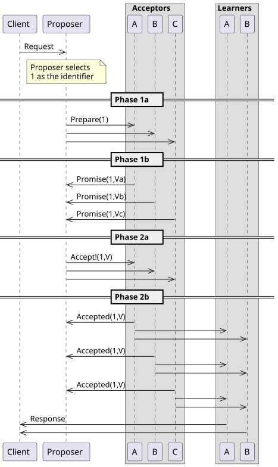
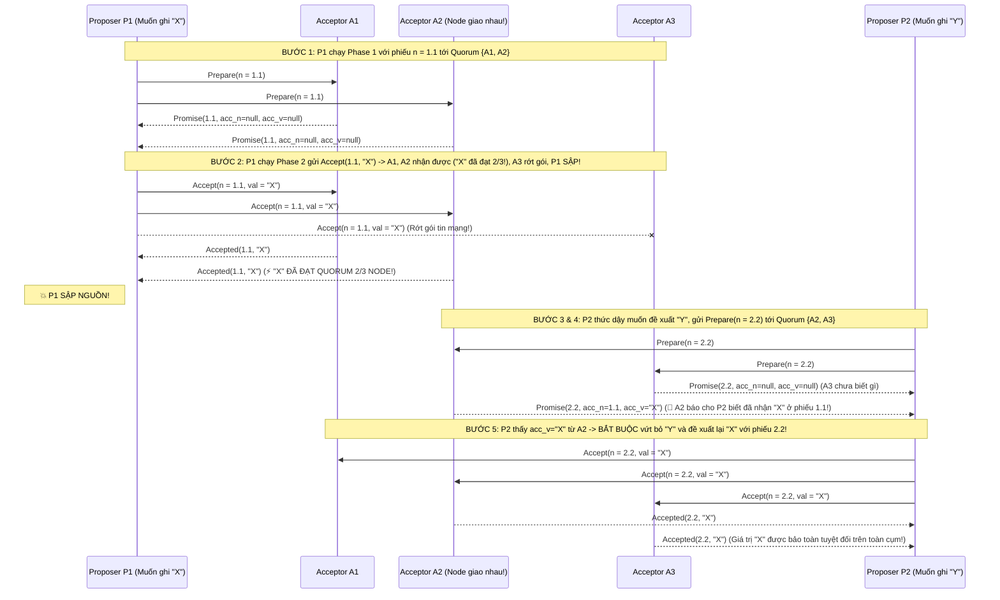
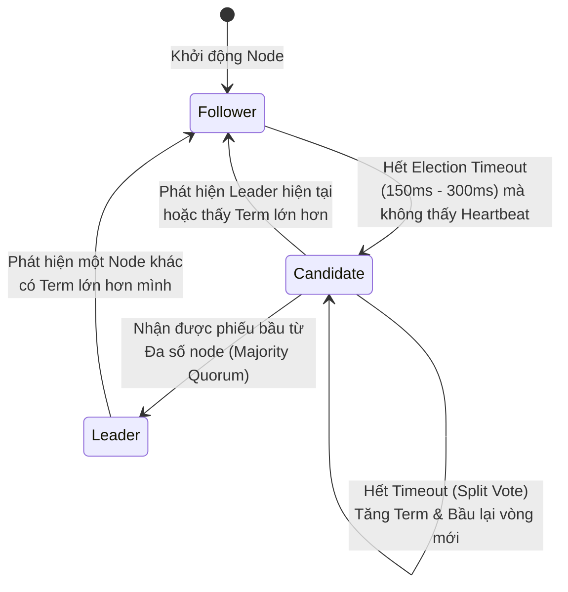
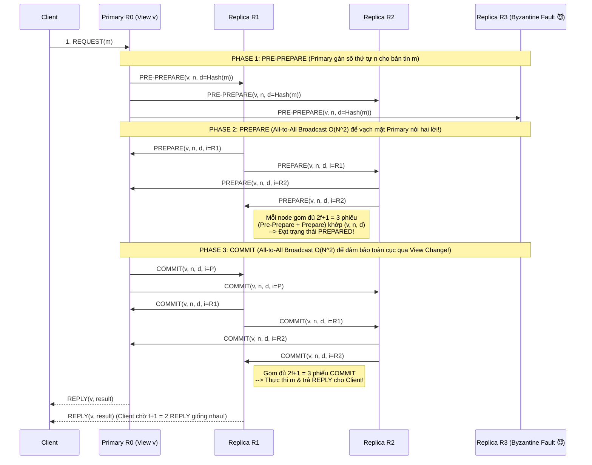

## Table of Contents
1. [Bài toán Consensus và 4 Thuộc tính Cốt lõi](#what-is-consensus)
2. [Hệ thống phân cấp Broadcast và Atomic Broadcast](#broadcast-hierarchy)
3. [Paxos và Multi-Paxos](#paxos-and-multi-paxos)
4. [Thuật toán Đồng thuận Raft](#raft-consensus)
5. [ZAB (ZooKeeper Atomic Broadcast) và Byzantine Consensus (PBFT)](#zab-and-pbft)
6. [Bảng so sánh các Thuật toán Consensus](#consensus-comparison)
7. [Tóm tắt & Ghi nhớ cốt lõi (Key Takeaways)](#key-takeaways)

---

Đồng thuận phân tán (**Consensus**) là nền tảng cốt lõi của hầu hết các hệ thống dữ liệu hiện đại: từ bầu chọn Leader, quản lý cấu hình cụm (etcd, ZooKeeper, Consul), khoá phân tán (Distributed Locks) cho tới sao chép máy trạng thái (**Replicated State Machines**) trong Google Spanner, CockroachDB, TiKV và Apache Kafka (KRaft). Chương 14 giải phẫu từ gốc rễ toán học đến từng bước chạy tay của **Broadcast Hierarchy**, **Paxos**, **Multi-Paxos**, **Fast/EPaxos**, **Raft**, **ZAB** và **PBFT**.

---

## Bài toán Consensus và 4 Thuộc tính Cốt lõi {#what-is-consensus}

### Bài toán thực tế & Mental Model

Hãy hình dung 5 máy chủ ngân hàng đặt tại 5 thành phố khác nhau cùng quản lý một sổ cái chung. Cùng một lúc, khách hàng gửi lệnh `"Đặt lãi suất = 5%"` tới Máy chủ 1, trong khi một quản trị viên gửi lệnh `"Đặt lãi suất = 6%"` tới Máy chủ 5. Giữa lúc các máy chủ đang trao đổi qua mạng thì cáp quang bị chập chờn và Máy chủ 1 bị sập nguồn. Làm thế nào để các máy chủ còn sống có thể **tự động thống nhất chọn đúng 1 giá trị đơn lẻ** mà không bao giờ xảy ra cảnh nửa cụm áp dụng `5%`, nửa cụm áp dụng `6%`?

Một thuật toán **Consensus** đúng đắn bắt buộc phải đảm bảo 4 thuộc tính nền tảng sau:
1. **Agreement (Tính thống nhất — Safety)**: Không có hai node đúng đắn nào quyết định chọn hai giá trị khác nhau.
2. **Validity / Non-Triviality (Tính hợp lệ — Safety)**: Giá trị được quyết định bắt buộc phải là giá trị do ít nhất một node trong cụm đề xuất (nếu không có điều kiện này, mọi node chỉ cần gán cứng kết quả bằng hằng số `null` từ đầu là luôn "thống nhất" với nhau nhưng hoàn toàn vô nghĩa!).
3. **Integrity (Tính toàn vẹn — Safety)**: Mỗi node chỉ được đưa ra quyết định tối đa 1 lần cho một vị trí đồng thuận (không được rút lại hay tự ý đổi quyết định sau khi đã chốt).
4. **Termination (Tính kết thúc — Liveness)**: Mọi node còn sống cuối cùng đều phải đi đến quyết định trong thời gian hữu hạn.

> [!IMPORTANT]
> **Định lý bất khả thi FLP (Fischer-Lynch-Paterson, 1985) và cách vượt qua trong thực tế**:
> Định lý FLP chứng minh rằng trong mô hình mạng **bất đồng bộ hoàn toàn (Asynchronous Network)** — nơi gói tin có thể bị trễ vô hạn nên không thể phân biệt một node đã chết với một node đang phản hồi chậm — **không một thuật toán tất định nào có thể đảm bảo đồng thời cả Safety lẫn Liveness nếu có dù chỉ 1 node được phép sập**.
> Do đó, mọi thuật toán thực tế (**Paxos**, **Raft**, **ZAB**) đều được thiết kế theo nguyên tắc:
> - **Bảo vệ Safety tuyệt đối 100% trong mọi kịch bản mạng** (dù đứt cáp, trễ gói tin hàng giờ hay nhiều Leader cùng xuất hiện cũng không bao giờ chốt 2 giá trị mâu thuẫn).
> - Sử dụng mô hình **Partial Synchrony (Đồng bộ từng phần)** kết hợp bộ đếm thời gian ngẫu nhiên (**Randomized Timeouts**) hoặc bầu Leader ổn định để đạt được **Liveness** ngay khi đường truyền mạng hoạt động bình thường trở lại.

---

## Hệ thống phân cấp Broadcast và Atomic Broadcast {#broadcast-hierarchy}

### Tại sao nghiên cứu Consensus lại phải bắt đầu từ Broadcast?

Trong cơ sở dữ liệu thực tế, các node không chỉ đồng thuận 1 giá trị đơn lẻ rồi nghỉ, mà phải liên tục phát tán một luồng các lệnh cập nhật (`Write X=1`, `Write Y=2`, `Delete Z`...) sao cho mọi bản sao nhận được cùng một tập bản tin theo cùng một thứ tự. Các cơ chế phát tán thông điệp (**Broadcast**) được phân cấp từ yếu đến mạnh theo **4 cấp độ**, và cấp độ thứ 4 chính là mảnh ghép tương đương hoàn toàn với **Consensus**:

```text
================================================================================
              THáp PHÂN CẤP 4 CẤP ĐỘ BROADCAST (TỪ YẾU ĐẾN MẠNH)
================================================================================
  [Cấp 4] Total Order Broadcast (Atomic Broadcast)  ◄══► Tương đương CONSENSUS!
          (= Uniform Reliable + Mọi node nhận bản tin theo CÙNG MỘT THỨ TỰ)
               ▲
  [Cấp 3] Uniform Reliable Broadcast
          (Nếu BẤT KỲ 1 node nào — kể cả node vừa deliver xong liền SẬP NGAY —
           đã deliver m, thì mọi node còn sống cũng bắt buộc phải deliver m)
               ▲
  [Cấp 2] Reliable Broadcast (Eager Re-broadcast)
          (Mọi node CÒN SỐNG đều cùng deliver m hoặc không ai deliver;
           nhưng node vừa deliver xong rồi sập ngay có thể lệch với phần còn lại!)
               ▲
  [Cấp 1] Best-Effort Broadcast
          (Chỉ đảm bảo nếu NGƯỜI GỬI không bị sập giữa chừng)
================================================================================
```

### Giải thích trực quan kèm Ví dụ chạy tay cho 4 cấp độ Broadcast

Giả sử cụm có 3 node: `N1` (Node gửi gốc), `N2` và `N3`. Hãy quan sát sự khác biệt sinh tử giữa 4 cấp độ khi xảy ra sự cố sập máy:

#### 1. Best-Effort Broadcast (Phát tán nỗ lực tối đa)
- **Cơ chế**: Node gửi `N1` chỉ đơn giản lặp qua danh sách `[N1, N2, N3]` và gửi gói tin `m` qua TCP cho từng node.
- **Ví dụ sự cố**: `N1` gửi `m` cho chính mình (`N1`) và gửi `m` sang `N2` thành công, nhưng **trước khi `N1` kịp gửi `m` cho `N3` thì `N1` bị mất điện sập nguồn!**
- **Hệ quả**: `N2` nhận được `m`, còn `N3` không bao giờ nhận được `m` (dù cả `N2` và `N3` đều đang sống khoẻ mạnh!).

#### 2. Reliable Broadcast (Eager Reliable Broadcast)
- **Bài toán cần giải quyết**: Làm sao để khi người gửi `N1` chết giữa chừng như ở trên, cả `N2` và `N3` (các node còn sống) vẫn có chung kết quả?
- **Cơ chế**: Khi bất kỳ node nào nhận được bản tin `m` lần đầu tiên, trước khi chuyển `m` lên tầng ứng dụng (`deliver(m)`), nó tự động **chuyển tiếp (`re-broadcast`) bản tin `m` cho tất cả các node khác** trong cụm.
- **Ví dụ khắc phục & Điểm mù còn sót lại**:
  - Nếu `N1` gửi `m` cho `N2` rồi `N1` sập: vì `N2` còn sống nên `N2` sẽ tự động chuyển tiếp `m` sang cho `N3` $\rightarrow$ cả `N2` và `N3` đều nhận được `m`!
  - **NHƯNG điều gì xảy ra nếu**: `N1` gửi `m` cho chính mình (`N1` đã `deliver(m)` — ví dụ đã ghi `m` vào cơ sở dữ liệu và trả kết quả cho Client), sau đó `N1` định gửi `m` cho `N2` và `N3` nhưng **cả 2 gói tin ra khỏi card mạng của `N1` đều bị rớt đúng lúc `N1` nổ nguồn sập luôn**?
  - Lúc này: `N1` (đã sập) **đã thực thi `deliver(m)`**, trong khi các node còn sống là `N2` và `N3` chưa bao giờ nghe nói tới `m`! Khi `N1` được sửa máy và bật lại, dữ liệu của `N1` bị dư ra một giao dịch `m` mà phần còn lại của thế giới không hề có!

#### 3. Uniform Reliable Broadcast (Phát tán tin cậy đồng nhất)
- **Bài toán cần giải quyết**: Loại bỏ hoàn toàn điểm mù của Reliable Broadcast ở trên — đảm bảo rằng **nếu BẤT KỲ 1 node nào (dù node đó sập ngay 1 mili-giây sau khi `deliver(m)`) đã thực thi `deliver(m)`, thì tất cả các node còn sống cũng chắc chắn sẽ `deliver(m)`**.
- **Cơ chế**: Một node khi vừa nhận được `m` **TUYỆT ĐỐI CHƯA ĐƯỢC `deliver(m)` ngay lập tức**! Thay vào đó, nó giữ `m` ở trạng thái chờ (`pending`), phát tán `m` sang các node khác và **chờ cho đến khi nhận được xác nhận (`ACK`) từ một đa số Quorum ($\lfloor N/2 \rfloor + 1$, tức ít nhất `2/3` node)** rằng các node đó cũng đã giữ bản sao của `m` trong bộ nhớ, thì mới được phép `deliver(m)`!
- **Ví dụ kiểm chứng**: Với cụm `{N1, N2, N3}`, `N1` chỉ được phép `deliver(m)` sau khi ít nhất 2 node (ví dụ `N1` và `N2`) đã nhận được `m`. Ngay cả khi `N1` vừa `deliver(m)` xong liền nổ nguồn sập ngay lập tức, thì bản tin `m` **đã nằm an toàn trên `N2` (đang sống)**, và `N2` sẽ tiếp tục chuyển tiếp `m` sang cho `N3`!

#### 4. Total Order Broadcast (Atomic Broadcast) $\equiv$ Consensus
- **Bài toán cần giải quyết**: Uniform Reliable Broadcast đảm bảo mọi node nhận được cùng một tập các bản tin `{m1, m2}`, nhưng **chưa đảm bảo thứ tự**!
  - Ví dụ: `N1` phát bản tin `m1 = "Gán X = 1"`, cùng lúc đó `N3` phát bản tin `m2 = "Gán X = 2"`.
  - Nếu `N1` nhận và thực thi theo thứ tự `[m1, m2]` (kết quả cuối cùng `X = 2`), còn `N3` lại nhận và thực thi theo thứ tự `[m2, m1]` (kết quả cuối cùng `X = 1`), thì hai cơ sở dữ liệu vẫn bị lệch dữ liệu!
- **Định nghĩa Total Order Broadcast (Atomic Broadcast)**: Là **Uniform Reliable Broadcast** cộng thêm tính chất **Total Order**: nếu một node thực thi `deliver(m1)` trước `deliver(m2)`, thì **mọi node khác trong cụm cũng bắt buộc phải `deliver(m1)` trước `deliver(m2)`**.
- **Tính tương đương toán học với Consensus (Chandra & Toueg)**:
  - Dùng **Consensus** để xây dựng **Total Order Broadcast**: Đánh số các vị trí trong nhật ký lệnh là `Slot 1, Slot 2, Slot 3...`. Ở mỗi `Slot k`, các node chạy một lượt **Consensus** để bầu chọn xem bản tin nào được ghi vào `Slot k`.
  - Dùng **Total Order Broadcast** để giải quyết **Consensus**: Mọi node gửi giá trị đề xuất của mình qua kênh Total Order Broadcast; bản tin đầu tiên được kênh này phân phối (`deliver`) chính là giá trị quyết định chung của toàn cụm!

---

## Paxos và Multi-Paxos {#paxos-and-multi-paxos}

Được Leslie Lamport công bố (lần đầu viết năm 1989 và xuất bản năm 1998 dưới ẩn dụ hòn đảo Hy Lạp cổ đại *Paxos*), **Paxos** là viên đá tảng của mọi giao thức đồng thuận chịu lỗi dừng (**Crash-Fault Tolerant — CFT**). Để chịu được tối đa $f$ node bị sập cùng lúc, cụm Paxos cần tối thiểu **$N = 2f + 1$ node** (ví dụ $N = 3$ chịu được $f = 1$ node sập; $N = 5$ chịu được $f = 2$ node sập), với kích thước mỗi tập đa số (**Majority Quorum**) là $Q = f + 1 = \lfloor N/2 \rfloor + 1$.

### Ba vai trò và Cấu trúc số phiếu bầu `Ballot Number`

1. **Ba vai trò trong Paxos** (trong thực tế, mỗi server vật lý thường kiêm nhiệm cả 3 vai trò):
   - **Proposer (Người đề xuất)**: Nhận lệnh từ Client, đứng ra khởi xướng lượt bầu chọn với số phiếu $n$ và đề xuất giá trị $v$.
   - **Acceptor (Người bỏ phiếu / Bộ nhớ trạng thái)**: Giữ phiếu bầu bền vững trên ổ đĩa cứng. Một giá trị $v$ chính thức được chọn (**Chosen**) khi được một đa số Quorum ($f + 1$) Acceptor chấp nhận ở cùng một số phiếu $n$.
   - **Learner (Người học kết quả)**: Nhận thông báo sau khi giá trị đã được đa số Acceptor chấp thuận để thực thi vào máy trạng thái.
2. **Cấu trúc Số phiếu bầu đơn lẻ toàn cục (`Ballot / Proposal Number` $n$)**:
   - Hai Proposer khác nhau tuyệt đối không bao giờ được phép sinh ra cùng một số phiếu $n$.
   - Giải pháp chuẩn: Ghép số thứ tự vòng (`round`) ở phần nguyên và định danh đơn lẻ của máy chủ (`node_id`) ở phần thập phân:
     $$n = \text{round}.\text{node\_id}$$
   - Ví dụ: `Proposer 1` (`id = 1`) sinh các số phiếu `1.1`, `2.1`, `3.1`...; `Proposer 2` (`id = 2`) sinh các số phiếu `1.2`, `2.2`, `3.2`... Khi so sánh: $2.2 > 1.1$, và trong cùng vòng 2 thì $2.2 > 2.1$.

---

### Tại sao Basic Paxos bắt buộc phải có 2 Pha? (Quy trình 2 Pha)

Nếu một Proposer chỉ đơn giản gửi `Accept("X")` cho các Acceptor (1 pha), thì khi có 2 Proposer chạy cùng lúc, `P1` có thể gửi `"X"` cho `A1`, `P2` gửi `"Y"` cho `A3`, còn `A2` ở giữa nhận được cả hai thì biết nghe ai? Và nếu `P1` đã ghi `"X"` lên đa số `{A1, A2}` rồi `P1` sập, làm sao để `P2` thức dậy sau đó biết được rằng `"X"` đã được chốt ở đa số rồi để không ghi đè `"Y"` lên?

Đó là lý do **Basic (Single-Decree) Paxos** bắt buộc phải chia làm **2 pha** (`Prepare/Promise` và `Accept/Accepted`):
- **Mục đích của Phase 1 (`Prepare / Promise`)**:
  1. **Phong toả các Proposer cũ**: Yêu cầu đa số Acceptor hứa (`Promise`) từ nay về sau không nghe lời bất kỳ Proposer nào mang số phiếu nhỏ hơn $n$ nữa.
  2. **Do thám lịch sử (Khám phá giá trị đã được chấp nhận trước đó)**: Hỏi các Acceptor trong Quorum xem: *"Trước tôi, đã có ai gửi giá trị nào cho các anh giữ chưa? Nếu có, hãy báo lại cặp `(accepted_n, accepted_v)` cho tôi biết!"*.
- **Mục đích của Phase 2 (`Accept / Accepted`)**:
  1. **Quy tắc kế thừa bắt buộc (Safety Rule)**: Nếu ở Phase 1 có bất kỳ Acceptor nào báo về rằng nó đã từng giữ một giá trị `accepted_v`, Proposer hiện tại **BẮT BUỘC phải vứt bỏ giá trị dự kiến của riêng mình, và phải chọn giá trị `accepted_v` nào có số phiếu `accepted_n` lớn nhất** để đem đi đề xuất ở Phase 2! Chỉ khi tất cả các Acceptor trong Quorum đều báo về `(null, null)` thì Proposer mới được phép đề xuất giá trị mới của mình.
  2. **Chốt giá trị xuống đĩa**: Gửi lệnh `Accept(n, v)` để đa số Acceptor ghi bền vững xuống đĩa (với điều kiện trong lúc chờ đợi chưa có Proposer nào khác mang số phiếu lớn hơn $n$ nhảy vào chặn).



---

### Ví dụ chạy tay từng bước cực kỳ chi tiết: Kịch bản kinh điển của Basic Paxos

Hãy chạy tay từng bước kịch bản quan trọng nhất của Paxos để thấy tận mắt **tại sao quy tắc kế thừa giá trị có `accepted_n` cao nhất lại cứu hệ thống khỏi thảm hoạ mất dữ liệu đã Commit**.

**Thiết lập hệ thống**:
- Cụm gồm **3 Acceptor**: `A1`, `A2`, `A3` (kích thước đa số **Quorum $Q = 2$**).
- Mỗi Acceptor lưu 3 biến bền vững trên đĩa:
  - `max_promised`: Số phiếu `Prepare` lớn nhất mà Acceptor từng hứa (ban đầu = `null`).
  - `accepted_n`: Số phiếu của lệnh `Accept` mới nhất đã nhận (ban đầu = `null`).
  - `accepted_v`: Giá trị của lệnh `Accept` mới nhất đã nhận (ban đầu = `null`).
- Có **2 Proposer**:
  - **`P1`** (Node ID = `1`): Muốn đề xuất giá trị **`"X"`**.
  - **`P2`** (Node ID = `2`): Muốn đề xuất giá trị **`"Y"`**.



#### Trace chi tiết bảng trạng thái đĩa của `A1, A2, A3` qua 5 bước thời gian

##### Bước 1: `P1` gửi `Prepare(n = 1.1)` tới `A1` và `A2`
- `P1` chọn số phiếu `n = 1.1` và gửi `Prepare(1.1)` tới `A1, A2`.
- Cả `A1` và `A2` đều thấy `1.1 > null`, nên cập nhật `max_promised = 1.1` vào đĩa và trả về `Promise(1.1, null, null)`.

| Node | `max_promised` | `accepted_n` | `accepted_v` | Giải thích trạng thái |
| :---: | :---: | :---: | :---: | :--- |
| **`A1`** | **`1.1`** | `null` | `null` | Đã hứa với `P1` ở phiếu `1.1`, chưa từng nhận giá trị nào |
| **`A2`** | **`1.1`** | `null` | `null` | Đã hứa với `P1` ở phiếu `1.1`, chưa từng nhận giá trị nào |
| **`A3`** | `null` | `null` | `null` | Chưa nhận được gói tin nào |

##### Bước 2: `P1` gửi `Accept(n = 1.1, val = "X")`, đạt Quorum `{A1, A2}` rồi `P1` bị sập!
- Do tất cả các phản hồi `Promise` ở Bước 1 đều trả về `accepted_v = null`, `P1` được tự do đưa giá trị của mình là **`"X"`** vào lệnh `Accept(n = 1.1, val = "X")`.
- Gói tin `Accept(1.1, "X")` tới được **`A1` và `A2`**, nhưng gói tin gửi tới **`A3` bị rớt trên đường truyền**, và ngay lúc đó **`P1` bị sập nguồn**!
- Trên `A1` và `A2`: thấy `n = 1.1 >= max_promised (1.1)`, nên cả hai ghi bền vững `accepted_n = 1.1, accepted_v = "X"` xuống đĩa!
- **Chú ý cực kỳ quan trọng**: Ngay tại khoảnh khắc này, giá trị **`"X"` đã được lưu trên 2/3 Acceptor (`A1` và `A2`) — tức là `"X"` ĐÃ ĐẠT ĐA SỐ QUORUM VÀ ĐÃ CHÍNH THỨC ĐƯỢC CHỌN (CHOSEN / COMMITTED)**! Bất kỳ thuật toán đúng đắn nào cũng tuyệt đối không được làm mất `"X"` nữa!

| Node | `max_promised` | `accepted_n` | `accepted_v` | Giải thích trạng thái |
| :---: | :---: | :---: | :---: | :--- |
| **`A1`** | `1.1` | **`1.1`** | **`"X"`** | Đã chấp nhận `"X"` ở phiếu `1.1` (1/3) |
| **`A2`** | `1.1` | **`1.1`** | **`"X"`** | Đã chấp nhận `"X"` ở phiếu `1.1` (**2/3 $\rightarrow$ `"X"` đã Committed!**) |
| **`A3`** | `null` | `null` | `null` | Bị rớt gói tin nên vẫn trống trơn |

##### Bước 3: `P2` thức dậy muốn đề xuất giá trị `"Y"`, gửi `Prepare(n = 2.2)` tới `A2` và `A3`
- `P2` không hề biết `P1` đã làm gì trước khi chết. `P2` muốn ghi giá trị **`"Y"`** của Client mới, nên chọn số phiếu lớn hơn là **`n = 2.2`** và gửi `Prepare(2.2)` tới một tập Quorum gồm 2 node là **`{A2, A3}`** (giả sử lúc này liên lạc giữa `P2` và `A1` đang bị chậm).

##### Bước 4: Giao điểm của hai Quorum (`A2`) phát huy tác dụng trong bản tin `Promise`!
- **`A3`** nhận được `Prepare(2.2)`: thấy `2.2 > null` nên cập nhật `max_promised = 2.2` và trả lời `Promise(2.2, accepted_n = null, accepted_v = null)` (vì `A3` chưa biết gì về `"X"`).
- **`A2`** nhận được `Prepare(2.2)`: thấy `2.2 > 1.1` nên nâng `max_promised = 2.2`, **NHƯNG đồng thời `A2` đính kèm lịch sử đã lưu trên đĩa của mình trả về cho `P2`**:
  $$\text{Promise}(2.2, \; \mathbf{\text{accepted\_n} = 1.1, \; \text{accepted\_v} = \text{"X"}})$$
- **Tại sao luôn có ít nhất 1 node báo lại giá trị `"X"`?**: Vì tập Quorum ở Bước 2 là `{A1, A2}` (2/3 node) và tập Quorum ở Bước 3 là `{A2, A3}` (2/3 node). Theo nguyên lý Dirichlet (Pigeonhole Principle), hai tập con có kích thước $\ge 2$ trong tập 3 phần tử **bắt buộc phải giao nhau tại ít nhất 1 phần tử** ($\{A1, A2\} \cap \{A2, A3\} = \{A2\}$)!

| Node | `max_promised` | `accepted_n` | `accepted_v` | Phản hồi `Promise` gửi về cho `P2` |
| :---: | :---: | :---: | :---: | :--- |
| **`A1`** | `1.1` | `1.1` | `"X"` | *(Không nằm trong tập Quorum của P2)* |
| **`A2` *(Giao điểm!)*** | **`2.2`** | `1.1` | `"X"` | **`Promise(2.2, accepted_n = 1.1, accepted_v = "X")`** |
| **`A3`** | **`2.2`** | `null` | `null` | `Promise(2.2, accepted_n = null, accepted_v = null)` |

##### Bước 5: `P2` bắt buộc phải vứt bỏ `"Y"` và gửi `Accept(n = 2.2, val = "X")`!
- `P2` tập hợp đủ 2 bản tin `Promise` từ `A2` và `A3`:
  - Từ `A3`: `(null, null)`
  - Từ `A2`: `(1.1, "X")`
- Theo **Quy tắc Phase 2a của Paxos**: vì có ít nhất một Acceptor trả về `accepted_v != null`, **`P2` bắt buộc phải vứt bỏ giá trị `"Y"` của mình và chọn giá trị có `accepted_n` cao nhất là `"X"`**!
- `P2` gửi lệnh **`Accept(n = 2.2, val = "X")`** tới các Acceptor. Cả `A1, A2, A3` đều thấy `n = 2.2 >= max_promised` nên lưu `(accepted_n = 2.2, accepted_v = "X")` xuống đĩa:

| Node | `max_promised` | `accepted_n` | `accepted_v` | Kết quả cuối cùng |
| :---: | :---: | :---: | :---: | :--- |
| **`A1`** | `2.2` | **`2.2`** | **`"X"`** | Giá trị `"X"` được giữ vững! |
| **`A2`** | `2.2` | **`2.2`** | **`"X"`** | Giá trị `"X"` được giữ vững! |
| **`A3`** | `2.2` | **`2.2`** | **`"X"`** | `A3` cũng được đồng bộ lên `"X"`! |

> [!TIP]
> **Ghi nhớ cốt lõi**: Trong Paxos, **Phase 1 không dùng để khoá dữ liệu, mà dùng để đọc lại lịch sử đã chốt của quá khứ và chặn các phiếu bầu cũ**. Nhờ giao điểm giữa hai Quorum (`Quorum Intersection`) và quy tắc kế thừa giá trị có `accepted_n` lớn nhất, một khi giá trị `"X"` đã chạm tới đa số node thì dù sau đó có bao nhiêu Proposer mới thức dậy đi chăng nữa, tất cả đều sẽ bị ép phải đề xuất lại chính giá trị `"X"` đó!

---

### Multi-Paxos, Fast Paxos và Egalitarian Paxos (EPaxos)

#### 1. Multi-Paxos: Giải quyết Livelock (Dueling Proposers) và rút gọn từ 2 RTT xuống 1 RTT
Basic Paxos chỉ giải quyết đồng thuận cho **1 giá trị đơn lẻ** và có 2 nhược điểm lớn khi chạy trực tiếp:
1. **Tốn 2 vòng mạng (2 RTT = `Prepare` + `Accept`)** và 2 lần `fsync` đĩa cho mỗi lệnh ghi.
2. **Dueling Proposers (Livelock)**: Nếu `P1` và `P2` liên tục gửi `Prepare` đè số phiếu của nhau (`P1` gửi `Prepare(1.1)` $\rightarrow$ `P2` cắt ngang bằng `Prepare(2.2)` làm `Accept(1.1)` của `P1` bị từ chối $\rightarrow$ `P1` lại gửi `Prepare(3.1)` cắt ngang `Accept(2.2)` của `P2`...), cả hai có thể đấu súng vô tận mà không chốt được giá trị nào!

**Multi-Paxos** tối ưu hoá cho một chuỗi liên tiếp các vị trí nhật ký (`Log Slot 1, Slot 2, Slot 3...`) bằng cách:
- Bầu ra một **Distinguished Proposer (Stable Leader)** đơn lẻ duy trì nhịp tim (Heartbeats / Leases) để không còn hiện tượng Dueling Proposers.
- Khi Leader mới lên nắm quyền, nó chạy **Phase 1 (`Prepare(n)`) ĐÚNG 1 LẦN ĐƠN LẺ cho toàn bộ các Log Slots từ hiện tại đến vô cực** (`Slot k, k+1, k+2...`).
- Sau khi các Acceptor đã hứa (`Promise`) với Leader này cho mọi Slot tương lai, ở trạng thái vận hành bình thường (**Steady State**), mỗi khi Client gửi lệnh ghi mới, Leader **bỏ qua hoàn toàn Phase 1** và chỉ gửi trực tiếp **Phase 2 (`Accept(n, slot_i, value)`)** tới các Acceptor $\rightarrow$ **rút ngắn độ trễ ghi xuống chỉ còn đúng 1 RTT**!

```text
BASIC PAXOS (Cho mỗi lệnh ghi đều tốn 2 RTT):
  Client ──► Leader ──[Phase 1: Prepare/Promise (1 RTT)]──► Acceptors
                    ──[Phase 2: Accept/Accepted (1 RTT)]──► Acceptors ──► Trả kết quả (Tổng: 2 RTT)

MULTI-PAXOS (Phase 1 chỉ chạy 1 lần khi bầu Leader; mọi lệnh ghi sau đó chỉ tốn 1 RTT!):
  [Khi bầu Leader]: Leader ──[Phase 1: Prepare(n, slot >= k) (1 lần đơn lẻ)]──► Acceptors
  [Lệnh ghi #1]:    Client ──► Leader ──[Phase 2: Accept(n, slot=k,   v1) (1 RTT)]──► Acceptors
  [Lệnh ghi #2]:    Client ──► Leader ──[Phase 2: Accept(n, slot=k+1, v2) (1 RTT)]──► Acceptors
```

#### 2. Fast Paxos và Egalitarian Paxos (EPaxos)
- **Fast Paxos (Lamport, 2006)**: Làm sao để Client ở xa Leader không phải gửi gói tin vòng qua Leader trước rồi mới từ Leader phát tới các Acceptor? Fast Paxos cho phép Client gửi thẳng giá trị đề xuất (**Fast Round**) tới tất cả các Acceptor. Tuy nhiên, vì không có Leader đứng giữa sắp thứ tự khi 2 Client cùng gửi đồng thời, để phần giao nhau của các Quorum vẫn đủ lớn nhằm phát hiện xung đột, Fast Paxos bắt buộc phải nâng kích thước **Fast Quorum** từ $\lfloor \frac{N}{2} \rfloor + 1$ lên tới:
  $$Q_{\text{fast}} = \left\lfloor \frac{3N}{4} \right\rfloor + 1 \quad (\text{tức cần tối thiểu } N = 3f + 1 \text{ node để chịu } f \text{ lỗi ở chế độ Fast!})$$
  Nếu xảy ra va chạm (2 Client gửi 2 giá trị khác nhau cùng lúc), hệ thống lùi về chạy vòng Classic Paxos qua Leader để phân xử.
- **Egalitarian Paxos (EPaxos — Moraru et al., 2013)**: Loại bỏ hoàn toàn một Leader cố định đơn lẻ (Leaderless Consensus). Bất kỳ Replica nào nằm gần Client nhất đều có thể tự làm **Command Leader** để chốt các lệnh ghi trong 1 RTT (Fast Path) miễn là các lệnh đó **không chạm vào cùng một khoá (Non-interfering commands)**. Chỉ khi hai node ở hai châu lục cùng sửa vào **một khoá giống nhau** tại cùng một thời điểm, EPaxos mới ghi nhận đồ thị phụ thuộc (`Dependency Graph`) và chạy pha thứ hai để thống nhất thứ tự thực thi giữa hai lệnh xung đột đó.

---

## Thuật toán Đồng thuận Raft {#raft-consensus}

### Tại sao cần Raft khi đã có Multi-Paxos?

Mặc dù Basic Paxos rất ngắn gọn, việc mở rộng từ Basic Paxos lên một hệ thống **Multi-Paxos** hoàn chỉnh trong thực tế (xử lý lỗ hổng trong Log, thay đổi cấu hình thành viên cụm, bầu Leader, truyền Snapshot) lại cực kỳ phức tạp và không có một chuẩn thiết kế thống nhất.

Năm 2014, Diego Ongaro và John Ousterhout (Đại học Stanford) thiết kế thuật toán **Raft** với triết lý đặt **Tính dễ hiểu (Understandability)** làm mục tiêu cốt lõi, thông qua hai nguyên tắc thiết kế cốt lõi:
1. **Decomposition (Phân rã bài toán)**: Tách bạch hoàn toàn thành 3 mô-đun: *Leader Election*, *Log Replication*, và *Safety*.
2. **Strong Leader (Luồng dữ liệu một chiều tuyệt đối)**: Trong Multi-Paxos, node nào thắng số phiếu cao hơn cũng có thể làm Leader rồi phải thu thập các mảnh Log từ các Acceptor khác về ghép lại cho mình. Ngược lại, trong **Raft**: **Log chỉ bao giờ chảy theo đúng 1 chiều đơn lẻ từ Leader xuống các Follower** (Leader không bao giờ ghi đè hay xoá bản ghi trong Log của chính mình; và một ứng viên thiếu bản ghi đã Commit thì ngay từ đầu đã không thể thắng cử làm Leader!).



---

### 1. Leader Election và Quy tắc so sánh độ mới của Log `(lastLogTerm, lastLogIndex)`

Trong Raft, thời gian được chia thành các nhiệm kỳ đánh số nguyên tăng dần gọi là **Term** (`Term 1, Term 2, Term 3...`). Mỗi khi một `Follower` hết thời gian chờ ngẫu nhiên (**Randomized Election Timeout**, thường từ `150 ms` đến `300 ms`) mà không nhận được nhịp tim (`AppendEntries` rỗng) từ Leader, nó tự tăng `currentTerm = currentTerm + 1`, chuyển sang trạng thái **`Candidate`**, tự bầu cho mình 1 phiếu và gửi RPC **`RequestVote(term, candidateId, lastLogIndex, lastLogTerm)`** tới tất cả các node khác.

#### Quy tắc Safety thứ nhất (Election Restriction): Khi nào một Voter đồng ý bỏ phiếu cho Candidate?
Một node Voter chỉ đồng ý cho phiếu (`voteGranted = true`) nếu thoả mãn **đồng thời 2 điều kiện**:
1. `Candidate.term >= Voter.currentTerm` và Voter chưa bầu cho ai khác trong Term này.
2. **Log của Candidate phải "cập nhật ít nhất bằng" (`at least as up-to-date as`) Log của chính Voter đó!**

Raft định nghĩa phép so sánh độ cập nhật giữa hai Log chỉ dựa vào cặp **`(lastLogTerm, lastLogIndex)`** của phần tử cuối cùng trong mỗi Log theo thứ tự từ điển (**Ưu tiên tuyệt đối `lastLogTerm` trước, nếu bằng nhau mới xét độ dài `lastLogIndex`**):

$$\text{Log}_A \ge \text{Log}_B \iff \big(\text{lastLogTerm}_A > \text{lastLogTerm}_B\big) \;\lor\; \big(\text{lastLogTerm}_A == \text{lastLogTerm}_B \;\land\; \text{lastLogIndex}_A \ge \text{lastLogIndex}_B\big)$$

#### Ví dụ chạy tay: Tại sao `Node A` ngắn hơn (`Index 5`) lại được coi là MỚI HƠN `Node B` dài hơn (`Index 9`)?

Giả sử trong cuộc bầu cử ở `Term 4`, có hai node so sánh Log với nhau:
- **`Node A`**: Có phần tử cuối cùng nằm ở **`(Term = 3, Index = 5)`** (Log dài 5 phần tử).
- **`Node B`**: Có phần tử cuối cùng nằm ở **`(Term = 2, Index = 9)`** (Log dài tới 9 phần tử!).

```text
================================================================================
   VÍ DỤ SO SÁNH ĐỘ MỚI CỦA LOG TRONG RAFT: NODE A (Ngắn) vs NODE B (Dài)
================================================================================
  Chỉ số Index:   [ 1 ]   [ 2 ]   [ 3 ]   [ 4 ]   [ 5 ]   [ 6 ]   [ 7 ]   [ 8 ]   [ 9 ]
  ─────────────────────────────────────────────────────────────────────────────────────
  Log của Node A: [T=1]   [T=1]   [T=2]   [T=2]   [T=3] ◄── lastLog = (Term 3, Index 5)
  Log của Node B: [T=1]   [T=1]   [T=2]   [T=2]   [T=2]   [T=2]   [T=2]   [T=2]   [T=2]
                                                                                  ▲
                                                        lastLog = (Term 2, Index 9)

  👉 HỎI: Node A (dài 5) và Node B (dài 9), ai có Log cập nhật hơn (Up-to-date hơn)?
  👉 ĐÁP: NODE A MỚI HƠN! Vì lastLogTerm(A) = 3 > lastLogTerm(B) = 2!
================================================================================
```

**Giải thích bản chất tại sao `Node A (Term 3, Index 5)` lại mới hơn `Node B (Term 2, Index 9)`**:
- Làm thế nào mà `Node B` lại có tới 5 bản ghi từ `Index 5` đến `Index 9` ở `Term 2` mà `Node A` lại không có?
  Đó là vì ở `Term 2`, `Node B` chính là Leader cũ bị đứt cáp mạng (Network Partition) tách khỏi phần còn lại của cụm! Trong lúc bị cô lập một mình, `Node B` vẫn nhận thêm 5 lệnh ghi từ Client vào Log cục bộ của nó (`Index 5..9` mang `Term 2`), nhưng **không một bản ghi nào trong số `Index 5..9` của `Node B` từng được sao chép lên đa số node (chưa bao giờ được Commit)**!
- Trong khi đó, ở phần cụm đa số còn sống, các node đã bầu ra một Leader mới ở **`Term 3`** (bao gồm `Node A`) và đã ghi bản ghi hợp lệ ở `Index 5 (Term 3)`.
- Do đó, `Term 3 > Term 2` chứng minh rằng `Node A` đã đi tới tương lai (`Term 3`), còn toàn bộ phần đuôi dài lê thê `Index 5..9` ở `Term 2` của `Node B` chỉ là **dữ liệu rác chưa được Commit (Uncommitted Stale Logs)** cần phải bị cắt bỏ! Nếu `Node A` nhận được `RequestVote` từ `Node B`, `Node A` sẽ lập tức **từ chối bỏ phiếu cho `Node B`**.

---

### 2. Log Replication và Cơ chế sửa chữa Log bị lệch bằng `(prevLogIndex, prevLogTerm)`

Khi đã đắc cử Leader, làm thế nào để Leader phát hiện và xoá phần đuôi rác `Index 5..9 (Term 2)` trên `Node B` ở ví dụ trên rồi đồng bộ Log của `Node B` khớp 100% với Leader (`Node A`)?

Raft không yêu cầu gửi toàn bộ Log qua mạng mà dùng cơ chế kiểm tra điểm nối liền kề (**Inductive Consistency Check**) trong mỗi gói tin `AppendEntries`:
- Leader duy trì một mảng con trỏ **`nextIndex[]`** cho từng Follower, cho biết vị trí Log tiếp theo mà Leader định gửi cho Follower đó (ban đầu khởi tạo bằng `lastLogIndex_Leader + 1 = 6`).
- Khi gửi bản ghi tại vị trí `nextIndex`, Leader luôn gửi kèm thông tin của **phần tử đứng ngay liền trước nó**: `(prevLogIndex = nextIndex - 1, prevLogTerm)`.
- Follower kiểm tra Log của mình tại đúng vị trí `prevLogIndex`: nếu không tồn tại hoặc có `Term != prevLogTerm`, Follower trả về **`false` (Reject)**!
- Mỗi lần nhận `false`, Leader **lùi `nextIndex` xuống 1 bước** (hoặc lùi nhanh theo từng Term) cho đến khi tìm được điểm giao nhau cuối cùng mà hai bên khớp cả `Index` lẫn `Term`, rồi ghi đè từ điểm đó trở đi!

#### Ví dụ chạy tay từng bước: Leader `Node A` sửa Log cho Follower `Node B`

Giả sử `Node A` vừa đắc cử Leader ở `Term 4` và nhận thêm 1 lệnh mới ở `Index 6 (Term 4)`. Hãy xem `Node A` sửa Log của `Node B` qua từng vòng `AppendEntries`:

| Bước | Hành động của Leader (`Node A`) | Kiểm tra tại Follower (`Node B`) | Kết quả & Điều chỉnh `nextIndex[B]` |
| :---: | :--- | :--- | :--- |
| **1** | Khởi tạo `nextIndex[B] = 6`.<br/>Gửi `AppendEntries(entries=[Idx 6 (T=4)], prevLogIdx=5, prevLogTerm=3)` | Kiểm tra tại `Index 5` của `Node B`: thấy đang là **`Term 2` $\neq$ `prevLogTerm (3)`**! | `Node B` trả về **`false` (Từ chối)**.<br/>Leader giảm `nextIndex[B]` xuống **`5`**. |
| **2** | Với `nextIndex[B] = 5`:<br/>Gửi `AppendEntries(entries=[Idx 5 (T=3), Idx 6 (T=4)], prevLogIdx=4, prevLogTerm=2)` | Kiểm tra tại `Index 4` của `Node B`: thấy đang là **`Term 2` == `prevLogTerm (2)` (KHỚP ĐIỂM NỐI!)** | `Node B` trả về **`true` (Đồng ý)**:<br/>1. **Xoá sạch** các bản ghi lệch từ `Index 5..9 (Term 2)` trên `Node B`.<br/>2. Ghi nối `[Idx 5 (T=3), Idx 6 (T=4)]` vào sau `Index 4`.<br/>3. Log của `B` khớp 100% với Leader `A`! |

---

### 3. Ví dụ chạy tay cho Quy tắc Safety số 2 (Bài toán Hình 8 kinh điển trong bài báo Raft)

#### Tại sao Leader ở `Term 4` KHÔNG ĐƯỢC PHÉP commit trực tiếp bản ghi của `Term 2` dù đã sao chép đủ `3/5` node?

Đây là tình huống tinh vi nhất của Raft (được minh hoạ tại **Figure 8** trong bài báo gốc của Ongaro & Ousterhout). Nhiều kỹ sư lầm tưởng rằng: *"Cứ hễ một bản ghi trong Log được sao chép lên đa số node (ví dụ 3/5 node) thì Leader được quyền đánh dấu nó là Committed ngay"*. **Điều này hoàn toàn SAI đối với các bản ghi thuộc nhiệm kỳ cũ (`logTerm < currentTerm`)!**

Hãy chạy tay từng bước qua 5 mốc thời gian `(a) -> (b) -> (c) -> (d)` trên một cụm gồm **5 máy chủ (`S1, S2, S3, S4, S5`, đa số Quorum = 3)** để thấy tận mắt tại sao nếu commit sớm bản ghi của Term cũ thì bản ghi đó sẽ bị xoá mất:

```text
==========================================================================================
     CHẠY TAY BÀI TOÁN HÌNH 8 (RAFT PAPER): TẠI SAO KHÔNG ĐƯỢC COMMIT TRỰC TIẾP TERM CŨ?
==========================================================================================

(a) Ở Term 2: S1 là Leader, ghi (Term 2) vào Index 2 trên S1 và S2, rồi S1 sập.
    Index:   [ 1 ]      [ 2 ]      [ 3 ]
    S1:     [T=1,x]    [T=2,y]  ◄── (Mới chỉ có trên 2/5 node: S1, S2)
    S2:     [T=1,x]    [T=2,y]
    S3:     [T=1,x]
    S4:     [T=1,x]
    S5:     [T=1,x]

(b) Ở Term 3: S5 đắc cử Leader (nhờ phiếu của S3, S4, S5 - đều có lastLog = (T=1, Idx=1)).
    S5 nhận lệnh mới ở Index 2: [T=3,z], chưa kịp gửi cho ai thì S5 sập!
    Index:   [ 1 ]      [ 2 ]      [ 3 ]
    S1:     [T=1,x]    [T=2,y]
    S2:     [T=1,x]    [T=2,y]
    S3:     [T=1,x]
    S4:     [T=1,x]
    S5:     [T=1,x]    [T=3,z]  ◄── (S5 đang giữ bản ghi Term 3 ở Index 2!)

(c) Ở Term 4: S1 đắc cử Leader lại! S1 sao chép tiếp bản ghi cũ [T=2,y] ở Index 2
    sang cho S3 -> Lúc này [T=2,y] ở Index 2 ĐÃ NẰM TRÊN ĐA SỐ 3/5 NODE (S1, S2, S3)!
    Index:   [ 1 ]      [ 2 ]      [ 3 ]
    S1:     [T=1,x]    [T=2,y]  ◄── Đã có trên S1 (1/5)
    S2:     [T=1,x]    [T=2,y]  ◄── Đã có trên S2 (2/5)
    S3:     [T=1,x]    [T=2,y]  ◄── Đã có trên S3 (3/5 - ĐỦ QUORUM 3/5 NODE!)
    S4:     [T=1,x]
    S5:     [T=1,x]    [T=3,z]

    ⚠️ CÂU HỎI SINH TỬ TẠI BƯỚC (c):
    Tại bước (c), bản ghi [T=2,y] ở Index 2 đã nằm trên 3/5 node (S1, S2, S3).
    Leader S1 (đang ở Term 4) có được phép đánh dấu [T=2,y] là COMMITTED ngay lúc này không?
    👉 KHÔNG ĐƯỢC PHÉP! Hãy xem thảm hoạ ở bước (d1) nếu S1 dám đánh dấu Commit rồi S1 sập:

(d1) THẢM HOẠ NẾU COMMIT SỚM RỒI S1 SẬP NGAY SAU BƯỚC (c):
     S1 vừa sập -> S5 thức dậy ứng cử ở Term 5!
     - Log cuối của S5 đang là: (Term = 3, Index = 2).
     - Log cuối của S2, S3, S4 chỉ là: (Term = 2, Index = 2) hoặc (Term = 1, Index = 1).
     - Vì Term 3 > Term 2, cả S2, S3, S4 đều thấy S5 "MỚI HƠN" mình nên BẦU CHO S5 LÀM LEADER!
     - Sau khi đắc cử ở Term 5, S5 lấy [T=3,z] của mình GHI ĐÈ ĐÈ LÊN [T=2,y] trên cả S2 và S3!
     💥 KẾT QUẢ: Bản ghi [T=2,y] (dù đã nằm trên 3/5 node ở bước c) BỊ XOÁ SẠCH TOÀN CỤM!

(d2) GIẢI PHÁP ĐÚNG CỦA RAFT (QUY TẮC SAFETY SỐ 2):
     Ở bước (c) (Term 4), S1 KHÔNG ĐƯỢC commit [T=2,y] trực tiếp, mà phải ghi thêm 1 bản ghi
     thuộc chính Term 4 (ví dụ [T=4,w] ở Index 3) lên đa số {S1, S2, S3}:
     Index:   [ 1 ]      [ 2 ]      [ 3 ]
     S1:     [T=1,x]    [T=2,y]    [T=4,w] ◄── Commit [T=4,w] ở Term hiện tại (Term 4)!
     S2:     [T=1,x]    [T=2,y]    [T=4,w] ◄── Khi [T=4,w] đạt 3/5, cả [T=2,y] phía trước
     S3:     [T=1,x]    [T=2,y]    [T=4,w]     được COMMIT GIÁN TIẾP và AN TOÀN 100%!
     S4:     [T=1,x]                           (Vì bây giờ S5 có Term 3 < Term 4 nên S5
     S5:     [T=1,x]    [T=3,z]                 không bao giờ xin được phiếu của S2, S3 nữa!)
==========================================================================================
```

> [!IMPORTANT]
> **Phát biểu Quy tắc Safety số 2 của Raft (Commit Rule for Previous Terms)**:
> - Leader **TUYỆT ĐỐI KHÔNG BAO GIỜ** được đánh dấu một bản ghi của nhiệm kỳ cũ (`entry.term < currentTerm`) là `Committed` bằng cách đếm số lượng bản sao của bản ghi đó.
> - Leader **chỉ được phép đếm số lượng bản sao (Quorum) để đánh dấu `Committed` cho bản ghi thuộc chính nhiệm kỳ hiện tại của mình (`entry.term == currentTerm`)**!
> - Ngay khi một bản ghi của `currentTerm` (trong thực tế như etcd và TiKV, ngay khi vừa đắc cử, Leader mới lập tức ghi một bản ghi rỗng **`No-Op Entry`** mang `currentTerm` vào Log) được sao chép lên đa số node và được Commit, thì nhờ tính chất **Log Matching Property**, toàn bộ các bản ghi của các Term cũ nằm phía trước nó (như `[T=2, y]`) cũng tự động được **Commit gián tiếp (Indirectly Committed)** và không một node nào có Term nhỏ hơn `currentTerm` có thể thắng cử để ghi đè chúng được nữa!

---

## ZAB (ZooKeeper Atomic Broadcast) và Byzantine Consensus (PBFT) {#zab-and-pbft}

### 1. Giải phẫu ZAB (ZooKeeper Atomic Broadcast)

Được thiết kế chuyên biệt cho hệ thống điều phối phân tán **Apache ZooKeeper**, **ZAB** là một giao thức **Atomic Broadcast** xoay quanh một **Primary (Leader)** với đảm bảo thứ tự nhân quả nghiêm ngặt (**FIFO Client Order / Primary Order**):

#### a. Cấu trúc định danh giao dịch 64-bit `zxid` (`[epoch | counter]`)
Trong ZAB, mỗi thay đổi trạng thái (Proposal) không được đánh số rời rạc mà được gắn một định danh đơn lẻ `64-bit` gọi là **`zxid` (ZooKeeper Transaction ID)** chia làm hai nửa `32-bit`:

```text
┌────────────────────────────────────────┬────────────────────────────────────────┐
│         32-bit cao: EPOCH (e)          │        32-bit thấp: COUNTER (c)        │
│  (Tăng lên 1 mỗi khi bầu Primary mới,  │  (Số thứ tự giao dịch tự tăng 1, 2, 3  │
│   tương đương với Term trong Raft)     │   trong cùng một Epoch; reset về 0     │
│                                        │   khi sang Epoch mới)                  │
└────────────────────────────────────────┴────────────────────────────────────────┘
 Ví dụ: zxid = 0x00000003_00000001  -->  Epoch = 3, Giao dịch số = 1 (Viết tắt: <3, 1>)
```

Nhờ cấu trúc ghép `zxid = (epoch, counter)` thành một số nguyên `64-bit` đơn lẻ, việc kiểm tra xem Follower nào có Log mới nhất trong ZAB chỉ đơn giản là một phép so sánh số nguyên `64-bit` thông thường: **`zxid_A >= zxid_B`**!

#### b. Ba pha hoạt động của ZAB (`Discovery -> Synchronization -> Broadcast`)
Khi khởi động hoặc khi Primary hiện tại bị sập, cụm ZooKeeper chuyển trạng thái qua 3 pha tuần tự chặt chẽ:
1. **Phase 1 — Discovery (Phát hiện & Bầu chọn Primary)**:
   - Các node trao đổi `lastZxid` để bầu chọn node có **`zxid` lớn nhất** (tức là có `epoch` lớn nhất, nếu cùng `epoch` thì có `counter` lớn nhất) làm **Primary mới**.
   - Primary mới tìm giá trị `epoch` cao nhất từng xuất hiện trong một đa số Quorum, cộng thêm `1` để tạo ra **`new_epoch = e + 1`**, và yêu cầu các Follower xác nhận `CEPOCH(e + 1)` (tương đương Phase 1 `Prepare/Promise` của Paxos để khoá sổ mọi Primary cũ có `epoch <= e`).
2. **Phase 2 — Synchronization (Đồng bộ hoá toàn bộ Log TRƯỚC KHI mở cửa nhận Traffic)**:
   - **Điểm khác biệt thú vị giữa ZAB và Raft**: Trong Raft, Leader mới có thể bắt đầu nhận lệnh ghi mới từ Client ngay lập tức và vừa gửi lệnh mới vừa lùi `nextIndex` sửa Log cho Follower. Ngược lại, trong **ZAB**, Primary mới bắt buộc phải chạy pha **Synchronization**: gửi các bản tin `DIFF` (nếu Follower chỉ thiếu vài bản ghi đuôi), `TRUNC` (yêu cầu Follower cắt bỏ các bản ghi chưa commit của epoch cũ) hoặc `SNAP` (gửi toàn bộ Snapshot) để **đồng bộ tất cả các Follower trong Quorum khớp 100% với lịch sử của Primary**, rồi phát lệnh `COMMIT` cho pha đồng bộ đó trước khi bước sang Phase 3!
3. **Phase 3 — Broadcast (Phát tán giao dịch ở trạng thái ổn định)**:
   - Khi đã đồng bộ xong, ZAB hoạt động giống hệt Phase 2 của Multi-Paxos (nhưng theo hàng đợi tuần tự nghiêm ngặt kiểu TCP): Primary gán `zxid = <e+1, c++>` cho mỗi yêu cầu ghi, gửi `PROPOSAL(zxid, v)` tới tất cả các Follower; khi nhận đủ `ACK` từ một đa số Quorum, Primary gửi lệnh `COMMIT(zxid)` để các node áp dụng vào bộ nhớ theo đúng thứ tự `zxid` tăng dần.

---

### 2. Byzantine Fault Tolerance (PBFT — Chịu lỗi gian lận / làm giả dữ liệu)

#### Bài toán thực tế & Mental Model: Bài toán Các vị tướng Byzantine

Tất cả các thuật toán đã xét ở trên (Paxos, Multi-Paxos, Raft, ZAB) đều hoạt động dưới giả thiết **Crash-Fault Tolerance (CFT)**: một máy chủ có thể bị cháy nguồn, treo hệ điều hành, hoặc đứt cáp mạng (**Fail-Stop / Crash-Recovery**), nhưng **không bao giờ nói dối, không tự ý sửa đổi nội dung bản tin và không gửi hai bản tin trái ngược nhau cho hai nhóm máy chủ khác nhau**.

Tuy nhiên, trong các hệ thống đa tổ chức không tin cậy lẫn nhau (như Blockchain, Liên minh ngân hàng) hoặc các hệ thống hàng không vũ trụ chịu bức xạ vũ trụ làm đảo bit bộ nhớ mà không bị phát hiện bởi checksum, một node bị lỗi có thể hành xử theo kiểu **Byzantine Fault (Lỗi tuỳ ý / Kẻ phản bội)**:
- Node đó vẫn trả lời nhịp tim bình thường, nhưng lại cố tình gửi gói tin `"Tấn công (Commit X)"` cho nửa cụm và gửi gói tin `"Rút lui (Commit Y)"` cho nửa cụm còn lại nhằm chia rẽ hệ thống!

---

#### Chứng minh trực quan công thức $N \ge 3f + 1$ (Ví dụ 4 vị tướng có $f = 1$ kẻ phản bội)

**Câu hỏi kinh điển**: Tại sao để chịu được $f = 1$ node bị lỗi trong Raft/Paxos thì chỉ cần **$N = 2f + 1 = 3$ node**, nhưng trong môi trường Byzantine (PBFT) thì bắt buộc phải có tối thiểu **$N = 3f + 1 = 4$ node**?

##### Bước 1: Tại sao $N = 3$ node (với $f = 1$ kẻ phản bội) là BẤT KHẢ THI?
Hãy xét 3 vị tướng: **Tướng Chỉ Huy `C` (Primary)**, **Trung uý `A`** và **Trung uý `B`**. Trong số 3 người này có **1 kẻ phản bội ($f = 1$)**:

```text
==========================================================================================
   TẠI SAO 3 VỊ TƯỚNG (N = 3) KHÔNG THỂ CHỐNG LẠI 1 KẺ PHẢN BỘI (f = 1)?
==========================================================================================

  TRƯỜNG HỢP 1: Tướng Chỉ Huy C là KẺ PHẢN BỘI (A và B trung thực)
                      [ Chỉ Huy C (Phản bội 😈) ]
                       /                       \
     Gửi: "TẤN CÔNG!" /                         \ Gửi: "RÚT LUI!"
                     ▼                           ▼
            [ Trung úy A ] ◄───────────────► [ Trung úy B ]
                           B bảo A: "C bảo tôi RÚT LUI!"

  TRƯỜNG HỢP 2: Chỉ Huy C TRUNG THỰC, nhưng Trung úy B là KẺ PHẢN BỘI!
                      [ Chỉ Huy C (Trung thực 😇) ]
                       /                       \
     Gửi: "TẤN CÔNG!" /                         \ Gửi: "TẤN CÔNG!"
                     ▼                           ▼
            [ Trung úy A ] ◄───────────────► [ Trung úy B (Phản bội 😈) ]
                           B nói dối A: "C bảo tôi RÚT LUI!"

  👉 GÓC NHÌN CỦA TRUNG ÚY A (Người trung thực):
     Trong CẢ HAI trường hợp trên, những gì Trung úy A nhìn thấy là GIỐNG HỆT NHAU 100%:
     - Trực tiếp từ C gửi cho A: "TẤN CÔNG!"
     - Qua lời kể của B nói với A: "C bảo RÚT LUI!"
     --> Với chỉ 3 người, Trung úy A KHÔNG THỂ PHÂN BIỆT ĐƯỢC ai là kẻ nói dối (C hay B)!
==========================================================================================
```

##### Bước 2: Chứng minh toán học và Ví dụ 4 vị tướng ($N = 3(1) + 1 = 4$)
Giả sử tổng số node trong cụm là $N$, trong đó có tối đa $f$ node là kẻ phản bội (Byzantine). Hãy suy luận 3 ràng buộc bắt buộc:
1. **Ràng buộc Chống treo máy (Liveness)**: Vì $f$ kẻ phản bội có thể giả chết (cố tình im lặng không gửi bất kỳ phản hồi nào), thuật toán không bao giờ được phép chờ đủ cả $N$ phiếu, mà bắt buộc phải ra quyết định ngay khi thu thập được phản hồi từ một **Quorum gồm tối đa $Q = N - f$ node**.
2. **Ràng buộc Đa số trung thực trong Quorum (Safety)**: Nhưng điều gì xảy ra nếu $f$ node không kịp trả lời kia thực chất là **các node trung thực đang bị nghẽn mạng**, còn toàn bộ **$f$ kẻ phản bội lại nằm gọn bên trong tập $Q = N - f$ node vừa trả lời sớm nhất**?!
   Khi đó, bên trong tập $N - f$ phiếu thu được, có $f$ phiếu là lời nói dối của kẻ phản bội, và chỉ còn lại **$(N - f) - f = N - 2f$ phiếu là của các node trung thực**!
3. **Để số phiếu trung thực áp đảo số phiếu nói dối** (và để giao điểm của hai Quorum kích thước $N - f$ bất kỳ luôn chứa ít nhất $f + 1$ node — tức chắc chắn chứa ít nhất 1 node trung thực không nói dối), số phiếu trung thực phải lớn hơn số phiếu gian lận:
   $$(N - f) - f > f \iff N - 2f > f \iff \mathbf{N \ge 3f + 1}$$

**Kiểm chứng với $f = 1 \implies N = 3(1) + 1 = 4$ vị tướng (`C, A, B, D`)**:
- Kích thước mỗi Quorum là $Q = N - f = 4 - 1 = \mathbf{3\text{ phiếu}}$ (tổng quát là $Q = 2f + 1$).
- Khi Chỉ Huy `C` phát lệnh `"TẤN CÔNG"`, cả 3 Trung uý `A, B, D` trao đổi chéo kết quả với nhau:
  - Nếu `B` là kẻ phản bội đơn lẻ nói dối là `"RÚT LUI"`, thì Trung uý `A` vẫn nhận được 3 thông tin: từ `C` (`"TẤN CÔNG"`), từ chính `A` (`"TẤN CÔNG"`), từ `D` (`"TẤN CÔNG"`) và chỉ có 1 phiếu ngược từ `B` (`"RÚT LUI"`). Với tỷ số **`3 phiếu TẤN CÔNG` vs `1 phiếu RÚT LUI`**, `A` và `D` dễ dàng lấy theo đa số 3/4 để cùng `"TẤN CÔNG"`!

---

#### Quy trình 3 pha của PBFT (`Pre-Prepare -> Prepare -> Commit`)

Được Miguel Castro và Barbara Liskov công bố năm 1999, **PBFT (Practical Byzantine Fault Tolerance)** đưa bài toán Byzantine vào thực tế (với $N = 3f + 1$ node, Quorum $Q = 2f + 1$, và thời gian chia theo nhiệm kỳ gọi là **View $v$**) thông qua **3 pha trao đổi bản tin**:



**Tại sao PBFT cần tới 3 pha (`Pre-Prepare`, `Prepare`, `Commit`) với độ phức tạp bản tin $O(N^2)$?**
1. **Phase 1 — `Pre-Prepare` ($O(N)$ bản tin)**: Primary (Leader của View $v$) nhận yêu cầu $m$ từ Client, gán số thứ tự $n$ và gửi `PRE-PREPARE(v, n, Hash(m))` tới tất cả các Replica.
   - *Vấn đề*: Nhỡ bản thân **Primary là kẻ phản bội** và nó gửi `PRE-PREPARE(v, n, Hash("X"))` cho `R1` nhưng lại gửi `PRE-PREPARE(v, n, Hash("Y"))` cho `R2` ở cùng vị trí $n$ thì sao?
2. **Phase 2 — `Prepare` (Trao đổi chéo All-to-All — $O(N^2)$ bản tin)**:
   - Để kiểm tra xem Primary có nói dối hai lời hay không, mỗi Replica khi nhận được `PRE-PREPARE` sẽ tự phát bản tin `PREPARE(v, n, Hash(m), node_id)` tới **tất cả các Replica khác trong cụm**.
   - Mỗi Replica chờ thu thập đủ **$2f + 1$ phiếu** khớp cùng `(v, n, Hash(m))`. Vì hai tập Quorum kích thước $2f + 1$ trong tổng số $3f + 1$ node luôn giao nhau tại ít nhất $(2f+1) + (2f+1) - (3f+1) = f + 1$ node (chứa ít nhất **1 node trung thực**!), nên không bao giờ có chuyện `R1` gom đủ $2f + 1$ phiếu cho `"X"` mà `R2` lại gom đủ $2f + 1$ phiếu cho `"Y"` trong cùng một View $v$!
   - **Mục đích của Phase 2 (`Prepare`)**: Đảm bảo thứ tự đơn lẻ **bên trong cùng một View $v$**.
3. **Phase 3 — `Commit` (Trao đổi chéo All-to-All — $O(N^2)$ bản tin)**:
   - Nếu Phase 2 đã chống được Primary nói hai lời trong cùng một View rồi, tại sao vẫn cần thêm Phase 3 (`Commit`)?
   - Bởi vì `R1` mới chỉ biết *bản thân `R1`* đã gom đủ $2f + 1$ phiếu `Prepare`, chứ `R1` chưa biết các node trung thực khác đã gom đủ `Prepare` hay chưa! Nếu `R1` vội vàng thực thi lệnh ngay sau Phase 2 rồi đúng lúc đó xảy ra chuyển đổi nhiệm kỳ (**View Change** sang View $v + 1$), giá trị của `R1` có thể chưa kịp lan tới đủ một Quorum các node tham gia bầu View mới.
   - Nhờ Phase 3 (`Commit`), khi một node nhận đủ **$2f + 1$ bản tin `COMMIT`**, nó biết chắc chắn rằng đã có **ít nhất $f + 1$ node trung thực** hoàn tất Phase 2 (`Prepared`), nên dù có đổi sang View $v + 1$ thì giá trị đó chắc chắn sẽ được bảo toàn sang View mới!

---

## Bảng so sánh các Thuật toán Consensus {#consensus-comparison}

| Tiêu chí | Basic Paxos | Multi-Paxos | Raft | ZAB (ZooKeeper) | PBFT |
| :--- | :--- | :--- | :--- | :--- | :--- |
| **Mô hình lỗi chịu được** | Crash Fault (CFT) | Crash Fault (CFT) | Crash Fault (CFT) | Crash Fault (CFT) | **Byzantine Fault (BFT)** |
| **Số node tối thiểu chịu $f$ lỗi** | $2f + 1$ | $2f + 1$ | $2f + 1$ | $2f + 1$ | **$3f + 1$** |
| **Kích thước mỗi Quorum ($Q$)** | $f + 1$ | $f + 1$ | $f + 1$ | $f + 1$ | **$2f + 1$** |
| **Tên gọi Nhiệm kỳ / Lượt** | Ballot Number (`r.id`) | Ballot Number (`r.id`) | **Term** | **Epoch** (32-bit cao của `zxid`) | **View** ($v$) |
| **Độ trễ ghi (Steady State)** | 2 RTT (`Prepare` + `Accept`) | **1 RTT** (Chỉ chạy `Accept` từ Leader) | **1 RTT** (`AppendEntries` từ Leader) | **1 RTT** (`Proposal/Ack` từ Primary) | **3 pha** (`Pre-Prepare`, `Prepare`, `Commit`) |
| **Độ phức tạp bản tin mỗi lệnh** | $O(N)$ | $O(N)$ | $O(N)$ | $O(N)$ | **$O(N^2)$** (All-to-All Broadcast) |
| **Chiều chảy dữ liệu Log khi bầu Leader mới** | 2 chiều (Proposer mới thu thập từ Quorum ở Phase 1) | 2 chiều (Leader mới chạy Phase 1 gom các Slot dở dang) | **1 chiều đơn lẻ** (Từ Leader xuống Follower nhờ *Election Restriction*) | **1 chiều** (Bầu node có `zxid` lớn nhất rồi chạy pha *Synchronization*) | Giữ nguyên các bản ghi có *Prepared Certificate* ($2f+1$) qua *View Change* |
| **Hệ thống sử dụng thực tế** | Google Chubby, Cassandra LWT | Google Spanner, OceanBase | etcd, CockroachDB, TiKV, Consul, Kafka KRaft | Apache ZooKeeper | Hyperledger Fabric, Tendermint (biến thể) |

---

## Tóm tắt & Ghi nhớ cốt lõi (Key Takeaways) {#key-takeaways}

- **4 Thuộc tính của Consensus & Tháp Broadcast**: Mọi giao thức Consensus phải đảm bảo **Agreement**, **Validity**, **Integrity** (Safety) và **Termination** (Liveness). Trong tháp phân cấp 4 cấp độ Broadcast (*Best-Effort* $\to$ *Reliable* $\to$ *Uniform Reliable* $\to$ *Total Order*), **Total Order Broadcast (Atomic Broadcast)** tương đương hoàn toàn về mặt toán học với việc chạy **Consensus** trên chuỗi nhật ký lệnh.
- **Basic Paxos & Quy tắc kế thừa giá trị có `accepted_n` cao nhất**: Basic Paxos hoạt động qua 2 pha (`Prepare/Promise` và `Accept/Accepted`). Nhờ tính chất giao nhau của hai Quorum bất kỳ ($\ge 1$ node chung), nếu một giá trị `"X"` đã đạt đa số ở phiếu cũ thì khi một Proposer mới chạy Phase 1, node giao nhau sẽ báo lại `(accepted_n, accepted_v = "X")` trong bản tin `Promise`, buộc Proposer mới phải vứt bỏ giá trị riêng và đề xuất lại chính `"X"`.
- **Multi-Paxos, Fast Paxos & EPaxos**: **Multi-Paxos** bầu một Leader ổn định chạy Phase 1 đúng 1 lần cho toàn bộ các Log Slots tương lai, giúp rút ngắn mỗi lệnh ghi ở trạng thái ổn định từ **2 RTT xuống còn 1 RTT**. **Fast Paxos** cho phép Client gửi thẳng tới Acceptor nhưng đòi hỏi Quorum lớn hơn ($\lfloor 3N/4 \rfloor + 1$); **EPaxos** cho phép mọi node đều làm Leader cho các khoá không xung đột.
- **Raft & Hai quy tắc Safety sống còn**:
  1. **Election Restriction**: So sánh độ mới của Log theo thứ tự từ điển **`(lastLogTerm, lastLogIndex)`** (ưu tiên `Term` lớn hơn trước, nên `(Term 3, Index 5)` mới hơn `(Term 2, Index 9)`), đảm bảo chỉ ứng viên có đầy đủ mọi bản ghi đã Commit mới có thể đắc cử Leader.
  2. **Commit Rule cho Term cũ (Bài toán Hình 8)**: Leader tuyệt đối không được đánh dấu Commit trực tiếp cho bản ghi của nhiệm kỳ cũ (`logTerm < currentTerm`) bằng cách đếm số bản sao, mà phải chờ Commit một bản ghi thuộc chính `currentTerm` để chốt gián tiếp các bản ghi phía trước.
- **ZAB & PBFT ($3f + 1$)**: **ZAB** định danh giao dịch bằng số `64-bit` **`zxid = [epoch | counter]`** và đồng bộ toàn bộ Follower trong pha *Synchronization* trước khi nhận tải ở pha *Broadcast*. Trong môi trường có kẻ phản bội làm giả dữ liệu (**Byzantine**), **PBFT** bắt buộc cần tối thiểu **$N = 3f + 1$ node** (Quorum $2f + 1$) và trao đổi chéo $O(N^2)$ bản tin qua 3 pha (`Pre-Prepare -> Prepare -> Commit`).

### Tài liệu & Nguồn tham khảo
- [Petrov, A. (2019) — *Database Internals: A Deep Dive into How Distributed Data Systems Work*, Chapter 14: Consensus (O'Reilly Media)](https://www.databass.dev/)
- [Lamport, L. (2001) — *Paxos Made Simple* (ACM SIGACT News)](https://lamport.azurewebsites.net/pubs/paxos-simple.pdf)
- [Ongaro, D., & Ousterhout, J. (2014) — *In Search of an Understandable Consensus Algorithm (Extended Version)* (USENIX ATC)](https://raft.github.io/raft.pdf)
- [Junqueira, F. P., Reed, B. C., & Serafini, M. (2011) — *Zab: High-performance broadcast for primary-backup systems* (IEEE/IFIP DSN)](https://dl.acm.org/doi/10.1109/DSN.2011.5958223)
- [Castro, M., & Liskov, B. (1999) — *Practical Byzantine Fault Tolerance (PBFT)* (USENIX OSDI)](https://pmg.csail.mit.edu/papers/osdi99.pdf)
