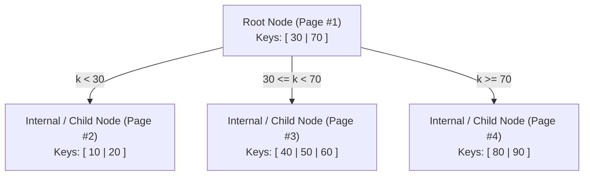
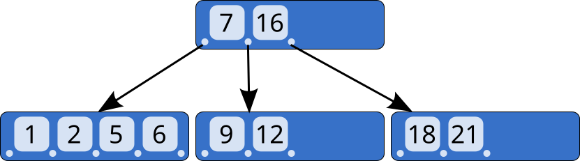
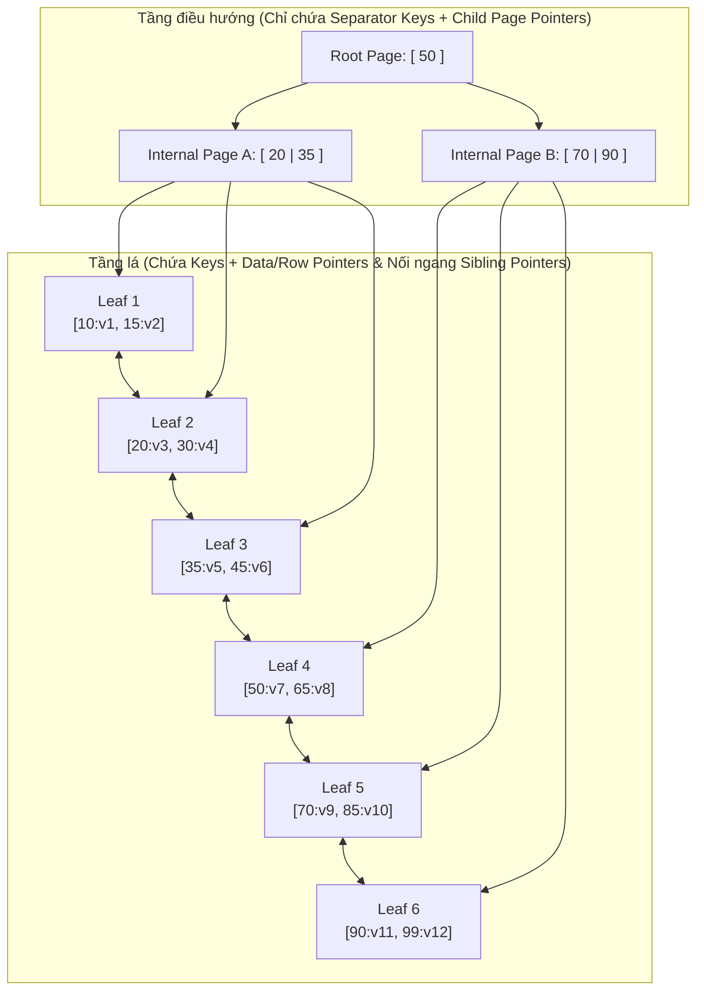
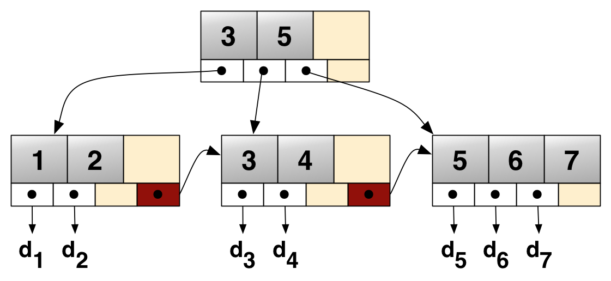
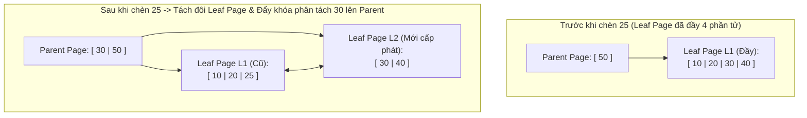

## Table of Contents
1. [Tại sao Binary Search Tree (BST) không phù hợp cho Disk Storage?](#why-not-bst)
2. [Từ Binary Search Tree đến B-Tree: Tăng Fanout để giảm chiều cao](#from-bst-to-btree)
3. [Phân biệt B-Tree truyền thống và B+Tree trong Database](#btree-vs-bplustree)
4. [Giải phẫu các Node và Bài toán tính chiều cao B+Tree thực tế](#anatomy-and-height-math)
5. [Cơ chế Tìm kiếm, Chèn (Node Split) và Xóa (Node Merge)](#lookup-split-merge)
6. [Tóm tắt & Ghi nhớ cốt lõi (Key Takeaways)](#key-takeaways)

---

## Tại sao Binary Search Tree (BST) không phù hợp cho Disk Storage? {#why-not-bst}

Trên RAM, các cây nhị phân cân bằng như **AVL Tree** hay **Red-Black Tree** hoạt động rất tốt với độ phức tạp `O(log2 N)`. Tuy nhiên, khi đem cấu trúc cây nhị phân xuống lưu trên ổ đĩa (HDD hoặc SSD), nó bộc lộ hai điểm yếu chí mạng:

1. **Fanout quá thấp ($\text{Fanout} = 2$) dẫn đến cây quá cao**:
   - Với $N = 100.000.000$ ($10^8$) bản ghi, một cây nhị phân cân bằng có chiều cao:

$$
h = \lceil \log_2(10^8) \rceil \approx 27\text{ tầng}
$$

   - Vì mỗi node con có thể nằm ở một vị trí ngẫu nhiên trên đĩa, đi từ gốc xuống lá đòi hỏi **27 lần đọc ngẫu nhiên (Random Disk Seeks)**! Với ổ HDD (mỗi lần seek mất $\approx 10\text{ ms}$), chỉ riêng việc tìm 1 bản ghi sẽ mất $270\text{ ms}$; ngay cả với SSD, 27 lần đọc tuần tự phụ thuộc nhau cũng gây độ trễ lớn.
2. **Lãng phí đơn vị đọc tối thiểu của phần cứng (Page / Block Size)**:
   - Ổ đĩa và hệ điều hành không đọc từng byte lẻ mà luôn đọc theo từng khối cố định (**OS Page = `4 KB`**, **Database Page = `8 KB` hoặc `16 KB`**).
   - Một node của Binary Tree chỉ chứa 1 khóa và 2 con trỏ (khoảng `24 bytes`). Nếu mỗi lần đọc cả một Page `16 KB` từ đĩa lên RAM mà chỉ lấy đúng `24 bytes` rồi nhảy sang Page khác thì hiệu suất sử dụng băng thông I/O gần như bằng không!

> [!IMPORTANT]
> **Nguyên lý thiết kế cấu trúc dữ liệu trên đĩa**: Để tối ưu Disk I/O, một node của cây phải có kích thước **vừa khít với 1 Database Page (`8 KB` – `16 KB`)**, chứa hàng trăm đến hàng ngàn khóa trên cùng 1 node nhằm đẩy hệ số phân nhánh (**Fanout**) lên cao và ép chiều cao của cây xuống chỉ còn **3 đến 4 tầng**.

---

## Từ Binary Search Tree đến B-Tree: Tăng Fanout để giảm chiều cao {#from-bst-to-btree}

**B-Tree** (được Rudolf Bayer và Ed McCreight giới thiệu năm 1971) là sự tổng quát hóa của cây tìm kiếm nhị phân tự cân bằng: thay vì mỗi node chỉ có 1 khóa và tối đa 2 nhánh con, mỗi node trong B-Tree (tương ứng với 1 Page trên đĩa) chứa tối đa `N-1` khóa đã sắp xếp và `N` con trỏ trỏ xuống các trang con.

- Các khóa trong mỗi node đóng vai trò là **Separator Keys (Khóa phân tách)**: nếu một node chứa 2 khóa `[30, 70]`, nó chia không gian tìm kiếm thành 3 nhánh con:
  - Nhánh 1: mọi khóa `k < 30`.
  - Nhánh 2: mọi khóa `30 ≤ k < 70`.
  - Nhánh 3: mọi khóa `k ≥ 70`.
- **B-Tree luôn tự cân bằng từ dưới lên (Bottom-up Balancing)**: Khác với BST mọc dài xuống dưới khi chèn thêm lá, mọi node lá (Leaf Nodes) trong B-Tree **luôn nằm ở cùng một độ sâu**. Cây chỉ cao thêm khi bản thân Root Node bị đầy và tách đôi!

*Hình 2.1: Cấu trúc phân nhánh của B-Tree với các khóa phân tách (Separator Keys) và các con trỏ trỏ xuống trang con*

---

## Phân biệt B-Tree truyền thống và B+Tree trong Database {#btree-vs-bplustree}

Trong thực tế, khi các tài liệu của PostgreSQL, MySQL InnoDB hay SQLite nói tới "B-Tree Index", cấu trúc thực sự được cài đặt bên dưới là **B+Tree** (biến thể cải tiến của B-Tree):

| Đặc điểm | B-Tree truyền thống (Original B-Tree) | B+Tree (Chuẩn mực trong DBMS hiện đại) |
| :--- | :--- | :--- |
| **Nơi lưu trữ dữ liệu (Values / Data Payloads)** | Lưu dữ liệu (hoặc con trỏ dòng) ở **cả Internal Nodes lẫn Leaf Nodes**. | Internal Nodes **chỉ lưu khóa điều hướng (Separator Keys)**. Toàn bộ dữ liệu (`Row Tuple` hoặc `TID`) **chỉ nằm ở tầng Leaf Nodes**. |
| **Hệ số phân nhánh (Fanout) của Internal Nodes** | Thấp hơn (vì không gian Page bị chiếm bởi cả Value/Data). | **Cao hơn nhiều** (vì Internal Page chỉ chứa Key + Child Page ID nhỏ gọn, nhét được hàng ngàn khóa vào 1 Page `16 KB`). |
| **Liên kết giữa các Leaf Nodes** | Các node lá không nối với nhau (muốn quét khoảng phải đi ngược lên cha rồi xuống con). | Các node lá được nối với nhau bằng danh sách liên kết hai chiều (**Sibling Pointers** `prev_page` `<->` `next_page`). |
| **Hiệu năng Range Scan (`BETWEEN`, `>`, `<`)** | Chậm vì phải duyệt cây theo chiều sâu (In-order traversal) qua nhiều tầng. | **Rất nhanh**: chỉ cần tìm điểm bắt đầu ở tầng lá, sau đó trượt ngang theo con trỏ `next_page` qua các trang lá kế tiếp! |

*Hình 2.2: Trong B+Tree, dữ liệu thực chỉ nằm ở tầng lá (Leaf Nodes) và các lá được nối ngang với nhau để tối ưu Range Scan*

---

## Giải phẫu các Node và Bài toán tính chiều cao B+Tree thực tế {#anatomy-and-height-math}

Hãy làm một phép tính thực tế (giống cách MySQL InnoDB vận hành với kích thước `Page = 16 KB = 16,384 bytes`) để thấy tại sao B+Tree có thể tìm 1 bản ghi trong hàng trăm triệu dòng chỉ với vài thao tác đọc:

1. **Sức chứa của 1 Internal Node (Fanout)**:
   - Giả sử khóa chính là `BIGINT` (`8 bytes`) và con trỏ trỏ xuống `Child Page Number` chiếm `6 bytes` -> mỗi mục điều hướng tốn `14 bytes`.
   - Trừ đi phần Page Header, một Internal Page `16 KB` chứa được khoảng:

$$
\text{Fanout } N \approx \frac{15.000\text{ bytes}}{14\text{ bytes}} \approx 1.000\text{ nhánh con}
$$

2. **Sức chứa của 1 Leaf Node**:
   - Giả sử mỗi bản ghi dữ liệu (`Row`) trung bình nặng `1 KB` -> mỗi Leaf Page `16 KB` chứa được khoảng `15` bản ghi.
3. **Tổng số bản ghi lưu được theo chiều cao cây $h$**:
   - **Cây cao 2 tầng** (1 Root + 1.000 Leaf Pages): $1.000 \times 15 = 15.000$ dòng.
   - **Cây cao 3 tầng** (1 Root + 1.000 Internal Pages + $10^6$ Leaf Pages): $1.000 \times 1.000 \times 15 = 15.000.000$ (**15 triệu dòng**).
   - **Cây cao 4 tầng** (1 Root + $10^3$ Internal L1 + $10^6$ Internal L2 + $10^9$ Leaf Pages): $10^9 \times 15 = 15.000.000.000$ (**15 tỷ dòng**)!

> [!TIP]
> Trong thực tế, **Root Page** và toàn bộ các **Internal Pages ở tầng 1, tầng 2** luôn là những trang được truy cập nhiều nên **nằm thường trực `100%` trong RAM (`Buffer Pool`)**. Điều đó có nghĩa là dù bảng có tới **hàng trăm triệu dòng (cây cao 3–4 tầng)**, một truy vấn tìm kiếm theo khóa chính tốn **tối đa 1 lần đọc đĩa (Disk I/O)** ở đúng tầng Leaf Page cuối cùng!

---

## Cơ chế Tìm kiếm, Chèn (Node Split) và Xóa (Node Merge) {#lookup-split-merge}

### 1. Tìm kiếm (Point Lookup & Range Scan)
- **Point Lookup (`WHERE id = 42`)**: Bắt đầu từ Root Page, dùng **Binary Search** trên mảng khóa đã sắp xếp trong Page để tìm nhánh con phù hợp, đi xuống dần cho tới Leaf Page rồi dùng Binary Search tìm đúng vị trí bản ghi.
- **Range Scan (`WHERE id BETWEEN 25 AND 60`)**: Duyệt từ Root xuống Leaf để tìm khóa đầu tiên `≥ 25`, sau đó đi dọc theo con trỏ ngang `next_page` trên tầng Leaf cho đến khi gặp khóa `> 60` thì dừng lại (không cần quay ngược lên các node cha).

### 2. Chèn dữ liệu & Tách trang (Overflow -> Node Split)
Khi chèn một bản ghi mới vào một Leaf Page nhưng trang đó đã đầy (vượt quá sức chứa `N-1` phần tử — gọi là **Overflow**), Storage Engine thực hiện **Node Split**:

Quy trình 4 bước của một **Leaf Split** trong B+Tree:
1. Cấp phát một trang lá mới tinh `L2`.
2. Chia nửa tập khóa (tại điểm giữa `split point`): nửa nhỏ hơn (`[10, 20, 25]`) ở lại trang cũ `L1`, nửa lớn hơn (`[30, 40]`) chuyển sang trang mới `L2`.
3. Cập nhật con trỏ liên kết ngang (`Sibling Pointers`) để chèn `L2` vào ngay bên phải `L1`.
4. **Sao chép (Copy-up)** khóa đầu tiên của trang mới (`30` — gọi là *Separator Key*) đẩy lên chèn vào trang cha (`Parent Page`).
   - *Lưu ý khác biệt*: Nếu bản thân **Internal Page (trang cha)** cũng bị đầy và phải tách đôi (**Internal Node Split**), khóa ở giữa sẽ được **Di chuyển (Push-up / Move-up)** lên tầng cao hơn chứ không giữ lại bản sao ở tầng dưới như Leaf Split. Nếu lan truyền tới tận Root Page làm Root bị tách đôi, một Root Page mới sẽ được tạo ra và chiều cao cây tăng thêm `1`.

### 3. Xóa dữ liệu & Gộp trang (Underflow -> Rebalance / Merge)
Khi xóa một bản ghi khiến số lượng phần tử trong trang tụt xuống dưới ngưỡng tối thiểu `⌊ N/2 ⌋` (gọi là **Underflow**), theo lý thuyết B-Tree chuẩn sẽ thực hiện:
1. **Redistribution (Mượn phần tử từ trang anh em kế cận)**: Nếu trang anh em (`Sibling`) bên trái hoặc bên phải còn dư phần tử, mượn 1 phần tử sang và cập nhật lại khóa phân tách ở trang cha.
2. **Node Merge (Gộp 2 trang làm 1)**: Nếu cả hai trang anh em đều quá thưa (tổng dung lượng của cả 2 trang cộng lại vừa đủ nhét vào 1 trang), gộp toàn bộ phần tử sang trang bên trái, giải phóng trang bên phải và xóa khóa phân tách trên trang cha.

---

## Tóm tắt & Ghi nhớ cốt lõi (Key Takeaways) {#key-takeaways}

1. **Tại sao Database dùng B+Tree thay vì Binary Search Tree hay Hash Index làm chỉ mục mặc định?**
   - So với **Binary Search Tree**, B+Tree có `Fanout` hàng trăm/ngàn nhánh giúp giảm số lần đọc đĩa từ `~ 25-30` lần xuống còn `3-4` lần và tận dụng tối đa cơ chế đọc theo `Page` của ổ đĩa.
   - So với **Hash Index**, B+Tree giữ các khóa theo đúng thứ tự sắp xếp, nhờ đó hỗ trợ tốt cả **Point Lookup (`=`)**, **Range Scan (`BETWEEN`, `>`, `<`)**, **`ORDER BY`**, **`GROUP BY`** và tìm kiếm theo tiền tố (**Prefix Match `LIKE 'abc%'`**), trong khi Hash Index chỉ hỗ trợ phép so sánh bằng (`=`).
2. **Điểm khác nhau giữa Leaf Split (Copy-up) và Internal Node Split (Push-up) trong B+Tree?**
   - Ở tầng **Leaf**, mọi khóa đều phải tồn tại để lưu dữ liệu thật, nên khi tách trang lá, khóa phân tách được **sao chép (copy-up)** lên trang cha (vừa nằm ở trang cha để dẫn đường, vừa nằm ở đầu trang lá bên phải).
   - Ở tầng **Internal**, các khóa chỉ làm nhiệm vụ phân luồng nên khi tách trang nội bộ, khóa ở giữa được **đẩy hẳn (push-up)** lên trang cha mà không cần giữ lại ở tầng dưới.
3. **Khi nào chiều cao của cây B+Tree tăng lên?**
   - Chỉ xảy ra khi **Root Page bị đầy và tách làm 2 trang con**, lúc này một Root Page mới được cấp phát để trỏ xuống 2 nửa đó. Mọi lá của B+Tree luôn cách gốc một khoảng bằng nhau.

### Tài liệu & Nguồn tham khảo
- [Comer, D. (1979) — *The Ubiquitous B-Tree* (ACM Computing Surveys)](https://dl.acm.org/doi/10.1145/356770.356776)
- [Graefe, G. (2011) — *Modern B-Tree Techniques* (Foundations and Trends in Databases)](https://www.nowpublishers.com/article/Details/DBS-028)
- [Use The Index, Luke! — Anatomy of an SQL Index (B-Tree Traversal & Range Scans)](https://use-the-index-luke.com/sql/anatomy)
