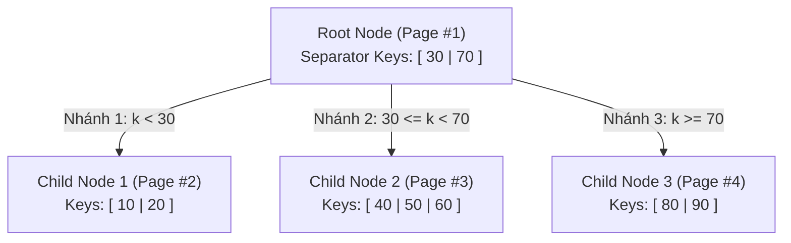
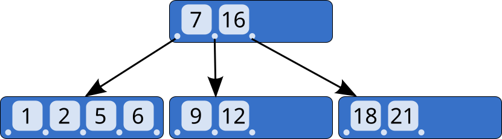
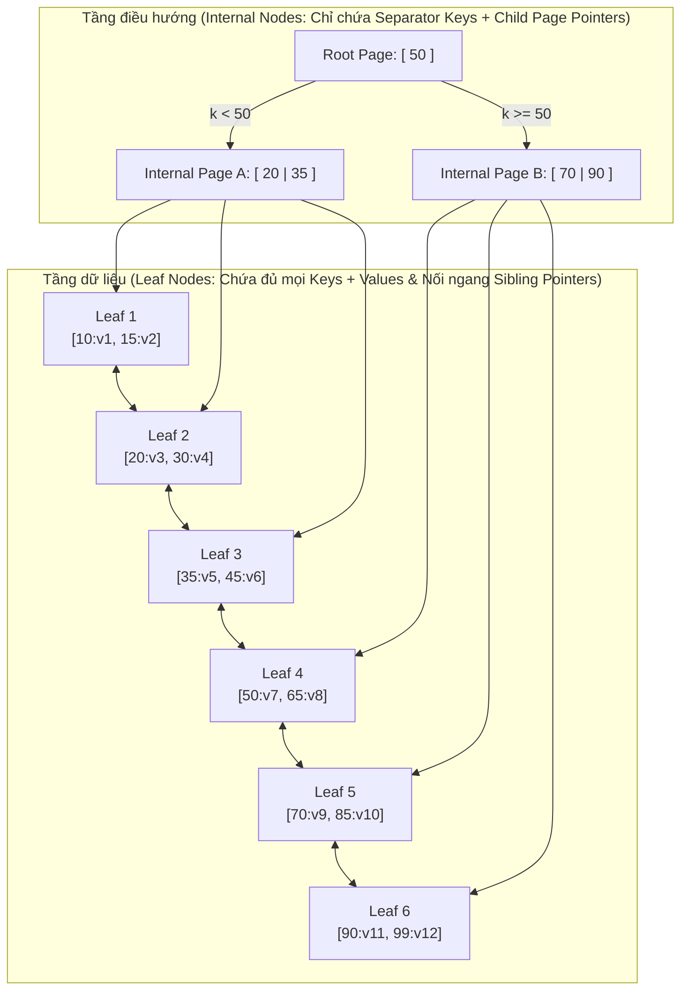
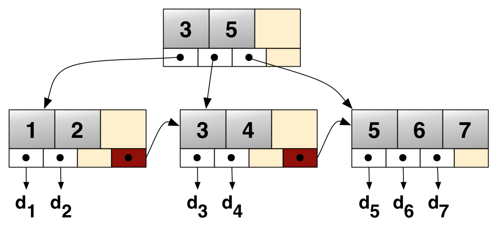
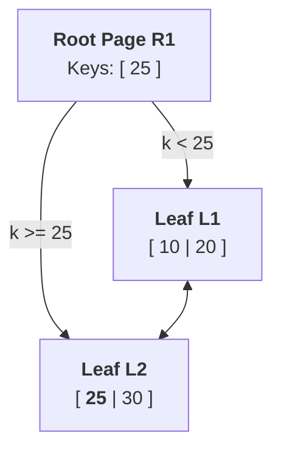
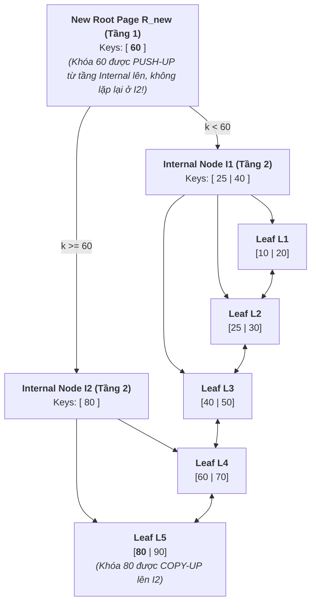
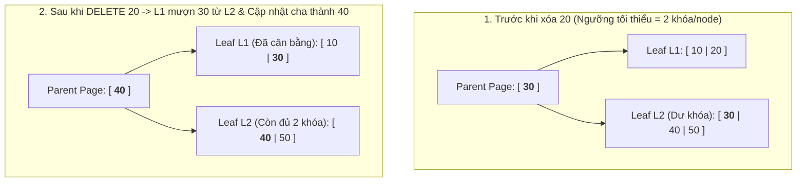
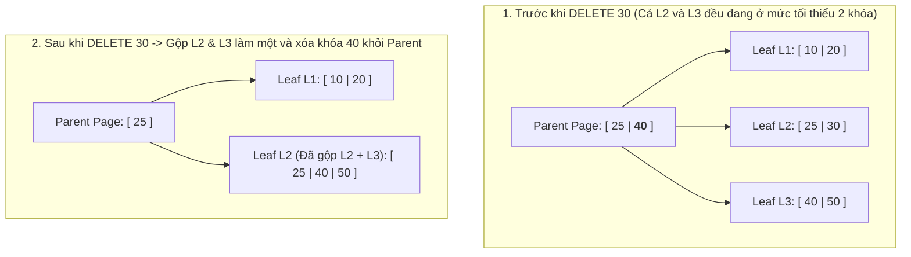

## Table of Contents
1. [Tại sao Binary Search Tree (BST) không phù hợp cho Disk Storage?](#why-not-bst)
2. [Từ Binary Search Tree đến B-Tree: Tăng Fanout để ép lùn chiều cao](#from-bst-to-btree)
3. [Phân biệt B-Tree truyền thống và B+Tree trong Database](#btree-vs-bplustree)
4. [Giải phẫu các khái niệm cốt lõi: Fanout, Separator Keys, High/Low Keys & Sibling Pointers](#anatomy-and-height-math)
5. [Ví dụ chạy tay (Step-by-Step Dry Run): INSERT, Leaf Split (Copy-up) & Internal Split (Push-up)](#lookup-split-merge)
6. [Ví dụ chạy tay quá trình DELETE: Underflow, Redistribution và Node Merge](#delete-underflow-merge)
7. [Tóm tắt & Ghi nhớ cốt lõi (Key Takeaways)](#key-takeaways)

---

## Tại sao Binary Search Tree (BST) không phù hợp cho Disk Storage? {#why-not-bst}

### Bài toán thực tế & Thiết kế ngây thơ (Naive Design)
Khi dữ liệu được sắp xếp theo khóa trên một mảng liên tiếp, thuật toán **Binary Search (Tìm kiếm nhị phân)** cho phép tìm 1 phần tử trong $N$ phần tử chỉ với $\mathcal{O}(\log_2 N)$ bước. Tuy nhiên, mảng liên tiếp cố định có nhược điểm lớn là khi chèn (`INSERT`) hoặc xóa (`DELETE`) một phần tử ở giữa, hệ thống phải dịch chuyển toàn bộ các phần tử phía sau ($\mathcal{O}(N)$).

Trên bộ nhớ RAM, giải pháp kinh điển để vừa tìm kiếm $\mathcal{O}(\log_2 N)$ vừa chèn/xóa $\mathcal{O}(\log_2 N)$ là dùng **Cây tìm kiếm nhị phân tự cân bằng (Self-Balancing Binary Search Tree)** như **AVL Tree** hoặc **Red-Black Tree**, trong đó mỗi node lưu 1 khóa và 2 con trỏ (`left`, `right`).

Thế nhưng, khi đem cấu trúc Binary Search Tree xuống lưu trên ổ đĩa cứng (HDD hoặc SSD), thiết kế này lập tức thất bại vì **3 rào cản vật lý**:

1. **Hệ số phân nhánh quá thấp ($\text{Fanout} = 2$) dẫn đến cây quá cao**:
   - Với một bảng có $N = 100.000.000$ ($10^8$) bản ghi, chiều cao của một cây nhị phân cân bằng hoàn hảo là:

$$
h = \lceil \log_2(10^8) \rceil \approx 27\text{ tầng}
$$

   - Do các node được cấp phát và xoay cây (tree rotation) ở những thời điểm khác nhau, các node cha và node con thường nằm ở các vị trí hoàn toàn ngẫu nhiên trên ổ đĩa (**Poor Spatial Locality**).
   - Để đi từ Root xuống tới Leaf ở tầng thứ 27, hệ thống phải thực hiện **27 lần đọc đĩa ngẫu nhiên (Random Disk Seeks)** nối tiếp nhau! Trên ổ HDD (mỗi lần di chuyển đầu đọc mất $\approx 10\text{ ms}$), chỉ riêng việc tìm **1 bản ghi** đã mất $27 \times 10\text{ ms} = \mathbf{270\text{ ms}}$. Ngay cả trên NVMe SSD ($\approx 0,1\text{ ms}$/read), vì 27 lần đọc này phụ thuộc tuần tự vào nhau (phải đọc xong cha mới biết địa chỉ của con), CPU hoàn toàn không thể đọc song song.
2. **Lãng phí đơn vị truyền tải tối thiểu của phần cứng (Block / Page Granularity)**:
   - Phần cứng ổ đĩa và hệ điều hành không bao giờ đọc từng byte lẻ mà luôn đọc theo từng khối cố định (**OS Page = `4 KB`**, **Database Page = `8 KB` hoặc `16 KB`**).
   - Một node của Binary Search Tree chỉ chứa `1 Key (8 bytes) + 2 Child Pointers (16 bytes) = 24 bytes`. Nếu mỗi lần đọc cả một khối `16.384 bytes` từ đĩa lên RAM mà chỉ lấy đúng `24 bytes` rồi nhảy sang khối khác, hệ thống đã **vứt bỏ $99,85\%$ băng thông Disk I/O**!
3. **Chi phí cân bằng lại cây (Rebalancing Overhead)**:
   - Các phép xoay cây (`Left/Right Rotation`) trong AVL hay Red-Black Tree làm thay đổi liên kết của nhiều node trên nhiều trang đĩa khác nhau sau mỗi lần chèn/xóa, gây ra lượng ghi ngẫu nhiên rất lớn.

> [!IMPORTANT]
> **Mental Model của cấu trúc dữ liệu trên đĩa**: Vì đằng nào một lần đọc đĩa cũng lấy lên trọn một **Page `8 KB` – `16 KB`**, thay vì chỉ nhét 1 khóa vào mỗi node (cao và gầy), hãy gom **hàng trăm đến hàng ngàn khóa đã sắp xếp** vào chung 1 node sao cho kích thước 1 node vừa khít với 1 Database Page! Cây sẽ trở nên **cực kỳ lùn và bè ngang (High Fanout, Low Height)** — giảm số lần đọc đĩa từ `27` tầng xuống chỉ còn **`3` đến `4` tầng**.

---

## Từ Binary Search Tree đến B-Tree: Tăng Fanout để ép lùn chiều cao {#from-bst-to-btree}

**B-Tree** (được Rudolf Bayer và Ed McCreight phát minh tại Boeing Labs năm 1971) là sự tổng quát hóa của Binary Search Tree cho thiết bị lưu trữ theo khối (Block Storage):
- Thay vì mỗi node chỉ có `1` khóa và `2` nhánh con, một node trong B-Tree bậc $M$ (tương ứng với 1 Page trên đĩa) có thể chứa tối đa $M - 1$ khóa đã sắp xếp tăng dần và trỏ xuống tối đa $M$ trang con.
- Các node trong B-Tree được chia thành 3 cấp bậc:
  1. **Root Node (Nút gốc)**: Nút duy nhất nằm ở đỉnh cây (không có cha).
  2. **Internal Nodes (Các nút nội bộ / nút trung gian)**: Nằm giữa Root và Leaf, đóng vai trò như các biển chỉ dẫn giao thông phân luồng tìm kiếm xuống tầng dưới.
  3. **Leaf Nodes (Các nút lá)**: Nằm ở tầng đáy cùng của cây, không có con trỏ trỏ xuống tầng thấp hơn.



- **Cơ chế tự cân bằng từ dưới lên (Bottom-up Self-Balancing)**:
  - Khác hoàn toàn với Binary Search Tree (vốn mọc dài thêm từ lá xuống dưới mỗi khi chèn khóa mới, dễ bị lệch thành cây suy biến), B-Tree luôn chèn khóa mới vào tầng Leaf và **chỉ phát triển chiều cao từ dưới đẩy ngược lên Root** thông qua cơ chế tách trang (`Node Split`).
  - Nhờ đó, **mọi Leaf Node trong B-Tree luôn nằm ở cùng một độ sâu tuyệt đối** tính từ Root — đảm bảo chi phí tìm kiếm mọi bản ghi đều đồng đều và có thể dự đoán trước.


*Hình 2.1: Cấu trúc phân nhánh của B-Tree — một node chứa $k$ khóa phân tách (Separator Keys) sẽ quản lý $k + 1$ con trỏ trỏ xuống các trang con*

---

## Phân biệt B-Tree truyền thống và B+Tree trong Database {#btree-vs-bplustree}

Khi các tài liệu của PostgreSQL, MySQL InnoDB, SQLite hay Oracle nhắc đến thuật ngữ *"B-Tree Index"*, cấu trúc thực tế được cài đặt bên trong hầu hết các RDBMS hiện đại không phải là B-Tree nguyên bản năm 1971, mà là biến thể cải tiến **B+Tree** (được Douglas Comer hệ thống hóa năm 1979).

### Tại sao B-Tree nguyên bản vẫn chưa đủ tốt?
Trong B-Tree nguyên bản, cả **Internal Nodes** lẫn **Leaf Nodes** đều lưu trữ trực tiếp dữ liệu dòng (`Value / Row Payload`) đi kèm với `Key`. Thiết kế này gây ra 2 bất lợi lớn:
1. **Làm giảm hệ số phân nhánh (Fanout) của các tầng trên**: Nếu mỗi bản ghi nặng `500 bytes` và nằm ngay trong Root / Internal Page (`16 KB`), thì một Internal Page chỉ chứa được khoảng `30` khóa thay vì `1.000` khóa -> cây bị cao hơn và tốn nhiều Disk I/O hơn.
2. **Quét khoảng (`Range Scan`) cực kỳ phức tạp**: Để lấy các bản ghi `WHERE id BETWEEN 15 AND 70`, hệ thống phải đi từ lá lên cha, đọc bản ghi ở cha, rồi lại tụt xuống nhánh con bên phải (In-order tree traversal) — gây đọc ngẫu nhiên lên xuống giữa các tầng.

### Giải pháp của B+Tree: Tách bạch hoàn toàn tầng Điều hướng và tầng Dữ liệu

| Đặc điểm đối chiếu | B-Tree truyền thống (Original B-Tree) | B+Tree (Chuẩn mực trong DBMS hiện đại) |
| :--- | :--- | :--- |
| **Nơi lưu trữ dữ liệu (`Values` / `Row Payloads` / `TIDs`)** | Lưu ở **cả Internal Nodes lẫn Leaf Nodes**. | Internal Nodes **chỉ lưu khóa điều hướng (`Separator Keys`) + `Child Page ID`**. Toàn bộ dữ liệu thật **chỉ nằm ở tầng Leaf Nodes**. |
| **Sự xuất hiện lặp lại của Key** | Mỗi khóa chỉ xuất hiện đúng 1 lần duy nhất trên toàn cây. | Khóa ở Internal Node chỉ là bản sao làm mốc phân cách; **mọi khóa đang tồn tại đều có mặt đầy đủ ở tầng Leaf Nodes**. |
| **Hệ số phân nhánh (`Fanout`) của Internal Nodes** | Thấp (bị chiếm chỗ bởi `Value`). | **Rất cao** (hàng trăm đến hàng ngàn nhánh mỗi Page vì chỉ lưu `Key + PageID` nhỏ gọn). |
| **Liên kết ngang giữa các Leaf Nodes** | Không có liên kết ngang giữa các lá. | Các trang lá nối với nhau thành danh sách liên kết đôi (**Sibling Pointers**: `prev_page` $\leftrightarrow$ `next_page`). |
| **Hiệu năng Range Scan (`BETWEEN`, `>`, `<`, `ORDER BY`)** | Chậm (phải nhảy zíc-zắc lên cha xuống con). | **Cực nhanh**: chỉ cần 1 lần đi từ Root xuống điểm bắt đầu ở tầng Leaf, sau đó trượt ngang tuần tự qua các Leaf Pages kế tiếp! |




*Hình 2.2: Trong B+Tree, dữ liệu thực chỉ nằm ở tầng lá (Leaf Nodes) và các lá được nối ngang với nhau để tối ưu Range Scan*

---

## Giải phẫu các khái niệm cốt lõi: Fanout, Separator Keys, High/Low Keys & Sibling Pointers {#anatomy-and-height-math}

Để đọc hiểu mã nguồn của PostgreSQL (`src/backend/access/nbtree`) hay MySQL InnoDB, cần nắm vững 4 thuật ngữ kỹ thuật xuất hiện xuyên suốt Chương 2 của sách *Database Internals*:

### 1. Fanout (Hệ số phân nhánh) & Bài toán tính chiều cao cây thực tế
- **Định nghĩa**: **Fanout** của một Internal Node là tổng số con trỏ trỏ xuống các trang con (`Child Pointers`) mà node đó có thể chứa. Nếu một node chứa $k$ khóa phân tách, nó có đúng $k + 1$ nhánh con.
- **Bài toán tính toán thực tế trên MySQL InnoDB (`Page Size = 16 KB = 16.384 bytes`)**:
  1. **Tính Fanout của 1 Internal Node**:
     - Giả sử khóa chính là `BIGINT` (`8 bytes`) và mỗi con trỏ địa chỉ trang con `Child Page Number` chiếm `6 bytes` $\implies$ mỗi mục chỉ dẫn tốn $8 + 6 = 14\text{ bytes}$.
     - Sau khi trừ đi phần `Page Header / Trailer` và khoảng trống dự phòng ($\approx 1.384\text{ bytes}$), không gian hữu ích còn khoảng $15.000\text{ bytes}$:

$$
\text{Fanout } M \approx \frac{15.000\text{ bytes}}{14\text{ bytes}} \approx \mathbf{1.000\text{ nhánh con / Page}}
$$

  2. **Tính sức chứa của 1 Leaf Node**:
     - Giả sử mỗi dòng dữ liệu (`Row Payload`) nặng trung bình `1 KB` (`1.000 bytes`) $\implies$ mỗi Leaf Page `16 KB` chứa được khoảng **15 bản ghi**.
  3. **Bảng đối chiếu chiều cao cây B+Tree theo số lượng bản ghi**:

| Chiều cao cây ($h$) | Cấu trúc các tầng của B+Tree | Tổng số Leaf Pages | Tổng số bản ghi (`1 KB`/dòng) | Số lần đọc Disk thực tế (khi Internal Nodes nằm trong RAM) |
| :--- | :--- | :--- | :--- | :--- |
| **$h = 1$** | Chỉ có 1 Root Page (kiêm Leaf) | $1$ | $\approx 15$ dòng | **0 – 1 I/O** |
| **$h = 2$** | 1 Root + $1.000$ Leaf Pages | $10^3$ | $\approx 15.000$ dòng | **1 I/O** |
| **$h = 3$** | 1 Root + $10^3$ Internal + $10^6$ Leaf Pages | $10^6$ | $\approx \mathbf{15.000.000}$ (**15 triệu dòng**) | **1 I/O** |
| **$h = 4$** | 1 Root + $10^3$ L1 + $10^6$ L2 + $10^9$ Leaf Pages | $10^9$ | $\approx \mathbf{15.000.000.000}$ (**15 tỷ dòng**) | **1 – 2 I/O** |

> [!TIP]
> **Tại sao tìm 1 dòng trong bảng 15 triệu dòng chỉ tốn tối đa 1 lần đọc đĩa?**
> Ở cây cao 3 tầng ($h = 3$), toàn bộ tầng Root (1 trang) + tầng Internal L1 (1.000 trang $\times 16\text{ KB} \approx \mathbf{16\text{ MB}}$) chỉ chiếm vỏn vẹn `16 MB` bộ nhớ — luôn nằm thường trực $100\%$ trong `Buffer Pool` trên RAM! Do đó, 2 bước duyệt đầu tiên diễn ra hoàn toàn trên RAM, và hệ thống chỉ tốn **tối đa 1 lần Disk I/O duy nhất** để nạp trang Leaf Page cuối cùng.

### 2. Separator Keys (Khóa phân tách), Low Key và High Key
- **Separator Keys (Khóa phân tách)**: Các khóa nằm trên Internal Nodes chia không gian khóa thành các nửa khoảng $[K_i, K_{i+1})$. Cụ thể, nếu trang cha có khóa phân tách `30`, thì mọi khóa ở cây con bên trái đều thỏa mãn $k < 30$, và mọi khóa ở cây con bên phải đều thỏa mãn $k \ge 30$.
- **Low Key (Khóa cận dưới) & High Key (Khóa cận trên)**:
  - Mỗi node $N$ trong cây B+Tree phụ trách quản lý một đoạn giá trị xác định $[K_{\text{low}}, K_{\text{high}})$, trong đó $K_{\text{low}}$ là khóa nhỏ nhất được phép nằm trong node $N$, và $K_{\text{high}}$ là cận trên (mọi khóa trong node $N$ phải nhỏ hơn $K_{\text{high}}$; ở node ngoài cùng bên phải thì $K_{\text{high}} = +\infty$).
  - **Tại sao các DBMS như PostgreSQL (cài đặt biến thể *Lehman & Yao B-link Tree*) lại lưu tường minh `High Key` ngay bên trong từng Page?**
    - Hãy tưởng tượng **Luồng Đọc A** đang đi từ trang cha xuống trang lá `L1` để tìm khóa `35` (khi còn ở trang cha, `L1` quản lý khoảng $[20, 50)$).
    - Đúng lúc Luồng A vừa buông khóa (`Latch`) ở trang cha nhưng chưa kịp chạm vào `L1`, **Luồng Ghi B** nhảy vào chèn dữ liệu làm `L1` bị đầy và **tách đôi (Split)** thành `L1` mới quản lý $[20, 30)$ và `L2` quản lý $[30, 50)$!
    - Khi Luồng A đọc `L1`, nhờ kiểm tra thấy `High Key` của `L1` bây giờ chỉ là `30` (mà khóa cần tìm là $35 \ge 30$), Luồng A phát hiện ngay lập tức rằng phần tử `35` đã bị tách sang trang anh em bên phải `L2`. Thay vì phải hủy bỏ và đi lại từ Root, Luồng A chỉ cần đi ngang theo con trỏ `right_sibling` sang `L2` là tìm thấy `35`!

```text
[Minh họa High Key & Right-Link giúp tìm kiếm an toàn khi có Split đồng thời (B-link Tree)]
Luồng A tìm k = 35, đi xuống Page L1 (nhưng L1 vừa bị Luồng B tách đôi!):

+---------------------------------------+        +---------------------------------------+
| Leaf Page L1                          |        | Leaf Page L2 (Vừa tách ra bên phải)   |
| High Key = 30  (Cận trên của trang!)  | -----> | High Key = 50                         |
| Keys hiện có: [ 20 | 25 ]             | right  | Keys hiện có: [ 30 | 35 | 40 ]        |
+---------------------------------------+ sibling+---------------------------------------+
  ^ Luồng A thấy 35 >= High Key (30) -> Tự động trượt ngang sang L2 để lấy 35!
```

### 3. Sibling Pointers (Con trỏ anh em hai chiều)
- Trong phần Header của mỗi Leaf Page luôn dành sẵn 2 trường `prev_page_id` (Left Sibling) và `next_page_id` (Right Sibling) nối tất cả các trang lá thành một **Doubly Linked List**.
- Nhờ đó, câu truy vấn `SELECT * FROM logs WHERE id >= 20 ORDER BY id ASC LIMIT 100` chỉ cần đi từ Root xuống Leaf 1 lần tại khóa `20`, rồi trượt sang phải theo `next_page_id`; nếu truy vấn `ORDER BY id DESC` thì trượt ngược sang trái theo `prev_page_id`.

---

## Ví dụ chạy tay (Step-by-Step Dry Run): INSERT, Leaf Split (Copy-up) & Internal Split (Push-up) {#lookup-split-merge}

Để nắm thật chắc cách cây B+Tree tự cân bằng và phát triển chiều cao từ dưới lên, phần dưới đây minh họa từng bước chạy tay trên một cây **B+Tree bậc $M = 4$**:
- Mỗi node có tối đa $M = 4$ con trỏ nhánh con (`Fanout tối đa = 4`).
- Mỗi node chứa **tối đa $M - 1 = 3$ khóa**.
- Ngay khi chèn khóa thứ `4` vào một node đang có `3` khóa, node đó rơi vào trạng thái **Tràn (Overflow — 4 khóa)** và bắt buộc phải **Tách đôi (Split)** tại vị trí giữa ($\lfloor 4/2 \rfloor = \text{index } 2$): 2 khóa đầu ở lại trang trái, 2 khóa sau chuyển sang trang phải mới.

---

### Phần 1: Chèn lần lượt `10, 20, 30` rồi chèn `25` -> Kích hoạt Leaf Split (Copy-up)

#### Bước 1.1: Chèn `10`, `20`, `30` vào cây rỗng
Ban đầu cây chỉ có 1 trang duy nhất là `Node L1` (đóng vai trò vừa là Root vừa là Leaf). Sau khi chèn `10, 20, 30`, trang `L1` đạt sức chứa tối đa `3` khóa (chiều cao $h = 1$):

```text
[Chiều cao h = 1]
+--------------------+
| Leaf/Root L1 (Đầy) |
| [ 10 | 20 | 30 ]   |
+--------------------+
```

#### Bước 1.2: Chèn thêm khóa `25` -> Tràn trang lá & Thực hiện `Leaf Split (Copy-up)`
1. Chèn `25` vào đúng thứ tự sắp xếp trong `L1` $\implies$ `L1` tạm thời có 4 khóa `[10, 20, 25, 30]` (**Overflow!**).
2. Cấp phát một trang lá mới `L2`. Chia đôi 4 khóa tại điểm giữa:
   - Nửa trái `[10, 20]` ở lại `L1`.
   - Nửa phải `[25, 30]` dời sang `L2`.
   - Nối con trỏ ngang `L1 <-> L2`.
3. **Bước quan trọng nhất — `Copy-up` (Sao chép khóa lên cha)**:
   - Lấy khóa đầu tiên của trang phải `L2` là **`25`** làm khóa phân tách (**Separator Key**).
   - Vì `L1` chưa có trang cha, hệ thống cấp phát một **Root Page mới `R1`** và **sao chép (`Copy-up`)** khóa `25` lên `R1`.
   - **Chú ý**: Khóa `25` vừa nằm trên `R1` (để làm mốc điều hướng: $< 25$ đi sang `L1`, $\ge 25$ đi sang `L2`), vừa **vẫn được giữ nguyên ở đầu trang lá `L2`** (vì trong B+Tree, tầng lá phải chứa dữ liệu của mọi khóa!). Lúc này chiều cao cây tăng từ $h = 1$ lên $h = 2$:



---

### Phần 2: Chèn tiếp `40, 50, 60, 70, 80` (và `90`) -> Kích hoạt Internal Node Split (Push-up) làm tăng chiều cao cây lên $h = 3$

Hãy tiếp tục chèn tuần tự các khóa tăng dần vào cây đang có ở trên để xem khi nào trang cha `R1` bị đầy và tách đôi:

#### Bước 2.1: Chèn `40`, sau đó chèn `50`
- **Chèn `40`**: So sánh với Root `R1 [25]`, vì $40 \ge 25$ nên đi xuống `L2`. Trang `L2` thành `[25, 30, 40]` (đầy 3 khóa, chưa tràn).
- **Chèn `50`**: Đi xuống `L2` $\implies$ `L2` tràn thành `[25, 30, 40, 50]`.
  - Tách `L2` thành `L2 = [25, 30]` và trang lá mới `L3 = [40, 50]`.
  - **Copy-up** khóa đầu tiên của `L3` là **`40`** lên trang cha `R1`. Trang `R1` hiện có 2 khóa `[25, 40]`:

```text
                +------------------+
                |   Root R1        |
                |  [ 25  |  40 ]   |
                +------------------+
               /         |          \
              v          v           v
     [ 10 | 20 ] <-> [ 25 | 30 ] <-> [ 40 | 50 ]
       Leaf L1         Leaf L2         Leaf L3
```

#### Bước 2.2: Chèn `60`, sau đó chèn `70` -> Làm đầy trang cha `R1`
- **Chèn `60`**: Vì $60 \ge 40$, đi xuống `L3`. Trang `L3` thành `[40, 50, 60]` (đầy 3 khóa).
- **Chèn `70`**: Đi xuống `L3` $\implies$ `L3` tràn thành `[40, 50, 60, 70]`.
  - Tách `L3` thành `L3 = [40, 50]` và trang lá mới `L4 = [60, 70]`.
  - **Copy-up** khóa đầu tiên của `L4` là **`60`** lên trang cha `R1`.
  - Lúc này, **Root `R1` chứa `[25, 40, 60]` — đã đạt giới hạn tối đa 3 khóa và trỏ xuống 4 nhánh con!**

```text
                      +-------------------------+
                      |    Root R1 (ĐÃ ĐẦY!)    |
                      |   [ 25  |  40  |  60 ]  |
                      +-------------------------+
                     /        |          |       \
                    v         v          v        v
          [10 | 20] <-> [25 | 30] <-> [40 | 50] <-> [60 | 70]
           Leaf L1       Leaf L2       Leaf L3       Leaf L4
```

#### Bước 2.3: Chèn `80` (làm đầy `L4`) và chèn tiếp `90` -> Tách dây chuyền từ Leaf lên Internal/Root (`Push-up`)!
- **Chèn `80`**: Đi xuống nhánh ngoài cùng bên phải `L4` ($80 \ge 60$) $\implies$ `L4` thành `[60, 70, 80]` (đầy 3 khóa).
- **Chèn tiếp `90`** (hoặc bất kỳ khóa nào $> 60$, ví dụ `85`): Đi xuống `L4` $\implies$ `L4` tràn thành `[60, 70, 80, 90]`. Hãy xem hiệu ứng domino 2 tầng diễn ra:
  1. **Tầng 1 — Leaf Split tại `L4` (Dùng `Copy-up`)**:
     - Tách `L4` thành `L4 = [60, 70]` và trang lá mới `L5 = [80, 90]`.
     - **Copy-up** khóa đầu tiên của `L5` là **`80`** đẩy lên trang cha `R1`. (Khóa `80` vẫn nằm ở `L5`).
  2. **Tầng 2 — Internal Node Split tại `R1` (Dùng `Push-up / Move-up`)**:
     - Khi nhận thêm khóa `80`, trang nội bộ `R1` bị tràn với 4 khóa phân tách: `[25, 40, 60, 80]` (và đang giữ 5 con trỏ tới `L1, L2, L3, L4, L5`).
     - Hệ thống tách trang nội bộ `R1` thành 2 Internal Nodes `I1` và `I2`, đồng thời lấy khóa đứng giữa là **`60`** để **ĐẨY HẲN LÊN (`Push-up / Move-up`)** tạo thành một **Root Page mới `R_new = [60]`**!
     - `I1` giữ khóa `[25, 40]` (quản lý 3 lá `L1, L2, L3`).
     - `I2` chỉ giữ khóa `[80]` (quản lý 2 lá `L4, L5`). **Lưu ý: Khóa `60` biến mất khỏi `I2` vì đã được `Push-up` lên `R_new`!**
     - Chiều cao của cây B+Tree chính thức tăng từ **$h = 2$ lên $h = 3$**:



> [!IMPORTANT]
> **Tại sao Leaf Split thì `Copy-up` (Sao chép) còn Internal Split thì `Push-up` (Đẩy hẳn)?**
> - **Ở tầng Leaf (`Copy-up`)**: Mọi khóa của bảng đều kèm theo dữ liệu thật (`Row Payload` hoặc `TID`). Nếu khi tách `L4` và `L5` mà hệ thống xóa mất khóa `80` khỏi `L5` để đẩy lên cha `I2` (nơi chỉ lưu khóa phân tách chứ không lưu dữ liệu dòng), thì dữ liệu của bản ghi `80` sẽ bị mất! Vì vậy, Leaf Split bắt buộc phải **giữ `80` ở `L5` và chỉ sao chép một bản sao của `80` lên `I2`**.
> - **Ở tầng Internal (`Push-up`)**: Bản thân khóa `60` đã có mặt an toàn dưới tầng lá `L4 = [60, 70]`. Ở tầng Internal, khóa `60` chỉ làm biển chỉ đường rẽ nhánh ($< 60$ sang trái, $\ge 60$ sang phải). Khi `60` đã được đưa lên `R_new` để chia nhánh giữa `I1` (mọi phần tử $< 60$) và `I2` (mọi phần tử $\ge 60$), việc giữ lại `60` bên trong `I2` là hoàn toàn dư thừa và sai cấu trúc số con trỏ ($k$ khóa đi kèm $k+1$ nhánh con)!

---

## Ví dụ chạy tay quá trình DELETE: Underflow, Redistribution và Node Merge {#delete-underflow-merge}

Trong B+Tree bậc $M = 4$ (tối đa `3` khóa/node), ngưỡng lấp đầy tối thiểu của mỗi node (trừ Root) là $\lceil M/2 \rceil - 1 = \mathbf{1\text{ khóa}}$ (hoặc với cây bậc $M = 5$ chứa tối đa `4` khóa thì ngưỡng tối thiểu là $\mathbf{2\text{ khóa}}$). Khi một lệnh `DELETE` làm số khóa trong một node tụt xuống dưới ngưỡng tối thiểu, node đó rơi vào trạng thái **Đói phần tử (Underflow)**.

Để khắc phục Underflow, Storage Engine ưu tiên kiểm tra 2 phương án theo thứ tự từ nhẹ đến nặng:

### Trường hợp 1: Sibling Redistribution (Mượn khóa từ nút anh em & Xoay khóa phân cách trên cha)
- **Điều kiện áp dụng**: Nút anh em kế cận (`Left Sibling` hoặc `Right Sibling` có cùng cha) đang **dư dả khóa** (nhiều hơn ngưỡng tối thiểu).
- **Ví dụ chạy tay cụ thể**:
  - Giả sử ngưỡng tối thiểu là `2` khóa/trang lá. Hiện tại trang cha có khóa phân tách `[30]`, trỏ xuống:
    - `Leaf L1 = [10, 20]` (đang ở mức tối thiểu 2 khóa).
    - `Leaf L2 = [30, 40, 50]` (đang dư dả 3 khóa).
  - Thực thi lệnh **`DELETE 20`**:
    1. Sau khi xóa `20`, trang `L1` chỉ còn `[10]` (< 2 khóa $\implies$ **Underflow!**).
    2. Nhìn sang anh em bên phải `L2 = [30, 40, 50]`, thấy `L2` đang có 3 khóa (có thể cho mượn 1 khóa mà `L2` vẫn còn đủ 2 khóa).
    3. **Di chuyển khóa đầu tiên của `L2` là `30` sang cuối `L1`** $\implies$ `L1` trở thành `[10, 30]`, còn `L2` trở thành `[40, 50]`.
    4. **Cập nhật (Rotate) khóa phân tách trên trang cha**: Vì khóa nhỏ nhất của `L2` bây giờ là **`40`**, khóa phân tách trên trang cha được đổi từ `30` thành **`40`**!



### Trường hợp 2: Node Merge / Coalescing (Gộp 2 nút làm 1 & Xóa khóa phân tách trên cha)
- **Điều kiện áp dụng**: Nút bị Underflow và cả nút anh em kế cận của nó đều đang ở ngưỡng tối thiểu (không ai dư khóa để cho mượn). Lúc này, tổng số khóa của cả 2 nút cộng lại chắc chắn nhét vừa vào 1 trang duy nhất!
- **Ví dụ chạy tay cụ thể**:
  - Tiếp tục từ trạng thái trên (hoặc xét cây có `Parent = [25, 40]` quản lý 3 lá `L1 = [10, 20]`, `L2 = [25, 30]`, `L3 = [40, 50]` với ngưỡng tối thiểu 2 khóa/lá).
  - Thực thi lệnh **`DELETE 30`** tại `L2`:
    1. Trang `L2` chỉ còn `[25]` (**Underflow!**). Nhìn sang `L1 = [10, 20]` và `L3 = [40, 50]`, cả hai đều chỉ có đúng 2 khóa nên không thể mượn.
    2. **Gộp (`Merge`) toàn bộ phần tử của `L2` và `L3` về chung một trang** (hoặc gộp `L1` và `L2`): gộp `L2 [25]` và `L3 [40, 50]` thành trang `L2 = [25, 40, 50]`, giải phóng trang `L3` trả về Free Page List.
    3. **Kéo xuống / Xóa khóa phân tách `40` trên trang cha `Parent`**: Vì nhánh `L3` đã biến mất, khóa phân tách `40` giữa `L2` và `L3` trên `Parent` bị xóa bỏ $\implies$ `Parent` chỉ còn `[25]`.
    - *Lưu ý đối với Internal Node Merge*: Nếu việc xóa khóa phân tách trên `Parent` làm bản thân `Parent` (một Internal Node) cũng bị Underflow và phải gộp với một Internal Node anh em khác, thì khóa phân cách trên tầng cao hơn sẽ được **kéo hẳn xuống (`Pull-down / Demote`)** nằm giữa 2 Internal Nodes đang gộp lại (ngược lại hoàn toàn với thao tác `Push-up` khi tách Internal Node!).



> [!NOTE]
> **Thực tế cài đặt trong các DBMS hiện đại (PostgreSQL, SQLite)**:
> Trong sách giáo khoa, B-Tree thực hiện Rebalance/Merge ngay khi trang đầy dưới $50\%$. Tuy nhiên trong thực tế, việc gộp trang ngay lập tức rất tốn Latch và dễ gây hiện tượng **Thrashing** (vừa tốn công gộp 2 trang xong thì ngay mili-giây sau người dùng lại `INSERT` đúng khóa đó, buộc hệ thống phải tách trang lại từ đầu!). Vì vậy, các hệ thống như PostgreSQL thường cho phép trang vơi dưới $50\%$ và chỉ thu hồi/gộp trang khi trang đó **rỗng hoàn toàn ($0\%$ phần tử)** trong quá trình quét dọn `VACUUM`!

---

## Tóm tắt & Ghi nhớ cốt lõi (Key Takeaways) {#key-takeaways}

1. **Tại sao Database dùng B+Tree thay vì Binary Search Tree hay Hash Index làm cấu trúc chỉ mục mặc định?**
   - So với **Binary Search Tree**, B+Tree gom hàng trăm/ngàn khóa vào 1 Page kích thước cố định (`8 KB` – `16 KB`), đẩy `Fanout` lên $\approx 1.000$ và ép chiều cao cây của hàng trăm triệu bản ghi xuống chỉ còn `3 – 4` tầng (tốn tối đa 1–2 lần đọc đĩa khi các tầng Internal đã nằm trong RAM).
   - So với **Hash Index**, B+Tree duy trì thứ tự sắp xếp của khóa và nối ngang các trang lá bằng `Sibling Pointers`, nhờ đó hỗ trợ xuất sắc cả **Point Lookup (`=`)**, **Range Scan (`BETWEEN`, `>`, `<`)**, **`ORDER BY`**, **`GROUP BY`** và tìm kiếm theo tiền tố (**Prefix Match `LIKE 'abc%'`**), trong khi Hash Index chỉ hỗ trợ duy nhất phép so sánh bằng (`=`).
2. **Điểm khác nhau cốt lõi giữa Leaf Split (`Copy-up`) và Internal Node Split (`Push-up`) trong B+Tree là gì?**
   - Ở tầng **Leaf**, mọi khóa đều gắn liền với dữ liệu thật của bản ghi, nên khi tách trang lá, khóa đầu tiên của trang lá bên phải được **sao chép (`Copy-up`)** lên trang cha (vừa nằm ở trang cha để dẫn đường, vừa giữ nguyên ở trang lá bên phải).
   - Ở tầng **Internal**, các khóa chỉ đóng vai trò phân luồng giao thông (bản dữ liệu gốc đã nằm dưới tầng lá), nên khi tách trang nội bộ, khóa đứng giữa được **đẩy hẳn (`Push-up`)** lên trang cha mà không giữ lại ở tầng dưới.
3. **Vai trò của `High Key` trong mỗi trang B+Tree là gì?**
   - `High Key` lưu giá trị cận trên của các khóa được phép cư trú trong trang đó. Nhờ `High Key` kết hợp với con trỏ sang trang anh em bên phải (`Right-link`), một luồng Đọc đang đi xuống trang vừa bị luồng khác tách đôi (`Split`) có thể phát hiện ngay khóa cần tìm $\ge \text{High Key}$ và trượt ngang sang phải để đọc tiếp mà không cần giữ khóa (`Latch`) trên cả cây hay đi lại từ Root.

### Tài liệu & Nguồn tham khảo
- [Alex Petrov — *Database Internals*, Chapter 2: B-Tree Basics (O'Reilly)](https://www.databass.dev/)
- [Comer, D. (1979) — *The Ubiquitous B-Tree* (ACM Computing Surveys)](https://dl.acm.org/doi/10.1145/356770.356776)
- [Lehman, P. L., & Yao, S. B. (1981) — *Efficient Locking for Concurrent Operations on B-Trees*](https://dl.acm.org/doi/10.1145/319628.319663)
- [Graefe, G. (2011) — *Modern B-Tree Techniques* (Foundations and Trends in Databases)](https://www.nowpublishers.com/article/Details/DBS-028)
