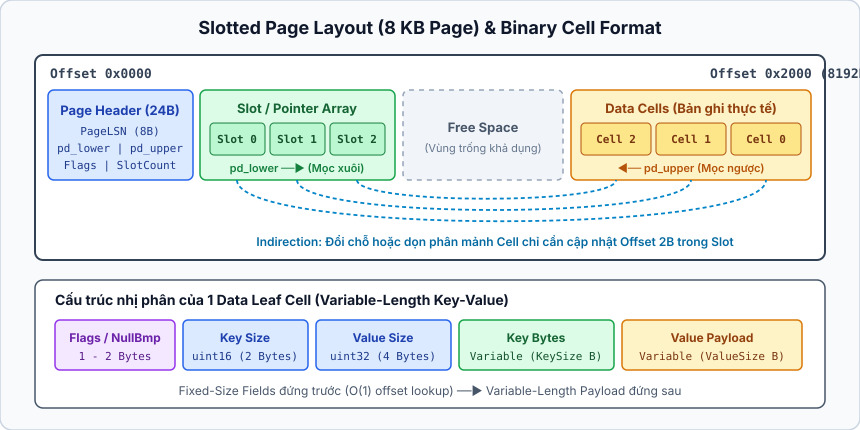
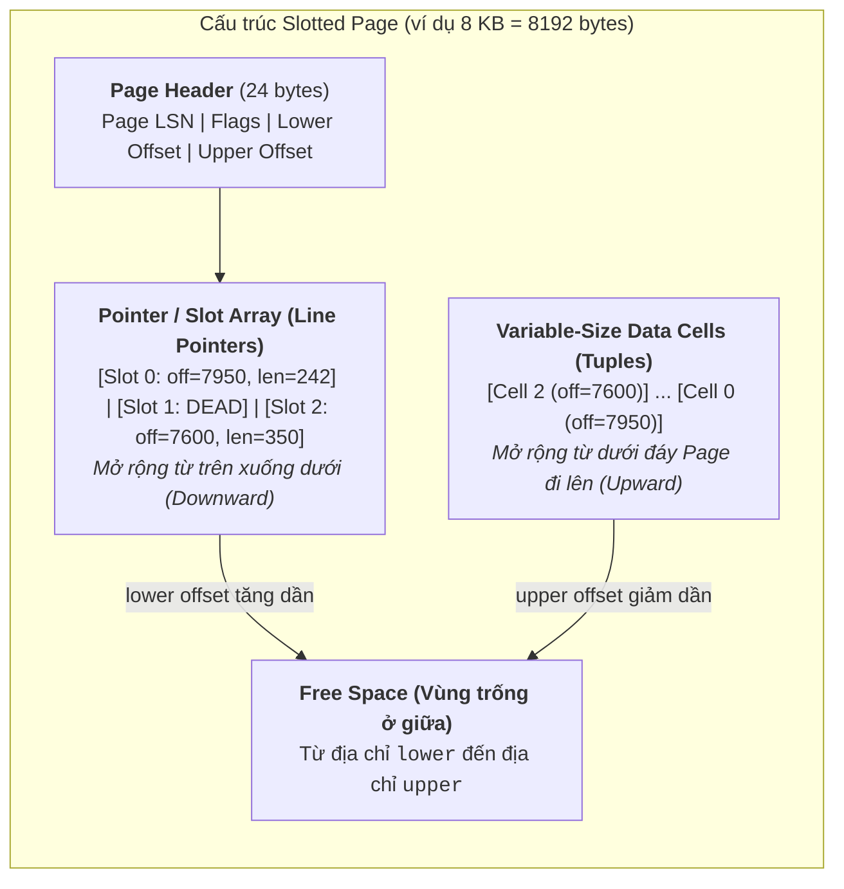

## Table of Contents
1. [Binary Encoding (Mã hóa nhị phân)](#binary-encoding)
2. [Cấu trúc Page tổng quát và Slotted Pages](#slotted-pages)
3. [Cấu trúc Cell (Key Cells vs Key-Value Data Cells)](#cell-layout)
4. [Quản lý dữ liệu kích thước lớn và Overflow Pages (TOAST)](#overflow-pages)
5. [Quản lý phiên bản File Format (Versioning)](#versioning)
6. [Tóm tắt & Ghi nhớ cốt lõi (Key Takeaways)](#key-takeaways)

---

Mọi cấu trúc dữ liệu trên đĩa — dù là B-Tree hay LSM-Tree — cuối cùng đều phải được tuần tự hóa (serialize) thành các mảng byte liên tiếp bên trong các khối cố định gọi là **Page** (thường có kích thước `4 KB`, `8 KB` hoặc `16 KB`). Chương này đi sâu vào cách Storage Engine biểu diễn các kiểu dữ liệu nguyên thủy, tổ chức **Slotted Page** để quản lý bản ghi có độ dài thay đổi mà không làm hỏng chỉ mục phụ (Secondary Index), và xử lý các trường dữ liệu vượt quá kích thước một Page.

---

## Binary Encoding (Mã hóa nhị phân) {#binary-encoding}

Khác với các định dạng văn bản như JSON hay CSV vốn tốn kém chi phí parse và chiếm nhiều dung lượng, Storage Engine lưu trữ dữ liệu dưới dạng nhị phân có cấu trúc chặt chẽ để có thể nhảy trực tiếp đến từng trường thông qua độ lệch byte (**Byte Offset**).

### 1. Kiểu số nguyên và thứ tự Byte (Endianness)
Số nguyên có kích thước cố định (`INT8` = `1 byte`, `INT16` = `2 bytes`, `INT32` = `4 bytes`, `INT64` = `8 bytes`) được biểu diễn theo hai quy ước thứ tự byte:
- **Big-Endian (Most Significant Byte - MSB first)**: Byte có trọng số lớn đứng đầu. Ví dụ số `0x12345678` được lưu theo thứ tự `12 34 56 78`. Điểm mạnh quan trọng của Big-Endian trong cơ sở dữ liệu là cho phép so sánh hai mảng byte từ trái sang phải bằng hàm `memcmp` mà vẫn giữ nguyên thứ tự giá trị số học (đối với số không dấu).
- **Little-Endian (Least Significant Byte - LSB first)**: Byte có trọng số nhỏ đứng đầu (`78 56 34 12`). Phù hợp với kiến trúc CPU `x86_64`, cho phép đọc trực tiếp từ bộ nhớ vào thanh ghi CPU mà không cần đảo byte (byte swap).

Số thực dấu phẩy động (`FLOAT`, `DOUBLE`) tuân theo chuẩn IEEE `754` gồm `3` phần: bit dấu (sign bit), phần mũ (exponent) và phần định trị (mantissa).

### 2. Chuỗi ký tự và dữ liệu độ dài thay đổi (Variable-Length Data)
Thay vì dùng ký tự kết thúc chuỗi `\0` (Null-terminated string) của ngôn ngữ C — vốn buộc hệ thống phải quét tuần tự từng byte để biết độ dài và gặp lỗi nếu dữ liệu nhị phân chứa byte `0x00` — cơ sở dữ liệu sử dụng cấu trúc **Length-Prefixed**:
```text
+-------------------+-----------------------------------+
| Length (2-4 byte) | Payload Bytes (UTF-8 / Raw Bytes) |
+-------------------+-----------------------------------+
```

### 3. Kiểu Boolean và Null Bitmap
- **Boolean**: Thay vì tốn trọn `1 byte` cho mỗi cột boolean, nhiều cột boolean và trạng thái `NULL` của toàn bộ các cột trong dòng được gộp chung vào một vùng bitmask gọi là **Null Bitmap**.
- **Null Bitmap**: Mỗi cột trong bảng tương ứng với `1 bit` trong bitmap (ví dụ bảng có `8` cột sẽ cần `1 byte` Null Bitmap). Nếu bit thứ `i` bật (`1`), cột thứ `i` mang giá trị `NULL` và hoàn toàn không chiếm bất kỳ byte nào trong phần dữ liệu phía sau.

### 4. Ví dụ cụ thể: Mã hóa một dòng dữ liệu
Giả sử bảng `users` có schema `(id INT32, name VARCHAR, active BOOLEAN, bio VARCHAR)` và cần lưu bản ghi:
- `id = 42` (`0x0000002A` theo Big-Endian)
- `name = "Alice"` (`5 bytes` ASCII: `41 6C 69 63 65`)
- `active = true` (`0x01`)
- `bio = NULL`

Bố cục byte liên tiếp (Contiguous Byte Layout) của bản ghi này trên đĩa như sau:

| Thành phần | Kích thước | Giá trị Hex | Giải thích kỹ thuật |
| :--- | :--- | :--- | :--- |
| **Null Bitmap** | `1 byte` | `0x08` (`00001000` nhị phân) | Bit thứ `3` (`0-indexed`, ứng với cột `bio`) bằng `1` báo hiệu `bio IS NULL`. Các cột `0, 1, 2` đều khác `NULL`. |
| **Fixed: `id`** | `4 bytes` | `00 00 00 2A` | Giá trị `42` kiểu `INT32` (Big-Endian). Vị trí cố định ngay sau Null Bitmap. |
| **Fixed: `active`** | `1 byte` | `01` | Giá trị `true`. Gom các cột cố định lên đầu giúp truy cập với độ phức tạp `O(1)`. |
| **Var Offset Array** | `2 bytes` | `00 05` | Độ dài hoặc vị trí kết thúc của cột biến đổi thứ nhất (`name` dài `5 bytes`). Cột `bio` là `NULL` nên được bỏ qua. |
| **Var Data: `name`** | `5 bytes` | `41 6C 69 63 65` | Chuỗi ASCII `"Alice"`. Cột `bio` không tốn byte lưu trữ nào. |

Tổng kích thước bản ghi chỉ chiếm đúng `13 bytes`.

---

## Cấu trúc Page tổng quát và Slotted Pages {#slotted-pages}

Nếu mọi bản ghi đều có kích thước cố định (Fixed-size records), việc quản lý Page rất đơn giản: chia Page thành các ô bằng nhau và dùng một bitmap để đánh dấu ô trống. Tuy nhiên, trong thực tế các bản ghi có độ dài thay đổi (do `VARCHAR`, `TEXT` hoặc các cột `NULL`). Nếu xếp các bản ghi biến đổi nối đuôi nhau trực tiếp:
1. Khi xóa một bản ghi ở giữa, khoảng trống tạo ra không đủ lớn cho bản ghi mới dài hơn (gây **External Fragmentation**).
2. Khi cập nhật làm tăng độ dài bản ghi hoặc khi dồn trang (Defragmentation/Compaction), địa chỉ byte vật lý của bản ghi bị thay đổi. Nếu các chỉ mục phụ (Secondary Index) trỏ trực tiếp vào địa chỉ byte vật lý này, mọi chỉ mục phụ đều phải cập nhật lại — một chi phí I/O cực kỳ đắt đỏ.

### Giải pháp: Slotted Page (PostgreSQL, InnoDB)
**Slotted Page** tách biệt vị trí định danh logic của bản ghi khỏi vị trí byte vật lý thông qua một mảng con trỏ trung gian gọi là **Slot Array** (hay **Line Pointer Directory** trong PostgreSQL).





Một **Slotted Page** được chia thành `4` vùng chính:
1. **Page Header**: Nằm ở đầu Page, lưu trữ siêu dữ liệu như `Page LSN` (phục vụ khôi phục WAL), cờ trạng thái (`flags`), con trỏ `lower` (vị trí kết thúc của mảng Slot) và con trỏ `upper` (vị trí bắt đầu của Cell nằm cao nhất).
2. **Slot Array (Pointer/Offset Directory)**: Nằm ngay dưới Page Header và **phát triển từ trên xuống dưới**. Mỗi phần tử (Slot) chỉ tốn khoảng `4 bytes`, lưu cặp giá trị `(offset, length)` trỏ tới vị trí thực tế của Cell trong Page.
3. **Free Space (Không gian trống)**: Khoảng trống liên tục nằm giữa `lower` và `upper`. Khi thêm mới dữ liệu, `lower` tăng lên và `upper` giảm xuống; khi hai con trỏ chạm nhau nghĩa là Page đã đầy.
4. **Data Cells (Tuples)**: Nằm ở đáy Page và **phát triển từ dưới lên trên**.

### Tại sao Slotted Page giải quyết triệt để bài toán định danh?
- **Tách biệt TID khỏi địa chỉ byte vật lý**: Mọi chỉ mục bên ngoài chỉ lưu **TID (Tuple Identifier)** gồm cặp `(PageId, SlotId)` — ví dụ `(Page 10, Slot 2)`.
- **Xóa bản ghi**: Chỉ cần đánh dấu `Slot 1` là `DEAD/DELETED` (hoặc đặt `offset = 0`).
- **Cập nhật hoặc Dồn trang (Defragmentation)**: Khi Page bị phân mảnh, Storage Engine có thể dịch chuyển các Cell ở đáy Page lại gần nhau để gộp vùng trống, sau đó chỉ cần cập nhật lại con trỏ `offset` bên trong `Slot Array` của chính Page đó. Định danh `(PageId, SlotId)` hoàn toàn không đổi, giúp Secondary Index không bị ảnh hưởng.

---

## Cấu trúc Cell (Key Cells vs Key-Value Data Cells) {#cell-layout}

Bên trong một Slotted Page của B-Tree, các phần tử dữ liệu được đóng gói thành các **Cell** theo hai loại chính:
- **Key Cells (Internal Node Cells)**: Dùng cho các nút trung gian (Internal Nodes) của B-Tree, chỉ chứa khóa phân tách (`Separator Key`) và con trỏ `Child Page ID` (`4` hoặc `8 bytes`).
- **Key-Value Data Cells (Leaf Node Cells)**: Dùng cho các nút lá (Leaf Nodes), chứa khóa chính cùng toàn bộ dữ liệu của dòng (Row Tuple).

Để đảm bảo khả năng truy cập bất kỳ cột nào với độ phức tạp `O(1)` mà không cần giải mã tuần tự các cột đứng trước, một Data Cell sắp xếp các trường theo thứ tự nghiêm ngặt:

```text
+------------+------------------+-----------------------+------------------------+-------------------------+
| Cell Header| Null Bitmap      | Fixed-Width Columns   | Variable Offset Array  | Variable-Width Payloads |
| (Flags/Len)| (1 bit / column) | (INT, BIGINT, DOUBLE) | (Offset 1, Offset 2..) | (VARCHAR, BYTEA, TEXT)  |
+------------+------------------+-----------------------+------------------------+-------------------------+
```

- **Các cột kích thước cố định (Fixed-Width Columns)** luôn được đặt ở đầu với độ lệch byte cố định tính từ đầu Cell.
- **Các cột kích thước thay đổi (Variable-Width Columns)** được gom về cuối Cell, đi kèm một mảng **Variable Offset Array** nhỏ ngay phía trước. Để đọc cột biến đổi thứ `k`, hệ thống chỉ cần đọc `offset[k]` trong mảng này rồi nhảy thẳng tới vị trí byte tương ứng.

---

## Quản lý dữ liệu kích thước lớn và Overflow Pages (TOAST) {#overflow-pages}

Một Page thông thường chỉ có kích thước `8 KB` (PostgreSQL) hoặc `16 KB` (InnoDB). Nếu một nút B-Tree chỉ chứa được `1`–`2` bản ghi lớn, hệ số phân nhánh (**Fanout**) của cây sẽ sụt giảm nghiêm trọng, làm tăng chiều cao cây và số lần đọc đĩa. Hơn nữa, làm thế nào để lưu một trường `TEXT` hoặc `BLOB` nặng `50 KB` vào trong một Page `8 KB`?

Storage Engine giải quyết vấn đề này bằng kỹ thuật **Overflow Pages** (hoặc **Out-of-line Storage**):

1. **Ngưỡng tách trang (Inline Threshold)**: Hệ thống quy định kích thước tối đa cho một Cell (thường bằng `1/4` kích thước Page, ví dụ khoảng `2 KB` trên Page `8 KB` của PostgreSQL).
2. **Nén và tách ra Overflow Pages**: Khi một trường dữ liệu vượt ngưỡng này, Storage Engine ưu tiên nén dữ liệu trước (ví dụ bằng thuật toán `LZ4` hoặc `pglz`). Nếu sau khi nén vẫn vượt ngưỡng, phần dữ liệu lớn sẽ bị cắt nhỏ thành nhiều mảnh (chunks) và ghi sang một danh sách liên kết các **Overflow Pages** riêng biệt.
3. **Lưu con trỏ đại diện (TOAST Pointer)**: Tại Data Cell gốc trong Page chính, cột đó chỉ lưu một con trỏ nhỏ gọn (khoảng `18 bytes`) chứa `(OverflowPageId, ChunkCount)`.
4. **Cơ chế TOAST của PostgreSQL (The Oversized-Attribute Storage Technique)**: Thay vì dùng danh sách liên kết các trang tràn (vốn phải duyệt tuần tự khi đọc dữ liệu ở cuối chuỗi), PostgreSQL tạo riêng một bảng phụ ẩn (`TOAST Table`) có chỉ mục B-Tree riêng, chia payload lớn thành các dòng `2 KB` đánh số thứ tự `chunk_seq`. Nhờ đó, thao tác đọc bản ghi chính không bị chậm lại nếu truy vấn `SELECT` không yêu cầu cột `TEXT` lớn đó (**Lazy Loading**).

---

## Quản lý phiên bản File Format (Versioning) {#versioning}

Các tệp dữ liệu trên đĩa tồn tại qua nhiều năm và nhiều bản nâng cấp phần mềm. Để tránh lỗi đọc sai cấu trúc nhị phân khi nâng cấp Storage Engine, đầu mỗi tệp dữ liệu luôn có phần **File Header** chứa:
- **Magic Number**: Chuỗi byte định danh cố định (ví dụ `4` hoặc `8 bytes` đầu tiên của tệp SQLite luôn là chuỗi `"SQLite format 3\0"`) giúp phát hiện ngay lập tức nếu tệp không đúng định dạng hoặc bị hỏng phần đầu.
- **Version Number (`Major.Minor`)**: Cho biết phiên bản thuật toán mã hóa Page, kiểu Checksum (`CRC32C`, `xxHash`) và tính năng tương thích ngược (Backward Compatibility) hay tương thích xuôi (Forward Compatibility).

---

## Tóm tắt & Ghi nhớ cốt lõi (Key Takeaways) {#key-takeaways}

- **Binary Encoding ưu tiên truy cập theo Offset $O(1)$**: Các cột kích thước cố định luôn được xếp trước, tiếp theo là mảng Offset của các cột độ dài thay đổi và cuối cùng là vùng dữ liệu biến đổi. **Null Bitmap** giúp các cột mang giá trị `NULL` tốn đúng `1 bit` thay vì lãng phí không gian lưu trữ.
- **Slotted Page là nền tảng của hầu hết RDBMS**: Mảng **Slot Array** mọc từ trên xuống và các **Data Cells** mọc từ dưới lên, để lại vùng trống ở giữa. Cơ chế này tách biệt hoàn toàn định danh logic `TID (PageId, SlotId)` khỏi địa chỉ byte vật lý, cho phép dồn trang (Defragmentation) và cập nhật bản ghi mà không làm hỏng các chỉ mục phụ.
- **Big-Endian hỗ trợ so sánh byte trực tiếp**: Khi mã hóa khóa nhị phân (Key Encoding), định dạng Big-Endian giữ nguyên thứ tự từ điển, cho phép so sánh khóa bằng `memcmp` mà không cần giải mã ngược về kiểu số học.
- **Overflow Pages và TOAST bảo vệ Fanout của B-Tree**: Dữ liệu vượt quá ngưỡng kích thước dòng (như `TEXT`/`BLOB` `50 KB`) được tách sang các trang tràn hoặc bảng TOAST riêng biệt, giữ cho các nút của B-Tree luôn chứa được hàng trăm khóa trên một Page.

### Tài liệu & Nguồn tham khảo
- [PostgreSQL Documentation — Database Page Layout (`PageHeaderData` & `ItemIdData`)](https://www.postgresql.org/docs/current/storage-page-layout.html)
- [PostgreSQL Documentation — TOAST (The Oversized-Attribute Storage Technique)](https://www.postgresql.org/docs/current/storage-toast.html)
- [SQLite Database File Format Specification (B-Tree Pages & Varint Encoding)](https://www.sqlite.org/fileformat2.html)
