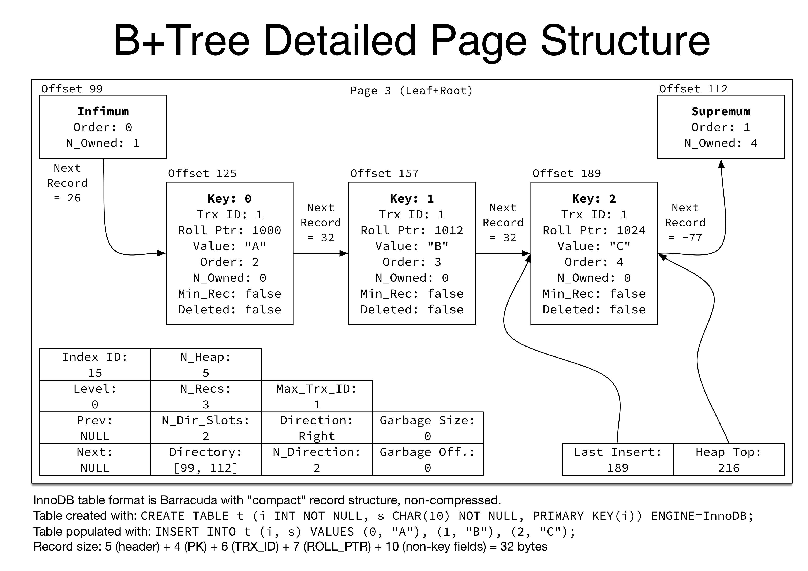
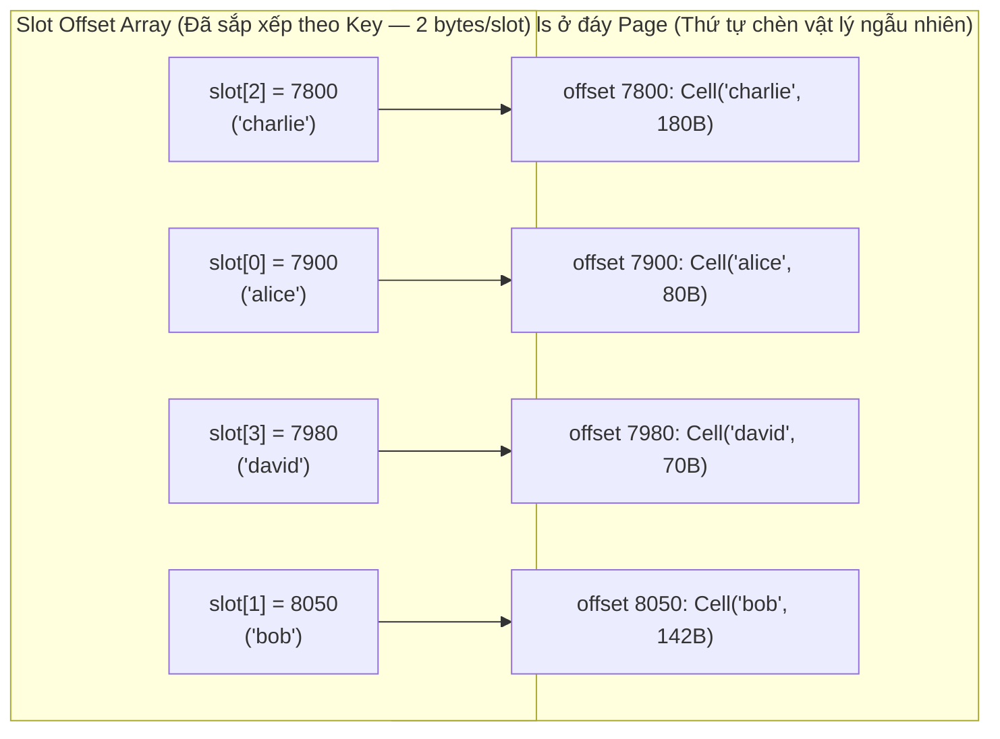
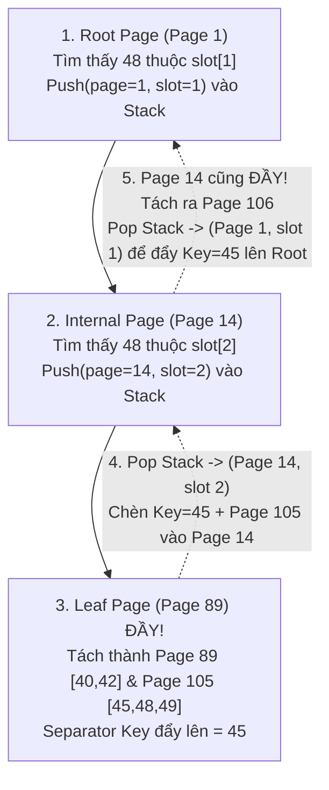
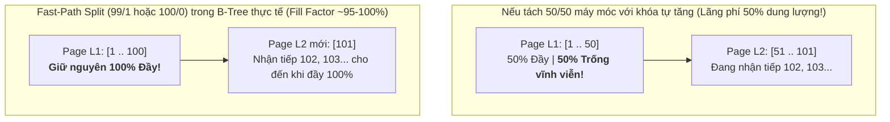

## Table of Contents
0. [Khởi động cho người mới: Tại sao B-Tree sách giáo khoa chưa đủ dùng trong Production?](#beginner-warmup)
1. [Page Header và cấu trúc B-link Tree (Lehman & Yao)](#page-header)
2. [Tìm kiếm nhị phân với Indirection Vector (Offset Array)](#binary-search-indirection)
3. [Lan truyền Split và Merge bằng Breadcrumbs](#breadcrumbs-split-merge)
4. [Tái cân bằng (Rebalancing) vs Lazy Deletions](#rebalancing-vs-lazy-deletions)
5. [Tối ưu hóa Right-Only Appends và tác hại của UUIDv4](#right-only-appends)
6. [Nén khóa: Prefix Compression và Suffix Truncation](#key-compression)
7. [Vacuum và thu hồi vùng nhớ phân mảnh (Maintenance)](#vacuum-maintenance)
8. [Tóm tắt & Ghi nhớ cốt lõi (Key Takeaways)](#key-takeaways)

---

## Khởi động cho người mới: Tại sao B-Tree sách giáo khoa chưa đủ dùng trong Production? {#beginner-warmup}

### 1. Bốn khoảng cách lớn giữa B-Tree lý thuyết và B-Tree trong PostgreSQL / MySQL InnoDB
Sau khi nắm vững nguyên lý cây **B+Tree** ở Chương 2 và cấu trúc **Slotted Page** ở Chương 3, người đọc có thể nghĩ rằng việc ghép các Slotted Page lại thành một cây B+Tree đã hoàn tất. Thế nhưng, khi đưa B-Tree vào chạy thực tế trong **PostgreSQL** hay **MySQL InnoDB** — nơi hàng nghìn kết nối cùng lúc bắn các câu lệnh `SELECT`, `INSERT`, `UPDATE`, `DELETE` — mô hình B-Tree trong sách giáo khoa lập tức lộ ra **4 điểm nghẽn thực chiến**:

1. **Làm sao tìm kiếm nhị phân (`Binary Search`) trong trang khi các dòng dữ liệu có độ dài ngắn dài khác nhau và nằm lộn xộn?**
   - Khi chạy `SELECT * FROM users WHERE username = 'charlie'`, trang lá `16 KB` có thể chứa 200 bản ghi có độ dài co giãn bất kỳ. Nếu không sắp xếp lại các bản ghi nặng nề dưới đáy trang mỗi khi `INSERT`, làm sao CPU nhảy thẳng tới phần tử đứng giữa trang trong $\mathcal{O}(\log K)$ bước?
   - **Giải pháp thực tế**: Duy trì một mảng chỉ mục con trỏ nhỏ gọn đã sắp xếp (**`Indirection Vector`** trong PostgreSQL, hay **`Page Directory`** dạng thưa trong MySQL InnoDB).
2. **Làm sao vừa tách trang (`Page Split`) vừa cho phép hàng nghìn luồng khác đọc dữ liệu mà không phải khóa cứng toàn bộ cây?**
   - Trong sách giáo khoa, khi một trang lá bị đầy và tách đôi, luồng ghi phải khóa cả trang cha lẫn trang con. Nếu hàng nghìn lệnh `SELECT` phải xếp hàng chờ ở nút gốc (`Root`), database sẽ đứng hình!
   - **Giải pháp thực tế**: Biến thể **B-link Tree (Lehman & Yao)** đặt thêm một "cột mốc chặn trên" (**`High Key`**) và mũi tên rẽ ngang (**`Right-Sibling Pointer`**) ngay trong mỗi trang, kết hợp với dấu vết đường đi trên RAM (**`Breadcrumbs`**) để tách trang từ dưới lên mà không cần khóa toàn cây.
3. **Làm sao tối ưu khi ứng dụng chèn khóa tự tăng (`AUTO_INCREMENT` / `BIGSERIAL` / `UUIDv7`)?**
   - Nếu người dùng chạy `INSERT INTO orders ...` với `id` tăng dần `1, 2, 3...`, mọi bản ghi mới đều dồn về trang lá ngoài cùng bên phải. Nếu cứ tách đôi `50/50` theo sách giáo khoa, toàn bộ nửa trái của mọi trang đã tách sẽ bị bỏ trống vĩnh viễn $50\%$ dung lượng!
   - **Giải pháp thực tế**: Cơ chế **Right-Only Appends (Fast-Path Split)** nhận diện chèn tuần tự ở cực phải để giữ trang cũ đầy $99\% - 100\%$ và mở trang mới tinh ở bên phải.
4. **Làm sao nén khóa chỉ mục và tái sử dụng không gian khi xóa (`DELETE`) mà không gây phân mảnh?**
   - Các chuỗi khóa dài làm giảm số nhánh con (`Fanout`), còn việc gộp trang (`Merge`) ngay khi vơi dưới $50\%$ gây ra hiện tượng tách-gộp liên hồi (**Thrashing**).
   - **Giải pháp thực tế**: Cắt tỉa phần đầu/đuôi của khóa (**`Prefix & Suffix Truncation`**) và dùng danh sách liên kết rác (**`Free Space Management`**) kết hợp dọn dẹp tại chỗ (**`Vacuum / In-Page Compaction`**).

---

### 2. Bảng Từ Điển Thuật Ngữ Nhanh Cho Người Mới (Beginner's Visual Glossary)

Trước khi đi vào từng kỹ thuật triển khai chi tiết của Chương 4, người đọc hãy điểm qua 7 thuật ngữ cốt lõi trong bảng đối chiếu dưới đây:

| Thuật ngữ trong sách | Hiểu nôm na cho người mới (Ẩn dụ đời thực) | Trong Database thực tế (PostgreSQL / MySQL InnoDB / SQLite) là gì? |
| :--- | :--- | :--- |
| **`Magic Number`** | "Con dấu nhận diện hàng thật" đóng ở ngay trang bìa tập hồ sơ để tránh mở nhầm file văn bản hay file ảnh sang file cơ sở dữ liệu. | Chuỗi byte cố định ở đầu file/trang (ví dụ SQLite có `16 bytes` `"SQLite format 3\0"`; mỗi trang cũng có cờ `Page Type` phân biệt `Root`, `Internal`, `Leaf`). |
| **`Indirection Vector / Page Directory`** | "Hộp thẻ mục lục thư viện": sách dưới kệ để lộn xộn theo thứ tự nhập kho, nhưng các tấm thẻ nhỏ `2 bytes` trên hộp mục lục luôn xếp đúng thứ tự A–Z để tra cứu nhị phân. | Trong PostgreSQL là mảng **`ItemIdData` (`Line Pointers`)** trỏ tới từng Tuple; trong MySQL InnoDB là **`Page Directory`** ở cuối trang (cứ `4–8` bản ghi gom thành `1 Slot` đại diện để Binary Search). |
| **`Breadcrumbs` (Dấu vết đường đi trên Stack)** | "Rải vụn bánh mì của Hansel & Gretel": khi đi từ đỉnh cây xuống lá, luồng ghi nhớ lại các ngã rẽ vào một ngăn xếp (`Stack`) trên RAM để lát nữa biết đường quay ngược lên báo tin tách trang cho nút cha. | Trong PostgreSQL là cấu trúc `BTStack` (`src/backend/access/nbtree`) lưu chuỗi `(PageID, Offset)` trong RAM của tiến trình khi hạ cây, giúp các trang con trên đĩa không cần lưu con trỏ `parent_page_id`. |
| **`Right-Only Appends` (Tối ưu chèn cực phải)** | Khi xếp sách có mã số tăng dần (`1, 2, 3...`), thủ thư giữ nguyên kệ cũ đầy kín $100\%$ rồi mới kê thêm kệ mới ở bên phải, thay vì cưa đôi kệ cũ thành hai kệ lưng chừng $50\%$. | InnoDB theo dõi con trỏ `PAGE_LAST_INSERT` trong Header: nếu khóa mới lớn hơn khóa vừa chèn ở cuối trang, hệ thống tách trang ở điểm cuối (**Fast-Path Split `99/1`**) thay vì tách giữa `50/50`. |
| **`B-Link Tree & High Key` (Khóa chặn trên)** | "Biển báo giới hạn số nhà tối đa của con hẻm": nếu khách đi tìm nhà số `35` mà thấy đầu hẻm ghi `High Key = 28`, khách biết ngay nhà số `35` đã tách sang hẻm kế bên phải, cứ rẽ ngang sang phải là thấy! | Cài đặt chuẩn mực trong PostgreSQL (`nbtree` dựa trên thuật toán *Lehman & Yao*): mục đầu tiên (`Offset 1`) trên mỗi trang B-Tree (trừ trang cực phải) luôn lưu giá trị **`High Key`** kèm con trỏ `btpo_next`. |
| **`Prefix & Suffix Truncation` (Cắt tỉa tiền tố & hậu tố)** | - **Prefix**: Cả trang cùng ở phố `"Nguyễn Huệ"` thì ghi tên phố 1 lần ở đầu trang.<br/>- **Suffix**: Biển báo phân ranh giới giữa `"An_12345"` và `"Bình_99999"` chỉ cần ghi ngắn gọn chữ `"B"` là đủ! | PostgreSQL (v12+), SQLite và WiredTiger áp dụng **Suffix Truncation** khi tách trang lá đẩy khóa phân cách lên `Internal Page`, giúp khóa điều hướng ngắn đi nhiều lần và tăng vọt hệ số `Fanout`. |
| **`Free Space Management & Vacuum / Compaction`** | Khi có khách trả ghế trong rạp phim: tạm thời ghi nhận ghế trống vào danh sách chờ tái sử dụng ngay; khi cần chỗ lớn mới dồn các khách còn ngồi sát lại với nhau. | InnoDB nối các bản ghi vừa bị `DELETE` vào danh sách liên kết rác **`FREE` (`PAGE_FREE` / `Garbage Offset`)** để `INSERT` sau chèn đè lên ngay; nếu vẫn thiếu chỗ mới chạy **Page Reorganization / Compaction**. |

---

## Page Header và cấu trúc B-link Tree (Lehman & Yao) {#page-header}

### Bài toán thực tế & Mental Model

Trong một hệ cơ sở dữ liệu đa luồng, hàng nghìn luồng đọc (`Reader`) và ghi (`Writer`) duyệt qua các nút của B-Tree cùng lúc. Nếu áp dụng thiết kế `B+Tree` cơ bản: khi một nút lá `Page L1` bị đầy và đang trong quá trình tách đôi (`Node Split`) thành `Page L1` và `Page L2`, nút cha `Parent P` chưa kịp cập nhật khóa phân tách mới. Nếu một luồng đọc đi từ `Parent P` xuống `Page L1` đúng vào tích tắc giao thời đó, nó sẽ rơi vào trang cũ không còn chứa khóa cần tìm! Để ngăn lỗi này theo cách ngây thơ, luồng ghi buộc phải khóa độc quyền (`Exclusive Latch`) cả nút cha lẫn nút con trong suốt quá trình tách trang, biến nút cha thành cổ chai chặn đứng mọi luồng đọc.

**Mental Model — "Biển báo rẽ ngang trên đường cao tốc" (B-link Tree của Lehman & Yao):**
Hãy hình dung mỗi Page là một tòa nhà trên phố được đánh số theo khoảng giá trị. Thay vì bắt buộc mọi người phải quay lại ngã tư trung tâm (`Parent Node`) để hỏi đường mỗi khi một tòa nhà được tách đôi, thiết kế **B-link Tree** đặt thêm `2` thông tin ngay tại mỗi tòa nhà (`Page Header`):
1. **High Key (`K_high`)**: Biển báo ghi rõ *"Giá trị khóa tối đa mà trang này đang quản lý"*.
2. **Right-Sibling Pointer (`right_link`)**: Mũi tên chỉ thẳng sang trang anh em kế tiếp nằm ngay bên phải ở cùng tầng.

Nếu một luồng đọc đi xuống một trang (dựa theo thông tin hơi cũ từ nút cha) và phát hiện khóa cần tìm lớn hơn `High Key` của trang hiện tại, nó biết ngay trang này vừa bị tách đôi và chỉ việc đi bộ ngang theo mũi tên `Right-Sibling Pointer` sang trang bên phải để lấy dữ liệu mà không cần quay lên nút cha hay giữ khóa nút cha!

### Các trường điều khiển trong B-Tree Page Header

Mỗi nút của B-Tree tương ứng với một Page vật lý cố định trên đĩa (ví dụ `8 KB = 8192 bytes` trong PostgreSQL hoặc `16 KB` trong InnoDB). Phần **Page Header** (kết hợp cùng vùng `Special Space` ở cuối trang) lưu trữ các siêu dữ liệu quản lý sống còn:

```text
+-------------------------------------------------------------------------+
| B-Tree Page Header (24 - 36 bytes)                                      |
| - pageLSN (8B)      : LSN của bản ghi WAL sửa đổi trang gần nhất       |
| - flags (2B)        : ROOT | INTERNAL | LEAF | OVERFLOW | HAS_GARBAGE   |
| - lower_offset (2B) : Ranh giới cuối của mảng Slot Offset Array        |
| - upper_offset (2B) : Ranh giới đầu của vùng chứa Data Cells ở đáy      |
| - fragmented_B (2B) : Tổng số byte rác bị phân mảnh ở vùng Data Cells   |
| - right_sibling(4B) : Con trỏ Page ID trỏ sang trang anh em bên phải    |
| - high_key_off (2B) : Offset trỏ tới giá trị High Key của trang         |
+-------------------------------------------------------------------------+
```

- **Magic Number & Page Type Flags**: Xác thực tính toàn vẹn của trang và phân biệt trang hiện tại là **Root Node**, **Internal Node** (nút trung gian chỉ chứa khóa phân tách và con trỏ trang con), **Leaf Node** (nút lá chứa dữ liệu), hay **Overflow Page**.
- **Free Space Pointers (`lower_offset`, `upper_offset`) & `fragmented_bytes`**: Theo dõi vùng trống liên tục ở giữa trang (`upper - lower`) cũng như tổng số byte bị phân mảnh do các bản ghi đã xóa nằm rải rác ở phần đáy trang.
- **Right-Sibling Pointer & High Key**: Trái tim của biến thể **B-link Tree** (như cài đặt `nbtree` trong PostgreSQL), phục vụ đồng thời cả hai mục đích: tăng tốc độ quét khoảng (`Range Scan`) bằng cách trượt ngang qua chuỗi Leaf Page và đảm bảo tính đúng đắn khi tách trang đồng thời mà không cần giữ Latch ở nút cha.

Để đối chiếu giữa cấu trúc Header lý thuyết và thực tế sản phẩm, hãy quan sát bức tranh giải phẫu chi tiết một **trang B+Tree (`Page 3`)** trong **MySQL InnoDB** sau khi chạy lệnh `INSERT INTO t VALUES (0, "A"), (1, "B"), (2, "C");`:

> [!NOTE]
> **Cách đọc sơ đồ cho người mới:**
> 1. **Nhìn vào bảng thông số Header ở góc dưới bên trái (`Index ID: 15`, `Level: 0`, `Prev/Next`, `Directory`)**: Đây chính là `INDEX Header` của InnoDB ghi nhận trang này ở tầng lá (`Level: 0`), đang có `N_Recs: 3` bản ghi người dùng, `Garbage Size: 0` (chưa có rác), và ở góc dưới bên phải là con trỏ **`Last Insert: 189`** cùng đỉnh vùng cấp phát **`Heap Top: 216`**.
> 2. **Nhìn lên hai cột mốc cố định `Infimum (Offset 99)` và `Supremum (Offset 112)` ở hai góc trên**: Mọi trang B+Tree của InnoDB luôn khởi tạo sẵn 2 bản ghi hệ thống này làm điểm đầu và điểm cuối.
> 3. **Theo dõi dây chuyền mũi tên `Next Record` ở giữa trang (`Offset 125 -> 157 -> 189`)**: Từ `Infimum`, mũi tên dẫn qua 3 bản ghi người dùng `Key: 0 ("A")` $\to$ `Key: 1 ("B")` $\to$ `Key: 2 ("C")` rồi cắm về đích `Supremum`, mỗi bản ghi dài đúng `32 bytes` và lưu đầy đủ thông tin giao dịch (`Trx ID`, `Roll Ptr`) lẫn cờ trạng thái (`Deleted: false`).



### Ví dụ chạy tay (Dry Run): 2 luồng Đọc/Ghi đồng thời trên B-link Tree

Giả sử nút cha `Internal P10` ban đầu có mục chỉ đường: mọi khóa trong đoạn `(10, 50]` đều đi xuống trang lá **`Page L1`**. Ban đầu `Page L1` đang chứa 4 khóa và đã đầy:
- `Page L1`: `Keys = [12, 20, 28, 35, 42, 45]`, `High Key = 50`, `Right-Sibling = NULL`.

Xét kịch bản hai luồng `Thread 1` (Reader tìm khóa `K = 35`) và `Thread 2` (Writer chèn khóa `K = 25` gây tách trang) chạy đan xen nhau từng bước theo thời gian thực:

| Bước | Luồng thực thi | Hành động chi tiết trên bộ nhớ & đĩa | Trạng thái của `Page L1`, `Page L2` và `Parent P10` |
| :--- | :--- | :--- | :--- |
| **Bước 1** | **`Thread 1` (Reader)** | Cần tìm `K = 35`. Đọc `Parent P10`, thấy `10 < 35 <= 50` nên xác định trang con cần xuống là `Page L1`. Ngay sau khi nhả Latch của `Parent P10` và trước khi kịp đọc `Page L1`, hệ điều hành tạm dừng `Thread 1` (Context Switch). | `Parent P10` vẫn trỏ `(10, 50] -> Page L1`. `Thread 1` đang cầm trong tay địa chỉ đích `target = Page L1`. |
| **Bước 2** | **`Thread 2` (Writer)** | Chèn `K = 25` vào `Page L1`. Vì `Page L1` đã đầy, `Thread 2` khóa `Page L1`, cấp phát trang mới **`Page L2`** và thực hiện tách đôi (`Split`):<br/>- Nửa lớn `[30..50]` chuyển sang `Page L2`.<br/>- Nửa nhỏ `[10..28]` ở lại `Page L1`, cập nhật **`High Key = 28`** và nối **`Right-Sibling = Page L2`**. | - **`Page L1`**: `Keys = [12, 20, 25, 28]`, **`High Key = 28`**, **`Right-Sibling = Page L2`**.<br/>- **`Page L2`**: `Keys = [35, 42, 45]`, **`High Key = 50`**, `Right-Sibling = NULL`.<br/>- **`Parent P10`**: **Chưa kịp cập nhật!** Vẫn nghĩ `Page L1` chứa tới `50`. |
| **Bước 3** | **`Thread 2` (Writer)** | Nhả Latch của `Page L1` và `Page L2`, chuẩn bị đi lên `Parent P10` để chèn khóa phân tách `28 -> Page L1, 50 -> Page L2`. | Ngay tại thời điểm này, cây đang ở trạng thái "tách dở dang" (Half-Split): nút con đã tách xong nhưng nút cha chưa biết sự tồn tại của `Page L2`. |
| **Bước 4** | **`Thread 1` (Reader)** | Tỉnh dậy sau Context Switch và khóa đọc `Page L1`. Đầu tiên, `Thread 1` kiểm tra điều kiện bất biến của B-link Tree:<br/>So sánh khóa cần tìm `K = 35` với `Page L1.HighKey (28)`.<br/>Thấy **`35 > 28`**! | `Thread 1` lập tức nhận ra: *"Trong lúc đang đi từ cha xuống con, `Page L1` đã bị tách đôi và phần tử `35` đã dọn sang trang hàng xóm bên phải!"* |
| **Bước 5** | **`Thread 1` (Reader)** | Không cần báo lỗi hay quay lại `Root`, `Thread 1` đọc trường `Right-Sibling Pointer` của `Page L1` (`-> Page L2`), nhả `Page L1` và **trượt ngang sang `Page L2`**. Tại `Page L2`, kiểm tra thấy `35 <= High Key (50)`, thực hiện tìm kiếm nhị phân và **lấy được `K = 35` thành công!** | Truy vấn đọc hoàn tất chính xác `100%` với độ trễ cực thấp mà không hề bị chặn bởi quá trình cập nhật nút cha của `Thread 2`. |

> [!IMPORTANT]
> **Quy tắc thứ tự ghi trong B-link Tree:** Để kỹ thuật trượt ngang hoạt động an toàn tuyệt đối, luồng ghi (`Thread 2`) bắt buộc phải khởi tạo đầy đủ dữ liệu cho trang mới bên phải (`Page L2`) và thiết lập liên kết `Page L1.right_sibling = Page L2` cùng `Page L1.HighKey = 28` **trước khi** nhả Latch trên `Page L1` và **trước khi** cập nhật nút cha `Parent P10`.

---

## Tìm kiếm nhị phân với Indirection Vector (Offset Array) {#binary-search-indirection}

### Bài toán thực tế & Mental Model

Trong B-Tree lý thuyết, các khóa bên trong một nút được vẽ như một mảng liên tiếp các phần tử có kích thước bằng nhau, giúp áp dụng tìm kiếm nhị phân (`Binary Search`) dễ dàng bằng công thức `addr = base + index * sizeof(Key)`. Tuy nhiên, trong cơ sở dữ liệu thực tế:
1. Các Cell dữ liệu có **độ dài thay đổi** (do khóa kiểu `VARCHAR`, `TEXT` hoặc bản ghi được nén). Không thể tính địa chỉ của phần tử thứ `i` bằng phép nhân!
2. Các Cell được chèn vào vùng đáy của Slotted Page theo thứ tự thời gian tới trước ghi trước. Nếu mỗi lần chèn một khóa mới (ví dụ `"anna"`) vào giữa trang `16 KB` mà hệ thống phải dịch chuyển (`memmove`) hàng chục kilobyte dữ liệu của các bản ghi phía sau để giữ thứ tự vật lý, CPU sẽ kiệt sức vì băng thông sao chép bộ nhớ.

**Mental Model — "Mục lục thẻ thư viện" (Indirection Vector):**
Thay vì sắp xếp lại hàng nghìn cuốn sách nặng nề trên kệ mỗi khi nhập về một cuốn sách mới, thủ thư cứ đặt cuốn sách mới vào ô trống tiếp theo ở cuối kệ, nhưng **chèn một tấm thẻ chỉ mục nhỏ gọn (chỉ ghi số ngăn kệ) vào đúng thứ tự bảng chữ cái trong hộp thẻ mục lục**. Khi cần tìm sách bằng tìm kiếm nhị phân, độc giả chỉ lật tìm trên hộp thẻ mục lục kích thước cố định (`2 bytes` mỗi thẻ), thấy thẻ nào cần đọc mới nhảy tới đúng ngăn kệ đó để lấy sách.

Trong Slotted Page, hộp thẻ mục lục đó chính là mảng **Slot Offset Array** (còn gọi là **Indirection Vector** hoặc **Line Pointer Array**):
- **Vùng Data Cells ở đáy trang**: Giữ nguyên vị trí vật lý lúc chèn, **không sắp xếp** theo khóa.
- **Mảng `slot[]` ở đầu trang**: Mỗi phần tử chỉ dài đúng `2 bytes` (lưu `offset` trong phạm vi `0..65535`). Mảng `slot[]` luôn được duy trì **sắp xếp nghiêm ngặt theo thứ tự tăng dần của khóa** mà nó trỏ tới.

> [!NOTE]
> **Cách đọc sơ đồ cho người mới (Sơ đồ Slot Offset Array bên dưới):**
> 1. **Nhìn khối bên trái (`Slot Offset Array`)**: Các ô `slot[0..3]` xếp đúng thứ tự bảng chữ cái `alice -> bob -> charlie -> david`. Đây là "hộp thẻ mục lục" — mỗi thẻ chỉ ghi một con số `offset`.
> 2. **Nhìn khối bên phải (`Data Cells`)**: Các bản ghi nằm lộn xộn theo thứ tự chèn (`charlie` ở `7800`, `alice` ở `7900`...). Không ai phải dời chúng đi.
> 3. **Theo dõi các mũi tên**: Mỗi thẻ trỏ thẳng tới đúng bản ghi của nó. Khi tìm kiếm nhị phân, hệ thống chỉ "lật" bên trái (`2 bytes` mỗi ô), rồi đi theo mũi tên đúng một lần để đọc dữ liệu.



#### Trong MySQL InnoDB thực tế: Page Directory là một Indirection Vector "thưa"
InnoDB không giữ một slot cho **mỗi** bản ghi như sơ đồ trên. Để tiết kiệm chỗ, mỗi slot của **Page Directory** chỉ trỏ tới bản ghi "trưởng nhóm" của một nhóm `4–8` bản ghi liền nhau (các bản ghi trong nhóm nối với nhau bằng con trỏ `next_record`). Tìm kiếm diễn ra theo 2 bước: **Binary Search trên các slot** để tìm đúng nhóm, rồi **quét tuyến tính tối đa 8 bản ghi** trong nhóm đó.

> [!NOTE]
> **Cách đọc sơ đồ cho người mới (*Page Directory của InnoDB* bên dưới):**
> 1. **Nhìn đáy trang (Page Directory)**: Các slot xếp từ cuối trang ngược lên. Slot đầu luôn trỏ tới bản ghi giả `infimum` (nhỏ hơn mọi khóa), slot cuối trỏ tới `supremum` (lớn hơn mọi khóa).
> 2. **Theo dõi mũi tên từ slot lên vùng User Records**: Mỗi mũi tên chỉ trỏ tới bản ghi **cuối nhóm**. Con số `n_owned` trên bản ghi đó cho biết nhóm có bao nhiêu bản ghi.
> 3. **Theo dõi các mũi tên `next_record`**: Chúng nối toàn bộ bản ghi thành một danh sách liên kết theo đúng thứ tự khóa. Ví dụ, tìm `id = 23`: Binary Search trên slot thấy `23` thuộc nhóm của slot thứ 2 -> nhảy tới bản ghi trước đó -> đi theo `next_record` vài bước là gặp `23`.

 kết hợp tìm kiếm nhị phân (Binary Search) trong trang — Nguồn: Jeremy Cole")

### Ví dụ chạy tay từng bước (Dry Run)

#### Phần A: Tìm kiếm nhị phân khóa `"charlie"` qua Indirection Vector
Giả sử Page kích thước `8192 bytes` đang chứa `K = 4` bản ghi. Mảng `slot[0..3]` ở đầu trang có giá trị:
`slot = [7900, 8050, 7800, 7980]`.

Quá trình tìm kiếm nhị phân khóa `target = "charlie"` chỉ thao tác trên chỉ số `0..3` của mảng `slot[]`:
1. **Bước 1**: Khởi tạo `low = 0`, `high = 3`. Tính chỉ số giữa: $\text{mid} = \lfloor (0 + 3) / 2 \rfloor = 1$.
2. **Bước 2**: Tra cứu `slot[1]` lấy được độ lệch `offset = 8050`. Nhảy tới địa chỉ byte `8050` trong Page để giải mã khóa, đọc được `Key = "bob"`.
3. **Bước 3**: So sánh từ điển (`memcmp`): vì `"charlie" > "bob"`, khóa cần tìm chắc chắn nằm ở nửa bên phải của mảng `slot[]`. Cập nhật `low = mid + 1 = 2`.
4. **Bước 4**: Tính lại chỉ số giữa: $\text{mid} = \lfloor (2 + 3) / 2 \rfloor = 2$.
5. **Bước 5**: Tra cứu `slot[2]` lấy được độ lệch `offset = 7800`. Nhảy tới byte `7800` trong Page, đọc được `Key = "charlie"` — **Khớp hoàn toàn!** Toàn bộ quá trình chỉ tốn $O(\log_2 K)$ bước so sánh khóa.

#### Phần B: Chèn khóa mới `"anna"` (`100 bytes`) vào giữa trang
Hiện tại con trỏ đầu vùng dữ liệu ở đáy trang là `upper = 7800`, con trỏ cuối mảng Slot là `lower = 24 (Header) + 4 * 2 = 32`. Khi giao dịch chạy `INSERT` bản ghi mới có `Key = "anna"` (dài `100 bytes`):

1. **Bước 1 — Tìm vị trí chèn bằng Binary Search**: Chạy tìm kiếm nhị phân trên `slot[0..3]` cho khóa `"anna"`. Kết quả xác định `"alice" < "anna" < "bob"`, tức vị trí cần chèn vào mảng `slot[]` là tại chỉ số **`insert_idx = 1`**.
2. **Bước 2 — Ghi Cell mới vào đáy vùng trống**: Hạ con trỏ `upper` xuống `100 bytes`:
   $$\text{upper}_{\text{new}} = 7800 - 100 = 7700$$
   Ghi toàn bộ `100 bytes` của Cell `"anna"` vào vùng byte `[7700..7799]`. **Các Cell cũ (`7800`, `7900`, `7980`, `8050`) giữ nguyên vị trí tuyệt đối, không dịch chuyển dù chỉ 1 byte!**
3. **Bước 3 — Dịch chuyển mảng `slot[]` (`2 bytes` mỗi phần tử)**: Dịch các phần tử từ `slot[1..3]` sang phải `1` ô (`slot[2..4]`) bằng một lệnh `memmove` chỉ dài $3 \times 2 = 6\text{ bytes}$, sau đó gán `slot[1] = 7700` và tăng `lower` từ `32` lên `34`.

Bảng đối chiếu trạng thái bộ nhớ của Page trước và sau khi chèn `"anna"`:

| Thành phần trong Page | Trước khi chèn `"anna"` | Sau khi chèn `"anna"` (`100 bytes`) | Chi phí CPU / Memory thực tế |
| :--- | :--- | :--- | :--- |
| **Con trỏ `lower` / `upper`** | `lower = 32`, `upper = 7800` | `lower = 34`, `upper = 7700` | Cập nhật `2` biến số nguyên `16-bit`. |
| **Mảng `slot[]`** | `[7900, 8050, 7800, 7980]`<br/>*(alice, bob, charlie, david)* | `[7900, `**`7700`**`, 8050, 7800, 7980]`<br/>*(alice, **anna**, bob, charlie, david)* | Dịch chuyển đúng **`6 bytes`** trong `L1 CPU Cache`. |
| **Vùng Data Cells** | `[7800..8192]` (`392 bytes`) | Ghi nối thêm `[7700..7799]`; vùng `[7800..8192]` bất động | **Zero copy** đối với toàn bộ dữ liệu cũ! |

---

## Lan truyền Split và Merge bằng Breadcrumbs {#breadcrumbs-split-merge}

### Bài toán thực tế & Mental Model

Khi một Leaf Page bị đầy và tách làm hai trang (`Left Page` và `Right Page`), hệ thống bắt buộc phải đẩy một khóa phân tách (**Separator Key**) kèm theo con trỏ `Page ID` của trang mới lên nút cha (**Parent Internal Node**). Câu hỏi đặt ra là: *Làm sao nút lá biết nút cha của nó là Page nào?*

Một ý tưởng tự nhiên là lưu thêm trường `parent_page_id` trong Page Header của mọi trang con. Tuy nhiên, **hầu hết các B-Tree trên đĩa đều KHÔNG lưu con trỏ `parent_page_id` vật lý**. Hãy xem điều gì xảy ra nếu lưu `parent_page_id`:
- Một Internal Node `P14` có Fanout bằng `500` (tức là đang trỏ tới `500` trang con).
- Khi `P14` bị đầy và tách thành `P14` (`250` con) và `P99` mới (`250` con), toàn bộ `250` trang con được chuyển sang `P99` hiện vẫn đang lưu `parent_page_id = 14` cũ!
- Hệ thống sẽ buộc phải nạp cả `250` trang con đó từ đĩa lên RAM, sửa lại `parent_page_id = 99` và ghi trả lại `250` Dirty Pages xuống đĩa! Một thao tác tách nút trung gian sẽ gây bão I/O ngẫu nhiên làm tê liệt cơ sở dữ liệu.

**Mental Model — "Rải vụn bánh mì của Hansel và Gretel" (Breadcrumb Stack):**
Vì mọi thao tác chèn hoặc xóa trên B-Tree đều bắt đầu bằng việc đi từ nút gốc (`Root`) xuống nút lá (`Leaf`), luồng thực thi không cần trang con phải tự nhớ cha của nó. Thay vào đó, trong lúc đi từ trên xuống dưới, luồng thực thi mang theo một ngăn xếp nhỏ trong bộ nhớ RAM riêng của luồng gọi là **Breadcrumbs** (`Stack<PageId, SlotIndex>`). Mỗi khi bước qua một nút trung gian để rẽ xuống nhánh con, luồng ghi lại vào ngăn xếp: *"Vừa đi qua `Page X` tại nhánh `Slot Y`"*. Khi xuống tới lá và cần tách trang, luồng chỉ việc lấy ngược (`pop`) từng mẩu bánh mì từ ngăn xếp ra để biết chính xác nút cha trực tiếp và vị trí Slot cần chèn khóa mới!

### Ví dụ chạy tay từng bước (Dry Run): Lan truyền Split qua Breadcrumb Stack

Giả sử cây B-Tree hiện có 3 tầng và giao dịch thực hiện lệnh `INSERT` khóa **`K = 48`**:
- **`Root (Page 1)`**: Chứa các khóa phân tách `[20, 60, 100]` ứng với các nhánh con:
  - `slot[0]` (`K < 20`) $\to$ `Page 11`
  - `slot[1]` (`20 <= K < 60`) $\to$ `Page 14`
  - `slot[2]` (`60 <= K < 100`) $\to$ `Page 18`
- **`Internal (Page 14)`**: Đang quản lý khoảng `[20, 60)`, chứa các khóa phân tách `[30, 40, 50]` (đã đầy, tối đa `3` khóa phân tách):
  - `slot[0]` (`20 <= K < 30`) $\to$ `Page 81`
  - `slot[1]` (`30 <= K < 40`) $\to$ `Page 85`
  - `slot[2]` (`40 <= K < 50`) $\to$ `Page 89`
  - `slot[3]` (`50 <= K < 60`) $\to$ `Page 92`
- **`Leaf (Page 89)`**: Đang chứa `[40, 42, 45, 49]` (đã đầy tối đa `4` bản ghi).

> [!NOTE]
> **Cách đọc sơ đồ cho người mới (Lan truyền Split bằng Breadcrumbs bên dưới):**
> 1. **Mũi tên liền (đi xuống, ô `1 -> 2 -> 3`)**: Pha tìm kiếm. Ở mỗi tầng, hệ thống ghi lại "mẩu bánh mì" `(page, slot)` vào Stack rồi mới bước xuống.
> 2. **Ô `3` (Leaf đầy)**: Trang lá bị tách đôi, sinh ra khóa phân cách `45` cần gửi lên cha.
> 3. **Mũi tên nét đứt (đi ngược lên, `4 -> 5`)**: Pha lan truyền. Hệ thống `pop` Stack để biết ngay cha là ai và chèn vào slot nào — không cần tìm lại từ gốc. Nếu cha cũng đầy, quá trình lặp lại thêm một tầng.



Hãy theo dõi trạng thái của ngăn xếp `Breadcrumb Stack` trong RAM qua hai pha Đi xuống (**Search Phase**) và Đi ngược lên (**Split Propagation Phase**):

| Bước | Pha thực thi | Thao tác tại Page hiện tại | Trạng thái `Breadcrumb Stack` (Đỉnh ở bên phải) |
| :--- | :--- | :--- | :--- |
| **Bước 1** | **Đi xuống từ Root** | Đọc `Root (Page 1)`. Tìm kiếm nhị phân cho `K = 48`, rơi vào nhánh `slot[1]` trỏ tới `Page 14`. Đẩy điểm rẽ vào Stack trước khi đi xuống. | `[(Page 1, slot 1)]` |
| **Bước 2** | **Đi xuống Internal** | Đọc `Internal (Page 14)`. Tìm kiếm nhị phân cho `K = 48`, rơi vào nhánh `slot[2]` trỏ tới `Page 89`. Đẩy điểm rẽ vào Stack trước khi xuống lá. | `[(Page 1, slot 1), (Page 14, slot 2)]` |
| **Bước 3** | **Tách trang lá (`Leaf Split`)** | Đọc `Leaf (Page 89)`. Cần chèn `48` vào `[40, 42, 45, 49]` tại vị trí thứ `3`, nhưng trang đã đầy! Cấp phát trang mới **`Page 105`**:<br/>- `Page 89` giữ nửa trái: `[40, 42]`<br/>- `Page 105` nhận nửa phải: `[45, 48, 49]`<br/>Khóa nhỏ nhất của trang phải được chọn làm **Separator Key**: `K_sep = 45`. | `[(Page 1, slot 1), (Page 14, slot 2)]`<br/>*(Chuẩn bị đẩy cặp `(K_sep = 45, Child = Page 105)` lên cha)* |
| **Bước 4** | **Pop lần 1 & Tách nút trung gian** | Gọi ` stack.pop()` lấy ra **`(Page 14, slot 2)`**. Nhờ lưu sẵn `slot = 2`, hệ thống biết ngay cần chèn khóa `45` và con trỏ `Page 105` ngay sau `slot[2]` của `Page 14` mà không cần Binary Search lại! Tuy nhiên, `Page 14` cũng đã đầy (`[30, 40, 45, 50]`). Hệ thống cấp phát **`Page 106`** và thực hiện **Internal Split**:<br/>- `Page 14` giữ `[30, 40]`<br/>- Khóa giữa **`K_promote = 45`** được **đẩy vọt lên tầng trên** (không giữ lại ở `Page 106`)<br/>- `Page 106` giữ `[50]`. | `[(Page 1, slot 1)]`<br/>*(Đã pop `(Page 14, slot 2)`; chuẩn bị đẩy `(K_promote = 45, Child = Page 106)` lên cha tiếp theo)* |
| **Bước 5** | **Pop lần 2 & Cập nhật Root** | Gọi `stack.pop()` lấy ra **`(Page 1, slot 1)`**. Tại `Root (Page 1)`, hệ thống chèn khóa phân tách `45` và con trỏ `Page 106` ngay sau `slot[1]`. Lúc này `Page 1` có `[20, 45, 60, 100]` và vẫn còn chỗ trống nên quá trình tách kết thúc! | `[]` *(Stack rỗng — hoàn tất thao tác)* |

> [!TIP]
> **Điều gì xảy ra nếu Stack đã rỗng mà chính `Root (Page 1)` cũng bị đầy và phải tách?**
> Khi `stack.is_empty() == true` mà nút hiện tại vẫn cần đẩy `Separator Key` lên trên, Storage Engine biết rằng chính `Root Node` đang bị tách đôi. Hệ thống sẽ cấp phát một trang mới làm **`New Root`** (hoặc giữ nguyên `Page 1` làm Root và chép hai nửa sang hai trang con mới để không phải đổi địa chỉ `Root Page ID` trong siêu dữ liệu bảng), đặt `Separator Key` duy nhất vào `New Root` trỏ xuống hai nhánh vừa tách. Đây là **duy nhất** trường hợp chiều cao $h$ của cây B-Tree tăng thêm `1` (B-Tree luôn phát triển chiều cao từ gốc lên trên chứ không phải từ lá xuống dưới!).

---

## Tái cân bằng (Rebalancing) vs Lazy Deletions {#rebalancing-vs-lazy-deletions}

### Bài toán thực tế & Mental Model

Theo lý thuyết B-Tree cổ điển trong sách giáo khoa thuật toán, mọi nút phải luôn duy trì hệ số lấp đầy tối thiểu `50%` ($\lceil N/2 \rceil$). Khi xóa một khóa làm số lượng phần tử trong trang tụt xuống dưới ngưỡng `50%` (**Underflow**), thuật toán bắt buộc phải thực hiện một trong hai thao tác tái cân bằng đắt đỏ:
1. **Rotation (Mượn khóa từ nút anh em)**: Nếu trang anh em kế bên còn dư khóa (`> 50%`), dịch chuyển một khóa từ trang anh em qua nút cha sang trang hiện tại.
2. **Node Merge (Gộp hai trang lại làm một)**: Nếu cả hai trang anh em đều chạm đáy `50%`, gom toàn bộ dữ liệu của hai trang vào làm một, giải phóng một trang và xóa khóa phân tách trên nút cha (có thể gây Underflow dây chuyền ngược lên tới Root).

Tuy nhiên, trong các hệ quản trị cơ sở dữ liệu công nghiệp như PostgreSQL hay MySQL InnoDB, **thuật toán tái cân bằng tức thì tại ngưỡng `50%` hầu như không được sử dụng**. Lý do là hiện tượng **Thrashing (Dao động tách/gộp liên hoàn tại điểm biên)**:

**Mental Model — "Cửa xoay kẹt cứng vì tách/gộp liên hồi":**
Hãy tưởng tượng một trang chứa tối đa `100` bản ghi:
- Trang đang có `100` bản ghi. Giao dịch `T1` chèn thêm `1` bản ghi thứ `101` $\implies$ Kích hoạt **Node Split** tốn kém thành hai trang, mỗi trang chứa `50` bản ghi.
- Ngay mili-giây sau, giao dịch `T2` xóa đi `1` bản ghi làm trang tụt xuống còn `49` bản ghi (`< 50%`) $\implies$ Nếu tuân thủ sách giáo khoa, hệ thống lập tức kích hoạt **Node Merge** gộp hai trang lại thành một trang `99` bản ghi!
- Tích tắc tiếp theo, giao dịch `T3` lại chèn `2` bản ghi $\implies$ Lại kích hoạt **Node Split**!
Chỉ với vài thao tác thêm/xóa nhỏ xoay quanh ngưỡng biên, Storage Engine sẽ phải đọc/ghi hàng loạt trang đĩa, cập nhật nút cha và giữ Exclusive Latch liên tục.

### Giải pháp thực tế: Lazy Deletion & Empty Page Reclamation

Bài báo kinh điển của *Johnson & Shasha (1989) — "Utilization of B-trees with Inserts, Deletes and Modifies"* đã chứng minh bằng toán học rằng đối với khối lượng công việc thực tế (nơi số lượng `INSERT` thường lớn hơn hoặc bằng `DELETE`), việc bỏ hoàn toàn bước gộp trang ở ngưỡng `50%` vẫn giữ cho tỷ lệ sử dụng không gian của B-Tree ổn định ở mức cao mà không gây sụp đổ hiệu năng:

1. **Lazy Deletion (Xóa lười bằng cờ trạng thái)**: Khi thực hiện lệnh `DELETE`, Storage Engine chỉ đánh dấu Slot tương ứng trong `Slot Array` (hoặc trong Tuple Header) là `DELETED / DEAD` mà không dịch chuyển dữ liệu hay gộp trang ngay lập tức.
2. **Tái sử dụng tại chỗ (In-place Reuse)**: Nếu ngay sau đó có một bản ghi mới thuộc cùng khoảng khóa được `INSERT` vào trang này, nó sẽ tận dụng lại ngay không gian của bản ghi vừa xóa mà không cần tách trang.
3. **Thu hồi khi trang rỗng hoàn toàn hoặc rất thưa (Empty Page Reclamation / Merge Threshold thấp)**:
   - Trong **PostgreSQL**: Một Leaf Page chỉ bị tháo khỏi cây B-Tree và đưa vào danh sách trang trống (`Free Space Map - FSM`) khi **toàn bộ `100%` các bản ghi trong trang đó đã bị xóa sạch** trong quá trình chạy `VACUUM`.
   - Trong **MySQL InnoDB**: Cho phép cấu hình ngưỡng `MERGE_THRESHOLD` (mặc định là `50%`, có thể hạ xuống `35%`–`40%` cho các bảng có tải xóa/chèn xen kẽ cao) để tránh hiện tượng tách-gộp lặp đi lặp lại.

---

## Tối ưu hóa Right-Only Appends và tác hại của UUIDv4 {#right-only-appends}

### Bài toán thực tế & Mental Model

Cách lập trình viên chọn kiểu dữ liệu cho khóa chính (**Primary Key**) — giữa khóa tăng dần tuần tự (`BIGSERIAL`, `AUTO_INCREMENT`, `UUIDv7`) và khóa ngẫu nhiên hoàn toàn (`UUIDv4`) — tạo ra sự khác biệt một trời một vực về hành vi vật lý của B-Tree trên đĩa.

**Mental Model — "Xếp sách nối tiếp vào kệ cuối cùng" vs "Nhét sách ngẫu nhiên vào mọi kệ trong thư viện":**
- **Khóa tăng dần (`BIGSERIAL` / `UUIDv7`)**: Mọi cuốn sách mới luôn có mã số lớn hơn cuốn trước đó, nên thủ thư chỉ đứng cố định ở **chiếc kệ ngoài cùng bên phải (Rightmost Leaf Page)** để xếp sách vào. Chiếc kệ này luôn nằm sẵn trên bàn làm việc (`RAM Buffer Pool`).
- **Khóa ngẫu nhiên (`UUIDv4`)**: Mỗi cuốn sách mới có mã số ngẫu nhiên rơi vào một chiếc kệ bất kỳ trong hàng triệu chiếc kệ nằm dưới tầng hầm (`Disk`). Để nhét 1 cuốn sách mới, thủ thư phải chạy xuống tầng hầm khiêng chiếc kệ đó lên bàn (`Random Read I/O`), cưa đôi chiếc kệ nếu đã đầy (`50/50 Split`), rồi lại khiêng chiếc kệ nặng `16 KB` đó cất xuống tầng hầm (`Random Write I/O`)!

### 1. Tối ưu hóa Fast-Path Split (`99/1` vs `50/50`) cho Right-Only Appends

Hãy xét một nghịch lý thú vị: Nếu khóa chính là số tự tăng `1, 2, 3, ...` và Storage Engine vẫn máy móc áp dụng quy tắc **tách đôi `50/50`** mỗi khi trang ngoài cùng bên phải bị đầy, điều gì sẽ xảy ra?
- Giả sử `Page L1` chứa các khóa `[1..100]` và đã đầy.
- Khi chèn khóa `101`, nếu tách `50/50`: `Page L1` giữ `[1..50]` (đầy `50%`), `Page L2` mới nhận `[51..101]` (đầy `50%`).
- Vì mọi khóa tiếp theo được sinh ra sẽ là `102, 103, 104...` (luôn `> 51`), chúng sẽ luôn đi vào `Page L2` và các trang phía sau. **Nửa trống `50%` của `Page L1` sẽ không bao giờ nhận thêm bất kỳ bản ghi nào nữa trong suốt vòng đời của bảng!** Toàn bộ bảng dữ liệu sẽ bị lãng phí đúng `50%` dung lượng đĩa và RAM!

> [!NOTE]
> **Cách đọc sơ đồ cho người mới (So sánh tách 50/50 và Fast-Path Split bên dưới):**
> 1. **Khối trên (tách 50/50)**: `Page L1` chỉ còn nửa đầy, và vì mọi khóa mới đều lớn hơn `101`, nửa trống đó **không bao giờ được lấp lại**.
> 2. **Khối dưới (Fast-Path 99/1)**: `Page L1` được giữ nguyên đầy `100%`, chỉ khóa mới `101` được đặt sang trang mới. Kết quả: mọi trang đều đầy gần như tuyệt đối.
> 3. **Liên hệ thực tế**: Đây là lý do một bảng dùng `BIGSERIAL` / `AUTO_INCREMENT` trong PostgreSQL hoặc InnoDB thường nhỏ gọn hơn hẳn bảng cùng dữ liệu nhưng dùng `UUIDv4`.



Để giải quyết triệt để vấn đề này, các Storage Engine như MySQL InnoDB và PostgreSQL cài đặt cơ chế **Right-Only Append Optimization (Fast-Path Split)**:
- Mỗi Page Header lưu thêm con trỏ `PAGE_LAST_INSERT` ghi nhớ vị trí bản ghi vừa chèn lần trước.
- Khi trang ngoài cùng bên phải bị đầy và Storage Engine phát hiện khóa mới `K_new` lớn hơn khóa cực đại hiện có trong trang (tức là mẫu chèn tuần tự vào điểm cuối), hệ thống **không tách `50/50`** mà thực hiện **tách bất đối xứng (`99/1` hoặc `100/0`)**:
  - Giữ nguyên gần như `100%` các bản ghi cũ (`[1..100]`) nằm yên trong `Page L1` (đạt tỷ lệ lấp đầy tối đa, thường là `15/16` tức `~93.75%` trong InnoDB hoặc `90%–100%` tùy `fillfactor` trong PostgreSQL).
  - Cấp phát `Page L2` mới hoàn toàn trống ở bên phải để đặt bản ghi `101` vào đầu trang và tiếp tục lấp đầy tuần tự.

### 2. Bảng đối chiếu bằng con số cụ thể: `UUIDv4` vs `UUIDv7` / `BIGSERIAL`

Giả sử bài toán thực tế: Chèn **`10,000,000` (`10 triệu`) bản ghi** vào bảng `orders`, mỗi bản ghi dài trung bình `200 bytes`, kích thước mỗi Page là `16 KB` (chứa tối đa `~75` bản ghi/Page), và dung lượng **Buffer Pool chỉ có `512 MB` RAM** (nhỏ hơn kích thước bảng trên đĩa):

| Chỉ số đo lường thực tế | Dùng khóa ngẫu nhiên `UUIDv4` | Dùng khóa thứ tự thời gian `UUIDv7` / `BIGSERIAL` | Giải thích nguyên nhân vật lý |
| :--- | :--- | :--- | :--- |
| **Vị trí trang đích khi `INSERT`** | Rơi ngẫu nhiên vào bất kỳ Leaf Page nào trong toàn bộ cây. | Luôn đi vào đúng **`1` trang duy nhất** ngoài cùng bên phải (`Rightmost Leaf`). | `UUIDv7` đặt `48-bit` Unix Timestamp theo thứ tự Big-Endian ở đầu nên tăng dần đơn điệu theo thời gian. |
| **Cách thức tách trang (`Split Mode`)** | Tách đôi **`50/50`** ở giữa trang. | **Fast-Path Split (`99/1`)** tại điểm cuối trang. | Nhận diện mẫu chèn tuần tự qua `PAGE_LAST_INSERT`. |
| **Tỷ lệ lấp đầy trang (`Fill Factor`)** | Trung bình chỉ đạt **`~67%`** ($\ln 2 \approx 69\%$), kèm phân mảnh nội vi lớn. | Đạt **`93% – 99%`** (các trang bên trái được đóng gói chặt). | Tách `50/50` ngẫu nhiên để lại các trang vơi một nửa và lấp đầy rất chậm. |
| **Tổng số Leaf Pages & Dung lượng bảng** | `~200,000 Pages` (**`~3.2 GB`** trên đĩa). | `~135,000 Pages` (**`~2.15 GB`** trên đĩa — tiết kiệm `> 30%` đĩa và RAM). | Cùng `10 triệu` dòng nhưng `UUIDv4` tốn thêm hơn `1 GB` trang rỗng! |
| **Tỷ lệ trúng bộ nhớ đệm (`Buffer Pool Hit Ratio`)** | Sụp đổ xuống **`~16%`** (khi bảng `3.2 GB` vượt xa `512 MB` RAM). | Đạt **`> 99.9%`** (chỉ cần giữ nhánh phải trong RAM). | Với `UUIDv4`, cứ khoảng `6` lần `INSERT` thì có `5` lần chạm vào Page đang nằm trên đĩa (Cache Miss)! |
| **Thông lượng ghi (`Insert Throughput`)** | Giảm thê thảm xuống vài trăm đến vài nghìn `rows/sec` do nghẽn `Random Disk I/O`. | Duy trì ổn định hàng chục nghìn `rows/sec` (chỉ bị giới hạn bởi tốc độ ghi WAL tuần tự). | Tránh hoàn toàn chu trình đọc trang ngẫu nhiên từ đĩa và xả trang bẩn ngẫu nhiên. |

> [!WARNING]
> **Quy tắc thiết kế Schema bắt buộc:** Nếu hệ thống cần định danh phân tán toàn cục dạng UUID làm khóa chính hoặc khóa có đánh chỉ mục B-Tree, **tuyệt đối không dùng `UUIDv4`**. Hãy luôn sử dụng **`UUIDv7` (chuẩn RFC 9562)** hoặc **`ULID`** để bảo toàn đặc tính **Right-Only Append** cho B-Tree.

---

## Nén khóa: Prefix Compression và Suffix Truncation {#key-compression}

### Bài toán thực tế & Mental Model

Tốc độ tìm kiếm và lượng RAM tiêu thụ của B-Tree phụ thuộc chặt chẽ vào **Fanout** (số lượng khóa và con trỏ trang con chứa được trong một Page). Vì kích thước mỗi Page vật lý là cố định (ví dụ `8192 bytes`), nếu mỗi khóa chuỗi (`VARCHAR`) chiếm tới `40 bytes`, một Internal Page chỉ chứa được hơn trăm nhánh con, làm cây B-Tree cao thêm và tốn nhiều bước đọc đĩa hơn. Làm thế nào để nhồi được gấp `3` đến `5` lần số lượng khóa vào cùng một Page `8 KB` mà vẫn cho phép tìm kiếm nhị phân nhanh chóng?

**Mental Model — "Viết tắt phần đầu giống nhau và cắt bỏ phần đuôi thừa thãi":**
1. **Ở đầu trang và giữa các khóa liền kề (`Prefix Compression`)**: Trong một cuốn danh bạ đã sắp xếp theo tên phố, nếu cả trang đều nằm trên phố `"Nguyen_Thi_Minh_Khai_Quan_1_HCMC_"`, không ai chép lại cả cụm dài đó cho từng nhà mà chỉ ghi một lần ở tiêu đề trang: `Tiền tố chung = "Nguyen_Thi_Minh_Khai_Quan_1_HCMC_"`, còn từng dòng bên dưới chỉ ghi số nhà `"So_01"`, `"So_02"`, `"So_03"`.
2. **Ở các biển chỉ đường nút trung gian (`Suffix Truncation`)**: Tại ngã rẽ phân chia giữa tòa nhà bên trái (kết thúc bằng `"nguyen_van_anh_998877"`) và tòa nhà bên phải (bắt đầu bằng `"pham_thi_binh_112233"`), biển chỉ đường ở ngã tư (`Internal Node`) có cần viết đủ cả chuỗi `"pham_thi_binh_112233"` dài `20 ký tự` không? Hoàn toàn không! Chỉ cần viết đúng `1` chữ cái **`"p"`** (hoặc `"ph"`): ai có tên `< "p"` rẽ trái, ai có tên `>= "p"` rẽ phải!

### 1. Prefix Compression (Nén tiền tố trên Leaf & Internal Pages)

Vì toàn bộ các khóa trong cùng một Page B-Tree đều nằm trong khoảng `[Low Key, High Key]` và đã được sắp xếp theo thứ tự từ điển, chúng có xác suất rất cao sở hữu chung một tiền tố dài (**Page-Level Common Prefix** hoặc **Front Coding** giữa hai khóa kế tiếp).

#### Ví dụ chạy tay bằng bảng Byte cụ thể
Giả sử một Leaf Page đang lưu `4` khóa định danh phiên làm việc của người dùng:
1. `"session:prod:ap-southeast-1:20261028:0001"` (`41 bytes`)
2. `"session:prod:ap-southeast-1:20261028:0002"` (`41 bytes`)
3. `"session:prod:ap-southeast-1:20261028:0045"` (`41 bytes`)
4. `"session:prod:ap-southeast-1:20261029:0001"` (`41 bytes`)

Nếu áp dụng **Page-Level Prefix Compression** (như trong WiredTiger và Db2), hệ thống trích xuất tiền tố chung của cả khoảng khóa trong trang là chuỗi `"session:prod:ap-southeast-1:2026102"` (dài `35 bytes`) lưu đúng `1` lần vào vùng Header của Page:

| Cách lưu trữ | Nội dung lưu trong Page Header | Nội dung lưu tại từng Cell (`Key #1` $\to$ `Key #4`) | Tổng số Byte cho `4` khóa | Với `200` khóa trong Page |
| :--- | :--- | :--- | :--- | :--- |
| **Không nén (Raw Keys)** | `0 bytes` | Lưu nguyên vẹn cả `4` chuỗi dài `41 bytes` | $4 \times 41 = \mathbf{164\text{ bytes}}$ | $200 \times 41 = \mathbf{8,200\text{ bytes}}$ *(Tràn trang `8 KB`!)* |
| **Có Prefix Compression** | Lưu `1` lần tiền tố chung:<br/>`"session:prod:ap-southeast-1:2026102"` (**`35 bytes`**) | Chỉ lưu phần hậu tố `6 bytes`:<br/>- Cell 1: `"8:0001"` (`6B`)<br/>- Cell 2: `"8:0002"` (`6B`)<br/>- Cell 3: `"8:0045"` (`6B`)<br/>- Cell 4: `"9:0001"` (`6B`) | $35 + (4 \times 6) = \mathbf{59\text{ bytes}}$ | $35 + (200 \times 6) = \mathbf{1,235\text{ bytes}}$ *(Giảm **`6.6 lần`** dung lượng!)* |

> [!NOTE]
> **Tối ưu hóa so sánh khi Binary Search:** Khi một luồng đọc tìm kiếm khóa `target = "session:prod:ap-southeast-1:20261028:0045"` trong trang này, đầu tiên nó chỉ cần so sánh `35 bytes` đầu của `target` với **Page Prefix** đúng `1` lần duy nhất. Nếu khớp, trong suốt toàn bộ vòng lặp Binary Search $\log_2(200) \approx 8$ bước tiếp theo, CPU chỉ việc so sánh chuỗi hậu tố ngắn `6 bytes` (`"8:0045"`) thay vì phải so sánh lại cả `41 bytes` ở mỗi bước!

### 2. Suffix Truncation (Cắt bỏ hậu tố tại Internal Nodes)

Khác với Leaf Page (nơi bắt buộc phải giữ toàn vẹn giá trị khóa để trả về cho câu truy vấn), các **Separator Keys trên Internal Page** chỉ tồn tại với mục đích duy nhất là **định tuyến (`Routing`)** sang nhánh con bên trái hay bên phải khi duyệt cây.

Khi một Leaf Page bị đầy và tách thành trang trái $L_{\text{left}}$ (có khóa lớn nhất là $K_{\text{last\_left}}$) và trang phải $L_{\text{right}}$ (có khóa nhỏ nhất là $K_{\text{first\_right}}$), thay vì chép nguyên vẹn khóa $K_{\text{first\_right}}$ đẩy lên nút cha, kỹ thuật **Suffix Truncation** tìm chuỗi tiền tố ngắn nhất $K_{\text{sep}}$ của $K_{\text{first\_right}}$ sao cho vẫn thỏa mãn bất đẳng thức phân tách chặt:
$$K_{\text{last\_left}} < K_{\text{sep}} \le K_{\text{first\_right}}$$

#### Ví dụ chạy tay: Cắt hậu tố khi tách trang và tác động lên Fanout
Giả sử trang lá $L_{\text{left}}$ kết thúc bằng khóa:
- $K_{\text{last\_left}} =$ `"user_account_vietnam_2026_000098412"` (`35 bytes`)

Và trang lá $L_{\text{right}}$ bắt đầu bằng khóa:
- $K_{\text{first\_right}} =$ `"user_account_vietnam_2026_000100000"` (`35 bytes`)

Hệ thống quét từ trái sang phải hai chuỗi để tìm vị trí byte đầu tiên khác nhau:
```text
K_last_left  : "user_account_vietnam_2026_000" + "0" + "98412" (35 bytes)
K_first_right: "user_account_vietnam_2026_000" + "1" + "00000" (35 bytes)
                                                  ^
                                    Byte thứ 30 khác nhau ('0' < '1')!
```
- Ngay tại byte thứ `30`, ký tự `'1'` đã lớn hơn `'0'`. Toàn bộ phần đuôi `"00000"` phía sau hoàn toàn vô tác dụng cho việc phân nhánh!
- Hệ thống cắt bỏ phần đuôi đó và chỉ đẩy chuỗi $K_{\text{sep}} =$ `"user_account_vietnam_2026_0001"` (`30 bytes`) lên nút cha.
- Thậm chí hơn nữa, nếu điểm tách nằm giữa hai từ khóa khác nhau ngay ở những byte đầu:
  - $K_{\text{last\_left}} =$ `"order_2025_12_31_99999999"` (`25 bytes`)
  - $K_{\text{first\_right}} =$ `"order_2026_01_01_00000001"` (`25 bytes`)
  - Khóa phân tách đẩy lên Internal Node chỉ cần là: **`"order_2026"` (`10 bytes`)**!
- Kết hợp thêm **Prefix Compression** trên Internal Node (lưu tiền tố chung `"order_202"` ở đầu trang), mỗi khóa phân tách chỉ còn tốn **`1 byte` (`"6"`)** cộng với `6 bytes` con trỏ trang con! Nhờ kết hợp hai kỹ thuật này, một Internal Page `8 KB` có thể tăng **Fanout** từ `~150` nhánh con lên tới **`> 800` nhánh con**, giúp một cây B-Tree chỉ cao `3` tầng ($800^3 \approx 5.12 \times 10^8$) quản lý được hơn **nửa tỷ trang lá**!

> [!TIP]
> **Ứng dụng thực tế trong PostgreSQL (`INCLUDE` Covering Index):**
> Trong PostgreSQL (từ phiên bản 11 trở đi), khi tạo chỉ mục bao phủ `CREATE INDEX idx ON users (email) INCLUDE (full_name, avatar_url)`, PostgreSQL áp dụng một dạng **Suffix Truncation ở cấp độ cột**: các cột nằm trong mệnh đề `INCLUDE` (`full_name`, `avatar_url`) chỉ được lưu ở các **Leaf Pages**, và bị **cắt bỏ hoàn toàn (`100%` truncated)** khi đẩy khóa lên các **Internal Pages**! Nhờ đó các Internal Page chỉ chứa mỗi cột `email` nhỏ gọn, giữ cho toàn bộ các tầng trên của cây B-Tree luôn nằm gọn trong RAM.

---

## Vacuum và thu hồi vùng nhớ phân mảnh (Maintenance) {#vacuum-maintenance}

### Bài toán thực tế & Mental Model

Khi một Slotted Page trải qua hàng trăm lượt `DELETE` và `UPDATE` ở giữa trang, các Slot bị xóa để lại những "lỗ thủng" rải rác (**Dead Cells / Fragmented Free Space**) xen kẽ giữa các bản ghi còn sống ở đáy trang. Lúc này xảy ra một tình huống trớ trêu:
- Tổng dung lượng trống thực tế trong trang (`total_free = (upper - lower) + fragmented_bytes`) vẫn còn rất nhiều (ví dụ `500 bytes`).
- Nhưng vùng trống liên tục ở giữa trang (`contiguous_free = upper - lower`) chỉ còn đúng `40 bytes`!
- Khi một giao dịch muốn chèn bản ghi mới dài `120 bytes`, không lẽ hệ thống lại phải tách trang (`Node Split`) trong khi trang vẫn đang trống tới `500 bytes`?

**Mental Model — "Dồn hàng ghế rạp chiếu phim" (In-Page Defragmentation / Compaction):**
Thay vì xây thêm phòng chiếu mới (tách trang), nhân viên chỉ việc yêu cầu những khán giả đang ngồi rải rác ở cuối phòng dồn sát lại về phía cuối hàng ghế để gộp tất cả các ghế trống lẻ tẻ thành một dãy ghế trống liên tục lớn ở giữa phòng, sau đó cập nhật lại số ghế trên bảng sơ đồ (`Slot Offset Array`).

### Trong MySQL InnoDB thực tế: Danh sách bản ghi đã xóa (`PAGE_FREE` list)
Trước khi phải dồn trang, InnoDB còn một bước rẻ hơn: khi một bản ghi bị xóa (sau khi giao dịch `COMMIT` và tiến trình `purge` dọn xong), bản ghi đó được tháo khỏi chuỗi `next_record` của các bản ghi còn sống và **nối vào một danh sách liên kết riêng gọi là `PAGE_FREE`**. Lần `INSERT` sau, nếu bản ghi mới vừa vặn với ô ở đầu danh sách này, InnoDB dùng lại ngay ô đó mà không cần dồn trang.

> [!NOTE]
> **Cách đọc sơ đồ cho người mới (*Xóa bản ghi trong trang InnoDB* bên dưới):**
> 1. **Nhìn chuỗi mũi tên chính (`infimum -> ... -> supremum`)**: Đây là danh sách các bản ghi còn sống, xếp theo thứ tự khóa. Bản ghi vừa xóa đã bị "nhảy cóc" qua — bản ghi đứng trước nó giờ trỏ thẳng tới bản ghi đứng sau.
> 2. **Nhìn mũi tên xuất phát từ `PAGE_FREE` trong INDEX Header**: Nó trỏ tới bản ghi vừa xóa. Ô này vẫn chiếm chỗ trong trang, nhưng đã được đánh dấu là "ghế trống có thể ngồi lại".
> 3. **Ý nghĩa thực tế**: Ghế trống chỉ được dùng lại nếu bản ghi mới đủ nhỏ. Khi có quá nhiều ghế trống lẻ tẻ không vừa ai, InnoDB mới dồn trang (In-Page Compaction) như ví dụ chạy tay bên dưới.

 để tái sử dụng không gian ngay lập tức — Nguồn: Jeremy Cole")

### Ví dụ chạy tay từng bước (Dry Run): In-Page Compaction trước khi Split

Giả sử một Slotted Page kích thước `8192 bytes` đang có trạng thái như sau:
- `lower = 40` (kết thúc mảng `slot[]`).
- `upper = 7800` (đầu vùng Data Cells).
- Khoảng trống liên tục ở giữa: `contiguous_free = 7800 - 40 = 7760`... Giả sử trang đã gần đầy với `lower = 7760`, `upper = 7800` $\implies$ **Khoảng trống liên tục chỉ còn `40 bytes` (`[7760..7800]`)**.
- Tuy nhiên, ở vùng đáy `[7800..8192]` (`392 bytes`) đang có `4` Cell, trong đó `Cell 1` và `Cell 3` đã bị xóa (`DEAD`):

```text
Trạng thái vùng đáy Page [7800..8192] TRƯỚC khi dồn trang (In-Page Compaction):
+----------------------------------------------------------------------------------+
| Free [7760..7800] | Cell 3 (DEAD) | Cell 2 ('charlie') | Cell 1 (DEAD) | Cell 0  |
|   (Chỉ 40 bytes)  | [7800..7890]  |    [7890..7970]    | [7970..8090]  | [8090.. |
|                   |  (90B rác)    |     (80B sống)     |  (120B rác)   |  8192]  |
+----------------------------------------------------------------------------------+
```
- Bảng `slot[]` hiện tại:
  - `slot[0] = 8090` (`Cell 0`: `"alice"`, dài `102 bytes`, đang sống)
  - `slot[1] = DEAD` (`Cell 1`: đã xóa, chiếm `120 bytes` rác tại `[7970..8090]`)
  - `slot[2] = 7890` (`Cell 2`: `"charlie"`, dài `80 bytes`, đang sống)
  - `slot[3] = DEAD` (`Cell 3`: đã xóa, chiếm `90 bytes` rác tại `[7800..7890]`)
- Biến đếm trong Header: `fragmented_bytes = 120 + 90 = 210 bytes`.

Bây giờ, một luồng thực hiện `INSERT` khóa **`"bob"` dài `150 bytes`** (cần thêm `2 bytes` cho Slot mới $\implies$ tổng cộng cần **`152 bytes`** liên tục):

1. **Bước 1 — Kiểm tra dung lượng**:
   - Kiểm tra vùng trống liên tục: `upper - lower = 7800 - 7760 = 40 bytes < 152 bytes` (Không đủ chỗ ghi trực tiếp!).
   - Kiểm tra tổng dung lượng khả dụng nếu thu gom rác:
     $$\text{total\_available} = (\text{upper} - \text{lower}) + \text{fragmented\_bytes} = 40 + 210 = \mathbf{250\text{ bytes}} \ge 152\text{ bytes}$$
   - Kết luận: **Không cần tách trang (`Node Split`)!** Chỉ cần chạy **In-Page Compaction (Page Defragmentation)**.
2. **Bước 2 — Dồn các Cell còn sống sát về đáy trang (`8192`)**:
   - `Cell 0` (`"alice"`, `102B`) đã nằm sát đáy tại `[8090..8192]` $\implies$ giữ nguyên `slot[0] = 8090`.
   - Dịch chuyển `Cell 2` (`"charlie"`, `80B`) từ `[7890..7970]` lùi xuống sát ngay trên `Cell 0`, tức vùng **`[8010..8090]`**.
   - Cập nhật lại con trỏ trong mảng Slot: **`slot[2] = 8010`**. (Lưu ý: Định danh bên ngoài `(PageId, Slot 2)` hoàn toàn không đổi!).
   - Đặt lại con trỏ `upper = 8010` và `fragmented_bytes = 0`.
3. **Bước 3 — Chèn bản ghi mới `"bob"` (`150 bytes`) vào vùng trống vừa gộp**:
   - Lúc này khoảng trống liên tục ở giữa đã mở rộng lên: `upper - lower = 8010 - 7760 = 250 bytes`.
   - Hạ `upper` xuống `150 bytes`: `upper = 8010 - 150 = 7860`.
   - Ghi Cell `"bob"` vào `[7860..8010]` và trỏ Slot tương ứng tới `7860`.

```text
Trạng thái vùng đáy Page SAU khi chạy In-Page Compaction và chèn 'bob' (150B):
+----------------------------------------------------------------------------------+
| Free [7762..7860] |   Cell mới ('bob')   | Cell 2 ('charlie') | Cell 0 ('alice') |
| (Còn dư 98 bytes  |     [7860..8010]     |    [8010..8090]    |   [8090..8192]   |
|  trống liên tục!) |     (150B sống)      |     (80B sống)     |   (102B sống)    |
+----------------------------------------------------------------------------------+
```

Nhờ bước **In-Page Compaction** diễn ra hoàn toàn trong bộ nhớ RAM này, Storage Engine tránh được một đợt tách trang tốn kém trên đĩa và giữ cho các bản ghi được đóng gói chặt chẽ.

---

## Tóm tắt & Ghi nhớ cốt lõi (Key Takeaways) {#key-takeaways}

- **B-link Tree (Lehman & Yao) giải phóng nút cha khỏi khóa tách trang**: Bằng cách bổ sung **`High Key`** và **`Right-Sibling Pointer`** vào mỗi Page Header, các luồng đọc nếu đi xuống một trang vừa bị tách đôi chỉ cần kiểm tra điều kiện `search_key > High Key` để tự động trượt ngang sang trang anh em bên phải mà không cần khóa nút cha hay tìm lại từ Root.
- **Indirection Vector (`Slot Offset Array`) tách biệt thứ tự logic khỏi vị trí vật lý**: Các bản ghi có độ dài thay đổi được ghi nối tiếp vào đáy Page mà không bao giờ phải sắp xếp vật lý; thứ tự từ điển được duy trì bằng cách dịch chuyển các con trỏ `2-byte` trong mảng `slot[]`, cho phép tìm kiếm nhị phân $O(\log K)$ với chi phí ghi bộ nhớ tối thiểu.
- **Breadcrumb Stack thay thế con trỏ cha trên đĩa**: Để tránh thảm họa phải cập nhật hàng trăm trang con mỗi khi một Internal Node bị tách đôi, các nút B-Tree không lưu `Parent Page ID` trên đĩa mà dùng ngăn xếp **`Breadcrumbs` (`Stack<PageId, SlotIndex>`)** trong RAM để ghi nhớ đường đi từ Root xuống Leaf và lan truyền `Split` ngược lên.
- **Lazy Deletion chống hiện tượng Thrashing**: Thay vì gộp trang ngay tại ngưỡng `50%` gây vòng lặp tách/gộp liên hoàn tại điểm biên, các DBMS thực tế đánh dấu xóa lười (`DEAD`) và chỉ dồn trang tại chỗ (**In-page Compaction**) hoặc thu hồi khi trang gần như rỗng hoàn toàn qua tiến trình `Vacuum`.
- **Luôn ưu tiên `UUIDv7` / `BIGSERIAL` thay vì `UUIDv4`**: Khóa tăng dần kích hoạt cơ chế **Right-Only Append** và **Fast-Path Split (`99/1`)**, giúp trang lá luôn đầy `> 93%` và nằm gọn trong RAM; ngược lại `UUIDv4` gây tách trang `50/50` ngẫu nhiên làm phình kích thước chỉ mục và gây bão `Random I/O`.
- **Prefix Compression & Suffix Truncation tối đa hóa Fanout**: Nén phần tiền tố trùng nhau ở đầu trang và cắt bỏ phần hậu tố thừa của khóa phân tách trên các Internal Node giúp giảm mạnh kích thước khóa, tăng Fanout gấp nhiều lần và giữ chiều cao B-Tree ở mức tối thiểu (`3–4` tầng).

### Tài liệu & Nguồn tham khảo
- [Petrov, A. (2019) — *Database Internals: A Deep Dive into How Distributed Data Systems Work*, Chapter 4: Implementing B-Trees (O'Reilly Media)](https://www.databass.dev/)
- [Lehman, P. L., & Yao, S. B. (1981) — *Efficient Locking for Concurrent Operations on B-Trees* (ACM TODS)](https://www.csd.uoc.gr/~hy460/pdf/p650-lehman.pdf)
- [PostgreSQL Source Code — `src/backend/access/nbtree/README` (Lehman & Yao B-link Tree & Suffix Truncation Implementation)](https://github.com/postgres/postgres/blob/master/src/backend/access/nbtree/README)
- [Johnson, T., & Shasha, D. (1989) — *Utilization of B-trees with Inserts, Deletes and Modifies* (ACM PODS)](https://dl.acm.org/doi/10.1145/73721.73745)
- [RFC 9562 — Universally Unique IDentifiers (UUIDv7 Time-Ordered Specification)](https://datatracker.ietf.org/doc/html/rfc9562)
