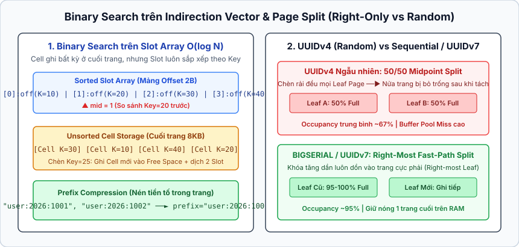
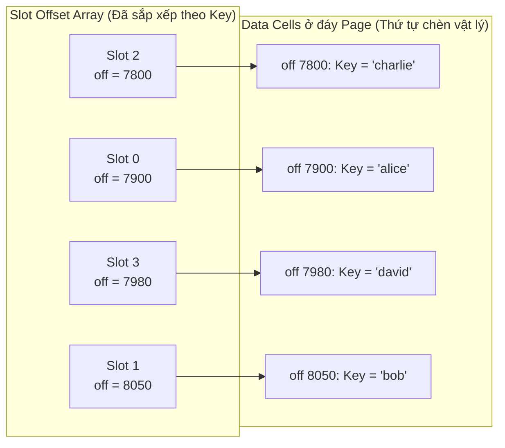
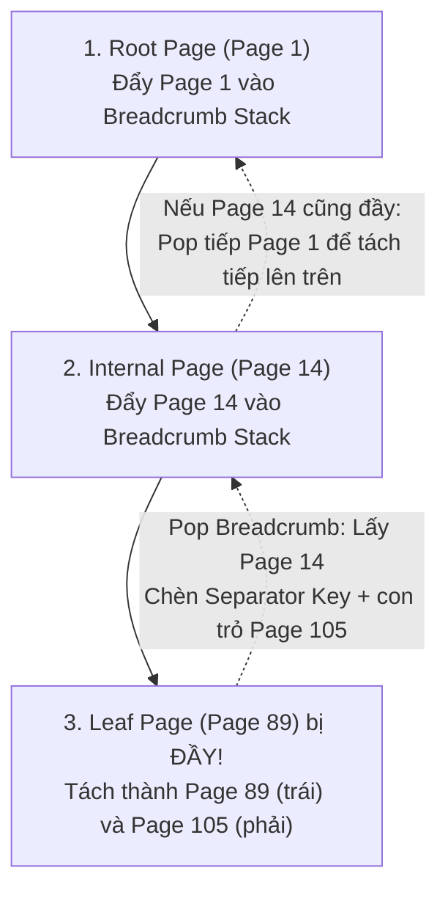

## Table of Contents
1. [Page Header và quản lý siêu dữ liệu B-Tree](#page-header)
2. [Tìm kiếm nhị phân với Indirection Vector (Offset Array)](#binary-search-indirection)
3. [Lan truyền Split và Merge bằng Breadcrumbs](#breadcrumbs-split-merge)
4. [Tái cân bằng (Rebalancing) vs Lazy Deletions](#rebalancing-vs-lazy-deletions)
5. [Tối ưu hóa Right-Only Appends và tác hại của UUIDv4](#right-only-appends)
6. [Nén khóa: Prefix Compression và Suffix Truncation](#key-compression)
7. [Vacuum và thu hồi vùng nhớ phân mảnh (Maintenance)](#vacuum-maintenance)
8. [Tóm tắt & Ghi nhớ cốt lõi (Key Takeaways)](#key-takeaways)

---

Sau khi nắm vững cấu trúc **Slotted Page** ở Chương 3, Chương 4 đi sâu vào cách kết hợp các Slotted Page thành một cấu trúc chỉ mục **B-Tree (hoặc `B+Tree`)** hoàn chỉnh trên đĩa. Điểm khác biệt cốt lõi giữa B-Tree lý thuyết trong sách giáo khoa và B-Tree thực tế trong PostgreSQL hay InnoDB nằm ở cách xử lý khóa có độ dài thay đổi, cơ chế tránh tái cân bằng cây quá mức khi xóa, và các tối ưu hóa phần cứng cho thao tác ghi tuần tự.

---

## Page Header và quản lý siêu dữ liệu B-Tree {#page-header}

Mỗi nút của B-Tree tương ứng với một Page vật lý trên đĩa. Phần **Page Header** của một nút B-Tree lưu trữ các trường điều khiển quan trọng:
- **Magic Number & Page Type Flags**: Phân biệt trang hiện tại là **Root Node**, **Internal Node** (nút trung gian chỉ chứa khóa phân tách và con trỏ trang con), **Leaf Node** (nút lá chứa dữ liệu), hay **Overflow Page**.
- **Free Space Pointers (`lower`, `upper`) & Fragmented Bytes Count**: Theo dõi dung lượng trống liên tục ở giữa trang cũng như tổng số byte bị phân mảnh do các bản ghi đã xóa nằm rải rác ở phần đáy trang.
- **Right-Sibling Pointer (`right_child` / High-Key Link)**: Trong biến thể `B+Tree` và **B-link Tree** (như cài đặt của PostgreSQL theo bài báo Lehman & Yao), mỗi trang lưu thêm con trỏ trỏ sang trang anh em ngay bên phải ở cùng mức và một giá trị **High Key** (biên trên của khóa trong trang hiện tại). Nhờ con trỏ này, thao tác quét khoảng (`Range Scan`) chỉ cần duyệt ngang qua chuỗi các Leaf Page mà không cần quay ngược lên Internal Node, đồng thời cho phép các luồng đọc xử lý an toàn ngay cả khi trang đang trong quá trình tách (`Split`).

---

## Tìm kiếm nhị phân với Indirection Vector (Offset Array) {#binary-search-indirection}

Một câu hỏi kinh điển khi hiện thực hóa B-Tree: *Nếu các Cell dữ liệu có độ dài thay đổi (do khóa kiểu `VARCHAR`) và được chèn vào đáy Slotted Page theo thứ tự thời gian bất kỳ (không theo thứ tự từ điển), làm sao thực hiện tìm kiếm nhị phân (Binary Search) trong $O(\log K)$?*

Nếu phải sắp xếp lại và dịch chuyển toàn bộ các Data Cell nặng hàng kilobyte mỗi khi chèn một khóa mới vào giữa trang, chi phí sao chép bộ nhớ (`memmove`) sẽ rất lớn. Thay vào đó, Storage Engine **giữ nguyên vị trí vật lý của các Data Cell** ở đáy trang, và **chỉ duy trì thứ tự tăng dần theo khóa trên mảng Slot Offset Array** (còn gọi là **Indirection Vector**).

### Ví dụ từng bước: Tìm khóa `"charlie"` trong Page
Giả sử Page có `K = 4` bản ghi. Mảng `slot[]` chứa các độ lệch byte đã được sắp xếp theo thứ tự bảng chữ cái của khóa:
- `slot[0] = 7900` (trỏ tới Cell chứa `"alice"`)
- `slot[1] = 8050` (trỏ tới Cell chứa `"bob"`)
- `slot[2] = 7800` (trỏ tới Cell chứa `"charlie"`)
- `slot[3] = 7980` (trỏ tới Cell chứa `"david"`)

Quá trình tìm kiếm nhị phân diễn ra trực tiếp trên chỉ số của mảng `slot[0..3]`:
1. Khởi tạo `low = 0`, `high = 3`. Tính chỉ số giữa: `mid = (0 + 3) / 2 = 1`.
2. Đọc `slot[1]` lấy được địa chỉ byte `8050`. Nhảy tới byte `8050` trong Page để đọc khóa `"bob"`.
3. So sánh khóa cần tìm `"charlie"` với `"bob"`: vì `"charlie" > "bob"`, thu hẹp khoảng tìm kiếm sang nửa phải: `low = mid + 1 = 2`.
4. Tính `mid = (2 + 3) / 2 = 2`. Đọc `slot[2]` lấy địa chỉ byte `7800`, nhảy tới byte `7800` đọc được khóa `"charlie"` — **Khớp hoàn toàn!**

Khi chèn một khóa mới (ví dụ `"anna"`), hệ thống chỉ việc ghi Cell `"anna"` vào vùng trống tiếp theo ở đáy trang, rồi dịch chuyển các phần tử `2-byte` hoặc `4-byte` trong mảng `slot[]` để chèn con trỏ mới vào giữa `slot[0]` và `slot[1]`. Chi phí dịch chuyển vài chục byte của mảng con trỏ nằm gọn trong `L1 CPU Cache`.

---

## Lan truyền Split và Merge bằng Breadcrumbs {#breadcrumbs-split-merge}

Các nút B-Tree thường chỉ lưu con trỏ một chiều từ cha xuống con (`Child Page ID`) chứ **không lưu con trỏ ngược từ con lên cha (`Parent Page ID`)**. Lý do là nếu một Internal Node bị tách đôi, nó có thể có tới hàng trăm trang con; việc phải đọc và cập nhật lại con trỏ `Parent Page ID` trên hàng trăm trang con đó sẽ gây bão ghi đĩa (Write Amplification).

Vậy khi một Leaf Page bị đầy và cần tách làm hai (**Node Split**), làm sao hệ thống biết trang cha nào cần nhận khóa phân tách (`Separator Key`) đẩy lên?

### Cơ chế Breadcrumb Stack
Trong quá trình duyệt cây từ `Root` xuống `Leaf` để thực hiện thao tác `INSERT` hoặc `DELETE`, luồng thực thi lưu lại lịch sử đường đi vào một ngăn xếp trong bộ nhớ RAM gọi là **Breadcrumbs** (`Stack<PageId, SlotIndex>`):

1. **Khi đi xuống**: Bắt đầu từ `Root (Page 1)` -> đẩy `Page 1` vào stack -> đi xuống `Internal (Page 14)` -> đẩy `Page 14` vào stack -> tới `Leaf (Page 89)`.
2. **Khi tách trang lá**: `Page 89` đầy, được tách thành `Page 89` (giữ nửa đầu các khóa) và `Page 105` mới (nhận nửa sau các khóa).
3. **Khi lan truyền ngược lên (Propagate Up)**: Hệ thống lấy phần tử đầu ngăn xếp (`pop`) khỏi Breadcrumb Stack — chính là `Page 14` — để chèn khóa phân tách (`Separator Key`) kèm con trỏ `Page 105`. Nếu `Page 14` cũng hết chỗ, quá trình tách tiếp tục lan truyền ngược lên `Page 1` theo đúng ngăn xếp Breadcrumbs. Nếu `Root` cũng bị tách, một trang `Root` mới được cấp phát làm cha của hai mảnh vừa tách, và chiều cao của B-Tree tăng thêm `1`.

---

## Tái cân bằng (Rebalancing) vs Lazy Deletions {#rebalancing-vs-lazy-deletions}

Theo lý thuyết B-Tree cổ điển, khi xóa một phần tử làm số lượng khóa trong trang tụt xuống dưới ngưỡng `50%` (**Underflow**), cây phải mượn khóa từ nút anh em kế cận (Rotation) hoặc gộp hai nút lại làm một (**Node Merge**).

Tuy nhiên, trong các hệ quản trị cơ sở dữ liệu thực tế (như PostgreSQL và InnoDB), **việc gộp trang ngay lập tức khi xóa hầu như bị tránh hoặc trì hoãn tối đa**:
- **Tránh hiện tượng Thrashing (Oscillation)**: Nếu một trang vừa đầy vừa bị tách đôi, ngay sau đó có một giao dịch xóa đi `1` bản ghi làm trang rơi xuống dưới ngưỡng `50%` và kích hoạt gộp trang, rồi giao dịch tiếp theo lại chèn `1` bản ghi gây tách trang trở lại — hệ thống sẽ rơi vào vòng lặp tách/gộp liên tục tại điểm biên, gây tranh chấp Latch nghiêm trọng và tốn băng thông I/O.
- **Thực tế dữ liệu thường tăng trưởng**: Các vùng khóa vừa xóa thường sẽ sớm nhận thêm bản ghi mới.
- **Giải pháp thực tế (Lazy Deletion & Empty Page Reclamation)**: Khi xóa bản ghi, hệ thống chỉ đánh dấu Slot tương ứng là `DELETED` (hoặc `Tombstone`). Việc gộp hoặc thu hồi trang chỉ diễn ra khi trang đạt ngưỡng rỗng hoàn toàn (`0%`) hoặc giảm xuống dưới một ngưỡng rất thấp (ví dụ dưới `25%`–`30%`) thông qua tiến trình dọn dẹp ngầm (**Vacuum / Purge**).

---

## Tối ưu hóa Right-Only Appends và tác hại của UUIDv4 {#right-only-appends}

Cách chọn kiểu dữ liệu cho khóa chính (**Primary Key**) quyết định trực tiếp đến hiệu năng ghi và mức độ phân mảnh của B-Tree:

### 1. Tối ưu hóa Right-Only Appends (Khóa tăng dần tuần tự)
Khi sử dụng khóa tăng dần đơn điệu như `BIGSERIAL`, `AUTO_INCREMENT`, hoặc `UUIDv7` (UUID có `48 bit` đầu là Unix timestamp), mọi bản ghi mới luôn có giá trị lớn hơn toàn bộ các khóa hiện có và **luôn đi thẳng vào Leaf Page ngoài cùng bên phải (Rightmost Leaf Page)**.
- **Hiệu quả bộ nhớ đệm (Buffer Pool Hit Ratio cao)**: Hệ thống chỉ cần giữ cố định `1` trang lá ngoài cùng bên phải trong RAM để phục vụ hàng chục nghìn lượt `INSERT` liên tiếp mà không phải đọc đĩa.
- **Fast-Path Split (Tách trang bất đối xứng `99/1` thay vì `50/50`)**: Nếu áp dụng quy tắc tách đôi `50/50` thông thường cho khóa tăng dần, nửa trang bên trái sau khi tách sẽ **không bao giờ được chèn thêm bản ghi nào nữa**, dẫn đến lãng phí đúng `50%` dung lượng đĩa! Do đó, các Storage Engine như InnoDB nhận diện mẫu chèn tuần tự ở trang ngoài cùng bên phải (thông qua con trỏ `PAGE_LAST_INSERT`) và thực hiện **Fast-Path Split**: giữ nguyên `100%` dữ liệu ở trang cũ bên trái, cấp phát một trang mới hoàn toàn trống ở bên phải để ghi bản ghi mới. Nhờ đó hệ số lấp đầy trang (**Fill Factor**) đạt xấp xỉ `95%`–`100%`.

### 2. Tại sao Random `UUIDv4` phá hủy hiệu năng B-Tree?
Ngược lại, `UUIDv4` sinh ra `128 bit` ngẫu nhiên hoàn toàn:
- Mỗi lần `INSERT` rơi vào một Leaf Page ngẫu nhiên trên toàn bộ không gian khóa. Khi bảng lớn hơn dung lượng RAM, mỗi lượt chèn đều gây ra một lỗi thiếu trang (**Page Fault / Cache Miss**), buộc hệ thống phải đọc ngẫu nhiên một Page từ đĩa lên và ghi trả lại một **Dirty Page**.
- Các trang lá bị tách theo tỷ lệ `50/50` ngẫu nhiên và lấp đầy rất chậm, làm dung lượng chỉ mục phình to gấp `1.5` đến `2` lần so với khi dùng `UUIDv7` hoặc `INT64` tuần tự.

---

## Nén khóa: Prefix Compression và Suffix Truncation {#key-compression}

Chiều cao của B-Tree phụ thuộc vào **Fanout** (số lượng con trỏ trang con chứa được trong một Internal Node). Vì kích thước Page là cố định, nếu giảm được số byte của mỗi khóa trong trang, ta sẽ chứa được nhiều khóa hơn trên cùng một Page. Hai kỹ thuật nén khóa phổ biến gồm:

### 1. Prefix Compression (Nén tiền tố ở Leaf & Internal Nodes)
Do các khóa trong cùng một Page đã được sắp xếp theo thứ tự từ điển, các khóa đứng cạnh nhau thường có chung phần đầu (tiền tố). Ví dụ các khóa:
- `"customer:vn:2026:0001"`
- `"customer:vn:2026:0002"`
- `"customer:vn:2026:0003"`

Page chỉ cần lưu tiền tố chung `"customer:vn:2026:"` đúng một lần ở đầu trang (hoặc so với khóa liền trước), và tại mỗi Cell chỉ lưu phần hậu tố khác biệt (`"0001"`, `"0002"`, `"0003"`).

### 2. Suffix Truncation (Cắt bỏ hậu tố ở Internal Nodes)
Tại các **Internal Nodes**, khóa chỉ đóng vai trò làm **cột mốc phân luồng (Separator Key)** để chỉ đường đi sang trang con bên trái hay bên phải, chứ không cần lưu giá trị thực.
Ví dụ trang lá bên trái kết thúc bằng khóa `"application_server_01"` và trang lá bên phải bắt đầu bằng khóa `"backup_service_99"`. Thay vì đẩy nguyên chuỗi dài `"backup_service_99"` (`17 bytes`) lên làm khóa phân tách ở Internal Node, hệ thống chỉ cần cắt lấy tiền tố ngắn đủ để phân biệt hai nhánh — ở đây chỉ cần chuỗi `"b"` (`1 byte`)! Mọi khóa `< "b"` đi sang nhánh trái, mọi khóa `>= "b"` đi sang nhánh phải. **Suffix Truncation** giúp tăng mạnh Fanout của các nút trung gian.

---

## Vacuum và thu hồi vùng nhớ phân mảnh (Maintenance) {#vacuum-maintenance}

Khi các bản ghi trong một Slotted Page bị xóa hoặc cập nhật nhiều lần, vùng chứa Data Cells ở đáy trang sẽ xuất hiện nhiều khoảng trống rời rạc (**Dead Tuples**) xen kẽ giữa các bản ghi còn sống. Dù tổng dung lượng trống trong Page vẫn còn đủ cho bản ghi mới, nhưng vùng trống liên tục ở giữa (`upper - lower`) đã cạn kiệt.

Lúc này, trước khi quyết định tách trang (`Node Split`), Storage Engine sẽ kích hoạt quá trình **Page Compaction (hoặc In-page Vacuum)**:
1. Quét bỏ toàn bộ các Cell đã chết (`Dead Cells`) ở đáy trang.
2. Dịch chuyển các Cell còn sống sát lại nhau về phía đáy trang (hoặc tạo một bản sao trang tạm trong bộ nhớ rồi chép ngược lại) để gộp toàn bộ không gian trống rời rạc về vùng giữa trang (tăng lại giá trị con trỏ `upper`).
3. Cập nhật lại các địa chỉ `offset` tương ứng bên trong mảng **Slot Array**.

---

## Tóm tắt & Ghi nhớ cốt lõi (Key Takeaways) {#key-takeaways}

- **Indirection Vector cho phép tìm kiếm nhị phân $O(\log K)$**: Các bản ghi có độ dài thay đổi được ghi nối tiếp vào đáy Page mà không cần sắp xếp vật lý; thứ tự khóa được duy trì thông qua mảng con trỏ **Slot Offset Array** nhỏ gọn ở đầu Page.
- **Breadcrumb Stack thay thế con trỏ cha**: Để tránh chi phí cập nhật hàng loạt trang con khi tách nút, B-Tree không lưu con trỏ ngược lên cha trên đĩa mà dùng một ngăn xếp **Breadcrumbs** trong bộ nhớ RAM để ghi nhớ đường đi từ Root xuống Leaf.
- **Ưu tiên `UUIDv7` / khóa tuần tự thay vì `UUIDv4`**: Khóa tăng dần kích hoạt cơ chế **Right-Only Append** và tách trang bất đối xứng (`100/0`), giữ trang luôn đầy và nằm gọn trong RAM; ngược lại `UUIDv4` gây phân mảnh `50%` và làm tràn bộ nhớ đệm.
- **Prefix Compression & Suffix Truncation tối đa hóa Fanout**: Nén phần đầu giống nhau ở các khóa liền kề và cắt gọn phần đuôi không cần thiết của khóa phân tách trên Internal Nodes giúp giảm chiều cao cây B-Tree.

### Tài liệu & Nguồn tham khảo
- [Lehman, P. L., & Yao, S. B. (1981) — *Efficient Locking for Concurrent Operations on B-Trees*](https://www.csd.uoc.gr/~hy460/pdf/p650-lehman.pdf)
- [PostgreSQL Source Code — `src/backend/access/nbtree/README` (Lehman & Yao B-link Tree Implementation)](https://github.com/postgres/postgres/blob/master/src/backend/access/nbtree/README)
- [RFC 9562 — Universally Unique IDentifiers (UUIDv7 Time-Ordered Specification)](https://datatracker.ietf.org/doc/html/rfc9562)
