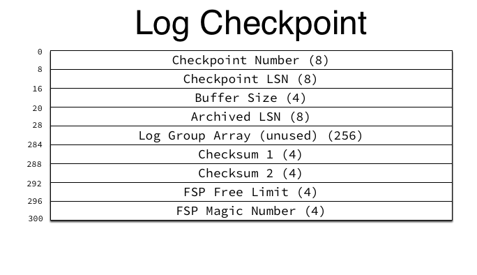
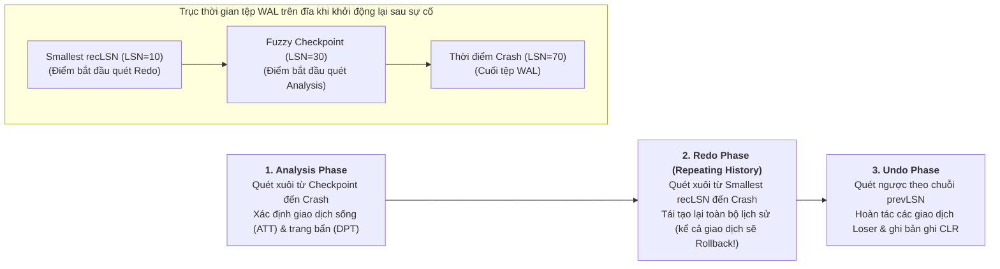
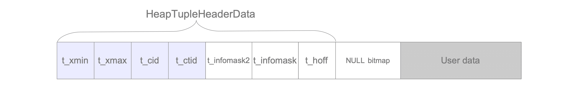
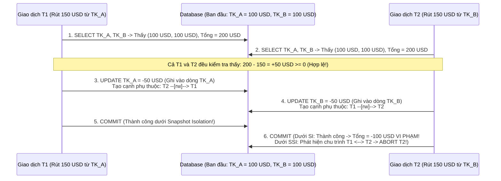
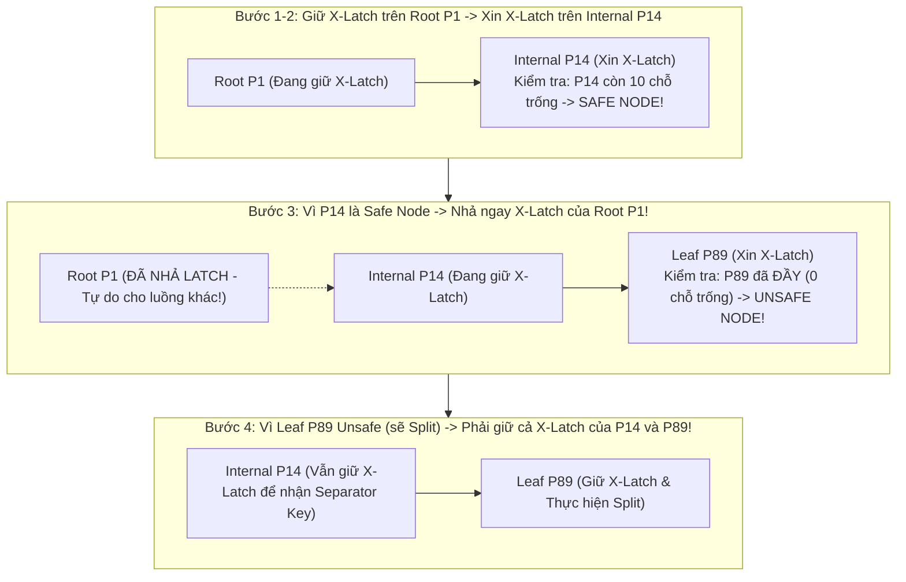

## Table of Contents
1. [Quản lý Buffer Pool và Page Cache](#buffer-management)
2. [Các thuật toán thay thế trang (Cache Eviction Policies)](#cache-eviction-policies)
3. [Khôi phục sự cố (Recovery) và Write-Ahead Log (WAL)](#wal-and-recovery)
4. [Thuật toán khôi phục ARIES (3 giai đoạn)](#aries-recovery)
5. [Kiểm soát đồng thời (Concurrency Control), MVCC và các dị thường](#concurrency-control)
6. [Phân biệt Lock vs Latch và kỹ thuật Latch Crabbing](#lock-vs-latch)
7. [Tóm tắt & Ghi nhớ cốt lõi (Key Takeaways)](#key-takeaways)

---

Để đảm bảo bộ tính chất **ACID** (`Atomicity`, `Consistency`, `Isolation`, `Durability`) trong khi vẫn đạt thông lượng hàng chục nghìn giao dịch mỗi giây, Storage Engine không thể ghi trực tiếp mọi thay đổi xuống các Page dữ liệu ngẫu nhiên trên đĩa ngay tại thời điểm `COMMIT`. Chương 5 giải quyết ba bài toán trụ cột của một hệ quản trị cơ sở dữ liệu thực thụ:
1. Quản lý bộ nhớ đệm **Buffer Pool** trong RAM như thế nào để một câu truy vấn quét toàn bộ bảng không đuổi sạch các trang chỉ mục nóng ra khỏi bộ nhớ?
2. Làm thế nào để khôi phục trạng thái chính xác tuyệt đối sau sự cố mất điện thông qua **Write-Ahead Log (WAL)** và thuật toán **ARIES** (`Analysis -> Redo -> Undo`)?
3. Làm thế nào để điều phối hàng nghìn luồng đọc/ghi đồng thời thông qua **MVCC**, **SSI**, **Locks** và **Latch Crabbing**?

---

### 0. Khởi động cho người mới: Chuyện gì thực sự xảy ra bên trong Database khi chạy một giao dịch chuyển tiền?

Trước khi đi vào các thuật toán cấp thấp của Chương 5, hãy bắt đầu bằng một câu lệnh SQL chuyển `100 USD` từ tài khoản `id = 1` (An) sang tài khoản `id = 2` (Bình) mà bất kỳ lập trình viên nào cũng từng viết:

```sql
BEGIN;
UPDATE accounts SET balance = balance - 100 WHERE id = 1;
UPDATE accounts SET balance = balance + 100 WHERE id = 2;
COMMIT;
```

Đối với người dùng gõ lệnh SQL, bốn dòng trên trông như một thao tác đơn giản. Nhưng bên dưới nắp máy của **PostgreSQL** hay **MySQL InnoDB**, câu lệnh này phải vượt qua **3 bài toán sinh tử** cùng một lúc:
1. **Bài toán Tốc độ vs. Độ bền (RAM vs. Disk)**:
   - Dòng dữ liệu của `id = 1` có thể đang nằm ở `Page #105` ở đầu ổ cứng, còn dòng `id = 2` nằm ở `Page #89.420` ở cuối ổ cứng. Nếu mỗi lần bấm `COMMIT`, Database đều bắt ổ cứng phải di chuyển đầu đọc/ghi đến cả hai vị trí ngẫu nhiên đó để sửa và lưu xong xuôi rồi mới báo thành công (`FORCE`), hệ thống chỉ chạy được vài trăm giao dịch mỗi giây!
   - Để chạy được hàng chục nghìn giao dịch mỗi giây, Database chỉ sửa `Page #105` và `Page #89.420` **ngay trên bộ nhớ RAM (`Buffer Pool`)**, đánh dấu hai trang đó là **"trang bẩn" (`Dirty Page`)**, rồi ghi nối tiếp một dòng chữ ngắn gọn vào cuối cuốn sổ nhật ký **`Write-Ahead Log (WAL)`** trên đĩa trước khi báo `COMMIT` thành công!
2. **Bài toán Sập nguồn đột ngột (Crash Recovery)**:
   - Điều gì xảy ra nếu vừa trừ `100 USD` của An ở `Page #105` (và trang này đã vô tình bị đẩy xuống đĩa do RAM đầy — chính sách **`STEAL`**), nhưng chưa kịp cộng `100 USD` cho Bình thì máy chủ bị rút phích cắm điện? Hoặc ngược lại: cả hai lệnh đều đã `COMMIT` thành công nhưng cả hai trang vẫn đang nằm trên RAM chưa kịp ghi xuống file bảng (**`NO-FORCE`**) thì mất điện?
   - Khi bật máy lại, thuật toán khôi phục **ARIES** sẽ đọc cuốn sổ **WAL** qua 3 bước: **Analysis** (kiểm kê hiện trường) $\to$ **Redo** (làm lại mọi bước đã ghi sổ để dựng lại đúng trạng thái RAM trước khi mất điện) $\to$ **Undo** (hoàn trả lại `100 USD` cho những giao dịch đang chạy dở dang chưa kịp `COMMIT`).
3. **Bài toán 1.000 người cùng truy cập một lúc (Concurrency Control)**:
   - Ngay trong tích tắc giao dịch chuyển tiền đã trừ `100 USD` của An nhưng chưa cộng `100 USD` cho Bình, nếu sếp tổng chạy câu lệnh `SELECT SUM(balance) FROM accounts;` để kiểm toán, sếp tổng không được phép nhìn thấy tổng tiền của ngân hàng bị hụt mất `100 USD`! Đồng thời, câu lệnh `SELECT` của sếp tổng cũng không được làm treo cứng giao dịch chuyển tiền của khách hàng.
   - Cơ chế **MVCC (`Multi-Version Concurrency Control`)** giải quyết việc này bằng cách giữ lại bản chụp dữ liệu cũ (`Snapshot` qua `xmin/xmax` trên PostgreSQL hoặc `Undo Log` trên MySQL InnoDB) để người đọc và người ghi không bao giờ cản đường nhau!

---

### Bảng Từ Điển Thuật Ngữ Nhanh Cho Người Mới (Beginner's Visual Glossary)

Khi đọc Chương 5, người đọc sẽ liên tục bắt gặp 14 thuật ngữ cốt lõi dưới đây. Hãy nắm vững ý nghĩa đời thực và vị trí của chúng trong các hệ cơ sở dữ liệu thực tế trước khi đi sâu vào chi tiết:

| Thuật ngữ trong sách | Hiểu nôm na cho người mới (Ẩn dụ đời thực) | Trong Database thực tế (PostgreSQL / MySQL InnoDB / RocksDB / LMDB) là gì? |
| :--- | :--- | :--- |
| **`Buffer Pool` (Vùng đệm trang trên RAM)** | Chiếc **bàn làm việc rộng rãi trên RAM** chia thành hàng triệu ô bằng nhau (`Frames`). Muốn đọc hay sửa bất kỳ trang sách (`Page`) nào dưới kho đĩa cứng, thủ thư bắt buộc phải bốc trang đó đặt lên chiếc bàn này trước. | Trong **PostgreSQL** là vùng nhớ `shared_buffers` (chia thành các khung `8 KB`); trong **MySQL InnoDB** là `innodb_buffer_pool_size` (chia thành các khung `16 KB`). |
| **`Dirty Page` (Trang đã sửa trên RAM nhưng chưa lưu xuống đĩa)** | Tờ hồ sơ trên bàn làm việc **đã được nhân viên viết thêm chữ mới vào**, nhưng bản gốc nằm dưới kho đĩa cứng vẫn là bản cũ chưa được cập nhật theo. | Khung trang trong `Buffer Pool` có cờ `BM_DIRTY` (PostgreSQL) hoặc nằm trong `Flush List` (MySQL InnoDB), chờ tiến trình nền `Checkpointer / Page Cleaner` ghi xuống đĩa. |
| **`Pin Count` / `Reference Count` (Chốt giữ trang trên RAM)** | Chiếc **đinh ghim cắm chặt tờ giấy xuống mặt bàn** khi đang có nhân viên cúi xuống đọc hoặc viết lên tờ giấy đó. Chừng nào còn ít nhất 1 chiếc ghim (`pin_count > 0`), không ai được phép dẹp tờ giấy đó đi chỗ khác! | Trường `refcount` trong `BufferDesc` của PostgreSQL hoặc `buf_fix_count` trong InnoDB. Trang đang có `pin_count > 0` tuyệt đối không thể bị trục xuất (`Evict`). |
| **`Page Eviction: LRU / 2Q / CLOCK-Sweep`** | Quy tắc **chọn tờ giấy ít quan trọng nhất trên bàn để cất đi** khi mặt bàn đã kín chỗ mà lại cần lấy thêm trang mới từ kho lên — đồng thời phải tránh việc một đoàn khách vãng lai (`SELECT *` quét cả bảng) đuổi mất các trang mục lục VIP. | **MySQL InnoDB** dùng danh sách LRU chia đôi `Young / Old` (**Midpoint Insertion**); **PostgreSQL** dùng kim đồng hồ **Clock-Sweep** giảm dần biến đếm `usage_count` kết hợp `Ring Buffer`. |
| **`STEAL` & `NO-FORCE` Policy** | **`STEAL`**: Cho phép cất bớt tờ nháp của giao dịch *chưa chốt* xuống kho nếu bàn làm việc hết chỗ (cần `Undo` nếu mất điện). **`NO-FORCE`**: Khi khách bấm `COMMIT`, chỉ cần ghi vào sổ nhật ký chứ *không bắt* phải mang ngay mọi tờ giấy trên bàn xuống kho (cần `Redo` nếu mất điện). | Cả **PostgreSQL**, **MySQL InnoDB**, **Oracle** và **SQL Server** đều dùng tổ hợp **`STEAL + NO-FORCE`** để đạt tốc độ cao nhất và không bị tràn RAM khi chạy giao dịch lớn. |
| **`Write-Ahead Log` (`WAL` / `Redo Log`)** | **Cuốn sổ nhật ký chống cháy chỉ ghi nối đuôi (`Append-Only`)**. Luật bất thành văn: Mọi thay đổi bắt buộc phải được ghi vào cuốn sổ này và lưu xuống đĩa *trước khi* trang dữ liệu được ghi xuống kho hoặc trước khi báo `COMMIT` thành công. | Trong **PostgreSQL** là các file `pg_wal/` (`XLOG`); trong **MySQL InnoDB** là `ib_logfile0/1` (`#ib_redo`); trong **RocksDB** là file `.log`. |
| **`Undo Log`** | **Cuốn sổ ghi lại giá trị cũ trước khi sửa (`Before-Image`)** để nếu giao dịch bị hủy (`ROLLBACK`) hoặc mất điện giữa chừng thì có thể khôi phục lại nguyên trạng ban đầu, đồng thời phục vụ cho các luồng đọc cũ (MVCC). | **MySQL InnoDB** và **Oracle** có vùng `Undo Tablespace / Rollback Segment` riêng biệt; **PostgreSQL** không tách Undo Log riêng mà giữ luôn bản ghi cũ (`Dead Tuple`) ngay trong trang bảng `Heap`. |
| **`LSN` (`Log Sequence Number`) & `PageLSN`** | **`LSN`**: Số thứ tự byte tăng dần của từng dòng trong sổ nhật ký WAL (như số trang nhật ký). **`PageLSN`**: Con dấu đóng ở góc mỗi trang dữ liệu ghi lại xem trang đó đã được cập nhật tới dòng nhật ký số mấy rồi. | Trong **PostgreSQL** là kiểu dữ liệu `pg_lsn` và trường `pd_lsn` ở đầu mỗi trang `8 KB`; trong **MySQL InnoDB** là `LSN` `8-byte` và trường `FIL_PAGE_LSN` ở đầu mỗi trang `16 KB`. |
| **`Fuzzy Checkpoint`** | Thay vì bắt cả ngân hàng ngừng giao dịch để cất toàn bộ giấy tờ trên bàn xuống kho (`Sharp Checkpoint`), thủ thư **vừa cho giao dịch chạy bình thường vừa túc tắc đẩy dần các trang bẩn xuống đĩa**, đồng thời ghi một mốc đánh dấu vào sổ WAL để biết khi sập nguồn chỉ cần đọc lại WAL từ mốc đó trở đi. | Tiến trình `checkpointer` trong **PostgreSQL** (ghi bản ghi `XLOG_CHECKPOINT_ONLINE` chứa vị trí `REDO Point`) và cơ chế `Fuzzy Checkpoint` theo tuổi trang bẩn (`Oldest Modification LSN`) trong **MySQL InnoDB**. |
| **`ARIES Recovery` (3 pha: `Analysis -> Redo -> Undo`)** | Quy trình **3 bước cứu hộ tiêu chuẩn sau khi mất điện**: (1) **Analysis**: Đọc sổ từ Checkpoint để lập danh sách trang đang bẩn và giao dịch đang dở dang; (2) **Redo**: Chạy lại lịch sử để dựng lại đúng mặt bàn RAM lúc mất điện; (3) **Undo**: Đi ngược lại để hủy các giao dịch chưa kịp `COMMIT`. | Chuẩn mực khôi phục của **IBM Db2**, **Microsoft SQL Server**, **MySQL InnoDB**. (**PostgreSQL** chỉ cần chạy pha **Redo** vì các phiên bản cũ đã nằm sẵn trên trang Heap và được đánh dấu hủy qua bảng trạng thái `pg_xact`). |
| **`Lock` (Khóa logic) vs. `Latch` (Khóa vật lý ngắn hạn)** | **`Lock`**: Biển báo *"Tài khoản An đang giao dịch, người khác cấm sửa!"* giữ suốt từ lúc `BEGIN` đến lúc `COMMIT`. **`Latch`**: Chốt cửa phòng kỹ thuật khóa trong vài phần triệu giây (`nanoseconds`) khi CPU đang dịch chuyển các byte trong một ô nhớ RAM để không bị lệch con trỏ. | **`Lock`**: Quản lý bởi `Lock Manager` (`SELECT ... FOR UPDATE`, Row Lock, Gap Lock, có phát hiện Deadlock). **`Latch`**: Là `LWLock` / `Spinlock` trong PostgreSQL hoặc `rw_lock_t` (Page Latch) trong MySQL InnoDB. |
| **`Two-Phase Locking` (`2PL`) & `Strict 2PL`** | Quy tắc khóa bi quan: Giao dịch muốn đọc/ghi dòng nào thì phải xin khóa dòng đó trước (**Pha 1: Tích lũy khóa**), và giữ chặt toàn bộ khóa viết cho đến tận khi `COMMIT` hoặc `ROLLBACK` xong mới nhả ra một lượt (**Pha 2: Nhả khóa — `Strict 2PL`**). | Cơ chế khóa dòng (`Row-level Locking` kết hợp `Next-Key Lock`) khi chạy `UPDATE / DELETE / SELECT FOR UPDATE` trong **MySQL InnoDB**, **PostgreSQL**, **Oracle**. |
| **`MVCC` (`Multi-Version Concurrency Control`)** | **Cỗ máy chụp ảnh thời gian**: Khi sửa một dòng, Database không xóa đè mất giá trị cũ ngay mà giữ lại cả phiên bản cũ lẫn phiên bản mới kèm mã số giao dịch. Nhờ đó người vào đọc chỉ việc nhìn vào "bức ảnh quá khứ" (`ReadView / Snapshot`) của mình mà không bao giờ bị người đang ghi chặn lại! | Trong **PostgreSQL**: mỗi dòng (`HeapTuple`) có cặp trường ẩn `t_xmin` (ai tạo) và `t_xmax` (ai xóa/sửa) nối qua `t_ctid`. Trong **MySQL InnoDB**: mỗi dòng có `DB_TRX_ID` và con trỏ `DB_ROLL_PTR` trỏ về chuỗi phiên bản cũ trong `Undo Log`. |
| **`Serializable Snapshot Isolation` (`SSI`) & `Write Skew`** | **`Write Skew`**: Lỗi logic khi 2 người cùng nhìn một bức ảnh cũ thấy tài khoản tổng còn `200 USD`, rồi người 1 rút `150 USD` ở thẻ A, người 2 rút `150 USD` ở thẻ B làm tổng bị âm `-100 USD`! **`SSI`**: Thuật toán theo dõi mũi tên "Ai đọc trước khi ai sửa" (`rw-dependency`) để bắt quả tang chu trình vòng tròn và hủy ngay giao dịch gây lệch. | Mức cô lập `ISOLATION LEVEL SERIALIZABLE` trong **PostgreSQL** (từ bản 9.1, dùng `SIREAD locks`) và trong **CockroachDB**. |

---

## Quản lý Buffer Pool và Page Cache {#buffer-management}

### Bài toán thực tế & Mental Model

Tại sao các hệ quản trị cơ sở dữ liệu như PostgreSQL, MySQL InnoDB hay Oracle không phó mặc việc quản lý bộ nhớ đệm cho hệ điều hành thông qua `OS Page Cache` và lời gọi hệ thống `mmap()`, mà phải tự cấp phát và quản lý một vùng bộ nhớ RAM riêng gọi là **Buffer Pool**?

Nếu giao toàn quyền cho hệ điều hành (`mmap`):
1. **Vi phạm quy tắc an toàn của Write-Ahead Log (WAL)**: Hệ điều hành có thể tự ý đẩy (flush) một trang bộ nhớ bị sửa đổi xuống đĩa bất cứ lúc nào khi thiếu RAM, **ngay cả trước khi bản ghi nhật ký WAL của trang đó kịp được ghi xuống đĩa**! Nếu mất điện đúng lúc đó, cơ sở dữ liệu không có thông tin Undo trong WAL để hoàn tác trang bẩn và sẽ bị hỏng dữ liệu vĩnh viễn.
2. **Hiện tượng nhân đôi bộ nhớ (`Double Buffering`) và mất kiểm soát Eviction**: Hệ điều hành không hiểu ngữ nghĩa truy vấn SQL (không biết trang nào là Root của B-Tree cần giữ chặt, trang nào chỉ là dữ liệu quét thoáng qua 1 lần). Do đó các DBMS như InnoDB hay Oracle thường mở tệp với cờ `O_DIRECT` để bỏ qua hoàn toàn `OS Page Cache` và tự quản lý `100%` bộ nhớ thông qua **Buffer Pool Manager**.

**Mental Model — "Bàn làm việc có chốt ghim an toàn":**
Hãy hình dung Buffer Pool là một chiếc bàn làm việc có số lượng ô cố định (`Frames`). Muốn đọc hay sửa một trang sách (`Page`) nằm dưới kho đĩa cứng, luồng thực thi (`Worker Thread`) phải nhờ thủ thư (`Buffer Manager`) lấy trang đó đặt lên một ô trên bàn và **cắm một chiếc ghim (`Pin`)** vào trang đó để không ai được phép dẹp nó đi trong lúc luồng đang thao tác.

### Các cơ chế cốt lõi trong Buffer Manager

> [!NOTE]
> **Cách đọc sơ đồ cho người mới:**
> 1. **Nhìn từ trái sang phải qua 3 bước `(1) -> (2) -> (3)`**: Tiến trình xử lý câu lệnh SQL (`backend process` — hộp màu xám ở trên) không bao giờ tự ý đọc thẳng từ ổ cứng (`database cluster` — hình trụ màu xanh dương ở dưới), mà luôn phải hỏi qua tầng trung gian **`Buffer Manager`** (khung màu xanh lá ở giữa).
> 2. **Theo dõi mũi tên ở bước `(1)` và `(2)`**: Khi câu lệnh SQL cần đọc một trang dữ liệu, `backend process` gửi nhãn định danh trang (`buffer_tag`) xuống `Buffer Manager`. Nếu trang đó chưa có trong RAM, `Buffer Manager` đọc trang từ ổ cứng `database cluster` nạp vào ô trống màu xanh đậm và trả về số thứ tự ô nhớ **`buffer_id`**.
> 3. **Kết quả ở bước `(3)`**: Khi đã biết `buffer_id`, tiến trình `backend process` ghim (`Pin`) và truy cập trực tiếp vào ô trang màu xanh đậm nằm ngay trên `Buffer Pool` trong RAM với tốc độ nano-giây!

, Buffer Descriptors (Metadata chứa Pin Count, Dirty bit, Usage Count) và Buffer Pool (Mảng các khung trang 8 KB thực tế) — Nguồn: The Internals of PostgreSQL")

> [!NOTE]
> **Cách đọc sơ đồ cho người mới:**
> 1. **Nhìn vào khung `Buffer Pool Frame Descriptor` bên dưới**: Hãy hình dung mỗi trang dữ liệu `8 KB` hoặc `16 KB` nằm trên RAM đều có một "thẻ căn cước" nhỏ (`Descriptor` khoảng `64 bytes`) đi kèm để quản lý mà không cần đọc vào nội dung trang.
> 2. **Theo dõi 5 trường thông tin từ trên xuống**: `page_id` cho biết khung này đang chứa trang số mấy của bảng nào; `pin_count` đếm số luồng đang ghim trang (`> 0` là cấm đuổi khỏi RAM); `is_dirty` đánh dấu trang đã bị sửa nhưng chưa ghi xuống đĩa; `usage_count / LRU` phục vụ thuật toán chọn trang để đuổi khi hết RAM; và `rw_latch` là khóa vật lý bảo vệ khung nhớ.

```text
+-----------------------------------------------------------------------+
| Buffer Pool Frame Descriptor (Metadata cho mỗi khung trang trong RAM) |
| - page_id (4-8B)    : Định danh Page đang nạp trong khung (ví dụ P10) |
| - pin_count (4B)    : Số luồng đang đọc/ghi trang này (Pin > 0: Cấm đuổi)|
| - is_dirty (1 bit)  : Trang đã bị sửa trong RAM nhưng chưa ghi đĩa?   |
| - usage_count / LRU : Biến đếm tần suất hoặc con trỏ danh sách Eviction|
| - rw_latch          : Khóa nội bộ bảo vệ nội dung vật lý của Frame    |
+-----------------------------------------------------------------------+
```

- **Pinning / Unpinning (`pin_count` / `ref_count`)**: Khi một luồng cần đọc hoặc sửa một Page trong Buffer Pool, nó tăng biến đếm tham chiếu `pin_count` của khung nhớ đó (**Pin**). Bất kỳ Page nào có `pin_count > 0` đều bị khóa chặt tại chỗ trong RAM và **tuyệt đối không được phép bị trục xuất (`evict`)** ra khỏi bộ nhớ đệm. Khi thao tác hoàn tất, luồng giảm `pin_count` (**Unpin**). Chỉ những trang có `pin_count == 0` mới là ứng viên cho thuật toán thay thế trang.
- **Dirty Page**: Một Page đã bị sửa đổi trong RAM nhưng nội dung mới chưa được đồng bộ xuống tệp dữ liệu trên đĩa sẽ được gắn cờ `is_dirty = true`.
- **Flush vs Force**:
  - **Flush**: Hành động ghi các Dirty Page từ Buffer Pool xuống đĩa để thu hồi khung nhớ hoặc tạo điểm kiểm tra (**Checkpoint**), thường do tiến trình nền (`Checkpointer` / `Page Cleaner`) thực hiện bất đồng bộ.
  - **Force**: Hành động bắt buộc phải đẩy đồng bộ toàn bộ các Dirty Page của một giao dịch xuống tệp dữ liệu trên đĩa ngay tại thời điểm giao dịch đó gọi `COMMIT`.

---

## Các thuật toán thay thế trang (Cache Eviction Policies) {#cache-eviction-policies}

### Bài toán thực tế & Mental Model

Khi toàn bộ các khung nhớ trong Buffer Pool đã đầy và một câu truy vấn cần nạp thêm một Page mới từ đĩa lên, Buffer Manager phải chọn một trang hiện có (đang có `pin_count == 0`) để trục xuất khỏi RAM.

> [!NOTE]
> **Cách đọc sơ đồ cho người mới:**
> 1. **Nhìn vào cột bên trái từ trên xuống dưới**: Bộ nhớ đệm có `4` ô trống. Lần lượt ở các thời điểm `0, 1, 2, 3`, các trang `A(0)`, `B(1)`, `C(2)`, `D(3)` được nạp vào làm đầy kín cả `4` ô (con số trong ngoặc đơn là mốc thời gian lần cuối trang đó được chạm tới).
> 2. **Theo dõi mũi tên vòng sang cột bên phải**: Ở thời điểm `4`, cần nạp trang mới **`E(4)`** nhưng bộ nhớ đã đầy. Thuật toán **LRU** tìm ô có mốc thời gian nhỏ nhất (cũ nhất) là `A(0)` để đuổi đi và thế chỗ bằng **`E(4)`**.
> 3. **Kết quả ở 2 bước cuối cột phải**: Ở thời điểm `5`, trang `D` được đọc lại nên mốc thời gian của nó được cập nhật từ `D(3)` lên **`D(5)`**. Nhờ vậy, đến thời điểm `6` khi trang mới **`F(6)`** vào, trang bị đuổi không phải là `D` mà là **`B(1)`** (vì `1` là mốc thời gian cũ nhất trong bộ `[E(4), B(1), C(2), D(5)]`).


Thuật toán phổ biến trong sách giáo khoa là **Pure LRU (Least Recently Used)**: duy trì một danh sách liên kết đôi, mỗi khi một trang được chạm tới thì đưa nó lên đầu danh sách (`MRU - Most Recently Used`) và khi thiếu chỗ thì đuổi trang ở cuối danh sách (`LRU`). Tuy nhiên, áp dụng Pure LRU vào cơ sở dữ liệu sẽ gây ra **thảm họa ô nhiễm bộ nhớ đệm (`Sequential Scan Cache Pollution`)**:

**Mental Model — "Đoàn khách du lịch vãng lai đuổi sạch khách quen VIP":**
Hãy tưởng tượng một quán cà phê có `4` chiếc ghế (`Buffer Pool = 4 frames`). Có `2` vị khách VIP (`Page H1`, `Page H2` — chính là các nút `Root` và `Internal` của B-Tree) ngày nào cũng vào uống hàng trăm lần. Đột nhiên có một đoàn khách du lịch vãng lai gồm `4` người (`Page S1, S2, S3, S4` từ một câu truy vấn báo cáo chạy `SELECT * FROM logs` quét tuần tự qua bảng) ghé vào đúng `1` lần rồi đi mãi mãi.
- Với **Pure LRU**: Ai mới bước vào cửa đều được xếp lên ghế đầu! Kết quả là `4` người khách vãng lai `S1..S4` lần lượt đẩy cả `H1` và `H2` ra khỏi quán! Ngay giây tiếp theo khi khách VIP `H1`, `H2` quay lại, quán phải tốn công đi đón lại từ đầu (đọc đĩa).
- Với **Midpoint Insertion (InnoDB)** hoặc **Clock-Sweep (PostgreSQL)**: Quán chia làm **Phòng VIP (`Young`)** và **Ghế chờ ngoài hiên (`Old`)**. Khách mới bước vào lần đầu (`S1..S4`) chỉ được ngồi ở ghế chờ ngoài hiên rồi tự thay phiên nhau rời đi; chỉ ai quay lại từ **lần thứ `2` trở lên** mới được bước vào Phòng VIP!

### Ví dụ chạy tay (Dry Run): Đối chiếu Pure LRU vs InnoDB Midpoint vs PostgreSQL Clock-Sweep

Giả sử **Buffer Pool có đúng `4` khung nhớ (`4 Frames`)**.
- Hai trang chỉ mục nóng **`H1`**, **`H2`** được truy cập lặp đi lặp lại.
- Xen vào giữa là một câu truy vấn chạy `Seq Scan` đọc lướt qua `4` trang dữ liệu **`S1`, `S2`, `S3`, `S4`** (mỗi trang chỉ đọc đúng `1` lần).
- Chuỗi truy cập trang theo thời gian:
  $$H_1 \to H_2 \to H_1 \to H_2 \to S_1 \to S_2 \to S_3 \to S_4 \to H_1 \to H_2$$

Hãy theo dõi trạng thái RAM của `3` thuật toán qua từng bước:

#### 1. Pure LRU (Đưa mọi trang mới lên đầu danh sách `MRU -> LRU`)
- **Sau chuỗi khởi động `H1 -> H2 -> H1 -> H2`**: Hai trang nóng nằm ở đầu danh sách: `[H2, H1, trống, trống]`.
- **Khi `Seq Scan` quét qua `S1 -> S2 -> S3 -> S4`**:
  - Đọc `S1`: `[S1, H2, H1, trống]`
  - Đọc `S2`: `[S2, S1, H2, H1]` *(Đầy 4 khung)*
  - Đọc `S3`: Trục xuất `H1` ở cuối! RAM còn: `[S3, S2, S1, H2]`
  - Đọc `S4`: Trục xuất nốt `H2` ở cuối! RAM còn: **`[S4, S3, S2, S1]`**
- **Khi truy cập lại `H1 -> H2`**: Cả `H1` và `H2` đều đã bị đuổi khỏi RAM! Xảy ra **`2` lần Cache Miss liên tiếp** — bộ nhớ đệm bị ô nhiễm `100%` bởi các trang chỉ đọc một lần!

#### 2. InnoDB Midpoint Insertion / 2Q (`Young Sublist = 2 frames` | `Old Sublist = 2 frames`)
Quy tắc: Trang mới nạp từ đĩa lần đầu **không được vào đầu `Young`** mà chỉ được chèn vào điểm giữa (**Midpoint** — đầu vùng `Old`). Chỉ khi một trang đang nằm sẵn trong cache mà được truy cập lặp lại đủ lâu thì mới được thăng hạng lên vùng `Young`:
- **Sau chuỗi khởi động `H1 -> H2 -> H1 -> H2`**: Vì `H1` và `H2` được truy cập lặp lại lần thứ `2`, cả hai được thăng hạng lên vùng `Young`:
  - `Young (VIP) = [H2, H1]` | `Old (Vãng lai) = [trống, trống]`.
- **Khi `Seq Scan` quét qua `S1 -> S2 -> S3 -> S4`** (mọi trang mới đều chèn vào đầu vùng `Old` và đẩy đuôi vùng `Old` ra ngoài):
  - Đọc `S1`: `Young = [H2, H1]` | `Old = [S1, trống]`
  - Đọc `S2`: `Young = [H2, H1]` | `Old = [S2, S1]`
  - Đọc `S3`: Đuổi `S1` ở cuối vùng `Old`! `Young = [H2, H1]` | `Old = [S3, S2]`
  - Đọc `S4`: Đuổi `S2` ở cuối vùng `Old`! **`Young = [H2, H1]` | `Old = [S4, S3]`**
- **Khi truy cập lại `H1 -> H2`**: Cả `H1` và `H2` vẫn nằm nguyên vẹn trong vùng `Young`! Đạt **`100% Cache Hit`** cho các trang nóng!

#### 3. PostgreSQL Clock-Sweep (`4` khung xếp vòng tròn `F0..F3` kèm biến đếm `usage_count`)
Quy tắc: Mỗi lần đọc trúng trang chỉ cần cộng `usage_count += 1` (tối đa là `5`) bằng lệnh nguyên tử mà không cần sửa danh sách liên kết. Khi cần trục xuất, kim đồng hồ (`clock_hand`) quét qua từng khung: nếu `usage_count > 0` thì giảm đi `1` và đi tiếp; nếu gặp khung có `usage_count == 0` thì thay thế trang đó!

> [!NOTE]
> **Cách đọc sơ đồ cho người mới:**
> 1. **Nhìn vào 3 tầng từ trên xuống dưới**: Tầng trên cùng là **`buffer table`** (bảng băm Hash Table giúp tra cứu nhanh từ địa chỉ trang đĩa ra số thứ tự `buffer_id`); tầng giữa là **`buffer descriptors`** (mảng chứa thông tin quản lý nhẹ của từng trang như `pin_count`, `usage_count`, `dirty bit`); tầng dưới cùng màu xanh đậm là **`buffer pool`** (vùng RAM nặng chứa dữ liệu `8 KB` thực sự của các trang).
> 2. **Theo dõi chuỗi mũi tên nét đứt `freelist` ở tầng giữa**: Khi cần tìm một khung nhớ trống hoặc chọn trang để trục xuất, kim đồng hồ **Clock-Sweep** chỉ việc nhảy tuần tự qua mảng `buffer descriptors` mỏng nhẹ ở tầng giữa từ trái sang phải (giảm `usage_count` đi `1` nếu `> 0`, và chọn ngay ô có `usage_count == 0` và `pin_count == 0`) mà không cần chạm vào vùng dữ liệu `8 KB` nặng nề ở tầng dưới!

 làm trang nạn nhân để trục xuất — Nguồn: The Internals of PostgreSQL")

- **Sau `H1 -> H2 -> H1 -> H2`**:
  - `F0: H1 (usage = 2)`, `F1: H2 (usage = 2)`, `F2: trống`, `F3: trống`.
- **Đọc `S1`, `S2`** vào `F2`, `F3` (trang mới từ `Seq Scan` sử dụng Ring Buffer hoặc khởi tạo `usage = 1`):
  - `F0: H1(2)`, `F1: H2(2)`, `F2: S1(1)`, `F3: S2(1)`. Kim đồng hồ đang ở `F0`.
- **Đọc `S3`** (Cần tìm 1 khung có `usage == 0`):
  - Kim quét vòng 1 qua `F0..F3`, giảm mỗi khung đi `1`: `F0: H1(1)`, `F1: H2(1)`, `F2: S1(0)`, `F3: S2(0)`.
  - Kim quét tiếp: qua `F0: H1(1 -> 0)`, qua `F1: H2(1 -> 0)`, đến **`F2: S1` thấy `usage == 0` $\implies$ Trục xuất `S1` để nạp `S3(1)`!**
- Nhờ có `usage_count` tích lũy cao hơn từ các lần đọc trước, các trang nóng `H1`, `H2` sống sót qua đợt quét của kim đồng hồ mà không cần bất kỳ khóa Mutex trung tâm nào trên danh sách liên kết!

### Bảng tổng hợp các thuật toán Eviction trong DBMS thực tế

| Thuật toán | Cơ chế hoạt động cốt lõi | Khả năng chống Cache Pollution | Đồng bộ hóa đa luồng | Hệ thống sử dụng |
| :--- | :--- | :--- | :--- | :--- |
| **Pure LRU** | Danh sách liên kết đôi đơn lẻ; mỗi lần chạm đều đẩy trang lên đầu `MRU`. | **Kém**: Bị `Full Table Scan` cuốn trôi toàn bộ trang nóng. | **Nghẽn cổ chai**: Mọi luồng đọc đều phải khóa Mutex để sửa con trỏ danh sách. | Ít dùng nguyên bản trong DBMS hiện đại. |
| **2Q / Midpoint Insertion** | Chia danh sách thành vùng `Young` (`5/8`) và vùng `Old` (`3/8`); trang mới nạp vào điểm giữa **Midpoint** và phải đợi đủ `innodb_old_blocks_time` (mặc định `1000ms`) mới được lên `Young`. | **Rất tốt**: Các trang quét tuần tự chỉ đi qua vùng `Old` rồi bị đuổi ngay. | Cần khóa trên cấu trúc danh sách (được giảm thiểu bằng nhiều Buffer Pool Instances). | **MySQL InnoDB**, **Oracle Database** (Touch-Count Midpoint). |
| **LRU-K (`LRU-2`)** | Lưu lịch sử thời điểm của `K` lần truy cập gần nhất; trục xuất trang có khoảng thời gian kể từ lần truy cập thứ `K` trước đó xa nhất (**Backward K-distance**). | **Rất tốt**: Trang chỉ mới đọc `1` lần có `2-distance = ∞` nên bị ưu tiên trục xuất trước tiên. | Phức tạp hơn do phải cập nhật cấu trúc hàng đợi ưu tiên. | **Microsoft SQL Server**, các hệ thống phân tích. |
| **Clock-Sweep (Second-Chance)** | Xếp các khung thành vòng tròn với kim đồng hồ `clock_hand` và biến đếm `usage_count` (`0..5`). Kết hợp thêm **Buffer Ring (`256 KB`)** riêng cho các lệnh `Seq Scan` lớn để tự ghi đè lên chính nó. | **Xuất sắc**: Vừa bảo vệ trang có `usage_count` cao, vừa nhốt `Seq Scan` trong Ring Buffer nhỏ. | **Lock-free khi đọc trúng (`Cache Hit`)**: Chỉ dùng lệnh nguyên tử `atomic_fetch_add` trên `usage_count`. | **PostgreSQL** (`src/backend/storage/buffer/freelist.c`). |

---

## Khôi phục sự cố (Recovery) và Write-Ahead Log (WAL) {#wal-and-recovery}

### Bài toán thực tế & Mental Model

Khi một giao dịch thực hiện sửa đổi dữ liệu trên `5` trang B-Tree nằm rải rác trên đĩa và gọi `COMMIT`, hệ thống đứng trước một mâu thuẫn gay gắt giữa **Hiệu năng (Performance)** và **Độ bền vững/Nguyên tử (Durability & Atomicity)**:
1. Nếu bắt buộc phải ghi đè cả `5` trang dữ liệu (`5 x 16 KB = 80 KB`) xuống `5` vị trí ngẫu nhiên trên đĩa trước khi báo `COMMIT` thành công: tốc độ giao dịch sẽ bị trói chặt vào tốc độ `Random Write I/O` chậm chạp của ổ cứng. Hơn nữa, nếu mới ghi xong `3` trang thì sập nguồn, `2` trang còn lại bị mất sẽ để lại cơ sở dữ liệu trong trạng thái vỡ vụn!
2. Ngược lại, nếu giữ các trang sửa đổi trong RAM để ghi xuống đĩa sau, làm sao đảm bảo khi mất điện dữ liệu đã `COMMIT` không bị bay mất?

**Mental Model — "Sổ nhật ký giao dịch ghi nối tiếp (Write-Ahead Log)":**
Thay vì chạy đi sửa ngay `5` cuốn sổ cái lớn nằm ở `5` kho khác nhau mỗi khi có giao dịch, kế toán trưởng chỉ cần **ghi nối tiếp một dòng chữ ngắn gọn vào cuối cuốn sổ nhật ký đặt ngay trước mặt (`WAL File` — Sequential Append)** và đóng dấu `COMMIT`. Cuốn sổ nhật ký này được đồng bộ xuống đĩa cực nhanh vì đầu đọc/ghi chỉ đi thẳng một mạch. Sau đó, vào lúc rảnh rỗi, nhân viên mới đem nội dung từ sổ nhật ký đi cập nhật dần vào các cuốn sổ cái ở kho (`Buffer Pool Flush`). Nếu mất điện bất ngờ, khi mở cửa lại chỉ cần đọc lại cuốn sổ nhật ký để làm nốt việc đã chốt (`Redo`) và gạch bỏ việc đang viết dở (`Undo`)!

> [!NOTE]
> **Cách đọc sơ đồ cho người mới:**
> 1. **Nhìn vào 2 tầng thiết bị bên trái**: Phía trên là thanh bộ nhớ RAM (`shared buffer pool`) có tốc độ cực nhanh nhưng mất sạch dữ liệu khi tắt điện; phía dưới là ổ đĩa cứng (`database cluster`) lưu trữ bền vững.
> 2. **Theo dõi trục thời gian từ trái sang phải `(1) -> (2) -> (3)`**: Ở bước `(1)`, câu lệnh `INSERT INTO TABLE_A VALUES('A'); COMMIT;` nạp trang `TABLE_A` từ đĩa lên RAM và chèn chữ `'A'` vào RAM. Ở bước `(2)`, giao dịch tiếp theo chèn thêm chữ `'B'` cũng ngay trên trang RAM đó (`[B | A]`).
> 3. **Kết quả tại điểm nổ `(3) Crash`**: Khi máy chủ sập nguồn đột ngột trước khi trang `TABLE_A` trên RAM kịp ghi xuống ổ cứng, toàn bộ hai bản ghi `'A'` và `'B'` đã báo `COMMIT` trên RAM sẽ bị bốc hơi vĩnh viễn nếu không có cơ chế nhật ký **Write-Ahead Log (WAL)**!

 vào WAL Buffer và xả xuống WAL Segment File trên đĩa trước khi trang Dirty Page được phép ghi xuống đĩa — Nguồn: The Internals of PostgreSQL")

### 1. Ma trận chính sách STEAL / NO-STEAL và FORCE / NO-FORCE

Theo phân loại kinh điển của *Haerder & Reuter (1983)*, mọi cơ chế quản lý bộ nhớ đệm và khôi phục sự cố đều được định hình bởi hai quyết định thiết kế độc lập:

| Chính sách | Định nghĩa kỹ thuật | Tác động đến Hiệu năng RAM & I/O | Yêu cầu khi Khôi phục (Recovery) |
| :--- | :--- | :--- | :--- |
| **`NO-STEAL`** | **Cấm** Buffer Pool đẩy một Dirty Page chứa thay đổi của giao dịch **chưa `COMMIT`** xuống đĩa. | **Kém (Giới hạn RAM)**: Nếu một giao dịch chạy `UPDATE` `10 GB` dữ liệu trên máy có `4 GB` RAM, Buffer Pool không được phép đẩy trang bẩn xuống đĩa nên sẽ bị treo cứng vì hết bộ nhớ (`Out of Memory`)! | **Không cần `UNDO`** trên đĩa vì dữ liệu chưa commit chưa bao giờ chạm xuống đĩa. |
| **`STEAL`** | **Cho phép** Buffer Pool lấy khung nhớ của Dirty Page chưa `COMMIT` đẩy xuống đĩa bất cứ lúc nào khi thiếu RAM. | **Tối ưu RAM**: Giao dịch có thể sửa đổi lượng dữ liệu lớn tùy ý vượt xa dung lượng RAM. | **Bắt buộc phải có `UNDO`**: Vì đĩa cứng có thể chứa dữ liệu của giao dịch chưa xong, khi sập nguồn phải hoàn tác (`Undo`) các thay đổi đó về giá trị cũ (**Before-Image**). |
| **`FORCE`** | Khi giao dịch gọi `COMMIT`, **bắt buộc** phải đẩy (`fsync`) toàn bộ các Dirty Page của giao dịch đó xuống đĩa ngay lập tức. | **Rất chậm (`Random Write I/O`)**: Mỗi lần `COMMIT` gây ra hàng loạt thao tác ghi trang ngẫu nhiên xuống đĩa; trang nóng bị ghi đi ghi lại hàng nghìn lần. | **Không cần `REDO`** vì mọi giao dịch đã commit chắc chắn `100%` đã nằm yên trên các trang dữ liệu ở đĩa. |
| **`NO-FORCE`** | Khi gọi `COMMIT`, **chỉ cần `fsync` bản ghi WAL tuần tự**, còn các Dirty Page được phép nằm lại trong RAM và đẩy xuống đĩa muộn hơn ở chế độ nền. | **Cực nhanh (`Sequential Write I/O`)**: Biến mọi thao tác `COMMIT` thành ghi tuần tự vài chục byte vào cuối tệp WAL; gộp nhiều lần sửa trên cùng một trang thành `1` lần ghi đĩa duy nhất. | **Bắt buộc phải có `REDO`**: Vì trang dữ liệu của giao dịch đã commit có thể vẫn đang nằm trong RAM lúc mất điện, khi khởi động lại phải tái tạo (**After-Image**) từ tệp WAL. |

> [!IMPORTANT]
> **Lựa chọn chuẩn mực của các DBMS hiện đại (`STEAL` + `NO-FORCE`):**
> Hầu hết các hệ quản trị cơ sở dữ liệu công nghiệp (PostgreSQL, MySQL InnoDB, Oracle, SQL Server, Db2) đều chọn tổ hợp **`STEAL + NO-FORCE`** để đạt hiệu năng runtime cao nhất, và sử dụng thuật toán **ARIES** kết hợp **Write-Ahead Log (WAL)** để đảm nhận cả hai nhiệm vụ **`UNDO`** (cho `STEAL`) lẫn **`REDO`** (cho `NO-FORCE`).

### 2. Quy tắc vàng của Write-Ahead Log (WAL Protocol)

Mỗi bản ghi nhật ký trong tệp WAL được gắn một địa chỉ byte tăng dần đơn điệu gọi là **LSN (`Log Sequence Number`)**. Đồng thời, ở phần Header của mỗi Page dữ liệu (trên đĩa cũng như trong RAM) đều lưu một trường **`pageLSN`** ghi nhận `LSN` của bản ghi WAL mới nhất đã sửa đổi trang đó. Hệ thống theo dõi biến toàn cục **`flushedLSN`** là vị trí `LSN` cao nhất trong tệp WAL đã được đồng bộ (`fsync`) an toàn xuống đĩa cứng.

Giao thức **Write-Ahead Logging** bắt buộc tuân thủ nghiêm ngặt `2` bất biến:
1. **Quy tắc bảo vệ `UNDO` (Write-Ahead Rule trước khi Flush Dirty Page)**:
   Trước khi một Dirty Page $P$ trong Buffer Pool được phép ghi xuống đĩa (do `STEAL` hoặc `Checkpoint`), bản ghi WAL sửa đổi trang đó bắt buộc phải nằm trên đĩa trước:
   $$\text{flushedLSN} \ge P.\text{pageLSN}$$
   *(Nếu chưa thỏa mãn, Buffer Manager phải chờ tiến trình Log Writer đẩy tệp WAL xuống đĩa tới mốc $P.\text{pageLSN}$ trước rồi mới được ghi trang $P$).*
2. **Quy tắc bảo vệ `REDO` (Commit Rule trước khi trả kết quả cho Client)**:
   Một giao dịch $T$ chỉ được phép thông báo `COMMIT` thành công cho ứng dụng sau khi bản ghi `COMMIT` của $T$ (cùng toàn bộ các bản ghi WAL trước đó của $T$) đã được `fsync` xuống đĩa:
   $$\text{flushedLSN} \ge T.\text{commitLSN}$$

> [!NOTE]
> **Cách đọc sơ đồ cho người mới:**
> 1. **Nhìn vào dải băng ở giữa (`WAL segments`)**: Ngay từ mốc **`REDO point`** (do lần Checkpoint gần nhất đánh dấu), mọi thao tác chèn `'A'` (kèm `LSN_1`) và chèn `'B'` (kèm `LSN_2`) đều đã được ghi tuần tự an toàn xuống file `WAL segments` trên đĩa cứng.
> 2. **Theo dõi mũi tên đi lên ở bước `(1)`**: Khi máy chủ bật nguồn trở lại sau sự cố, PostgreSQL đọc trang `TABLE_A` gốc từ đĩa cứng lên `shared buffer pool` (trang này đang mang con dấu cũ `LSN_0`).
> 3. **Theo dõi 2 mũi tên phát lại ở bước `(2)` và `(3)`**: Hệ thống đọc dải `WAL segments` từ `REDO point`: thấy bản ghi `'A'` có `LSN_1 > LSN_0` nên áp dụng `'A'` vào trang và nâng con dấu trang lên `LSN_1`; tiếp tục thấy bản ghi `'B'` có `LSN_2 > LSN_1` nên áp dụng nốt `'B'` và nâng con dấu lên `LSN_2` — khôi phục hoàn hảo `100%` dữ liệu đã `COMMIT`!

 toàn bộ các bản ghi XLOG từ đó về cuối log bằng cách so sánh LSN với pd_lsn của từng trang — Nguồn: The Internals of PostgreSQL")

> [!NOTE]
> **Cách đọc sơ đồ cho người mới:**
> 1. **Nhìn vào cột số byte bên trái (`0 -> 300`)**: Đây là cấu trúc nhị phân `300 bytes` của bản ghi **Log Checkpoint** lưu ở phần đầu tệp Redo Log trong **MySQL InnoDB**.
> 2. **Chú ý 2 trường quan trọng nhất ở trên cùng (`Byte 0..16`)**: `Checkpoint Number (8 bytes)` lưu số thứ tự lần chụp Checkpoint, và **`Checkpoint LSN (8 bytes)`** lưu mốc tọa độ LSN mà tại đó mọi thay đổi cũ hơn đều đã được đẩy xuống các trang đĩa an toàn.
> 3. **Kết quả khi khôi phục**: Khi MySQL InnoDB khởi động lại sau khi sập nguồn, nó đọc ngay ô `Checkpoint LSN` này (và kiểm tra `Checksum 1 / Checksum 2` ở byte `284..292` để chắc chắn bản ghi Checkpoint không bị hỏng) làm vạch xuất phát để quét Redo Log!



---

## Thuật toán khôi phục ARIES (3 giai đoạn) {#aries-recovery}

### Bài toán thực tế & Mental Model

Khi máy chủ sử dụng chính sách **`STEAL + NO-FORCE`** bị rút dây nguồn đột ngột, tệp dữ liệu trên đĩa rơi vào trạng thái "nửa nạc nửa mỡ":
- Có những giao dịch **đã `COMMIT`** thành công với người dùng, nhưng các trang dữ liệu của chúng vẫn còn nằm trong RAM lúc mất điện nên **chưa có trên đĩa** (thiếu dữ liệu $\implies$ cần `Redo`).
- Ngược lại, có những giao dịch **đang chạy dở dang (`Uncommitted`)** lúc mất điện, nhưng một vài Dirty Page của chúng đã bị Buffer Pool đẩy xuống đĩa từ trước do thiếu RAM (thừa dữ liệu rác $\implies$ cần `Undo`).
- Khó khăn hơn nữa: nếu đang trong quá trình khôi phục (`Undo`) mà máy chủ lại mất điện lần thứ hai thì sao?

Thuật toán **ARIES (*Algorithms for Recovery and Isolation Exploiting Semantics*, do C. Mohan và cộng sự tại IBM phát minh năm 1992)** giải quyết trọn vẹn bài toán này bằng ba nguyên lý thiết kế thiên tài:
1. **Write-Ahead Logging với `pageLSN`**: Dùng `pageLSN` trên mỗi trang làm "dấu mốc thời gian" để biết chính xác bản ghi WAL nào đã có trên trang đĩa và bản ghi nào chưa.
2. **Repeating History during Redo (Tái hiện toàn bộ lịch sử trong pha Redo)**: Thay vì chỉ Redo các giao dịch đã commit, ARIES **Redo lại TẤT CẢ mọi bản ghi trong WAL** (kể cả của các giao dịch chưa commit!) để đưa toàn bộ cơ sở dữ liệu về **đúng trạng thái bộ nhớ RAM ngay tại tích tắc trước khi mất điện**. Chỉ sau khi đã dựng lại nguyên trạng hiện trường lúc sập nguồn, hệ thống mới bắt đầu hoàn tác (`Undo`) các giao dịch dở dang!
3. **Logging Changes during Undo with `CLR` (`Compensation Log Record`)**: Khi hoàn tác (`Undo`) một bước của giao dịch bị hủy, ARIES không xóa bản ghi WAL cũ mà **ghi thêm một bản ghi nhật ký mới gọi là `CLR`** có chứa con trỏ **`UndoNextLSN`** chỉ thẳng tới bước cần Undo tiếp theo. Nhờ vậy, nếu sập nguồn lần 2 giữa chừng, hệ thống không bao giờ phải Undo lại những bước đã Undo xong!

> [!NOTE]
> **Cách đọc sơ đồ cho người mới:**
> 1. **Nhìn vào khung `Trục thời gian tệp WAL trên đĩa` ở bên trái**: Trên cuộn băng nhật ký WAL có 3 cột mốc quan trọng: `Smallest recLSN (LSN=10)` là nơi có trang bẩn lâu đời nhất chưa được lưu xuống đĩa; `Fuzzy Checkpoint (LSN=30)` là nơi hệ thống chụp báo cáo định kỳ gần nhất; và `Thời điểm Crash (LSN=70)` là cuối tệp WAL lúc mất điện.
> 2. **Theo dõi 3 hộp quy trình ở bên phải (`1. Analysis -> 2. Redo -> 3. Undo`)**:
>    - **Pha 1 (`Analysis`)**: Xuất phát từ mốc `Checkpoint (LSN=30)` đọc xuôi về cuối log (`LSN=70`) để tìm xem lúc mất điện có giao dịch nào chưa xong (`ATT`) và trang nào đang bẩn (`DPT`).
>    - **Pha 2 (`Redo`)**: Lùi về vạch `Smallest recLSN (LSN=10)` và chạy xuôi một mạch tới `LSN=70` để làm lại mọi thao tác, dựng lại đúng bộ nhớ RAM lúc xảy ra sự cố.
>    - **Pha 3 (`Undo`)**: Đi ngược từ cuối log (`LSN=70`) về đầu theo chuỗi `prevLSN` để hoàn tác các giao dịch dở dang và ghi bản ghi chống lặp `CLR`.



### Cấu trúc các bảng trạng thái của ARIES

Trong quá trình chạy bình thường (và được ghi vào **Fuzzy Checkpoint**) cũng như trong quá trình khôi phục, ARIES duy trì một cấu trúc bản ghi WAL liên kết ngược theo từng giao dịch (`prevLSN`) và hai bảng trạng thái trung tâm trong bộ nhớ:

1. **Cấu trúc mỗi bản ghi WAL**:
   - `LSN`: Địa chỉ thứ tự của bản ghi nhật ký hiện tại.
   - `TransID`: Mã giao dịch thực hiện (`T1`, `T2`...).
   - `prevLSN`: **`LSN` của bản ghi WAL liền trước thuộc cùng giao dịch `TransID`** (tạo thành một danh sách liên kết đơn đi ngược về đầu giao dịch để phục vụ pha `Undo`).
   - `PageID`: Trang dữ liệu bị sửa đổi (đối với bản ghi `UPDATE`).
   - `Undo / Redo Info`: Giá trị cũ (`Before-Image`) và giá trị mới (`After-Image`).
2. **ATT (`Active Transaction Table` — Bảng giao dịch đang hoạt động)**:
   - Lưu các giao dịch chưa kết thúc (`Status = Running / Uncommitted`), kèm theo trường **`lastLSN`** (`LSN` mới nhất mà giao dịch đó vừa ghi vào WAL). Khi kết thúc pha Analysis, mọi giao dịch còn nằm trong `ATT` đều là **Loser Transactions** cần phải hoàn tác trong pha Undo.
3. **DPT (`Dirty Page Table` — Bảng trang bẩn)**:
   - Lưu danh sách các `PageID` đang bị bẩn trong Buffer Pool kèm theo trường cực kỳ quan trọng là **`recLSN` (`Recovery LSN`)**: đây là **`LSN` của bản ghi WAL đầu tiên làm bẩn trang đó kể từ lần cuối cùng trang được Flush sạch xuống đĩa**. Nói cách khác, mọi thay đổi trước `recLSN` chắc chắn đã nằm trên đĩa; chỉ những thay đổi từ `recLSN` trở đi mới có nguy cơ chưa được ghi xuống tệp dữ liệu!

---

### Ví dụ chạy tay toàn diện 3 pha của ARIES (`Analysis -> Redo -> Undo`)

Hãy theo dõi một kịch bản sự cố thực tế với các con số cụ thể từ đầu đến cuối.
Giả sử cơ sở dữ liệu có `2` trang dữ liệu **`Page P1`** và **`Page P2`**, cùng `2` giao dịch **`T1`** và **`T2`**:
- Ban đầu trên đĩa cứng:
  - `Page P1` có `A = 100`, `pageLSN = 0`.
  - `Page P2` có `B = 200`, `pageLSN = 0`.
- Dưới đây là bảng nhật ký **WAL trên đĩa** từ `LSN = 10` đến `LSN = 70` trước khi máy chủ bị **MẤT ĐIỆN ĐỘT NGỘT (`CRASH`)** ngay sau `LSN = 70`:

| `LSN` | `prevLSN` | `TransID` | Loại bản ghi & Thao tác | `PageID` | Diễn giải trạng thái vật lý (RAM vs Disk) |
| :--- | :--- | :--- | :--- | :--- | :--- |
| **`10`** | `0` | **`T1`** | `UPDATE P1: A = 100 -> 150` | **`P1`** | `T1` sửa `P1` trong RAM (`P1` bẩn từ `LSN = 10`, chưa xuống đĩa). |
| **`20`** | `0` | **`T2`** | `UPDATE P2: B = 200 -> 250` | **`P2`** | `T2` sửa `P2` trong RAM (`P2` bẩn từ `LSN = 20`). |
| **`30`** | — | — | **`CHECKPOINT`** | — | Ghi Fuzzy Checkpoint: lúc này cả `T1`, `T2` đang chạy; `P1 (recLSN=10)` và `P2 (recLSN=20)` đều đang bẩn. |
| *(Giữa 30 & 40)* | — | *(OS/BG)* | *(Background Flush `Page P2` xuống đĩa!)* | **`P2`** | Tiến trình nền đẩy **`P2` xuống đĩa** (chính sách `STEAL`!). Trên đĩa lúc này **`P2.pageLSN = 20`** và `P2` được xóa khỏi `DPT` trong RAM. |
| **`40`** | `10` | **`T1`** | `UPDATE P2: B = 250 -> 300` | **`P2`** | `T1` sửa tiếp `P2` trong RAM (làm `P2` bẩn trở lại từ `LSN = 40`, chưa xuống đĩa). |
| **`50`** | `40` | **`T1`** | **`COMMIT`** | — | `T1` hoàn tất và ghi `COMMIT` vào WAL (nhưng `P1` và `P2` mới của `T1` vẫn nằm trong RAM — chính sách `NO-FORCE`!). |
| **`60`** | `50` | **`T1`** | **`END`** | — | Kết thúc vòng đời giao dịch `T1` (xóa `T1` khỏi `ATT`). |
| **`70`** | `20` | **`T2`** | `UPDATE P1: A = 150 -> 999` | **`P1`** | `T2` sửa tiếp `P1` trong RAM (`prevLSN = 20`). |
| ⚡ | — | — | **⚡ SẬP NGUỒN (SYSTEM CRASH)!** | — | Mất sạch bộ nhớ RAM! Trên đĩa cứng lúc này: **`P1.pageLSN = 0`** (`A = 100`), **`P2.pageLSN = 20`** (`B = 250`). |

Hãy quan sát trạng thái hỗn loạn trên đĩa cứng ngay khi máy chủ vừa bật nguồn trở lại:
- Giao dịch **`T1` đã `COMMIT`**, nhưng thay đổi của `T1` ở `LSN = 10` (`P1: A=150`) và `LSN = 40` (`P2: B=300`) đều **chưa hề được ghi xuống đĩa** (`P1.pageLSN = 0`, `P2.pageLSN = 20`)!
- Giao dịch **`T2` chưa `COMMIT`** (đang chạy dở thì sập nguồn), nhưng thay đổi của `T2` ở `LSN = 20` (`P2: B=250`) lại **đã nằm chễm chệ trên đĩa cứng**!

Bây giờ, hãy chạy tay từng bước qua **3 giai đoạn của ARIES** để xem cơ sở dữ liệu tự chữa lành như thế nào:

---

#### Giai đoạn 1: Analysis Phase (Quét xuôi từ `Checkpoint LSN = 30` đến cuối WAL `LSN = 70`)

1. **Khởi tạo tại `LSN = 30` (`CHECKPOINT`)**: Đọc nội dung bản chụp lưu trong bản ghi Checkpoint ở `LSN = 30`:
   - Bảng `ATT` ban đầu:
     - `T1`: `(status = Running, lastLSN = 10)`
     - `T2`: `(status = Running, lastLSN = 20)`
   - Bảng `DPT` ban đầu:
     - `Page P1`: `recLSN = 10`
     - `Page P2`: `recLSN = 20` *(Lưu ý: Bản ghi Checkpoint tại `LSN = 30` chưa biết việc `P2` được flush xuống đĩa ngay sau `LSN = 30`, nên trong `DPT` vẫn giữ `P2: recLSN = 20` — hoàn toàn an toàn vì `recLSN` bảo thủ hơn thực tế chỉ làm quét kiểm tra thêm chứ không gây sai!).*
2. **Quét tới `LSN = 40` (`T1 UPDATE P2`)**:
   - Cập nhật `ATT`: `T1.lastLSN = 40`.
   - Kiểm tra `DPT`: `Page P2` đã có mặt trong `DPT` (với `recLSN = 20`) nên giữ nguyên `recLSN = 20` (nếu `P2` chưa có trong `DPT` thì mới thêm vào với `recLSN = 40`).
3. **Quét tới `LSN = 50` (`T1 COMMIT`) & `LSN = 60` (`T1 END`)**:
   - `T1` đã hoàn tất thành công $\implies$ **Xóa `T1` khỏi bảng `ATT`**!
4. **Quét tới `LSN = 70` (`T2 UPDATE P1`)**:
   - Cập nhật `ATT`: **`T2.lastLSN = 70`**.
   - `Page P1` đã có trong `DPT` với `recLSN = 10` nên giữ nguyên.

**Kết quả chốt hạ sau khi kết thúc Analysis Phase:**

| Bảng kết quả sau Analysis | Nội dung chi tiết các dòng trong bảng | Ý nghĩa điều khiển cho 2 pha tiếp theo |
| :--- | :--- | :--- |
| **Bảng `ATT` (Active Transactions)** | Chỉ còn duy nhất **`T2`**: `(status = Loser/Undo, lastLSN = 70)` | `T1` đã thắng (`Winner`); chỉ có **`T2` là `Loser Transaction`** cần phải hoàn tác ở pha Undo, bắt đầu từ `lastLSN = 70`. |
| **Bảng `DPT` (Dirty Pages)** | - **`Page P1`**: `recLSN = 10`<br/>- **`Page P2`**: `recLSN = 20` | Giá trị `recLSN` nhỏ nhất trong toàn bảng `DPT` là:$$\min(\text{recLSN}) = \min(10, 20) = \mathbf{10}$$Pha **Redo** sẽ bắt đầu quét xuôi từ đúng **`LSN = 10`**! |

---

#### Giai đoạn 2: Redo Phase — "Repeating History" (Quét xuôi từ `min(recLSN) = 10` đến `LSN = 70`)

Quy tắc lọc ở mỗi bản ghi cập nhật trang $P$ tại vị trí `LSN`:
- Hệ thống chỉ thực sự phải nạp trang $P$ và áp dụng lại (`Redo`) thay đổi nếu `Page P` nằm trong `DPT`, có `LSN >= DPT[P].recLSN`, **VÀ** khi đọc trang $P$ từ đĩa lên thấy **`P.pageLSN < LSN`** (nghĩa là thay đổi này thực sự chưa kịp xuống đĩa trước khi sập nguồn!).

Hãy theo dõi từng dòng từ `LSN = 10` đến `LSN = 70`:

| `LSN` đang xét | Nội dung bản ghi WAL | Kiểm tra `pageLSN` trên đĩa | Hành động của Redo Phase | Trạng thái trang sau bước này |
| :--- | :--- | :--- | :--- | :--- |
| **`LSN = 10`** | `T1 UPDATE P1: A = 100 -> 150` | Đọc `P1` từ đĩa: `P1.pageLSN = 0 < 10` | **CHẠY LẠI (`REDO`)!** Ghi `A = 150` vào `P1` và cập nhật `P1.pageLSN = 10`. | `P1: A = 150, pageLSN = 10` |
| **`LSN = 20`** | `T2 UPDATE P2: B = 200 -> 250` | Đọc `P2` từ đĩa: thấy **`P2.pageLSN = 20 >= 20`**! | **BỎ QUA (`SKIP`)!** Vì `P2` đã được đẩy xuống đĩa sau Checkpoint nên thay đổi tại `LSN = 20` đã có sẵn trên đĩa rồi! | `P2: B = 250, pageLSN = 20` *(Giữ nguyên)* |
| **`LSN = 30`** | `CHECKPOINT` | Không phải bản ghi sửa dữ liệu | Bỏ qua. | Giữ nguyên |
| **`LSN = 40`** | `T1 UPDATE P2: B = 250 -> 300` | Trên `P2` hiện có `P2.pageLSN = 20 < 40` | **CHẠY LẠI (`REDO`)!** Ghi `B = 300` vào `P2` và cập nhật `P2.pageLSN = 40`. *(Khôi phục thành công dữ liệu đã COMMIT của `T1`!)* | `P2: B = 300, pageLSN = 40` |
| **`LSN = 50, 60`** | `T1 COMMIT`, `T1 END` | Không sửa trang dữ liệu | Bỏ qua. | Giữ nguyên |
| **`LSN = 70`** | `T2 UPDATE P1: A = 150 -> 999` | Trên `P1` hiện có `P1.pageLSN = 10 < 70` | **CHẠY LẠI (`REDO`)!** Dù `T2` là giao dịch sẽ bị hủy (`Loser`), theo nguyên lý **Repeating History**, ARIES vẫn Redo `A = 999` và đặt `P1.pageLSN = 70`! | `P1: A = 999, pageLSN = 70` |

**Kết thúc Redo Phase**: Bộ nhớ RAM lúc này có `P1 (A = 999, pageLSN = 70)` và `P2 (B = 300, pageLSN = 40)` — **giống hệt `100%` trạng thái RAM ngay trước tích tắc sập nguồn**!

---

#### Giai đoạn 3: Undo Phase (Quét ngược chuỗi `prevLSN` của `Loser T2` từ `lastLSN = 70` về `0`)

Bảng `ATT` cho biết giao dịch cần hoàn tác là **`T2`** với tập các vị trí cần Undo khởi tạo là `ToUndo = { T2.lastLSN } = { 70 }`:

1. **Bước Undo 1 — Hoàn tác `LSN = 70` (`T2 UPDATE P1: A = 150 -> 999`, `prevLSN = 20`)**:
   - Đảo ngược thay đổi trên `Page P1`: khôi phục giá trị cũ **`A = 150`** (vốn là giá trị đã commit của `T1`!).
   - Ghi nối tiếp một bản ghi **`CLR` (`Compensation Log Record`)** mới vào cuối tệp WAL tại **`LSN = 80`**:
     - `LSN = 80, Type = CLR, TransID = T2, PageID = P1, Action = "Undo LSN 70 (Restore P1.A = 150)"`
     - Trường quan trọng nhất trong `CLR`: **`UndoNextLSN = 20`** (chính là `prevLSN` của bản ghi `70` vừa được hoàn tác xong!).
   - Cập nhật `P1.pageLSN = 80`. Tập cần hoàn tác tiếp theo lấy từ `UndoNextLSN`: `ToUndo = { 20 }`.
2. **Bước Undo 2 — Hoàn tác `LSN = 20` (`T2 UPDATE P2: B = 200 -> 250`, `prevLSN = 0`)**:
   - Lưu ý: Trên `Page P2`, sau khi `T2` sửa ở `LSN = 20`, `T1` đã cập nhật lên `B = 300` ở `LSN = 40` (trong thực tế khóa dòng `X-Lock` của 2PL sẽ ngăn `T1` và `T2` cùng sửa một dòng `B` trên `P2`; giả sử ở đây `LSN = 20` của `T2` sửa một dòng khác `B_2 = 200 -> 250` trên cùng trang `P2` còn `LSN = 40` của `T1` sửa dòng `B_1 = 250 -> 300` trên trang `P2` để minh họa cơ chế **Page-oriented Redo / Logical Undo** của ARIES!).
   - Hệ thống hoàn tác dòng `B_2` của `T2` trên `Page P2` về `200` (trong khi vẫn giữ nguyên dòng `B_1 = 300` đã commit của `T1`!).
   - Ghi thêm bản ghi **`CLR`** thứ hai vào cuối tệp WAL tại **`LSN = 90`**:
     - `LSN = 90, Type = CLR, TransID = T2, PageID = P2, Action = "Undo LSN 20", UndoNextLSN = 0`.
   - Cập nhật `P2.pageLSN = 90`.
3. **Bước kết thúc (`UndoNextLSN == 0`)**:
   - Vì `UndoNextLSN = 0`, toàn bộ các bước của giao dịch `T2` đã được hoàn tác sạch sẽ!
   - Hệ thống ghi bản ghi **`LSN = 100: T2 END`** vào WAL và xóa `T2` khỏi bảng `ATT`.

> [!NOTE]
> **Cách đọc sơ đồ cho người mới:**
> 1. **Nhìn vào 3 dòng nhật ký mới được ghi nối thêm ở cuối bảng (`LSN = 80, 90, 100`)**: Trong pha Undo, hệ thống không xóa các dòng nhật ký cũ của `T2`, mà ghi nối tiếp các dòng **`CLR` (`Compensation Log Record`)** vào cuối tệp WAL.
> 2. **Theo dõi cột cuối cùng `UndoNextLSN`**: Tại `LSN = 80` (hoàn tác bước `70`), cột `UndoNextLSN` chỉ thẳng về **`20`** (bước tiếp theo cần hoàn tác của `T2`). Tại `LSN = 90` (hoàn tác bước `20`), cột `UndoNextLSN` bằng **`0`** (báo hiệu không còn bước nào của `T2` cần hoàn tác nữa).
> 3. **Kết quả tại `LSN = 100`**: Bản ghi `END` khép lại hoàn toàn giao dịch `T2` bị hủy.

```text
Tệp WAL hoàn chỉnh sau khi ARIES khôi phục thành công (bổ sung LSN 80, 90, 100):
+-----+---------+---------+----------------------------------------+-------------+
| LSN | prevLSN | TransID | Nội dung bản ghi WAL                   | UndoNextLSN |
+-----+---------+---------+----------------------------------------+-------------+
| ... | ...     | ...     | (Các bản ghi LSN 10 .. 70 trước Crash) | —           |
| 80  | 70      | T2      | CLR: Hoàn tác LSN 70 trên P1 (A = 150) | 20          |
| 90  | 80      | T2      | CLR: Hoàn tác LSN 20 trên P2           | 0           |
| 100 | 90      | T2      | END (Kết thúc hoàn tác giao dịch T2)   | —           |
+-----+---------+---------+----------------------------------------+-------------+
```

> [!TIP]
> **Sức mạnh của `UndoNextLSN` khi sập nguồn kép (Crash during Recovery):**
> Giả sử máy chủ vừa ghi xong `LSN = 80 (CLR, UndoNextLSN = 20)` thì **lại bị cúp điện lần thứ 2** trước khi kịp Undo `LSN = 20`! Khi bật máy lại:
> 1. Pha **Redo** chạy từ đầu đến `LSN = 80` (bao gồm cả việc chạy lại bản ghi `CLR 80` để đặt `P1.A = 150`).
> 2. Sang pha **Undo**, hệ thống bắt đầu từ bản ghi cuối của `T2` là `LSN = 80`. Vì `LSN = 80` là một bản ghi `CLR`, hệ thống đọc trường **`UndoNextLSN = 20`** và **nhảy vọt thẳng về `LSN = 20`** để làm nốt bước cuối cùng, hoàn toàn bỏ qua `LSN = 70` đã làm xong! Quá trình khôi phục luôn tiến về phía trước mà không bao giờ bị lặp vô hạn.

---

## Kiểm soát đồng thời (Concurrency Control), MVCC và các dị thường {#concurrency-control}

### Bài toán thực tế & Mental Model

Khi hàng nghìn giao dịch cùng đọc và sửa dữ liệu đồng thời, nếu bắt các giao dịch xếp hàng chạy nối đuôi nhau từng cái một (`Serial Execution`), độ trễ sẽ tăng vọt và hầu hết các nhân CPU bị bỏ không. Ngược lại, nếu cho chạy đan xen tự do mà không có cơ chế bảo vệ, dữ liệu sẽ gặp phải các hiện tượng dị thường nghiêm trọng (**Concurrency Anomalies**).

Để đạt được sự cân bằng giữa độ cô lập (`Isolation`) và tốc độ xử lý, các hệ quản trị cơ sở dữ liệu hiện đại kết hợp **MVCC (`Multi-Version Concurrency Control`)** với các cơ chế khóa hoặc phát hiện xung đột đồ thị.

### 1. Cơ chế hoạt động của MVCC qua ví dụ bảng phiên bản `(xmin, xmax)`

**Mental Model — "Chụp ảnh nhanh theo dòng thời gian (Time-Travel Snapshot)":**
Thay vì ghi đè trực tiếp lên dòng dữ liệu cũ (khiến luồng đang đọc nhìn thấy dữ liệu bị sửa nửa chừng hoặc phải đứng đợi luồng ghi khóa xong), **MVCC không bao giờ ghi đè bản ghi đang được đọc**. Mỗi lần `UPDATE` thực chất tạo ra một **phiên bản bản ghi mới (`Tuple Version`)** gắn kèm con dấu thời gian/mã giao dịch tạo ra nó (`xmin`) và mã giao dịch xóa/thay thế nó (`xmax`). Nhờ đó: **Đọc không bao giờ chặn Ghi, và Ghi không bao giờ chặn Đọc!**

#### So sánh trực quan cách hiện thực hóa MVCC: PostgreSQL vs. MySQL InnoDB

Trong thực tế, **PostgreSQL** và **MySQL InnoDB** chọn hai hướng đi trái ngược nhau hoàn toàn để lưu trữ các phiên bản dữ liệu của MVCC:

1. **Cách của PostgreSQL — Lưu tất cả phiên bản trực tiếp ngay trên trang bảng (`Heap Tuple Header` + `t_ctid`)**:
   - Mỗi dòng dữ liệu (`HeapTuple`) trên trang `8 KB` của PostgreSQL đều mang một phần đầu đề dài `23 bytes` gọi là **`HeapTupleHeaderData`**.

> [!NOTE]
> **Cách đọc sơ đồ cho người mới:**
> 1. **Nhìn từ trái sang phải trên thanh bản ghi**: Một dòng dữ liệu trong PostgreSQL được ghép bởi phần đầu đề quản lý **`HeapTupleHeaderData`** (các ô màu tím nhạt và trắng ở bên trái) rồi mới tới phần dữ liệu thực của người dùng (**`User data`** — ô màu xám ở bên phải).
> 2. **Chú ý 4 ô màu tím nhạt đầu tiên**:
>    - **`t_xmin`**: Mã số giao dịch (`txid`) đã thực hiện lệnh `INSERT` hoặc `UPDATE` **tạo ra** phiên bản dòng này.
>    - **`t_xmax`**: Mã số giao dịch đã thực hiện lệnh `DELETE` hoặc `UPDATE` **xóa/thay thế** phiên bản dòng này (nếu dòng đang là bản mới nhất chưa bị ai xóa thì `t_xmax = 0`).
>    - **`t_cid`**: Số thứ tự câu lệnh SQL bên trong cùng một giao dịch (`Command ID`, bắt đầu từ `0`).
>    - **`t_ctid`**: Địa chỉ vật lý `(block, offset)` trỏ tới **chính nó** (nếu là bản mới nhất) hoặc trỏ sang **phiên bản kế tiếp** của dòng này sau khi bị `UPDATE`!



> [!NOTE]
> **Cách đọc sơ đồ cho người mới:**
> 1. **Nhìn vào khung nét đứt bên trái**: Giao dịch mang mã số **`txid = 99`** chạy câu lệnh `INSERT INTO tbl VALUES('A'); COMMIT;` theo chiều mũi tên thời gian (`Time`).
> 2. **Theo dõi mũi tên màu xanh dương sang phải (`Tuple_1`)**: PostgreSQL tạo ra bản ghi vật lý `Tuple_1` tại ô số `1` của trang `0` và tự động điền 4 con số vào đầu dòng: **`t_xmin = 99`** (do giao dịch `99` tạo ra), **`t_xmax = 0`** (đang sống, chưa bị ai xóa), **`t_cid = 0`** (câu lệnh đầu tiên trong giao dịch), và **`t_ctid = (0, 1)`** (trỏ vào chính vị trí trang `0`, ô `1` của nó).
> 3. **Khi có lệnh `UPDATE` tiếp theo**: Nếu sau đó giao dịch `txid = 100` sửa `'A'` thành `'B'`, PostgreSQL sẽ giữ nguyên `Tuple_1` nhưng điền `t_xmax = 100` và đổi `t_ctid = (0, 2)` để nối mũi tên sang bản ghi mới `Tuple_2` nằm ở ô `(0, 2)`!

; khi UPDATE sẽ tạo thêm Tuple_2 mới và nối t_ctid từ bản cũ sang bản mới — Nguồn: The Internals of PostgreSQL")

2. **Cách của MySQL InnoDB — Sửa đè bản mới nhất tại chỗ và đẩy các bản cũ vào `Undo Log` (`ROLL_PTR`)**:
   - Ngược lại với PostgreSQL, trang lá của cây `Clustered Index` trong **MySQL InnoDB** **chỉ lưu duy nhất phiên bản mới nhất** của dòng dữ liệu kèm theo 2 cột ẩn: `DB_TRX_ID` (`6 bytes` — mã giao dịch vừa sửa dòng) và `DB_ROLL_PTR` (`7 bytes` — con trỏ cuộn ngược trỏ vào **Undo Log**).

> [!NOTE]
> **Cách đọc sơ đồ cho người mới:**
> 1. **Nhìn vào 3 câu lệnh SQL ở dưới đáy hình**: Lần lượt giao dịch `TRX_ID = 1` chèn `(1, "A")`, sau đó `TRX_ID = 2` sửa thành `"B"`, và cuối cùng `TRX_ID = 3` sửa thành `"C"`.
> 2. **Nhìn vào hộp `Record` ở góc trên bên trái**: Trên trang bảng chính (Clustered Index) của InnoDB chỉ lưu phiên bản mới nhất **`a = "C"`** (với `TRX_ID = 3`), hoàn toàn không làm phình trang bảng bằng các bản ghi cũ!
> 3. **Theo dõi chuỗi mũi tên đen đi từ trái sang phải (`Undo Log Chain`)**: Nếu một giao dịch đọc cũ bắt đầu từ thời điểm `TRX_ID = 1` cần đọc dòng `id = 1`, InnoDB thấy `TRX_ID = 3` trên trang chính là quá mới nên đi lần ngược theo mũi tên con trỏ `ROLL_PTR` sang hộp `Undo Update (TRX_ID = 2, a = "B")` $\to$ đi tiếp sang hộp `Undo Update (TRX_ID = 1, a = "A")` để lấy ra giá trị quá khứ **`a = "A"`**!

 và dùng con trỏ ROLL_PTR nối ngược về chuỗi các phiên bản cũ (a = 'B' -> a = 'A') nằm trong Undo Log — Nguồn: Jeremy Cole")

| Tiêu chí so sánh MVCC | PostgreSQL (Append-only Heap Tuples) | MySQL InnoDB (In-place Update + Undo Log Delta) |
| :--- | :--- | :--- |
| **Nơi lưu các phiên bản cũ** | Nằm **ngay trong cùng bảng dữ liệu (`Heap Page`)** bên cạnh phiên bản mới. | Nằm tách biệt trong vùng **`Undo Tablespace / Rollback Segment`**. |
| **Chiều đi của con trỏ phiên bản** | Đi từ **Cũ $\to$ Mới** (qua trường `t_ctid` nối từ `Tuple_1` sang `Tuple_2`). | Đi từ **Mới $\to$ Cũ** (qua con trỏ `DB_ROLL_PTR` từ trang chính lùi về `Undo Log`). |
| **Hiệu năng khi `ROLLBACK` giao dịch lớn** | **Tức thì ($O(1)$)**: Chỉ cần đánh dấu bit trạng thái giao dịch là `ABORTED` trong `pg_xact`; không cần chép ngược dữ liệu! | **Rất chậm ($O(N)$)**: Phải đọc ngược từng bản ghi trong `Undo Log` để khôi phục lại giá trị cũ lên trang B-Tree. |
| **Hiệu năng khi đọc bản mới nhất vs bản cũ** | Nếu chuỗi phiên bản dài có thể phải đi qua các bản cũ trước khi tới bản mới; khi bảng bị `UPDATE` nhiều sẽ bị phình dung lượng (**Table Bloat**) nếu `autovacuum` dọn không kịp. | Đọc bản mới nhất **cực nhanh** vì nằm ngay tại trang lá; chỉ những giao dịch đọc quá cũ mới phải lần theo chuỗi `Undo Log`. |

#### Ví dụ chạy tay từng bước: 3 giao dịch đồng thời trên PostgreSQL MVCC
Giả sử bảng `accounts` có dòng dữ liệu của tài khoản `id = 1` ban đầu được tạo bởi giao dịch `T90` đã commit từ trước với số dư `balance = 1000`.
Hiện tại có 3 giao dịch mới bắt đầu theo thứ tự mã giao dịch tăng dần (`txid`):
- **`T100`** (Chỉ đọc — chạy ở mức `REPEATABLE READ / Snapshot Isolation`, chụp Snapshot tại thời điểm bắt đầu nên chỉ nhìn thấy các giao dịch đã commit có `txid < 100`).
- **`T101`** (Giao dịch ghi — cập nhật `balance` từ `1000` lên `2000` rồi `COMMIT`).
- **`T102`** (Giao dịch đọc mới — bắt đầu **sau khi** `T101` đã `COMMIT`).

Bảng trạng thái các phiên bản vật lý (**Physical Tuple Versions**) của dòng `id = 1` trong Page dữ liệu:

| Phiên bản vật lý (`ctid`) | `id` | `balance` | **`xmin`** *(Tx tạo)* | **`xmax`** *(Tx xóa/sửa)* | Con trỏ `t_ctid` tiếp theo | Giải thích vòng đời phiên bản |
| :--- | :--- | :--- | :--- | :--- | :--- | :--- |
| **Version 1** `(0, 1)` | `1` | **`1000`** | **`90`** *(Committed)* | **`101`** *(Committed)* | Trỏ sang `(0, 2)` | Phiên bản gốc do `T90` tạo; sau đó bị `T101` đánh dấu hết hạn (`xmax = 101`) khi cập nhật. |
| **Version 2** `(0, 2)` | `1` | **`2000`** | **`101`** *(Committed)* | **`0`** *(Đang sống)* | `(0, 2)` *(Cuối chuỗi)* | Phiên bản mới do `T101` sinh ra khi chạy `UPDATE accounts SET balance = 2000 WHERE id = 1`. |

Cách quy tắc hiển thị (**Visibility Rule**) quyết định mỗi giao dịch nhìn thấy phiên bản nào mà không cần khóa chặn nhau:
1. **Khi `T100` (`txid = 100`, Snapshot chỉ thấy `txid < 100`) đọc dòng `id = 1`**:
   - Kiểm tra **Version 1 `(0, 1)`**: `xmin = 90 < 100` (đã tồn tại lúc `T100` chụp ảnh) và `xmax = 101 > 100` (tức đối với bức ảnh quá khứ của `T100`, giao dịch `101` chưa từng xảy ra, nên Version 1 vẫn chưa bị xóa!).
   - Kiểm tra **Version 2 `(0, 2)`**: `xmin = 101 > 100` $\implies$ Không hiển thị đối với `T100`.
   - **Kết quả cho `T100`**: Nhìn thấy **`balance = 1000`** một cách nhất quán tuyệt đối trong suốt giao dịch mà không hề bị `T101` chặn!
2. **Khi `T102` (`txid = 102`, bắt đầu sau khi `T101` đã `COMMIT`) đọc dòng `id = 1`**:
   - Kiểm tra **Version 1 `(0, 1)`**: `xmax = 101 < 102` và `T101` đã commit $\implies$ Version 1 đã chết đối với `T102`.
   - Đi theo con trỏ `t_ctid` sang **Version 2 `(0, 2)`**: `xmin = 101 < 102` (đã commit) và `xmax = 0` (chưa ai xóa).
   - **Kết quả cho `T102`**: Nhìn thấy giá trị mới **`balance = 2000`**!

---

### 2. Các dị thường đồng thời và bài toán Write Skew dưới Snapshot Isolation

Các dị thường cổ điển bao gồm:
- **Dirty Read**: `T1` đọc phải dữ liệu chưa `COMMIT` của `T2`.
- **Non-Repeatable Read (Fuzzy Read)**: `T1` đọc cùng một dòng hai lần nhưng nhận hai giá trị khác nhau vì `T2` vừa sửa và `COMMIT` ở giữa.
- **Phantom Read**: `T1` chạy cùng một truy vấn khoảng (`WHERE dept = 'IT'`) hai lần nhưng lần hai thấy xuất hiện thêm dòng mới do `T2` vừa `INSERT`.
- **Lost Update**: `T1` và `T2` cùng đọc giá trị cũ `x = 100`, cùng tính toán dựa trên `100` rồi lần lượt ghi đè kết quả xuống, làm mất bản cập nhật của giao dịch commit trước.

Mặc dù **Snapshot Isolation (`MVCC`)** chặn đứng được Dirty Read, Non-Repeatable Read và Lost Update (nhờ quy tắc `First-Committer-Wins` báo lỗi nếu hai giao dịch cùng sửa **cùng một dòng**), nó vẫn bất lực trước một dị thường cực kỳ nguy hiểm là **Write Skew (Dị thường lệch ghi)**.

#### Ví dụ chạy tay: Dị thường Write Skew và cách SSI phát hiện chu trình `rw-antidependency`

**Bài toán nghiệp vụ**: Hệ thống ngân hàng (hoặc lịch trực bác sĩ) có quy tắc toàn vẹn: *"Một khách hàng có 2 tài khoản `Checking (TK_A)` và `Savings (TK_B)`; tổng số dư hai tài khoản $A + B$ không bao giờ được phép âm ($A + B \ge 0$)"*.
Ban đầu: `TK_A = 100 USD`, `TK_B = 100 USD` (Tổng $= 200\text{ USD} \ge 0$).
Khách hàng thực hiện đồng thời `2` giao dịch rút tiền tại `2` cây ATM khác nhau dưới mức cô lập **Snapshot Isolation (`REPEATABLE READ`)**:
- **`T1`**: Rút `150 USD` từ tài khoản `TK_A`.
- **`T2`**: Rút `150 USD` từ tài khoản `TK_B`.

> [!NOTE]
> **Cách đọc sơ đồ cho người mới:**
> 1. **Nhìn vào 3 cột nhân vật từ trái sang phải**: Cột trái là giao dịch `T1` (rút tiền ở `TK_A`), cột giữa là `Database`, cột phải là giao dịch `T2` (rút tiền ở `TK_B`). Đọc theo thứ tự thời gian từ trên xuống dưới qua các bước `1 -> 6`.
> 2. **Theo dõi bước `1 -> 2` (Cùng chụp ảnh quá khứ)**: Cả `T1` lẫn `T2` đều đọc thấy `TK_A = 100 USD, TK_B = 100 USD` (tổng `200 USD`) và cùng yên tâm rằng rút `150 USD` vẫn còn dư `50 USD`.
> 3. **Theo dõi bước `3 -> 4` (Sửa chéo vào 2 dòng khác nhau)**: `T1` sửa `TK_A = -50 USD` (làm dữ liệu `TK_A` mà `T2` vừa đọc bị cũ đi $\implies$ tạo cạnh `T2 --[rw]--> T1`); trong khi `T2` sửa `TK_B = -50 USD` (làm dữ liệu `TK_B` mà `T1` vừa đọc bị cũ đi $\implies$ tạo cạnh `T1 --[rw]--> T2`).
> 4. **Kết quả ở bước `5 -> 6`**: Dưới Snapshot Isolation thường, cả hai đều `COMMIT` trót lọt làm tổng tiền âm `-100 USD`! Còn dưới **SSI (`SERIALIZABLE`)**, hệ thống phát hiện vòng lặp 2 chiều `T1 <--> T2` và tự động hủy (`ABORT`) `T2` ở bước `6`!



**Tại sao Snapshot Isolation thông thường bị lừa?**
- Ở Bước 3, `T1` chỉ sửa dòng **`TK_A`**.
- Ở Bước 4, `T2` chỉ sửa dòng **`TK_B`**.
- Vì hai giao dịch sửa **hai dòng vật lý hoàn toàn khác nhau** (`TK_A` $\neq$ `TK_B`), bộ kiểm tra xung đột ghi-ghi (`Write-Write Conflict`) thấy không có dòng nào bị ghi đè trùng nhau nên cho cả `T1` và `T2` `COMMIT` thành công! Kết quả cuối cùng trên đĩa: `TK_A = -50 USD`, `TK_B = -50 USD`, tổng số dư $= -100\text{ USD} < 0$ (vi phạm nghiêm trọng ràng buộc toàn vẹn!).

**Cách 1 — Chặn bằng Khóa bi quan (`2PL / SELECT ... FOR UPDATE`)**:
Nếu ở Bước 1 và Bước 2, cả hai giao dịch đều dùng `SELECT ... FOR UPDATE` (hoặc dùng **Next-Key Locks** trong InnoDB `REPEATABLE READ` khi cập nhật), cả hai dòng `TK_A` và `TK_B` đều bị khóa độc quyền (`X-Lock`), buộc `T2` phải đợi `T1` chạy xong và thấy tổng mới chỉ còn `50 USD` nên từ chối rút `150 USD`.

**Cách 2 — Phát hiện bằng `SSI` (`Serializable Snapshot Isolation` trong PostgreSQL `SERIALIZABLE`)**:
Thay vì dùng khóa chặn làm giảm hiệu năng đọc, thuật toán **SSI** (do *Cahill, Röhm & Fekete* phát triển năm 2008) vẫn giữ nguyên tốc độ đọc không chặn của MVCC nhưng ghi nhận thêm các **`SIREAD Locks`** nhẹ trong RAM để theo dõi **cạnh phụ thuộc ngược đọc-ghi (`rw-antidependency` / `rw-conflict`)**:
- Một cạnh $T_{\text{reader}} \xrightarrow{rw} T_{\text{writer}}$ hình thành khi $T_{\text{reader}}$ đọc một phiên bản cũ của dòng dữ liệu $X$, và ngay sau đó $T_{\text{writer}}$ tạo ra một phiên bản mới cho dòng $X$ (tức là trong thứ tự tuần tự hóa, $T_{\text{reader}}$ bắt buộc phải đứng trước $T_{\text{writer}}$ vì $T_{\text{reader}}$ không nhìn thấy bản ghi của $T_{\text{writer}}$).
- Trong ví dụ trên:
  1. `T2` đọc `TK_A = 100 USD`, sau đó `T1` sửa `TK_A = -50 USD` $\implies$ Hình thành cạnh: **`T2 --[rw]--> T1`**.
  2. `T1` đọc `TK_B = 100 USD`, sau đó `T2` sửa `TK_B = -50 USD` $\implies$ Hình thành cạnh: **`T1 --[rw]--> T2`**.
- Hai cạnh này khép kín tạo thành một **chu trình phụ thuộc (`Dangerous Structure / rw-cycle`)**: $T_1 \xrightarrow{rw} T_2 \xrightarrow{rw} T_1$. Ngay khi `T2` gọi `COMMIT`, bộ phát hiện của SSI thấy chu trình này và lập tức **hủy (`ROLLBACK`) `T2`** với mã lỗi `40001: could not serialize access due to read/write dependencies among transactions`, bảo vệ toàn vẹn dữ liệu mà không cần chặn bất kỳ câu lệnh `SELECT` nào!

---

## Phân biệt Lock vs Latch và kỹ thuật Latch Crabbing {#lock-vs-latch}

### 1. Phân biệt rõ Lock (Khóa giao dịch logic) và Latch (Khóa bộ nhớ vật lý)

Trong tài liệu kiến trúc Storage Engine, **Lock** và **Latch** là hai khái niệm hoàn toàn khác biệt. Nhầm lẫn giữa hai thuật ngữ này sẽ dẫn đến hiểu sai toàn bộ cách B-Tree vận hành đồng thời:

| Tiêu chí đối chiếu | Lock (Khóa giao dịch logic — `Transaction Lock`) | Latch (Khóa nội bộ bộ nhớ — `Page Latch / RWLatch`) |
| :--- | :--- | :--- |
| **Đối tượng bảo vệ** | Bảo vệ các **thực thể dữ liệu logic** của ứng dụng (`Row/Tuple`, `Key Range / Gap`, `Table`). | Bảo vệ tính toàn vẹn của **cấu trúc dữ liệu vật lý trong RAM** (`B-Tree Page`, `Slot Array`, `Hash Bucket`). |
| **Thời gian nắm giữ** | Giữ **rất lâu** — trong suốt vòng đời của giao dịch SQL (từ vài mili-giây đến hàng chục giây, kể cả khi chờ mạng hay Disk I/O). | Giữ **cực ngắn** — chỉ trong vài chục nano-giây đến micro-giây khi CPU đang đọc hoặc dịch chuyển các byte trong một Page. |
| **Đối tượng cạnh tranh** | Các giao dịch SQL khác nhau (`Transactions`). | Các luồng thực thi CPU (`Worker Threads` — ngay cả 2 luồng thuộc cùng một truy vấn song song vẫn phải xin Latch!). |
| **Cơ chế xử lý Deadlock** | Có bộ phát hiện Deadlock runtime bằng đồ thị **`Wait-For Graph`** hoặc `Lock Timeout` để chọn và `ROLLBACK` một giao dịch nạn nhân. | **Không có bộ phát hiện Deadlock runtime!** Mã nguồn của Storage Engine bắt buộc phải được thiết kế tuân thủ thứ tự lấy Latch nghiêm ngặt (`Deadlock-free by coding discipline`). |
| **Khả năng Rollback** | Các thay đổi dữ liệu dưới sự bảo vệ của Lock có thể được hoàn tác qua `Undo Log / WAL`. | Các thao tác dưới Latch là bước nguyên tử cấp thấp trên bộ nhớ, hoàn toàn trong suốt với người dùng SQL. |

---

### 2. Kỹ thuật Latch Crabbing / Latch Coupling trên cây B-Tree

#### Bài toán thực tế & Mental Model
Khi một luồng CPU (`Thread A`) đi từ `Root` xuống `Leaf` để thực hiện lệnh `INSERT` hoặc `DELETE`, làm sao nó khóa `Latch` các nút trên đường đi để:
1. Không bị một luồng khác (`Thread B`) đang tách/gộp nút làm hỏng con trỏ ngay dưới chân mình?
2. Đồng thời **không khóa cứng nút `Root`** trong suốt quá trình (vì nếu giữ Latch ở `Root` cho đến khi xong việc ở `Leaf`, toàn bộ các luồng khác trên toàn hệ thống sẽ bị chặn đứng ngay tại cửa `Root`!)?

**Mental Model — "Con cua bò xuống cành cây" (`Latch Crabbing / Latch Coupling`):**
Hãy hình dung cách một người leo núi (hoặc một con cua) di chuyển xuống các bậc thang:
1. Tay trên đang nắm chắc bậc cha (`Parent Latch`).
2. Tay dưới vươn xuống nắm chặt bậc con (`Child Latch`).
3. **Kiểm tra xem bậc con có "An toàn" (`Safe Node`) hay không**: Nếu bậc con đủ vững chắc (tức là chắc chắn không bị gãy/tách đôi hay gộp trang làm ảnh hưởng ngược lên các bậc phía trên), người leo núi **buông ngay tay trên (`Release All Ancestor Latches`)** để những người đi sau có thể bước qua các bậc trên thoải mái!

> [!NOTE]
> **Cách đọc sơ đồ cho người mới:**
> 1. **Nhìn vào khung trên cùng (`Bước 1-2`)**: Luồng ghi bắt đầu bằng việc giữ khóa `X-Latch` ở trang gốc `Root P1`, sau đó vươn tay xuống khóa tiếp trang trung gian `Internal P14`. Vì thấy `P14` vẫn còn dư `10` chỗ trống (**`SAFE NODE`** — chắc chắn không thể bị vỡ đôi làm ảnh hưởng lên `Root P1`), luồng ghi yên tâm chuyển sang bước kế tiếp.
> 2. **Theo dõi mũi tên nét đứt ở khung giữa (`Bước 3`)**: Luồng ghi **buông ngay khóa `X-Latch` của `Root P1`** để giải phóng cổng vào cho hàng nghìn luồng khác! Từ `P14`, nó vươn tay xuống khóa trang lá `Leaf P89` và phát hiện `P89` đã đầy kín (`0` chỗ trống $\implies$ **`UNSAFE NODE`**, bắt buộc phải cắt đôi trang).
> 3. **Kết quả ở khung dưới cùng (`Bước 4`)**: Vì `Leaf P89` sắp bị tách đôi và phải đẩy `1` khóa phân tách lên cha của nó là `Internal P14`, luồng ghi giữ chặt khóa `X-Latch` trên cả hai cha con `(P14, P89)` để tách trang an toàn!



#### Khi nào một nút được coi là "Safe Node" (Nút an toàn)?
Một nút con $C$ được gọi là **Safe Node** nếu thao tác hiện tại chắc chắn **không bao giờ gây ra sự thay đổi cấu trúc (`Split` hoặc `Merge`) lan truyền ngược lên nút cha** của $C$:
- **Đối với thao tác Đọc (`SELECT / Search`)**: Mọi nút đều là **Safe Node**! Luồng đọc dùng **Shared Latch (`S-Latch`)**:
  1. Xin `S-Latch` trên `Parent`.
  2. Tìm nhánh con và xin `S-Latch` trên `Child`.
  3. Ngay khi đã nắm được `S-Latch` trên `Child`, **nhả ngay lập tức `S-Latch` trên `Parent`**! (Tại mọi thời điểm, một luồng đọc chỉ giữ tối đa `2` Shared Latches liên tiếp).
- **Đối với thao tác Chèn (`INSERT`)**: Một nút con $C$ là **Safe Node** khi và chỉ khi **nó chưa đầy** (`C.free_space >= new_entry_size`), nghĩa là dù dưới nó có bị tách trang đẩy `1` khóa lên thì bản thân $C$ vẫn đủ chỗ chứa và sẽ **không bị Split** tiếp lên trên!
- **Đối với thao tác Xóa (`DELETE`)**: Một nút con $C$ là **Safe Node** khi và chỉ khi **nó đang có nhiều hơn mức tối thiểu** (`C.num_keys > min_keys`), nghĩa là dù bị rút bớt `1` khóa thì $C$ vẫn không rơi vào trạng thái `Underflow` và **không bị Merge**.

#### Ví dụ chạy tay: Pessimistic vs Optimistic Latch Crabbing khi `INSERT`

Giả sử luồng thực thi cần `INSERT` khóa `K = 48` đi qua đường dẫn `Root P1` $\to$ `Internal P14` (còn trống `10` chỗ — **Safe**) $\to$ `Leaf P89` (đã đầy `100%` — **Unsafe, chắc chắn phải Split**):

1. **Cách 1 — Pessimistic Latch Crabbing (Truyền thống)**:
   - **Bước 1**: Xin khóa độc quyền **`X-Latch` trên `Root P1`**.
   - **Bước 2**: Đi xuống và xin **`X-Latch` trên `Internal P14`**. Kiểm tra thấy `P14` còn trống `10` chỗ $\implies$ `P14` là **Safe Node** (dù `Leaf P89` bên dưới có tách đôi và đẩy `1` khóa lên `P14` thì `P14` vẫn dư sức chứa mà không bao giờ lan truyền tiếp lên `Root P1`!).
   - **Bước 3 (Nhả sớm tổ tiên)**: Nhờ `P14` là Safe Node, luồng **nhả ngay lập tức `X-Latch` của `Root P1`**! Các luồng khác lại có thể đi qua `Root P1` bình thường.
   - **Bước 4**: Đi xuống và xin **`X-Latch` trên `Leaf P89`**. Kiểm tra thấy `P89` đã đầy (`Unsafe Node`). Do đó luồng **không được nhả `X-Latch` của `P14`** mà phải giữ cả `X-Latch(P14)` và `X-Latch(P89)` để tách `P89` và chèn khóa phân tách lên `P14` an toàn, xong xuôi mới nhả cả hai.
2. **Cách 2 — Optimistic Latch Crabbing (Tối ưu hóa hiện đại trong thực tế)**:
   - *Nhận xét thực tế*: Nếu một Leaf Page chứa được `200` bản ghi, thì **`199 / 200` (`99.5%`) các lệnh `INSERT` sẽ KHÔNG gây tách trang (`Node Split`)**! Vậy tại sao ở Bước 1 của cách truyền thống, mọi lệnh `INSERT` đều phải xin `X-Latch` (khóa độc quyền) ngay tại `Root P1` làm chặn các luồng khác?
   - **Cơ chế Optimistic**:
     - Luồng `INSERT` giả định lạc quan rằng Leaf Page sẽ không bị tách. Do đó, nó đi từ `Root P1` qua `Internal P14` bằng **Shared Latch (`S-Latch`)** nhẹ nhàng (nhả cha ngay khi nắm được con, giống hệt luồng đọc!), và chỉ xin **`X-Latch` ở đúng nút lá cuối cùng `Leaf P89`**.
     - Nếu `Leaf P89` còn chỗ trống (xảy ra trong `99.5%` trường hợp): chèn xong tại `P89`, nhả `X-Latch(P89)` và hoàn tất! Không một nút trung gian hay nút gốc nào bị khóa độc quyền!
     - Nếu chẳng may `Leaf P89` đã đầy (chỉ xảy ra trong `0.5%` trường hợp): luồng lập tức nhả `X-Latch(P89)` (không sửa gì cả) và **chạy lại từ `Root` bằng chế độ Pessimistic (`X-Latch` Crabbing)** để thực hiện tách trang an toàn.

---

## Tóm tắt & Ghi nhớ cốt lõi (Key Takeaways) {#key-takeaways}

- **Buffer Pool tự quản lý RAM để bảo vệ WAL và chống Cache Pollution**: Một trang có `pin_count > 0` không bao giờ bị trục xuất. Để ngăn câu lệnh `Seq Scan` đuổi sạch các trang nóng ra khỏi bộ nhớ đệm (điểm yếu của **Pure LRU**), MySQL InnoDB dùng danh sách chia đôi **Midpoint Insertion (`Young / Old`)**, còn PostgreSQL dùng vòng quay **Clock-Sweep (`usage_count`)** kết hợp Ring Buffer.
- **Chính sách `STEAL + NO-FORCE` là tiêu chuẩn vàng**: `STEAL` cho phép đẩy Dirty Page của giao dịch chưa commit xuống đĩa khi thiếu RAM (đòi hỏi cơ chế `Undo`); `NO-FORCE` cho phép trả về `COMMIT` tức thì ngay khi bản ghi nhật ký đã được `fsync` tuần tự vào tệp **WAL** mà không cần chờ ghi các trang dữ liệu ngẫu nhiên xuống đĩa (đòi hỏi cơ chế `Redo`).
- **Thuật toán ARIES khôi phục qua 3 pha (`Analysis -> Redo -> Undo`)**:
  - **Analysis**: Quét xuôi từ Checkpoint để dựng lại bảng giao dịch dở dang **`ATT` (`lastLSN`)** và bảng trang bẩn **`DPT` (`recLSN`)**.
  - **Redo (Repeating History)**: Quét xuôi từ **`smallest recLSN`** trong `DPT` để thực hiện lại mọi thay đổi (kể cả của giao dịch chưa commit) nếu trên đĩa có `pageLSN < LSN`, đưa cơ sở dữ liệu về đúng trạng thái RAM ngay trước lúc sập nguồn.
  - **Undo**: Quét ngược theo chuỗi `prevLSN` để hoàn tác các giao dịch `Loser` trong `ATT` và ghi bản ghi **`CLR` (`UndoNextLSN`)** giúp quá trình khôi phục không bao giờ phải làm lại phần đã Undo nếu mất điện lặp lại.
- **MVCC giúp Đọc/Ghi không chặn nhau, nhưng cần `SSI` hoặc `2PL` để chống Write Skew**: Dưới Snapshot Isolation, hai giao dịch đọc cùng một tập dữ liệu rồi sửa hai dòng khác nhau sẽ vượt qua bộ kiểm tra xung đột ghi-ghi và gây lỗi **Write Skew**. Để ngăn chặn ở mức `SERIALIZABLE`, hệ thống phải dùng khóa khoảng (**Next-Key Locks** trong 2PL) hoặc phát hiện chu trình phụ thuộc ngược **`rw-antidependency`** (**SSI** trong PostgreSQL).
- **Phân biệt rõ `Lock` và `Latch`**: **Lock** bảo vệ thực thể dữ liệu logic suốt giao dịch và có bộ phát hiện Deadlock; **Latch** bảo vệ cấu trúc byte của Page trong vài nano-giây và tránh Deadlock nhờ kỹ thuật **Latch Crabbing** (nhả sớm Latch của toàn bộ tổ tiên ngay khi bước xuống một **Safe Node**, kết hợp **Optimistic Latch Crabbing** chỉ giữ `S-Latch` trên đường đi xuống).

### Tài liệu & Nguồn tham khảo
- [Petrov, A. (2019) — *Database Internals: A Deep Dive into How Distributed Data Systems Work*, Chapter 5: Transaction Processing and Recovery (O'Reilly Media)](https://www.databass.dev/)
- [Mohan, C., Haderle, D., Lindsay, B., Pirahesh, H., & Schwarz, P. (1992) — *ARIES: A Transaction Recovery Method Supporting Fine-Granularity Locking and Partial Rollbacks Using Write-Ahead Logging* (ACM TODS)](https://people.eecs.berkeley.edu/~brewer/cs262/Aries.pdf)
- [Haerder, T., & Reuter, A. (1983) — *Principles of Transaction-Oriented Database Recovery* (ACM Computing Surveys)](https://dl.acm.org/doi/10.1145/289.291)
- [Berenson, H., Bernstein, P., Gray, J., Melton, J., O'Neil, E., & O'Neil, P. (1995) — *A Critique of ANSI SQL Isolation Levels* (ACM SIGMOD)](https://www.microsoft.com/en-us/research/wp-content/uploads/2016/02/tr-95-51.pdf)
- [Cahill, M. J., Röhm, U., & Fekete, A. D. (2008) — *Serializable Isolation for Snapshot Databases* (ACM SIGMOD)](https://dl.acm.org/doi/10.1145/1376616.1376690)
