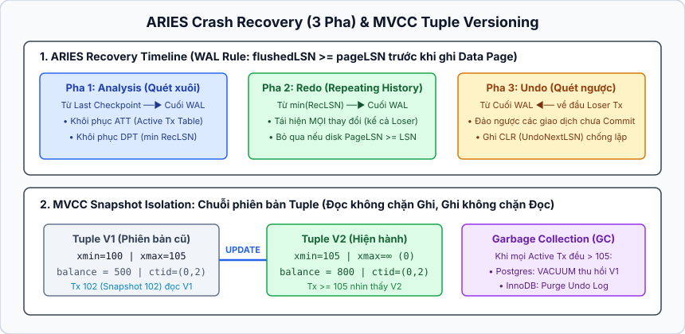
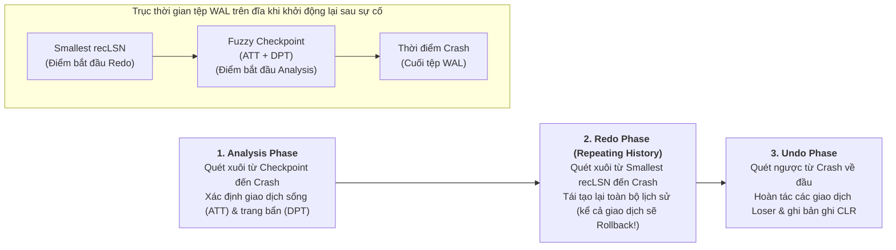

## Table of Contents
1. [Quản lý Buffer Pool và Page Cache](#buffer-management)
2. [Các thuật toán thay thế trang (Cache Eviction Policies)](#cache-eviction-policies)
3. [Khôi phục sự cố (Recovery) và Write-Ahead Log (WAL)](#wal-and-recovery)
4. [Thuật toán khôi phục ARIES (3 giai đoạn)](#aries-recovery)
5. [Kiểm soát đồng thời (Concurrency Control) và các dị thường](#concurrency-control)
6. [Phân biệt Lock và Latch](#lock-vs-latch)
7. [Tóm tắt & Ghi nhớ cốt lõi (Key Takeaways)](#key-takeaways)

---

Để đảm bảo bộ tính chất **ACID** (Atomicity, Consistency, Isolation, Durability) trong khi vẫn đạt thông lượng hàng chục nghìn giao dịch mỗi giây, Storage Engine không thể ghi trực tiếp mọi thay đổi xuống các Page dữ liệu trên đĩa ngay tại thời điểm `COMMIT`. Chương 5 giải quyết hai bài toán trụ cột của hệ quản trị cơ sở dữ liệu: làm thế nào để khôi phục trạng thái bền vững sau sự cố mất điện thông qua **Write-Ahead Log (WAL)** và thuật toán **ARIES**, và làm thế nào để điều phối hàng nghìn luồng đọc/ghi đồng thời thông qua **Locks**, **Latches** và **MVCC**.

---

## Quản lý Buffer Pool và Page Cache {#buffer-management}

Các hệ cơ sở dữ liệu như PostgreSQL và InnoDB không phụ thuộc hoàn toàn vào bộ nhớ đệm tệp của hệ điều hành (`OS Page Cache` qua `mmap`), mà tự quản lý một vùng bộ nhớ RAM riêng gọi là **Buffer Pool**. Việc tự quản lý Buffer Pool cho phép Storage Engine kiểm soát chính xác thời điểm một trang dữ liệu được phép ghi xuống đĩa (để tuân thủ quy tắc WAL) và tránh hiện tượng nhân đôi bộ nhớ (**Double Buffering**) khi dùng `O_DIRECT`.

Các khái niệm cốt lõi trong Buffer Manager:
- **Pinning / Unpinning & Reference Count**: Khi một luồng thực thi cần đọc hoặc sửa một Page trong Buffer Pool, nó tăng biến đếm tham chiếu (`pin_count / ref_count`) của khung nhớ đó (**Pin**). Bất kỳ Page nào có `pin_count > 0` đều bị khóa chặt trong RAM và **không được phép bị trục xuất (evict)** ra khỏi bộ nhớ đệm. Khi thao tác hoàn tất, luồng giảm `pin_count` (**Unpin**).
- **Dirty Page**: Một Page đã bị sửa đổi trong RAM nhưng nội dung mới chưa được đồng bộ xuống tệp dữ liệu trên đĩa sẽ được gắn cờ `dirty = true`.
- **Flush vs Force**: **Flush** là hành động ghi các Dirty Page từ Buffer Pool xuống đĩa (thường do tiến trình nền Checkpointer thực hiện bất đồng bộ); **Force** là việc bắt buộc phải đẩy toàn bộ Dirty Page của một giao dịch xuống đĩa đồng bộ ngay tại thời điểm giao dịch gọi `COMMIT`.

---

## Các thuật toán thay thế trang (Cache Eviction Policies) {#cache-eviction-policies}

Khi Buffer Pool đầy và cần nạp một Page mới từ đĩa, hệ thống phải chọn một Page hiện có (với `pin_count == 0`) để trục xuất.

### 1. Điểm yếu chí mạng của LRU thuần túy (Pure LRU)
Thuật toán **LRU (Least Recently Used)** dùng một danh sách liên kết đôi, đưa mọi trang vừa được truy cập lên đầu danh sách (`Head`) và trục xuất trang ở cuối danh sách (`Tail`). Trong cơ sở dữ liệu, Pure LRU có hai điểm yếu lớn:
1. **Ô nhiễm bộ nhớ đệm do quét bảng (Sequential Scan Cache Pollution)**: Một câu truy vấn báo cáo chạy `SELECT * FROM logs` (Full Table Scan) đọc qua hàng triệu trang dữ liệu chỉ dùng đúng `1` lần sẽ đẩy toàn bộ các trang chỉ mục nóng (Hot Index Pages) ra khỏi Buffer Pool!
2. **Tranh chấp khóa ở đầu danh sách (Mutex Contention)**: Ngay cả khi chỉ đọc dữ liệu, mọi luồng CPU đều phải giành quyền khóa Mutex của danh sách liên kết để di chuyển nút vừa đọc lên đầu danh sách, biến danh sách LRU thành cổ chai tuần tự.

### 2. So sánh các thuật toán Eviction trong thực tế

| Thuật toán | Cơ chế hoạt động cốt lõi | Ưu điểm kỹ thuật | Hệ thống tiêu biểu |
| :--- | :--- | :--- | :--- |
| **Pure LRU** | Danh sách liên kết đôi đơn lẻ; mỗi lần chạm đều đẩy trang lên đầu danh sách. | Cài đặt đơn giản. | Ít dùng trực tiếp trong DB thực tế do dễ bị Cache Pollution và tranh chấp khóa. |
| **2Q (Two Queue)** / **Midpoint Insertion** | Chia bộ nhớ đệm thành `2` vùng: hàng đợi **FIFO / Old Sublist** (cho trang mới nạp lần đầu) và hàng đợi **LRU / Young Sublist** (cho trang được truy cập từ lần thứ `2` trở lên). | Chặn đứng hiện tượng Full Table Scan làm tràn bộ nhớ đệm: các trang chỉ đọc `1` lần khi quét tuần tự sẽ đi vào vùng `Old` và bị đẩy ra ngay mà không chạm tới vùng `Young`. | **MySQL InnoDB** (chia danh sách theo tỷ lệ `5/8` Young và `3/8` Old, chèn trang mới vào điểm giữa Midpoint). |
| **LRU-K** | Theo dõi lịch sử thời điểm của `K` lần truy cập gần đây (thường là `LRU-2`), ưu tiên giữ các trang có khoảng cách giữa `2` lần truy cập ngắn thay vì trang chỉ mới xuất hiện `1` lần. | Phân biệt chính xác tần suất truy cập thực tế (Frequency) với sự xuất hiện nhất thời (Recency). | **SQL Server**, các hệ thống lưu trữ phân tích. |
| **CLOCK (Second-Chance / Clock-Sweep)** | Xếp các khung trang thành vòng tròn với một kim đồng hồ (`clock_hand`) và mỗi trang có một bộ đếm `usage_count` (hoặc `1 bit` tham chiếu). Khi cần trục xuất, kim quét qua từng trang: nếu `usage_count > 0` thì giảm đi `1` và cho cơ hội thứ hai; nếu `usage_count == 0` thì trục xuất trang đó. | **Không cần sửa đổi danh sách liên kết khi đọc!** Khi đọc một trang chỉ cần tăng biến đếm nguyên tử (`atomic increment`), loại bỏ hoàn toàn tranh chấp khóa trung tâm giữa các luồng đọc. | **PostgreSQL** (`Clock-Sweep` với `usage_count` tối đa bằng `5`). |

---

## Khôi phục sự cố (Recovery) và Write-Ahead Log (WAL) {#wal-and-recovery}

### 1. Chính sách STEAL / NO-STEAL và FORCE / NO-FORCE
Thiết kế bộ quản lý Buffer Pool và hệ thống khôi phục xoay quanh hai quyết định thiết kế độc lập:
- **STEAL vs NO-STEAL (Liên quan đến tính Atomicity / Undo)**: Bộ quản lý Buffer Pool có được phép lấy khung nhớ của một **Dirty Page chứa dữ liệu của giao dịch chưa `COMMIT`** để ghi xuống đĩa khi thiếu RAM hay không?
  - `NO-STEAL`: Cấm ghi trang chưa commit xuống đĩa. Đơn giản hóa việc khôi phục (không cần Undo trên đĩa), nhưng nếu một giao dịch cập nhật số lượng dòng lớn hơn dung lượng RAM, hệ thống sẽ bị treo vì hết bộ nhớ!
  - `STEAL`: Cho phép ghi trang chưa commit xuống đĩa bất cứ lúc nào, đổi lại phải có cơ chế **Undo Log** để hoàn tác nếu giao dịch đó bị hủy hoặc sập nguồn.
- **FORCE vs NO-FORCE (Liên quan đến tính Durability / Redo)**: Khi giao dịch gọi `COMMIT`, hệ thống có bắt buộc phải đẩy (`fsync`) toàn bộ các Dirty Page của giao dịch đó xuống đĩa ngay lập tức hay không?
  - `FORCE`: Bắt buộc ghi mọi trang dữ liệu xuống đĩa trước khi trả về kết quả `COMMIT`. Không cần Redo khi khôi phục, nhưng biến mỗi giao dịch nhỏ thành hàng chục thao tác ghi đĩa ngẫu nhiên (`Random I/O`), làm sụp đổ thông lượng ghi.
  - `NO-FORCE`: Cho phép trả về `COMMIT` thành công ngay khi bản ghi nhật ký đã vào tệp **WAL** tuần tự, còn các Dirty Page trong RAM có thể được ghi xuống đĩa muộn hơn ở chế độ nền.

> **Lựa chọn chuẩn mực của các DBMS hiện đại**: Hầu hết các hệ quản trị cơ sở dữ liệu hiệu năng cao (PostgreSQL, InnoDB, Oracle, SQL Server) đều chọn kết hợp **STEAL + NO-FORCE**. Cơ chế này đạt tốc độ thực thi cao nhờ chỉ cần ghi tuần tự vào tệp WAL lúc commit (`NO-FORCE`) và không bị giới hạn kích thước giao dịch bởi dung lượng RAM (`STEAL`).

### 2. Quy tắc vàng của Write-Ahead Log (WAL Protocol)
Mỗi bản ghi nhật ký trong tệp WAL được gắn một số thứ tự tăng dần đơn điệu gọi là **LSN (Log Sequence Number)**. Mỗi Page dữ liệu cũng lưu trường **`pageLSN`** ghi nhận `LSN` của bản ghi WAL gần đây vừa sửa đổi trang đó. Quy tắc WAL quy định hai điều kiện bất biến:
1. **Quy tắc hỗ trợ Undo (Before Flushing Dirty Page)**: Một Dirty Page trong RAM **không được phép** ghi xuống đĩa trước khi bản ghi WAL tương ứng với `pageLSN` của nó đã được `fsync` bền vững xuống tệp WAL trên đĩa (`flushedLSN >= pageLSN`).
2. **Quy tắc hỗ trợ Redo (Before Commit)**: Một giao dịch chỉ được coi là đã `COMMIT` thành công khi mọi bản ghi WAL của nó (bao gồm bản ghi `COMMIT`) đã được `fsync` xuống đĩa.

---

## Thuật toán khôi phục ARIES (3 giai đoạn) {#aries-recovery}

Khi sử dụng chính sách **STEAL + NO-FORCE**, tại thời điểm máy chủ mất điện đột ngột, đĩa cứng sẽ rơi vào trạng thái hỗn loạn: vừa thiếu các thay đổi của những giao dịch đã `COMMIT` (do `NO-FORCE`), vừa chứa sẵn các thay đổi rác của những giao dịch chưa kịp kết thúc (do `STEAL`). Thuật toán **ARIES (Algorithms for Recovery and Isolation Exploiting Semantics)** khôi phục lại trạng thái nhất quán qua `3` giai đoạn tuần tự:

### 1. Analysis Phase (Giai đoạn Phân tích)
Quét xuôi tệp WAL từ vị trí **Fuzzy Checkpoint** gần đây đến cuối tệp WAL để dựng lại hai bảng trạng thái tại thời điểm xảy ra sự cố:
- **ATT (Active Transaction Table)**: Danh sách tất cả các giao dịch đang chạy dở dang (chưa có bản ghi `COMMIT` hay `ABORT` trong WAL) tại lúc sập nguồn — đây là các **"Loser Transactions"** cần phải hoàn tác.
- **DPT (Dirty Page Table)**: Danh sách các Page có thay đổi đã ghi vào WAL nhưng có thể chưa được đẩy xuống đĩa, kèm theo trường **`recLSN`** (Recovery LSN — `LSN` đầu tiên làm bẩn trang đó kể từ lần trang được ghi xuống đĩa gần đây).

### 2. Redo Phase (Giai đoạn Làm lại — "Repeating History")
Điểm đặc trưng của ARIES là nguyên lý **Repeating History**: hệ thống tìm giá trị `recLSN` nhỏ nhất trong bảng `DPT` và quét xuôi tới cuối tệp WAL để **thực hiện lại TẤT CẢ các thao tác đã ghi trong nhật ký** — bao gồm cả thao tác của những giao dịch đã `COMMIT` lẫn những giao dịch chưa `COMMIT` (sẽ bị hoàn tác ở bước sau).
- Đối với mỗi bản ghi WAL, hệ thống chỉ bỏ qua không cần Redo nếu trang dữ liệu trên đĩa đã có `pageLSN >= LSN` của bản ghi đó.
- Kết thúc giai đoạn Redo, cơ sở dữ liệu được đưa về **đúng trạng thái bộ nhớ RAM ngay trước tích tắc xảy ra sự cố**.

### 3. Undo Phase (Giai đoạn Hoàn tác)
Hệ thống quét ngược tệp WAL từ cuối về đầu để hoàn tác mọi thay đổi của các giao dịch chưa hoàn tất (**Loser Transactions** trong bảng `ATT`) theo thứ tự ngược thời gian.
- **Compensation Log Record (CLR)**: Mỗi khi thực hiện hoàn tác một bước (Undo), ARIES **ghi thêm một bản ghi nhật ký mới vào WAL gọi là `CLR`**. Bản ghi `CLR` chứa trường con trỏ **`UndoNextLSN`** trỏ thẳng tới bản ghi tiếp theo cần hoàn tác của giao dịch đó.
- **Tại sao cần `CLR`?** Nếu máy chủ lại bị mất điện một lần nữa ngay trong lúc đang chạy khôi phục (Crash during Recovery), nhờ giai đoạn Redo thực thi lại các bản ghi `CLR` và nhảy qua các bước đã hoàn tác thông qua `UndoNextLSN`, quá trình khôi phục đảm bảo tính lũy đẳng (**Idempotent**) và không bao giờ phải hoàn tác lại từ đầu những phần đã Undo xong.

---

## Kiểm soát đồng thời (Concurrency Control) và các dị thường {#concurrency-control}

Khi nhiều giao dịch cùng đọc và sửa dữ liệu đồng thời, nếu không có cơ chế cách ly phù hợp sẽ xuất hiện các hiện tượng dị thường dữ liệu (**Read & Write Anomalies**):

### 1. Các dị thường đọc và ghi (Anomalies)
- **Dirty Read**: Giao dịch `T1` đọc được dữ liệu vừa sửa bởi `T2` nhưng `T2` chưa `COMMIT` (nếu `T2` sau đó `ROLLBACK`, `T1` đã đọc phải dữ liệu ma không hề tồn tại).
- **Non-Repeatable Read (Fuzzy Read)**: Trong cùng một giao dịch `T1`, hai lần đọc cùng một dòng `id = 10` trả về hai giá trị khác nhau do giao dịch `T2` đã cập nhật và `COMMIT` ở giữa hai lần đọc đó.
- **Phantom Read**: Giao dịch `T1` thực thi cùng một câu truy vấn khoảng `WHERE age > 20` hai lần nhưng lần thứ hai thấy xuất hiện thêm (hoặc mất đi) một số dòng do `T2` vừa `INSERT`/`DELETE`.
- **Lost Update**: Hai giao dịch `T1` và `T2` cùng đọc giá trị `balance = 100`, cùng cộng thêm `50` trong bộ nhớ và lần lượt ghi đè `balance = 150` xuống đĩa — làm mất một lần cộng tiền.
- **Write Skew (Dị thường lệch ghi dưới Snapshot Isolation)**: Đây là dị thường tinh vi xảy ra ngay cả khi hệ thống đã bật **MVCC / Snapshot Isolation (`REPEATABLE READ` trong PostgreSQL)**.
  - **Ví dụ kinh điển (Ca trực bác sĩ)**: Bệnh viện có quy tắc bất biến *"Mỗi ca trực phải có ít nhất `1` bác sĩ đang trực (`on_call = true`)"*. Hiện tại cả bác sĩ Alice và Bob đều đang trực (`count = 2`).
  - Giao dịch `T1` (Alice xin nghỉ) và `T2` (Bob xin nghỉ) bắt đầu cùng lúc trên cùng một bản chụp dữ liệu (**Snapshot**):
    1. `T1` chạy `SELECT count(*) FROM doctors WHERE on_call = true` -> thấy `2 >= 2` (hợp lệ).
    2. `T2` chạy `SELECT count(*) FROM doctors WHERE on_call = true` -> cũng thấy `2 >= 2` (hợp lệ).
    3. `T1` cập nhật dòng của **Alice** thành `on_call = false` và `COMMIT`.
    4. `T2` cập nhật dòng của **Bob** thành `on_call = false` và `COMMIT`.
  - Vì `T1` và `T2` sửa **hai dòng hoàn toàn khác nhau** (`Alice` vs `Bob`), bộ phát hiện xung đột ghi-ghi (`First-Committer-Wins`) của Snapshot Isolation không báo lỗi! Kết quả cuối cùng là cả hai bác sĩ đều nghỉ (`count = 0`), phá vỡ ràng buộc toàn vẹn nghiệp vụ.

### 2. Ba trường phái kiểm soát đồng thời
1. **Pessimistic Concurrency Control (2PL - Two-Phase Locking)**:
   - Giao dịch phải xin khóa chia sẻ (**Shared Lock - S**) trước khi đọc và khóa độc quyền (**Exclusive Lock - X**) trước khi ghi; không được xin thêm khóa mới sau khi đã bắt đầu nhả khóa.
   - Để chặn **Phantom Read** và **Write Skew**, hệ thống không chỉ khóa các dòng đang tồn tại mà còn phải dùng **Predicate Locks** hoặc **Gap Locks / Next-Key Locks** (như trong MySQL InnoDB) để khóa luôn cả các khoảng trống giữa các khóa trong chỉ mục B-Tree, ngăn giao dịch khác chèn bản ghi mới vào khoảng đang đọc.
2. **Optimistic Concurrency Control (OCC)**:
   - Cho phép các giao dịch đọc và sửa dữ liệu trên vùng nhớ riêng mà không giữ khóa trong suốt giai đoạn làm việc (**Read/Working Phase**). Khi gọi `COMMIT`, hệ thống bước vào **Validation Phase** để kiểm tra xem tập dữ liệu đã đọc (`Read Set`) có bị giao dịch khác sửa đổi trong thời gian đó hay không; nếu có xung đột thì hủy và chạy lại giao dịch.
3. **MVCC (Multi-Version Concurrency Control) & SSI (Serializable Snapshot Isolation)**:
   - Mỗi lần cập nhật bản ghi sẽ tạo ra một phiên bản mới gắn kèm dấu thời gian hoặc mã giao dịch (`xmin`, `xmax` trong PostgreSQL). **Đọc không bao giờ chặn Ghi, và Ghi không bao giờ chặn Đọc**.
   - **Snapshot Isolation (SI)** chặn được Dirty Read, Non-Repeatable Read và Lost Update, nhưng vẫn bị **Write Skew**. Để đạt mức cô lập tuyệt đối `SERIALIZABLE` mà không cần khóa chặn như 2PL, PostgreSQL sử dụng **SSI (Serializable Snapshot Isolation)**: dùng các khóa nhẹ trong RAM (`SIREAD Locks`) để theo dõi đồ thị phụ thuộc đọc-ghi (`rw-antidependency`) và chủ động hủy giao dịch nếu phát hiện cấu trúc chu trình nguy hiểm dẫn đến Write Skew.

---

## Phân biệt Lock và Latch {#lock-vs-latch}

Trong tài liệu hệ thống cơ sở dữ liệu, **Lock** và **Latch** là hai cơ chế đồng bộ hóa hoàn toàn khác biệt về mục đích và tầng hoạt động:

| Tiêu chí so sánh | Lock (Khóa giao dịch logic) | Latch (Mutex / RWLatch nội bộ) |
| :--- | :--- | :--- |
| **Đối tượng bảo vệ** | Bảo vệ các thực thể dữ liệu logic của người dùng (Row, Tuple, Key Range, Table). | Bảo vệ cấu trúc dữ liệu vật lý trong bộ nhớ RAM (B-Tree Page, Hash Table Bucket, LRU List). |
| **Thời gian nắm giữ** | Giữ trong suốt vòng đời của một giao dịch SQL (từ vài mili-giây đến vài giây, chờ cả mạng và I/O). | Chỉ giữ trong thời gian cực ngắn (vài chục nano-giây đến micro-giây) khi đang đọc hoặc tách một Page trong RAM. |
| **Đối tượng cạnh tranh** | Các giao dịch người dùng khác nhau (Transactions). | Các luồng thực thi CPU (Worker Threads). |
| **Xử lý Deadlock** | Có đồ thị `Wait-For Graph` hoặc Timeout để phát hiện Deadlock và tự động `ROLLBACK` một giao dịch nạn nhân. | **Không có bộ phát hiện Deadlock runtime!** Lập trình viên Storage Engine phải tuân thủ nghiêm ngặt thứ tự lấy Latch (ví dụ **Latch Crabbing / Coupling** từ trên xuống dưới, từ trái qua phải) để đảm bảo không bao giờ xảy ra Deadlock. |
| **Khả năng Rollback** | Thay đổi dưới sự bảo vệ của Lock có thể được hoàn tác qua Undo Log / WAL. | Thay đổi vật lý dưới Latch là các bước nguyên tử nội bộ, được ẩn hoàn toàn khỏi giao dịch SQL. |

---

## Tóm tắt & Ghi nhớ cốt lõi (Key Takeaways) {#key-takeaways}

- **Buffer Pool ưu tiên 2Q / LRU-K / CLOCK thay vì Pure LRU**: Để ngăn một câu truy vấn quét toàn bộ bảng (`SELECT *`) đẩy toàn bộ dữ liệu nóng ra khỏi RAM (Cache Pollution), InnoDB dùng danh sách chia đôi **Midpoint Insertion (Young/Old)** còn PostgreSQL dùng thuật toán **Clock-Sweep**.
- **STEAL + NO-FORCE kết hợp với ARIES là kiến trúc chuẩn**: `STEAL` cho phép đẩy trang bẩn chưa commit xuống đĩa khi thiếu RAM (cần Undo); `NO-FORCE` cho phép commit tức thì chỉ bằng cách `fsync` tệp WAL tuần tự mà không cần chờ ghi các trang dữ liệu ngẫu nhiên (cần Redo).
- **3 bước của ARIES (`Analysis -> Redo -> Undo`)**: Giai đoạn Redo thực hiện nguyên lý **Repeating History** (tái tạo lại trạng thái ngay trước lúc sập nguồn, kể cả các giao dịch chưa commit), sau đó giai đoạn Undo mới hoàn tác các giao dịch dở dang và ghi bản ghi **CLR** để đảm bảo an toàn nếu sập nguồn lặp lại.
- **Snapshot Isolation (MVCC) vẫn bị lỗi Write Skew**: Hai giao dịch đọc cùng một tập dữ liệu rồi cập nhật hai dòng khác nhau sẽ vượt qua bộ kiểm tra xung đột ghi-ghi; để ngăn chặn cần dùng `SELECT ... FOR UPDATE`, **Next-Key Locks (2PL)** hoặc nâng lên mức **Serializable Snapshot Isolation (SSI)**.
- **Phân biệt rõ Lock và Latch**: **Lock** bảo vệ dòng dữ liệu logic suốt giao dịch và hỗ trợ phát hiện Deadlock; **Latch** là Mutex cấp thấp bảo vệ cấu trúc bộ nhớ của Page trong vài nano-giây và được giải quyết bằng kỹ thuật **Latch Crabbing**.

### Tài liệu & Nguồn tham khảo
- [Mohan, C., et al. (1992) — *ARIES: A Transaction Recovery Method Supporting Fine-Granularity Locking and Partial Rollbacks Using Write-Ahead Logging*](https://people.eecs.berkeley.edu/~brewer/cs262/Aries.pdf)
- [Berenson, H., et al. (1995) — *A Critique of ANSI SQL Isolation Levels*](https://www.microsoft.com/en-us/research/wp-content/uploads/2016/02/tr-95-51.pdf)
- [Cahill, M. J., Röhm, U., & Fekete, A. D. (2008) — *Serializable Isolation for Snapshot Databases*](https://dl.acm.org/doi/10.1145/1376616.1376690)
