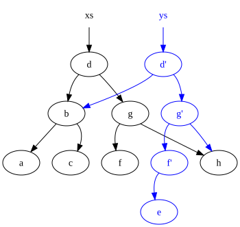
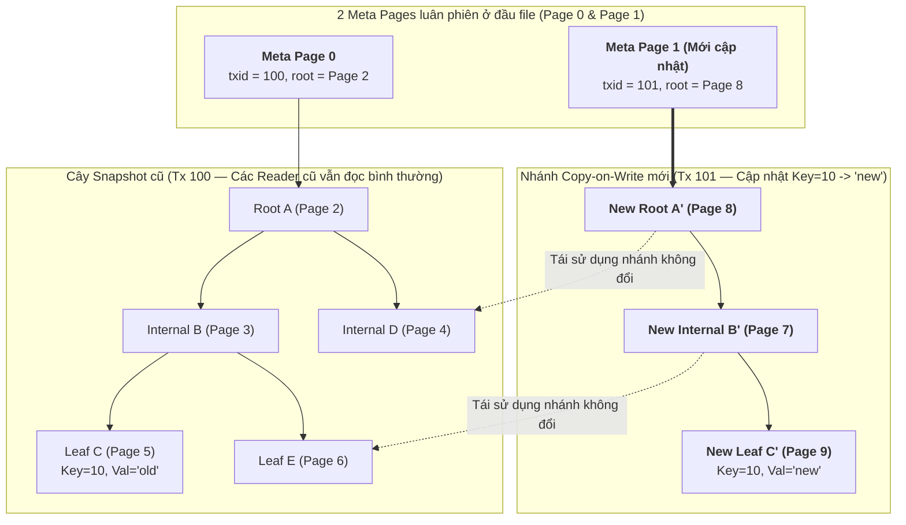
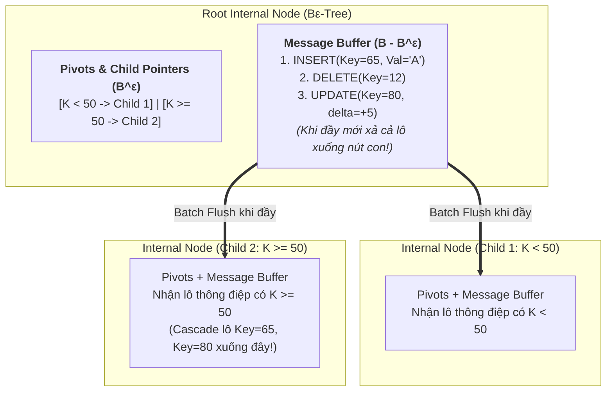
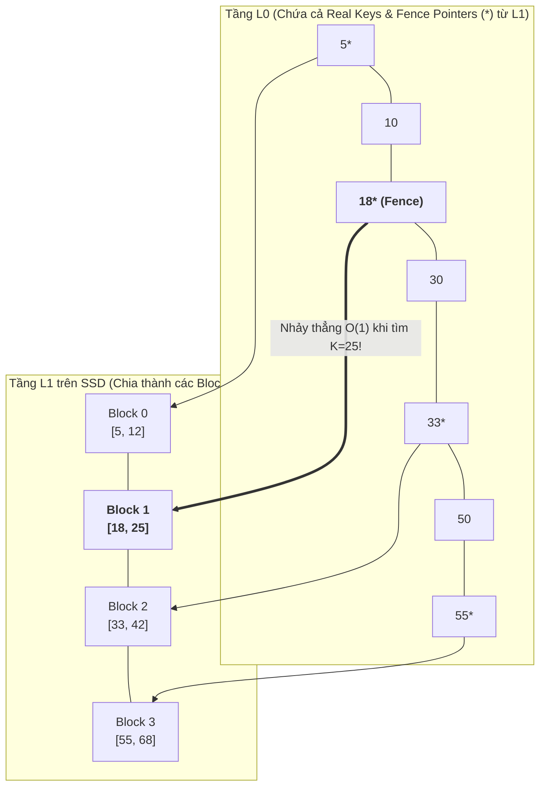
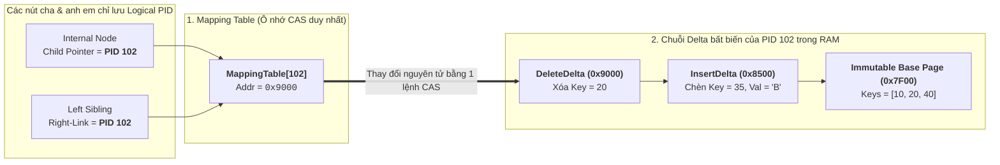
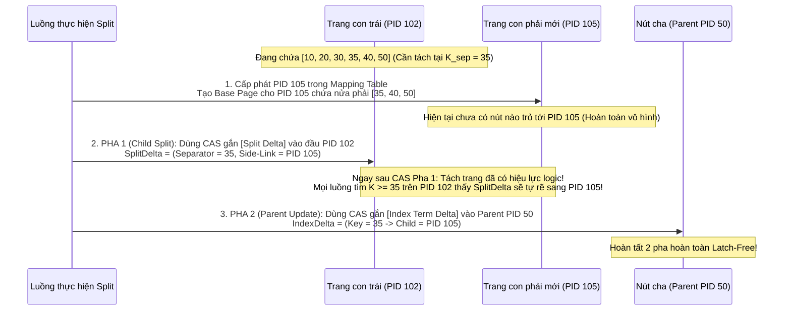

## Table of Contents
1. [Tại sao `B+Tree` truyền thống gặp nút thắt trên phần cứng hiện đại?](#standard-btree-bottlenecks)
2. [Copy-on-Write (CoW) B-Trees (LMDB, Btrfs, ZFS)](#copy-on-write-btrees)
3. [Lazy-Adaptive Trees: $B^\varepsilon$-Tree và kiến trúc của WiredTiger](#lazy-adaptive-wiredtiger)
4. [FD-Trees (Flash-Disk Trees) và kỹ thuật Fractional Cascading](#fd-trees-fractional-cascading)
5. [Bw-Trees: B-Tree không dùng Latch (Latch-Free với CAS)](#bw-trees-latch-free)
6. [Bảng so sánh tổng hợp các biến thể B-Tree](#comparison-table)
7. [Tóm tắt & Ghi nhớ cốt lõi (Key Takeaways)](#key-takeaways)

---

`B+Tree` truyền thống với cơ chế cập nhật tại chỗ (**In-place Update**) được phát minh từ đầu thập niên `1970` — thời điểm mà ổ đĩa từ tính (**HDD**) và vi xử lý đơn nhân thống trị. Khi chuyển sang kiến trúc phần cứng hiện đại gồm ổ cứng thể rắn **SSD/NVMe** và máy chủ có hàng chục đến hàng trăm nhân CPU (`Multi-core / NUMA`), `B+Tree` cổ điển bộc lộ những giới hạn vật lý nghiêm trọng về khuếch đại ghi ngẫu nhiên (**Random Write Amplification**) và tranh chấp khóa bộ nhớ (**Latch Contention**). Chương 6 phân tích bốn biến thể B-Tree hiện đại giải quyết triệt để những nút thắt này.

---

## Tại sao `B+Tree` truyền thống gặp nút thắt trên phần cứng hiện đại? {#standard-btree-bottlenecks}

Khi thực thi khối lượng công việc có tần suất ghi và cập nhật cao, `B+Tree` cập nhật tại chỗ vấp phải `3` rào cản vật lý lớn:
1. **Sự bất đối xứng của ổ cứng SSD/NVMe và Write Amplification**:
   - Khác với HDD, chip nhớ **NAND Flash (SSD)** không thể ghi đè trực tiếp lên một trang dữ liệu cũ. SSD đọc và ghi theo đơn vị **Flash Page** (`4 KB` – `16 KB`), nhưng **chỉ có thể xóa trắng theo đơn vị `Erase Block` khổng lồ (`256 KB` – `4 MB`)**.
   - Khi `B+Tree` sửa `1` dòng nhỏ dài `100 bytes` và ghi đè một Page `16 KB` tại vị trí ngẫu nhiên, tầng điều khiển của SSD (**FTL — Flash Translation Layer**) phải ghi trang đó sang một vùng vật lý mới, đánh dấu trang cũ là rác (`Stale`), và liên tục chạy bộ thu gom rác nội bộ (**SSD Garbage Collection**) để chép các trang còn sống sang khối khác rồi mới xóa được `Erase Block`. Điều này gây **Write Amplification kép**, làm sụt giảm tuổi thọ SSD và gây độ trễ đuôi (`p99 Tail Latency`) tăng vọt.
2. **Tranh chấp Latch giữa các nhân CPU (`Page Latch Contention`)**:
   - Để sửa một Page trong RAM, luồng ghi phải chiếm **Exclusive Latch (`X-Latch`)** trên Page đó. Trên máy chủ `64–128` nhân CPU, việc các nhân liên tục tranh giành biến nguyên tử của `RWLatch` trên các trang nóng làm phát sinh bão đồng bộ bộ nhớ đệm (**CPU Cache Line Bouncing / Invalidation** qua giao thức MESI) và buộc hệ điều hành phải chuyển ngữ cảnh (`Context Switch`).
3. **Gánh nặng duy trì Write-Ahead Log (WAL) và khôi phục ARIES**:
   - Mọi thao tác cập nhật tại chỗ đều bị ràng buộc bởi giao thức WAL: mỗi thay đổi phải ghi `2` lần (một lần vào tệp WAL, một lần khi Flush Dirty Page), đồng thời mã nguồn phải gánh toàn bộ độ phức tạp của thuật toán khôi phục `Analysis -> Redo -> Undo`.

---

## Copy-on-Write (CoW) B-Trees (LMDB, Btrfs, ZFS) {#copy-on-write-btrees}

### Bài toán thực tế & Mental Model

Làm thế nào để một cơ sở dữ liệu đảm bảo tính nguyên tử (`Atomicity`) và bền vững (`Durability`) tuyệt đối trước sự cố mất điện mà **hoàn toàn không cần tệp Write-Ahead Log (WAL)**, đồng thời cho phép các luồng đọc truy cập dữ liệu với tốc độ tối đa mà **không cần bất kỳ Lock hay Latch nào**?

**Mental Model — "Xuất bản ấn phẩm mới thay vì tẩy xóa trên bản gốc" (`Path Copying`):**
Trong `B+Tree` truyền thống, khi sửa một chữ ở trang sách số `4`, thủ thư lấy cục tẩy xóa trực tiếp trên trang `4` đang có độc giả ngồi đọc (nên phải đuổi độc giả ra ngoài bằng Latch và phải ghi sổ nhật ký WAL phòng khi đang tẩy dở thì mất điện).
Ngược lại, trong **Copy-on-Write (CoW) B-Tree** (được sử dụng trong **LMDB — Lightning Memory-Mapped Database**, hệ thống tệp **Btrfs**, **ZFS**, và **CouchDB**), **mọi Page đã ghi xuống đĩa đều là bất biến (`Immutable`)**. Muốn sửa trang lá `C`:
1. Hệ thống lấy một tờ giấy trắng ở vùng trống, chép nội dung trang `C` sang kèm theo chữ mới để tạo ra trang **`C'`**.
2. Vì trang con đã đổi địa chỉ từ `C` sang `C'`, nút cha `B` cũng được chép sang tờ giấy mới **`B'`** trỏ tới `C'`.
3. Cuối cùng nút gốc `Root A` cũng được chép sang **`New Root A'`** trỏ tới `B'`.
Trong suốt thời gian luồng ghi đang lặng lẽ xây dựng nhánh mới `C' -> B' -> A'`, toàn bộ các luồng đọc vẫn đọc trên cây cũ `Root A` một cách bình yên mà không hề biết có luồng ghi đang chạy!





### Ví dụ chạy tay từng bước (Dry Run): Cập nhật, Dual Meta Pages và Freelist trong LMDB

Hãy theo dõi cách **LMDB** thực hiện một giao dịch cập nhật `Key = 10` từ `'old'` sang `'new'`, cách nó `COMMIT` nguyên tử không cần WAL qua **2 trang Meta (`Meta 0` và `Meta 1`)**, và cách nó thu hồi trang cũ:

#### 1. Cơ chế `Dual Meta Pages` (`Page 0` và `Page 1`) thay thế hoàn toàn WAL
Ở ngay đầu tệp dữ liệu của LMDB luôn cố định `2` trang đặc biệt là **`Meta Page 0` (tại `Page 0`)** và **`Meta Page 1` (tại `Page 1`)**. Mỗi trang Meta lưu cặp thông tin cốt lõi: `(txid, root_page_id)`.
- Giả sử trước khi giao dịch `Tx 101` bắt đầu:
  - `Meta Page 0`: `(txid = 100, root = Page 2)` *(Đang là bản mới nhất vì `100 > 99`)*.
  - `Meta Page 1`: `(txid = 99, root = Page 15)` *(Bản của giao dịch trước đó)*.
- Khi giao dịch ghi **`Tx 101`** sửa `Key = 10` tại `Leaf C (Page 5)`:
  1. **Bước 1 — Ghi nhánh trang mới ra vùng trống**: `Tx 101` cấp phát `3` trang mới: ghi `Leaf C'` vào **`Page 9`**, ghi `Internal B'` (trỏ tới `Page 9` và `Page 6`) vào **`Page 7`**, và ghi `New Root A'` (trỏ tới `Page 7` và `Page 4`) vào **`Page 8`**. Sau đó gọi `fsync()` để đẩy cả `Page 9, 7, 8` xuống đĩa.
     *(Lưu ý: Nếu mất điện ngay lúc này, trên đĩa `Meta Page 0` vẫn có `txid = 100` lớn nhất trỏ vào `Root A (Page 2)` nguyên vẹn `100%`! Các trang `9, 7, 8` chỉ coi như vùng trống chưa ai trỏ tới, không cần chạy `Undo`!).*
  2. **Bước 2 — Atomic Flip trên Meta Page đối diện**: Sau khi các trang dữ liệu mới đã nằm an toàn trên đĩa, `Tx 101` ghi đè vào trang Meta có chỉ số `txid % 2 = 101 % 2 = 1` (tức **`Meta Page 1`**):
     $$\text{Meta Page 1} \leftarrow (\text{txid} = 101, \text{root} = \text{Page 8})$$
     Vì thao tác ghi một cấu trúc nhỏ vài chục byte vào một sector đĩa là nguyên tử, ngay khi `Meta Page 1` được `fsync()`, giao dịch `Tx 101` chính thức **`COMMIT` thành công**! Mọi luồng đọc mới vào hệ thống sẽ so sánh `Meta 0 (txid = 100)` và `Meta 1 (txid = 101)`, chọn `max(txid) = 101` và bắt đầu duyệt từ **`New Root A' (Page 8)`**.

#### 2. Quản lý `Freelist` theo `Oldest Active Reader`
Sau khi `Tx 101` đã chuyển gốc sang `Page 8`, `3` trang cũ của nhánh trước là **`Page 2` (`Root A`), `Page 3` (`Internal B`), và `Page 5` (`Leaf C`)** đã trở thành trang lỗi thời (`Obsolete Pages`). Tuy nhiên, LMDB **chưa được phép tái sử dụng ngay** `3` trang này nếu vẫn còn một luồng đọc cũ đang đọc dở trên cây `Tx 100`!
- LMDB đưa danh sách các trang vừa giải phóng vào **Freelist** gắn liền với mã giao dịch giải phóng chúng:
  $$\text{Freelist}[\text{Tx } 101] = \{\text{Page 2, Page 3, Page 5}\}$$
- Trong bảng `Reader Lock Table` (bộ nhớ dùng chung), mỗi luồng đọc khi bắt đầu đều ghi lại `txid` mà nó đang đọc:
  - Giả sử đang có `Reader R1` đọc ở `txid = 100` và `Reader R2` đọc ở `txid = 101`.
  - Khi giao dịch ghi tiếp theo `Tx 102` cần xin trang trống, nó kiểm tra `oldest_reader_txid = min(100, 101) = 100`. Vì `100 < 101`, các trang trong `Freelist[Tx 101]` (`Page 2, 3, 5`) vẫn đang được `Reader R1` nhìn thấy nên **chưa được phép ghi đè**!
  - Ngay khi `Reader R1` kết thúc (`oldest_reader_txid` tăng lên `101` hoặc không còn reader cũ), ở giao dịch ghi kế tiếp, toàn bộ `{Page 2, Page 3, Page 5}` được thu hồi để ghi dữ liệu mới mà tệp cơ sở dữ liệu không cần phình thêm dung lượng!

> [!WARNING]
> **Rủi ro kinh điển trong vận hành CoW B-Tree (Long-running Reader Leak):**
> Nếu một luồng ứng dụng mở một giao dịch đọc (`Read Transaction`) trong LMDB rồi bị treo hoặc quên đóng suốt nhiều giờ, biến `oldest_reader_txid` sẽ bị ghim chặt ở quá khứ. Hệ quả là **không một trang cũ nào trong `Freelist` được phép tái sử dụng**, khiến mọi giao dịch ghi mới buộc phải xin thêm dung lượng ở cuối tệp và làm kích thước tệp đĩa phình to gấp hàng chục lần cho đến khi tràn ổ cứng!

---

## Lazy-Adaptive Trees: $B^\varepsilon$-Tree và kiến trúc của WiredTiger {#lazy-adaptive-wiredtiger}

### Bài toán thực tế & Mental Model

Mặc dù CoW B-Tree giải quyết được bài toán đọc không khóa và loại bỏ WAL, nó lại làm trầm trọng thêm hiện tượng **Write Amplification**: sửa `1` bản ghi nhỏ ở nút lá buộc phải ghi mới toàn bộ chuỗi trang từ lá lên gốc ($O(\log_B N)$ trang đĩa cho mỗi lần sửa). Trong khi đó, ở `B+Tree` truyền thống, một lệnh `INSERT` khóa ngẫu nhiên cũng phải đi một mạch từ Root xuống tận Leaf và làm bẩn nguyên một trang lá `16 KB` chỉ vì `1` dòng dữ liệu.

Làm thế nào để giữ được cấu trúc phân cây của B-Tree (giúp đọc nhanh), nhưng lại **gom hàng trăm thao tác sửa đổi nhỏ lẻ thành từng lô lớn (`Batch`)** trước khi đẩy xuống các tầng bên dưới?

### 1. Cấu trúc $B^\varepsilon$-Tree (Buffered Repository Tree — TokuDB, BetrFS)

**Mental Model — "Trạm trung chuyển bưu kiện tại mỗi ngã ba" ($B^\varepsilon$-Tree):**
Trong `B+Tree` thường, mỗi khi có `1` bức thư (`INSERT / UPDATE / DELETE`), người đưa thư phải chạy bộ từ tổng đài (`Root`) qua các trạm tỉnh/huyện (`Internal Nodes`) xuống tận nhà dân (`Leaf Node`) để giao ngay lập tức.
Trong **$B^\varepsilon$-Tree** (do *Brodal & Fagerberg* đề xuất năm 2003), mỗi nút trung gian (`Internal Node`) được chia làm `2` ngăn:
- Một phần nhỏ kích thước $B^\varepsilon$ chứa các **Khóa phân tách và Con trỏ nhánh con (`Pivots & Child Pointers`)**.
- Phần dung lượng lớn còn lại $B - B^\varepsilon$ làm **Giỏ chứa thông điệp tạm thời (`Update / Message Buffer`)**.



#### Ví dụ chạy tay: Luồng Ghi (`Batch Cascade`) và Luồng Đọc trong $B^\varepsilon$-Tree
Giả sử kích thước mỗi nút là $B = 100$ mục, chọn $\varepsilon = 0.5 \implies B^\varepsilon = \sqrt{100} = 10$ nhánh con (`Fanout = 10`), còn lại $100 - 10 = \mathbf{90}$ **chỗ trống làm `Message Buffer`** tại mỗi Internal Node:
1. **Khi thực hiện `INSERT`, `UPDATE` hoặc `DELETE`**:
   - Hệ thống **KHÔNG đi xuống Leaf Page**! Nó chỉ việc chèn một bản tin (`Message`) vào `Message Buffer` của **`Root Node`** (luôn nằm sẵn trong RAM) rồi hoàn tất ngay lập tức!
2. **Khi `Message Buffer` của một nút bị đầy (`90` bản tin)**:
   - Hệ thống tìm nhánh con đang có nhiều bản tin chờ nhất trong giỏ (theo nguyên lý Dirichlet, với `90` bản tin chia cho `10` nhánh con, chắc chắn có ít nhất một nhánh con nhận được $\ge 90 / 10 = \mathbf{9}$ bản tin cùng lúc, trung bình từ `10–20` bản tin!).
   - Hệ thống đẩy nguyên lô (`Batch Flush / Cascade`) cả chục bản tin đó xuống `Message Buffer` của nút con tương ứng chỉ trong **`1` lần đọc/ghi trang con duy nhất**! Nếu nút con đó cũng đầy, nó tiếp tục xả lô xuống tầng dưới cho tới khi chạm tới Leaf Page.
   - **Hiệu quả toán học**: Thay vì tốn $1$ lần Disk I/O cho mỗi bản ghi như `B+Tree` ($O(\log_B N)$), $B^\varepsilon$-Tree chia sẻ `1` lần Disk I/O cho cả một lô $B^{1-\varepsilon}$ bản ghi, giảm chi phí ghi xuống chỉ còn:
     $$\text{Write Cost}(B^\varepsilon\text{-Tree}) = O\left(\frac{\log_B N}{\varepsilon \cdot B^{1-\varepsilon}}\right) \ll O(\log_B N)$$
3. **Khi thực hiện `SELECT` (Đọc một khóa `K = 80`)**:
   - Luồng đọc đi từ `Root` xuống `Leaf` như B-Tree bình thường, nhưng tại mỗi nút trung gian đi qua, nó kiểm tra luôn `Message Buffer` của nút đó để nhặt các bản tin `UPDATE / DELETE` đang chờ của `K = 80` và áp dụng lên kết quả đọc từ Leaf Page!

---

### 2. Kiến trúc của WiredTiger (Storage Engine của MongoDB)

**WiredTiger** áp dụng triết lý Lazy-Adaptive ở tầng bộ nhớ bằng cách **tách biệt hoàn toàn định dạng trang trên đĩa (`On-Disk Page Format`) và định dạng trang trong RAM (`In-Memory Page Format`)**:

1. **In-Memory Update Lists (`WT_UPDATE` Chains)**:
   - Khi một trang dữ liệu được nạp từ đĩa vào RAM, WiredTiger giải nén nó thành một cấu trúc cây/mảng trong bộ nhớ.
   - Khi có lệnh `UPDATE` hoặc `INSERT` mới, thay vì sửa trực tiếp vào mảng byte của trang đĩa (vốn đòi hỏi `Exclusive Latch` và dịch chuyển bộ nhớ), WiredTiger cấp phát một nút cập nhật nhỏ **`WT_UPDATE`** gắn kèm mã giao dịch (`txid`) và nối vào đầu danh sách liên kết (`Update List`) của dòng đó bằng lệnh nguyên tử **CAS (`Compare-And-Swap`)**.
   - Các bản ghi mới chèn vào giữa trang được gom vào một danh sách **`Insert SkipList`** riêng gắn với từng khoảng khóa.
2. **Reconciliation (Hợp nhất và nén khi đẩy xuống đĩa)**:
   - Chỉ khi một trang bẩn trong RAM cần được ghi xuống đĩa (do tiến trình `Checkpoint` hoặc `Eviction` khi đầy RAM), luồng nền mới thực hiện quá trình **Reconciliation**: quét qua trang gốc kết hợp với các chuỗi `WT_UPDATE` và `Insert SkipList`, loại bỏ các phiên bản cũ không còn giao dịch nào cần nhìn thấy, thực hiện nén tiền tố (`Prefix Compression`) + nén khối (`Snappy / Zstd`), chia thành các trang đĩa mới nếu quá lớn và ghi xuống vùng trống mới trên đĩa theo cơ chế **Copy-on-Write**!

#### Ví dụ chạy tay: Bảo vệ trang trong RAM không dùng Latch bằng `Hazard Pointers`

**Bài toán**: Trong WiredTiger, các luồng đọc (`Reader Threads`) duyệt qua các trang trong RAM mà không giữ khóa `RWLatch` để đạt tốc độ tối đa. Nhưng nếu đúng lúc `Reader Thread 1` đang đọc dở dữ liệu tại địa chỉ bộ nhớ `0x7F8000` (thuộc `Page P50`), luồng thu hồi bộ nhớ (`Eviction Thread`) quyết định trục xuất `Page P50` khỏi RAM và gọi hàm `free(0x7F8000)` thì sao? `Reader Thread 1` sẽ truy cập vào vùng nhớ đã bị giải phóng (`Use-After-Free`) và làm sập toàn bộ tiến trình Database (`Segmentation Fault`)!

WiredTiger giải quyết bài toán này hoàn toàn không dùng khóa chặn thông qua cơ chế **Hazard Pointers**:

```text
Bảng Hazard Pointer Table toàn cục trong RAM (Mỗi Worker Thread sở hữu 1 ô riêng):
+---------------+--------------------------+-----------------------------------------+
| Thread Slot   | Hazard Pointer (Address) | Ý nghĩa trạng thái                      |
+---------------+--------------------------+-----------------------------------------+
| Thread 1 (R1) | 0x7F8000 (Page P50)      | "Đang đọc Page P50, CẤM giải phóng!"    |
| Thread 2 (R2) | NULL (0x0)               | Không đọc trang nào                     |
| Thread 3 (R3) | 0x9A2000 (Page P12)      | "Đang đọc Page P12, CẤM giải phóng!"    |
+---------------+--------------------------+-----------------------------------------+
```

Hãy theo dõi từng bước phối hợp giữa **`Reader Thread 1`** và **`Eviction Thread`**:
1. **Bước 1 — Đăng ký Hazard Pointer trước khi đọc**:
   - Khi `Reader Thread 1` muốn đọc `Page P50` (đang nằm tại địa chỉ bộ nhớ `0x7F8000`), nó ghi địa chỉ `0x7F8000` vào ô riêng của nó trong bảng toàn cục: `HazardTable[Thread_1] = 0x7F8000` (kèm rào chắn bộ nhớ `Memory Barrier`), sau đó kiểm tra lại xem con trỏ trang trên nút cha vẫn trỏ tới `0x7F8000` hay không. Nếu đúng, `Thread 1` bắt đầu đọc dữ liệu tại `0x7F8000` mà không cần khóa bất kỳ Mutex nào!
2. **Bước 2 — Luồng Eviction muốn trục xuất `Page P50` (`0x7F8000`)**:
   - `Eviction Thread` muốn giải phóng `Page P50` để lấy RAM. Đầu tiên nó dùng lệnh `CAS` chuyển trạng thái của `Page P50` sang `EVICTING` để các luồng đọc mới không nhảy vào nữa.
   - Tiếp theo, trước khi gọi `free(0x7F8000)`, `Eviction Thread` **quét qua toàn bộ bảng `HazardTable[1..N]`**.
   - Khi quét tới ô `HazardTable[Thread_1]`, nó phát hiện giá trị **`0x7F8000` đang khớp với địa chỉ của `Page P50`**!
   - `Eviction Thread` lập tức biết rằng `Thread 1` vẫn đang đọc dở trên trang này $\implies$ **Hủy/hoãn việc giải phóng bộ nhớ `0x7F8000`**!
3. **Bước 3 — Xóa Hazard Pointer sau khi đọc xong**:
   - Khi `Reader Thread 1` đọc xong dữ liệu từ `Page P50`, nó chỉ việc gán lại `HazardTable[Thread_1] = NULL`. Ở vòng quét tiếp theo, `Eviction Thread` thấy không còn ô Hazard Pointer nào chứa `0x7F8000` nữa nên thu hồi vùng nhớ `0x7F8000` một cách an toàn tuyệt đối!

---

## FD-Trees (Flash-Disk Trees) và kỹ thuật Fractional Cascading {#fd-trees-fractional-cascading}

### Bài toán thực tế & Mental Model

Để loại bỏ hoàn toàn thao tác ghi trang ngẫu nhiên trên SSD, một hướng tiếp cận là tổ chức dữ liệu thành các tầng mảng đã sắp xếp có kích thước tăng dần theo cấp số nhân ($L_0, L_1, L_2, \dots, L_k$):
- Tầng đỉnh $L_0$ là một cây nhỏ nằm gọn trong RAM nhận mọi thao tác ghi.
- Khi tầng $L_i$ đầy, toàn bộ tầng $L_i$ được trộn tuần tự (**Sequential Merge-Sort**) với tầng $L_{i+1}$ để tạo ra tầng $L_{i+1}$ mới trên SSD.

Tuy nhiên, cấu trúc phân tầng này gặp một nhược điểm lớn khi **Đọc (`Point Lookup`)**: Nếu có $k$ tầng, để tìm một khóa `K = 25`, hệ thống phải thực hiện **Tìm kiếm nhị phân (`Binary Search`) độc lập trên từng tầng một** ($L_0$, rồi $L_1$, rồi $L_2 \dots$), làm chi phí đọc tăng lên $O(k \cdot \log N)$. Làm thế nào để chỉ cần tìm kiếm ở tầng đỉnh $L_0$ đúng `1` lần, còn khi đi xuống các tầng dưới $L_1, L_2 \dots$ thì nhảy thẳng tới đúng vị trí trong $O(1)$ như B-Tree?

**Mental Model — "Thang máy nối thẳng giữa các tầng danh bạ" (`Fractional Cascading`):**
Trong thiết kế **FD-Tree (*Flash-Disk Tree*)**, kỹ thuật **Fractional Cascading** (do *Chazelle & Guibas* phát minh trong hình học tính toán) giải quyết bài toán này bằng cách: cứ mỗi khối/trang (hoặc cứ mỗi $s$ phần tử) ở tầng dưới $L_{i+1}$, hệ thống trích lấy khóa đầu tiên đẩy ngược lên chèn vào tầng trên $L_i$ dưới dạng một **Con trỏ bắc cầu (`Fence Pointer`)**! Nhờ các con trỏ bắc cầu này, tầng trên $L_i$ biết chính xác vị trí điểm rơi ở tầng dưới $L_{i+1}$ mà không cần tìm kiếm nhị phân lại từ đầu!

### Ví dụ chạy tay bằng con số cụ thể: Tìm kiếm với Fractional Cascading

Giả sử hệ thống có `2` tầng đã sắp xếp:
- **Tầng trên $L_0$** (ban đầu chỉ có `3` khóa dữ liệu thực):
  $$L_0 = [10, 30, 50]$$
- **Tầng dưới $L_1$** (có `8` khóa dữ liệu thực, được chia thành các khối nhỏ mỗi khối `2` phần tử):
  $$L_1 = \underbrace{[5, 12]}_{\text{Block 0 (idx 0..1)}} \quad \underbrace{[18, 25]}_{\text{Block 1 (idx 2..3)}} \quad \underbrace{[33, 42]}_{\text{Block 2 (idx 4..5)}} \quad \underbrace{[55, 68]}_{\text{Block 3 (idx 6..7)}}$$

#### Bước 1: Xây dựng Fence Pointers từ $L_1$ đẩy lên $L_0$
Cứ mỗi Block ở tầng dưới $L_1$, hệ thống lấy khóa đầu tiên của Block đó (`5`, `18`, `33`, `55`) đưa lên trộn vào mảng $L_0$ kèm theo con trỏ `child_idx` trỏ thẳng xuống đầu Block tương ứng ở $L_1$. Mảng $L_0$ sau khi bổ sung **Fence Pointers** (ký hiệu `*` là Fence Pointer từ $L_1$ đưa lên) trở thành:

| Vị trí tại $L_0$ | `idx 0` | `idx 1` | **`idx 2`** | `idx 3` | `idx 4` | `idx 5` | `idx 6` |
| :--- | :--- | :--- | :--- | :--- | :--- | :--- | :--- |
| **Khóa tại $L_0$** | `5*` *(Fence)* | `10` *(Real)* | **`18*` *(Fence)*** | `30` *(Real)* | `33*` *(Fence)* | `50` *(Real)* | `55*` *(Fence)* |
| **Con trỏ xuống $L_1$ (`child_block`)** | $\downarrow$ `Block 0`<br/>`[5, 12]` | $\downarrow$ `Block 0`<br/>`[5, 12]` | **$\downarrow$ `Block 1`<br/>`[18, 25]`** | $\downarrow$ `Block 1`<br/>`[18, 25]` | $\downarrow$ `Block 2`<br/>`[33, 42]` | $\downarrow$ `Block 2`<br/>`[33, 42]` | $\downarrow$ `Block 3`<br/>`[55, 68]` |



#### Bước 2: Chạy tay truy vấn tìm khóa `K = 25`
1. **Tại tầng đỉnh $L_0$ (trong RAM)**:
   - Thực hiện Binary Search cho `K = 25` trên $L_0 = [5^*, 10, 18^*, 30, 33^*, 50, 55^*]$.
   - Tìm thấy vị trí lớn nhất $\le 25$ là **`idx 2: Key = 18*`** (nằm giữa `18*` và `30`).
   - Kiểm tra thấy `25` không phải là khóa thực tại $L_0$.
2. **Nhảy thẳng xuống tầng $L_1$ trong $O(1)$ qua Fence Pointer**:
   - Thay vì phải chạy lại Binary Search trên toàn bộ mảng $L_1$, phần tử `18*` tại $L_0$ đã lưu sẵn con trỏ `child_block = Block 1 (idx 2..3)`!
   - Hệ thống đi thẳng theo con trỏ này xuống đúng **`Block 1 = [18, 25]`** ở tầng $L_1$, kiểm tra `2` phần tử trong Block 1 và **bắt trúng ngay `K = 25`**!
   - Nếu có thêm các tầng $L_2, L_3 \dots$, mỗi Block ở $L_1$ lại chứa sẵn Fence Pointer từ $L_2$ đưa lên, nên quá trình đi qua mỗi tầng chỉ tốn đúng **`1` bước nhảy con trỏ $O(1)$**!

> [!NOTE]
> **Chi phí khi Merge (Compaction) trong FD-Tree:** Vì các Fence Pointers của tầng $L_{i+1}$ được nhúng vào tầng $L_i$, mỗi khi tầng $L_i$ đầy và được trộn tuần tự xuống $L_{i+1}$ để tạo ra tầng $L_{i+1}$ mới, hệ thống cũng đồng thời trích xuất bộ Fence Pointers mới của $L_{i+1}$ đưa ngược lên các tầng trên $L_0 \dots L_i$ trong cùng một lượt quét tuần tự.

---

## Bw-Trees: B-Tree không dùng Latch (Latch-Free với CAS) {#bw-trees-latch-free}

### Bài toán thực tế & Mental Model

Trên các hệ thống cơ sở dữ liệu đa nhân hiện đại (như **Microsoft SQL Server Hekaton**), việc dùng `RWLatch` để khóa các trang B-Tree gây ra hai vấn đề lớn:
1. Nếu một luồng đang giữ `X-Latch` trên một Page mà bị hệ điều hành tạm dừng (Context Switch hoặc Page Fault), mọi luồng khác trên `63` nhân CPU còn lại muốn đi qua Page đó đều bị đóng băng!
2. Ngay cả việc ghi biến đếm của `Shared Latch` cũng làm các nhân CPU liên tục giành quyền sở hữu dòng bộ nhớ đệm `64-byte Cache Line` (`Cache Coherency Traffic`).

Làm thế nào để xây dựng một cây B-Tree mà **không một thao tác nào (kể cả `INSERT`, `UPDATE`, `DELETE` lẫn `Node Split` và `Node Merge`) dùng Latch**?

Nếu thử dùng cấu trúc Copy-on-Write trực tiếp trong RAM với lệnh nguyên tử **`CAS` (`Compare-And-Swap`)**, ta lập tức vấp phải một bức tường: Khi một trang con $P$ thay đổi địa chỉ bộ nhớ từ `0x1000` sang `0x2000`, ta phải sửa con trỏ ở nút cha $R$ **VÀ** sửa con trỏ `right_sibling` ở nút anh em bên trái $L$ cùng một lúc. Phần cứng CPU chỉ hỗ trợ lệnh `CAS` nguyên tử trên **đúng `1` ô nhớ `64-bit` đơn lẻ**, không thể `CAS` đồng thời trên cả nút cha lẫn nút anh em!

**Mental Model — "Số điện thoại tổng đài ảo (`Mapping Table`) + Giấy ghi chú dán chồng (`Delta Chain`)":**
**Bw-Tree** (do *Levandoski, Lomet & Sengupta* tại Microsoft Research thiết kế năm 2013) hóa giải bài toán này bằng `2` phát kiến cốt lõi:
1. **Mapping Table (Bảng ánh xạ trung gian)**: Mọi nút trong Bw-Tree **tuyệt đối không lưu địa chỉ bộ nhớ vật lý (`0x7F00...`) của nhau**, mà chỉ lưu **Mã số trang logic (`Logical Page ID — PID`)** (ví dụ `PID = 102`). Một bảng **Mapping Table** trung tâm ánh xạ từ `PID 102` sang địa chỉ bộ nhớ vật lý hiện tại. Khi trang `102` đổi địa chỉ vật lý mới, hệ thống chỉ cần thực hiện **đúng `1` lệnh `CAS` duy nhất tại ô `MappingTable[102]`** — cả nút cha lẫn nút anh em vẫn giữ nguyên số `PID = 102` mà không cần sửa một bit nào!
2. **Delta Records & Delta Chains (Chuỗi bản ghi chênh lệch bất biến)**: Thay vì chép lại cả trang `8 KB` mỗi khi sửa `1` dòng, mọi trang gốc (**Base Page**) đều bất biến; mỗi thao tác sửa chỉ cấp phát một mẩu giấy ghi chú nhỏ (**Delta Record**) trỏ vào đầu trang hiện tại rồi dùng `CAS` cập nhật `MappingTable[PID]` trỏ vào mẩu Delta mới đó!



### Ví dụ chạy tay từng bước (Dry Run): Cập nhật bằng CAS, Consolidation và Two-Phase Atomic Split

#### Phần A: Chèn/Xóa Latch-Free bằng `CAS` trên `Mapping Table` và `Consolidation`
Giả sử trang lá **`PID = 102`** ban đầu là một **Base Page** nằm tại địa chỉ vật lý `0x7F00`, chứa các khóa `[10, 20, 40]`. Trong bảng Mapping Table hiện có: `MappingTable[102] = 0x7F00`.

1. **Bước 1 — `Thread 1` muốn chèn `Key = 35, Val = 'B'` vào `PID 102`**:
   - `Thread 1` đọc `old_addr = MappingTable[102]` (lấy được `0x7F00`).
   - Cấp phát một bản ghi **`InsertDelta`** tại địa chỉ mới `0x8500`, ghi nội dung `(INSERT, Key=35, Val='B')` và gán con trỏ `next = 0x7F00`.
   - Thực thi lệnh phần cứng nguyên tử:
     $$\text{CAS}(\&\text{MappingTable}[102], \text{expected}=\text{0x7F00}, \text{new}=\text{0x8500})$$
   - Lệnh `CAS` thành công! Lúc này `MappingTable[102] = 0x8500`. Hoàn toàn không có một Latch nào được sử dụng!
2. **Bước 2 — `Thread 2` đồng thời muốn xóa `Key = 20` trên `PID 102`**:
   - `Thread 2` tạo bản ghi **`DeleteDelta`** tại địa chỉ `0x9000` với `next = 0x8500`, rồi gọi `CAS(&MappingTable[102], 0x8500, 0x9000)`.
   - *(Nếu giả sử `Thread 2` đọc `0x7F00` cùng lúc với `Thread 1` và bị `Thread 1` `CAS` thắng trước làm lệnh `CAS` của `Thread 2` trả về `false`, `Thread 2` chỉ việc đổi `DeleteDelta.next = 0x8500` mới rồi gọi lại `CAS` ngay lập tức!).*
3. **Bước 3 — Luồng Đọc (`Search`) và Hợp nhất chuỗi (`Consolidation`)**:
   - Khi một luồng đọc tìm kiếm trên `PID 102`, nó duyệt từ `0x9000 (Delete 20) -> 0x8500 (Insert 35) -> 0x7F00 (Base [10, 20, 40])` để tổng hợp kết quả hiện tại là `[10, 35, 40]`.
   - Khi chiều dài chuỗi Delta chạm ngưỡng cấu hình (ví dụ `8` bản ghi Delta), một luồng thực thi sẽ thực hiện **Page Consolidation**: gom `Base Page` cũ cùng toàn bộ chuỗi Delta lại trong vùng nhớ riêng để tạo ra một **Immutable Base Page mới** đã sắp xếp sạch sẽ `[10, 35, 40]` tại địa chỉ `0xA000`, sau đó dùng `1` lệnh `CAS(&MappingTable[102], 0x9000, 0xA000)` để thay thế toàn bộ chuỗi Delta bằng trang gốc mới! (Chuỗi cũ `0x9000..0x7F00` được đưa vào hàng đợi **Epoch-Based Reclamation** để giải phóng khi các luồng đọc cũ đã rời đi).

---

#### Phần B: Quy trình tách trang không khóa 2 pha (`Two-Phase Atomic Split`) trong Bw-Tree

Đây là phần tinh túy nhất của Chương 6: *Làm thế nào để tách một trang `PID 102` thành hai trang (`PID 102` và `PID 105`) và cập nhật nút cha `Parent PID 50` mà không dùng Latch, trong khi lệnh `CAS` chỉ sửa được từng trang một?*

Bw-Tree kế thừa ý tưởng **B-link Tree của Lehman & Yao** và chia quá trình tách trang thành **2 pha nguyên tử độc lập (`Two-Phase Split`)**, mỗi pha chỉ cần đúng `1` lệnh `CAS`:



Hãy theo dõi chi tiết từng pha với con số cụ thể:
- Giả sử nút cha **`Parent PID 50`** đang trỏ xuống trang lá **`PID 102`** chứa `[10, 20, 30, 35, 40, 50]`. Hệ thống quyết định tách trang này tại khóa phân tách **`K_sep = 35`**.

1. **Bước chuẩn bị (Chưa ai nhìn thấy)**:
   - Xin một mã số trang mới trong Mapping Table là **`PID = 105`** cho trang anh em bên phải (`Page Q`).
   - Tạo một `Base Page` mới cho `PID 105` chứa nửa lớn của dữ liệu: **`[35, 40, 50]`**, nối `right_sibling` của `PID 105` sang người anh em bên phải cũ của `PID 102`. Lúc này chưa có con trỏ nào trên cây trỏ tới `PID 105`.
2. **Pha 1 — Gắn `Split Delta` lên trang con `PID 102` (`Half-Split` nguyên tử)**:
   - Tạo một bản ghi **`Split Delta Record`** chứa hai thông tin:
     - `separator_key = 35` (báo hiệu mọi khóa $\ge 35$ không còn thuộc về `PID 102` nữa!).
     - `side_link = PID 105` (con trỏ B-link trỏ ngang sang trang mới bên phải!).
   - Dùng lệnh **`CAS`** trên `MappingTable[102]` để gắn `Split Delta` này vào đầu chuỗi của `PID 102`.
   - **Điều kỳ diệu ngay sau lệnh `CAS` Pha 1**: Nếu ngay tích tắc này có một luồng đọc khác đi từ `Parent PID 50` xuống `PID 102` để tìm `K = 40`, ngay ở đầu chuỗi của `PID 102` nó chạm mặt bản ghi `Split Delta (separator = 35, side_link = PID 105)`. Thấy `40 >= 35`, luồng đọc lập tức trượt ngang theo `side_link` sang `PID 105` và lấy được `40` chính xác tuyệt đối dù `Parent PID 50` chưa hề được cập nhật!
3. **Pha 2 — Gắn `Separator Index Delta` lên nút cha `Parent PID 50`**:
   - Để các luồng đọc sau này đi thẳng từ `Parent PID 50` xuống `PID 105` mà không cần đi vòng qua `PID 102`, luồng thực thi tạo một bản ghi **`Separator Index Term Delta`** chứa `(separator_key = 35, logical_child = PID 105)` và dùng lệnh **`CAS`** trên `MappingTable[50]` để gắn vào đầu chuỗi của nút cha `Parent PID 50`.

> [!IMPORTANT]
> **Giao thức tương trợ không chờ đợi (`Lock-Free Help-Along Protocol`):**
> Điều gì xảy ra nếu luồng `Thread 1` vừa thực hiện xong `CAS` Pha 1 (gắn `Split Delta` lên `PID 102`), nhưng chưa kịp làm Pha 2 (cập nhật `Parent PID 50`) thì bị hệ điều hành tạm dừng?
> Trong Bw-Tree, nếu `Thread 2` đi xuống `PID 102` và nhìn thấy một `Split Delta` chưa hoàn tất cập nhật ở nút cha, **`Thread 2` sẽ không đứng đợi `Thread 1`!** Thay vào đó, bản thân `Split Delta` đã chứa đủ mọi thông tin (`K_sep = 35`, `PID = 105`), nên **`Thread 2` tự tay thực hiện luôn lệnh `CAS` Pha 2 lên `Parent PID 50` hộ cho `Thread 1`**, rồi tiếp tục công việc của mình! Khi `Thread 1` tỉnh dậy sau đó, nó thấy `Parent PID 50` đã có khóa `35 -> PID 105` rồi nên chỉ việc kết thúc. Đây chính là bản chất của thiết kế **Wait-Free / Lock-Free** thực thụ.

---

## Bảng so sánh tổng hợp các biến thể B-Tree {#comparison-table}

| Đặc điểm kỹ thuật | Standard `B+Tree` (PostgreSQL, InnoDB) | Copy-on-Write B-Tree (LMDB, Btrfs) | Lazy-Adaptive Tree ($B^\varepsilon$-Tree / WiredTiger) | FD-Tree (Flash-Disk Tree) | Latch-Free Bw-Tree (SQL Server Hekaton) |
| :--- | :--- | :--- | :--- | :--- | :--- |
| **Cơ chế cập nhật** | Sửa đè tại chỗ (**In-place Update**) trên Slotted Page trong RAM. | Sao chép trang mới từ lá lên tới gốc (**Path Copying**). | Đệm bản tin ở Internal Node ($B^\varepsilon$) hoặc chuỗi `WT_UPDATE` trong RAM; gộp khi Flush. | Ghi vào cây nhỏ $L_0$ trong RAM; trộn tuần tự xuống các tầng SSD $L_1..L_k$. | Gắn bản ghi **Delta** bất biến vào đầu chuỗi qua lệnh `CAS`. |
| **Yêu cầu tệp WAL** | **Bắt buộc có WAL** + khôi phục ARIES 3 pha. | **Không cần WAL** (dùng `2` trang Meta luân phiên). | Có WAL (Journal) cho các thay đổi chưa kịp Checkpoint. | Có WAL cho tầng $L_0$ trong RAM. | Có WAL để khôi phục bộ nhớ sau khi mất điện. |
| **Đồng bộ hóa Đọc/Ghi** | Dùng **Page Latches (`RWLatch`)** + Latch Crabbing. | **Lock-free Reads** hoàn toàn; chỉ cho phép **1 Writer** tại một thời điểm. | Dùng `CAS` trên chuỗi `WT_UPDATE` kết hợp **Hazard Pointers**. | Khóa khi chuyển đổi các mảng tầng sau khi Merge. | **Hoàn toàn Latch-Free** cho cả Đọc, Ghi và Split nhờ `CAS` + **Mapping Table**. |
| **Điểm mạnh cốt lõi** | Độ trễ đọc cực thấp, cân bằng tốt cho tải OLTP đa dụng. | Đọc Zero-copy qua `mmap`, không bao giờ hỏng cây khi sập nguồn. | Giảm mạnh Write Amplification và nén khối trên đĩa hiệu quả cao. | Biến `100%` ghi ngẫu nhiên thành ghi tuần tự trên SSD, đọc nhanh nhờ **Fence Pointers**. | Mở rộng tuyến tính trên máy chủ đa nhân CPU, không bị chặn bởi Context Switch. |
| **Điểm đánh đổi (Trade-off)** | Tranh chấp Latch khi tải cao; tốn Random Write I/O khi Flush trang bẩn. | Khuếch đại ghi cao do Path Copying; lỗi rò rỉ Reader làm phình tệp đĩa. | Tốn CPU cho quá trình **Reconciliation** và xả bộ đệm ngầm. | Tốn băng thông I/O định kỳ khi trộn tầng giống Compaction của LSM-Tree. | Duyệt qua chuỗi Delta dài làm tăng số lần nhảy con trỏ (`CPU Cache Miss`) trước khi Consolidate. |

---

## Tóm tắt & Ghi nhớ cốt lõi (Key Takeaways) {#key-takeaways}

- **Copy-on-Write (CoW) B-Tree loại bỏ hoàn toàn WAL bằng Path Copying và Dual Meta Pages**: Mọi trang trên đĩa đều bất biến; cập nhật một nút lá sẽ tạo ra chuỗi trang mới dẫn tới **`New Root`**. Việc `COMMIT` chỉ là thao tác ghi luân phiên vào **`Meta Page 0` hoặc `Meta Page 1`** (`txid % 2`), trong khi các trang cũ được quản lý trong **Freelist** và chỉ tái sử dụng khi mọi giao dịch đọc cũ hơn đã kết thúc.
- **$B^\varepsilon$-Tree và WiredTiger trì hoãn và gom lô thao tác ghi**: **$B^\varepsilon$-Tree** dành phần lớn dung lượng của mỗi Internal Node làm `Message Buffer` để gom hàng chục thao tác sửa đổi rồi mới xả theo lô (**Batch Cascade**) xuống nút con. **WiredTiger** tách biệt định dạng trang trong RAM và trên đĩa: gắn các thay đổi vào chuỗi `WT_UPDATE` trong RAM, dùng **Hazard Pointers** để bảo vệ luồng đọc khỏi luồng Eviction mà không cần Latch, và thực hiện **Reconciliation** để nén và ghi trang mới khi Checkpoint.
- **FD-Tree kết hợp ghi tuần tự với Fractional Cascading**: Chia dữ liệu thành các tầng tăng theo hàm mũ ($L_0 \to L_k$) để chỉ ghi tuần tự lên SSD, đồng thời nhúng các **Fence Pointers** từ tầng dưới $L_{i+1}$ lên tầng trên $L_i$ giúp truy vấn đọc nhảy thẳng giữa các tầng trong $O(1)$ mà không cần Binary Search lặp lại.
- **Bw-Tree đạt trạng thái Latch-Free `100%` nhờ `Mapping Table` và `Two-Phase Split`**: Bằng cách dùng bảng **Mapping Table** ánh xạ từ `Logical PID` sang địa chỉ vật lý, mọi cập nhật được thực hiện bằng lệnh **`CAS`** gắn bản ghi **Delta** vào đầu trang. Ngay cả thao tác tách trang cũng diễn ra không khóa qua `2` pha: gắn **`Split Delta`** lên trang con trước rồi gắn **`Separator Index Delta`** lên nút cha sau (kết hợp giao thức **Help-Along**).

### Tài liệu & Nguồn tham khảo
- [Petrov, A. (2019) — *Database Internals: A Deep Dive into How Distributed Data Systems Work*, Chapter 6: B-Tree Variants (O'Reilly Media)](https://www.databass.dev/)
- [Levandoski, J. J., Lomet, D. B., & Sengupta, S. (2013) — *The Bw-Tree: A B-tree for New Hardware Platforms* (IEEE ICDE / Microsoft Research)](https://www.microsoft.com/en-us/research/wp-content/uploads/2016/02/bw-tree-icde2013-final.pdf)
- [Brodal, G. S., & Fagerberg, R. (2003) — *Lower Bounds for External Memory Dictionaries* ($B^\varepsilon$-Tree Specification, ACM-SIAM SODA)](https://dl.acm.org/doi/10.5555/644108.644201)
- [Li, Y., He, B., Yang, R. J., Luo, Q., & Yi, K. (2010) — *Tree Indexing on Solid State Drives* (FD-Tree & Fractional Cascading, VLDB)](https://www.vldb.org/pvldb/vol3/vldb10-1085.pdf)
- [Symas LMDB (Lightning Memory-Mapped Database) Design & Architecture](http://www.lmdb.tech/doc/)
- [MongoDB WiredTiger Storage Engine Architecture Guide (Hazard Pointers & Reconciliation)](https://source.wiredtiger.com/)
