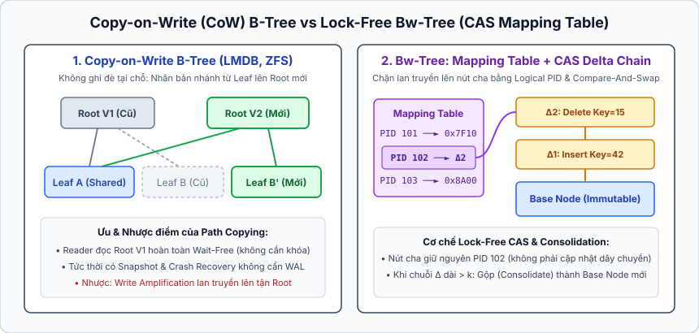
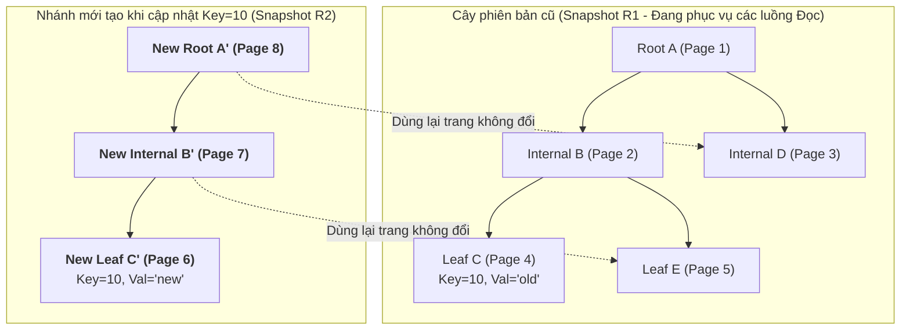
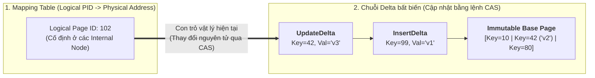

## Table of Contents
1. [Tại sao `B+Tree` truyền thống gặp nút thắt khi ghi nặng?](#standard-btree-bottlenecks)
2. [Copy-on-Write (CoW) B-Trees (LMDB, Btrfs, ZFS)](#copy-on-write-btrees)
3. [Lazy-Adaptive Trees và kiến trúc của WiredTiger](#lazy-adaptive-wiredtiger)
4. [FD-Trees (Flash-Disk Trees) và Fractional Cascading](#fd-trees-fractional-cascading)
5. [Bw-Trees: B-Tree không dùng Latch (Latch-Free với CAS)](#bw-trees-latch-free)
6. [Bảng so sánh tổng hợp các biến thể B-Tree](#comparison-table)
7. [Tóm tắt & Ghi nhớ cốt lõi (Key Takeaways)](#key-takeaways)

---

`B+Tree` truyền thống với cơ chế cập nhật tại chỗ (**In-place Update**) được thiết kế từ thập niên `1970` khi ổ đĩa từ tính (HDD) và CPU đơn nhân thống trị. Khi chuyển sang phần cứng hiện đại với ổ cứng thể rắn **SSD/NVMe** và máy chủ có hàng trăm nhân CPU, `B+Tree` truyền thống bộc lộ những giới hạn nghiêm trọng về khuếch đại ghi (Write Amplification) và tranh chấp khóa nội bộ (Latch Contention). Chương 6 phân tích các biến thể B-Tree hiện đại giải quyết triệt để những nút thắt này.

---

## Tại sao `B+Tree` truyền thống gặp nút thắt khi ghi nặng? {#standard-btree-bottlenecks}

Khi thực thi khối lượng công việc có tần suất ghi ngẫu nhiên cao (Write-heavy Workloads), `B+Tree` cập nhật tại chỗ gặp `3` rào cản lớn:
1. **Khuếch đại I/O ngẫu nhiên (Random I/O & Write Amplification)**: Dù chỉ cập nhật một trường `INT32` dài `4 bytes`, hệ thống vẫn phải ghi cả bản ghi vào tệp WAL, sau đó đẩy toàn bộ **Dirty Page** kích thước `8 KB` hoặc `16 KB` xuống đĩa tại một vị trí ngẫu nhiên. Trên ổ cứng SSD (vốn chỉ có thể xóa theo khối Erase Block lớn và không thể ghi đè trực tiếp tại chỗ), việc ghi trang ngẫu nhiên kích hoạt bộ thu gom rác nội bộ của SSD (**FTL Garbage Collection**), làm giảm tuổi thọ ổ đĩa và gây độ trễ đuôi (Tail Latency) cao.
2. **Tranh chấp Latch giữa các nhân CPU (Page Latch Contention)**: Để sửa hoặc tách một Page, luồng ghi phải giữ **Exclusive Latch (X-Latch)** trên Page đó, chặn toàn bộ các luồng đọc và ghi khác muốn đi qua cùng Page, đồng thời làm mất hiệu lực dòng bộ nhớ đệm CPU (**CPU Cache Line Invalidation**) giữa các nhân.
3. **Chi phí duy trì WAL và ARIES Recovery**: Mọi thao tác sửa đổi trang tại chỗ đều phải đi kèm cơ chế khóa `pageLSN`, ghi nhật ký WAL và chạy khôi phục 3 bước phức tạp nếu mất điện giữa chừng.

---

## Copy-on-Write (CoW) B-Trees (LMDB, Btrfs, ZFS) {#copy-on-write-btrees}

Ý tưởng cốt lõi của **Copy-on-Write (CoW) B-Tree** (được sử dụng trong **LMDB**, hệ thống tệp **Btrfs**, **ZFS** và CouchDB) là **tuyệt đối không bao giờ sửa đè lên Page đang tồn tại trên đĩa**. Mọi Page sau khi ghi xuống đĩa đều mang tính bất biến (**Immutable**).

### Cơ chế Path Copying (Sao chép đường đi từ lá lên gốc)
Khi một giao dịch cần cập nhật hoặc chèn dữ liệu vào một Leaf Page (ví dụ `Leaf C`):
1. Hệ thống không sửa `Leaf C` cũ mà cấp phát một trang mới ở vùng đĩa trống, chép nội dung cũ sang kèm theo bản sửa đổi để tạo thành **`Leaf C'`**.
2. Vì địa chỉ trang con đã đổi từ `C` sang `C'`, nút cha `Internal B` cũng không được sửa tại chỗ mà phải được sao chép sang trang mới **`Internal B'`** trỏ tới `C'` (đồng thời vẫn giữ nguyên con trỏ tới các trang con khác không thay đổi).
3. Quá trình sao chép dây chuyền này (**Path Copying**) lan truyền ngược lên tới tận gốc, tạo ra một nút gốc hoàn toàn mới **`Root A'`** tại thời điểm giao dịch `COMMIT`.

### Ưu điểm và Nhược điểm của CoW B-Tree
- **Ưu điểm vượt trội**:
  - **Không cần Write-Ahead Log (Zero WAL)**: Vì các trang của cây cũ (`Root A`) không hề bị ghi đè trong lúc đang xây dựng nhánh mới, nếu máy chủ mất điện trước khi hoàn tất, cây cũ trên đĩa vẫn nguyên vẹn `100%`. Thao tác `COMMIT` chỉ đơn giản là ghi đè nguyên tử con trỏ `Root Page ID` trong trang siêu dữ liệu ở đầu tệp!
  - **MVCC tự nhiên và Đọc hoàn toàn không khóa (Lock-Free Reads)**: Các luồng đọc chỉ cần đọc từ `Root A` cũ mà không cần xin bất kỳ Lock hay Latch nào, không bao giờ bị chặn bởi luồng ghi đang xây dựng `Root A'`. Trong **LMDB**, kết hợp với `mmap`, luồng đọc trả về con trỏ trỏ thẳng vào vùng nhớ ánh xạ tệp mà không tốn chi phí sao chép bộ nhớ (**Zero-copy Lookup**).
- **Nhược điểm**:
  - **Khuếch đại ghi (Write Amplification)**: Sửa `1` bản ghi nhỏ ở lá buộc phải ghi mới toàn bộ các trang trên đường đi từ lá lên tới gốc (`O(log N)` trang mới mỗi giao dịch).
  - **Chỉ cho phép 1 luồng ghi tại một thời điểm (Single Writer)**: Để tránh hai luồng ghi tạo ra hai nhánh `Root` xung đột nhau, LMDB tuần tự hóa các giao dịch ghi (chỉ cho phép đúng `1` Writer Thread hoạt động song song với hàng nghìn Reader Threads).

---

## Lazy-Adaptive Trees và kiến trúc của WiredTiger {#lazy-adaptive-wiredtiger}

Để giảm khuếch đại ghi mà không đánh mất lợi thế của cấu trúc B-Tree, các biến thể **Lazy B-Tree** (như `B^ε`-Tree hay kiến trúc bộ nhớ của **WiredTiger** — Storage Engine mặc định của MongoDB) chọn cách **trì hoãn việc sửa đổi trang đĩa bằng bộ đệm cập nhật trong RAM**.

Trong **WiredTiger**, định dạng trang trong bộ nhớ RAM và định dạng trang trên đĩa được tách biệt hoàn toàn:
1. **In-Memory Update Lists (Intent Logs)**: Khi một trang được nạp từ đĩa vào RAM, các thao tác `INSERT / UPDATE / DELETE` mới không sửa trực tiếp vào mảng byte của trang đĩa mà được gắn nối tiếp vào một cấu trúc danh sách cập nhật trong bộ nhớ (`Update List` hoặc `SkipList` gắn kèm mỗi dòng của Page). Nhờ đó, thao tác ghi trong RAM diễn ra cực nhanh mà không cần dịch chuyển các byte trong Slotted Page.
2. **Reconciliation (Hợp nhất khi đẩy xuống đĩa)**: Khi một trang bẩn trong RAM cần được đẩy xuống đĩa (do Checkpoint hoặc Eviction), tiến trình nền thực hiện bước **Reconciliation**: gom trang gốc cùng toàn bộ các chuỗi cập nhật trong RAM lại, nén khối dữ liệu và ghi ra các trang mới trên đĩa theo phong cách Copy-on-Write.
3. **Hazard Pointers**: Thay vì dùng Latch nặng nề để ngăn một trang đang có luồng đọc bị trục xuất khỏi RAM, WiredTiger sử dụng **Hazard Pointers** — mỗi luồng đọc đăng ký con trỏ địa chỉ bộ nhớ mà nó đang đọc vào một mảng toàn cục nhỏ; tiến trình thu hồi bộ nhớ kiểm tra mảng này trước khi giải phóng trang.

---

## FD-Trees (Flash-Disk Trees) và Fractional Cascading {#fd-trees-fractional-cascading}

Ổ cứng **SSD (Flash Memory)** có đặc tính vật lý bất đối xứng: đọc ngẫu nhiên rất nhanh, nhưng **ghi ngẫu nhiên rất chậm và làm giảm tuổi thọ chip nhớ** (do phải xóa theo khối lớn `Erase Block` từ `256 KB` đến `4 MB` trước khi ghi lại).

**FD-Tree (Flash-Disk Tree)** được thiết kế chuyên biệt để biến các thao tác ghi ngẫu nhiên trên B-Tree thành các thao tác ghi tuần tự giống như LSM-Tree, nhưng vẫn giữ tốc độ tìm kiếm của B-Tree nhờ kỹ thuật **Fractional Cascading**:
- **Cấu trúc phân tầng theo hàm mũ ($L_0, L_1, \dots, L_k$)**:
  - Tầng đỉnh $L_0$ là một B-Tree nhỏ nằm gọn trong RAM để hấp thụ mọi thao tác ghi mới.
  - Các tầng dưới $L_1, L_2, \dots, L_k$ nằm trên SSD với kích thước tăng dần theo cấp số nhân. Khi tầng $L_i$ đầy, nó được trộn tuần tự (**Sequential Merge**) xuống tầng $L_{i+1}$, loại bỏ hoàn toàn việc sửa trang ngẫu nhiên trên SSD.
- **Fractional Cascading (Con trỏ bắc cầu giữa các tầng)**:
  - Trong LSM-Tree thông thường, để tìm một khóa, hệ thống phải thực hiện tìm kiếm nhị phân độc lập trên từng tầng $L_0, L_1, \dots, L_k$.
  - FD-Tree khắc phục nhược điểm này bằng cách chèn một tỷ lệ mẫu khóa (ví dụ cứ mỗi trang ở tầng dưới $L_{i+1}$ thì trích lấy khóa đầu trang đẩy ngược lên tầng trên $L_i$) dưới dạng các **Fence Pointers (con trỏ bắc cầu)**. Nhờ vậy, khi tìm kiếm một khóa, hệ thống chỉ cần tìm trên cây $L_0$ ở đỉnh, sau đó đi thẳng theo con trỏ Fence Pointer từ tầng $L_i$ xuống đúng trang tương ứng ở tầng $L_{i+1}$ trong $O(1)$ mà không cần tìm kiếm lại từ đầu ở mỗi tầng!

---

## Bw-Trees: B-Tree không dùng Latch (Latch-Free với CAS) {#bw-trees-latch-free}

Trên các hệ thống cơ sở dữ liệu đa nhân hiện đại (In-memory / NVMe DBMS), chi phí khóa và mở khóa **Latch (Mutex / RWLatch)** trên các nút B-Tree khiến các nhân CPU liên tục bị dừng thực thi (Context Switch) và làm hỏng bộ nhớ đệm `L1/L2 Cache`. **Bw-Tree** (do nhóm nghiên cứu Microsoft phát triển cho SQL Server Hekaton) loại bỏ hoàn toàn mọi Latch bằng cách kết hợp `2` kỹ thuật cốt lõi dựa trên lệnh nguyên tử phần cứng **`CAS` (Compare-and-Swap)**:

### 1. Mapping Table (Bảng ánh xạ địa chỉ trung gian)
Trong B-Tree truyền thống, các nút cha lưu địa chỉ vật lý (trên đĩa hoặc trong RAM) của nút con. Nếu nút con được thay thế bằng một bản sao mới ở địa chỉ khác, ta phải cập nhật cả nút cha lẫn nút con cùng lúc — điều không thể thực hiện bằng một lệnh `CAS` `64-bit` đơn lẻ.
- **Bw-Tree** giải quyết bằng một bảng **Mapping Table** trung gian: mọi con trỏ giữa các nút B-Tree chỉ lưu **Logical Page ID (`PID`)** (một số nguyên `64-bit`), còn bảng Mapping Table ánh xạ từ `PID` sang địa chỉ bộ nhớ vật lý hiện tại của trang đó.
- Nhờ lớp trung gian này, việc thay đổi vị trí vật lý của một trang chỉ cần thực hiện một lệnh **`CAS(MappingTable[PID], old_addr, new_addr)`** tại đúng một ô nhớ, hoàn toàn không cần sửa đổi nút cha hay các nút anh em!

### 2. Delta Chains & Consolidation (Chuỗi bản ghi Delta bất biến)
Thay vì sửa trực tiếp vào mảng byte của trang gốc (vốn đòi hỏi Latch để tránh luồng đọc nhìn thấy dữ liệu đang ghi dở), mọi trang gốc (**Base Page**) trong Bw-Tree đều bất biến:
- **Gắn Delta Record bằng CAS**: Khi một luồng muốn chèn hoặc xóa khóa trên trang `PID = 102`, nó cấp phát một bản ghi **Delta Record** nhỏ gọn (`InsertDelta`, `DeleteDelta`, hoặc `SplitDelta`) chứa thông tin thay đổi, cho con trỏ `next` của Delta trỏ vào địa chỉ hiện tại của trang `102`, rồi dùng lệnh **`CAS`** trên `MappingTable[102]` để trỏ đầu trang `102` sang bản ghi Delta mới này. Nếu lệnh `CAS` thất bại (do luồng khác vừa gắn một Delta khác trước tích tắc đó), luồng chỉ việc đọc lại địa chỉ mới và thử lại `CAS` ngay lập tức mà không bao giờ bị ngủ (Spin-free / Latch-free).
- **Duyệt trang**: Luồng đọc đi từ đầu chuỗi Delta xuống Base Page, áp dụng các bản ghi Delta bắt gặp trên đường đi để thấy trạng thái mới của trang.
- **Consolidation (Hợp nhất chuỗi Delta)**: Khi chuỗi Delta dài vượt quá ngưỡng nhất định (ví dụ `8` bản ghi Delta, làm chậm thao tác đọc), một luồng sẽ gom Base Page cùng toàn bộ chuỗi Delta lại để tạo ra một **Base Page mới** đã sắp xếp gọn gàng, rồi dùng lệnh `CAS` trên Mapping Table để trỏ `PID` thẳng vào Base Page mới đó.

---

## Bảng so sánh tổng hợp các biến thể B-Tree {#comparison-table}

| Đặc điểm kỹ thuật | Standard `B+Tree` (PostgreSQL, InnoDB) | Copy-on-Write B-Tree (LMDB, Btrfs) | Lazy-Adaptive B-Tree (WiredTiger) | Latch-Free Bw-Tree (Hekaton) |
| :--- | :--- | :--- | :--- | :--- |
| **Cơ chế cập nhật trang** | Cập nhật tại chỗ (**In-place Update**) trên Slotted Page trong RAM. | Tạo bản sao trang mới và sao chép đường đi lên tới Root (**Path Copying**). | Ghi vào danh sách cập nhật trong RAM (`Update List`), hợp nhất (**Reconcile**) khi ghi đĩa. | Gắn bản ghi **Delta** bất biến vào đầu trang qua lệnh nguyên tử `CAS`. |
| **Yêu cầu Write-Ahead Log** | **Bắt buộc có WAL** + thuật toán khôi phục ARIES. | **Không cần WAL** (cây cũ trên đĩa luôn nhất quán, commit bằng cách trỏ sang Root mới). | Có WAL (Journal) cho các giao dịch chưa kịp Checkpoint. | Có WAL để khôi phục bộ nhớ sau khi mất điện. |
| **Đồng bộ hóa đọc/ghi** | Dùng **Page Latches (RWLatch)** kết hợp Latch Crabbing. | **Lock-free Reads** hoàn toàn; chỉ cho phép **1 Writer** tại một thời điểm. | Dùng **Hazard Pointers** và thao tác nguyên tử trong bộ nhớ. | **Hoàn toàn Latch-Free** cho cả đọc và ghi nhờ `CAS` + **Mapping Table**. |
| **Điểm mạnh cốt lõi** | Cân bằng tốt cho OLTP đa dụng, tối ưu dung lượng đĩa. | Tốc độ đọc cực nhanh (`Zero-copy mmap`), cài đặt khôi phục sự cố đơn giản. | Chịu tải ghi ngẫu nhiên lớn và nén dữ liệu hiệu quả trên đĩa. | Khả năng mở rộng tuyến tính trên máy chủ có rất nhiều nhân CPU. |
| **Điểm đánh đổi (Trade-off)** | Tranh chấp Latch khi tải cao; tốn I/O ngẫu nhiên khi Flush trang bẩn. | Khuếch đại ghi cao do Path Copying; nghẽn cổ chai nếu có nhiều luồng ghi song song. | Quá trình Reconciliation và Eviction phức tạp khi bộ nhớ RAM đầy. | Chuỗi Delta dài làm chậm thao tác đọc và giảm hiệu quả `CPU Cache` trước khi Consolidate. |

---

## Tóm tắt & Ghi nhớ cốt lõi (Key Takeaways) {#key-takeaways}

- **Copy-on-Write (CoW) B-Tree loại bỏ nhu cầu dùng WAL**: Thay vì sửa đè trang tại chỗ, CoW B-Tree (như **LMDB**) tạo bản sao mới cho mọi trang bị thay đổi từ lá lên tới **New Root**; luồng đọc truy cập nhánh cũ hoàn toàn không cần khóa, còn `COMMIT` chỉ là thao tác trỏ sang Root mới.
- **WiredTiger tách biệt định dạng trang trong RAM và trên đĩa**: Các cập nhật mới được gom vào danh sách trong bộ nhớ (`Update List`) gắn với từng trang và chỉ được hợp nhất (**Reconciliation**) thành trang mới khi đẩy xuống đĩa, kết hợp với **Hazard Pointers** để tránh tranh chấp Latch.
- **FD-Tree tối ưu cho SSD nhờ Fractional Cascading**: Gom các thao tác ghi ngẫu nhiên thành các tầng trộn tuần tự ($L_0 \to L_k$) và dùng các con trỏ bắc cầu (**Fence Pointers**) giữa các tầng để tránh phải tìm kiếm nhị phân lặp lại trên từng tầng.
- **Bw-Tree loại bỏ hoàn toàn Page Latch bằng `Mapping Table` + `Delta Chains`**: Nhờ bảng ánh xạ trung gian từ `Logical PID` sang địa chỉ bộ nhớ vật lý, mọi cập nhật và tách trang trên Bw-Tree đều được thực hiện thông qua việc gắn bản ghi **Delta** bất biến bằng lệnh phần cứng **`CAS` (Compare-and-Swap)**.

### Tài liệu & Nguồn tham khảo
- [Levandoski, J. J., Lomet, D. B., & Sengupta, S. (2013) — *The Bw-Tree: A B-tree for New Hardware Platforms* (Microsoft Research)](https://www.microsoft.com/en-us/research/wp-content/uploads/2016/02/bw-tree-icde2013-final.pdf)
- [Symas LMDB (Lightning Memory-Mapped Database) Architecture Documentation](http://www.lmdb.tech/doc/)
- [MongoDB WiredTiger Storage Engine Architecture Guide](https://source.wiredtiger.com/)
