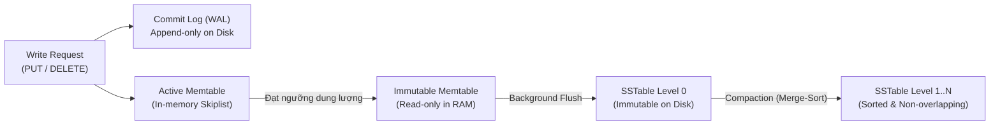
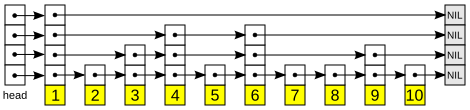
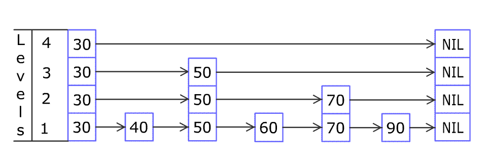
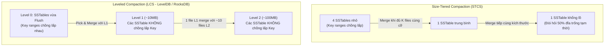
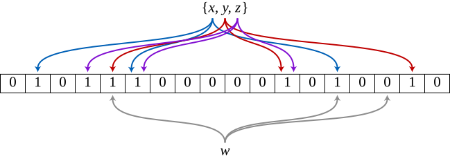
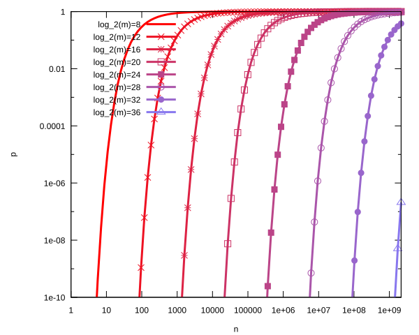

## Table of Contents
1. [Kiến trúc cốt lõi của LSM-Tree (Memtable, WAL, SSTable)](#lsm-tree-core-architecture)
2. [Cấu trúc SSTable và Luồng đọc dữ liệu (Read Path)](#sstable-structure-read-path)
3. [Cơ chế Update, Delete và Tombstone](#updates-deletes-tombstones)
4. [Các chiến lược Compaction: STCS vs LCS](#compaction-strategies)
5. [Cơ chế hoạt động của Bloom Filter](#bloom-filters-deep-dive)
6. [Định lý RUM Conjecture và So sánh B+Tree với LSM-Tree](#rum-conjecture-btree-vs-lsm)
7. [Tóm tắt & Ghi nhớ cốt lõi (Key Takeaways)](#key-takeaways)

---

## Kiến trúc cốt lõi của LSM-Tree (Memtable, WAL, SSTable) {#lsm-tree-core-architecture}

Trong khi các cấu trúc chỉ mục trên đĩa như B-Tree thực hiện cập nhật tại chỗ (*in-place update*) thông qua các thao tác Random I/O trên từng Page cố định, **LSM-Tree (Log-Structured Merge-Tree)** được thiết kế dựa trên nguyên lý bất biến (*immutability*) và ghi tuần tự (*append-only*). Toàn bộ các thao tác thêm mới, cập nhật hoặc xóa đều được chuyển hóa thành thao tác ghi tuần tự vào bộ nhớ đệm rồi xả xuống đĩa theo từng lô lớn, giúp khai thác tối đa băng thông Sequential Write của cả ổ cứng từ tính (HDD) lẫn bộ nhớ bán dẫn (SSD/NVMe).

### Luồng ghi dữ liệu (Write Path)

Một thao tác ghi (`PUT` hoặc `DELETE`) vào LSM-Tree đi qua 3 bước chính:

1. **Ghi vào Commit Log / Write-Ahead Log (WAL)**: Trước khi chạm vào cấu trúc dữ liệu trên RAM, bản ghi được nối đuôi (*append*) trực tiếp vào file WAL trên đĩa để đảm bảo tính bền vững (*durability*). Nếu tiến trình database gặp sự cố sập nguồn, dữ liệu chưa kịp đẩy xuống SSTable sẽ được khôi phục bằng cách đọc tuần tự lại file WAL.
2. **Chèn vào Memtable**: Sau khi ghi WAL thành công, bản ghi được chèn vào **Memtable** — một bảng lưu trữ trên bộ nhớ RAM giữ các cặp Key-Value luôn được sắp xếp theo thứ tự từ điển (*lexicographical order*) của Key.
3. **Flush xuống đĩa thành SSTable**: Khi kích thước của Active Memtable chạm ngưỡng cấu hình (ví dụ `64MB` trong RocksDB), nó được chuyển trạng thái sang **Immutable Memtable** (chỉ đọc), đồng thời một Active Memtable mới được khởi tạo để tiếp nhận luồng ghi tiếp theo. Một luồng chạy ngầm (*background flush thread*) sẽ duyệt tuần tự qua Immutable Memtable và ghi toàn bộ dữ liệu đã sắp xếp xuống đĩa thành một file **SSTable (Sorted String Table)** bất biến, sau đó cắt bỏ phần WAL tương ứng.

### Tại sao Skiplist được ưu tiên hơn Balanced Tree cho Memtable?

Mặc dù các cây nhị phân tự cân bằng (như Red-Black Tree hoặc AVL Tree) và B-Tree đều đảm bảo độ phức tạp tìm kiếm/chèn ở mức `O(log N)`, hầu hết các engine LSM-Tree hiện đại (LevelDB, RocksDB, Apache Cassandra) đều cài đặt Memtable bằng **Concurrent Skiplist** vì hai lý do kỹ thuật:

- **Khả năng đồng thời không khóa (Lock-free Concurrency)**: Khi chèn một phần tử mới vào Red-Black Tree hoặc B-Tree, thao tác xoay cây (*tree rotation*) hoặc tách nút (*node split*) có thể lan truyền ngược lên tận nút gốc (*root*), buộc hệ thống phải giữ khóa đọc-ghi trên phạm vi rộng hoặc sử dụng cơ chế khóa phức tạp. Ngược lại, Skiplist là cấu trúc danh sách liên kết nhiều tầng xác suất; thao tác chèn chỉ cần cập nhật các con trỏ cục bộ ở một số tầng thông qua lệnh nguyên tử **CAS (`Compare-And-Swap`)** của CPU mà không cần cân bằng lại toàn cục.
- **Đơn giản hóa quá trình Flush tuần tự**: Tầng thấp (`Level 0`) của Skiplist là một danh sách liên kết đơn chứa toàn bộ các phần tử đã sắp xếp. Khi Flush xuống SSTable, luồng chạy ngầm chỉ cần duyệt tuyến tính từ đầu đến cuối danh sách ở tầng thấp mà không tốn chi phí duyệt cây đệ quy.

*Hình 7.1: Cấu trúc Skiplist nhiều tầng dùng làm Memtable trong RocksDB, LevelDB và Apache Cassandra*

*Hình 7.2: Quá trình nhảy bậc tìm kiếm và chèn phần tử mới vào Skiplist trong $O(\log N)$ mà không cần xoay cây toàn cục*

---

## Cấu trúc SSTable và Luồng đọc dữ liệu (Read Path) {#sstable-structure-read-path}

**SSTable (Sorted String Table)** là tệp dữ liệu bất biến trên đĩa, trong đó các bản ghi được sắp xếp chặt chẽ theo Key. Một khi đã được tạo ra qua quá trình Flush hoặc Compaction, SSTable không bao giờ bị sửa đổi tại chỗ.

### Cấu trúc bên trong một file SSTable

Trong các hệ thống như RocksDB hoặc LevelDB, một file SSTable được chia thành các khối logic có kích thước cố định:

- **Data Blocks**: Chứa các cặp Key-Value thực tế được sắp xếp tuần tự. Do các Key liền kề thường có chung tiền tố (*shared prefix*), Data Block áp dụng kỹ thuật nén tiền tố (*Prefix Compression / Delta Encoding*) cùng các thuật toán nén khối như LZ4, Zstd hoặc Snappy để giảm dung lượng lưu trữ.
- **Filter Block (Bloom Filter)**: Chứa mảng bit của bộ lọc Bloom tương ứng với các Key nằm trong SSTable, cho phép kiểm tra nhanh sự tồn tại của Key trước khi đọc Data Block.
- **Index Block (Sparse Index)**: Vì các Data Block đã được sắp xếp hoàn toàn, hệ thống không cần lưu vị trí của mọi Key. Index Block chỉ lưu Key đầu tiên (hoặc cuối cùng) của mỗi Data Block kèm theo `offset` và kích thước của khối đó trên đĩa.
- **Footer**: Nằm ở cuối file với kích thước cố định, lưu con trỏ (`offset` và `size`) trỏ tới Index Block và Meta-Index Block. Khi mở SSTable, engine luôn đọc Footer đầu tiên.

### Luồng đọc dữ liệu (Read Path)

Do dữ liệu của cùng một Key có thể nằm rải rác ở nhiều thành phần khác nhau theo thời gian ghi, một truy vấn đọc theo điểm (*Point Lookup*) hoặc quét dải (*Range Scan*) phải kiểm tra theo thứ tự từ mới đến cũ:

1. Kiểm tra **Active Memtable** và các **Immutable Memtables** trên RAM. Nếu tìm thấy ở đây, trả về ngay lập tức vì đây là phiên bản mới.
2. Nếu không có trên RAM, kiểm tra lần lượt các file **SSTable trên đĩa từ tầng mới đến tầng cũ** (`L_0 -> L_1 -> ... -> L_n`).
3. Với mỗi SSTable:
   - Truy vấn **Bloom Filter** trong bộ nhớ. Nếu Bloom Filter báo Key không tồn tại, bỏ qua hoàn toàn SSTable đó (tiết kiệm `100%` Disk I/O cho file này).
   - Nếu Bloom Filter trả về dương tính, thực hiện tìm kiếm nhị phân (*Binary Search*) trên **Sparse Index** để xác định đúng `1` Data Block có khả năng chứa Key, sau đó nạp Data Block đó từ đĩa lên để tìm kiếm.
4. Đối với truy vấn **Range Scan**, engine phải khởi tạo một **Merge Iterator** (sử dụng cấu trúc Min-Heap / Priority Queue) đọc đồng thời qua Memtable và tất cả các SSTable có dải Key giao nhau để hợp nhất kết quả theo đúng thứ tự từ điển và loại bỏ các phiên bản cũ bị ghi đè.

---

## Cơ chế Update, Delete và Tombstone {#updates-deletes-tombstones}

Bởi vì các file SSTable trên đĩa là bất biến (*immutable*), LSM-Tree không bao giờ tìm đến vị trí cũ của bản ghi trên đĩa để sửa hoặc xóa:

- **Thao tác `UPDATE`**: Được xử lý giống hệt như `INSERT`. Một bản ghi mới mang cùng Key nhưng kèm theo giá trị mới và nhãn thời gian (*timestamp* hoặc *sequence number*) lớn hơn được ghi vào Memtable. Trong quá trình đọc, phiên bản có sequence number lớn hơn sẽ che khuất (*shadow*) các phiên bản cũ nằm ở các SSTable bên dưới.
- **Thao tác `DELETE`**: Khi xóa một Key, hệ thống không giải phóng dung lượng đĩa ngay lập tức mà ghi thêm một bản ghi đặc biệt gọi là **Tombstone** (bia mộ) mang Key đó cùng với timestamp hiện tại. Khi luồng đọc gặp phải Tombstone mới hơn các bản ghi dữ liệu bên dưới, nó hiểu rằng Key đã bị xóa và trả về `NOT_FOUND`.

> [!WARNING]
> **Hiện tượng Zombie Data Resurrection và `gc_grace_seconds` trong hệ phân tán:**
> Dung lượng đĩa của các bản ghi cũ và chính bản thân Tombstone chỉ thực sự được thu hồi khi tiến trình **Compaction** gộp các SSTable lại với nhau. Tuy nhiên, nếu Compaction xóa bỏ Tombstone quá sớm khi một bản sao (*replica*) khác trong cụm phân tán đang bị mất kết nối tạm thời và chưa nhận được Tombstone đó, sau khi replica kia phục hồi và thực hiện đồng bộ lại (*Read Repair* hoặc *Anti-Entropy*), bản ghi cũ chưa bị xóa ở replica đó sẽ được lan truyền ngược lại toàn cụm — làm dữ liệu đã xóa "sống dậy" (*Zombie Data*). Do đó, các hệ thống như Apache Cassandra thiết lập tham số `gc_grace_seconds` (mặc định `864,000` giây tương đương `10` ngày): Tombstone bắt buộc phải được giữ lại trên đĩa cho đến khi vượt qua ngưỡng thời gian này mới được phép thu hồi trong lúc Compaction.

---

## Các chiến lược Compaction: STCS vs LCS {#compaction-strategies}

Khi số lượng SSTable liên tục tăng lên sau mỗi lần Flush từ Memtable, hiệu năng đọc sẽ suy giảm nghiêm trọng (tăng **Read Amplification**) và dung lượng đĩa bị lãng phí do lưu giữ nhiều phiên bản trùng lặp cùng các Tombstone (tăng **Space Amplification**). **Compaction** là tiến trình chạy ngầm thực hiện thuật toán **Multi-way Merge-Sort** trên nhiều SSTable đầu vào: nó giữ lại phiên bản mới của mỗi Key, loại bỏ các phiên bản đã bị ghi đè hoặc bị đánh dấu bởi Tombstone (nếu đủ điều kiện hết hạn), và xuất ra các SSTable mới gọn sạch hơn.

### 1. Size-Tiered Compaction Strategy (STCS)

Được sử dụng mặc định cho các bảng ghi nặng trong Apache Cassandra và ScyllaDB:

- **Cơ chế**: Các SSTable mới được Flush xuống có kích thước nhỏ. Khi hệ thống tích lũy đủ một số lượng `K` (ví dụ `4`) file SSTable có kích thước tương đương nhau trong cùng một nhóm (*bucket*), tiến trình Compaction sẽ trộn cả `K` file này thành một file SSTable lớn hơn gấp `K` lần. Quá trình này lặp lại ở các bậc kích thước lớn dần.
- **Ưu điểm**: Tối ưu cho các tải công việc ghi cực nặng (*write-intensive*) vì số lần một bản ghi bị đọc lên và ghi lại xuống đĩa (Write Amplification) tương đối thấp.
- **Nhược điểm chí mạng (Space Amplification)**:
  1. Dải Key giữa các SSTable vẫn chồng lấp nhau (*overlapping key ranges*), khiến truy vấn đọc vẫn phải kiểm tra nhiều file.
  2. Khi gộp các SSTable khổng lồ ở tầng cao (ví dụ gộp `4` file `100GB` thành `1` file `400GB`), hệ thống phải giữ cả `4` file cũ lẫn file mới đang ghi trên đĩa cho đến khi hoàn tất, đòi hỏi tối thiểu **`50%` dung lượng ổ đĩa trống** chỉ để làm không gian tạm cho Compaction.

### 2. Leveled Compaction Strategy (LCS)

Được thiết kế trong LevelDB và RocksDB để khắc phục nhược điểm về không gian đĩa và chi phí đọc của STCS:

- **Cơ chế**: Dữ liệu trên đĩa được chia thành chuỗi các tầng có dung lượng tối đa tăng theo cấp số nhân (thường gấp `10` lần mỗi tầng: `L_1 = 10MB, L_2 = 100MB, L_3 = 1,000MB...`). Mỗi tầng được cắt nhỏ thành nhiều file SSTable có kích thước cố định (ví dụ `64MB`).
- **Quy tắc bất biến quan trọng**:
  - Ở **`L_0`** (nơi nhận trực tiếp các file Flush từ Memtable): Các file SSTable **có dải Key chồng lấp nhau**.
  - Từ **`L_1` trở xuống (`L_1, L_2, ..., L_n`)**: Mọi file SSTable trong cùng một tầng **hoàn toàn không chồng lấp dải Key** (*strictly non-overlapping key ranges*). Tức là ở mỗi tầng `L_i` (`i ≥ 1`), một Key bất kỳ chỉ có thể nằm ở tối đa **chỉ có đúng `1` file SSTable**.
- **Quá trình Compaction**: Khi dung lượng tầng `L_i` vượt ngưỡng, engine chọn `1` file SSTable từ `L_i` và trộn (*merge-sort*) nó với tất cả các file ở tầng `L_i+1` có dải Key giao nhau (trung bình khoảng `10` file ở `L_i+1`).
- **Hệ quả**:
  - **Giảm mạnh Space Amplification**: Phiên bản dữ liệu cũ bị loại bỏ nhanh chóng, khoảng `90%` dữ liệu nằm ở tầng cuối cùng; lượng không gian đĩa dư thừa chỉ chiếm khoảng `10%`.
  - **Giảm Read Amplification**: Ở mỗi tầng `L_1+`, Binary Search trên danh mục file chỉ định đích danh `1` SSTable cần kiểm tra.
  - **Tăng Write Amplification**: Một bản ghi khi di chuyển từ `L_i` xuống `L_i+1` phải tham gia trộn lại với tới `10` file ở tầng dưới, khiến hệ số Write Amplification cao hơn đáng kể so với STCS.

| Tiêu chí | Size-Tiered Compaction (STCS) | Leveled Compaction (LCS) |
| :--- | :--- | :--- |
| **Tổ chức Key trong cùng tầng** | Các SSTable có dải Key chồng lấp nhau ở mọi bậc | Chỉ chồng lấp ở `L_0`; tách biệt hoàn toàn từ `L_1` trở đi |
| **Write Amplification** | Thấp (phù hợp tải `INSERT` / `WRITE` liên tục) | Cao (do phải trộn lặp lại với ~`10` file ở tầng kế tiếp) |
| **Read Amplification** | Trung bình - Cao (phải tra cứu nhiều SSTable chồng lấp) | Thấp (mỗi tầng `L_1+` chỉ cần kiểm tra tối đa `1` SSTable) |
| **Space Amplification** | Rất cao (cần dự phòng tới `50%` dung lượng đĩa trống) | Rất thấp (chỉ tốn khoảng `10%` dung lượng đĩa phụ trội) |

---

## Cơ chế hoạt động của Bloom Filter {#bloom-filters-deep-dive}

Để ngăn chặn việc phải đọc đĩa vô ích khi tìm kiếm một Key không tồn tại trong SSTable, mỗi SSTable đi kèm một cấu trúc dữ liệu xác suất nhỏ gọn trên RAM gọi là **Bloom Filter**.

### Cấu trúc toán học và thao tác Bit Array

Một Bloom Filter bao gồm một mảng gồm `m` bit (khởi tạo toàn bộ bằng `0`) và `k` hàm băm độc lập (`h_1, h_2, ..., h_k`), mỗi hàm ánh xạ một Key bất kỳ vào một vị trí chỉ số trong đoạn `[0, m - 1]`:

- **Khi ghi Key vào SSTable (`Add(key)`)**: Engine tính toán `k` vị trí băm `h_1(key), h_2(key), ..., h_k(key)` và bật tất cả các bit tại `k` vị trí đó trong mảng lên `1`.
- **Khi kiểm tra Key lúc đọc (`MayContain(key)`)**: Engine băm Key cần tìm qua cùng `k` hàm băm và kiểm tra giá trị tại `k` vị trí bit tương ứng:
  - **Nếu có bất kỳ `1` bit nào mang giá trị `0`**: Chắc chắn `100%` Key đó **chưa từng được ghi** vào SSTable này. Hệ thống lập tức bỏ qua SSTable mà không tốn bất kỳ lệnh đọc đĩa nào (**Zero False Negatives**).
  - **Nếu toàn bộ `k` bit đều mang giá trị `1`**: Key **có khả năng** nằm trong SSTable. Tuy nhiên, có xác suất xảy ra **False Positive** (Dương tính giả) do các Key khác trong cùng SSTable khi băm ra đã vô tình bật trùng cả `k` vị trí bit này lên `1`.

*Hình 7.3: Minh họa Bloom Filter với mảng $m = 18$ bit và $k = 3$ hàm băm: phần tử `w` không nằm trong tập hợp vì có 1 vị trí bit mang giá trị `0`*

### Đánh đổi bộ nhớ và xác suất False Positive

Với $n$ phần tử được chèn vào mảng $m$ bit sử dụng $k$ hàm băm, xác suất xảy ra False Positive $p$ được xấp xỉ bởi công thức:

$$
p \approx \left(1 - e^{-kn/m}\right)^k
$$

Số lượng hàm băm tối ưu để cực tiểu hóa $p$ theo tỷ lệ số bit trên mỗi phần tử ($m/n$) là:

$$
k = \frac{m}{n} \ln 2 \approx 0.693 \times \frac{m}{n}
$$

*Hình 7.4: Xác suất False Positive $p$ giảm theo cấp số nhân khi tăng tỷ lệ số bit trên mỗi phần tử ($m/n$)*

Trong cấu hình thực tế của RocksDB (`10` bits/key với $k = 7$ hàm băm), tỷ lệ False Positive chỉ rơi vào khoảng **`1%` (`0.01`)**. Điều này đồng nghĩa với việc `99%` các truy vấn vào những SSTable không chứa Key sẽ được chặn đứng ngay trên RAM trước khi chạm xuống tầng I/O của hệ điều hành.

---

## Định lý RUM Conjecture và So sánh B+Tree với LSM-Tree {#rum-conjecture-btree-vs-lsm}

Trong thiết kế Storage Engine, **RUM Conjecture** phát biểu rằng khi tối ưu hóa một cấu trúc dữ liệu lưu trữ, không thể giảm thiểu đồng thời cả 3 loại chi phí khuếch đại dưới đây; việc tối ưu tối đa `2` trong `3` yếu tố bắt buộc phải trả giá bằng yếu tố còn lại:

1. **Read Amplification (RA)**: Tỷ lệ giữa tổng dung lượng dữ liệu thực tế phải đọc từ đĩa (qua Memtable, Index Block, nhiều SSTable hoặc nhiều tầng của cây) so với kích thước logic của bản ghi mà ứng dụng yêu cầu.
2. **Update / Write Amplification (WA)**: Tỷ lệ giữa tổng số byte thực tế bị ghi xuống thiết bị lưu trữ vật lý (bao gồm ghi WAL, Flush Memtable và ghi lặp đi lặp lại qua các vòng Compaction hoặc ghi nguyên Page `16KB` trong B+Tree) so với kích thước bản ghi gốc.
3. **Memory / Space Amplification (SA)**: Tỷ lệ giữa tổng dung lượng không gian lưu trữ bị chiếm dụng trên đĩa (do phân mảnh nội vi của Page trong B+Tree, hoặc do các bản ghi cũ chưa thu hồi và Tombstone trong LSM-Tree) so với kích thước dữ liệu thực tế sau khi đã khử trùng lặp.

| Đặc tính kỹ thuật | B+Tree (ví dụ: InnoDB, PostgreSQL) | LSM-Tree (ví dụ: RocksDB, Cassandra) |
| :--- | :--- | :--- |
| **Cơ chế cập nhật** | Update-in-place (ghi đè trực tiếp lên Page cố định trên đĩa) | Append-only & Immutable (ghi tuần tự, hợp nhất ngầm qua Compaction) |
| **Đặc tính I/O khi Ghi** | Random Write I/O (khiến thông lượng giảm mạnh khi vượt bộ nhớ đệm) | Sequential Write I/O (tối ưu thông lượng ghi và kéo dài tuổi thọ xóa-ghi của SSD) |
| **Read Amplification (RA)** | **Thấp**: Mọi Key chỉ tồn tại ở đúng `1` vị trí lá; đi theo con trỏ nhánh tốn `O(logB N)` bước | **Cao hơn**: Point Lookup có thể phải tra cứu nhiều SSTable; Range Scan phải Merge-Sort nhiều luồng |
| **Write Amplification (WA)** | **Cao với bản ghi nhỏ**: Sửa `100` bytes vẫn phải ghi lại toàn bộ Page `4KB`–`16KB` cùng WAL | **Thấp lúc ghi, phát sinh lúc Compaction**: Ghi ban đầu chỉ tốn Sequential I/O nhưng dữ liệu bị trộn lại qua nhiều Level |
| **Space Amplification (SA)** | **Trung bình**: Lãng phí khoảng `25%`–`50%` do Page Fill Factor và phân mảnh sau khi xóa | **Thấp (với LCS + nén khối)**: Các SSTable bất biến không bị phân mảnh Page và nén Prefix/Block đạt tỷ lệ rất cao |

---

## Tóm tắt & Ghi nhớ cốt lõi (Key Takeaways) {#key-takeaways}

- **Bản chất của LSM-Tree**: Đánh đổi chi phí đọc và CPU chạy ngầm (Compaction) để biến mọi thao tác ghi ngẫu nhiên thành **Sequential I/O** trên đĩa thông qua tổ hợp **WAL (đảm bảo Durability)** + **Memtable trên RAM (thường dùng Concurrent Skiplist để hỗ trợ chèn lock-free qua CAS)** + **Immutable SSTables trên đĩa**.
- **Cơ chế bất biến với Update/Delete**: LSM-Tree không sửa dữ liệu tại chỗ; `UPDATE` chỉ chèn phiên bản mới có timestamp cao hơn và `DELETE` chèn một bản ghi đánh dấu **Tombstone**. Dung lượng đĩa chỉ thực sự được giải phóng khi chạy **Compaction** sau thời gian `gc_grace_seconds` để ngăn chặn lỗi Zombie Data.
- **Đánh đổi giữa STCS và LCS**: **Size-Tiered Compaction (STCS)** tối ưu cho tải ghi nặng nhưng gây Space Amplification lớn (cần tới `50%` đĩa trống tạm thời). **Leveled Compaction (LCS)** chia đĩa thành các tầng tăng theo cấp số nhân với các SSTable không chồng lấp Key từ `L_1` trở đi, giúp giảm mạnh Space Amplification và Read Amplification nhưng làm tăng Write Amplification.
- **Vai trò của Bloom Filter và Sparse Index**: **Bloom Filter** đảm bảo tính chất **Zero False Negatives** (nếu bit bằng `0`, chắc chắn Key không có trong SSTable), giúp cắt bỏ hầu hết các truy vấn đọc đĩa thừa thãi cho Point Lookup trước khi dùng **Sparse Index** để định vị Data Block.
- **Định lý RUM Conjecture**: Không tồn tại Storage Engine nào tối ưu hóa đồng thời cả Read, Write và Space Amplification; B+Tree ưu tiên Read Amplification thấp với vị trí Key cố định, trong khi LSM-Tree ưu tiên thông lượng ghi cao và tỷ lệ nén không gian vượt trội.

### Tài liệu & Nguồn tham khảo
- [O'Neil, P., et al. (1996) — *The Log-Structured Merge-Tree (LSM-Tree)*](https://www.cs.umb.edu/~poneil/lsmtree.pdf)
- [Meta Engineering — RocksDB Wiki: Compaction, MemTable & Bloom Filters](https://github.com/facebook/rocksdb/wiki)
- [Lu, L., et al. (2016) — *WiscKey: Separating Keys from Values in SSD-Conscious Storage* (USENIX FAST)](https://www.usenix.org/system/files/conference/fast16/fast16-papers-lu.pdf)
