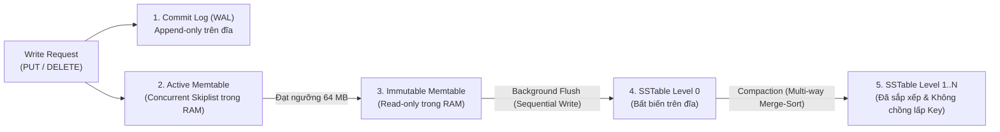
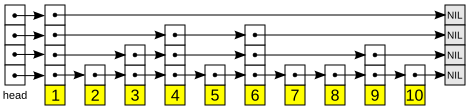
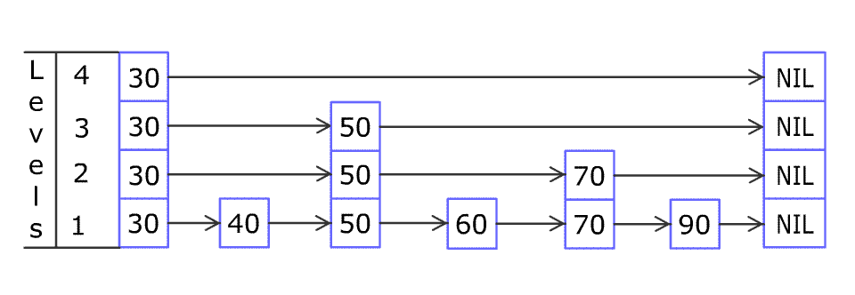
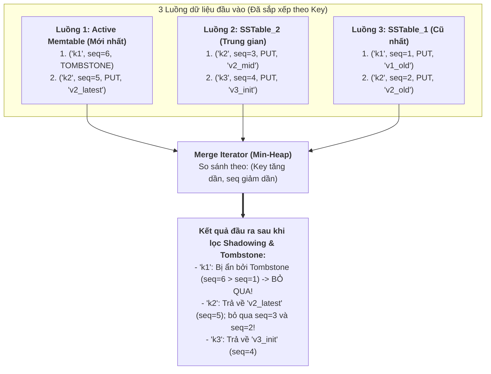
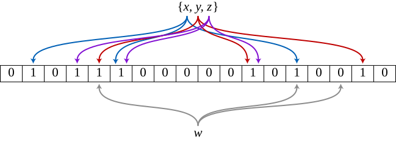
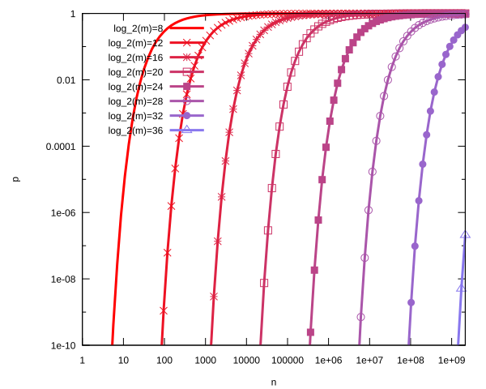
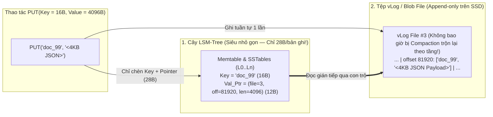

## Table of Contents
1. [Kiến trúc cốt lõi của LSM-Tree (Memtable, WAL, SSTable)](#lsm-tree-core-architecture)
2. [Cấu trúc SSTable, Luồng đọc và Merge Iterator (Min-Heap)](#sstable-structure-read-path)
3. [Cơ chế Update, Delete, Tombstone và Vòng đời dữ liệu](#updates-deletes-tombstones)
4. [Các chiến lược Compaction: STCS, LCS và TWCS](#compaction-strategies)
5. [Cơ chế hoạt động của Bloom Filter (Ví dụ chạy tay từng Bit)](#bloom-filters-deep-dive)
6. [Tách biệt Key-Value (WiscKey / BlobDB) và Định lý RUM Conjecture](#rum-conjecture-btree-vs-lsm)
7. [Tóm tắt & Ghi nhớ cốt lõi (Key Takeaways)](#key-takeaways)

---

Trong khi các cấu trúc chỉ mục họ B-Tree thực hiện cập nhật tại chỗ (**In-place Update**) thông qua các thao tác đọc-sửa-ghi trang (`Random I/O`), **LSM-Tree (*Log-Structured Merge-Tree*, do Patrick O'Neil và cộng sự đề xuất năm 1996)** được thiết kế dựa trên một triết lý hoàn toàn đối lập: **Dữ liệu trên đĩa là bất biến (`Immutable`) và mọi thao tác sửa đổi đều được biến thành ghi tuần tự (`Sequential Append`)**. Nhờ loại bỏ hoàn toàn việc tìm kiếm và ghi đè ngẫu nhiên trên đĩa trong luồng ghi trực tuyến, LSM-Tree đã trở thành trái tim của hàng loạt hệ cơ sở dữ liệu chịu tải ghi khổng lồ hiện đại như **RocksDB**, **LevelDB**, **Apache Cassandra**, **ScyllaDB**, **HBase**, và **CockroachDB (Pebble)**.

---

## Kiến trúc cốt lõi của LSM-Tree (Memtable, WAL, SSTable) {#lsm-tree-core-architecture}

### Bài toán thực tế & Mental Model

Tại sao B-Tree bị nghẽn cổ chai khi tải ghi ngẫu nhiên vượt quá dung lượng RAM? Vì mỗi khi chèn một khóa ngẫu nhiên, B-Tree phải định vị đúng trang lá trên đĩa để sửa và ghi lại cả trang `16 KB`. Nhưng nếu chỉ ghi nối đuôi (`Append-only`) vào một tệp nhật ký phẳng như ` Append-Only Log`, tốc độ ghi sẽ đạt mức cực đại của phần cứng, song đổi lại việc tìm kiếm một khóa sẽ phải quét toàn bộ tệp trong $O(N)$!

Làm thế nào để **Ghi nhanh như tệp Log tuần tự**, nhưng **Đọc nhanh nhờ dữ liệu luôn được sắp xếp theo khóa**?

**Mental Model — "Bàn phân loại trong RAM + Các tập hồ sơ đóng bìa cứng trên đĩa":**
Hãy hình dung cách một văn phòng lưu trữ hàng triệu hồ sơ:
1. Khi hồ sơ mới tới, nhân viên ghi nhanh một dòng vào cuốn sổ nhật ký chống cháy (**Write-Ahead Log — WAL**) trên đĩa để lỡ cúp điện không bị mất.
2. Tiếp theo, nhân viên xếp ngay hồ sơ đó vào đúng thứ tự bảng chữ cái trên chiếc kệ xoay đặt ngay trên bàn làm việc trong RAM (**Active Memtable**). Vì thao tác trong RAM cực nhanh, việc chèn vào đúng thứ tự chỉ mất vài trăm nano-giây.
3. Khi chiếc kệ trên bàn đã đầy (ví dụ đạt `64 MB`), nhân viên khóa chiếc kệ đó lại không cho nhét thêm nữa (**Immutable Memtable**), lấy một chiếc kệ trống mới ra bàn để tiếp tục nhận hồ sơ, đồng thời giao chiếc kệ đã đầy cho nhân viên hậu cần ở phòng sau in ra thành một cuốn danh bạ đóng bìa cứng (**SSTable — Sorted String Table**) cất xuống kho đĩa cứng!



### 1. Luồng ghi dữ liệu (Write Path) qua 3 bước

Một thao tác ghi (`PUT` hoặc `DELETE`) vào LSM-Tree luôn đi qua `3` bước tuần tự:
1. **Ghi vào Write-Ahead Log (WAL / Commit Log)**: Trước khi chạm vào RAM, bản ghi `(seq_num, op_type, key, value)` được nối đuôi trực tiếp vào cuối tệp WAL trên đĩa để đảm bảo tính bền vững (**Durability**). Nếu máy chủ sập nguồn khi dữ liệu vẫn đang nằm trong RAM, hệ thống chỉ cần phát lại (`replay`) tệp WAL để dựng lại Memtable.
2. **Chèn vào Active Memtable trong RAM**: Bản ghi được chèn vào cấu trúc **Memtable** — một bộ đệm trong bộ nhớ RAM luôn duy trì các khóa theo thứ tự từ điển tăng dần. Ngay sau bước này, hệ thống trả về kết quả thành công cho ứng dụng mà **không tốn bất kỳ một thao tác Random Disk I/O nào**!
3. **Flush bất đồng bộ xuống đĩa thành SSTable**: Khi dung lượng `Active Memtable` chạm ngưỡng cấu hình (ví dụ `write_buffer_size = 64 MB` trong RocksDB), nó lập tức được đóng băng thành **`Immutable Memtable`** (chỉ đọc), và một `Active Memtable` mới cùng một tệp WAL mới được tạo ra để không làm gián đoạn luồng ghi. Ở chế độ nền, luồng `Flush Thread` duyệt tuần tự từ đầu đến cuối `Immutable Memtable` và ghi thẳng xuống đĩa thành một tệp **SSTable** ở tầng `Level 0` (`L0`), sau đó xóa bỏ tệp WAL cũ tương ứng.

### 2. Tại sao Concurrent Skiplist được ưu tiên hơn Balanced Tree cho Memtable?

Mặc dù các cây tìm kiếm nhị phân tự cân bằng (như `Red-Black Tree`, `AVL Tree`) hay `B+Tree` trong bộ nhớ đều có độ phức tạp tìm kiếm và chèn là $O(\log N)$, hầu hết các LSM Engine công nghiệp (RocksDB, LevelDB, Apache Cassandra, Pebble) đều chọn **Concurrent Skiplist** làm cấu trúc mặc định cho Memtable vì hai lý do cốt lõi:

- **Chèn đồng thời hoàn toàn không khóa (`Lock-Free Concurrency via CAS`)**:
  - Trên cây `Red-Black Tree` hoặc `AVL Tree`, việc chèn một nút mới ở lá có thể kích hoạt chuỗi phép xoay cây (**Tree Rotations**) lan truyền ngược lên tới tận `Root`, buộc hệ thống phải khóa phạm vi rộng và làm nghẽn các luồng ghi song song.
  - Ngược lại, **Skiplist** là danh sách liên kết nhiều tầng dựa trên xác suất (mỗi nút khi tạo mới được tung đồng xu ngẫu nhiên để quyết định chiều cao tầng từ `1` đến `MaxLevel`, thường $p = 1/4$ hoặc $1/2$). Khi chèn một khóa mới, luồng ghi chỉ cần nối các con trỏ `next` cục bộ tại vị trí chèn từ tầng thấp nhất (`Level 0`) lên trên bằng lệnh nguyên tử phần cứng **`CAS` (`Compare-And-Swap`)** — hoàn toàn không có khái niệm xoay cây hay tách nút toàn cục!
- **Tối ưu hóa tuyệt đối cho thao tác Flush tuần tự**:
  - Tầng đáy (`Level 0`) của Skiplist bản chất là một danh sách liên kết đơn chứa `100%` các phần tử đã sắp xếp tăng dần. Khi `Flush Thread` ghi `Immutable Memtable` ra tệp SSTable, nó chỉ cần đi thẳng theo con trỏ `next` ở tầng `Level 0` với độ phức tạp $O(N)$ tuần tự mà không cần duy trì ngăn xếp đệ quy để duyệt cây.


*Hình 7.1: Cấu trúc Skiplist nhiều tầng dùng làm Memtable trong RocksDB, LevelDB và Apache Cassandra*


*Hình 7.2: Quá trình nhảy bậc tìm kiếm từ tầng cao xuống tầng thấp và chèn phần tử mới vào Skiplist trong $O(\log N)$ mà không cần xoay cây toàn cục*

---

## Cấu trúc SSTable, Luồng đọc và Merge Iterator (Min-Heap) {#sstable-structure-read-path}

### Bài toán thực tế & Mental Model

Khi hàng chục `Immutable Memtable` lần lượt được xả xuống đĩa thành hàng chục tệp **SSTable**, dữ liệu của cùng một khóa `"user_10"` có thể xuất hiện ở nhiều tệp SSTable khác nhau (phiên bản mới nằm ở Memtable hoặc SSTable mới tạo, phiên bản cũ nằm ở các SSTable tạo từ tuần trước). Vậy:
1. Một tệp SSTable kích thước `64 MB` được bố trí bên trong như thế nào để hệ thống không phải đọc cả `64 MB` lên RAM mỗi khi chỉ cần tìm `1` khóa?
2. Khi chạy câu lệnh quét khoảng (`Range Scan`: `SELECT * FROM items WHERE key BETWEEN 'k1' AND 'k9'`), làm sao hệ thống hợp nhất dữ liệu từ Memtable và hàng chục tệp SSTable đang mở cùng lúc mà vẫn trả về đúng thứ tự từ điển và chỉ lấy phiên bản mới nhất của mỗi khóa?

### 1. Giải phẫu cấu trúc bên trong một tệp SSTable

```text
+-------------------------------------------------------------------------+
| Cấu trúc vật lý của một tệp SSTable trên đĩa (ví dụ RocksDB Block-based)|
+-------------------------------------------------------------------------+
| Data Block 0 (4KB - 64KB, Prefix-compressed & LZ4/Zstd compressed)      |
|   [Key: "a1" -> "v1"] [Key: "a5" -> "v2"] ... [Key: "b8" -> "v9"]       |
+-------------------------------------------------------------------------+
| Data Block 1 (4KB - 64KB)                                               |
|   [Key: "c1" -> "v3"] ...                     [Key: "f9" -> "v7"]       |
+-------------------------------------------------------------------------+
| ... (Hàng nghìn Data Blocks tiếp theo đã sắp xếp chặt chẽ theo Key) ... |
+=========================================================================+
| Filter Block (Bloom Filter Bit Array cho toàn bộ hoặc từng Data Block)  |
+-------------------------------------------------------------------------+
| Meta Index Block (Con trỏ tới Filter Block, Compression Dict, Stats)    |
+-------------------------------------------------------------------------+
| Index Block (Sparse Index — Chỉ mục thưa cho từng Data Block):          |
|   - Entry 0: Separator Key >= "b8" -> (offset = 0,     size = 4096)     |
|   - Entry 1: Separator Key >= "f9" -> (offset = 4096,  size = 4096)     |
+=========================================================================+
| Footer (Kích thước cố định 48 bytes ở cuối file — Đọc đầu tiên khi mở): |
|   [Index Block Handle (offset, size)] [Meta Index Handle] [Magic Number]|
+-------------------------------------------------------------------------+
```

- **Data Blocks (`4 KB` – `64 KB`)**: Chứa các cặp `Key-Value` được sắp xếp tuần tự, áp dụng nén tiền tố (**Prefix Compression**) và nén khối (**LZ4 / Zstd**). Đây là đơn vị I/O nhỏ nhất khi nạp dữ liệu từ đĩa vào **Block Cache** trong RAM.
- **Filter Block (`Bloom Filter`)**: Chứa mảng bit xác suất cho phép kiểm tra tức thì trong RAM xem một khóa có mặt trong tệp SSTable này hay không trước khi chạm vào Data Block.
- **Index Block (`Sparse Index` — Chỉ mục thưa)**: Vì các Data Block đã được sắp xếp hoàn toàn, hệ thống không cần lưu vị trí của mọi khóa. `Index Block` chỉ lưu ** đúng `1` mục cho mỗi Data Block** (khóa phân tách cùng `offset` và `size` của Data Block đó). Ví dụ một SSTable `64 MB` chia thành các khối `16 KB` chỉ có `4,096` mục trong `Index Block` — cực kỳ nhỏ gọn để giữ cố định trong RAM!
- **Footer**: Nằm ở những byte cuối cùng của tệp với kích thước cố định. Khi mở tệp SSTable, Storage Engine luôn đọc `Footer` đầu tiên để lấy tọa độ của `Index Block` và `Filter Block`.

### 2. Luồng đọc dữ liệu (`Point Lookup` vs `Range Scan` với `Merge Iterator`)

- **Đối với truy vấn điểm (`Point Lookup` — `GET("k2")`)**:
  Hệ thống tìm kiếm theo thứ tự thời gian từ **Mới nhất đến Cũ nhất**:
  $$\text{Active Memtable} \to \text{Immutable Memtable} \to \text{SSTables } L_0 \to L_1 \to \dots \to L_n$$
  Ngay khi bắt gặp bản ghi đầu tiên của `"k2"`, luồng đọc dừng lại ngay lập tức và trả kết quả (vì mọi bản ghi ở các tầng sâu hơn đều là phiên bản cũ đã bị ghi đè!). Tại mỗi tệp SSTable trên đĩa, hệ thống kiểm tra `Bloom Filter` trước: nếu báo `false` thì bỏ qua tệp đó luôn; nếu báo `true` mới tra `Sparse Index Block` bằng Binary Search để đọc đúng `1` `Data Block` từ đĩa.
- **Đối với truy vấn khoảng (`Range Scan`) và tiến trình `Compaction` — Cơ chế `Merge Iterator (Min-Heap)`**:
  Khi quét một dải khóa `["k1" .. "k9"]`, các khóa trong dải này nằm rải rác trên cả Memtable lẫn nhiều SSTable. Hệ thống khởi tạo một bộ lặp hợp nhất gọi là **Merge Iterator** sử dụng cấu trúc hàng đợi ưu tiên **Min-Heap (`Priority Queue`)**:
  1. Mỗi nguồn dữ liệu (Memtable, mỗi SSTable ở $L_0$, mỗi tầng $L_1..L_n$) đóng vai trò là một con trỏ luồng đã sắp xếp (`Sorted Stream Iterator`) được đặt tại khóa đầu tiên $\ge \text{"k1"}$.
  2. Đưa phần tử đầu của tất cả các luồng vào **Min-Heap**, sắp xếp ưu tiên theo:
     - **Tiêu chí 1**: Khóa nhỏ hơn đứng trước (`Key Ascending`).
     - **Tiêu chí 2 (Nếu trùng `Key`)**: Số thứ tự phiên bản lớn hơn đứng trước (**`Sequence Number Descending`** — tức bản mới nhất luôn nổi lên đỉnh Heap trước!).

---

## Cơ chế Update, Delete, Tombstone và Vòng đời dữ liệu {#updates-deletes-tombstones}

### Bài toán thực tế & Mental Model

Nếu các tệp SSTable trên đĩa là bất biến (`Immutable` — cấm sửa đổi tại chỗ), vậy khi người dùng chạy lệnh `UPDATE` sửa giá trị của khóa `"k2"` hoặc chạy lệnh `DELETE` xóa khóa `"k1"` (vốn đang nằm sâu trong một tệp SSTable ở tầng dưới), LSM-Tree làm thế nào để cập nhật và xóa dữ liệu?

**Mental Model — "Thông báo đính chính mới đè lên thông báo cũ":**
Trong LSM-Tree, **không bao giờ có thao tác tìm đến vị trí cũ để tẩy xóa**:
- **`UPDATE`**: Chỉ đơn giản là ghi thêm một bản ghi mới có cùng `Key`, mang giá trị mới và số thứ tự **`seq_num` lớn hơn** vào `Memtable`. Khi đọc, bản ghi có `seq_num` lớn hơn sẽ **che khuất (`shadow`)** toàn bộ các bản ghi cũ bên dưới.
- **`DELETE` (Point Tombstone & Range Tombstone)**: Thay vì xóa dữ liệu ngay lập tức, hệ thống ghi thêm một bản ghi đánh dấu xóa đặc biệt gọi là **Tombstone (Bia mộ)** mang `seq_num` mới nhất vào `Memtable`:
  - **Point Tombstone**: Đánh dấu xóa một khóa đơn lẻ (ví dụ `(key="k1", seq=6, type=TOMBSTONE)`).
  - **Range Tombstone** (như `DeleteRange` trong RocksDB hoặc Cassandra): Khi người dùng chạy `DELETE FROM events WHERE key BETWEEN 'k2' AND 'k5'`, thay vì phải đọc lên hàng triệu khóa để ghi hàng triệu Point Tombstones, hệ thống chỉ ghi **đúng `1` bản ghi `Range Tombstone` duy nhất** `(["k2", "k5"), seq=7, type=RANGE_TOMBSTONE)` để che khuất mọi khóa nằm trong đoạn đó có `seq < 7`!

### Ví dụ chạy tay từng bước (Dry Run): Vòng đời của 3 khóa `"k1"`, `"k2"`, `"k3"` và Merge Iterator

Hãy theo dõi trọn vẹn vòng đời của `3` khóa **`"k1"`**, **`"k2"`**, **`"k3"`** qua `6` thao tác liên tiếp (với số thứ tự tăng dần `seq = 1 .. 6`):

#### Bước 1: Quá trình ghi và Flush qua các tầng theo thời gian
1. **Đợt 1 (`seq = 1..2`)**:
   - `seq = 1`: `PUT("k1", "v1_old")`
   - `seq = 2`: `PUT("k2", "v2_old")`
   - Memtable đầy và được Flush xuống đĩa tạo thành tệp **`SSTable_1` (ở tầng dưới)**:
     $$\text{SSTable\_1} = [\ (\text{"k1"}, \text{seq}=1, \text{PUT}, \text{"v1\_old"}),\ (\text{"k2"}, \text{seq}=2, \text{PUT}, \text{"v2\_old"})\ ]$$
2. **Đợt 2 (`seq = 3..4`)**:
   - `seq = 3`: `UPDATE("k2", "v2_mid")` *(Cập nhật lần 1 cho `"k2"`)*
   - `seq = 4`: `PUT("k3", "v3_init")` *(Thêm mới `"k3"`)*
   - Memtable đầy và được Flush xuống đĩa tạo thành tệp **`SSTable_2` (mới hơn `SSTable_1`)**:
     $$\text{SSTable\_2} = [\ (\text{"k2"}, \text{seq}=3, \text{PUT}, \text{"v2\_mid"}),\ (\text{"k3"}, \text{seq}=4, \text{PUT}, \text{"v3\_init"})\ ]$$
3. **Đợt 3 (`seq = 5..6` — Đang nằm trong `Active Memtable` trên RAM)**:
   - `seq = 5`: `UPDATE("k2", "v2_latest")` *(Cập nhật lần 2 cho `"k2"`)*
   - `seq = 6`: `DELETE("k1")` *(Xóa `"k1"` $\implies$ Chèn **Tombstone** cho `"k1"`!)*
   - Trạng thái hiện tại trong **`Active Memtable`**:
     $$\text{Memtable} = [\ (\text{"k1"}, \text{seq}=6, \mathbf{TOMBSTONE}),\ (\text{"k2"}, \text{seq}=5, \text{PUT}, \text{"v2\_latest"})\ ]$$



#### Bước 2: Chạy tay `Merge Iterator (Min-Heap)` khi quét `Range Scan ["k1" .. "k3"]` (hoặc khi chạy `Compaction`)

Hãy quan sát cách `Merge Iterator` nạp phần tử đầu tiên của cả `3` luồng (`Memtable`, `SSTable_2`, `SSTable_1`) vào **Min-Heap** và rút ra từng bước:

| Vòng lặp | Nội dung đang nằm trong `Min-Heap` *(Đỉnh Heap in đậm)* | Phần tử Pop khỏi đỉnh Heap | Hành động xử lý của `Merge Iterator` | Kết quả trả về cho Client |
| :--- | :--- | :--- | :--- | :--- |
| **Vòng 1 (Xử lý `"k1"`)** | - **`("k1", seq=6, TOMBSTONE)`** *(từ Memtable)*<br/>- `("k1", seq=1, PUT, "v1_old")` *(từ SSTable_1)*<br/>- `("k2", seq=3, PUT, "v2_mid")` *(từ SSTable_2)* | **`("k1", seq=6, TOMBSTONE)`** | Phát hiện đỉnh Heap của `"k1"` là **`TOMBSTONE` (`seq=6`)**! Hệ thống lập tức tiêu thụ và **vứt bỏ luôn** bản ghi cũ `("k1", seq=1, "v1_old")` của `SSTable_1`, rồi đẩy con trỏ của `Memtable` và `SSTable_1` sang phần tử kế tiếp (`"k2"`). | *(Không trả về `"k1"` vì đã bị xóa!)* |
| **Vòng 2 (Xử lý `"k2"`)** | - **`("k2", seq=5, PUT, "v2_latest")`** *(từ Memtable)*<br/>- `("k2", seq=3, PUT, "v2_mid")` *(từ SSTable_2)*<br/>- `("k2", seq=2, PUT, "v2_old")` *(từ SSTable_1)* | **`("k2", seq=5, PUT, "v2_latest")`** | Nhờ sắp xếp `seq` giảm dần khi trùng khóa, phiên bản mới nhất `seq=5` nổi lên đỉnh Heap trước! Hệ thống lấy `("k2", "v2_latest")`, đồng thời **bỏ qua toàn bộ các phiên bản cũ trùng khóa `"k2"` (`seq=3` và `seq=2`)** và dịch con trỏ `SSTable_2` sang `"k3"`. | **`("k2" -> "v2_latest")`** |
| **Vòng 3 (Xử lý `"k3"`)** | - **`("k3", seq=4, PUT, "v3_init")`** *(từ SSTable_2)*<br/>*(Memtable và SSTable_1 đã hết phần tử)* | **`("k3", seq=4, PUT, "v3_init")`** | Chỉ có duy nhất `1` phiên bản sống `seq=4` của `"k3"`, lấy ra và kết thúc vòng lặp. | **`("k3" -> "v3_init")`** |

> [!WARNING]
> **Hiện tượng "Dữ liệu xác sống" (`Zombie Data Resurrection`) và `gc_grace_seconds` trong hệ phân tán:**
> Trong quá trình **Compaction**, khi `Tombstone ("k1", seq=6)` được trộn xuống tầng đáy cùng và gặp bản ghi cũ `("k1", seq=1)`, cả hai sẽ triệt tiêu nhau để giải phóng `100%` dung lượng đĩa. Tuy nhiên, trong cơ sở dữ liệu phân tán không có khóa trung tâm (như **Apache Cassandra / ScyllaDB**), nếu `Node A` chạy Compaction xóa mất `Tombstone ("k1", seq=6)` quá sớm trong khi `Node B` (đang bị đứt mạng tạm thời nên chưa nhận được lệnh `DELETE` đó) vẫn còn giữ bản ghi cũ `("k1", seq=1)`, thì khi `Node B` kết nối lại và chạy đồng bộ (`Read Repair / Anti-Entropy`), `Node A` vì đã mất Tombstone nên tưởng `("k1", seq=1)` là dữ liệu mới và nhận ngược lại — làm dữ liệu đã xóa **"sống dậy từ cõi chết" (`Zombie Data`)**!
> Để ngăn chặn thảm họa này, Cassandra bắt buộc giữ lại mọi Tombstone trên đĩa trong khoảng thời gian **`gc_grace_seconds`** (mặc định `864,000` giây = `10` ngày) trước khi cho phép Compaction xóa bỏ chúng vĩnh viễn.

---

## Các chiến lược Compaction: STCS, LCS và TWCS {#compaction-strategies}

### Bài toán thực tế & Mental Model

Nếu chỉ liên tục Flush các Memtable xuống đĩa mà không bao giờ dọn dẹp:
1. Số lượng tệp SSTable sẽ tăng lên hàng chục nghìn tệp $\implies$ Truy vấn đọc phải kiểm tra hàng nghìn tệp (**Read Amplification bùng nổ**).
2. Các phiên bản cũ bị ghi đè và các Tombstone nằm mãi trên đĩa $\implies$ Tốn gấp nhiều lần dung lượng ổ cứng (**Space Amplification bùng nổ**).

Tiến trình chạy ngầm **Compaction** sử dụng chính thuật toán **Merge Iterator (`Multi-way Merge-Sort`)** ở mục trên để đọc nhiều tệp SSTable cũ, loại bỏ hoàn toàn các phiên bản bị che khuất cùng các Tombstone đã hết hạn, rồi ghi ra các tệp SSTable mới tinh gọn hơn. Ba chiến lược Compaction phổ biến nhất trong công nghiệp đại diện cho ba điểm đánh đổi khác nhau:

```mermaid
flowchart TD
    subgraph STCS["1. Size-Tiered Compaction (STCS — Cassandra mặc định)"]
        S1["4 SSTables nhỏ (Mỗi file 100 MB)<br/>Dải Key chồng lấp nhau"] -->|"Gộp khi đủ 4 file cùng cỡ"| S2["1 SSTable trung bình (400 MB)"]
        S2 -->|"Đủ 4 file 400 MB -> Gộp tiếp"| S3["1 SSTable lớn (1.6 GB)<br/>(Cần 50% đĩa trống khi gộp các file khổng lồ!)"]
    end

    subgraph LCS["2. Leveled Compaction (LCS — RocksDB / LevelDB)"]
        L0_Node["Level 0: Các SSTable vừa Flush<br/>(Dải Key chồng lấp nhau)"] -->|"Gộp vào L1"| L1_Node["Level 1 (Tối đa 100 MB)<br/>Các SSTable KHÔNG chồng lấp Key!"]
        L1_Node -->|"Chọn 1 file L1 trộn với ~10 files L2"| L2_Node["Level 2 (Tối đa 1,000 MB)<br/>Các SSTable KHÔNG chồng lấp Key!"]
    end

    subgraph TWCS["3. Time-Window Compaction (TWCS — Time-Series & TTL)"]
        W1["Cửa sổ 08:00 - 09:00<br/>(Đã đóng băng)"] --- W2["Cửa sổ 09:00 - 10:00<br/>(Đang gộp STCS nội bộ)"] --- W0["Cửa sổ quá hạn TTL (> 7 ngày)<br/>Xóa nguyên file O(1) — Zero I/O!"]
    end
```



### 1. Size-Tiered Compaction Strategy (STCS — Apache Cassandra, ScyllaDB)

- **Cơ chế hoạt động**: Hệ thống gom các tệp SSTable có kích thước xấp xỉ nhau vào cùng một nhóm bậc kích thước (`Size Bucket`). Mỗi khi một nhóm tích lũy đủ $K$ tệp (mặc định $K = 4$), bộ Compaction đọc cả $4$ tệp đó trộn thành `1` tệp SSTable mới lớn gấp $4$ lần đẩy lên bậc tiếp theo.
- **Ví dụ bằng con số thực tế (Nỗi ám ảnh `50%` dung lượng đĩa của STCS)**:
  - Giả sử ổ đĩa SSD có tổng dung lượng **`1,000 GB` (`1 TB`)**.
  - Trải qua nhiều tháng hoạt động, bảng dữ liệu đã hình thành `4` tệp SSTable lớn ở bậc cao, mỗi tệp nặng **`125 GB`** (tổng dữ liệu đang chiếm $4 \times 125\text{ GB} = \mathbf{500\text{ GB}}$, tức ổ đĩa vẫn còn trống một nửa là `500 GB`).
  - Khi STCS kích hoạt trộn `4` tệp `125 GB` này để tạo ra `1` tệp mới nặng **`500 GB`**: trong suốt nhiều giờ đồng hồ đang ghi tệp mới `500 GB`, hệ thống **chưa được phép xóa `4` tệp cũ `125 GB`** (vì các luồng đọc vẫn đang đọc trên `4` tệp cũ và phòng khi mất điện giữa chừng)!
  - Tức là tại thời điểm đỉnh của Compaction, trên đĩa phải chứa đồng thời:
    $$\underbrace{4 \times 125\text{ GB}}_{\text{4 tệp cũ (500 GB)}} + \underbrace{500\text{ GB}}_{\text{1 tệp mới đang ghi}} = \mathbf{1,000\text{ GB}} \text{ (Đầy 100\% ổ đĩa!)}$$
  - Hệ quả: Với **STCS**, ngay cả khi dữ liệu thực chỉ mới dùng quá `50%` ổ cứng (ví dụ `550 GB / 1000 GB`), đợt Major Compaction lớn nhất sẽ **không đủ không gian đĩa tạm để chạy và làm sập nút cơ sở dữ liệu vì lỗi `No space left on device` (`Space Amplification` cực cao)**! Ngoài ra, vì các tệp SSTable trong STCS có dải khóa chồng lấp nhau hoàn toàn, một truy vấn đọc hoặc cập nhật có thể phải chạm tới nhiều tệp cùng lúc.

---

### 2. Leveled Compaction Strategy (LCS — LevelDB, RocksDB, Pebble)

Để giải quyết triệt để căn bệnh tốn `50%` đĩa trống và chồng lấp khóa của STCS, **Leveled Compaction (LCS)** tổ chức các tệp SSTable thành chuỗi các tầng ($L_0, L_1, L_2, \dots, L_k$) với hai quy tắc bất biến nghiêm ngặt:
1. **Dung lượng tối đa của mỗi tầng tăng theo cấp số nhân (thường gấp `10` lần tầng ngay trên)**:
   - Ví dụ:
     - $L_1$: Tối đa **`100 MB`** (chia thành các tệp SSTable nhỏ có kích thước cố định, ví dụ `10 MB/file` $\implies$ tối đa `10` tệp).
     - $L_2$: Tối đa **`1,000 MB` (`1 GB`)** (`100` tệp $\times$ `10 MB`).
     - $L_3$: Tối đa **`10,000 MB` (`10 GB`)** (`1,000` tệp $\times$ `10 MB`).
     - $L_4$: Tối đa **`100,000 MB` (`100 GB`)** (`10,000` tệp $\times$ `10 MB`).
2. **Không chồng lấp khóa từ $L_1$ trở đi (`Strictly Non-Overlapping Key Ranges`)**:
   - Riêng tầng **`L_0`** (nơi nhận các tệp vừa Flush thẳng từ Memtable xuống) thì các tệp SSTable có dải khóa chồng lấp nhau (ví dụ cả `4` tệp ở $L_0$ đều chứa khóa từ `"a"` đến `"z"`).
   - Nhưng bắt đầu **từ tầng `L_1` trở xuống ($L_1, L_2, \dots, L_k$)**: toàn bộ các tệp SSTable trong cùng một tầng được phân hoạch thành các khoảng khóa rời nhau hoàn toàn!
     - Ví dụ ở $L_1$: `File_1: ["a".."d"]`, `File_2: ["e".."h"]`, `File_3: ["i".."m"]`...
     - Hệ quả sống còn: **Tại bất kỳ tầng $L_i$ nào ($i \ge 1$), một khóa `Key` cần tìm chỉ có thể nằm ở TỐI ĐA ĐÚNG `1` tệp SSTable duy nhất!**

#### Ví dụ bằng con số cụ thể: Đánh đổi Space Amplification vs Write Amplification trong LCS
- **Tại sao LCS chỉ tốn `~10%` Space Amplification?**
  Với tỷ lệ nhân `10` giữa các tầng ($L_1 = 0.1\text{ GB}, L_2 = 1\text{ GB}, L_3 = 10\text{ GB}, L_4 = 100\text{ GB}$), tổng dung lượng của toàn bộ các tầng trên cộng lại ($L_1 + L_2 + L_3 = 11.1\text{ GB}$) chỉ bằng đúng **`~10%`** dung lượng của tầng cuối cùng ($L_4 = 100\text{ GB}$)! Tức là **`~90%` dữ liệu luôn nằm ở tầng cuối cùng $L_{\max}$** (nơi không có bản ghi trùng lặp bên trong tầng đó). Hơn nữa, mỗi đợt Compaction của LCS chỉ lấy `1` tệp nhỏ `10 MB` ở $L_i$ trộn với `~10` tệp `10 MB` ở $L_{i+1}$ (tốn vỏn vẹn `~110 MB` không gian đĩa tạm thời thay vì hàng trăm Gigabyte như STCS!).
- **Cái giá phải trả của LCS (Write Amplification cao)**:
  Khi `1` tệp SSTable nặng `10 MB` ở tầng $L_1$ (ví dụ chứa khóa `["a".."d"]`) vượt hạn mức và được đẩy xuống tầng $L_2$: vì tầng $L_2$ lớn gấp `10` lần $L_1$, khoảng khóa `["a".."d"]` của tệp $L_1$ đó sẽ phủ lên trung bình **`10` tệp SSTable (`100 MB`) ở tầng $L_2$**! Để bảo toàn quy tắc không chồng lấp khóa tại $L_2$, hệ thống buộc phải đọc cả `1` tệp $L_1$ (`10 MB`) cùng `10` tệp $L_2$ (`100 MB`), trộn lại và ghi mới **`110 MB`** xuống đĩa chỉ để di chuyển `10 MB` dữ liệu xuống `1` tầng! Do đó hệ số **Write Amplification** của LCS cao hơn STCS khoảng `2–3` lần.

---

### 3. Time-Window Compaction Strategy (TWCS — Chuyên biệt cho Time-Series & IoT)

Đối với dữ liệu chuỗi thời gian (**Time-Series Data**: nhật ký hệ thống, chỉ số cảm biến IoT, lịch sử giao dịch có gắn thời gian sống **TTL — Time-To-Live**, ví dụ *"Tự động xóa sau `7` ngày"*):
- Nếu dùng STCS hoặc LCS, dữ liệu của ngày Thứ Hai sẽ bị trộn lẫn với dữ liệu của ngày Thứ Năm trong cùng một tệp SSTable lớn. Khi dữ liệu ngày Thứ Hai hết hạn `7` ngày, hệ thống vẫn phải đọc và trộn lại toàn bộ tệp khổng lồ đó để lọc bỏ từng bản ghi hết hạn.
- **Time-Window Compaction Strategy (TWCS)** chia trục thời gian thành các cửa sổ cố định (ví dụ mỗi cửa sổ là `1 giờ` hoặc `1 ngày`):
  1. Các SSTable sinh ra trong cùng một cửa sổ thời gian (ví dụ ngày `2026-10-28`) chỉ được phép trộn với nhau (bằng STCS nội bộ trong cửa sổ đó) thành `1` tệp SSTable duy nhất đại diện cho ngày `2026-10-28`.
  2. **Tuyệt đối không bao giờ trộn SSTable giữa hai cửa sổ thời gian khác nhau!** Khi đồng hồ bước sang ngày `2026-10-29`, tệp SSTable của ngày `2026-10-28` không bao giờ bị động tới nữa (`Write Amplification = 0` sau khi đóng cửa sổ).
  3. Khi toàn bộ cửa sổ ngày `2026-10-28` vượt quá hạn `TTL = 7 ngày`, Storage Engine không cần đọc hay tạo bất kỳ Tombstone nào, mà chỉ việc gọi lệnh hệ điều hành **`unlink()` xóa thẳng tệp SSTable của ngày đó khỏi đĩa trong $O(1)$**!

| Tiêu chí đối chiếu | Size-Tiered Compaction (STCS) | Leveled Compaction (LCS) | Time-Window Compaction (TWCS) |
| :--- | :--- | :--- | :--- |
| **Cách nhóm các SSTable** | Theo bậc kích thước tệp (`Size Buckets`), khóa chồng lấp. | Theo tầng tăng cấp số nhân (`10x`), **không chồng lấp khóa từ $L_1+$**. | Theo cửa sổ thời gian (`1h`, `1d`), tách biệt hoàn toàn giữa các cửa sổ. |
| **Write Amplification (WA)** | **Thấp** ($\sim 4\text{x} - 8\text{x}$). | **Trung bình – Cao** ($\sim 10\text{x} - 30\text{x}$ do trộn với `~10` tệp tầng dưới). | **Cực thấp** (Chỉ gộp trong cửa sổ hiện tại; xóa theo TTL tốn `0` I/O). |
| **Read Amplification (RA)** | **Cao** (Phải kiểm tra nhiều SSTable chồng lấp). | **Thấp** (Mỗi tầng $L_1+$ chỉ kiểm tra tối đa `1` SSTable). | **Rất thấp cho truy vấn theo khoảng thời gian** (`WHERE time BETWEEN...`). |
| **Space Amplification (SA)** | **Rất tệ** (Đòi hỏi dự phòng **`50%` ổ đĩa trống**). | **Rất tốt** (Chỉ lãng phí **`~10%`** dung lượng đĩa). | **Tốt** (Giải phóng nguyên tệp ngay khi hết hạn TTL). |
| **Bài toán phù hợp nhất** | Tải ghi cực nặng (`Insert-heavy`), ít cập nhật đè, ổ đĩa dư dả. | Đa dụng (OLTP, Key-Value có nhiều `UPDATE / Point Lookup / Range Scan`). | Dữ liệu **Time-Series, Logs, Metrics, IoT** có cấu hình `TTL`. |

---

## Cơ chế hoạt động của Bloom Filter (Ví dụ chạy tay từng Bit) {#bloom-filters-deep-dive}

### Bài toán thực tế & Mental Model

Trong LSM-Tree, giả sử một khách hàng truy vấn thông tin của một tài khoản không tồn tại (hoặc một khóa chỉ nằm ở tầng sâu nhất $L_4$). Nếu không có cơ chế lọc sớm, luồng đọc sẽ phải lần lượt tra cứu `Sparse Index` và đọc đĩa trên mọi tệp SSTable ở $L_0$, rồi $L_1$, $L_2$, $L_3$ — tốn hàng chục lượt `Disk I/O` vô ích chỉ để phát hiện ra rằng khóa đó không hề có trong các tệp đó!

Nếu lưu toàn bộ các khóa của mọi tệp SSTable trong RAM dưới dạng `HashSet` để kiểm tra nhanh thì sẽ tốn hàng chục Gigabyte bộ nhớ. Làm thế nào để chỉ tốn khoảng **`10 bits` (`1.25 bytes`) RAM cho mỗi khóa** (dù bản thân khóa đó dài hàng trăm byte!) mà vẫn gạt bỏ được `99%` các tệp SSTable không chứa khóa?

**Mental Model — "Bảng điểm danh dấu vân tay k-vị-trí" (`Bloom Filter`):**
Hãy tưởng tượng một bảng gồm $m$ bóng đèn ban đầu đều tắt (`0`). Mỗi khi có một nhân viên đi vào phòng (`SSTable`), hệ thống dùng $k$ công thức toán học để tính ra $k$ bóng đèn ứng với tên người đó và **bật cả $k$ bóng đèn đó lên sáng (`1`)**.
Sau đó, khi có người hỏi *"Anh `user_3` có ở trong phòng không?"*, hệ thống tính lại đúng $k$ bóng đèn của `user_3`:
- **Trường hợp 1**: Nếu nhìn thấy **dù chỉ `1` bóng đèn trong số đó đang TẮT (`0`)** $\implies$ **Chắc chắn `100%` anh `user_3` chưa từng bước vào phòng!** (Vì nếu đã vào thì cả $k$ bóng đèn bắt buộc phải sáng!). Hệ thống bỏ qua căn phòng ngay lập tức mà không cần mở cửa vào tìm (**Zero False Negatives**).
- **Trường hợp 2**: Nếu thấy cả $k$ bóng đèn đều đang SÁNG (`1`) $\implies$ Có hai khả năng: hoặc `user_4` thực sự có trong phòng, hoặc do hai người khác (`user_1` và `user_2`) mỗi người vô tình bật một vài bóng đèn ghép lại làm sáng đủ các bóng của `user_4` (**False Positive — Dương tính giả**). Lúc này mới cần mở cửa phòng (`Đọc SSTable`) để kiểm tra thực tế!


*Hình 7.3: Minh họa Bloom Filter với mảng bit và $k$ hàm băm: phần tử `w` chắc chắn không nằm trong tập hợp vì có 1 vị trí bit mang giá trị `0`*

### Ví dụ chạy tay từng Bit (Step-by-Step Bit Trace)

Hãy khởi tạo một **Bloom Filter** cho một tệp SSTable với:
- Kích thước mảng bit: **$m = 10\text{ bits}$** (đánh chỉ số từ `0` đến `9`), ban đầu toàn bộ bằng `0`.
- Số lượng hàm băm độc lập: **$k = 2$ hàm băm** (`h1(key)` và `h2(key)` trả về giá trị trong đoạn `0..9`).

| Trạng thái ban đầu của mảng Bit (`m = 10`) | `idx 0` | `idx 1` | `idx 2` | `idx 3` | `idx 4` | `idx 5` | `idx 6` | `idx 7` | `idx 8` | `idx 9` |
| :--- | :---: | :---: | :---: | :---: | :---: | :---: | :---: | :---: | :---: | :---: |
| **Bit Array `B[0..9]`** | `0` | `0` | `0` | `0` | `0` | `0` | `0` | `0` | `0` | `0` |

#### Pha 1: Ghi `2` khóa `"user_1"` và `"user_2"` vào SSTable (`Add`)
1. **Thêm khóa `"user_1"`**:
   - Băm qua `2` hàm: giả sử $h_1(\text{"user\_1"}) = \mathbf{2}$ và $h_2(\text{"user\_1"}) = \mathbf{6}$.
   - Bật `B[2] = 1` và `B[6] = 1`:

| Sau khi thêm `"user_1"` (`bits 2, 6`) | `idx 0` | `idx 1` | **`idx 2`** | `idx 3` | `idx 4` | `idx 5` | **`idx 6`** | `idx 7` | `idx 8` | `idx 9` |
| :--- | :---: | :---: | :---: | :---: | :---: | :---: | :---: | :---: | :---: | :---: |
| **Bit Array `B[0..9]`** | `0` | `0` | **`1`** | `0` | `0` | `0` | **`1`** | `0` | `0` | `0` |

2. **Thêm khóa `"user_2"`**:
   - Băm qua `2` hàm: giả sử $h_1(\text{"user\_2"}) = \mathbf{4}$ và $h_2(\text{"user\_2"}) = \mathbf{6}$.
   - Bật `B[4] = 1` và `B[6] = 1` (`B[6]` vốn đã là `1` thì giữ nguyên là `1`):

| Sau khi thêm `"user_2"` (`bits 4, 6`) | `idx 0` | `idx 1` | **`idx 2`** | `idx 3` | **`idx 4`** | `idx 5` | **`idx 6`** | `idx 7` | `idx 8` | `idx 9` |
| :--- | :---: | :---: | :---: | :---: | :---: | :---: | :---: | :---: | :---: | :---: |
| **Bit Array `B[0..9]`** | `0` | `0` | **`1`** | `0` | **`1`** | `0` | **`1`** | `0` | `0` | `0` |

---

#### Pha 2: Kiểm tra sự tồn tại khi Đọc (`MayContain`)

1. **Truy vấn 1 — Tìm khóa `"user_3"` (Chưa từng được ghi vào SSTable)**:
   - Tính hàm băm cho `"user_3"`: giả sử $h_1(\text{"user\_3"}) = \mathbf{2}$ và $h_2(\text{"user\_3"}) = \mathbf{8}$.
   - Tra cứu mảng bit `B`:
     - Tại `idx 2`: `B[2] == 1`.
     - Tại `idx 8`: **`B[8] == 0`**!
   - **Kết luận**: Vì có ít nhất một bit bằng `0` (`B[8] == 0`), Bloom Filter khẳng định **chắc chắn `100%` khóa `"user_3"` KHÔNG TỒN TẠI trong SSTable này**! Hệ thống bỏ qua tệp SSTable ngay lập tức trong vài nano-giây mà **tiết kiệm được `100%` Disk I/O**!

2. **Truy vấn 2 — Tìm khóa `"user_4"` (Cũng chưa từng được ghi, nhưng minh họa hiện tượng `False Positive`)**:
   - Tính hàm băm cho `"user_4"`: giả sử vô tình $h_1(\text{"user\_4"}) = \mathbf{2}$ và $h_2(\text{"user\_4"}) = \mathbf{4}$.
   - Tra cứu mảng bit `B`:
     - Tại `idx 2`: **`B[2] == 1`** *(do `"user_1"` bật lên từ trước!)*.
     - Tại `idx 4`: **`B[4] == 1`** *(do `"user_2"` bật lên từ trước!)*.
   - **Kết luận**: Cả `2` vị trí bit đều bằng `1`! Bloom Filter trả về `MayContain = true` (đây chính là một ca **Dương tính giả — `False Positive`** do va chạm bit giữa `"user_1"` và `"user_2"`).
   - **Điều gì xảy ra khi gặp False Positive? Có làm sai kết quả truy vấn không?**
     **Hoàn toàn KHÔNG làm sai kết quả!** Khi Bloom Filter trả về `true`, Storage Engine sẽ đi xuống đọc `Data Block` của SSTable từ đĩa để tìm `"user_4"`. Khi giải mã `Data Block` thực tế chỉ thấy `"user_1"` và `"user_2"`, hệ thống biết `"user_4"` không có ở đây và tiếp tục tìm ở SSTable tiếp theo. Tức là **False Positive chỉ làm tốn thêm `1` lần đọc đĩa thừa, chứ tuyệt đối không bao giờ trả về dữ liệu sai cho ứng dụng!**

### Công thức tối ưu hóa bộ nhớ của Bloom Filter

Với $n$ khóa được chèn vào mảng $m$ bit sử dụng $k$ hàm băm, xác suất xảy ra False Positive $p$ được xấp xỉ bởi:

$$
p \approx \left(1 - e^{-kn/m}\right)^k
$$

Để cực tiểu hóa xác suất dương tính giả $p$ ứng với một ngân sách bộ nhớ $m/n$ (số bit dành cho mỗi khóa), số lượng hàm băm tối ưu $k$ và số bit cần thiết được tính bằng:

$$
k_{\text{opt}} = \frac{m}{n} \ln 2 \approx 0.693 \times \frac{m}{n} \qquad \text{và} \qquad \frac{m}{n} = -\frac{\ln p}{(\ln 2)^2} \approx -1.44 \log_2(p)
$$


*Hình 7.4: Xác suất False Positive $p$ giảm theo cấp số nhân khi tăng tỷ lệ số bit trên mỗi phần tử ($m/n$)*

Trong cấu hình tiêu chuẩn của **RocksDB** (`bits_per_key = 10`, ứng với $k = 7$ hàm băm), tỷ lệ False Positive chỉ là **`~0.82%` (dưới `1%`)** — nghĩa là cứ `100` lần tệp SSTable không chứa khóa, Bloom Filter chặn đứng được hơn `99` lần đọc đĩa chỉ với chi phí `1.25 bytes` RAM trên mỗi khóa!

> [!TIP]
> **Prefix Bloom Filter cho các truy vấn khoảng ngắn (`Range Scan`):**
> Một điểm yếu của Bloom Filter tiêu chuẩn là nó chỉ hỗ trợ tra cứu chính xác toàn bộ khóa (`Point Lookup: WHERE key = 'user_123:order_456'`), chứ không hỗ trợ quét theo tiền tố (`Prefix Scan: WHERE key LIKE 'user_123:%'`). Để giải quyết bài toán này, RocksDB cung cấp cơ chế **Prefix Extractor + Prefix Bloom Filter**: ngoài việc băm toàn bộ khóa, hệ thống còn trích xuất phần tiền tố cố định (ví dụ `"user_123"`) đưa vào Bloom Filter. Nhờ đó, ngay cả câu lệnh `Range Scan` tìm tất cả đơn hàng của `"user_123"` cũng có thể dùng Bloom Filter để bỏ qua toàn bộ các SSTable không chứa bất kỳ đơn hàng nào của `"user_123"`!

---

## Tách biệt Key-Value (WiscKey / BlobDB) và Định lý RUM Conjecture {#rum-conjecture-btree-vs-lsm}

### 1. Kiến trúc Key-Value Separation (`WiscKey` / `RocksDB BlobDB` / `BadgerDB`)

#### Bài toán thực tế & Mental Model
Hãy xét một nghịch lý lớn trong LSM-Tree khi lưu trữ các bản ghi có kích thước `Value` lớn (ví dụ lưu tài liệu JSON, ảnh thu nhỏ hoặc vector nhúng có `Key = 16 bytes`, nhưng `Value = 4 KB = 4096 bytes`):
- Mục đích duy nhất của tiến trình **Compaction** là **sắp xếp lại thứ tự theo `Key`** và loại bỏ khóa trùng. Bản thân phần `Value` (`4 KB`) hoàn toàn không tham gia vào phép so sánh thứ tự từ điển!
- Thế nhưng trong LSM-Tree truyền thống, vì `Key` và `Value` được đóng gói chung trong các `Data Block` của SSTable, mỗi khi một bản ghi đi từ $L_0 \to L_1 \to L_2 \to L_3 \to L_4$ (với hệ số Write Amplification của LCS là `20x`), hệ thống phải **đọc lên và ghi lại cục `Value` nặng `4 KB` đó tới `20` lần (`80 KB` Disk I/O cho mỗi bản ghi `4 KB`)**, làm nghẽn toàn bộ băng thông SSD!

**Mental Model — "Cây LSM chỉ giữ Mục lục nhẹ, Kho hàng nặng nằm yên ở tệp vLog":**
Kiến trúc **WiscKey** (*Lu et al., USENIX FAST 2016* — được hiện thực hóa thành **BlobDB** trong RocksDB và **BadgerDB** trong Go) giải quyết triệt để bài toán này bằng cách **tách rời hoàn toàn `Value` ra khỏi cây LSM-Tree**:
1. Khi có lệnh `PUT(Key, Value)`: phần `Value` lớn (`4 KB`) được ghi nối tiếp đúng **`1` lần duy nhất** vào cuối tệp nhật ký giá trị gọi là **`vLog` (`Value Log` / `Blob File`)**, nhận về một địa chỉ con trỏ `(vLog_file_id, offset, size)` chỉ dài vỏn vẹn **`12 bytes`**!
2. Cây **LSM-Tree (`Memtable -> SSTables`)** lúc này **chỉ lưu cặp `(Key [16B], vLog_Pointer [12B])`** tổng cộng chỉ **`28 bytes`**!



#### Bảng đối chiếu bằng con số cụ thể: LSM-Tree chuẩn vs WiscKey (`BlobDB`)
Giả sử lưu **`100 triệu` bản ghi**, mỗi bản ghi có `Key = 16 bytes` và `Value = 4,096 bytes` (`4 KB`), sử dụng Leveled Compaction có hệ số nhân khuếch đại ghi của cây là `WA_tree = 20`:

| Chỉ số đo lường | LSM-Tree truyền thống (Lưu chung Key + Value) | WiscKey / RocksDB BlobDB (Tách Value ra `vLog`) | Mức độ cải thiện vật lý |
| :--- | :--- | :--- | :--- |
| **Kích thước mỗi mục trong LSM-Tree** | $16 + 4096 = \mathbf{4,112\text{ bytes}}$ | $16 + 12\text{ (pointer)} = \mathbf{28\text{ bytes}}$ | Nhỏ hơn **`146 lần`**! |
| **Tổng kích thước cây LSM-Tree** | **`~411 GB`** (Tràn khỏi RAM, chia làm nhiều tầng sâu). | Chỉ **`~2.8 GB`** (**Nằm gọn `100%` trong RAM!**). | Toàn bộ cây LSM nằm trong bộ nhớ đệm! |
| **Lượng dữ liệu phải ghi qua Compaction** | Ghi lặp lại cả `Key + Value` `20` lần:<br/>$20 \times 4,112\text{ B} = \mathbf{82,240\text{ bytes/record}}$ | `Value` ghi `1` lần vào `vLog` (`4,096B`); chỉ trộn `28B` trong LSM `20` lần:<br/>$4,096 + (20 \times 28) = \mathbf{4,656\text{ bytes/record}}$ | Giảm **Write Amplification từ `20x` xuống chỉ còn `~1.14x` (Giảm `17.6 lần` lượng ghi đĩa!)** |

- **Đánh đổi của WiscKey (`Range Scan` & `vLog Garbage Collection`)**:
  1. Khi chạy `Range Scan` qua nhiều khóa liên tiếp, vì các `Value` trong `vLog` được sắp xếp theo thứ tự thời gian ghi chứ không theo thứ tự từ điển của `Key`, luồng đọc phải nhảy tới các `offset` khác nhau trong `vLog` (tận dụng khả năng đọc ngẫu nhiên song song cực mạnh của ổ cứng **NVMe SSD** thông qua `io_uring` / Prefetching).
  2. Khi các bản ghi bị cập nhật hoặc xóa, tệp `vLog` cũ chứa các `Value` rác cần một tiến trình **vLog Garbage Collector** chạy ngầm: đọc một đoạn `vLog` cũ, kiểm tra lại trong cây LSM-Tree (đang nằm gọn trong RAM nên cực nhanh!) xem con trỏ của `Key` đó còn trỏ vào vị trí `vLog` này không; nếu vẫn còn sống thì chép nối sang cuối `vLog` mới rồi xóa tệp `vLog` cũ.

---

### 2. Định lý RUM Conjecture và Bảng đối chiếu B+Tree vs LSM-Tree

Mọi cấu trúc lưu trữ từ Chương 3 đến Chương 7 đều quy tụ về một định luật bất khả kháng trong thiết kế hệ thống lưu trữ gọi là **Định lý RUM Conjecture** (*Athanassoulis et al., EDBT 2016*):

> [!IMPORTANT]
> **Phát biểu Định lý RUM Conjecture (`Read — Update — Memory/Space`):**
> Khi thiết kế một Storage Engine, **không thể tối ưu hóa đồng thời cả 3 chi phí khuếch đại**:
> 1. **Read Overhead (Read Amplification — `RA`)**: Tỷ lệ giữa tổng số byte phải đọc từ thiết bị lưu trữ so với kích thước logic của dữ liệu mà truy vấn yêu cầu.
> 2. **Update Overhead (Write Amplification — `WA`)**: Tỷ lệ giữa tổng số byte bị ghi xuống thiết bị lưu trữ vật lý (bao gồm cả WAL, Flush trang bẩn và Compaction) so với kích thước dữ liệu logic được ghi.
> 3. **Memory / Storage Overhead (Space Amplification — `SA`)**: Tỷ lệ giữa tổng dung lượng đĩa/RAM bị chiếm dụng thực tế (do phân mảnh trang, các phiên bản cũ chưa dọn dẹp và siêu dữ liệu chỉ mục) so với kích thước dữ liệu thuần túy.
>
> **Việc giảm thiểu tối đa bất kỳ `2` trong `3` yếu tố trên bắt buộc phải trả giá bằng sự gia tăng của yếu tố thứ `3`!**

```text
                     Read Optimization (R)
                    (Point Lookup / Range Scan)
                            /\
                           /  \
      B+Tree / CoW Tree   /    \   FD-Tree / LCS LSM-Tree
       (Tối ưu R + M,    /      \    (Cân bằng R + U + M)
        hy sinh Update) /   RUM  \
                       /  Triangle\
                      /____________\
    Memory/Space (M)                Update Optimization (U)
  (Nén khối, Ít phân mảnh)          (Append-only Log / STCS LSM-Tree)
```

| Đặc tính kỹ thuật | `B+Tree` (PostgreSQL, MySQL InnoDB) | `LSM-Tree` (RocksDB, Cassandra, ScyllaDB) |
| :--- | :--- | :--- |
| **Cơ chế cập nhật vật lý** | **Update-in-Place**: Ghi đè trực tiếp lên các Slotted Page cố định (`8 KB` – `16 KB`). | **Append-Only & Immutable**: Ghi tuần tự vào WAL + Memtable, hợp nhất ngầm qua Compaction. |
| **Bản chất I/O khi Ghi** | **Random Write I/O** khi Flush Dirty Pages (dễ nghẽn cổ chai khi tập dữ liệu hoạt động lớn hơn RAM). | **100% Sequential Write I/O** cả khi Flush lẫn khi Compaction (khai thác tối đa băng thông và bảo vệ tuổi thọ SSD). |
| **Read Amplification (`RA`)** | **Thấp và ổn định**: Mọi khóa chỉ nằm ở đúng `1` Leaf Page duy nhất; đường đi cố định $O(\log_B N)$. | **Cao hơn**: Point Lookup có thể phải kiểm tra nhiều tầng (được giảm thiểu nhờ **Bloom Filter**); Range Scan phải chạy **Merge Iterator** trên nhiều luồng. |
| **Write Amplification (`WA`)** | **Cao với các bản ghi nhỏ ngẫu nhiên**: Sửa `50 bytes` vẫn phải ghi WAL + đẩy nguyên Page `16 KB` ($\text{WA} \approx 320\text{x}$ trong trường hợp xấu nhất). | **Thấp hơn trên mỗi bản ghi nhỏ**: Chia sẻ chi phí I/O theo lô qua Compaction ($\text{WA} \approx 10\text{x} - 30\text{x}$ với LCS, giảm xuống $\sim 1.5\text{x}$ nếu dùng **WiscKey**). |
| **Space Amplification (`SA`)** | **Trung bình – Cao (`~30% – 50%` lãng phí)**: Do hệ số lấp đầy trang (`Fill Factor ~67%`) và phân mảnh nội vi sau khi xóa. | **Thấp (với Leveled Compaction `~10%`)**: Các tệp SSTable được đóng gói khít `100%` không có khoảng trống thừa và đạt tỷ lệ nén khối (`Zstd/LZ4`) vượt trội. |

---

## Tóm tắt & Ghi nhớ cốt lõi (Key Takeaways) {#key-takeaways}

- **LSM-Tree biến mọi thao tác ghi ngẫu nhiên thành Sequential I/O**: Luồng ghi chỉ nối đuôi vào **WAL** trên đĩa và chèn vào **Active Memtable** (thường cài đặt bằng **Concurrent Skiplist** dùng lệnh `CAS` không khóa). Khi Memtable đầy, nó chuyển thành **Immutable Memtable** và được xả tuần tự xuống đĩa thành tệp **SSTable** bất biến.
- **Cập nhật và Xóa thông qua cơ chế che khuất (`Shadowing`) và `Tombstone`**: LSM-Tree không bao giờ sửa tệp SSTable cũ; lệnh `UPDATE` ghi bản ghi mới có `seq_num` cao hơn, còn lệnh `DELETE` ghi một **Point Tombstone** hoặc **Range Tombstone**. Khi đọc hoặc chạy Compaction, bộ **Merge Iterator (`Min-Heap`)** hợp nhất các luồng và chỉ giữ lại phiên bản có `seq_num` lớn nhất. Trong hệ phân tán, Tombstone chỉ được xóa sau thời gian `gc_grace_seconds` để chống lỗi **Zombie Data**.
- **Ba chiến lược Compaction phục vụ ba bài toán khác nhau**:
  - **STCS (Size-Tiered)**: Tối ưu cho tải ghi nặng nhưng các SSTable chồng lấp khóa và đòi hỏi tới **`50%` dung lượng ổ đĩa trống** khi gộp các tệp lớn.
  - **LCS (Leveled)**: Đảm bảo các SSTable **không chồng lấp khóa từ tầng $L_1$ trở đi**, giữ **Space Amplification chỉ `~10%`** và đọc cực nhanh, đổi lại tốn Write Amplification cao hơn khi trộn tầng.
  - **TWCS (Time-Window)**: Gom SSTable theo từng khung giờ/ngày và xóa nguyên tệp bằng `unlink()` khi hết hạn `TTL` với chi phí Compaction bằng `0`.
- **Bloom Filter chặn đứng `99%` truy vấn đọc đĩa thừa**: Chỉ với `~10 bits/key` trong RAM, nếu bất kỳ `1` vị trí băm nào mang bit `0`, khóa chắc chắn `100%` không tồn tại trong SSTable (**Zero False Negatives**). Nếu tất cả các bit đều bằng `1`, có xác suất nhỏ (`~1%`) xảy ra **False Positive** (chỉ làm tốn thêm `1` lần đọc đĩa chứ không bao giờ trả kết quả sai).
- **Tách biệt Key-Value (`WiscKey / BlobDB`) và Định lý RUM Conjecture**: Với các bản ghi có `Value` lớn, việc tách `Value` ra tệp `vLog` riêng và chỉ giữ `Key + Pointer` trong cây LSM giúp giảm hàng chục lần Write Amplification. Định lý **RUM Conjecture** khẳng định không cấu trúc nào tối ưu hóa đồng thời cả Read (`R`), Update (`U`) và Memory/Space (`M`).

### Tài liệu & Nguồn tham khảo
- [Petrov, A. (2019) — *Database Internals: A Deep Dive into How Distributed Data Systems Work*, Chapter 7: Log-Structured Storage (O'Reilly Media)](https://www.databass.dev/)
- [O'Neil, P., Cheng, E., Gawlick, D., & O'Neil, E. (1996) — *The Log-Structured Merge-Tree (LSM-Tree)* (Acta Informatica)](https://www.cs.umb.edu/~poneil/lsmtree.pdf)
- [Lu, L., Pillai, T. S., Gopalakrishnan, H., Arpaci-Dusseau, A. C., & Arpaci-Dusseau, R. H. (2016) — *WiscKey: Separating Keys from Values in SSD-Conscious Storage* (USENIX FAST '16)](https://www.usenix.org/system/files/conference/fast16/fast16-papers-lu.pdf)
- [Athanassoulis, M., Kester, M. S., Maas, L. M., Stoica, R., Idreos, S., Ailamaki, A., & Callaghan, M. (2016) — *Designing Access Methods: The RUM Conjecture* (EDBT)](https://stratos.seas.harvard.edu/files/stratos/files/rum.pdf)
- [Meta Engineering — RocksDB Wiki: Leveled Compaction, Prefix Bloom Filters & BlobDB (Integrated Key-Value Separation)](https://github.com/facebook/rocksdb/wiki)
