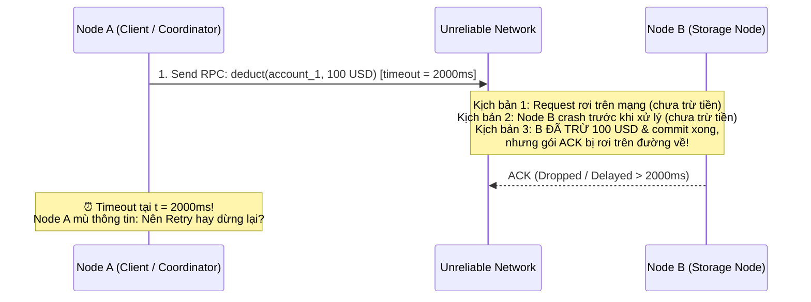
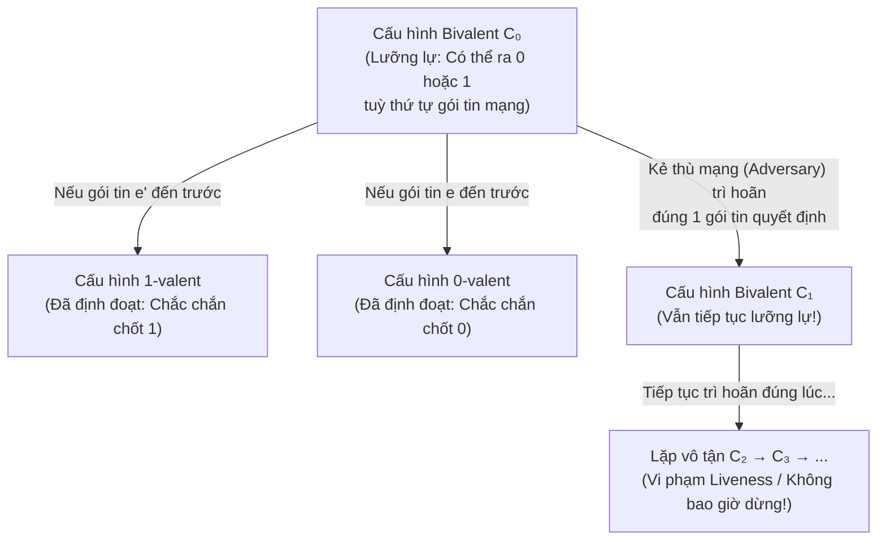
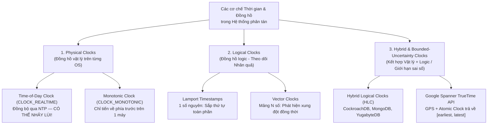
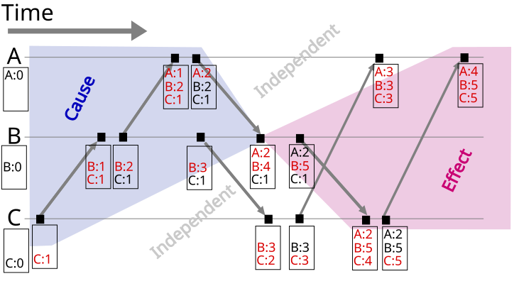

## Table of Contents
1. [Bước chuyển từ Single-Node Storage sang Hệ thống phân tán](#single-node-to-distributed)
2. [Bài toán Two Generals và Định lý bất khả thi FLP](#two-generals-and-flp)
3. [Mô hình đồng bộ mạng và Phân loại lỗi (Synchrony & Failure Models)](#synchrony-and-failure-models)
4. [Thời gian và Đồng hồ trong Hệ thống phân tán (Time & Clocks)](#time-and-clocks)
5. [Các nguỵ biện kinh điển của Điện toán phân tán (Fallacies of Distributed Computing)](#fallacies-of-distributed-computing)
6. [Tóm tắt & Ghi nhớ cốt lõi (Key Takeaways)](#key-takeaways)

---

## Bước chuyển từ Single-Node Storage sang Hệ thống phân tán {#single-node-to-distributed}

### 0. Khởi động cho người mới: Tại sao gọi hàm sang máy chủ khác qua dây mạng lại "nguy hiểm" gấp vạn lần gọi hàm trong cùng một máy?

Khi mới học lập trình, chúng ta quen với việc viết một hàm tính thuế `calculateTax(order)` chạy ngay bên trong RAM của cùng một máy chủ. Gọi hàm `calculateTax()` giống như **với tay lấy cốc nước ngay trên bàn làm việc**:
- Tốc độ gần như tức thì (vài chục nano-giây).
- Không bao giờ có chuyện cánh tay đi nửa đường thì "rớt mất gói tin".
- Nếu toà nhà mất điện (máy chủ sập nguồn), cả người gọi lẫn cốc nước đều dừng lại cùng một lúc — không có chuyện tay đã cầm cốc uống xong mà não không biết!

Thế nhưng, khi dữ liệu phình to vượt quá sức chứa của một ổ cứng hoặc doanh nghiệp đòi hỏi cơ sở dữ liệu không được phép ngừng hoạt động dù cháy cả một phòng máy, chúng ta buộc phải bước sang **Hệ thống phân tán (Distributed Systems)** — nơi dữ liệu được chia nhỏ và sao chép qua **nhiều máy chủ (`Nodes`) nối với nhau bằng dây cáp mạng**. Lúc này, một câu lệnh `INSERT` hay `SELECT` của lập trình viên thực chất phải biến thành một **lời gọi hàm qua mạng (`RPC - Remote Procedure Call`)**.

Nhiều lập trình viên mới thường bị "bỏng tay" nặng nề vì viết code gọi sang Database Node khác qua mạng giống hệt như gọi hàm `calculateTax()` trong RAM. Hãy hình dung: gọi `RPC` qua cáp mạng giống như **cử một người đưa thư đi xe máy sang thành phố bên cạnh giữa trời mưa bão**:
1. Người đưa thư có thể bị kẹt xe hoặc ngã xe dọc đường (**Mất gói tin chiều đi** — máy chủ bên kia chưa hề nhận được lệnh).
2. Người đưa thư đã tới nơi, kho hàng bên kia đã xuất hàng xong xuôi, nhưng trên đường cầm biên lai chạy về thì người đưa thư bị ngã xuống sông (**Thực thi xong nhưng mất gói tin `ACK` chiều về**).
3. Đứng ở trụ sở chính, khi thấy hết `2 giây` (`Timeout`) mà người đưa thư chưa về, hệ thống rơi vào trạng thái **mù thông tin hoàn toàn**: Không ai biết kho bên kia đã trừ tiền khách hàng hay chưa! Nếu vội vàng cử người đưa thư thứ hai đi giao lại đúng tờ lệnh đó, khách hàng sẽ bị trừ tiền hai lần!

Trước khi đi sâu vào toán học và giao thức nội bộ của Chương 8, hãy trang bị nhanh bảng từ điển đối chiếu dưới đây để nắm trọn mọi khái niệm nền tảng:

#### Bảng Từ Điển Thuật Ngữ Nhanh Cho Người Mới (Beginner's Visual Glossary)

| Thuật ngữ trong sách | Hiểu nôm na cho người mới (Ẩn dụ đời thực) | Trong Database phân tán thực tế (CockroachDB / TiKV / Cassandra / etcd / DynamoDB) là gì? |
| :--- | :--- | :--- |
| **`Partial Failure`**<br/>*(Lỗi cục bộ một phần)* | Trong một đội bóng 11 người, 1 cầu thủ bị chuột rút nằm sân nhưng 10 người kia vẫn đang chạy và không biết đồng đội mình vừa ngã. Hệ thống không chết hẳn mà "nửa sống nửa chết". | Khi chạy câu lệnh giao dịch trên **CockroachDB** hoặc **TiDB**, 1 trong 3 Storage Node (`TiKV`) bị đứt cáp mạng hoặc treo đĩa. Lời gọi RPC tới node đó bị hết giờ chờ (`Timeout`), và Coordinator không biết node đó đã ghi WAL xong chưa hay gói tin bị rớt trên Switch. |
| **`Indistinguishability of Slow vs Dead`**<br/>*(Không thể phân biệt nút chết với mạng chậm)* | Nhắn tin cho đồng nghiệp làm việc từ xa mà 5 phút chưa thấy trả lời: Không thể biết họ đã sập nguồn máy tính ("chết") hay chỉ đang đi vệ sinh / mạng Wi-Fi bị lag ("chậm"). | Một node **Cassandra** (chạy trên JVM) bước vào đợt dọn rác bộ nhớ *Stop-The-World GC Pause* mất `3 giây` không phản hồi mạng. Từ góc nhìn của các node khác, trạng thái im lặng 3 giây này giống hệt 100% với việc máy chủ đó vừa bị rút phích cắm điện. |
| **`Idempotency & Idempotency Key`**<br/>*(Tính lũy đẳng — Gửi lại nhiều lần kết quả vẫn như 1 lần)* | Bấm nút gọi thang máy tầng 5: Dù người đứng chờ sốt ruột bấm nút "Lên" 1 lần hay bấm liên tục 20 lần, thang máy cũng chỉ nhận đúng 1 lệnh đi lên tầng 5 chứ không chạy lên 20 lần. | Khi **DynamoDB** hoặc cổng thanh toán bị `Timeout`, Client gửi lại lệnh kèm cùng một mã `ClientRequestToken` (`Idempotency Key`). Storage Engine kiểm tra bảng lịch sử: thấy mã này đã làm rồi thì trả lại kết quả cũ chứ tuyệt đối không trừ tiền hay chèn dòng mới lần thứ hai. |
| **`Two Generals' Problem`**<br/>*(Bài toán Hai vị tướng)* | Hai vị tướng ở hai đỉnh đồi hẹn nhau cùng tấn công qua người đưa thư đi xuyên thung lũng địch. Vì người đưa thư xác nhận ("Tôi đã nhận được thư của anh!") luôn có thể bị bắt giữa đường, không bên nào dám chắc 100% bên kia đã yên tâm xuất quân. | Giải thích tại sao không thể thiết kế một giao thức chốt giao dịch (`2PC / Consensus`) đảm bảo chắc chắn 100% chỉ bằng số lượt gói tin cố định nếu đường mạng đứt hoàn toàn, buộc **TCP (`TIME_WAIT`)** và các bộ điều phối giao dịch phải có hàng đợi **Retry bền vững (Persistent Retry Queue)**. |
| **`FLP Impossibility Theorem`**<br/>*(Định lý bất khả thi FLP)* | Một hội đồng muốn biểu quyết chốt phương án `0` hoặc `1` qua đường bưu điện không giới hạn thời gian trễ. Nếu cho phép dù chỉ 1 thành viên có thể ngất xỉu bất ngờ, hội đồng có thể bị rơi vào trạng thái lưỡng lự (`Bivalent`) mãi mãi không bao giờ chốt xong. | Định lý nền tảng buộc các kỹ sư thiết kế **etcd (Raft)**, **Google Spanner (Paxos)**, **ZooKeeper (Zab)** phải chọn nguyên tắc: Bảo vệ tính đúng đắn dữ liệu (**Safety**) 100% mọi lúc, còn việc bầu cử kết thúc (**Liveness**) thì dựa vào **Timeout ngẫu nhiên** khi mạng ổn định (*Partially Synchronous*). |
| **`Crash-Stop` vs `Crash-Recovery` vs `Byzantine Faults`** | • **Crash-Stop**: Nhân viên nghỉ việc hẳn, không bao giờ quay lại.<br/>• **Crash-Recovery**: Nhân viên ngất xỉu, mất trí nhớ tạm thời (RAM), lúc tỉnh dậy phải mở sổ tay (Disk WAL) ra đọc lại.<br/>• **Byzantine**: Nội gián cố tình nói dối, báo cáo 2 nơi 2 con số trái ngược nhau. | Các Database nội bộ như **CockroachDB, TiKV, etcd, MongoDB** được thiết kế theo mô hình **Crash-Recovery** (cần $2f+1$ node, bắt buộc `fsync` trạng thái ra WAL trước khi trả lời). Còn Blockchain (Tendermint, PBFT) phải chống lỗi **Byzantine** nên cần tối thiểu $3f+1$ node. |
| **`Physical Clock (NTP / Monotonic)` vs `Logical Clock (Lamport & Vector Clock)`** | • **NTP (Wall Clock)**: Đồng hồ treo tường xem giờ hành chính (có thể bị chỉnh vặn lùi lại).<br/>• **Monotonic Clock**: Đồng hồ bấm giờ thể thao (chỉ tiến lên, dùng đo thời gian chờ).<br/>• **Logical Clock**: Số thứ tự đánh dấu trên từng tờ biên bản để biết tờ nào viết sau tờ nào. | **Cassandra** dùng nhãn thời gian vật lý cho *Last-Write-Wins* (dễ mất dữ liệu nếu lệch NTP). **Dynamo / Riak** dùng **Vector Clocks** để phát hiện 2 giỏ hàng sửa song song. **CockroachDB / MongoDB** kết hợp cả hai thành **HLC (Hybrid Logical Clock)**, còn **Spanner** dùng đồng hồ nguyên tử **TrueTime**. |
| **`Happens-Before (a -> b)` vs `Concurrent (a \|\| b)`** | • **`a -> b` (Nhân quả)**: Tin nhắn trả lời `b` được viết sau khi người đó đã đọc tin nhắn câu hỏi `a`.<br/>• **`a \|\| b` (Đồng thời)**: Hai người ở hai phòng kín cùng viết lên bảng của mình mà chưa hề nhìn thấy bài của nhau. | Trong **Amazon Dynamo / Riak / CouchDB**, nếu phiên bản `V2` biết về `V1` (`V1 -> V2`), DB tự động lấy `V2` đè lên `V1`. Nhưng nếu 2 người cùng sửa 1 bản ghi trên 2 node bị đứt cáp (`V_A \|\| V_B`), DB phát hiện đây là 2 nhánh độc lập (**Siblings**) và giữ lại cả hai để gộp (`Merge`)! |

---

### 1. Bài toán thực tế & Mental Model: Tại sao gọi hàm qua mạng không giống gọi hàm trong bộ nhớ?

Ở Phần I (Chương 1 đến Chương 7), mọi thành phần của Storage Engine (B-Tree, LSM-Tree, Buffer Pool, Write-Ahead Log) đều vận hành bên trong **một máy chủ vật lý đơn lẻ (Single-Node)**. Khi mô-đun thực thi truy vấn gọi hàm `storage.write(key, value)`, CPU chỉ đơn giản đẩy địa chỉ trả về vào ngăn xếp (*Call Stack*) trong RAM và nhảy tới vùng nhớ chứa mã máy của hàm đó.

Hãy hình dung hai mô hình đối lập sau:
- **Mental Model của Local Function Call (Gọi hàm nội bộ)**: Giống như hai người ngồi cùng một căn phòng kín trao đổi trực tiếp. Lời nói phát ra có kết quả tức thì (tính bằng nano-giây). Nếu căn phòng mất điện hoặc sập trần (tương đương Kernel Panic hoặc mất nguồn máy chủ), **cả người gọi lẫn người nhận đều ngưng hoạt động cùng một lúc**. Trạng thái luôn tất định (*Deterministic*): hoặc lời gọi hàm thành công và trả về kết quả, hoặc toàn bộ tiến trình sập hoàn toàn.
- **Mental Model của Network RPC (Remote Procedure Call qua mạng)**: Giống như việc gửi một bức thư tay qua đường bưu điện sang một thành phố khác. Giữa người gửi (**Node A**) và người nhận (**Node B**) là cả một hệ thống cáp quang, bộ định tuyến (*Router*), bộ chuyển mạch (*Switch*) và hàng đợi gói tin của hệ điều hành. Khi bức thư đã rời tay người gửi, người gửi bị "bịt mắt" hoàn toàn cho đến khi nhận được thư hồi âm.

Sự khác biệt vật lý giữa hai môi trường này được thể hiện rõ qua bảng đối chiếu sau:

| Tiêu chí đối chiếu | Local Function Call (Single-Node) | Network RPC (Distributed System) |
| :--- | :--- | :--- |
| **Độ trễ thực thi (Latency)** | Cỡ nano-giây (`~10 ns - 100 ns` truy cập RAM). | Cỡ mili-giây (`~0.5 ms` cùng Datacenter, `100 - 300 ms` xuyên lục địa) — chậm hơn từ **`5,000` đến `3,000,000` lần**. |
| **Không gian bộ nhớ** | Chia sẻ chung RAM; có thể truyền con trỏ (*Pointer*) trực tiếp. | Bộ nhớ tách biệt hoàn toàn (*Shared-Nothing*); dữ liệu phải tuần tự hoá (*Serialize*) thành chuỗi byte và giải tuần tự hoá (*Deserialize*). |
| **Đặc tính lỗi (Failure Mode)** | **Total Failure (Lỗi toàn cục)**: Hoặc chạy xong, hoặc cả tiến trình crash cùng nhau. | **Partial Failure (Lỗi cục bộ không xác định)**: Một node hoặc một đoạn cáp có thể chết độc lập, trong khi node kia vẫn sống và không biết chuyện gì đã xảy ra. |
| **Thứ tự và tính đơn nhất** | Thực thi đúng 1 lần (*Exactly-once*) theo đúng thứ tự dòng lệnh. | Gói tin có thể bị rơi (*Dropped*), đến trễ bất định (*Delayed*), bị nhân bản (*Duplicated*) hoặc đến ngược thứ tự gửi (*Out-of-order*). |

### 2. Giải phẫu Partial Failure: Ba kịch bản không thể phân biệt khi Timeout

Đặc trưng cốt lõi làm nên độ phức tạp của hệ thống phân tán là **Partial Failure (Lỗi cục bộ)**. Khi **Node A** gửi một yêu cầu ghi dữ liệu qua mạng tới **Node B** và đặt đồng hồ hẹn giờ chờ phản hồi (`timeout = 2000 ms`), nếu hết `2000 ms` mà không thấy gói tin trả lời, **Node A hoàn toàn không có bất kỳ cơ sở vật lý nào để phân biệt 3 kịch bản sau**:

1. **Kịch bản 1 — Mất gói tin chiều đi (`Request Lost in Transit`)**: Gói tin RPC bị rơi tại một Switch bị tràn bộ đệm trước khi kịp chạm tới card mạng của Node B. Node B chưa từng biết tới yêu cầu này và dữ liệu chưa hề thay đổi.
2. **Kịch bản 2 — Node B bị treo hoặc sập trước khi xử lý (`Remote Crash / GC Pause`)**: Gói tin đã tới Node B, nhưng tiến trình trên B bị sập nguồn ngay trước khi ghi xuống đĩa, hoặc đang bị đóng băng tạm thời bởi một đợt *Stop-The-World Garbage Collection*.
3. **Kịch bản 3 — Đã thực thi thành công nhưng mất gói tin chiều về (`Executed, ACK Lost`)**: Node B đã nhận yêu cầu, **đã ghi dữ liệu xuống đĩa và `fsync` thành công**, đồng thời đã gửi gói tin xác nhận (`ACK`) quay lại. Tuy nhiên, gói tin `ACK` bị rơi trên đường về hoặc bị kẹt mạng đến trễ sau mốc `2000 ms`.

> [!NOTE]
> **Cách đọc sơ đồ cho người mới:**
> 1. **Nhìn vào 3 cột dọc từ trái sang phải**: Cột 1 là `Node A` (máy gửi lệnh), cột giữa `Unreliable Network` là đường dây cáp mạng chập chờn, và cột 3 là `Node B` (máy chủ Database lưu trữ). Thời gian trôi từ trên xuống dưới.
> 2. **Theo dõi mũi tên số `1`**: `Node A` bắn lệnh trừ `100 USD` qua mạng và bấm đồng hồ đếm ngược `2000 ms`.
> 3. **Nhìn vào hộp ghi chú màu vàng ở giữa và mũi tên đứt nét `ACK`**: Dù xảy ra kịch bản 1 (rớt chiều đi), kịch bản 2 (`Node B` sập), hay kịch bản 3 (`Node B` đã trừ tiền xong nhưng rớt gói `ACK` chiều về), thì tại mốc `t = 2000ms` ở đáy hình, **màn hình của `Node A` đều trống trơn giống hệt nhau** — đẩy `Node A` vào thế tiến thoái lưỡng nan: gửi lại thì sợ trừ tiền 2 lần, mà dừng lại thì sợ đơn hàng chưa thanh toán!



### 3. Ví dụ chạy tay (Worked Example): Thảm hoạ trừ tiền hai lần và Thiết kế Idempotency Key

Để thấy rõ hậu quả của Partial Failure, hãy khảo sát kịch bản thanh toán giữa dịch vụ **Order Service (Node A)** và cơ sở dữ liệu **Ledger DB (Node B)** với tài khoản `account_1` đang có số dư ban đầu là **`500 USD`**.

#### Trường hợp A: Thao tác KHÔNG có tính luỹ đẳng (Non-Idempotent Retry)

Một thao tác được gọi là **Idempotent (Luỹ đẳng)** nếu việc thực thi nó `1` lần hay thực thi lặp lại `N` lần liên tiếp đều để lại trạng thái dữ liệu cuối cùng giống hệt nhau: $f(f(x)) = f(x)$.
- Phép gán tuyệt đối `SET status = 'PAID'` là **Idempotent**.
- Phép cộng/trừ tương đối `UPDATE accounts SET balance = balance - 100 WHERE id = 'account_1'` là **Non-Idempotent**.

Hãy theo dõi từng bước khi Order Service thực hiện retry ngây thơ đối với lệnh trừ tương đối:

| Mốc thời gian | Hành động tại Node A (Order Service) | Mạng truyền tin | Hành động & Trạng thái tại Node B (Ledger DB) |
| :--- | :--- | :--- | :--- |
| **`t = 0 ms`** | Khởi tạo giao dịch trừ `100 USD`. Gửi RPC lần 1: `deduct(account_1, 100)`. | Gói tin đi tới B sau `15 ms`. | Số dư ban đầu: `balance = 500 USD`. |
| **`t = 15 ms`** | Đang chờ phản hồi (Timer đếm ngược từ `2000 ms`). | — | Nhận lệnh `deduct(account_1, 100)`. Thực thi trừ tiền: `balance = 500 - 100 = 400 USD`. Ghi WAL & Commit xong. |
| **`t = 25 ms`** | Vẫn đang chờ... | Gói tin `ACK(OK)` bị rớt do nghẽn Switch! | Gửi `ACK(OK)` về cho Node A. |
| **`t = 2000 ms`** | **Hết hạn Timeout!** Vì không thấy `ACK`, Node A tưởng gói tin lần 1 chưa tới B nên tự động **Retry lần 2**: gửi lại `deduct(account_1, 100)`. | Gói tin Retry đi tới B lúc `t = 2020 ms`. | — |
| **`t = 2020 ms`** | Chờ phản hồi của lần Retry... | — | Nhận lệnh `deduct(account_1, 100)`. Vì không biết đây là bản tin gửi lại, Node B thực thi trừ tiền lần nữa: **`balance = 400 - 100 = 300 USD`**! |
| **`t = 2035 ms`** | Nhận `ACK(OK)`. Giao dịch báo thành công. | Gói tin `ACK(OK)` về tới A. | **Hậu quả**: Khách hàng chỉ mua đơn hàng `100 USD` nhưng bị trừ mất **`200 USD`**! |

#### Trường hợp B: Khắc phục triệt để bằng `Idempotency Key` (`Request ID`) và Bảng Deduplication

Để biến một thao tác vốn không luỹ đẳng thành **Idempotent**, Node A bắt buộc phải sinh ra một mã định danh không trùng lặp trên toàn cục (**`request_id` / `idempotency_key`**, ví dụ `req_tx_9001`) trước khi gửi lần đầu tiên, và **giữ nguyên mã `request_id` này trong mọi lần Retry của cùng một nghiệp vụ**. Về phía Node B, hệ thống lưu trữ cả trạng thái dữ liệu lẫn lịch sử `processed_requests` trong **cùng một giao dịch nguyên tử (Atomic Local Transaction)**:

> [!NOTE]
> **Cách đọc sơ đồ cho người mới:**
> 1. **Nhìn vào cặp từ khoá `BEGIN TRANSACTION` và `COMMIT` bọc ngoài cùng**: Toàn bộ 3 bước bên trong phải được Database thực hiện như một gói không thể tách rời (hoặc thành công cả hai bảng `accounts` và `processed_requests`, hoặc không làm gì cả).
> 2. **Theo dõi Bước 1 & Bước 2 (Chốt chặn chống trùng lặp)**: Ngay khi nhận lệnh, `Node B` tra sổ `processed_requests` xem mã `req_tx_9001` đã từng xuất hiện chưa. Nếu có rồi, lập tức trả lại biên lai cũ và thoát ra.
> 3. **Kết quả ở Bước 3**: Chỉ khi mã `req_tx_9001` hoàn toàn mới, `Node B` mới trừ `100 USD` trong bảng `accounts` đồng thời ghi ngay mã `req_tx_9001` vào sổ `processed_requests` trước khi `COMMIT`.

```text
// Logic xử lý chuẩn tại Node B (Storage Node) trong 1 Local Transaction:
BEGIN TRANSACTION;
  1. Kiểm tra: SELECT response_payload FROM processed_requests WHERE request_id = 'req_tx_9001';
  2. Nếu ĐÃ TỒN TẠI:
       - KHÔNG thực thi trừ tiền lần nữa!
       - Trả về ngay `response_payload` đã lưu từ lần thực thi trước.
  3. Nếu CHƯA TỒN TẠI:
       - UPDATE accounts SET balance = balance - 100 WHERE id = 'account_1'; (500 -> 400)
       - INSERT INTO processed_requests (request_id, response_payload, created_at)
         VALUES ('req_tx_9001', 'OK: new_balance=400', NOW());
COMMIT;
```

Chạy tay lại kịch bản mất `ACK` với cơ chế `Idempotency Key`:
1. **`t = 0 ms`**: Node A sinh `request_id = "req_tx_9001"`, gửi `deduct(req_id="req_tx_9001", account_1, 100)`.
2. **`t = 15 ms`**: Node B kiểm tra bảng `processed_requests`, chưa thấy `"req_tx_9001"`. Node B trừ số dư từ `500 USD` xuống **`400 USD`**, đồng thời ghi bản ghi `("req_tx_9001", "OK: new_balance=400")` vào bảng `processed_requests` trong cùng một lượt Commit xuống WAL.
3. **`t = 25 ms`**: Gói tin `ACK` trả về từ Node B bị đứt cáp làm rơi mất.
4. **`t = 2000 ms`**: Node A bị Timeout và thực hiện Retry, nhưng **vẫn gửi kèm chính xác `req_id="req_tx_9001"`**.
5. **`t = 2020 ms`**: Node B nhận gói tin Retry, tra cứu thấy `"req_tx_9001"` đã nằm trong `processed_requests`. Node B **bỏ qua bước trừ tiền**, trích xuất kết quả cũ `"OK: new_balance=400"` và gửi lại cho Node A. Số dư của `account_1` được bảo toàn tuyệt đối ở mức **`400 USD`**!

> [!IMPORTANT]
> **Nguyên tắc thiết kế bất di bất dịch trong Hệ thống phân tán**:
> Mọi giao thức mạng thực tế đều chỉ cung cấp ngữ nghĩa truyền tin **At-most-once** (gửi 1 lần, nếu rớt thì mất luôn) hoặc **At-least-once** (retry cho đến khi nhận được ACK, dẫn tới có thể nhận trùng nhiều lần). Để đạt được hiệu ứng **Effectively-once (Thực thi đúng 1 lần về mặt kết quả)**, hệ thống bắt buộc phải kết hợp:
> $$\text{At-least-once Retry (tại Sender)} + \text{Idempotent Execution / Deduplication (tại Receiver)}$$

---

## Bài toán Two Generals và Định lý bất khả thi FLP {#two-generals-and-flp}

Tại sao thiết kế các giao thức đồng thuận phân tán (như Paxos, Raft) lại khó đến vậy? Hai chứng minh toán học kinh điển dưới đây vạch ra ranh giới bất khả thi mà không một thuật toán nào có thể vượt qua nếu không nới lỏng các giả định vật lý.

### 1. Bài toán Hai vị tướng (Two Generals' Problem) — Giới hạn của kênh truyền mất gói tin

#### Bài toán thực tế & Mental Model
Giả sử có hai nút trong hệ thống phân tán cần thực hiện một hành động đồng thời (ví dụ: hai nhánh cơ sở dữ liệu cùng chốt hạ một giao dịch chuyển tiền liên ngân hàng, hoặc hai máy chủ cùng chuyển đổi cấu hình). Nếu cả hai cùng thực hiện thì thành công; nếu một bên thực hiện còn bên kia không thực hiện thì dữ liệu bị lệch nghiêm trọng. Ràng buộc đặt ra ở đây là đường truyền mạng giữa hai bên **không tin cậy (có thể làm rớt gói tin)**.

Bài toán này được mô hình hoá thành câu chuyện của hai vị tướng: **Tướng A (Quân Tiên Phong)** và **Tướng B (Quân Chủ Lực)** đóng trại trên hai đỉnh đồi tách biệt, ở giữa là thung lũng của quân địch.
- Nếu cả hai đạo quân tấn công **cùng một lúc**, họ chắc chắn chiến thắng.
- Nếu chỉ có **1 đạo quân tấn công đơn độc**, đạo quân đó sẽ bị tiêu diệt hoàn toàn.
- Hai vị tướng chỉ có thể liên lạc bằng cách cử lính liên lạc chạy bộ băng qua thung lũng của địch — nơi người lính có thể bị bắt giết bất cứ lúc nào (tương ứng với gói tin bị rơi trên mạng).

#### Phân tích từng bước: Tại sao chuỗi xác nhận kéo dài tới vô cực?

Hãy theo dõi suy luận logic của hai vị tướng qua từng lượt tin nhắn:

> [!NOTE]
> **Cách đọc sơ đồ cho người mới:**
> 1. **Nhìn vào hai cột ngoài cùng**: Bên trái là trại của `Tướng A`, bên phải là trại của `Tướng B`, ở giữa là `(Thung lũng địch)` nơi người đưa thư có thể bị bắt bất cứ lúc nào.
> 2. **Theo dõi mũi tên ngang theo trình tự từ trên xuống dưới (`Tin nhắn 1 -> Tin nhắn 2 -> Tin nhắn 3`)**: Mỗi khi một bên gửi thư đi, hãy đọc dòng chữ trong ngoặc đơn `(...)` ngay bên dưới mũi tên để thấy nỗi sợ của người vừa gửi thư.
> 3. **Kết quả ở đáy sơ đồ**: Dù gửi bao nhiêu lượt xác nhận (`ACK`, `ACK của ACK`...), người vừa thả bức thư cuối cùng ra khỏi tay luôn rơi vào trạng thái mù thông tin (không biết bức thư cuối đó có qua nổi thung lũng hay không), dẫn tới vòng lặp vô tận.

```text
[Đỉnh đồi A - Tướng A]                    (Thung lũng địch)                    [Đỉnh đồi B - Tướng B]
       |                                          |                                      |
       |--- Tin nhắn 1: "Tấn công lúc 06:00!" --->|------------------------------------->|
       |    (Trạng thái của A: Chưa dám đánh,     |         (Trạng thái của B: Đã biết kế hoạch,
       |     vì không biết lính lượt 1 có bị bắt  |          nhưng B biết rằng A sẽ KHÔNG DÁM ĐÁNH
       |     giữa đường hay không!)               |          nếu A chưa nhận được hồi âm của B!)
       |                                          |                                      |
       |<-----------------------------------------|<--- Tin nhắn 2: "ACK (Tôi đồng ý)" --|
       |    (Trạng thái của A: Đã biết B đồng ý,  |         (Trạng thái của B: Vẫn chưa dám đánh!
       |     nhưng A lại nhận ra rằng B sẽ KHÔNG  |          Vì B không biết lính lượt 2 mang ACK
       |     DÁM ĐÁNH nếu B không biết chắc chắn  |          có về tới trại A nguyên vẹn hay không!)
       |     rằng A đã nhận được Tin nhắn 2!)     |                                      |
       |                                          |                                      |
       |--- Tin nhắn 3: "ACK của ACK" ----------->|------------------------------------->|
       |    (Vòng lặp vô tận: Ai là người gửi gói tin cuối cùng sẽ luôn ở trạng thái     |
       |     không biết gói tin cuối đó có tới đích hay không!)                          |
```

- **Khái niệm Toán học — Tri thức chung (Common Knowledge)**:
  - Khi Tướng A gửi Tin nhắn 1 và Tướng B nhận được: cả A và B đều biết mệnh lệnh `"Tấn công lúc 06:00"` (gọi sự kiện này là $E$). Nhưng lúc này mới chỉ có *Shared Knowledge* (mỗi người tự biết $E$), chứ A chưa biết là B đã biết $E$.
  - Khi B gửi Tin nhắn 2 (`ACK`) về tới A: A biết rằng *"B đã biết $E$"*. Nhưng B lại không biết rằng *"A đã biết rằng B biết $E$"*.
  - Để hai bên dám xuất quân mà không sợ bị bỏ rơi, họ cần đạt trạng thái **Common Knowledge**: *"A biết $E$, B biết $E$, A biết rằng B biết $E$, B biết rằng A biết rằng B biết $E$, ... tới vô hạn"*.
  - **Chứng minh bằng quy nạp**: Giả sử tồn tại một giao thức chỉ cần đúng $k$ tin nhắn là hai tướng chắc chắn cùng tấn công. Thế thì tin nhắn thứ $k$ (tin nhắn cuối cùng) phải đóng vai trò quyết định. Nhưng người gửi tin nhắn thứ $k$ không nhận được bất kỳ phản hồi nào cho tin nhắn đó, nên kể cả khi tin nhắn thứ $k$ bị mất trên đường truyền, người gửi vẫn phải quyết định tấn công. Điều đó có nghĩa là tin nhắn thứ $k$ hoàn toàn dư thừa — chỉ cần $k - 1$ tin nhắn là đủ! Lùi dần về $k = 0$, ta đi tới mâu thuẫn: **Không tồn tại bất kỳ giao thức hữu hạn tin nhắn nào đảm bảo chắc chắn 100% sự đồng thuận trên kênh truyền có thể mất tin nhắn.**

- **Ứng dụng thực tế trong Hệ thống & Mạng máy tính**:
  - Đây chính là lý do tại sao khi đóng kết nối TCP (`FIN -> ACK -> FIN -> ACK`), bên gửi gói `ACK` cuối cùng bắt buộc phải nằm chờ ở trạng thái **`TIME_WAIT`** (thường từ `60s` đến `120s` — gấp đôi thời gian sống tối đa của gói tin `2 × MSL`). Nó không bao giờ biết chắc 100% gói `ACK` cuối có tới đích hay không, mà chỉ chờ đủ lâu để nếu bên kia không nhận được và gửi lại `FIN` thì nó còn kịp trả lời!
  - Trong cơ sở dữ liệu phân tán, người ta giải quyết bài toán này bằng cách chuyển từ câu hỏi *"Làm sao chắc chắn trong 1 lần gửi?"* sang cơ chế **Gửi lặp lại liên tục (Persistence Retry Queue) kết hợp Idempotency** cho tới khi đường mạng khôi phục, hoặc sử dụng một uỷ ban đa số (**Quorum**) để quyết định trạng thái giao dịch.

---

### 2. Định lý bất khả thi FLP (Fischer, Lynch, Paterson — `1985`)

#### Bài toán thực tế: Nếu mạng KHÔNG BAO GIỜ mất tin nhắn thì sao?
Trong bài toán Two Generals, thủ phạm gây bế tắc là **mạng làm rơi tin nhắn**. Vậy một câu hỏi tự nhiên được đặt ra: *"Giả sử đường mạng hoàn toàn tin cậy (mọi gói tin gửi đi sớm hay muộn chắc chắn sẽ tới đích, không bao giờ mất), liệu các node có thể luôn luôn thống nhất được một quyết định chung (Consensus) khi chỉ có tối đa 1 node bị sập nguồn (Crash) hay không?"*

Năm `1985`, ba nhà khoa học Michael Fischer, Nancy Lynch và Mike Paterson đã công bố định lý **FLP Impossibility** (công trình đạt giải thưởng Dijkstra), chứng minh một sự thật gây chấn động giới khoa học máy tính: **Câu trả lời vẫn là KHÔNG THỂ**, nếu hệ thống hoạt động trong môi trường **Bất đồng bộ hoàn toàn (Asynchronous System)**!

#### Các khái niệm nền tảng cần nắm vững trước khi đọc chứng minh FLP

1. **Bài toán Đồng thuận (Consensus Problem)**: Một cụm gồm $N$ node, mỗi node $i$ có một giá trị đề xuất ban đầu $v_i \in \{0, 1\}$ (ví dụ: `0 = Huỷ giao dịch / Abort`, `1 = Chấp nhận giao dịch / Commit`). Mọi node khoẻ mạnh phải cùng chốt hạ chung một giá trị quyết định thoả mãn 3 điều kiện:
   - **Agreement (Tính thống nhất — thuộc nhóm Safety)**: Không có hai node khoẻ mạnh nào chốt hai kết quả trái ngược nhau (không thể có chuyện một node chọn `0` còn node kia chọn `1`).
   - **Validity (Tính hợp lệ — thuộc nhóm Safety)**: Giá trị được chốt phải là giá trị do ít nhất một node trong cụm đề xuất ban đầu.
   - **Termination (Tính dừng — thuộc nhóm Liveness)**: Mọi node không bị crash cuối cùng đều phải đưa ra được quyết định sau một số bước hữu hạn (không được chạy lặp vô tận).

2. **Sự khác biệt sống còn giữa Safety và Liveness**:
   - **Safety ("Something bad never happens" — Không có điều gì sai trái xảy ra)**: Không bao giờ có chuyện hai Leader cùng hợp lệ hoặc dữ liệu bị ghi lệch. Nếu Safety bị vi phạm, ta có thể chỉ tay vào đúng thời điểm $t$ trong log nơi sự cố xảy ra.
   - **Liveness ("Something good eventually happens" — Điều đúng đắn cuối cùng sẽ xảy ra)**: Hệ thống cuối cùng sẽ trả lời truy vấn của người dùng. Khác với Safety, tại một thời điểm $t$ bất kỳ, nếu chưa có kết quả, ta chưa thể kết luận Liveness bị vi phạm hay hệ thống chỉ đang xử lý chậm.

3. **Cấu hình Bivalent vs Univalent (Trái tim của chứng minh FLP)**:
   - Tại bất kỳ thời điểm nào, toàn bộ trạng thái bộ nhớ của tất cả các node cộng với tập hợp các gói tin đang bay lơ lửng trên mạng được gọi là một **Cấu hình (Configuration $C$)**.
   - **Cấu hình Univalent (Đơn trị — Kết quả đã định đoạt)**: Là trạng thái hệ thống mà từ đó, dù các gói tin đang bay trên mạng có đến nhanh hay đến trễ theo bất kỳ thứ tự nào đi chăng nữa, kết quả cuối cùng của toàn cụm cũng chỉ có thể rơi vào **đúng 1 giá trị**:
     - **$0$-valent**: Chắc chắn `100%` mọi kịch bản tương lai đều dẫn tới quyết định `0`.
     - **$1$-valent**: Chắc chắn `100%` mọi kịch bản tương lai đều dẫn tới quyết định `1`.
   - **Cấu hình Bivalent (Lưỡng trị — Kết quả chưa định đoạt / Đang lưỡng lự)**: Là trạng thái hệ thống như đang đứng trên đỉnh một con dốc hai chiều:
     - Nếu gói tin của Node A đến đích trước gói tin của Node B $\rightarrow$ cả cụm sẽ nghiêng hẳn sang quyết định **`1`**.
     - Ngược lại, nếu gói tin của Node B đến đích trước gói tin của Node A $\rightarrow$ cả cụm sẽ nghiêng hẳn sang quyết định **`0`**.

> [!NOTE]
> **Cách đọc sơ đồ cho người mới:**
> 1. **Nhìn vào ô trên cùng `Cấu hình Bivalent C₀`**: Đây là trạng thái xuất phát khi cả cụm Database đang "lưỡng lự" 50-50, chưa chốt được kết quả là `0` (Abort) hay `1` (Commit).
> 2. **Theo dõi 2 nhánh rẽ sang trái và giữa**: Nếu mạng thông suốt để gói tin `e'` hoặc `e` tới đích bình thường, hệ thống sẽ rơi vào ô `1-valent` hoặc `0-valent` (đã chốt hạ xong).
> 3. **Theo dõi nhánh rẽ bên phải (`Kẻ thù mạng trì hoãn...`)**: Kẻ điều phối mạng bất đồng bộ cố tình ngâm gói tin quyết định lại đúng lúc, ép hệ thống trượt sang ô `Bivalent C₁` rồi `C₂ -> C₃ -> ...` lặp vô tận, khiến thuật toán đồng thuận không bao giờ dừng lại được!



#### Tại sao Kẻ thù mạng bất đồng bộ (Asynchronous Adversary) luôn thắng?

> [!IMPORTANT]
> **Phát biểu Định lý FLP (`1985`)**:
> Trong một hệ thống mạng bất đồng bộ hoàn toàn (*Asynchronous Network Model* — không có cận trên về độ trễ truyền tin và không có đồng hồ chung), **không tồn tại bất kỳ thuật toán đồng thuận tất định (*Deterministic Consensus Protocol*) nào có thể đảm bảo đồng thời cả Safety và Liveness nếu cho phép dù chỉ tối đa `1` node bị dừng hoạt động đột ngột (*1 unannounced crash failure*)**.

Hãy hình dung mạng bất đồng bộ giống như một **"Kẻ điều phối đối kháng" (Adversary Scheduler)** hợp pháp: nó không được phép xoá hay sửa nội dung gói tin, nhưng nó được phép **giữ chân bất kỳ gói tin nào lâu tuỳ ý** trước khi giao tới người nhận, và được phép làm crash tối đa `1` node. Chứng minh FLP diễn ra qua 3 bước cực kỳ trực quan:

1. **Bước 1 — Luôn tồn tại trạng thái khởi đầu Bivalent ($C_0$)**:
   Nếu ban đầu một nửa số node đề xuất `0` và một nửa số node đề xuất `1`, trạng thái khởi đầu $C_0$ chắc chắn là **Bivalent** (vì kết quả cuối cùng phụ thuộc vào việc node nào bị crash hoặc gói tin của phe nào tới trước).
2. **Bước 2 — Bước chuyển quyết định (Critical Step) và Sự mù mờ giữa "Chết" với "Chậm"**:
   Để thuật toán có thể kết thúc (đạt Liveness), ở một thời điểm nào đó hệ thống bắt buộc phải bước từ cấu hình lưỡng lự **Bivalent** sang cấu hình đã chốt **Univalent** ($0$-valent hoặc $1$-valent) thông qua một sự kiện nhận tin nhắn $e$ tại một **Node $p$** nào đó.
   Thế nhưng, ngay tại khoảnh khắc Node $p$ chuẩn bị đóng vai trò "lá phiếu quyết định" đó, Kẻ thù mạng chỉ cần **tạm thời giữ toàn bộ gói tin của Node $p$ lại (làm như thể Node $p$ rất chậm)**.
   Lúc này, các node còn lại rơi vào cái bẫy chết người:
   - Theo giả định của bài toán, hệ thống phải chịu được `1` node bị crash. Vì vậy, các node còn lại **không được phép ngồi chờ Node $p$ mãi mãi** (vì lỡ Node $p$ đã chết thật thì cả cụm bị treo cứng $\rightarrow$ mất Liveness).
   - Các node còn lại buộc phải tự bàn bạc với nhau mà không có Node $p$. Nhưng khi chúng vừa định nghiêng về quyết định `0`, Kẻ thù mạng lập tức **thả gói tin đang bị giữ của Node $p$ ra đúng lúc** để trung hoà quyết định đó, đẩy toàn bộ hệ thống sang một cấu hình mới $C_1$ **vẫn tiếp tục là Bivalent**!
3. **Bước 3 — Vòng lặp lưỡng lự vô tận**:
   Từ $C_1$ (Bivalent), Kẻ thù mạng lại lặp lại đúng thủ thuật trì hoãn gói tin đó để đẩy hệ thống sang $C_2, C_3, \dots, C_\infty$ đều là Bivalent. Hệ thống không bao giờ chạm tới trạng thái Univalent, tức là **không bao giờ chốt được kết quả (vi phạm Termination / Liveness)** dù không có node nào thực sự chết!

#### Cách các cơ sở dữ liệu thực tế (Raft, Paxos, Zab) "lách luật" định lý FLP

Nếu định lý FLP đã chứng minh là bất khả thi, tại sao các hệ thống như etcd (Raft), Google Spanner (Paxos), Apache ZooKeeper (Zab) vẫn chạy đồng thuận hàng ngày? Bởi vì định lý FLP chỉ áp dụng khi hội tụ đủ cả 3 ràng buộc: **(1) Mạng Bất đồng bộ hoàn toàn + (2) Thuật toán Tất định (Deterministic) + (3) Đảm bảo cả Safety lẫn Liveness mọi lúc**. Các hệ thống thực tế vượt qua rào cản FLP bằng hai phương pháp:

1. **Chuyển sang Mô hình Đồng bộ từng phần (Partially Synchronous Model — Dwork, Lynch, Stockmeyer `1988`)**:
   - Các giao thức như **Paxos, Raft, Zab** được thiết kế với triết lý: **Bảo vệ tuyệt đối Safety (`100%`) trong mọi điều kiện mạng** (kể cả khi mạng hoàn toàn bất đồng bộ, rớt gói, chia cắt phân vùng — dữ liệu không bao giờ bị sai lệch hay Split-Brain).
   - Về phần **Liveness**, giao thức chấp nhận rằng trong những khoảng thời gian mạng bị bão hoặc đối kháng bất đồng bộ, hệ thống có thể tạm thời chưa bầu được Leader. Nhưng ngay khi mạng quay về trạng thái bình thường trong một khoảng thời gian đủ dài (gọi là sau mốc *Global Stabilization Time - GST*), các bộ đếm **Timeout** sẽ hoạt động chính xác để giúp cụm chốt kết quả ngay lập tức!
2. **Sử dụng Tính ngẫu nhiên (Non-determinism / Randomized Consensus — Ben-Or `1983`, Raft Randomized Timeout)**:
   - Định lý FLP giả định thuật toán là **Tất định (Deterministic)** — tức là Kẻ thù mạng biết trước chính xác với đầu vào $X$ thì node sẽ hành xử như thế nào để trì hoãn đúng gói tin đó.
   - Khi đưa **số ngẫu nhiên** vào giao thức (ví dụ trong Raft, mỗi Follower chọn ngẫu nhiên thời gian chờ bầu cử trong khoảng `[150ms, 300ms]`, hoặc các thuật toán Ben-Or tung đồng xu ngẫu nhiên), Kẻ thù mạng không thể đoán trước kết quả ngẫu nhiên của từng node, nhờ đó phá vỡ trạng thái đối xứng Bivalent với xác suất tiến tới `1`!

---

## Mô hình đồng bộ mạng và Phân loại lỗi (Synchrony & Failure Models) {#synchrony-and-failure-models}

Khi đọc tài liệu thiết kế của bất kỳ cơ sở dữ liệu phân tán nào, câu hỏi đầu tiên cần làm rõ là: *"Thuật toán này đang giả định mạng truyền tin hoạt động theo mô hình nào, và các máy chủ có thể hỏng theo kiểu gì?"*

### 1. Các mô hình đồng bộ mạng (Network Synchrony Models)

Ba mô hình đồng bộ mạng định nghĩa các giả định về **cận trên của độ trễ truyền tin ($\Delta$)** và **độ lệch đồng hồ giữa các node**:

| Mô hình mạng | Giả định toán học cốt lõi | Mức độ khả thi & Ứng dụng thực tế |
| :--- | :--- | :--- |
| **Synchronous (Đồng bộ hoàn toàn)** | Tồn tại một cận trên cố định và đã biết trước $\Delta$: mọi gói tin gửi đi **chắc chắn** tới đích trong thời gian $\le \Delta$, và mọi thao tác CPU hoàn tất trong thời gian xác định. | **Không khả thi trên mạng IP/Ethernet thông thường**: Hiện tượng nghẽn hàng đợi Switch, TCP Retransmission, GC Pause hay Disk I/O spike luôn có thể làm độ trễ vượt quá mọi hằng số $\Delta$ cố định. Chỉ tồn tại trong các bus phần cứng thời gian thực chuyên dụng (như hệ thống điều khiển hàng không). |
| **Asynchronous (Bất đồng bộ hoàn toàn)** | **Không tồn tại bất kỳ cận trên $\Delta$ nào**. Gói tin có thể bị trễ `1 ms`, `10 phút`, hoặc `3 ngày` tuỳ ý. Các node không có đồng hồ vật lý chung và không thể dùng Timeout để kết luận node khác đã chết. | **Cực kỳ chặt chẽ về mặt lý thuyết**: Một giao thức chứng minh được tính Safety trên mô hình Asynchronous sẽ không bao giờ làm hỏng dữ liệu trong bất kỳ điều kiện mạng tồi tệ nào. Tuy nhiên, nó bị giới hạn bởi **Định lý FLP** (không thể đảm bảo Liveness cho bài toán Consensus tất định). |
| **Partially Synchronous (Đồng bộ từng phần)** | Hệ thống hành xử như mạng đồng bộ (độ trễ nhỏ hơn $\Delta$) trong phần lớn thời gian vận hành, nhưng thỉnh thoảng sẽ rơi vào các giai đoạn bất đồng bộ tạm thời (độ trễ vượt quá $\Delta$) do nghẽn mạng hoặc GC Pause. | **Mô hình chuẩn mực của công nghiệp phần mềm**: Phản ánh đúng thực tế hạ tầng Cloud/Datacenter hiện đại. Hầu hết các hệ cơ sở dữ liệu như **Google Spanner, CockroachDB, etcd, TiKV, Kafka (KRaft)** đều được xây dựng trên mô hình này. |

### 2. Phân cấp các mô hình lỗi của Node (Node Failure Models)

Các kiểu hỏng hóc của một máy chủ trong hệ thống phân tán được xếp thành một hệ thống phân cấp bao hàm nhau (mô hình bên ngoài bao gồm tất cả các trường hợp lỗi của mô hình bên trong):

> [!NOTE]
> **Cách đọc sơ đồ cho người mới:**
> 1. **Nhìn sơ đồ như các hộp búp bê Nga lồng vào nhau từ trong ra ngoài**: Hộp trong cùng (`1. Crash-Stop`) là kiểu lỗi "hiền lành" và dễ xử lý nhất; càng đi ra lớp vỏ ngoài cùng (`4. Byzantine`), mức độ hiểm độc của lỗi càng tăng lên.
> 2. **Theo dõi lớp hộp thứ 2 và thứ 3 (`Crash-Recovery` & `Omission`)**: Đây là ranh giới mà 99% các Database doanh nghiệp (CockroachDB, TiKV, Cassandra, PostgreSQL, etcd) lựa chọn để thiết kế — máy chủ có thể sập nguồn rồi khởi động lại (mất sạch RAM, chỉ còn Disk WAL) hoặc rớt gói tin mạng, nhưng không bao giờ cố tình làm giả dữ liệu.
> 3. **Kết quả ở lớp vỏ ngoài cùng (`4. Byzantine Failures`)**: Bao trùm mọi loại lỗi bên trong cộng thêm trường hợp node bị hỏng bit phần cứng hoặc bị hacker chiếm quyền gửi tin nhắn lừa đảo hai mặt.

```text
+-------------------------------------------------------------------------+
| 4. Byzantine Failures (Lỗi tuỳ ý / Độc hại / Hỏng bit phần cứng)         |
|   +-----------------------------------------------------------------+   |
|   | 3. Omission Failures (Lỗi bỏ sót gói tin gửi đi hoặc nhận về)    |   |
|   |   +---------------------------------------------------------+   |   |
|   |   | 2. Crash-Recovery (Sập nguồn bất ngờ, sau đó khởi động  |   |   |
|   |   |    lại: mất sạch RAM, chỉ còn dữ liệu trên Disk/WAL)    |   |   |
|   |   |   +-------------------------------------------------+   |   |   |
|   |   |   | 1. Crash-Stop / Fail-Stop (Chết hẳn vĩnh viễn)   |   |   |   |
|   |   |   +-------------------------------------------------+   |   |   |
|   |   +---------------------------------------------------------+   |   |
|   +-----------------------------------------------------------------+   |
+-------------------------------------------------------------------------+
```

1. **Crash-Stop (Fail-Stop)**:
   - Node hoạt động hoàn toàn chính xác cho tới thời điểm gặp sự cố, sau đó dừng vĩnh viễn và không bao giờ quay trở lại cụm.
   - Đây là mô hình đơn giản để chứng minh thuật toán trên giấy, nhưng không thực tế vì trong môi trường vận hành thực tế, các tiến trình/container bị sập luôn được Kubernetes hoặc systemd khởi động lại.
2. **Crash-Recovery (Fail-Recovery)**:
   - Node có thể dừng đột ngột tại bất kỳ dòng lệnh nào, và một lúc sau khởi động lại để tham gia lại vào cụm.
   - **Thách thức kỹ thuật**: Khi crash, toàn bộ biến trạng thái nằm trên bộ nhớ khả biến (**Volatile Memory / RAM**) bị xoá sạch. Khi tỉnh dậy, node có thể bị "mất trí nhớ" về các lá phiếu bầu cử hoặc các giao dịch nó đã hứa trước khi chết. Do đó, mọi thuật toán chạy trên mô hình Crash-Recovery (như Multi-Paxos, Raft) bắt buộc phải ghi bền vững trạng thái quan trọng (`currentTerm`, `votedFor`, `log[]`) xuống **Write-Ahead Log (WAL) trên đĩa** và gọi `fsync()` trước khi gửi gói tin phản hồi qua mạng.
3. **Omission Failures (Lỗi bỏ sót)**:
   - Tiến trình trên node vẫn đang chạy bình thường, nhưng thất bại trong việc gửi một số gói tin đi (**Send Omission**) hoặc không nhận được gói tin đến (**Receive Omission**).
   - Nguyên nhân thực tế: Tràn bộ đệm vòng của card mạng (*NIC Ring Buffer Overflow*), tường lửa/iptables chặn nhầm một chiều, hoặc hết vùng nhớ Kernel Socket Buffer.
4. **Byzantine Failures (Lỗi tuỳ ý / Độc hại — Lamport, Shostak, Pease `1982`)**:
   - Đây là mức độ lỗi khắc nghiệt nhất: node bị lỗi không dừng lại mà tiếp tục gửi các gói tin sai lệch — có thể do lỗi phần cứng làm lật bit trong RAM/CPU mà không qua ECC, lỗi phần mềm nghiêm trọng, hoặc node đã bị tin tặc chiếm quyền điều khiển và cố tình gửi thông tin hai mặt (nói với Node A rằng `"Tôi bầu cho 1"`, nhưng lại nói với Node B rằng `"Tôi bầu cho 0"`).
   - **Chi phí chịu lỗi ($2f + 1$ vs $3f + 1$)**:
     - Trong môi trường nội bộ Datacenter tin cậy (chỉ cần chống lỗi **Crash-Recovery / Omission**), để chịu được $f$ node chết, hệ thống chỉ cần tổng cộng **$N = 2f + 1$ node** (ví dụ: cụm `3` node chịu được `1` node sập; cụm `5` node chịu được `2` node sập).
     - Trong môi trường không tin cậy cần chống lỗi **Byzantine (BFT — Byzantine Fault Tolerance, như PBFT, Tendermint, Blockchain)**, để chịu được $f$ kẻ phản bội, hệ thống bắt buộc phải có tối thiểu **$N = 3f + 1$ node** (ví dụ: cần tối thiểu `4` node mới chịu nổi `1` node làm phản, vì trong `4` node nếu `1` node gửi tin nhắn lừa đảo và `1` node khác bị trễ mạng, `2` node trung thực còn lại phải áp đảo được `1` phiếu gian lận kia).

---

## Thời gian và Đồng hồ trong Hệ thống phân tán (Time & Clocks) {#time-and-clocks}

### 1. Bài toán thực tế & Mental Model: Tại sao không thể dùng `System.currentTimeMillis()` để sắp xếp sự kiện giữa các máy chủ?

Trên một máy tính đơn lẻ, để biết sự kiện $E_1$ hay $E_2$ xảy ra trước, lập trình viên chỉ cần gọi hàm lấy thời gian hệ thống rồi so sánh `t1 < t2`. Tuy nhiên, trong hệ thống phân tán gồm nhiều máy chủ, **không tồn tại một đồng hồ vật lý toàn cục hoàn hảo**.

Mỗi bo mạch chủ sử dụng một tinh thể thạch anh (*Quartz Crystal*) dao động khi có dòng điện chạy qua để đếm thời gian. Do sai số sản xuất và sự chênh lệch nhiệt độ trong phòng máy, không có hai tinh thể thạch anh nào dao động cùng một tần số tuyệt đối:
- **Clock Drift (Độ trôi đồng hồ)**: Tinh thể thạch anh trên Máy A chạy nhanh hơn giờ chuẩn quốc tế `15 ppm` (parts-per-million), trong khi Máy B chạy chậm hơn `15 ppm`. Chỉ sau `1` ngày (`86,400` giây), đồng hồ của hai máy đã tự trôi lệch nhau khoảng `2.6 ms`; sau một tuần không đồng bộ, chúng lệch nhau gần `20 ms`.
- **Clock Skew (Độ lệch đồng hồ tại một thời điểm)**: Là khoảng chênh lệch tức thời $|T_A(t) - T_B(t)|$ giữa hai đồng hồ tại cùng một thời điểm thực tế $t$. Ngay cả khi các máy chủ liên tục đồng bộ giờ với máy chủ thời gian qua giao thức **NTP (Network Time Protocol)**, do độ trễ mạng biến thiên không đối xứng trên đường truyền Internet/LAN, Clock Skew giữa các máy chủ trong thực tế vẫn thường xuyên dao động từ **`1 ms` đến vài chục `ms`** (thậm chí hàng trăm `ms` nếu cấu hình NTP lỗi).

Hãy xem điều gì xảy ra nếu cơ sở dữ liệu dùng nhãn thời gian vật lý cục bộ (*Wall-Clock Timestamp*) để giải quyết xung đột theo quy tắc **Last-Write-Wins (LWW — Bản ghi có timestamp lớn hơn sẽ thắng)**:

> [!NOTE]
> **Cách đọc sơ đồ cho người mới:**
> 1. **Nhìn vào cột ngoài cùng bên trái (`[Thời gian chuẩn Quốc tế UTC]`)**: Đây là thời gian thực tế ngoài đời. `Client 1` ghi `"V1_CU"` lúc `.100`, còn `Client 2` ghi `"V2_MOI"` lúc `.120` (tức `"V2_MOI"` mới hơn `"V1_CU"` tới `20 ms`).
> 2. **Theo dõi đồng hồ bị lệch trên `Node A` (cột giữa) và `Node B` (cột phải)**: Vì đồng hồ `Node A` chạy nhanh `+50ms`, nó đóng dấu `"V1_CU"` là `.150`. Còn đồng hồ `Node B` chạy chậm `-20ms`, nên dù `"V2_MOI"` xảy ra sau nhưng lại bị đóng dấu nhỏ hơn là `.100`.
> 3. **Kết quả ở đáy sơ đồ (`KẾT QUẢ KHI ĐỒNG BỘ`)**: Khi Database (như Cassandra LWW) gộp dữ liệu chỉ bằng cách so sánh con số timestamp (`.150 > .100`), nó ngây thơ tưởng `"V1_CU"` là bản mới hơn nên giữ lại `"V1_CU"` và **âm thầm xoá mất bản ghi mới `"V2_MOI"`** của khách hàng!

```text
[Thời gian chuẩn Quốc tế UTC]        [Node A (Đồng hồ chạy NHANH +50ms)]        [Node B (Đồng hồ chạy CHẬM -20ms)]
-----------------------------------------------------------------------------------------------------------------
10:00:00.100 UTC                     Client 1 gửi lệnh: SET x = "V1_CU"
                                     Đồng hồ Node A đang chỉ: 10:00:00.150
                                     -> Gắn nhãn: (x = "V1_CU", ts = .150)

10:00:00.120 UTC                     (20ms SAU đó theo thời gian thực!)
                                                                                Client 2 gửi lệnh: SET x = "V2_MOI"
                                                                                Đồng hồ Node B đang chỉ: 10:00:00.100
                                                                                -> Gắn nhãn: (x = "V2_MOI", ts = .100)
-----------------------------------------------------------------------------------------------------------------
KẾT QUẢ KHI ĐỒNG BỘ (MERGE):
Hệ thống so sánh ts(.150) > ts(.100) nên giữ lại "V1_CU" và XÓA BỎ "V2_MOI"!
-> Bản cập nhật mới hơn xảy ra sau tới 20ms đã bị âm thầm huỷ diệt (Silent Data Corruption) chỉ vì lệch đồng hồ!
```

Để làm chủ thời gian trong hệ thống phân tán, kỹ sư hệ thống phải phân biệt rõ 3 nhóm đồng hồ hoàn toàn khác nhau dưới đây:

> [!NOTE]
> **Cách đọc sơ đồ cho người mới:**
> 1. **Nhìn vào ô gốc trên cùng và 3 nhánh lớn**: Thế giới đồng hồ trong Database phân tán được chia làm 3 họ: `1. Physical Clocks` (đồng hồ phần cứng trên từng máy), `2. Logical Clocks` (đồng hồ đếm số bước nhân quả), và `3. Hybrid & Bounded-Uncertainty Clocks` (sự kết hợp hiện đại của cả hai).
> 2. **Theo dõi nhánh trái (`Physical`) và nhánh giữa (`Logical`)**: Ở nhánh `Physical`, hãy chú ý sự đối lập giữa `Time-of-Day Clock` (có thể nhảy lùi khi đồng bộ NTP) và `Monotonic Clock` (chỉ tiến lên, chuyên dùng bấm giờ Timeout). Ở nhánh `Logical`, `Lamport` dùng 1 con số nguyên còn `Vector Clocks` dùng mảng $N$ số để bắt xung đột.
> 3. **Kết quả ở nhánh phải (`HybridBounded`)**: Là hai vũ khí tối tân đang chạy trong các NewSQL thực tế: `HLC` (dùng trong CockroachDB, MongoDB, YugabyteDB, TiKV) và `TrueTime API` (dùng GPS + đồng hồ nguyên tử trong Google Spanner).



---

### 2. Time-of-Day Clocks (Wall-Clock Time) vs Monotonic Clocks

Mọi hệ điều hành hiện đại (Linux, macOS, Windows) và ngôn ngữ lập trình (Java, Go, Rust, C++) đều cung cấp **hai API đồng hồ vật lý riêng biệt**. Việc dùng nhầm hai loại đồng hồ này là nguyên nhân của hàng loạt sự cố sập hệ thống nổi tiếng (như sự cố Cloudflare DNS năm `2017` do giây nhuận làm thời gian trừ nhau ra số âm):

| Đặc tính kỹ thuật | Time-of-Day Clock (Wall-Clock Time) | Monotonic Clock (Đồng hồ đơn điệu) |
| :--- | :--- | :--- |
| **API hệ thống / Ngôn ngữ** | • Linux C: `clock_gettime(CLOCK_REALTIME)`<br/>• Java: `System.currentTimeMillis()`<br/>• Go: `time.Now()` (phần Wall time) | • Linux C: `clock_gettime(CLOCK_MONOTONIC)`<br/>• Java: `System.nanoTime()`<br/>• Rust: `std::time::Instant::now()` |
| **Ý nghĩa giá trị trả về** | Thời gian thực theo lịch thế giới (số giây/mili-giây tính từ mốc Unix Epoch `1970-01-01T00:00:00Z`). | Số nano-giây đã trôi qua kể từ một mốc tuỳ ý trong quá khứ (thường là thời điểm máy chủ vừa khởi động lên — Boot time). |
| **Tác động của NTP & Giây nhuận (Leap Second)** | **CÓ THỂ NHẢY LÙI VỀ QUÁ KHỨ (`t2 < t1`)** hoặc nhảy vọt lên trước khi NTP daemon phát hiện đồng hồ cục bộ lệch quá xa so với NTP Server. | **KHÔNG BAO GIỜ NHẢY LÙI (`t2 >= t1` luôn đúng)**. NTP chỉ được phép điều chỉnh nhẹ tần số nhịp đếm (*slewing* — tối đa `0.05%`) chứ không bao giờ vặn ngược kim đồng hồ Monotonic. |
| **So sánh giữa 2 máy chủ khác nhau?** | Có ý nghĩa gần đúng (trong phạm vi sai số Clock Skew của NTP). | **Hoàn toàn vô nghĩa** khi đem so sánh giữa Máy A và Máy B (vì mỗi máy khởi động vào một thời điểm khác nhau). |
| **Mục đích sử dụng chuẩn** | Ghi nhãn thời gian vào Log cho con người đọc, đóng dấu ngày giờ tạo bản ghi nghiệp vụ. | **Bắt buộc dùng** để đo khoảng thời gian trôi qua (`elapsed = t_end - t_start`), kiểm tra **Timeout**, đo thời hạn **Lease**, và tính Latency. |

> [!WARNING]
> **Quy tắc an toàn khi lập trình hệ thống**:
> Tuyệt đối không bao giờ viết code đo thời gian chờ bằng `CLOCK_REALTIME` (ví dụ `long start = System.currentTimeMillis(); ... if (System.currentTimeMillis() - start > timeout)`). Nếu đúng lúc đó NTP điều chỉnh đồng hồ lùi lại `2` giây, phép trừ sẽ trả về số âm hoặc làm thời gian chờ bị kéo dài bất thường; ngược lại nếu NTP nhảy vọt tới trước `2` giây, mọi kết nối mạng đang chờ sẽ đồng loạt nổ Timeout giả!

---

### 3. Logical Clocks: Quan hệ Happens-Before ($\to$), Lamport Timestamps và Vector Clocks

#### Bài toán thực tế & Mental Model: Đo thời gian bằng "Nguyên nhân — Kết quả" thay vì dao động thạch anh
Năm `1978`, trong bài báo nền tảng *"Time, Clocks, and the Ordering of Events in a Distributed System"*, Leslie Lamport đã đặt ra một góc nhìn cách mạng: **Trong hệ thống phân tán, điều chúng ta thực sự cần biết không phải là hai sự kiện xảy ra lúc mấy giờ trên đồng hồ treo tường, mà là sự kiện này có khả năng tác động nhân quả lên sự kiện kia hay không!**

Lamport định nghĩa quan hệ **Happens-Before (Xảy ra trước về mặt nhân quả, ký hiệu $a \to b$)** dựa trên 3 quy tắc vật lý không phụ thuộc vào đồng hồ:
1. **Cùng một tiến trình (Program Order)**: Nếu hai sự kiện $a$ và $b$ xảy ra trên cùng một Node, và lệnh $a$ chạy trước lệnh $b$, thì $a \to b$.
2. **Truyền tin qua mạng (Message Passing)**: Nếu sự kiện $a$ là việc Node 1 **gửi** một tin nhắn $m$, và sự kiện $b$ là việc Node 2 **nhận** được chính tin nhắn $m$ đó, thì chắc chắn $a \to b$ (tin nhắn không thể được nhận trước khi được gửi đi).
3. **Tính bắc cầu (Transitivity)**: Nếu $a \to b$ và $b \to c$, thì $a \to c$.

Nếu hai sự kiện $x$ và $y$ xảy ra trên hai node khác nhau mà không hề có đường đi thông tin nào từ $x$ sang $y$ ($x \not\to y$) và cũng không có đường đi nào từ $y$ sang $x$ ($y \not\to x$), nghĩa là lúc $x$ xảy ra nó hoàn toàn không biết gì về $y$ và ngược lại. Ta gọi $x$ và $y$ là **Hai sự kiện Đồng thời (Concurrent, ký hiệu $x \parallel y$)**.

---

#### A. Lamport Timestamps — Bộ đếm nguyên đơn điệu toàn cục

**Thuật toán Lamport Clock**:
Mỗi Node $i$ duy trì một biến số nguyên đơn lẻ $L_i$ (khởi tạo bằng `0`) và tuân thủ 3 quy tắc:
- **Quy tắc 1 (Sự kiện nội bộ)**: Trước khi thực thi một sự kiện nội bộ (như ghi dữ liệu cục bộ), Node $i$ tự tăng bộ đếm:
  $$L_i \leftarrow L_i + 1$$
- **Quy tắc 2 (Gửi tin nhắn)**: Khi Node $i$ gửi một tin nhắn $m$ qua mạng, nó tăng $L_i \leftarrow L_i + 1$ rồi đính kèm giá trị $t_m = L_i$ vào trong gói tin: `send(m, t_m)`.
- **Quy tắc 3 (Nhận tin nhắn)**: Khi Node $j$ nhận được gói tin `(m, t_m)`, nó phải kéo bộ đếm cục bộ của mình nhảy vượt lên trên cả giá trị hiện tại lẫn giá trị trong tin nhắn:
  $$L_j \leftarrow \max(L_j, t_m) + 1$$

#### Ví dụ chạy tay từng bước (Step-by-Step Dry Run): Lamport Timestamps và Điểm mù nhân quả

Xét một cụm gồm 3 node: **`Node A`, `Node B`, `Node C`**, ban đầu đều có bộ đếm Lamport $L_A = 0, L_B = 0, L_C = 0$. Hãy theo dõi các sự kiện diễn ra theo trình tự sau:

> [!NOTE]
> **Cách đọc sơ đồ cho người mới:**
> 1. **Nhìn vào 3 đường thẳng đứng của `Node A`, `Node B`, `Node C`**: Mỗi đường là dòng đời của một máy chủ, bắt đầu từ trên đỉnh với bộ đếm bằng `0` (`LA=0, LB=0, LC=0`).
> 2. **Theo dõi nhánh bên trái (`Node A -> Node B`)**: `Node A` tự làm sự kiện `A1` (tăng `LA = 1`), rồi gửi tin nhắn `m1` ở sự kiện `A2` (tăng `LA = 2`). Khi mũi tên `msg m1 (t=2)` chạm vào `Node B`, `Node B` lấy `max(0, 2) + 1 = 3`!
> 3. **Đối chiếu với nhánh cô lập bên phải (`Node C`)**: `Node C` không hề gửi hay nhận tin nhắn nào với `A` và `B`, nhưng tự làm 2 việc nội bộ nên `LC` cũng tăng lên `1` rồi `2`. Hãy để ý: dù `LA(A1) = 1 < LC(C2) = 2`, hai sự kiện này hoàn toàn độc lập chứ không hề có mũi tên nhân quả nào nối giữa chúng!

```text
Node A (LA=0)               Node B (LB=0)               Node C (LC=0)
     |                           |                           |
  [Sự kiện A1: Ghi x=1]          |                        [Sự kiện C1: Ghi x=99]
  LA = 0 + 1 = 1                 |                        LC = 0 + 1 = 1
     |                           |                           |
  [Sự kiện A2: Gửi msg m1]       |                        [Sự kiện C2: Nội bộ]
  LA = 1 + 1 = 2                 |                        LC = 1 + 1 = 2
     |------ msg m1 (t=2) ------>|                           |
     |                        [Sự kiện B1: Nhận m1]          |
     |                        LB = max(0, 2) + 1 = 3         |
     |                           |                           |
```

| Thứ tự bước | Sự kiện xảy ra | Công thức tính Lamport Timestamp | Giá trị các đồng hồ `(LA, LB, LC)` sau sự kiện | Nhãn thời gian của sự kiện |
| :---: | :--- | :--- | :---: | :---: |
| **Khởi tạo** | Trạng thái ban đầu | — | `(0, 0, 0)` | — |
| **Bước 1** | **Sự kiện `A1`**: `Node A` thực hiện ghi cục bộ `x = 1`. | $L_A \leftarrow 0 + 1 = 1$ | `(1, 0, 0)` | **`L(A1) = 1`** |
| **Bước 2** | **Sự kiện `C1`**: Cùng lúc đó (độc lập hoàn toàn, không giao tiếp với A), `Node C` thực hiện ghi `x = 99`. | $L_C \leftarrow 0 + 1 = 1$ | `(1, 0, 1)` | **`L(C1) = 1`** |
| **Bước 3** | **Sự kiện `C2`**: `Node C` thực hiện thêm một thao tác nội bộ nữa (vẫn chưa hề nói chuyện với A hay B). | $L_C \leftarrow 1 + 1 = 2$ | `(1, 0, 2)` | **`L(C2) = 2`** |
| **Bước 4** | **Sự kiện `A2`**: `Node A` gửi tin nhắn `m1` sang `Node B`. | $L_A \leftarrow 1 + 1 = 2$, gửi `m1(t=2)` | `(2, 0, 2)` | **`L(A2) = 2`** |
| **Bước 5** | **Sự kiện `B1`**: `Node B` nhận tin nhắn `m1(t=2)` từ `Node A`. | $L_B \leftarrow \max(0, 2) + 1 = 3$ | `(2, 3, 2)` | **`L(B1) = 3`** |

**Phân tích cực kỳ quan trọng — Tại sao Lamport Timestamp KHÔNG phát hiện được xung đột đồng thời?**
- Hãy nhìn vào hai sự kiện có quan hệ nhân quả thực sự: `A1` (trên Node A) dẫn tới `A2` (gửi tin nhắn `m1`) dẫn tới `B1` (nhận tin nhắn trên Node B), tức là **`A1 -> B1`**. Nhãn thời gian của chúng là `L(A1) = 1 < L(B1) = 3`. Như vậy:
  $$a \to b \implies L(a) < L(b)$$
- **NHƯNG hãy nhìn vào hai sự kiện `A1` (trên Node A, có `L(A1) = 1`) và `C2` (trên Node C, có `L(C2) = 2`)**:
  - Rõ ràng `L(A1) = 1 < L(C2) = 2`.
  - Thế nhưng giữa `Node A` và `Node C` **chưa hề có bất kỳ gói tin nào trao đổi với nhau**! Sự kiện `A1` và `C2` xảy ra hoàn toàn độc lập (**Concurrent: `A1 || C2`**).
  - Nếu một node thứ ba chỉ nhìn vào hai con số `L(A1) = 1` và `L(C2) = 2`, nó **hoàn toàn không thể phân biệt được** liệu `A1` là nguyên nhân gây ra `C2` (`A1 -> C2`), hay `A1` và `C2` là hai bản ghi xung đột đồng thời (`A1 || C2`)!
  - Nói cách khác, với Lamport Timestamp:
    $$L(a) < L(b) \quad \mathbf{\not\implies} \quad a \to b$$
  - Lamport Timestamp áp đặt một **Thứ tự toàn phần (Total Order)** giả tạo lên mọi sự kiện (nếu hai sự kiện trùng số đếm như `L(A1) = 1` và `L(C1) = 1`, ta ghép thêm Node ID làm tie-breaker: `(1, A) < (1, C)`), nhưng chính vì ép mọi thứ thành một đường thẳng đơn tuyến, nó **làm mất đi thông tin về việc hai nhánh sự kiện diễn ra song song độc lập**.

---

#### B. Vector Clocks — Giải pháp phát hiện chính xác Xung đột đồng thời (Siblings)

Để khắc phục điểm mù của Lamport Timestamp, **Vector Clocks** thay thế con số nguyên đơn lẻ bằng một mảng gồm $N$ bộ đếm $V = [v_1, v_2, \dots, v_N]$ tương ứng với $N$ node (hoặc $N$ tác nhân ghi) trong hệ thống. Trong Vector của Node $i$:
- Phần tử $V_i[i]$ là bộ đếm thời gian logic của chính Node $i$.
- Phần tử $V_i[k]$ (với $k \ne i$) là **phiên bản mới nhất của Node $k$ mà Node $i$ đã từng được nghe kể lại** thông qua chuỗi tin nhắn nhân quả.

> [!NOTE]
> **Cách đọc sơ đồ cho người mới:**
> 1. **Nhìn vào 3 trục ngang `A`, `B`, `C` và mũi tên `Time` chạy từ trái sang phải**: Mỗi trục ngang là một máy chủ (`Node A`, `Node B`, `Node C`). Ở đầu bên trái, cả 3 máy đều xuất phát từ trạng thái chưa có gì: `A:0`, `B:0`, `C:0` (tức vector `[A:0, B:0, C:0]`, các thành phần bằng `0` được lược giản trên hình cho gọn).
> 2. **Theo dõi từng bước nhảy con số theo các mũi tên xiên từ trái qua phải**:
>    - Dưới đáy trục `C`, sự kiện đầu tiên xảy ra làm `C` tăng lên **`(C:1)`** rồi bắn mũi tên lên trục `B`.
>    - Trục `B` nhận tin từ `C`, gộp lại và tăng bộ đếm của `B` lên thành **`(B:1, C:1)`**, rồi bước kế tiếp trên `B` tăng thành **`(B:2, C:1)`** và bắn mũi tên lên `A`.
>    - Trục `A` nhận tin từ `B`, tăng nhịp của `A` lên thành **`(A:1, B:2, C:1)`**, rồi bước tiếp theo thành **`(A:2, B:2, C:1)`** và bắn mũi tên ngược xuống `B` để tạo ra điểm trung tâm **`(A:2, B:4, C:1)`**.
> 3. **Kết quả — Hiểu 3 vùng màu lấy điểm `(A:2, B:4, C:1)` làm tâm**:
>    - **Vùng phễu màu xanh dương bên trái (`Cause` — Nguyên nhân)**: Mọi sự kiện nằm trong vùng này đều có tất cả các số $\le (A:2, B:4, C:1)$ — nghĩa là chúng xảy ra trước và là nguyên nhân dẫn tới sự kiện tâm.
>    - **Vùng phễu màu tím hồng bên phải (`Effect` — Kết quả)**: Mọi sự kiện trong vùng này đều có các số $\ge (A:2, B:4, C:1)$ (ví dụ `(A:3, B:3, C:3)` hay `(A:4, B:5, C:5)`) — nghĩa là chúng là hậu duệ sinh ra sau sự kiện tâm.
>    - **Vùng nền trắng ở trên và dưới (`Independent` — Độc lập / Xung đột đồng thời)**: Hãy nhìn ô **`(B:3, C:2)`** ở trục `C` bên dưới: so với tâm **`(A:2, B:4, C:1)`**, ô dưới có `C:2 > C:1` nhưng lại có `B:3 < B:4` (và `A:0 < A:2`). Không bên nào bao hàm được bên nào $\implies$ Hai sự kiện này diễn ra **đồng thời (`Concurrent / Siblings`)** mà không hề biết tới nhau!


*Hình 8.1: Cách Vector Clocks theo dõi quan hệ nhân quả (Causality) và phát hiện các sự kiện diễn ra đồng thời giữa 3 node*

**Quy tắc vận hành và So sánh hai Vector Clock $V(a)$ và $V(b)$**:
1. **Khi thực thi sự kiện nội bộ hoặc gửi tin tại Node $i$**: Chỉ tăng phần tử của chính mình: $V_i[i] \leftarrow V_i[i] + 1$.
2. **Khi Node $j$ nhận tin nhắn mang vector $V_{\text{msg}}$**:
   - Bước gộp (*Element-wise Max*): Với mọi vị trí $k \in \{1 \dots N\}$, lấy giá trị lớn nhất: $V_j[k] \leftarrow \max(V_j[k], V_{\text{msg}}[k])$.
   - Bước tăng nhịp nội bộ của người nhận: $V_j[j] \leftarrow V_j[j] + 1$.
3. **Quy tắc so sánh toán học (Đúng cả hai chiều $\iff$)**:
   - **$V(a) < V(b)$ (tức $a \to b$, bản ghi $b$ là hậu duệ hợp lệ ghi đè lên $a$)**: Khi và chỉ khi **mọi** phần tử tại vị trí tương ứng đều thoả mãn $V(a)[k] \le V(b)[k]$, và có ít nhất một vị trí nhỏ hơn hẳn ($V(a)[m] < V(b)[m]$).
   - **$V(a) \parallel V(b)$ (Không thể so sánh lớn/nhỏ — Xung đột đồng thời / Siblings!)**: Khi tại một vị trí $x$ thì $V(a)[x] > V(b)[x]$, nhưng tại một vị trí $y$ khác thì $V(a)[y] < V(b)[y]$.

#### Ví dụ chạy tay từng bước (Step-by-Step Worked Example): Vector Clocks trong bài toán Giỏ hàng phân tán (Amazon Dynamo)

Giả sử một khách hàng mua sắm trên hệ thống thương mại điện tử có dữ liệu giỏ hàng (`cart_user_42`) được sao chép trên 3 node: **`Node A` (vị trí `idx = 0`), `Node B` (vị trí `idx = 1`), `Node C` (vị trí `idx = 2`)**. Vector Clock có dạng `[vA, vB, vC]`, ban đầu là `[0, 0, 0]`. Hãy theo dõi từng bước khi xảy ra sự cố đứt mạng tạm thời:

| Bước | Sự kiện nghiệp vụ thực tế | Node xử lý | Phép tính cập nhật Vector `[vA, vB, vC]` | Giá trị Giỏ hàng & Vector lưu trữ | Giải thích quan hệ Nhân quả |
| :---: | :--- | :---: | :--- | :--- | :--- |
| **Bước 1** | Khách hàng trên điện thoại thêm `"Sách Database Internals"` vào giỏ hàng trống. | **Node A** | Tăng vị trí `vA`:<br/>`[0, 0, 0] -> [1, 0, 0]` | `Cart1 = ["Sách"]`<br/>**`V1 = [1, 0, 0]`** | Bản ghi gốc đầu tiên. Đồng bộ thành công sang cả B và C. |
| **Bước 2** | Khách hàng thêm tiếp `"Bàn phím cơ"` (dựa trên trạng thái đã thấy `V1 = [1, 0, 0]`). | **Node A** | Tăng vị trí `vA`:<br/>`[1, 0, 0] -> [2, 0, 0]` | `Cart2 = ["Sách", "Bàn phím"]`<br/>**`V2 = [2, 0, 0]`** | Vì `[1, 0, 0] < [2, 0, 0]` ở mọi vị trí $\implies$ `V1 -> V2`. Hệ thống tự động ghi đè `Cart2` lên `Cart1` (không có xung đột). Bản `V2` kịp nhân bản sang **Node B** và **Node C**. |
| **Bước 3 (Đứt mạng!)** | **Sự cố Network Partition**: Đường cáp giữa `Node B` và `Node C` bị đứt! Điện thoại của khách (kết nối vào **Node B**) xoá `"Bàn phím"` và thêm `"Chuột không dây"` từ bản `V2`. | **Node B** | Từ `V2 = [2, 0, 0]`, tăng vị trí `vB`:<br/>`[2, 0, 0] -> [2, 1, 0]` | `Cart3_B = ["Sách", "Chuột"]`<br/>**`V3_B = [2, 1, 0]`** | Bản cập nhật này là hậu duệ của `V2` (`[2, 0, 0] < [2, 1, 0]`), nhưng do đứt mạng nên **Node C chưa biết tới `V3_B`**. |
| **Bước 4 (Ghi song song!)** | Cùng lúc đang đứt mạng, khách hàng mở Laptop (định tuyến vào **Node C**, nơi mới chỉ có bản `V2 = [2, 0, 0]`) và thêm `"Màn hình 4K"` vào giỏ hàng. | **Node C** | Từ `V2 = [2, 0, 0]`, tăng vị trí `vC`:<br/>`[2, 0, 0] -> [2, 0, 1]` | `Cart3_C = ["Sách", "Bàn phím", "Màn hình"]`<br/>**`V3_C = [2, 0, 1]`** | Bản cập nhật trên Node C cũng xuất phát từ `V2`, hoàn toàn không hề biết việc khách vừa xoá `"Bàn phím"` và thêm `"Chuột"` bên Node B! |
| **Bước 5 (Phát hiện Siblings)** | Mạng kết nối trở lại! Client thực hiện lệnh Đọc giỏ hàng từ cả `Node B` và `Node C`, nhận về hai phiên bản **`V3_B = [2, 1, 0]`** và **`V3_C = [2, 0, 1]`**. | **Coordinator / Client** | So sánh từng vị trí giữa `[2, 1, 0]` và `[2, 0, 1]`:<br/>• Tại `B`: `1 > 0`<br/>• Tại `C`: `0 < 1` | Phát hiện **2 Siblings xung đột**:<br/>• `Cart3_B` (`[2, 1, 0]`)<br/>• `Cart3_C` (`[2, 0, 1]`) | Vì không vector nào lớn hơn hoàn toàn vector kia (`[2, 1, 0] || [2, 0, 1]`), hệ thống **KHÔNG tự ý xoá đè bản nào**, mà giữ lại cả hai nhánh (**Siblings**) trả về cho ứng dụng! |
| **Bước 6 (Hợp nhất / Merge)** | Ứng dụng gộp giỏ hàng (Union các mặt hàng để không làm mất đồ khách đã chọn) rồi gửi lệnh ghi bản hợp nhất vào **Node A**. | **Node A** | Gộp `max([2, 1, 0], [2, 0, 1]) = [2, 1, 1]`, sau đó tăng vị trí `vA`:<br/>`[2, 1, 1] -> [3, 1, 1]` | `Cart4 = ["Sách", "Bàn phím", "Chuột", "Màn hình"]`<br/>**`V4 = [3, 1, 1]`** | Lúc này `[2, 1, 0] < [3, 1, 1]` và `[2, 0, 1] < [3, 1, 1]`. Bản `V4` chính thức khép lại nhánh rẽ (reconcile) và ghi đè hợp lệ lên cả hai bản cũ! |

> [!NOTE]
> **Cách đọc sơ đồ cho người mới:**
> 1. **Nhìn từ đỉnh xuống `[1, 0, 0] -> [2, 0, 0]`**: Khi mạng bình thường, mỗi lần khách sửa giỏ hàng trên `Node A`, số đầu tiên tăng từ `1` lên `2`. Vì `[1, 0, 0] < [2, 0, 0]` ở mọi vị trí, bản sau đè thẳng lên bản trước.
> 2. **Theo dõi điểm rẽ nhánh chữ V ở giữa (lúc đứt mạng)**: Từ gốc `[2, 0, 0]`, nhánh trái trên `Node B` tăng số thứ hai thành **`[2, 1, 0]`**, còn nhánh phải trên `Node C` tăng số thứ ba thành **`[2, 0, 1]`**. Khi so sánh `[2, 1, 0]` với `[2, 0, 1]`, vị trí giữa `1 > 0` nhưng vị trí cuối `0 < 1` $\implies$ Hệ thống phát hiện ngay đây là 2 nhánh sửa song song (`Siblings`).
> 3. **Kết quả ở mũi tên chụm lại dưới đáy (`[3, 1, 1]`)**: Sau khi gộp giỏ hàng, `Node A` lấy `max` từng vị trí của hai nhánh (`max([2,1,0], [2,0,1]) = [2,1,1]`) rồi cộng `1` vào vị trí của `A` thành **`[3, 1, 1]`** — khép lại xung đột hoàn hảo!

```text
Sơ đồ phân nhánh và hợp nhất (Fork & Join) của Vector Clock trong ví dụ trên:

                     [1, 0, 0] ("Sách")
                         |
                         v
              [2, 0, 0] ("Sách", "Bàn phím")
                 /                      \
   (Nhánh Node B lúc đứt mạng)      (Nhánh Node C lúc đứt mạng)
               /                          \
              v                            v
     [2, 1, 0] (Siblings nhánh B)  [2, 0, 1] (Siblings nhánh C)
     ("Sách", "Chuột")            ("Sách", "Bàn phím", "Màn hình")
               \                          /
                \--- Phát hiện [2,1,0] || [2,0,1] ---/
                         |
                         v  (Hợp nhất max + Tăng vA)
                     [3, 1, 1] (Đã giải quyết xung đột)
```

> [!TIP]
> **Hạn chế thực tế của Vector Clocks và Cải tiến**:
> Nếu hệ thống có hàng nghìn Client/Node cùng ghi vào một key, kích thước mảng Vector Clock $[v_1, v_2, \dots, v_N]$ sẽ phình to gây tốn băng thông và dung lượng đĩa. Trong thực tế, các hệ thống như Riak sử dụng kỹ thuật **Clock Pruning** (cắt bỏ các mục cũ quá ngưỡng thời gian, dù có rủi ro nhỏ mất dấu nhân quả cổ xưa) hoặc dùng **Dotted Version Vectors (DVV)** chỉ gắn vector cho đúng các Storage Replica phụ trách key đó thay vì gắn theo Client ID.

---

### 4. Hybrid Logical Clocks (HLC) và Bounded Clock Drift (Google Spanner TrueTime)

#### A. Hybrid Logical Clocks (HLC — Kulkarni et al., `2014`)
- **Bài toán thực tế**: Lamport Clock và Vector Clock theo dõi được nhân quả nhưng con số của chúng (như `counter = 42`) hoàn toàn tách rời khỏi thời gian thực tế, nên không thể phục vụ các truy vấn nghiệp vụ kiểu *"Đọc dữ liệu của bảng `orders` tại thời điểm `2026-10-28 14:30:00`"*. Ngược lại, đồng hồ vật lý NTP thì có ngày giờ thực nhưng lại bị lệch giữa các máy.
- **Giải pháp HLC (được dùng trong CockroachDB, MongoDB, YugabyteDB)**: Kết hợp cả hai thế giới vào một nhãn thời gian 64-bit gồm 2 thành phần: **`HLC = (l, c)`**, trong đó:
  - `l` (**Logical Physical Part**): Lưu giá trị thời gian vật lý lớn nhất (`pt` — lấy từ Wall Clock cục bộ) mà node từng nhìn thấy kể từ lúc khởi động hoặc qua tin nhắn từ các node khác.
  - `c` (**Logical Counter Part**): Bộ đếm nguyên dùng để phân định thứ tự nhân quả khi có nhiều sự kiện xảy ra trong cùng một mili-giây vật lý, hoặc khi đồng hồ vật lý của node gửi chạy nhanh hơn đồng hồ vật lý của node nhận.
- **Thuật toán cập nhật HLC cực kỳ gọn nhẹ**:
  - Khi có sự kiện nội bộ hoặc gửi tin tại Node $i$ (với giờ vật lý hiện tại là $pt_i$):
    - Lưu lại $l_{\text{old}} = l_i$.
    - Cập nhật $l_i \leftarrow \max(l_{\text{old}}, pt_i)$.
    - Nếu $l_i == l_{\text{old}}$ (tức giờ vật lý chưa nhích lên hoặc đang bị tụt lại so với $l_{\text{old}}$), tăng bộ đếm logic: $c_i \leftarrow c_i + 1$. Ngược lại (nếu $pt_i > l_{\text{old}}$), đặt lại $c_i \leftarrow 0$.
  - Khi Node $j$ nhận tin nhắn mang nhãn `(l_m, c_m)`:
    - Cập nhật $l_j \leftarrow \max(l_{\text{old}}, l_m, pt_j)$.
    - Nếu cả 3 bằng nhau ($l_j == l_{\text{old}} == l_m$), đặt $c_j \leftarrow \max(c_j, c_m) + 1$.
    - Nếu $l_j == l_{\text{old}}$ (lớn hơn $l_m$), đặt $c_j \leftarrow c_j + 1$.
    - Nếu $l_j == l_m$ (tin nhắn từ máy có đồng hồ chạy nhanh hơn), đặt $c_j \leftarrow c_m + 1$.
    - Nếu $l_j == pt_j$ (giờ vật lý cục bộ đã vượt qua cả hai), đặt lại $c_j \leftarrow 0$.
- Nhờ cơ chế này, HLC vừa đảm bảo tính đơn điệu nhân quả giống hệt Lamport Clock ($a \to b \implies \text{HLC}(a) < \text{HLC}(b)$), vừa luôn bám sát đồng hồ thời gian thực UTC mà không bao giờ bị nhảy lùi!

#### B. Bounded Clock Drift — Google Spanner và TrueTime API
- **Bài toán thực tế**: HLC giải quyết được quan hệ nhân quả khi hai node **có gửi tin nhắn cho nhau**. Nhưng nếu Giao dịch $T_1$ hoàn tất tại Datacenter Tokyo lúc `10:00:00.001`, rồi khách hàng gọi điện thoại báo cho đồng nghiệp ở New York thực hiện Giao dịch $T_2$ lúc `10:00:00.005` (giao tiếp ngoài luồng hệ thống — *Out-of-band communication*), làm sao đảm bảo nhãn thời gian của $T_2$ chắc chắn lớn hơn $T_1$ (**External Consistency / Linearizability**)?
- **Cơ chế TrueTime của Google Spanner**:
  - Google lắp đặt các bộ thu tín hiệu vệ tinh **GPS** và **Đồng hồ nguyên tử Rubidium (Atomic Clocks)** trực tiếp tại mỗi trung tâm dữ liệu.
  - Thay vì trả về một con số thời điểm vô hướng (vốn luôn ẩn chứa sai số không rõ ràng), lệnh gọi `TrueTime.now()` trả về một **khoảng thời gian chắc chắn `[t_earliest, t_latest]`** sao cho thời điểm thực tế tuyệt đối $t_{\text{absolute}}$ chắc chắn nằm trọn bên trong khoảng này:
    $$t_{\text{earliest}} \le t_{\text{absolute}} \le t_{\text{latest}}, \quad \text{với bán kính sai số } \varepsilon = \frac{t_{\text{latest}} - t_{\text{earliest}}}{2} \in [1\text{ ms}, 7\text{ ms}]$$
  - **Quy tắc Commit Wait (`2ε`)**: Khi Giao dịch $T_1$ chuẩn bị Commit, Spanner gán cho $T_1$ nhãn thời gian $s_1 = t_{\text{latest}}$ tại thời điểm đó. Tuy nhiên, Spanner **chưa cho phép công bố kết quả của $T_1$ ra cho Client ngay**, mà bắt buộc node điều phối phải **ngồi chờ thêm một khoảng thời gian đúng bằng $2\varepsilon$** (cho tới khi đồng hồ TrueTime trả về một khoảng mới mà ngay cả mốc sớm nhất $t_{\text{earliest}} > s_1$).
  - Nhờ "ngồi chờ cho qua hết vùng sương mù sai số $2\varepsilon$" trước khi trả lời Client, bất kỳ giao dịch $T_2$ nào bắt đầu sau khi $T_1$ hoàn tất ở bất kỳ nơi nào trên Trái Đất cũng chắc chắn nhận được nhãn thời gian $s_2 > s_1$!

---

## Các nguỵ biện kinh điển của Điện toán phân tán (Fallacies of Distributed Computing) {#fallacies-of-distributed-computing}

Được đúc kết bởi L. Peter Deutsch và James Gosling tại Sun Microsystems vào thập niên 1990, đây là **8 giả định sai lầm chết người** mà các kiến trúc sư phần mềm thường vô tình mắc phải khi thiết kế hệ thống phân tán:

| STT | Nguỵ biện (Fallacy) | Thực tế khắc nghiệt trong Production | Giải pháp Kiến trúc & Thiết kế bắt buộc |
| :---: | :--- | :--- | :--- |
| **1** | **The network is reliable**<br/>*(Mạng luôn tin cậy)* | Cá mập cắn cáp quang biển, Switch cháy nguồn, BGP định tuyến sai, kết nối TCP rơi vào trạng thái *Half-open* (một bên đã chết nhưng bên kia không nhận được gói `RST/FIN`). | Mọi lời gọi mạng bắt buộc phải có **Timeout**, cơ chế **Retry với Exponential Backoff + Jitter** (tránh hiệu ứng bão Retry — *Thundering Herd*), **Circuit Breaker** và **Idempotency Key**. |
| **2** | **Latency is zero**<br/>*(Độ trễ bằng không)* | Tốc độ ánh sáng trong sợi cáp quang bị giới hạn vật lý ($\approx 200000\text{ km/s}$). Một vòng khứ hồi (*Round-Trip Time*) từ Singapore đi US-East mất tối thiểu `~200 ms`. | Tuyệt đối tránh kiểu gọi vòng lặp `for` bắn hàng trăm RPC tuần tự (*Chatty I/O* / lỗi $N+1$ qua mạng). Phải gộp lô (**Batching**), dùng **Pipelining / Async I/O** và đặt dữ liệu gần nơi tính toán (**Data Locality**). |
| **3** | **Bandwidth is infinite**<br/>*(Băng thông là vô hạn)* | Băng thông đường trục giữa các Rack hoặc giữa các Availability Zone (Cross-AZ) rất hữu hạn và dễ bị bão hoà khi có node mới đồng bộ dữ liệu. | Áp dụng cơ chế **Rate Limiting / Throttling** cho các tác vụ nền (như Compaction, Streaming Snapshot, Anti-Entropy Repair) để không bóp nghẹt băng thông phục vụ truy vấn của người dùng. |
| **4** | **The network is secure**<br/>*(Mạng nội bộ luôn an toàn)* | Mô hình bảo mật "vỏ cứng lòng mềm" (chỉ chặn tường lửa ngoài biên, bên trong LAN gửi plaintext) dễ dàng sụp đổ khi một container bị khai thác lỗ hổng. | Áp dụng **Zero-Trust Architecture**: mã hoá đường truyền nội bộ bằng **mTLS**, kiểm tra quyền truy cập từng dịch vụ và gắn **CRC/Checksum** để phát hiện gói tin bị hỏng trên đường truyền. |
| **5** | **Topology doesn't change**<br/>*(Cấu trúc mạng không đổi)* | Trên Cloud và Kubernetes, các Pod/VM liên tục bị thu hồi, khởi tạo lại với địa chỉ IP mới; cấu hình mạng thay đổi từng phút. | Không bao giờ gắn cứng (*Hardcode*) địa chỉ IP. Sử dụng **Service Discovery**, DNS động hoặc giao thức **Gossip Membership** để tự động cập nhật danh sách node. |
| **6** | **There is one administrator**<br/>*(Chỉ có một người quản trị)* | Một hệ thống thực tế phụ thuộc vào nhiều nhóm vận hành, nhiều nhà cung cấp Cloud/CDN khác nhau và không bao giờ có thể tắt toàn bộ cụm cùng lúc để nâng cấp. | Thiết kế giao thức hỗ trợ **Rolling Upgrade**: đảm bảo tính tương thích ngược và xuôi (**Backward & Forward Compatibility** trong schema Protobuf/Avro) khi trong cụm đang tồn tại song song cả node chạy phiên bản cũ `v1` lẫn phiên bản mới `v2`. |
| **7** | **Transport cost is zero**<br/>*(Chi phí truyền tải bằng không)* | Chi phí ở đây bao gồm cả **tài nguyên CPU/RAM** để Serialize/Deserialize (JSON/Protobuf) và **tiền bạc thực tế** trả cho Cloud Provider (phí băng thông Cross-AZ trên AWS/GCP cực kỳ đắt đỏ). | Sử dụng định dạng nhị phân hiệu năng cao (**Zero-copy Serialization** như FlatBuffers/Cap'n Proto hoặc Protobuf) và thiết kế **Rack/AZ-Aware Routing** để ưu tiên đọc từ Replica nằm trong cùng Availability Zone. |
| **8** | **The network is homogeneous**<br/>*(Mạng và phần cứng đồng nhất)* | Các node trong cùng một cụm có thể chạy trên các thế hệ CPU khác nhau, gặp hiện tượng "hàng xóm ồn ào" (*Noisy Neighbor* chiếm băng thông I/O trên Cloud) hoặc cấu hình kích thước gói tin MTU lệch nhau. | Không chia tải theo kiểu cào bằng tĩnh (*Static Round-Robin*). Cần cơ chế cân bằng tải thích nghi theo độ trễ phản hồi thực tế của từng node (**Adaptive Load Balancing / Speculative Execution**). |

---

## Tóm tắt & Ghi nhớ cốt lõi (Key Takeaways) {#key-takeaways}

- **Bản chất của Hệ thống phân tán là Partial Failure**: Khác với gọi hàm nội bộ trên một máy (nơi toàn bộ tiến trình sống hoặc chết cùng nhau), một lời gọi RPC qua mạng khi gặp **Timeout** sẽ để lại trạng thái bất định hoàn toàn — bên gửi không thể biết yêu cầu đã rớt trước khi tới đích hay đã thực thi xong nhưng rớt gói `ACK` trên đường về. Do đó, mọi cơ chế Retry bắt buộc phải đi kèm **Idempotency Key** và kiểm tra chống ghi trùng nguyên tử ở phía nhận.
- **Hai giới hạn bất khả thi nền tảng**:
  - **Bài toán Two Generals** chứng minh rằng trên kênh truyền có thể làm mất tin nhắn, hai nút **không bao giờ đạt được tri thức chung tuyệt đối (*Common Knowledge*)** bằng một số lượng bản tin hữu hạn.
  - **Định lý bất khả thi FLP (`1985`)** chứng minh rằng ngay cả khi mạng không bao giờ mất tin nhắn nhưng là **Bất đồng bộ hoàn toàn (Asynchronous)**, không tồn tại thuật toán đồng thuận tất định nào đảm bảo đồng thời cả **Safety** và **Liveness** nếu chỉ cần tối đa `1` node được phép bị crash (do Kẻ thù mạng luôn có thể trì hoãn đúng 1 gói tin quyết định để giữ hệ thống ở cấu hình lưỡng lự **Bivalent** mãi mãi). Các hệ cơ sở dữ liệu thực tế vượt qua bằng mô hình **Partially Synchronous** (bảo vệ tuyệt đối Safety mọi lúc, dùng Timeout và Randomization để đạt Liveness khi mạng ổn định).
- **Thời gian và Đồng hồ trong Hệ thống phân tán**:
  - Tuyệt đối không dùng **Time-of-Day Clock (`CLOCK_REALTIME` / NTP)** để đo thời gian chờ hoặc tính Timeout vì NTP có thể ép đồng hồ nhảy lùi về quá khứ; bắt buộc phải dùng **Monotonic Clock (`CLOCK_MONOTONIC`)** cho mọi phép đo khoảng thời gian cục bộ.
  - **Lamport Timestamps** cung cấp thứ tự toàn phần ($a \to b \implies L(a) < L(b)$) nhưng không thể phân biệt hai sự kiện có quan hệ nhân quả với hai sự kiện diễn ra độc lập đồng thời.
  - **Vector Clocks** duy trì mảng $N$ bộ đếm $[v_1, v_2, \dots, v_N]$ giúp phát hiện chính xác các bản ghi xung đột đồng thời (**Siblings**: $V(a) \parallel V(b)$) để bảo toàn và hợp nhất dữ liệu.
  - **Hybrid Logical Clocks (HLC)** và **Google TrueTime** kết hợp đồng hồ vật lý với bộ đếm nhân quả hoặc giới hạn sai số phần cứng ($2\varepsilon$ Commit Wait) để cung cấp nhãn thời gian vừa bám sát giờ thực tế vừa tôn trọng trật tự nhân quả toàn cục.

### Tài liệu & Nguồn tham khảo
- [Petrov, A. (2019) — *Database Internals: A Deep Dive into How Distributed Data Systems Work*, Chapter 8: Introduction to Distributed Systems (O'Reilly Media)](https://www.databass.dev/)
- [Lamport, L. (1978) — *Time, Clocks, and the Ordering of Events in a Distributed System* (Communications of the ACM)](https://lamport.azurewebsites.net/pubs/time-clocks.pdf)
- [Fischer, M. J., Lynch, N. A., & Paterson, M. S. (1985) — *Impossibility of Distributed Consensus with One Faulty Process (FLP)* (Journal of the ACM)](https://groups.csail.mit.edu/tds/papers/Lynch/jacm85.pdf)
- [Dwork, C., Lynch, N., & Stockmeyer, L. (1988) — *Consensus in the Presence of Partial Synchrony* (Journal of the ACM)](https://dl.acm.org/doi/10.1145/42282.42283)
- [Kulkarni, S. S., et al. (2014) — *Logical Physical Clocks and Consistent Snapshots in Globally Distributed Databases (HLC)*](https://cse.buffalo.edu/tech-reports/2014-04.pdf)
- [Corbett, J. C., et al. (2012) — *Spanner: Google's Globally-Distributed Database (TrueTime API)* (OSDI)](https://research.google/pubs/pub39966/)
