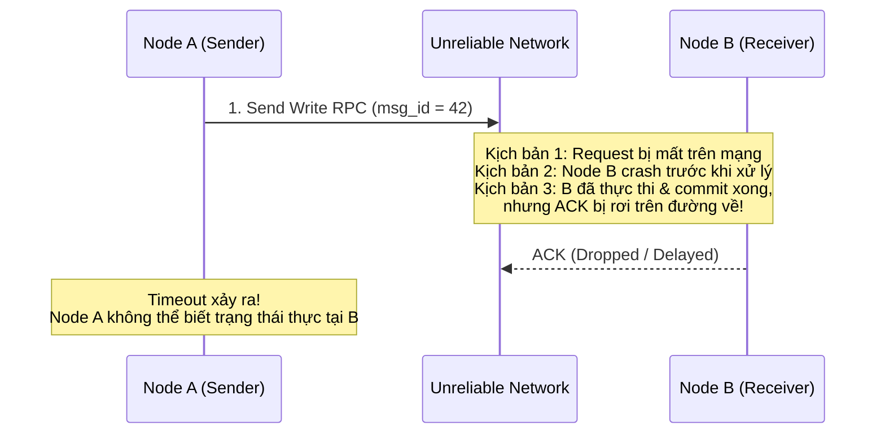
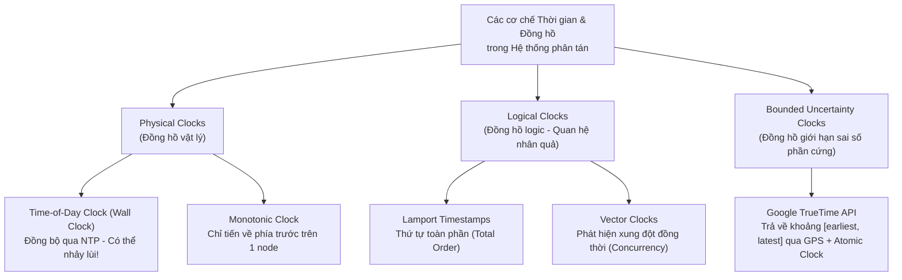
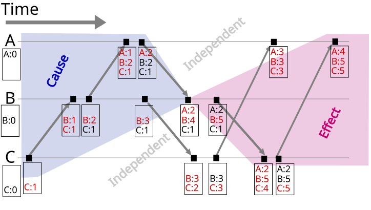

## Table of Contents
1. [Bước chuyển từ Single-Node Storage sang Hệ thống phân tán](#single-node-to-distributed)
2. [Bài toán Two Generals và Định lý bất khả thi FLP](#two-generals-and-flp)
3. [Mô hình đồng bộ mạng và Phân loại lỗi (Synchrony & Failure Models)](#synchrony-and-failure-models)
4. [Thời gian và Đồng hồ trong Hệ thống phân tán (Time & Clocks)](#time-and-clocks)
5. [Các ngụy biện kinh điển của Điện toán phân tán (Fallacies of Distributed Computing)](#fallacies-of-distributed-computing)
6. [Tóm tắt & Ghi nhớ cốt lõi (Key Takeaways)](#key-takeaways)

---

## Bước chuyển từ Single-Node Storage sang Hệ thống phân tán {#single-node-to-distributed}

Trong một Storage Engine chạy trên node đơn lẻ, giao tiếp giữa các mô-đun diễn ra qua lời gọi hàm nội bộ (*local function call*) chia sẻ chung không gian bộ nhớ và một đồng hồ phần cứng chung. Ở môi trường này, một thao tác gần như tuân theo tính chất toàn cục: hoặc lời gọi hàm trả về kết quả, hoặc toàn bộ tiến trình bị sập (*crash*) cùng lúc.

Khi mở rộng sang hệ thống phân tán gồm nhiều node kết nối qua mạng gói tin (*packet-switched network*), bản chất vật lý của hệ thống thay đổi hoàn toàn bởi sự xuất hiện của **Partial Failure (Lỗi cục bộ không xác định)**:

- **Sự bất định của trạng thái Request**: Khi Node `A` gửi một yêu cầu RPC qua mạng tới Node `B` và không nhận được phản hồi trước khi hết thời gian chờ (*timeout*), Node `A` hoàn toàn không thể phân biệt được 3 kịch bản:
  1. Gói tin Request bị rơi trên đường truyền trước khi tới được `B` (thao tác chưa từng được thực thi).
  2. Node `B` đang bị treo tạm thời do Stop-The-World Garbage Collection hoặc đã sập nguồn ngay trước khi xử lý.
  3. Node `B` **đã xử lý và commit thành công** yêu cầu xuống đĩa, nhưng gói tin Response bị mất trên đường quay về `A` hoặc bị trễ quá hạn timeout.
- **Hệ quả thiết kế**: Việc thử gửi lại (*retry*) một cách mù quáng khi gặp timeout có thể gây ra ghi trùng dữ liệu nếu thao tác không có tính **Idempotent** (lũy đẳng). Ngoài ra, các gói tin đi qua mạng có thể bị nhân bản (*duplication*), đến sai thứ tự (*out-of-order delivery*), hoặc bị chia cắt thành các phân vùng mạng độc lập (**Network Partition**).

---

## Bài toán Two Generals và Định lý bất khả thi FLP {#two-generals-and-flp}

Hai định lý nền tảng dưới đây đặt ra giới hạn toán học cho những gì một giao thức phân tán có thể và không thể đạt được.

### 1. Bài toán Hai vị tướng (Two Generals' Problem)

Giả sử hai đạo quân do Tướng `A` và Tướng `B` chỉ huy đóng trại trên hai đỉnh đồi, ở giữa là thung lũng của quân địch. Để giành chiến thắng, cả hai đạo quân bắt buộc phải tấn công **cùng một thời điểm**; nếu chỉ có đúng `1` bên tấn công đơn lẻ, bên đó sẽ bị tiêu diệt. Hai vị tướng chỉ có thể liên lạc bằng cách cử người đưa thư băng qua thung lũng — nơi người đưa thư có thể bị bắt bất cứ lúc nào (tương đương với đường truyền mạng không tin cậy, có thể làm mất gói tin).

- **Nghịch lý**:
  - Tướng `A` gửi thư: *"Tấn công lúc `06:00` sáng mai"*. Vì không biết người đưa thư có sống sót tới chỗ `B` hay không, `A` không dám xuất quân nếu chưa nhận được thư xác nhận (`ACK`) từ `B`.
  - Khi `B` nhận được thư và cử người mang `ACK` về cho `A`, bản thân `B` lại rơi vào thế lưỡng nan: `B` không biết người mang `ACK` có về tới trại của `A` hay không. Nếu người đó bị bắt, `A` sẽ không tấn công, nên `B` lại phải chờ thêm một thư xác nhận `ACK-of-ACK` từ `A`.
  - Chuỗi xác nhận này kéo dài vô tận.
- **Kết luận lý thuyết và cách xử lý thực tế**: Trên một kênh truyền thông có khả năng mất tin nhắn, hai nút **không bao giờ đạt được tri thức chung tuyệt đối (*Common Knowledge* — trạng thái "tôi biết rằng anh biết rằng tôi biết...") với một số lượng tin nhắn hữu hạn**. Trong thực tế (như giao thức bắt tay `3` bước `SYN` `->` `SYN-ACK` `->` `ACK` của TCP), các hệ thống không giải quyết triệt để bài toán này mà chấp nhận một ngưỡng rủi ro xác suất thông qua cơ chế gửi lặp lại kết hợp Timeout và kiểm tra tính Idempotent.

### 2. Định lý bất khả thi FLP (Fischer, Lynch, Paterson - `1985`)

Trong khi bài toán Two Generals xét kênh truyền làm mất tin nhắn với các nút hoàn toàn khỏe mạnh, định lý **FLP Impossibility** xét trường hợp ngược lại: mạng truyền thông hoàn toàn tin cậy (không bao giờ mất tin nhắn), nhưng hệ thống hoạt động trong mô hình **Bất đồng bộ hoàn toàn (Asynchronous Network Model)** — nơi không tồn tại bất kỳ cận trên cố định nào cho độ trễ truyền tin hay tốc độ xử lý của CPU.

Trước khi phát biểu định lý, cần phân biệt hai thuộc tính đúng đắn của thuật toán phân tán:

- **Safety (Tính an toàn - "Không có điều gì sai trái xảy ra")**: Mọi nút không bị lỗi không bao giờ đưa ra các quyết định mâu thuẫn nhau (ví dụ: không bao giờ có hai giá trị khác nhau cùng được chốt làm kết quả Consensus). Nếu Safety bị vi phạm, dữ liệu đã bị hỏng tại một thời điểm xác định.
- **Liveness (Tính sống - "Điều đúng đắn cuối cùng sẽ xảy ra")**: Mọi thao tác hợp lệ cuối cùng sẽ hoàn tất và trả về kết quả trong thời gian hữu hạn (hệ thống không bị treo vĩnh viễn hay lặp vô hạn).

> [!IMPORTANT]
> **Phát biểu Định lý FLP (`1985`)**:
> Trong một hệ thống mạng bất đồng bộ hoàn toàn (*Asynchronous System*), **không tồn tại bất kỳ giao thức đồng thuận tất định (*deterministic consensus protocol*) nào có thể đảm bảo đồng thời cả Safety và Liveness nếu chỉ cần tối đa `1` nút được phép gặp lỗi dừng hoạt động (*unannounced crash failure*)**.

- **Nguyên nhân cốt lõi**: Trong mạng bất đồng bộ, một nút không có cách nào phân biệt được một nút từ xa **đã bị crash vĩnh viễn** với một nút **chỉ đang phản hồi cực kỳ chậm**. Nếu giao thức cố gắng chờ nút đó thì vi phạm **Liveness** (treo vô hạn nếu nút đã chết); nếu giao thức tự ý quyết định bỏ qua nút đó thì có nguy cơ vi phạm **Safety** khi nút đó thực chất vẫn sống và đưa ra quyết định trái ngược.
- **Cách các hệ thống thực tế vượt qua rào cản FLP**: Các thuật toán như Paxos, Raft hay Zab không vi phạm định lý FLP mà nới lỏng giả định đầu vào bằng một trong hai hướng:
  1. Giả định mô hình **Đồng bộ từng phần (Partially Synchronous Model)**: Hệ thống có thể hành xử bất đồng bộ trong những khoảng thời gian ngắn (khi nghẽn mạng hoặc GC pause), nhưng phần lớn thời gian sẽ tồn tại một cận trên độ trễ để thuật toán sử dụng đồng hồ và Timeout nhằm khôi phục **Liveness**, trong khi luôn bảo toàn tuyệt đối **Safety** trong mọi hoàn cảnh mạng.
  2. Sử dụng các giao thức **Phi tất định (Non-deterministic / Randomized Consensus)**: Dùng yếu tố ngẫu nhiên (như Randomized Election Timeout trong Raft) để phá vỡ các trạng thái đối xứng gây bế tắc (*livelock*).

---

## Mô hình đồng bộ mạng và Phân loại lỗi (Synchrony & Failure Models) {#synchrony-and-failure-models}

Khi thiết kế hoặc phân tích một giao thức phân tán, việc xác định rõ giả định về thời gian truyền tin (**Synchrony Model**) và kiểu hỏng hóc của nút (**Failure Model**) là điều kiện tiên quyết.

### 1. Các mô hình đồng bộ mạng (Network Synchrony Models)

| Mô hình | Giả định về độ trễ mạng & tốc độ xử lý | Mức độ khả thi trong thực tế |
| :--- | :--- | :--- |
| **Synchronous (Đồng bộ)** | Tồn tại cận trên cố định và đã biết trước `Δ` cho thời gian truyền mọi gói tin cũng như độ lệch đồng hồ giữa các nút. | Không khả thi trên mạng Ethernet/IP thông thường (do nghẽn hàng đợi gói tin, GC pause, I/O spike làm độ trễ không bị chặn trên). |
| **Asynchronous (Bất đồng bộ)** | Gói tin có thể bị trễ một khoảng thời gian dài tùy ý (không có cận trên `Δ`), và không tồn tại đồng hồ vật lý chung. | Rất an toàn về mặt lý thuyết (giao thức chạy được trên mô hình này sẽ đúng ở mọi mạng), nhưng bị giới hạn bởi định lý **FLP**. |
| **Partially Synchronous (Đồng bộ từng phần)** | Hệ thống hoạt động đồng bộ trong hầu hết thời gian với độ trễ có chặn trên, nhưng đôi lúc xuất hiện các giai đoạn bất đồng bộ tạm thời không báo trước. | Mô hình sát thực tế, được sử dụng bởi hầu hết các hệ cơ sở dữ liệu phân tán hiện đại (Raft, Paxos, Spanner, CockroachDB). |

### 2. Phân cấp các mô hình lỗi của Node (Node Failure Models)

Các kiểu lỗi được xếp theo mức độ phức tạp tăng dần (mỗi lớp sau bao hàm các lớp trước):

1. **Crash-Stop (Fail-Stop)**: Một nút hoạt động chính xác cho đến khi nó gặp sự cố và dừng hẳn vĩnh viễn; nút đó không bao giờ quay trở lại mạng. Đây là mô hình đơn giản nhưng hiếm gặp vì các dịch vụ thực tế luôn được khởi động lại.
2. **Crash-Recovery (Fail-Recovery)**: Nút có thể dừng đột ngột tại bất kỳ thời điểm nào và sau đó khởi động lại để tham gia lại vào cụm. Khi crash, toàn bộ trạng thái trên bộ nhớ khả biến (RAM) bị mất sạch; nút chỉ có thể khôi phục từ dữ liệu đã được ghi bền vững xuống đĩa không khả biến (như WAL hoặc State Snapshot).
3. **Omission Failures (Lỗi bỏ sót)**: Nút vẫn chạy nhưng thất bại trong việc gửi tin nhắn đi (*Send Omission*) hoặc nhận tin nhắn đến (*Receive Omission*), thường do tràn bộ đệm mạng (*network buffer overflow*) hoặc rơi gói tin ở tầng OS/NIC.
4. **Byzantine Failures (Lỗi tùy ý / Độc hại)**: Nút bị lỗi có thể hành xử hoàn toàn tùy tiện: gửi dữ liệu bị hỏng do lỗi bit phần cứng, gửi thông tin mâu thuẫn cho các nút khác nhau, hoặc cố tình giả mạo giao thức để phá hoại hệ thống. Việc chịu lỗi Byzantine đòi hỏi các thuật toán **BFT (Byzantine Fault Tolerance)** như PBFT tốn kém nhiều vòng trao đổi tin nhắn hơn và yêu cầu tổng số nút tối thiểu `3f + 1` để chịu được `f` nút lỗi (thay vì `2f + 1` như trong mô hình Crash-Recovery).

---

## Thời gian và Đồng hồ trong Hệ thống phân tán (Time & Clocks) {#time-and-clocks}

Trên một máy chủ đơn lẻ, mọi luồng thực thi đều đọc chung một bộ đếm phần cứng để xác định thứ tự sự kiện (*Happens-Before*). Trong hệ thống phân tán, mỗi máy chủ sử dụng tinh thể thạch anh riêng biệt có tốc độ dao động chênh lệch nhau do nhiệt độ và sai số vật lý — hiện tượng này gọi là **Clock Drift (Độ trôi đồng hồ)**, dẫn đến khoảng cách thời gian giữa hai máy ngày càng lệch nhau (**Clock Skew**).

### 1. Time-of-Day Clocks (Wall-Clock Time) vs Monotonic Clocks

Các hệ điều hành hiện đại cung cấp hai loại đồng hồ vật lý với mục đích hoàn toàn khác biệt:

- **Time-of-Day Clock (ví dụ `clock_gettime(CLOCK_REALTIME)`, `System.currentTimeMillis()`)**:
  - Trả về thời gian thực theo lịch (số mili-giây tính từ mốc Epoch `1970-01-01T00:00:00Z`), thường được đồng bộ định kỳ với máy chủ thời gian qua giao thức **NTP (Network Time Protocol)**.
  - **Nguy cơ nghiêm trọng**: Nếu đồng hồ cục bộ chạy nhanh hơn máy chủ NTP, ở lần đồng bộ tiếp theo, daemon NTP có thể ép đồng hồ hệ thống **nhảy lùi về quá khứ** (*step back*) hoặc xảy ra hiện tượng giây nhuận (*leap second*). Do đó, **tuyệt đối không sử dụng Time-of-Day Clock để đo khoảng thời gian trôi qua (timeout/latency)** hoặc giả định rằng timestamp giữa hai máy khác nhau có thể so sánh trực tiếp với độ chính xác mili-giây.
- **Monotonic Clock (ví dụ `clock_gettime(CLOCK_MONOTONIC)`, `System.nanoTime()`)**:
  - Đo khoảng thời gian trôi qua kể từ một mốc tùy ý (thường là lúc máy tính khởi động).
  - **Đặc tính đảm bảo**: Giá trị của Monotonic Clock trên một node **luôn luôn tăng tiến**, không bao giờ nhảy lùi ngay cả khi NTP điều chỉnh giờ hệ thống. Đây là công cụ bắt buộc khi đo thời gian chờ (*timeout*), đo thời hạn Lease hoặc tính toán latency cục bộ, nhưng giá trị của nó không có ý nghĩa khi đem so sánh giữa hai máy chủ khác nhau.

### 2. Logical Clocks: Lamport Timestamps và Vector Clocks

Vì đồng hồ vật lý không thể sắp xếp chính xác thứ tự sự kiện xuyên suốt các node, Leslie Lamport (`1978`) đề xuất đo thời gian dựa trên **quan hệ nhân quả (*Causal Ordering / Happens-Before*: `a -> b`)** thông qua việc truyền tin nhắn:

- **Lamport Timestamps**:
  - Mỗi node $i$ duy trì một bộ đếm nguyên đơn điệu $L_i$. Mỗi khi có sự kiện nội bộ, node tăng $L_i \leftarrow L_i + 1$. Khi gửi tin nhắn, node đính kèm giá trị $L_i$. Khi node $j$ nhận được tin nhắn mang nhãn thời gian $t$, nó cập nhật bộ đếm của mình theo quy tắc:

$$
L_j \leftarrow \max(L_j, t) + 1
$$

  - **Tính chất**: Nếu sự kiện $a$ xảy ra trước sự kiện $b$ theo quan hệ nhân quả ($a \to b$), thì chắc chắn $L(a) < L(b)$. Tuy nhiên, **chiều ngược lại không đúng**: chỉ nhìn vào $L(a) < L(b)$ không thể kết luận được $a$ gây ra $b$ hay $a$ và $b$ diễn ra hoàn toàn độc lập (**đồng thời - concurrent**: $a \parallel b$).
- **Vector Clocks**:
  - Khắc phục hạn chế của Lamport Timestamp bằng cách duy trì một mảng (vector) gồm $N$ bộ đếm $V = [v_1, v_2, \dots, v_N]$ tương ứng với $N$ node trong cụm.
  - Khi so sánh hai Vector Clock $V(a)$ và $V(b)$:
    - Nếu mọi phần tử $V(a)[k] \le V(b)[k]$ và có ít nhất một phần tử nhỏ hơn hẳn, ta kết luận chắc chắn $a \to b$ ($a$ là tiền thân nhân quả của $b$).
    - Nếu tồn tại chỉ số $x$ sao cho $V(a)[x] < V(b)[x]$ nhưng lại có chỉ số $y$ sao cho $V(a)[y] > V(b)[y]$, hai sự kiện $a$ và $b$ **xảy ra đồng thời ($a \parallel b$) mà không biết sự tồn tại của nhau** — giúp các hệ thống như Amazon Dynamo hoặc Riak phát hiện chính xác **xung đột ghi (Write Conflict / Siblings)** để hợp nhất dữ liệu.

*Hình 8.1: Cách Vector Clocks theo dõi quan hệ nhân quả (Causality) và phát hiện các sự kiện diễn ra đồng thời giữa 3 node*

### 3. Bounded Clock Drift (Google Spanner TrueTime)

Thay vì bỏ hẳn đồng hồ vật lý, **Google Spanner** triển khai hạ tầng **TrueTime** bằng cách trang bị bộ thu tín hiệu **GPS** và **Đồng hồ nguyên tử (Atomic Clocks)** tại mỗi trung tâm dữ liệu. TrueTime API không trả về một con số thời điểm đơn lẻ mà trả về một khoảng thời gian chắc chắn `[t_earliest, t_latest]` với sai số `ε = (t_latest - t_earliest) / 2` cực nhỏ (thường dưới `7ms`).

Để đảm bảo hai giao dịch tuần tự `T_1` và `T_2` trên hai lục địa khác nhau có nhãn thời gian phản ánh đúng trật tự thời gian thực (**External Consistency / Linearizability**), Spanner áp dụng kỹ thuật **Commit Wait**: trước khi công bố dữ liệu của `T_1` ra ngoài, node điều phối chủ động chờ một khoảng thời gian bằng đúng độ bất định `2ε` để đảm bảo khoảng thời gian của giao dịch sau không bao giờ chồng lấp lên giao dịch trước.

---

## Các ngụy biện kinh điển của Điện toán phân tán (Fallacies of Distributed Computing) {#fallacies-of-distributed-computing}

Được đúc kết bởi L. Peter Deutsch và các kỹ sư tại Sun Microsystems, đây là `8` giả định sai lầm mà lập trình viên thường vô tình áp dụng khi chuyển từ phát triển ứng dụng đơn máy sang hệ thống phân tán:

1. **The network is reliable (Mạng luôn tin cậy)**: Thực tế cáp quang bị đứt, switch bị treo, gói tin bị rớt và kết nối TCP bị treo lơ lửng (*half-open connection*). Mọi lệnh gọi mạng đều phải có Timeout, Retry với Exponential Backoff + Jitter và thiết kế Idempotent.
2. **Latency is zero (Độ trễ bằng không)**: Một lệnh đọc RAM tốn khoảng `100` nanoseconds, trong khi một vòng khứ hồi mạng (*network round-trip*) trong cùng trung tâm dữ liệu tốn khoảng `0.5ms` (`500,000` nanoseconds) và xuyên lục địa tốn `100ms`–`300ms`. Thiết kế kiểu gọi tuần tự hàng trăm RPC nhỏ (*chatty I/O*) sẽ làm sụp đổ thông lượng hệ thống.
3. **Bandwidth is infinite (Băng thông là vô hạn)**: Băng thông mạng giữa các rack hoặc các Availability Zone có giới hạn vật lý; việc đồng bộ Snapshot hoặc chạy Anti-Entropy/Compaction qua mạng nếu không giới hạn tốc độ (*rate limiting*) sẽ làm nghẽn toàn bộ lưu lượng truy vấn của người dùng.
4. **The network is secure (Mạng luôn an toàn)**: Không thể tin tưởng gói tin nội bộ; cần xác thực mTLS, kiểm tra quyền hạn và checksum chống hỏng dữ liệu.
5. **Topology doesn't change (Cấu trúc mạng không đổi)**: Trong hạ tầng Cloud và Kubernetes, các node/container liên tục bị thu hồi, thay đổi địa chỉ IP và định tuyến lại; hệ thống không được gắn cứng (*hardcode*) cấu hình mạng tĩnh.
6. **There is one administrator (Chỉ có đúng một người quản trị)**: Hệ thống thực tế đi qua nhiều tầng hạ tầng, nhà cung cấp đám mây và nhóm vận hành khác nhau; việc nâng cấp phần mềm phải hỗ trợ **Rolling Upgrade** với khả năng tương thích ngược/xuôi giữa các phiên bản giao thức (*backward/forward compatibility*).
7. **Transport cost is zero (Chi phí truyền tải bằng không)**: Việc tuần tự hóa/giải tuần tự hóa dữ liệu (*serialization/deserialization* qua JSON, Protobuf) tiêu tốn đáng kể tài nguyên CPU, bộ nhớ đệm cấp phát đối tượng và chi phí tiền bạc cho băng thông liên vùng (*cross-AZ data transfer*).
8. **The network is homogeneous (Mạng đồng nhất)**: Các node trong cùng một cụm có thể chạy trên các thế hệ phần cứng khác nhau, gặp hiện tượng "hàng xóm ồn ào" (*noisy neighbor*) trên Cloud hoặc có cấu hình MTU khác biệt, khiến hiệu năng phân bố không đồng đều.

---

## Tóm tắt & Ghi nhớ cốt lõi (Key Takeaways) {#key-takeaways}

- **Đặc trưng cốt lõi của hệ phân tán là Partial Failure**: Khi một lời gọi RPC bị quá hạn Timeout, nút gửi không thể biết yêu cầu đã bị mất trước khi xử lý hay đã được thực thi thành công nhưng mất gói tin phản hồi; mọi giao thức thử lại bắt buộc phải đi kèm cơ chế **Idempotency**.
- **Bài toán Two Generals và Định lý FLP**:
  - **Two Generals** chứng minh không thể đạt được sự chắc chắn tuyệt đối (*Common Knowledge*) qua kênh truyền có khả năng mất tin nhắn bằng số bản tin hữu hạn.
  - **FLP Impossibility** chứng minh trong mô hình mạng **Asynchronous**, không có thuật toán đồng thuận tất định nào đảm bảo cùng lúc cả **Safety** và **Liveness** nếu cho phép dù chỉ có đúng `1` nút bị crash. Các hệ thống thực tế giải quyết bằng cách hoạt động trên mô hình **Partially Synchronous** (luôn giữ Safety, dùng Timeout/Randomization để duy trì Liveness).
- **Phân biệt Time-of-Day Clock và Monotonic Clock**: Tuyệt đối không dùng đồng hồ thời gian thực (`CLOCK_REALTIME` / NTP) để đo thời gian chờ hoặc giả định thứ tự sự kiện tuyệt đối giữa các máy vì NTP có thể ép đồng hồ nhảy lùi. Phải dùng **Monotonic Clock** để đo khoảng thời gian trôi qua cục bộ, và dùng **Logical Clocks (Lamport / Vector Clocks)** hoặc đồng hồ giới hạn sai số (**TrueTime**) để xác lập quan hệ nhân quả xuyên suốt các node.

### Tài liệu & Nguồn tham khảo
- [Lamport, L. (1978) — *Time, Clocks, and the Ordering of Events in a Distributed System*](https://lamport.azurewebsites.net/pubs/time-clocks.pdf)
- [Fischer, M. J., Lynch, N. A., & Paterson, M. S. (1985) — *Impossibility of Distributed Consensus with One Faulty Process (FLP)*](https://groups.csail.mit.edu/tds/papers/Lynch/jacm85.pdf)
- [Kulkarni, S. S., et al. (2014) — *Logical Physical Clocks and Consistent Snapshots in Globally Distributed Databases (HLC)*](https://cse.buffalo.edu/tech-reports/2014-04.pdf)
