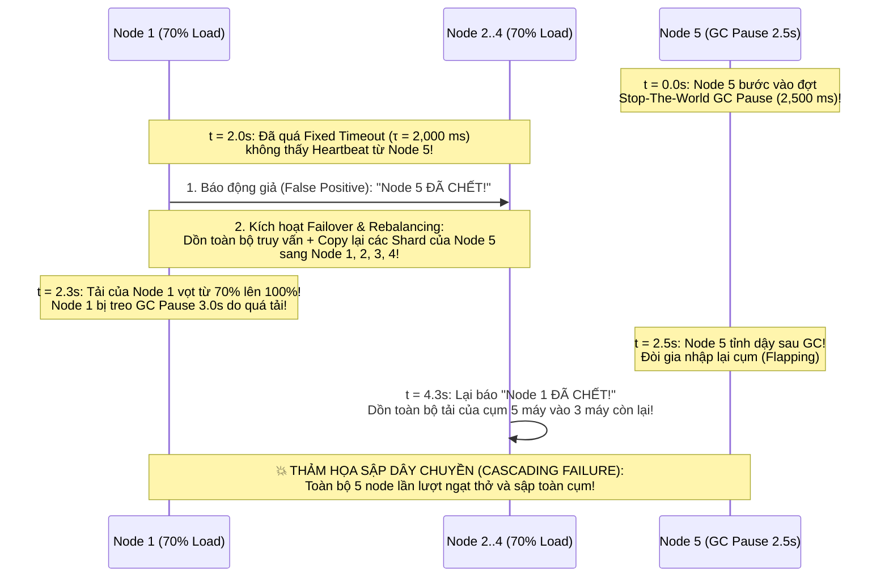
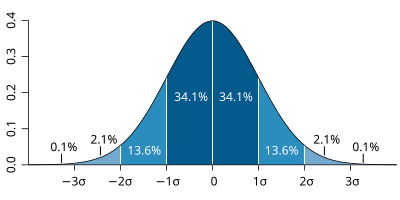
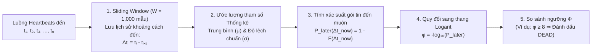
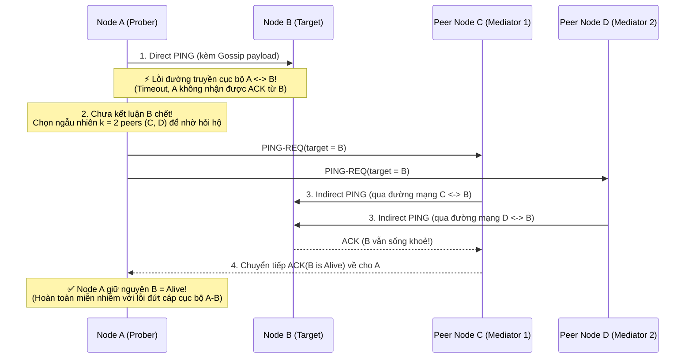

## Table of Contents
1. [Bài toán nan giải cốt lõi của Failure Detection](#fundamental-dilemma-of-failure-detection)
2. [Cơ chế Heartbeats vs Pings và Hạn chế của Fixed Timeout](#heartbeats-vs-pings-fixed-timeout)
3. [Thuật toán Phi-Accrual Failure Detector (Cassandra, Akka)](#phi-accrual-failure-detector)
4. [Giao thức Gossip và Outsourced Heartbeats (SWIM Protocol)](#gossip-and-swim-protocol)
5. [Tóm tắt & Ghi nhớ cốt lõi (Key Takeaways)](#key-takeaways)

---

## Bài toán nan giải cốt lõi của Failure Detection {#fundamental-dilemma-of-failure-detection}

### 0. Khởi động cho người mới: Làm sao biết đồng nghiệp làm việc từ xa "đã nghỉ việc" hay chỉ "đang đi vệ sinh hơi lâu"?

Hãy tưởng tượng một trưởng nhóm quản lý các lập trình viên làm việc từ xa (Remote Work) qua ứng dụng chat:
- Theo quy định, cứ mỗi `1 phút`, máy tính của nhân viên sẽ tự động gửi một chấm xanh báo hiệu *"Tôi vẫn đang ngồi làm việc"* (**Heartbeat**).
- Đột nhiên, chấm xanh của đồng nghiệp **B** tắt ngấm suốt `3 phút` liền! Lúc này trưởng nhóm đứng trước một bài toán hóc búa:
  - **Nếu quá nóng vội (Đặt ngưỡng chờ cực ngắn, ví dụ 2 phút)**: Thấy B im lặng 2 phút là trưởng nhóm lập tức kết luận *"B đã bỏ việc!"*, vội vàng thu hồi toàn bộ vé việc (tickets) của B chia cho 4 người còn lại làm gập mặt. Ai ngờ 30 giây sau B quay lại bàn làm việc và nói: *"Tôi chỉ đi pha cốc cà phê / mạng Wi-Fi nhà tôi vừa bị lag 30 giây thôi mà!"*. Việc báo tử nhầm này gọi là **Báo động giả (`False Positive` — vi phạm tính `Accuracy`)**, làm cả nhóm rối loạn và kiệt sức oan!
  - **Nếu quá cả nể (Đặt ngưỡng chờ cực dài, ví dụ 2 tiếng)**: Dù máy tính của B đã cháy nguồn thật sự từ lúc 9 giờ sáng, trưởng nhóm vẫn kiên nhẫn ngồi đợi tới 11 giờ trưa mới dám giao việc của B cho người khác. Suốt 2 tiếng đó, khách hàng gọi vào phần việc của B đều bị treo cứng! Việc chậm phát hiện lỗi thật này làm suy giảm **Tính đầy đủ (`Completeness` — gây `False Negative`)**.

Trong cơ sở dữ liệu phân tán (như **Apache Cassandra, CockroachDB, TiKV, etcd, MongoDB**), việc "đi vệ sinh hơi lâu" của một máy chủ chính là lúc nó bận **dọn rác bộ nhớ (`Stop-The-World GC Pause`)**, bận nén file trên ổ đĩa (**LSM Compaction spike**), hoặc cáp mạng qua Switch bị nghẽn vài giây (**Network Jitter**). Chương 9 giải quyết câu hỏi: **Làm thế nào để các máy chủ tự động phân biệt được một nút thực sự đã chết với một nút chỉ đang bị khựng tạm thời trên quy mô hàng nghìn máy?**

Trước khi đi vào chi tiết toán học, hãy nắm vững bảng từ điển các thuật ngữ cốt lõi của Chương 9:

#### Bảng Từ Điển Thuật Ngữ Nhanh Cho Người Mới (Beginner's Visual Glossary)

| Thuật ngữ trong sách | Hiểu nôm na cho người mới (Ẩn dụ đời thực) | Trong Database phân tán thực tế (CockroachDB / TiKV / Cassandra / etcd / DynamoDB) là gì? |
| :--- | :--- | :--- |
| **`Heartbeat` & `Ping/Ack`** | • **Heartbeat**: Nhân viên bảo vệ tự động bấm chuông báo bình an về phòng trực mỗi 1 phút (gửi 1 chiều).<br/>• **Ping/Ack**: Trưởng phòng chủ động gọi bộ đàm *"Còn đó không?"* và chờ bảo vệ đáp *"Có mặt!"* (2 chiều khứ hồi). | Trong **etcd / CockroachDB / TiKV (Raft)**, Leader định kỳ bắn gói `Heartbeat` một chiều xuống các Follower (khoảng `100ms - 500ms`/lần). Còn trong **Consul / Redis Cluster**, các node dùng cặp `PING -> PONG/ACK` hai chiều để kiểm tra lẫn nhau. |
| **`Completeness`**<br/>*(Tính đầy đủ — Nút chết thật thì chắc chắn phải phát hiện ra)* | Nếu một nhân viên thực sự đã nghỉ việc hoặc ngất xỉu, sớm hay muộn phòng nhân sự bắt buộc phải phát hiện ra chứ không được để tên họ nhận việc mãi mãi (**Tránh bỏ lọt lỗi / False Negative**). | Nếu một Storage Node của **DynamoDB** hoặc **TiKV** bị cháy nguồn, bộ điều phối truy vấn bắt buộc phải phát hiện ra để ngắt luồng request vào node chết đó và bầu Leader mới cho phân vùng dữ liệu (*Shard/Range*). |
| **`Accuracy`**<br/>*(Tính chính xác — Không báo tử nhầm nút đang sống)* | Không bao giờ được đuổi việc nhầm một nhân viên vẫn đang làm việc bình thường chỉ vì họ đi vệ sinh hoặc kẹt thang máy vài phút (**Tránh báo động giả / False Positive**). | Nếu một node **Cassandra** chỉ bị *JVM GC Pause* `2 giây` mà bị các node khác kết luận nhầm là `Dead` (*False Positive*), cả cụm sẽ đổ xô đi sao chép lại hàng Terabyte dữ liệu của node đó, gây nghẽn mạng và làm **sập dây chuyền (`Cascading Failure`)** toàn bộ Database! |
| **`Fixed-Timeout Detector`**<br/>*(Bộ phát hiện lỗi ngưỡng cố định)* | Đồng hồ hẹn giờ cứng nhắc: Cứ đúng `2.0 giây` không thấy trả lời là lập tức bấm còi báo tử, bất kể hôm đó trời nắng đẹp hay đang bão lũ kẹt xe toàn thành phố. | Cơ chế đơn giản dùng ngưỡng hằng số `election-timeout = 1000ms` (như trong cấu hình tĩnh của **etcd / ZooKeeper**): dễ cài đặt trong mạng LAN ổn định, nhưng rất dễ gây bão bầu cử giả khi triển khai qua mạng diện rộng (WAN / Cross-Region) có độ trễ trồi sụt thất thường. |
| **`Phi-Accrual Failure Detector` ($\varphi$)**<br/>*(Đánh giá mức độ nghi ngờ liên tục theo phân phối xác suất — Akka / Cassandra)* | Thay vì phán ngay *"Còn sống"* hay *"Đã chết"*, người quản lý nhìn vào lịch sử đi làm 1.000 ngày qua để chấm **điểm nghi ngờ $\varphi$ từ `0` đến `10+`**: Nếu mọi ngày đi rất đúng giờ mà hôm nay trễ 3 phút thì $\varphi$ vọt lên `9` (báo động ngay); nếu cả tuần nay đường đang đào cống ai cũng trễ 10 phút thì trễ 3 phút chỉ có $\varphi = 0.8$ (bình tĩnh chờ tiếp!). | Trái tim phát hiện lỗi của **Apache Cassandra, ScyllaDB, Akka Cluster**: Liên tục đo trung bình ($\mu$) và độ lệch chuẩn ($\sigma$) của 1.000 nhịp Heartbeat gần nhất theo đường cong hình chuông (hoặc phân phối mũ). Chỉ khi điểm nghi ngờ $\varphi \ge 8$ (`phi_convict_threshold: 8`, tức xác suất nhầm chỉ còn $10^{-8}$) thì Cassandra mới chính thức đánh dấu node là `DOWN`. |
| **`Gossip-style Failure Detection & SWIM Protocol`**<br/>*(Ping -> Ping-Req gián tiếp -> Suspect -> Confirm)* | Trong công ty 1.000 người, thay vì ai cũng gọi điện hỏi thăm cả 999 người mỗi phút làm cháy tổng đài, mỗi người chỉ hỏi thăm ngẫu nhiên 1 người. Nếu A gọi B không được, A nhờ 2 người hàng xóm C, D gọi thử cho B (**Ping-Req**). Nếu vẫn im lặng, cả công ty đồn rằng *"Hình như B đang ngất (`Suspect`)"*; nếu B tỉnh dậy kịp thì B la lên *"Tôi còn sống!"* để tự minh oan, còn hết giờ vẫn im thì mới chốt sổ nghỉ việc (**Confirm Dead**). | Được sử dụng trong **HashiCorp Consul, Serf, Uber Ringpop** và tầng Gossip của **Cassandra / Dynamo**: Giảm số gói tin kiểm tra sức khoẻ từ bậc hai $O(N^2)$ xuống hằng số $O(1)$ mỗi node, đồng thời miễn nhiễm hoàn toàn với lỗi đứt cáp cục bộ giữa 2 máy lẻ tẻ nhờ bước hỏi thăm gián tiếp `PING-REQ`. |

---

### 1. Bài toán thực tế & Mental Model: Tại sao phát hiện một máy chủ "đã chết" lại khó đến vậy?

Trong một cơ sở dữ liệu phân tán, hầu như mọi quyết định sống còn đều phải chờ tín hiệu khởi phát từ một mô-đun nền tảng: **Failure Detector (Bộ phát hiện lỗi)**.
- Nếu **Leader** bị sập, cụm chỉ có thể bắt đầu bầu chọn Leader mới (*Leader Election*) sau khi Failure Detector kết luận Leader cũ đã chết.
- Nếu một **Data Node** bị hỏng ổ cứng hoặc cháy nguồn, bộ điều phối (*Coordinator*) chỉ ngừng định tuyến truy vấn của người dùng tới node đó và kích hoạt quá trình nhân bản bù dữ liệu (*Re-replication / Hinted Handoff*) khi Failure Detector báo node đó là `Dead`.

Hãy hình dung **Mental Model** của Failure Detection:
Trên một máy đơn lẻ, hệ điều hành biết ngay lập tức một tiến trình con đã chết thông qua tín hiệu ngắt nhân (`SIGCHLD`) hoặc bảng quản lý tiến trình trong RAM. Ngược lại, trong hệ thống phân tán với mô hình mạng **Đồng bộ từng phần (Partially Synchronous Network)**, các node bị ngăn cách bởi mạng cáp quang. Khi **Node A** ngừng nhận được gói tin từ **Node B** trong suốt `3` giây, **Node A không có bất kỳ phương thức vật lý nào để phân biệt hai thực tại hoàn toàn khác nhau sau đây**:

1. **Thực tại 1 — Node B đã thực sự sập nguồn (Crashed / Dead)**: Máy chủ vật lý của B bị rút dây nguồn hoặc Kernel Panic; mọi tiến trình trên B đã biến mất.
2. **Thực tại 2 — Node B vẫn sống khoẻ nhưng bị "đóng băng" hoặc nghẽn mạng tạm thời (Slow / Paused)**:
   - Tiến trình JVM/Go trên Node B đang bước vào đợt dọn rác bộ nhớ **Stop-The-World Garbage Collection (GC Pause)** kéo dài `4` giây, khiến mọi luồng gửi nhận mạng bị tạm dừng.
   - Hoặc ổ đĩa NVMe trên Node B đang bị bão hoà `100%` I/O khi chạy LSM-Tree Compaction làm treo luồng chính.
   - Hoặc Switch mạng ở giữa A và B đang bị tràn hàng đợi gói tin (*Micro-burst congestion*), làm rớt hoặc giữ chân gói tin vài giây.

### 2. Sự đánh đổi toán học giữa Completeness và Accuracy (Chandra & Toueg, `1996`)

Để đánh giá chất lượng của một thuật toán Failure Detection, Tushar Chandra và Sam Toueg (`1996`) đã định nghĩa hai thước đo đối lập nhau như hai đầu của một chiếc bập bênh:

| Thuộc tính | Định nghĩa bản chất | Phân loại mức độ (Strong vs Weak / Eventual) | Lỗi xảy ra nếu vi phạm |
| :--- | :--- | :--- | :--- |
| **Completeness<br/>(Tính đầy đủ)** | Mọi node **thực sự đã chết (Crashed)** cuối cùng bắt buộc phải bị các node sống phát hiện ra. | • **Strong Completeness**: Mọi node chết cuối cùng đều bị **tất cả** các node khoẻ mạnh đánh dấu là `Dead`.<br/>• **Weak Completeness**: Mọi node chết cuối cùng bị **ít nhất 1** node khoẻ mạnh đánh dấu là `Dead`. | **False Negative (Bỏ lọt lỗi)**: Node B đã chết từ lâu nhưng Node A vẫn tưởng B còn sống và tiếp tục gửi truy vấn vào "hố đen", gây lỗi cho người dùng. |
| **Accuracy<br/>(Tính chính xác)** | Không có node **đang còn sống khoẻ mạnh (Alive)** nào bị kết luận oan là đã chết. | • **Strong Accuracy**: Không một node sống nào từng bị đánh dấu nhầm là `Dead` tại bất kỳ thời điểm nào.<br/>• **Eventual Accuracy**: Có thể nghi ngờ nhầm lúc mạng nhiễu, nhưng sau một thời điểm ổn định, không còn node sống nào bị kết luận oan nữa. | **False Positive (Báo động giả)**: Node B chỉ bị GC Pause `2` giây nhưng bị cả cụm khai tử oan, kích hoạt bầu cử lại và di chuyển dữ liệu hỗn loạn. |

> [!NOTE]
> **Cách đọc sơ đồ cho người mới:**
> 1. **Nhìn vào điểm tựa tam giác `▲` ở chính giữa**: Đây là trục bập bênh thể hiện giới hạn vật lý của mạng — khi kéo đầu này lên thì đầu kia buộc phải hạ xuống.
> 2. **Theo dõi đĩa cân bên trái (`Ưu tiên COMPLETENESS`)**: Khi vặn `Timeout` thật ngắn (ví dụ `200 ms`), hễ máy nào chết là phát hiện ra ngay lập tức, nhưng đổi lại mỗi khi mạng hơi giật nhẹ là báo tử nhầm (*False Positive*).
> 3. **Theo dõi đĩa cân bên phải (`Ưu tiên ACCURACY`)**: Khi vặn `Timeout` thật dài (ví dụ `60 giây`), hầu như không bao giờ báo tử nhầm máy đang GC Pause, nhưng đổi lại khi máy cháy nguồn thật thì khách hàng phải chờ mốc meo cả phút hệ thống mới biết!

```text
Chiếc bập bênh đánh đổi của Failure Detector:

  [Ưu tiên COMPLETENESS (Nhạy cao / Timeout ngắn)]       [Ưu tiên ACCURACY (Bảo thủ / Timeout dài)]
  • Phát hiện node chết cực nhanh (vài trăm ms)          • Rất hiếm khi kết luận oan cho node bị GC Pause
  • NHƯNG: Rất dễ bị False Positive (báo động giả)       • NHƯNG: Khi node chết thật, cả hệ thống bị treo
    mỗi khi mạng lag nhẹ -> Gây Cascading Failure!         suốt hàng chục giây chờ Timeout (MTTR rất cao)!
                         \                                      /
                          \====================================/
                                           ▲
                          (Không thể đạt hoàn hảo cả hai cùng lúc
                             trong mạng Partially Synchronous!)
```

> [!IMPORTANT]
> **Định lý Chandra-Toueg về Failure Detector**:
> Trong mạng bất đồng bộ hoặc đồng bộ từng phần có độ trễ biến thiên, **không thể xây dựng một bộ phát hiện lỗi đạt đồng thời cả Strong Completeness và Strong Accuracy**. Mọi thiết kế thực tế đều hướng tới việc đảm bảo **Strong Completeness** (chắc chắn phát hiện được node chết, thường nhờ Gossip lan truyền kết quả từ Weak Completeness sang toàn cụm) kết hợp với **Eventual Accuracy** (giảm thiểu tối đa tỷ lệ False Positive khi mạng biến động).

---

## Cơ chế Heartbeats vs Pings và Hạn chế của Fixed Timeout {#heartbeats-vs-pings-fixed-timeout}

### 1. So sánh cơ chế Pings (Chủ động hỏi) và Heartbeats (Chủ động phát nhịp tim)

Để theo dõi xem các node trong cụm còn hoạt động hay không, hệ thống phân tán sử dụng một trong hai giao thức truyền tin định kỳ:

| Đặc điểm | Pings (Request — Response / Pull-based) | Heartbeats (One-way / Push-based) |
| :--- | :--- | :--- |
| **Cơ chế hoạt động** | Định kỳ mỗi chu kỳ $\Delta t$, **Node A (Monitor)** gửi gói tin `PING` tới **Node B** và bấm giờ chờ gói tin `ACK` quay về trong khoảng thời gian $\tau$. | Định kỳ mỗi chu kỳ $\Delta t$, **Node B (Monitored)** tự động phát gói tin một chiều `HEARTBEAT` tới **Node A**. Node A chỉ lắng nghe và ghi nhận mốc thời gian nhận cuối cùng $t_{\text{last}}$ (bằng **Monotonic Clock** cục bộ). |
| **Chi phí gói tin mạng** | Tốn **gấp đôi (`2x`)** số gói tin trên mỗi chu kỳ (1 chiều đi `PING` + 1 chiều về `ACK`). | Tối ưu băng thông hơn (**`1x`** chiều đi); thường được đính kèm (*Piggyback*) luôn vào các bản tin nhân bản dữ liệu (như `AppendEntries` trong Raft). |
| **Khả năng đo Latency** | Đo được trực tiếp thời gian khứ hồi (**Round-Trip Time — RTT**) từ lúc gửi `PING` tới lúc nhận `ACK`. | Không biết được RTT tuyệt đối của từng gói tin (vì không thể trừ timestamp đồng hồ giữa hai máy khác nhau), nhưng đo được **Khoảng cách giữa các nhịp đến ($\Delta t_i = t_i - t_{i-1}$)**. |

### 2. Bài toán thực tế: Tại sao Fixed Timeout gây ra Thảm hoạ sập dây chuyền (Cascading Failure)?

Trong các hệ thống thế hệ cũ, Failure Detector được cài đặt bằng một ngưỡng thời gian chờ cố định (**Fixed Timeout $\tau$**):

> [!NOTE]
> **Cách đọc sơ đồ cho người mới:**
> 1. **Nhìn vào phép trừ `monotonic_now() - last_heartbeat_from_B`**: Đây là khoảng thời gian im lặng kể từ lần cuối cùng `Node A` nghe thấy tiếng của `Node B`.
> 2. **Theo dõi phép so sánh `> FIXED_TIMEOUT_TAU`**: Hệ thống so sánh khoảng im lặng đó với một hằng số cứng nhắc (ví dụ `2000 ms`).
> 3. **Kết quả ở 2 dòng lệnh bên trong `if`**: Ngay khoảnh khắc vượt quá ngưỡng cứng đó dù chỉ `1 ms`, `Node A` lập tức kết án tử hình `Node B` (`mark_node_as_DEAD`) và kích hoạt di chuyển dữ liệu (`trigger_failover_and_rebalance`) mà không cần biết mạng đang êm hay đang bão.

```text
// Logic Fixed Timeout cổ điển tại Node A:
if (monotonic_now() - last_heartbeat_from_B > FIXED_TIMEOUT_TAU) {
    mark_node_as_DEAD(Node_B);
    trigger_failover_and_rebalance();
}
```

Giả sử người vận hành cấu hình chu kỳ gửi Heartbeat là `1000 ms` và đặt ngưỡng cố định $\tau = 2000\text{ ms}$ với mong muốn phát hiện sự cố chỉ trong `2` giây. Hãy theo dõi **Kịch bản sập dây chuyền (Cascading Failure & Flapping)** xảy ra trong giờ cao điểm (Flash Sale) trên một cụm gồm 5 node (`Node 1` đến `Node 5`, mỗi node đang chạy ở mức tải `70%` CPU):

> [!NOTE]
> **Cách đọc sơ đồ cho người mới:**
> 1. **Nhìn vào cột ngoài cùng bên phải (`Node 5`) tại mốc `t = 0.0s`**: `Node 5` không hề hỏng phần cứng mà chỉ tạm ngưng `2.5 giây` để dọn rác bộ nhớ (*GC Pause*), nhưng vì ngưỡng chờ cố định chỉ có `2.0 giây`, tại `t = 2.0s` các `Node 1..4` đã vội vàng kết luận nhầm `"Node 5 ĐÃ CHẾT!"`.
> 2. **Theo dõi hiệu ứng Domino ở giữa sơ đồ (`t = 2.0s -> t = 4.3s`)**: Vì tưởng `Node 5` đã chết, toàn bộ tải và tác vụ sao chép lại dữ liệu của `Node 5` bị dồn ập sang `Node 1..4`, đẩy `Node 1` từ `70%` vọt lên `100%` CPU và tự rơi vào *GC Pause* `3.0 giây`! Ngay cả khi `Node 5` tỉnh dậy ở `t = 2.5s` đòi vào lại cụm (*Flapping*), thảm hoạ đã không thể phanh lại.
> 3. **Kết quả ở đáy sơ đồ**: Đến lượt `Node 1` bị báo chết ở `t = 4.3s`, tải của 5 máy dồn hết lên 3 máy còn lại và làm nổ tung toàn bộ cụm Database!



Hãy phân tích hai cực của cái bẫy **Fixed Timeout $\tau$**:
1. **Khi đặt $\tau$ quá nhỏ (ví dụ `1s - 2s`) $\rightarrow$ Sập dây chuyền (Cascading Failure) & Chập chờn (Flapping)**:
   - Chỉ cần một node (`Node 5`) bị khựng nhẹ `2.5` giây do JVM GC Pause hoặc nghẽn mạng thoáng qua, các node còn lại lập tức kết luận nhầm `Node 5` đã chết (**False Positive**).
   - Hệ thống tự động kích hoạt quy trình **Phục hồi thảm hoạ (Failover & Shard Rebalancing)**: vừa chuyển hướng toàn bộ lưu lượng truy vấn của `Node 5` sang 4 node còn lại (làm tải mỗi node tăng thêm `17.5%`), vừa bơm hàng Gigabyte dữ liệu qua mạng để nhân bản bù các phân vùng của `Node 5`.
   - Lưu lượng mạng và I/O khổng lồ từ việc Rebalancing đẩy `Node 1` vượt ngưỡng `100%` tài nguyên, khiến `Node 1` cũng bị trễ Heartbeat quá `2` giây $\rightarrow$ `Node 1` tiếp tục bị khai tử $\rightarrow$ toàn bộ tải dồn lên 3 node cuối cùng và đánh sập cả cụm như những quân cờ Domino!
   - Tệ hơn nữa, ngay ở giây thứ `2.5`, `Node 5` hoàn tất GC Pause và tỉnh dậy, thông báo *"Tôi vẫn sống!"*, buộc cụm lại phải huỷ quá trình di chuyển dữ liệu hoặc chuyển ngược dữ liệu về — hiện tượng một node liên tục bị báo `Dead` rồi lại `Alive` đan xen gọi là **Flapping**.
2. **Khi đặt $\tau$ quá lớn (ví dụ `30s - 60s`) $\rightarrow$ Hệ thống "đông cứng" khi có lỗi thật**:
   - Để tránh False Positive, nếu quản trị viên tăng $\tau = 60\text{ s}$, thì khi một máy chủ bị cháy nguồn thật sự, toàn bộ khách hàng có dữ liệu nằm trên máy chủ đó sẽ bị treo cứng truy vấn suốt `1` phút đồng hồ trước khi hệ thống bắt đầu chuyển sang node dự phòng!

**Câu hỏi đặt ra**: Làm thế nào để hệ thống **phát hiện lỗi cực nhanh (chỉ trong `~1.4` giây) khi đường mạng đang êm ả**, nhưng lại **tự động kiên nhẫn chờ lâu hơn (lên tới `5 - 10` giây) khi đường mạng đang có độ nhiễu (Jitter) cao** mà không cần con người chỉnh sửa tham số? Đó chính là lý do **$\Phi$-Accrual Failure Detector** ra đời.

---

## Thuật toán Phi-Accrual Failure Detector (Cassandra, Akka) {#phi-accrual-failure-detector}

Được đề xuất bởi Naohiro Hayashibara và cộng sự vào năm `2004`, **$\Phi$-Accrual Failure Detector (Phi-Accrual)** là một bước ngoặt trong thiết kế hệ thống phân tán và hiện là trái tim phát hiện lỗi của **Apache Cassandra**, **ScyllaDB**, **Akka Cluster**.

> [!NOTE]
> **Cách đọc sơ đồ cho người mới:**
> 1. **Nhìn vào đỉnh chuông ở chính giữa (`Mốc số 0` trên trục ngang)**: Đây là khoảng cách trung bình $\mu$ giữa các nhịp Heartbeat (ví dụ cứ đúng `1000 ms` là có 1 nhịp tim tới). Vùng màu xanh đậm quanh mốc `0` (từ `-1σ` đến `+1σ`) chiếm tới `34.1% + 34.1% = 68.2%` tổng số nhịp tim hàng ngày.
> 2. **Theo dõi trục ngang đi dần về phía đuôi bên phải (`1σ -> 2σ -> 3σ -> ...`)**: Càng đi xa về bên phải nghĩa là thời gian chờ nhịp tim tiếp theo ($\Delta t$) càng kéo dài bất thường. Hãy nhìn con số phần trăm diện tích thu hẹp cực nhanh: từ `13.6%` (ở `1σ..2σ`) xuống `2.1%` (ở `2σ..3σ`) và chỉ còn `0.1%` khi vượt quá `3σ`!
> 3. **Kết quả liên hệ với chỉ số nghi ngờ $\varphi$ trong Cassandra / Akka**: Phần diện tích nhỏ xíu còn sót lại ở đuôi bên phải chính là xác suất $P_{\text{later}}$ (*"Xác suất node kia vẫn sống nhưng gói tin vô tình đến muộn"*). Khi thời gian chờ trôi xa tới mức diện tích đuôi phải chỉ còn $10^{-8}$ (`0.000001%` — tương ứng khoảng `5.7σ` đến `6σ`), công thức $\varphi = -\log_{10}(10^{-8})$ sẽ cho ra **$\varphi = 8$** — lúc này Cassandra mới chính thức kết luận node đó đã `DEAD`!



### 1. Tư tưởng cốt lõi & Mental Model: Đổi từ câu trả lời Nhị phân (`Alive`/`Dead`) sang Thang đo nghi ngờ liên tục ($\varphi$)

Hãy hình dung sự khác biệt qua một ví dụ đời thường:
- **Mental Model của Fixed Timeout**: Giống như một quy định cứng nhắc: *"Hàng ngày đồng nghiệp B đều đến văn phòng lúc `08:00`. Nếu tới `08:15` chưa thấy mặt, lập tức kết luận B đã nghỉ việc!"* Quy định này hoàn toàn phớt lờ bối cảnh thời tiết hay giao thông.
- **Mental Model của $\Phi$-Accrual Failure Detector**: Hệ thống đóng vai một nhà thống kê học quan sát lịch sử đi làm của B trong `1,000` ngày gần nhất:
  - **Bối cảnh 1 (Trời nắng đẹp, đường thông thoáng)**: Suốt `1,000` nhịp gần nhất, B luôn xuất hiện cực kỳ đúng giờ lúc `08:00` với sai số chỉ $\pm 30\text{ giây}$. Trong bối cảnh ổn định tuyệt đối này, nếu tới `08:05` (trễ `5` phút — tức gấp `10` lần độ lệch chuẩn $\sigma$) mà vẫn chưa thấy B, khả năng B gặp tai nạn thật sự là `99.999999%`!
  - **Bối cảnh 2 (Trời bão lớn, đường kẹt cứng)**: Trong những nhịp gần đây, thời gian di chuyển biến động rất mạnh, lúc trễ `5` phút, lúc trễ `20` phút ($\sigma = 10\text{ phút}$). Trong bối cảnh nhiễu loạn này, việc `08:05` chưa thấy B là chuyện hết sức bình thường; hệ thống tự động hạ mức độ nghi ngờ xuống thấp và kiên nhẫn chờ tới `08:45` mới kết luận!

Về mặt kiến trúc phần mềm, $\Phi$-Accrual tách rời hoàn toàn **tầng đo đạc vật lý** (trả về con số thực $\varphi \ge 0$ biểu thị mức độ nghi ngờ tích luỹ theo thời gian) và **tầng hành động của ứng dụng** (tuỳ mức $\varphi$ cao hay thấp mà ứng dụng chọn hành động tương ứng):
- Khi $\varphi < 3$: Mạng bình thường, tiếp tục gửi truy vấn như cũ.
- Khi $3 \le \varphi < 8$: Node B đang có dấu hiệu chậm bất thường $\rightarrow$ Tạm thời ưu tiên gửi truy vấn đọc sang Replica khác (*Dynamic Snitch / Speculative Retry*), nhưng **chưa khai tử B**.
- Khi $\varphi \ge 8$ (ngưỡng mặc định `phi_convict_threshold: 8` trong Cassandra): Xác suất B chỉ bị trễ mạng đã nhỏ hơn $10^{-8}$ $\rightarrow$ Chính thức đánh dấu B là **`Dead`** và kích hoạt Hinted Handoff!

> [!NOTE]
> **Cách đọc sơ đồ cho người mới:**
> 1. **Nhìn từ trái sang phải qua 5 hộp xử lý nối tiếp (`1 -> 2 -> 3 -> 4 -> 5`)**: Đây là dây chuyền biến đổi từ những gói tin mạng thô thành quyết định vận hành Database.
> 2. **Theo dõi Hộp 1 & Hộp 2 (Giai đoạn học lịch sử mạng)**: Mỗi khi có nhịp tim mới đến, Hộp 1 lưu khoảng cách $\Delta t_i$ vào cửa sổ trượt `1,000` mẫu gần nhất để Hộp 2 tính ra nhịp trung bình ($\mu$) và độ trồi sụt của mạng ($\sigma$).
> 3. **Theo dõi Hộp 3, 4 & 5 (Giai đoạn chấm điểm nghi ngờ thời gian thực)**: Hộp 3 lấy thời gian đang chờ hiện tại $\Delta t_{\text{now}}$ tra vào đường cong hình chuông để ra xác suất trễ $P_{\text{later}}$; Hộp 4 đổi xác suất đó ra thang điểm $\varphi = -\log_{10}(P_{\text{later}})$ (đếm số chữ số 0 sau dấu phẩy); và Hộp 5 so sánh nếu $\varphi \ge 8$ thì báo tử!



---

### 2. Công thức toán học chi tiết của $\Phi$-Accrual

Quy trình tính toán tại **Node A** (đang theo dõi **Node B**) diễn ra qua 4 bước toán học rõ ràng:

1. **Bước 1 — Thu thập mẫu vào Cửa sổ trượt (Sliding Window)**:
   Mỗi khi nhận được nhịp Heartbeat thứ $i$ từ Node B tại thời điểm $t_i$ (đo bằng `CLOCK_MONOTONIC` của Node A), Node A tính khoảng thời gian cách nhịp trước đó:
   $$\Delta t_i = t_i - t_{i-1}$$
   Giá trị $\Delta t_i$ được đẩy vào một hàng đợi FIFO có kích thước cố định $W$ (thường lấy $W = 1000$ mẫu gần nhất; các mẫu quá cũ sẽ bị đẩy ra ngoài để phản ánh đúng tình trạng mạng hiện tại).

2. **Bước 2 — Tính Trung bình mẫu ($\mu$) và Độ lệch chuẩn mẫu ($\sigma$)**:
   Từ $W$ mẫu $\{\Delta t_1, \Delta t_2, \dots, \Delta t_W\}$ trong cửa sổ trượt, hệ thống liên tục cập nhật:
   $$\mu = \frac{1}{W} \sum_{i=1}^{W} \Delta t_i \quad \text{(Trung bình khoảng cách giữa 2 nhịp Heartbeat)}$$
   $$\sigma = \sqrt{\frac{1}{W} \sum_{i=1}^{W} (\Delta t_i - \mu)^2} \quad \text{(Độ lệch chuẩn — đo mức độ nhiễu / Jitter của mạng)}$$

3. **Bước 3 — Tính xác suất nhịp Heartbeat chỉ đang đến trễ ($P_{\text{later}}$)**:
   Giả sử lần cuối cùng Node A nhận được Heartbeat từ Node B là tại thời điểm $t_{\text{last}}$, và thời điểm hiện tại là $t_{\text{now}}$. Khoảng thời gian đã trôi qua mà chưa thấy nhịp mới là:
   $$\Delta t = t_{\text{now}} - t_{\text{last}}$$
   Gọi $f(x)$ là hàm mật độ xác suất và $F(x)$ là hàm phân phối tích luỹ (*Cumulative Distribution Function — CDF*) của khoảng cách giữa các nhịp tim. Xác suất để Node B thực chất vẫn sống và nhịp Heartbeat tiếp theo sẽ đến muộn hơn $\Delta t$ là phần diện tích đuôi bên phải của phân phối:
   $$P_{\text{later}}(\Delta t) = P(X > \Delta t) = 1 - F(\Delta t) = \int_{\Delta t}^{+\infty} f(x)\,dx$$
   Trong bài báo gốc của Hayashibara và trong **Akka Cluster**, $X$ được mô hình hoá theo **Phân phối chuẩn (Normal / Gaussian Distribution) $\mathcal{N}(\mu, \sigma^2)$** với chuẩn hoá $Z$-score là $z = \frac{\Delta t - \mu}{\sigma}$:
   $$P_{\text{later}}(\Delta t) = \frac{1}{\sigma\sqrt{2\pi}} \int_{\Delta t}^{+\infty} \exp\left(-\frac{(x - \mu)^2}{2\sigma^2}\right) dx = 1 - \Phi_{\text{norm}}\left(\frac{\Delta t - \mu}{\sigma}\right)$$

4. **Bước 4 — Ánh xạ sang chỉ số nghi ngờ $\varphi$ bằng hàm $-\log_{10}$**:
   Vì xác suất $P_{\text{later}}(\Delta t)$ giảm về các số thập phân cực kỳ nhỏ (như $0.00000001$), thuật toán lấy đối số logarit cơ số $10$ để biến nó thành một con số dương dễ đọc:
   $$\varphi(\Delta t) = -\log_{10}\big(P_{\text{later}}(\Delta t)\big)$$

| Giá trị $\varphi$ đo được | Xác suất nhịp tim chỉ vô tình đến trễ ($P_{\text{later}} = 10^{-\varphi}$) | Tỷ lệ rủi ro kết luận nhầm (False Positive Rate) | Ý nghĩa vận hành |
| :---: | :---: | :---: | :--- |
| **$\varphi = 1$** | $10^{-1} = 0.1$ | **`10%`** (`1/10`) | Mới trễ rất nhẹ, khả năng cao chỉ là trễ gói tin bình thường. |
| **$\varphi = 2$** | $10^{-2} = 0.01$ | **`1%`** (`1/100`) | Bắt đầu có dấu hiệu trễ rõ hơn mức trung bình. |
| **$\varphi = 3$** | $10^{-3} = 0.001$ | **`0.1%`** (`1/1,000`) | Khá đáng ngờ (ngưỡng cảnh báo sớm ở một số hệ thống nội bộ). |
| **$\varphi = 5$** | $10^{-5} = 0.00001$ | **`0.001%`** (`1/100,000`) | Ngưỡng mặc định cho mạng WAN nhiều nhiễu một số cấu hình. |
| **$\varphi = 8$** | $10^{-8} = 0.00000001$ | **`0.000001%`** (`1/100,000,000`) | **Ngưỡng mặc định của Apache Cassandra (`phi_convict_threshold = 8`)**: Chắc chắn `99.999999%` là có sự cố thật! |

---

### 3. Ví dụ chạy tay bằng con số cụ thể (Step-by-Step Numerical Worked Example)

Để thấy tận mắt phép màu tự thích nghi (*Self-Adapting*) của thuật toán $\Phi$-Accrual, hãy đặt bút tính toán trên cùng một kịch bản:
- **Node B** được cấu hình gửi Heartbeat định kỳ mỗi **`1,000 ms`** (`1` giây) sang **Node A**.
- Ngưỡng khai tử (Conviction Threshold) của hệ thống được đặt cố định tại **$\Phi = 8.0$**.
- Hãy so sánh kết quả tính $\varphi$ theo mô hình Phân phối chuẩn ($\mathcal{N}(\mu, \sigma^2)$) trong **2 trạng thái mạng trái ngược nhau**:

#### Trường hợp 1: Mạng nội bộ cực kỳ ổn định (Low Jitter)
Trong `1,000` nhịp Heartbeat gần nhất, mạng LAN hoạt động rất êm: các gói tin đến đều đặn quanh mốc `1,000 ms`, dao động chỉ vài chục mili-giây.
- Cửa sổ trượt của Node A đo được:
  $$\mu = 1000\text{ ms}, \qquad \sigma = 50\text{ ms}$$
- Bây giờ, đột nhiên Node B bị sập nguồn sau nhịp tim tại $t_{\text{last}} = 0$. Hãy theo dõi đồng hồ của Node A khi thời gian chờ $\Delta t$ nhích dần lên:

| Thời gian chờ $\Delta t$ | Độ lệch chuẩn hoá $z = \frac{\Delta t - \mu}{\sigma}$ | Xác suất trễ $P_{\text{later}}(\Delta t) = 1 - \Phi_{\text{norm}}(z)$ | Giá trị nghi ngờ $\varphi = -\log_{10}(P_{\text{later}})$ | Quyết định của Node A (so với ngưỡng $\Phi = 8.0$) |
| :---: | :---: | :---: | :---: | :--- |
| **`1000 ms`** | $z = \frac{1000 - 1000}{50} = \mathbf{0\sigma}$ | $P_{\text{later}} = 0.500$ ($50\%$) | $\varphi = -\log_{10}(0.5) = \mathbf{0.30}$ | `0.30 < 8.0` $\rightarrow$ **`Alive`** (Đúng hạn trung bình). |
| **`1100 ms`** | $z = \frac{1100 - 1000}{50} = \mathbf{2\sigma}$ | $P_{\text{later}} \approx 0.02275$ ($2.28\%$) | $\varphi = -\log_{10}(0.02275) = \mathbf{1.64}$ | `1.64 < 8.0` $\rightarrow$ **`Alive`** (Mới trễ `100 ms`). |
| **`1200 ms`** | $z = \frac{1200 - 1000}{50} = \mathbf{4\sigma}$ | $P_{\text{later}} \approx 3.167 \times 10^{-5}$ | $\varphi = -\log_{10}(3.167 \times 10^{-5}) = \mathbf{4.50}$ | `4.50 < 8.0` $\rightarrow$ **`Alive`** (Bắt đầu nghi ngờ). |
| **`1300 ms`** | $z = \frac{1300 - 1000}{50} = \mathbf{6\sigma}$ | $P_{\text{later}} \approx 9.866 \times 10^{-10}$ | $\varphi = -\log_{10}(9.866 \times 10^{-10}) = \mathbf{9.01}$ | **`9.01 > 8.0` $\rightarrow$ KẾT LUẬN `DEAD` NGAY LẬP TỨC!** |
| **`1400 ms`** | $z = \frac{1400 - 1000}{50} = \mathbf{8\sigma}$ | $P_{\text{later}} \approx 6.22 \times 10^{-16}$ | $\varphi = -\log_{10}(6.22 \times 10^{-16}) = \mathbf{15.21}$ | **`15.21 >> 8.0` $\rightarrow$ Đã vượt xa ngưỡng `DEAD`!** |

**Nhận xét Trường hợp 1**: Vì mạng trước đó rất ổn định ($\sigma = 50\text{ ms}$), chỉ cần Node B trễ thêm **`300 ms`** so với chu kỳ chuẩn (tức tại mốc **$\Delta t = 1300\text{ ms}$**, tương đương $6\sigma$), giá trị $\varphi$ đã vọt thẳng lên **`9.01`** (vượt ngưỡng $\Phi = 8.0$). Hệ thống phát hiện Node B chết chỉ sau **`1.3` giây**!

---

#### Trường hợp 2: Mạng đang bị nhiễu loạn mạnh / Jitter cao (High Jitter)
Giả sử cụm đang chạy tác vụ đồng bộ dữ liệu nặng hoặc đường truyền liên vùng (Cross-AZ) đang bị nghẽn, khiến các nhịp Heartbeat gần đây lúc thì đến sau `600 ms`, lúc thì trễ tới `1,500 ms`.
- Cửa sổ trượt của Node A tự động cập nhật độ lệch chuẩn giãn rộng gấp `8` lần:
  $$\mu = 1000\text{ ms}, \qquad \sigma = 400\text{ ms}$$
- Bây giờ, hãy tính lại bảng giá trị $\varphi$ tại **cùng các mốc thời gian chờ $\Delta t$** như trên:

| Thời gian chờ $\Delta t$ | Độ lệch chuẩn hoá $z = \frac{\Delta t - 1000}{400}$ | Xác suất trễ $P_{\text{later}}(\Delta t) = 1 - \Phi_{\text{norm}}(z)$ | Giá trị nghi ngờ $\varphi = -\log_{10}(P_{\text{later}})$ | Quyết định của Node A (so với ngưỡng $\Phi = 8.0$) |
| :---: | :---: | :---: | :---: | :--- |
| **`1300 ms`** *(Mốc mà TH1 đã báo Dead!)* | $z = \frac{1300 - 1000}{400} = \mathbf{0.75\sigma}$ | $P_{\text{later}} \approx 0.2266$ ($22.66\%$) | $\varphi = -\log_{10}(0.2266) = \mathbf{0.64}$ | `0.64 << 8.0` $\rightarrow$ **Hoàn toàn bình tĩnh (`Alive`)!** |
| **`1400 ms`** | $z = \frac{1400 - 1000}{400} = \mathbf{1.00\sigma}$ | $P_{\text{later}} \approx 0.1587$ ($15.87\%$) | $\varphi = -\log_{10}(0.1587) = \mathbf{0.80}$ | `0.80 << 8.0` $\rightarrow$ **Vẫn cực kỳ thấp (`Alive`)!** |
| **`2000 ms`** | $z = \frac{2000 - 1000}{400} = \mathbf{2.50\sigma}$ | $P_{\text{later}} \approx 0.00621$ ($0.62\%$) | $\varphi = -\log_{10}(0.00621) = \mathbf{2.21}$ | `2.21 < 8.0` $\rightarrow$ **Tiếp tục kiên nhẫn chờ (`Alive`)!** |
| **`3000 ms`** | $z = \frac{3000 - 1000}{400} = \mathbf{5.00\sigma}$ | $P_{\text{later}} \approx 2.867 \times 10^{-7}$ | $\varphi = -\log_{10}(2.867 \times 10^{-7}) = \mathbf{6.54}$ | `6.54 < 8.0` $\rightarrow$ **Chưa vội kết luận (`Alive`)!** |
| **`3300 ms`** | $z = \frac{3300 - 1000}{400} = \mathbf{5.75\sigma}$ | $P_{\text{later}} \approx 4.46 \times 10^{-9}$ | $\varphi = -\log_{10}(4.46 \times 10^{-9}) = \mathbf{8.35}$ | **`8.35 > 8.0` $\rightarrow$ Lúc này mới kết luận `DEAD`!** |

**Đối chiếu trực diện tại mốc $\Delta t = 1400\text{ ms}$**:
- Khi mạng ổn định ($\sigma = 50\text{ ms}$): Tại $\Delta t = 1400\text{ ms}$, $\varphi = \mathbf{15.21} \gg 8 \implies$ Đã khai tử node từ lâu.
- Khi mạng nhiễu ($\sigma = 400\text{ ms}$): Tại đúng $\Delta t = 1400\text{ ms}$, $\varphi$ mới chỉ bằng **$\mathbf{0.80}$** (nhỏ hơn ngưỡng $8.0$ tới `10` lần trên thang tuyến tính và nhỏ hơn hàng trăm triệu lần về mặt xác suất)! Hệ thống tự động kéo dài thời gian ân hạn từ `1.3 giây` lên **`3.3 giây`**, giúp miễn nhiễm hoàn toàn với bão báo động giả (**False Positives**) mà không cần bất kỳ ai can thiệp vào file cấu hình!

> [!NOTE]
> **Chi tiết cài đặt thực tế trong mã nguồn Apache Cassandra (Exponential Distribution Approximation)**:
> Trong khi bài báo gốc và Akka sử dụng Phân phối chuẩn $\mathcal{N}(\mu, \sigma^2)$, các kỹ sư phát triển **Apache Cassandra** (`FailureDetector.java`) nhận thấy việc dùng **Phân phối mũ (Exponential Distribution)** với tham số $\lambda = \frac{1}{\mu}$ cho kết quả tính toán cực nhanh và ổn định hơn khi có các đợt spike đột ngột. Với phân phối mũ, xác suất $P_{\text{later}}(\Delta t) = e^{-\Delta t / \mu}$, dẫn tới công thức rút gọn rất đẹp trong Cassandra:
> $$\varphi_{\text{Cassandra}}(\Delta t) = -\log_{10}\left(e^{-\Delta t / \mu}\right) = \frac{\Delta t}{\mu} \cdot \log_{10}(e) \approx 0.43429 \times \frac{t_{\text{now}} - t_{\text{last}}}{\mu}$$
> Với công thức này, ngưỡng `phi_convict_threshold = 8` tương ứng với việc chờ khoảng thời gian gấp $\frac{8}{0.43429} \approx \mathbf{18.42\text{ lần}}$ trung bình trượt $\mu$ của các nhịp Heartbeat gần nhất!

---

## Giao thức Gossip và Outsourced Heartbeats (SWIM Protocol) {#gossip-and-swim-protocol}

### 1. Bài toán thực tế & Mental Model: Hai tử huyệt của All-to-All Heartbeating khi mở rộng quy mô

Cho đến đây, chúng ta mới xét việc **Node A** theo dõi **Node B**. Nhưng trong một cụm cơ sở dữ liệu hoặc hệ thống Microservices gồm $N = 1000$ node (như cụm Cassandra, Consul hay Uber Ringpop), làm thế nào để **mọi node đều biết trạng thái sống/chết của tất cả 999 node còn lại**?

Nếu áp dụng mô hình ngây thơ **All-to-All Heartbeating** (mỗi node gửi Heartbeat trực tiếp tới toàn bộ $N - 1$ node khác mỗi giây), hệ thống sẽ đâm sầm vào **2 tử huyệt vật lý**:

1. **Tử huyệt 1 — Bùng nổ gói tin bậc hai $O(N^2)$**:
   - Với $N = 1000$ node, mỗi chu kỳ `1` giây toàn cụm phải bắn đi $N(N - 1) \approx \mathbf{1000000\text{ gói tin Heartbeat/giây}}$!
   - Khi quy mô tăng gấp đôi lên $N = 2000$, lượng gói tin chỉ riêng cho việc "hỏi thăm sức khoẻ" tăng gấp 4 lần lên `4,000,000` gói/giây, làm bão hoà băng thông Switch và ngốn sạch CPU Kernel Interrupt trước cả khi hệ thống kịp xử lý bất kỳ truy vấn dữ liệu nào của khách hàng.
2. **Tử huyệt 2 — Lỗi đường truyền cục bộ bất đối xứng (Asymmetric / Partial Link Failure)**:
   - Giả sử **Node B hoàn toàn khoẻ mạnh**, vẫn đang giao tiếp bình thường với `Node C, D, E, F`. Tuy nhiên, do lỗi bảng định tuyến BGP hoặc tường lửa cấu hình sai, **chỉ có riêng sợi cáp/kết nối trực tiếp giữa `Node A <-> Node B` bị đứt**.
   - Nếu `Node A` chỉ dựa vào bộ phát hiện lỗi cục bộ của riêng mình, `Node A` sẽ khăng khăng kết luận *"Node B đã chết!"*, trong khi toàn bộ các node còn lại trong cụm đều thấy *"Node B đang sống rất khoẻ"* — gây ra tình trạng bất nhất về danh sách thành viên (*Inconsistent Cluster Membership View*).

### 2. Giải pháp SWIM Protocol (`2002`): Thăm dò ngẫu nhiên $O(1)$, Ủy thác `PING-REQ` và Cơ chế Tự minh oan (Refutation)

Để giải quyết đồng thời cả hai tử huyệt trên, Abhinandan Das, Indranil Gupta và cộng sự tại Đại học Cornell (`2002`) đã phát minh ra giao thức **SWIM (Scalable Weakly-consistent Infection-style Process Group Membership Protocol)**.

Mental Model của SWIM dựa trên 3 trụ cột thông minh:
1. **Thăm dò ngẫu nhiên (Randomized Probing — Giảm tải từ $O(N^2)$ xuống $O(N)$ toàn cụm / $O(1)$ mỗi node)**:
   Trong mỗi chu kỳ giao thức $T'$, một node **KHÔNG gửi Ping cho tất cả mọi người**, mà chỉ bốc thăm ngẫu nhiên **đúng `1` node** trong danh sách để gửi `PING`.
2. **Ủy thác thăm dò gián tiếp (Outsourced Heartbeats / Indirect Probing — Chống lỗi đứt cáp cục bộ)**:
   Nếu `Node A` gọi trực tiếp cho `Node B` không được, `A` không vội kết luận `B` chết mà chọn ngẫu nhiên $k$ "người hàng xóm" trung gian (ví dụ `Node C`, `Node D`) và nhờ họ: *"Đường dây của tôi tới B đang mất tín hiệu, nhờ hai anh gọi thử cho B qua đường dây của hai anh xem B còn sống không!"* (gói tin `PING-REQ`).
3. **Lan truyền tin đồn kiểu dịch bệnh (Piggybacked Infection-style Gossip) & Trạng thái đệm `Suspect` có số thế hệ (`incarnation`)**:
   - Thay vì phát tán thông tin thành viên bằng các gói tin Broadcast riêng lẻ tốn băng thông, SWIM **đính kèm (Piggyback)** các mẩu tin đồn (`Alive`, `Suspect`, `Dead`) trực tiếp vào phần đuôi của chính các gói `PING`, `PING-REQ` và `ACK` hàng ngày!
   - Khi cả `A` lẫn $k$ người hàng xóm đều không gọi được cho `B`, `B` vẫn chưa bị khai tử thành `Dead` ngay, mà chỉ bị gắn nhãn **`Suspect(B, incarnation = i)`** trong một khoảng thời gian ân hạn. Nếu `B` vừa tỉnh dậy sau GC Pause và nghe được tin đồn mình đang bị nghi ngờ, `B` chỉ cần tự tăng số thế hệ lên **`incarnation = i + 1`** và tung tin **`Alive(B, incarnation = i + 1)`** để đập tan mọi lời đồn!

> [!NOTE]
> **Cách đọc sơ đồ cho người mới:**
> 1. **Nhìn vào bước `1. Direct PING` giữa `Node A` và `Node B`**: Đường cáp nối thẳng từ `A` sang `B` bị đứt cục bộ (dấu sét `⚡`), nên `A` gọi trực tiếp cho `B` không thấy trả lời.
> 2. **Theo dõi bước `2` và `3` (Nhờ hàng xóm hỏi hộ qua `PING-REQ`)**: Thay vì vội vàng báo `B` đã chết, `Node A` gửi lời nhờ vả `PING-REQ(target = B)` sang hai người hàng xóm `Node C` và `Node D`. Cả `C` và `D` dùng đường cáp riêng của họ gọi sang `B` (`3. Indirect PING`).
> 3. **Kết quả ở bước `4`**: Vì `Node B` vẫn sống khoẻ, `B` trả lời `ACK` cho `C`, và `C` chuyển tiếp tờ giấy xác nhận đó về cho `A` — giúp `Node A` biết `B` vẫn bình an vô sự bất chấp sợi cáp `A <-> B` bị đứt!



---

### 3. Ví dụ chạy tay từng bước (Step-by-Step Worked Example): Trace giao thức SWIM trên cụm 6 Node

Hãy theo dõi chi tiết từng gói tin trên một cụm gồm **6 node: `{A, B, C, D, E, F}`**, với cấu hình:
- Chu kỳ giao thức $T' = 1000\text{ ms}$ (trong đó `400 ms` đầu dành cho `Direct PING`, `600 ms` sau dành cho `Indirect PING-REQ`).
- Số lượng node trung gian uỷ thác: $k = 2$.
- Ban đầu tại $t = 0$, mọi node đều có danh sách thành viên hoàn toàn khoẻ mạnh với số hiệu thế hệ (`incarnation number`) bằng `0`:
  $$\text{Membership View} = \big\{\text{Alive}(A, 0),\ \text{Alive}(B, 0),\ \text{Alive}(C, 0),\ \text{Alive}(D, 0),\ \text{Alive}(E, 0),\ \text{Alive}(F, 0)\big\}$$

#### Kịch bản Phần 1 (Chu kỳ 1: `t = 0 ms -> 1000 ms`): Đứt cáp cục bộ `A <-> B`, cứu nguy nhờ `PING-REQ`
Giả sử sợi cáp mạng nối trực tiếp giữa `Node A` và `Node B` bị lỗi tường lửa chặn mất gói tin, nhưng `Node B` vẫn kết nối tốt với `C, D, E, F`:

1. **`t = 0 ms` (Direct Ping)**:
   `Node A` bốc thăm ngẫu nhiên trúng `Node B` làm mục tiêu kiểm tra trong chu kỳ này. `Node A` gửi `PING` trực tiếp tới `Node B`. Do lỗi đường truyền `A <-> B`, gói tin bị rơi.
2. **`t = 400 ms` (Hết hạn Direct Ping $\rightarrow$ Kích hoạt Indirect `PING-REQ`)**:
   Không thấy `ACK` từ `B`, `Node A` bốc thăm ngẫu nhiên $k = 2$ node khác trong tập `{C, D, E, F}` — giả sử trúng **`Node C`** và **`Node D`**.
   `Node A` gửi `PING-REQ(target = B)` tới cả `C` và `D`.
3. **`t = 420 ms` (Node trung gian kiểm tra hộ)**:
   `Node C` và `Node D` nhận được yêu cầu, lập tức gửi `PING` trực tiếp tới `Node B` thông qua đường cáp `C <-> B` và `D <-> B`.
4. **`t = 450 ms` (Nhận phản hồi qua trung gian)**:
   Vì `Node B` hoàn toàn khoẻ mạnh, `B` trả lời `ACK` cho cả `C` và `D`. `Node C` lập tức chuyển tiếp gói `ACK(target = B)` về cho `Node A` lúc `t = 470 ms`.
5. **Kết quả Chu kỳ 1**:
   `Node A` nhận được bằng chứng xác thực từ `Node C` rằng `B` vẫn sống! `Node A` giữ nguyên trạng thái `Alive(B, 0)` — **không hề có bất kỳ báo động giả nào xảy ra dù đường truyền `A <-> B` bị đứt hoàn toàn**!

---

#### Kịch bản Phần 2 (Chu kỳ 2 & 3: `t = 1000 ms -> 3500 ms`): `Node B` bị GC Pause, bị đồn là `Suspect` và Tự minh oan (`Refutation`)

Bây giờ, tại đúng mốc **`t = 1000 ms`**, tiến trình trên **`Node B` bước vào một đợt Stop-The-World GC Pause kéo dài `1,800 ms`** (từ `t = 1000 ms` đến `t = 2800 ms`). Hãy theo dõi cách tin đồn lan truyền (Piggyback Gossip) và cách `Node B` tự cứu mình khi tỉnh dậy:

| Mốc thời gian | Bước thực thi trong giao thức SWIM | Luồng gói tin & Nội dung Gossip đính kèm (Piggybacked) | Trạng thái của `Node B` trong sổ tay của các Node |
| :---: | :--- | :--- | :--- |
| **`t = 1000 ms`** | **Bắt đầu Chu kỳ 2**: `Node B` bị đóng băng hoàn toàn bởi GC Pause. `Node A` lại thăm dò `Node B` bằng `Direct PING`. | `A -> B`: `PING` *(Không có phản hồi vì B đang GC Pause)*. | • Mọi node: `Alive(B, inc=0)` |
| **`t = 1400 ms`** | `Direct PING` timeout! `Node A` chọn $k = 2$ node trung gian là `Node C` và `Node D` để gửi `PING-REQ(target = B)`. | `A -> C, D`: `PING-REQ(B)`<br/>`C, D -> B`: `PING` *(Cũng không có phản hồi vì B vẫn đang GC Pause!)*. | • Mọi node: `Alive(B, inc=0)` |
| **`t = 2000 ms`** | **Hết Chu kỳ 2 (`1000 ms`) mà cả `A, C, D` đều không nhận được `ACK` từ `B`!**<br/>`Node A` **KHÔNG đánh dấu `B` là `Dead`**, mà chuyển `B` sang trạng thái nghi ngờ **`Suspect(B, inc=0)`** và bắt đầu bộ đếm ân hạn (*Suspicion Timer = `3000 ms`*, hết hạn lúc `t = 5000 ms`). | **Bắt đầu Chu kỳ 3**: `Node A` đến lượt ping định kỳ cho `Node E` và `Node F`, đồng thời **đính kèm (Piggyback)** tin đồn vào gói `PING`:<br/>`A -> E`: `PING + Gossip[Suspect(B, inc=0)]`<br/>`E -> C`: `PING + Gossip[Suspect(B, inc=0)]` | • `A, E, C, D, F`: Cập nhật sổ tay thành **`Suspect(B, inc=0)`** (vì ở cùng `inc=0`, trạng thái `Suspect` thắng `Alive`).<br/>• Riêng `B` (đang ngủ): Chưa biết gì. |
| **`t = 2800 ms`** | **Node B tỉnh dậy sau đợt GC Pause!**<br/>Đúng lúc này, `Node E` gửi một gói `PING` định kỳ tới `Node B`, bên trong có đính kèm tin đồn `Gossip[Suspect(B, inc=0)]`. | `E -> B`: `PING + Gossip[Suspect(B, inc=0)]` | • `A, C, D, E, F`: `Suspect(B, inc=0)`<br/>• `Node B` đọc gói tin và phát hiện: *"Cả cụm đang nghi ngờ mình sắp chết ở thế hệ `inc=0`!"* |
| **`t = 2810 ms` (Tự minh oan / Refutation!)** | Để bác bỏ lời đồn `Suspect(B, inc=0)`, `Node B` lập tức **tăng số hiệu thế hệ của chính mình lên `incarnation = 0 + 1 = 1`**, và đính kèm tuyên bố **`Alive(B, inc=1)`** vào gói `ACK` trả lời cho `Node E`! | `B -> E`: `ACK + Gossip[Alive(B, inc=1)]`<br/>Sau đó `E`, `B` tiếp tục piggyback tin `Alive(B, inc=1)` sang `A, C, D, F` trong các gói `PING/ACK` kế tiếp. | • Khi `A, C, D, E, F` nhận được `Alive(B, inc=1)`: vì **`inc = 1 > inc = 0`**, tin mới ghi đè hoàn toàn tin nghi ngờ cũ!<br/>• **Toàn cụm huỷ bộ đếm Suspicion Timer và khôi phục `Alive(B, inc=1)`!** |

---

### 4. Quy tắc thứ tự ưu tiên trạng thái (State Precedence Rules) trong SWIM

Tại sao khi `Node B` phát tin `Alive(B, inc=1)` thì nó lại thắng được `Suspect(B, inc=0)` đang lan truyền trên mạng? Bởi vì mọi node trong giao thức SWIM đều áp dụng quy tắc so sánh tất định (tương tự một State-based CRDT) cho mỗi thành viên $M$:

> [!NOTE]
> **Cách đọc sơ đồ cho người mới:**
> 1. **Nhìn vào Quy tắc 1 (`DEAD` là cấp cao nhất)**: Một khi node đã hết sạch thời gian ân hạn và bị đóng dấu `Dead(M)`, trạng thái này là chung cuộc và đè lên mọi bản tin `Alive` hay `Suspect` cũ.
> 2. **Theo dõi Quy tắc 2 (Đấu số thế hệ `incarnation` giữa `Alive` và `Suspect`)**: Hãy nhìn vào hai chỉ số `inc = j` và `inc = i`: Nếu ở cùng một thế hệ (`j == i`), lời nghi ngờ `Suspect` sẽ thắng `Alive`. Nhưng nếu `Alive` có số thế hệ cao hơn hẳn (`j > i`), lời minh oan `Alive` sẽ lật ngược thế cờ và thắng `Suspect`!
> 3. **Kết quả ở dòng Lưu ý dưới đáy**: Vì chỉ có **chính chủ `Node M`** mới có quyền cộng thêm `+1` vào số `incarnation` của mình, việc xuất hiện gói tin `Alive(M, inc = i + 1)` là bằng chứng sống không thể chối cãi rằng `Node M` vừa tỉnh dậy và tự bác bỏ tin đồn thất thiệt về nó.

```text
Quy tắc ghi đè trạng thái của Node M giữa bản tin cũ và bản tin mới:

  1. Trạng thái DEAD (Confirm) luôn là trạng thái cuối cùng (thắng mọi trạng thái khác):
       Dead(M, bất kỳ inc nào)  >  Suspect(M, i)  và  Alive(M, i)

  2. Giữa Alive và Suspect, bản tin nào có số thế hệ (incarnation) LỚN HƠN sẽ thắng:
       Alive(M, inc = j)    >  Suspect(M, inc = i)     khi và chỉ khi:  j > i
       Suspect(M, inc = j)  >  Alive(M, inc = i)       khi và chỉ khi:  j >= i

  (Lưu ý cực kỳ quan trọng: Chỉ có CHÍNH NODE M mới được phép tăng số `incarnation` của M
   khi nó cần tự minh oan! Các node khác khi nghi ngờ M chỉ giữ nguyên số `inc` hiện tại).
```

Chỉ khi nào `Node B` đã chết thật sự (không thể tỉnh dậy để nâng `incarnation` lên `1` trước khi bộ đếm *Suspicion Timeout* tại `t = 5000 ms` kết thúc), lúc đó `Node A` mới chính thức phát tán bản tin **`Dead(B)` (`Confirm`)** để các node xoá `B` khỏi bảng định tuyến.

| Tiêu chí so sánh | All-to-All Heartbeating | SWIM Protocol (Gossip + Outsourced Ping) |
| :--- | :--- | :--- |
| **Số gói tin trên mạng mỗi chu kỳ** | **$O(N^2)$** trên toàn cụm ($O(N)$ tại mỗi node). | **$O(N)$** trên toàn cụm (**$O(1)$** hằng số tại mỗi node). |
| **Thời gian phát hiện 1 node sập (Detection Time)** | $O(1)$ chu kỳ. | $O(1)$ chu kỳ (kỳ vọng toán học $\approx \frac{1}{1 - e^{-1}} \approx 1.58$ chu kỳ để một node bất kỳ bốc thăm trúng node bị sập). |
| **Thời gian lan truyền tin ra toàn cụm (Dissemination Time)** | Mỗi node tự phát hiện độc lập. | **$O(\log N)$** chu kỳ (lan truyền theo cấp số nhân kiểu dịch bệnh — *Epidemic / Infection style*). |
| **Khả năng chống lỗi đứt cáp cục bộ (`A <-> B`)** | **Kém**: Node A sẽ báo B chết dù B vẫn sống khoẻ với phần còn lại. | **Xuất sắc**: Cơ chế `PING-REQ` qua $k$ node trung gian giảm xác suất báo nhầm theo luỹ thừa. |
| **Khả năng chống báo động giả do GC Pause** | Phụ thuộc hoàn toàn vào ngưỡng Timeout. | **Xuất sắc**: Nhờ cơ chế **Suspicion + Incarnation Refutation** (tự minh oan). |

---

## Tóm tắt & Ghi nhớ cốt lõi (Key Takeaways) {#key-takeaways}

- **Bản chất bất định của Failure Detection**: Trong mạng đồng bộ từng phần, không thể phân biệt tuyệt đối một node đã sập nguồn với một node đang bị đóng băng bởi GC Pause hoặc nghẽn mạng. Mọi bộ phát hiện lỗi đều phải đánh đổi giữa **Completeness** (phát hiện hết mọi node chết — tránh *False Negative*) và **Accuracy** (không kết luận oan cho node đang sống — tránh *False Positive*).
- **Tại sao Fixed Timeout nguy hiểm trong Production**: Đặt ngưỡng thời gian chờ cố định $\tau$ quá ngắn sẽ biến các đợt GC Pause hoặc nghẽn mạng ngắn hạn thành hàng loạt báo động giả (**False Positives**), kích hoạt Failover/Rebalance sai lầm làm quá tải các node còn lại và dẫn tới **Sập dây chuyền toàn cụm (Cascading Failure)** cùng hiện tượng **Flapping**. Ngược lại, đặt $\tau$ quá dài làm tăng vọt thời gian gián đoạn dịch vụ khi có lỗi thật.
- **Thuật toán $\Phi$-Accrual Failure Detector (Cassandra, ScyllaDB, Akka)**:
  - Thay thế kết quả nhị phân `Alive`/`Dead` bằng thang đo mức độ nghi ngờ liên tục $\varphi(t_{\text{now}}) = -\log_{10}(P_{\text{later}}(\Delta t))$ dựa trên trung bình $\mu$ và độ lệch chuẩn $\sigma$ của các nhịp Heartbeat trong cửa sổ trượt.
  - Khi mạng ổn định ($\sigma$ nhỏ), $\varphi$ tăng vọt qua ngưỡng $\Phi = 8$ (xác suất nhầm chỉ là $10^{-8}$) rất nhanh chỉ sau vài trăm mili-giây trễ; khi mạng nhiễu ($\sigma$ lớn), đường cong $\varphi$ tự động thoải xuống giúp hệ thống kiên nhẫn chờ lâu hơn mà không cần chỉnh sửa cấu hình.
- **Giao thức SWIM (Consul, Serf, Ringpop)**:
  - Giải quyết bài toán mở rộng quy mô hàng nghìn node bằng cách kết hợp **Thăm dò ngẫu nhiên $O(1)$**, **Ủy thác thăm dò gián tiếp (`PING-REQ`)** qua $k$ node trung gian để xuyên qua các sự cố đứt cáp cục bộ, **Piggyback Gossip** (đính kèm tin đồn vào gói `PING/ACK` để phát tán trong $O(\log N)$ bước), và cơ chế **Suspicion + Incarnation Refutation** cho phép node vừa thoát khỏi GC Pause tự nâng số thế hệ để bác bỏ tin đồn thất thiệt về mình.

### Tài liệu & Nguồn tham khảo
- [Petrov, A. (2019) — *Database Internals: A Deep Dive into How Distributed Data Systems Work*, Chapter 9: Failure Detection (O'Reilly Media)](https://www.databass.dev/)
- [Chandra, T. D., & Toueg, S. (1996) — *Unreliable Failure Detectors for Reliable Distributed Systems* (Journal of the ACM)](https://dl.acm.org/doi/10.1145/226643.226647)
- [Hayashibara, N., Défago, X., Yared, R., & Katayama, T. (2004) — *The $\varphi$ Accrual Failure Detector* (IEEE Symposium on Reliable Distributed Systems - SRDS)](https://www.semanticscholar.org/paper/The-%CF%86-accrual-failure-detector-Hayashibara-Defago/1106278042c721abbe61490a3b97111a8a212e8e)
- [Das, A., Gupta, I., & Motivala, A. (2002) — *SWIM: Scalable Weakly-consistent Infection-style Process Group Membership Protocol* (DSN)](https://www.cs.cornell.edu/projects/Quicksilver/public_pdfs/SWIM.pdf)
- [Lifeguard / HashiCorp Serf & Consul — *Making Gossip More Robust with Lifeguard (Local Health Aware Probe)*](https://arxiv.org/abs/1707.00788)
