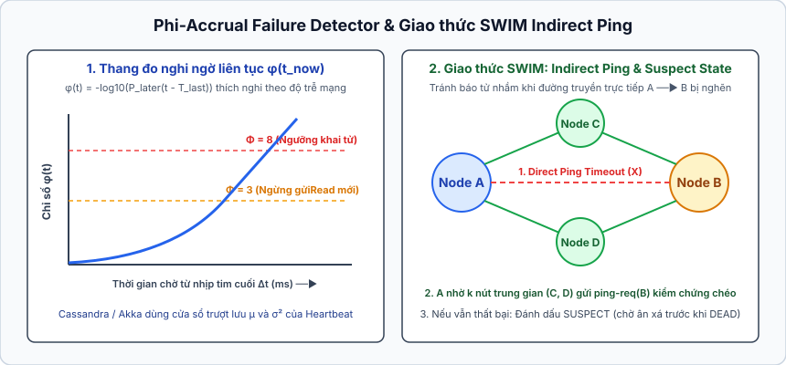
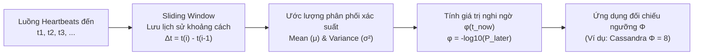
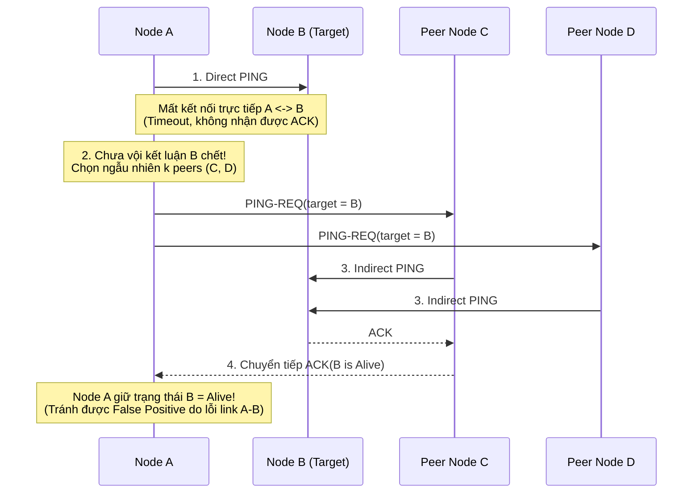

## Table of Contents
1. [Bài toán nan giải cốt lõi của Failure Detection](#fundamental-dilemma-of-failure-detection)
2. [Cơ chế Heartbeats vs Pings và Hạn chế của Fixed Timeout](#heartbeats-vs-pings-fixed-timeout)
3. [Thuật toán Phi-Accrual Failure Detector (Cassandra, Akka)](#phi-accrual-failure-detector)
4. [Giao thức Gossip và Outsourced Heartbeats (SWIM Protocol)](#gossip-and-swim-protocol)
5. [Tóm tắt & Ghi nhớ cốt lõi (Key Takeaways)](#key-takeaways)

---

## Bài toán nan giải cốt lõi của Failure Detection {#fundamental-dilemma-of-failure-detection}

Hầu hết các tác vụ quan trọng trong cơ sở dữ liệu phân tán — từ bầu chọn Leader mới (*Leader Election*), định tuyến lại truy vấn, cho tới kích hoạt quá trình sao chép bù dữ liệu — đều phụ thuộc vào một mô-đun nền tảng: **Failure Detector (Bộ phát hiện lỗi)**.

Tuy nhiên, trong môi trường mạng đồng bộ từng phần (*Partially Synchronous Network*), khi Node `A` ngừng nhận được tín hiệu từ Node `B`, Node `A` không có bất kỳ phương thức vật lý nào để phân biệt giữa hai trạng thái:

1. **Node `B` đã thực sự sập nguồn (Crashed)**.
2. **Node `B` vẫn hoàn toàn khỏe mạnh**, nhưng gói tin bị trễ do nghẽn mạng tạm thời, bão gói tin, hoặc tiến trình trên Node `B` đang bị đóng băng vài giây bởi **Stop-The-World Garbage Collection (GC Pause)** hay tắc nghẽn Disk I/O.

### Sự đánh đổi giữa Completeness và Accuracy

Chandra và Toueg (`1996`) đã định lượng hóa chất lượng của một Failure Detector thông qua hai thuộc tính đối lập nhau:

- **Completeness (Tính đầy đủ)**: Mọi nút thực sự bị sập cuối cùng bắt buộc phải bị phát hiện bởi các nút khỏe mạnh:
  - *Strong Completeness*: Mọi nút bị sập cuối cùng đều bị tất cả các nút khỏe mạnh đánh dấu là `Dead`.
  - *Weak Completeness*: Mọi nút bị sập cuối cùng đều bị ít nhất một nút khỏe mạnh đánh dấu là `Dead`.
- **Accuracy (Tính chính xác)**: Không có nút khỏe mạnh nào bị kết luận nhầm là đã chết (**False Positive**):
  - *Strong Accuracy*: Không một nút khỏe mạnh nào từng bị đánh dấu nhầm là `Dead` tại bất kỳ thời điểm nào.
  - *Eventual Accuracy*: Bộ phát hiện lỗi có thể mắc sai lầm tạm thời trong lúc mạng biến động, nhưng sau một khoảng thời gian ổn định, không còn nút khỏe mạnh nào bị nghi ngờ nhầm nữa.

> [!IMPORTANT]
> **Không thể đạt đồng thời cả Strong Completeness và Strong Accuracy trong mạng thực tế:**
> Nếu cấu hình bộ phát hiện lỗi cực kỳ nhạy (ngưỡng chờ ngắn) để đạt **Completeness** nhanh chóng, hệ thống sẽ liên tục gặp **False Positives** (vi phạm Accuracy) mỗi khi có nhiễu mạng hoặc GC pause. Ngược lại, nếu đặt ngưỡng chờ quá bảo thủ để bảo vệ **Accuracy**, hệ thống sẽ chậm phát hiện ra các nút đã chết thực sự, làm kéo dài thời gian gián đoạn dịch vụ (*MTTR / Failover time*).

---

## Cơ chế Heartbeats vs Pings và Hạn chế của Fixed Timeout {#heartbeats-vs-pings-fixed-timeout}

Hai cơ chế cơ bản để theo dõi trạng thái sống còn giữa hai nút là **Ping (Thăm dò hai chiều)** và **Heartbeat (Nhịp tim một chiều)**:

- **Pings (Request-Response)**: Định kỳ mỗi chu kỳ `Δ t`, Node `A` chủ động gửi gói tin `PING` tới Node `B` và chờ nhận lại gói tin `ACK` trong khoảng thời gian chờ `τ`. Cách tiếp cận này đo được độ trễ khứ hồi (*round-trip*), nhưng tốn gấp đôi lượng gói tin trên mạng.
- **Heartbeats (Push-based)**: Node `B` chủ động phát đi gói tin `HEARTBEAT` định kỳ mỗi `Δ t` tới các nút đang theo dõi nó. Node `A` chỉ cần lắng nghe và cập nhật dấu thời gian nhận cuối cùng `t_last` (đo bằng **Monotonic Clock** cục bộ của `A`).

### Tại sao Fixed Timeout thất bại trong môi trường Cloud?

Trong các thiết kế truyền thống, bộ phát hiện lỗi sử dụng một ngưỡng thời gian chờ cố định `τ` (*Fixed Timeout*): nếu `t_now - t_last > τ`, nút từ xa lập tức bị chuyển trạng thái nhị phân từ `Alive` sang `Dead`. Cách tiếp cận cứng nhắc này gây ra hai hậu quả nghiêm trọng trong hạ tầng sản xuất:

1. **Đặt `τ` quá nhỏ (ví dụ `500ms`–`1,000ms`) `->` Hiệu ứng Domino & Flapping**:
   - Khi hệ thống chịu tải cao, độ trễ mạng tăng vọt hoặc một node bước vào chu kỳ GC pause kéo dài `1.5` giây.
   - Các node còn lại lập tức kết luận nhầm node đó đã chết (**False Positive**) và kích hoạt quy trình **Failover / Rebalancing**: bầu lại Leader, hủy các kết nối hiện tại và di chuyển hàng loạt phân vùng dữ liệu (*shard migration*) sang các node khác.
   - Lưu lượng mạng phát sinh từ quá trình Rebalancing lại làm các node còn lại quá tải, đẩy chúng vượt ngưỡng `τ` và gây ra sập dây chuyền toàn cụm (**Cascading Failure**). Ngay sau đó, node bị GC pause tỉnh dậy và gia nhập lại cụm, gây ra hiện tượng trạng thái chập chờn liên tục (**Flapping**).
2. **Đặt `τ` quá lớn (ví dụ `30`–`60` giây) `->` Phản ứng trì trệ**:
   - Khi một máy chủ vật lý bị mất điện thực sự, toàn bộ các truy vấn gửi tới các phân vùng do máy đó nắm giữ sẽ bị treo cứng suốt `30`–`60` giây trước khi hệ thống bắt đầu chuyển đổi dự phòng.

---

## Thuật toán Phi-Accrual Failure Detector (Cassandra, Akka) {#phi-accrual-failure-detector}

Để giải quyết triệt để điểm yếu của ngưỡng cố định và kết quả nhị phân (`Alive`/`Dead`), Hayashibara và cộng sự (`2004`) đã đề xuất **$\Phi$-Accrual Failure Detector (Phi-Accrual)** — thuật toán hiện được sử dụng làm nền tảng trong **Apache Cassandra**, **ScyllaDB** và **Akka Cluster**.

### Tư tưởng cốt lõi: Thay thế Boolean bằng Thang đo nghi ngờ liên tục ($\varphi$)

Thay vì trả lời câu hỏi nhị phân *"Node `B` còn sống hay đã chết?"*, bộ phát hiện lỗi Phi-Accrual tách biệt hoàn toàn tầng **Giám sát (Monitoring)** và tầng **Ra quyết định (Interpretation)**:

- Nó liên tục thu thập lịch sử khoảng cách thời gian giữa các nhịp Heartbeat đến (*inter-arrival times*) trong một **cửa sổ trượt (Sliding Window)** để tự động học lấy đặc tính trễ và độ biến thiên (*jitter*) hiện tại của đường truyền mạng.
- Dựa trên phân phối xác suất của lịch sử đó, tại bất kỳ thời điểm $t_{\text{now}}$ nào, thuật toán tính ra một giá trị thực liên tục $\varphi$ (**Phi — mức độ nghi ngờ**), phản ánh xác suất mà nút từ xa thực sự đã chết chứ không phải chỉ bị trễ gói tin.

### Công thức toán học và Ý nghĩa xác suất của `φ`

Gọi `t_last` là thời điểm nhận được nhịp Heartbeat gần đây từ Node `B`, và `Δ t = t_now - t_last` là khoảng thời gian đã trôi qua kể từ đó. Từ các mẫu lịch sử trong cửa sổ trượt, hệ thống ước lượng hàm phân phối tích lũy `F(t)` (thường mô hình hóa bằng **Phân phối chuẩn - Normal Distribution** với trung bình `μ`, độ lệch chuẩn `σ` như trong Akka, hoặc **Phân phối mũ - Exponential Distribution** như trong cài đặt thực tế của Cassandra).

Xác suất để nhịp Heartbeat tiếp theo sẽ đến muộn hơn khoảng thời gian $\Delta t$ hiện tại (tức là nút vẫn sống nhưng gói tin chỉ đến trễ) là:

$$
P_{\text{later}}(\Delta t) = 1 - F(\Delta t) = \int_{\Delta t}^{\infty} f(x)\,dx
$$

Giá trị nghi ngờ $\varphi$ được định nghĩa theo thang logarit cơ số $10$:

$$
\varphi(t_{\text{now}}) = -\log_{10}\left(P_{\text{later}}(t_{\text{now}} - t_{\text{last}})\right)
$$

### Ví dụ thực tế với `phi_convict_threshold` trong Apache Cassandra

Nhờ hàm $-\log_{10}$, giá trị của $\varphi$ mang ý nghĩa xác suất trực quan rõ ràng:

- Nếu **$\varphi = 1$**: Xác suất nhịp Heartbeat chỉ bị trễ ($P_{\text{later}}$) là $10^{-1} = 10\%$ (khả năng mắc lỗi False Positive nếu kết luận node chết lúc này là $10\%$).
- Nếu **$\varphi = 2$**: Xác suất gói tin đến trễ là $10^{-2} = 1\%$.
- Nếu **$\varphi = 3$**: Xác suất gói tin đến trễ là $10^{-3} = 0.1\%$.
- Trong **Apache Cassandra**, tham số mặc định là `phi_convict_threshold: 8` ($\Phi = 8$). Khi $\varphi$ vượt qua ngưỡng $8$, xác suất để nhịp Heartbeat chỉ vô tình đến muộn mà node chưa chết chỉ còn là **$10^{-8}$ ($0.000001\%$)**!

**Khả năng tự thích nghi (Self-Adapting to Network Jitter)**:
Khi mạng nội bộ ổn định (ví dụ Heartbeat đến đều đặn mỗi $1000\text{ ms} \pm 5\text{ ms}$), độ lệch chuẩn $\sigma$ rất nhỏ, nên chỉ cần chậm vài giây là $\varphi$ đã vọt lên trên $8$. Ngược lại, khi mạng đang bị nghẽn hoặc có độ trễ dao động mạnh ($1000\text{ ms} \pm 800\text{ ms}$), độ lệch chuẩn $\sigma$ trong cửa sổ trượt tự động giãn rộng ra; lúc này đường cong tăng trưởng của $\varphi$ sẽ thoải hơn, giúp hệ thống tự động chờ lâu hơn trước khi chạm ngưỡng $\Phi = 8$ mà không cần người vận hành chỉnh sửa cấu hình bằng tay.

---

## Giao thức Gossip và Outsourced Heartbeats (SWIM Protocol) {#gossip-and-swim-protocol}

Khi quy mô cụm phân tán mở rộng lên hàng trăm hoặc hàng nghìn node, việc cho phép mọi node gửi Heartbeat trực tiếp tới tất cả các node còn lại (**All-to-All Heartbeating**) tạo ra số lượng tin nhắn tăng bậc hai **`O(N^2)`** trên mỗi chu kỳ, nhanh chóng làm bão hòa băng thông mạng và CPU. Bên cạnh đó, nếu chỉ có đường kết nối cục bộ giữa Node `A` và Node `B` bị lỗi định tuyến (trong khi `B` vẫn giao tiếp bình thường với các node `C, D, E` khác), một bộ phát hiện lỗi cục bộ tại `A` sẽ đưa ra kết luận sai lệch so với phần còn lại của cụm.

Để giải quyết cả bài toán mở rộng quy mô lẫn lỗi đường truyền cục bộ, Das và cộng sự (`2002`) đã thiết kế giao thức **SWIM (Scalable Weakly-consistent Infection-style Process Group Membership Protocol)** — kiến trúc được áp dụng rộng rãi trong HashiCorp Consul/Serf và Uber Ringpop.

### Quy trình `4` bước của SWIM (Indirect Probing & Suspicion Mechanism)

Trong mỗi chu kỳ giao thức `T'`, mỗi Node `A` chỉ chọn **ngẫu nhiên `1` node bất kỳ** trong danh sách thành viên (giả sử là Node `B`) để kiểm tra, giữ cho tải mạng trên mỗi node luôn ở mức hằng số `O(1)`:

1. **Thăm dò trực tiếp (Direct Ping)**: Node `A` gửi gói tin `PING` tới Node `B` và chờ phản hồi `ACK`. Nếu nhận được `ACK` đúng hạn, chu kỳ kiểm tra hoàn tất.
2. **Ủy thác thăm dò gián tiếp (Outsourced / Indirect Ping - `PING-REQ`)**: Nếu không nhận được `ACK` từ `B` sau khoảng chờ ngắn, Node `A` **không lập tức đánh dấu `B` đã chết** (vì nguyên nhân có thể chỉ là lỗi cáp hoặc tường lửa giữa riêng cặp `A <-> B`). Thay vào đó, `A` chọn ngẫu nhiên `k` node trung gian khác (ví dụ `C, D, E`) và gửi bản tin `PING-REQ(B)` nhờ chúng kiểm tra hộ.
3. **Chuyển tiếp kết quả**: Mỗi node trong nhóm `k` node trung gian sẽ tự gửi `PING` trực tiếp tới `B` thông qua đường mạng riêng của mình. Nếu bất kỳ node trung gian nào nhận được `ACK` từ `B`, nó sẽ chuyển tiếp gói `ACK` đó về cho `A`. Nhờ cơ chế đi vòng qua `k` đường truyền độc lập này, tỷ lệ kết luận nhầm do nghẽn mạng cục bộ giảm đi theo cấp số nhân.
4. **Trạng thái Nghi ngờ (Suspect State) & Phản bác tin đồn (Refutation)**:
   - Ngay cả khi cả `A` lẫn toàn bộ `k` node trung gian đều không nhận được `ACK` từ `B`, giao thức SWIM vẫn **chưa khai tử `B` ngay lập tức**.
   - Node `A` chuyển trạng thái của `B` sang **`Suspect` (Đang nghi ngờ)** và phát tán tin đồn `Suspect(B, incarnation = i)` ra toàn cụm bằng cách đính kèm (*piggyback*) vào các gói `PING` / `ACK` thông thường (không cần gửi gói tin quảng bá riêng).
   - Nếu Node `B` thực chất vẫn sống (ví dụ vừa thoát khỏi đợt GC pause) và nghe được tin đồn rằng chính mình đang bị liệt vào danh sách `Suspect`, `B` lập tức tự tăng số hiệu thế hệ (`incarnation = i + 1`) và phát tán bản tin `Alive(B, incarnation = i + 1)` để **phản bác tin đồn**.
   - Chỉ khi hết khoảng thời gian ân hạn (*Suspicion Timeout*) mà không có bất kỳ bản tin phản bác nào từ `B`, trạng thái của `B` mới chính thức chuyển sang **`Dead` (`Confirm`)** và bị loại khỏi danh sách thành viên của cụm.

---

## Tóm tắt & Ghi nhớ cốt lõi (Key Takeaways) {#key-takeaways}

- **Đánh đổi cốt lõi của Failure Detection**: Trong mạng đồng bộ từng phần, không thể phân biệt chắc chắn một node đã crash với một node bị chậm do mạng hoặc GC pause. Mọi bộ phát hiện lỗi đều phải cân bằng giữa **Completeness** (phát hiện hết mọi node chết) và **Accuracy** (tránh kết luận nhầm node sống thành chết — False Positive).
- **Nhược điểm của Fixed Timeout**: Đặt ngưỡng cố định quá thấp dẫn đến **False Positives**, kích hoạt Failover/Rebalance sai lầm gây sập dây chuyền (**Cascading Failure**) và chập chờn (**Flapping**); đặt ngưỡng quá cao làm kéo dài thời gian ngưng trệ khi có sự cố thật.
- **Cơ chế Phi-Accrual ($\Phi$-Accrual)**: Thay vì trả về kết quả nhị phân `Dead`/`Alive`, thuật toán duy trì một cửa sổ trượt lưu lịch sử khoảng cách giữa các Heartbeat để ước lượng phân phối xác suất và tính ra chỉ số nghi ngờ liên tục $\varphi = -\log_{10}(P_{\text{later}})$. Với ngưỡng $\Phi = 8$ trong Cassandra, xác suất nhịp tim chỉ vô tình đến trễ là $10^{-8}$ ($0.000001\%$), giúp hệ thống tự động thích nghi với độ nhiễu mạng (*network jitter*).
- **Giao thức SWIM và Outsourced Heartbeats**: Tránh bùng nổ gói tin $O(N^2)$ của All-to-All Heartbeat bằng cách kết hợp thăm dò ngẫu nhiên $O(1)$, **Indirect Ping (`PING-REQ`)** qua $k$ node trung gian để vượt qua lỗi đường truyền cục bộ, cùng trạng thái đệm **`Suspect`** cho phép node bị nghi ngờ tự phản bác trước khi bị đánh dấu `Dead`.

### Tài liệu & Nguồn tham khảo
- [Hayashibara, N., et al. (2004) — *The $\varphi$ Accrual Failure Detector*](https://www.Semanticscholar.org/paper/The-%CF%86-accrual-failure-detector-Hayashibara-Defago/1106278042c721abbe61490a3b97111a8a212e8e)
- [Das, A., Gupta, I., & Motivala, A. (2002) — *SWIM: Scalable Weakly-consistent Infection-style Process Group Membership Protocol*](https://www.cs.cornell.edu/projects/Quicksilver/public_pdfs/SWIM.pdf)
- [Akka Documentation — Phi Accrual Failure Detector Implementation](https://doc.akka.io/docs/akka/current/typed/failure-detector.html)
