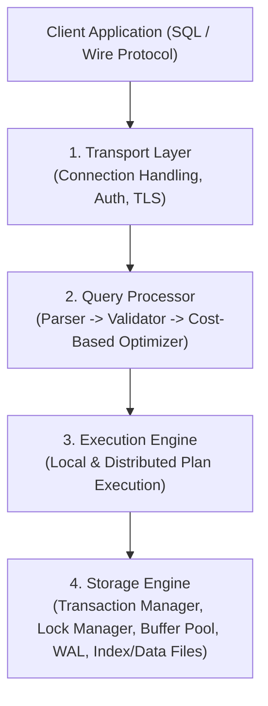

## Table of Contents
1. [Nhiệm vụ cốt lõi của Database](#database-missions)
2. [Kiến trúc phân tầng của một DBMS](#database-architecture)
3. [Giải phẫu Storage Engine: Luồng Ghi (Write Path) & Luồng Đọc (Read Path)](#storage-engines)
4. [Hai trường phái Storage Engine: B-Tree vs LSM-Tree](#b-tree-vs-lsm-tree)
5. [Transactional Processing & Recovery (ACID, WAL, MVCC)](#transactional-processing-and-recovery)
6. [Các biến thể B-Tree hiện đại (B-Tree Variants)](#b-tree-variants)
7. [Log-Structured Storage (LSM-Tree)](#log-structured-storage)
8. [Tiêu chí lựa chọn Database & Benchmark thực tế](#compare-databases)
9. [Tóm tắt & Ghi nhớ cốt lõi (Key Takeaways)](#key-takeaways)

---

## Nhiệm vụ cốt lõi của Database {#database-missions}

Tại sao không lưu thẳng dữ liệu ra các file JSON hay CSV trên ổ đĩa mà phải dùng Database Management System (DBMS)? Một DBMS giải quyết sẵn hàng loạt bài toán hạ tầng cực kỳ phức tạp:
- **Độ tin cậy & Bền vững dữ liệu (Durability & Crash Recovery)**: Đảm bảo dữ liệu đã `COMMIT` không bị hỏng (corrupt) hay biến mất ngay cả khi server mất điện đột ngột giữa lúc đang ghi.
- **Truy xuất hiệu năng cao (Indexing & Caching)**: Thay vì quét tuần tự toàn bộ file (`O(N)`), DBMS tổ chức dữ liệu theo cấu trúc chỉ mục (`O(log N)` hoặc `O(1)`) kết hợp tầng bộ nhớ đệm thông minh trên RAM.
- **Kiểm soát truy cập đồng thời (Concurrency Control)**: Cho phép hàng ngàn kết nối cùng đọc và ghi vào một bảng dữ liệu mà không dẫm đạp lên nhau (nhờ `Locking`, `Latching` và `MVCC`).
- **Tối ưu hóa truy vấn tự động (Query Optimization)**: Chuyển câu lệnh khai báo (Declarative SQL) thành kế hoạch thực thi vật lý (Execution Plan) có chi phí I/O và CPU thấp.

---

## Kiến trúc phân tầng của một DBMS {#database-architecture}

Một hệ quản trị cơ sở dữ liệu không phải là một khối monolithic đặc quánh mà được chia thành các tầng (layers) tách biệt rõ ràng:

- **Transport Layer**: Tiếp nhận kết nối TCP/Unix Socket từ Client, quản lý connection pool, xác thực (authentication) và giải mã gói tin theo giao thức riêng (như MySQL Wire Protocol, PostgreSQL Frontend/Backend Protocol).
- **Query Processor**:
  - **Query Parser**: Phân tích chuỗi SQL thành cây cú pháp trừu tượng (**AST - Abstract Syntax Tree**), kiểm tra cú pháp và quyền truy cập bảng/cột.
  - **Query Optimizer**: Loại bỏ các điều kiện dư thừa và dựa trên thống kê dữ liệu (**Statistics / Histograms**) để chọn kế hoạch thực thi có chi phí thấp (ví dụ: chọn `Index Scan` hay `Seq Scan`, chọn `Hash Join` hay `Nested Loop Join`).
- **Execution Engine**: Điều phối việc thực thi Execution Plan bằng cách gọi xuống các hàm API cấp thấp của tầng Storage Engine (hoặc gửi RPC tới các node khác nếu là Distributed Database).
- **Storage Engine**: Thành phần cốt lõi nằm ở đáy kiến trúc, trực tiếp quản lý dữ liệu vật lý trên ổ đĩa (Disk) và bộ nhớ khả biến (RAM). Toàn bộ **Part 1 (Chương 1 – Chương 7)** của cuốn sách tập trung giải phẫu tầng này.

*Hình 1.1: Kiến trúc tổng quan của MySQL InnoDB Storage Engine (In-Memory Structures vs On-Disk Structures)*

---

## Giải phẫu Storage Engine: Luồng Ghi (Write Path) & Luồng Đọc (Read Path) {#storage-engines}

Storage Engine phải giải quyết mâu thuẫn vật lý giữa **RAM** (nhanh hàng chục nanosecond nhưng mất sạch dữ liệu khi tắt nguồn) và **Disk** (bền vững nhưng chậm hơn từ hàng ngàn đến hàng triệu lần, đặc biệt với thao tác ghi ngẫu nhiên - Random I/O).

### 1. Quá trình Ghi (Write Path)
Khi ứng dụng thực thi lệnh `INSERT` / `UPDATE` / `DELETE`:
1. **Ghi Write-Ahead Log (WAL / Redo Log)**: Trước khi sửa dữ liệu trên đĩa, chi tiết thao tác thay đổi được ghi nối tiếp (**append-only sequential write**) vào file WAL trên đĩa cứng và gọi `fsync`. Vì ghi tuần tự chỉ tốn một phần nhỏ thời gian so với ghi ngẫu nhiên, thao tác `COMMIT` diễn ra rất nhanh mà vẫn đảm bảo an toàn khi sập nguồn.
2. **Cập nhật trên RAM (Buffer Pool / Memtable)**: Dữ liệu được sửa trực tiếp trên vùng nhớ đệm trong RAM:
   - Với **B-Tree Engine** (InnoDB, PostgreSQL): sửa trực tiếp trên trang bộ nhớ (**Page**) trong `Buffer Pool`, đánh dấu trang đó là **Dirty Page**.
   - Với **LSM-Tree Engine** (RocksDB, Cassandra): chèn bản ghi mới vào cấu trúc `Memtable` (thường là `Skiplist`) trên RAM.
3. **Background Flush / Checkpointing**: Định kỳ, các luồng chạy ngầm (Background Threads) gom các `Dirty Pages` (hoặc `Memtable` đã đầy) để ghi xuống file dữ liệu chính trên ổ đĩa (`Tablespace` / `SSTable`).

### 2. Quá trình Đọc (Read Path)
Khi ứng dụng thực thi lệnh `SELECT`:
1. **Cache Lookup (Kiểm tra trên RAM)**: Storage Engine kiểm tra xem dữ liệu cần tìm đã nằm sẵn trong `Buffer Pool` / `Memtable` chưa.
2. **Cache Hit**: Nếu có sẵn trong RAM, trả kết quả ngay lập tức mà không tốn bất kỳ thao tác Disk I/O nào.
3. **Cache Miss**: Nếu chưa có trong RAM, Storage Engine định vị đúng `Page` / `Block` trên đĩa (thường có kích thước `4 KB`, `8 KB` hoặc `16 KB`), nạp trang đó lên `Buffer Pool` (nếu RAM đầy sẽ kích hoạt thuật toán **Eviction** như `LRU`, `2Q`, `Clock` để đuổi trang cũ ra), sau đó trích xuất dòng dữ liệu trả về.

---

## Hai trường phái Storage Engine: B-Tree vs LSM-Tree {#b-tree-vs-lsm-tree}

Thế giới Storage Engine hiện đại phân cực thành 2 họ cấu trúc dữ liệu chính với triết lý đánh đổi trái ngược nhau:

| Tiêu chí | Họ B-Tree (`B+Tree`) | Họ LSM-Tree (`Log-Structured Merge-Tree`) |
| :--- | :--- | :--- |
| **Triết lý cập nhật** | **Update-in-place (Mutable Pages)**: Sửa trực tiếp đúng trang dữ liệu chứa bản ghi đó. | **Append-only (Immutable Files)**: Không bao giờ sửa file cũ; mọi thao tác ghi/sửa/xóa đều tạo bản ghi mới và trộn ngầm (`Compaction`). |
| **Đặc tính I/O khi Ghi** | **Random I/O** (khi flush các dirty pages nằm rải rác trên đĩa). | **Sequential I/O** (chỉ ghi nối tiếp vào WAL và flush SSTable tuần tự). |
| **Thế mạnh chính** | **Tốc độ Đọc (Read-heavy)** ổn định, tìm kiếm điểm (point lookup) và quét khoảng (range scan) chỉ cần đi qua 1 cây chỉ mục. | **Tốc độ Ghi (Write-heavy)** rất cao, nén dữ liệu tốt hơn, ít phân mảnh ổ đĩa. |
| **Điểm yếu (Amplification)** | **Write Amplification** cao (sửa 100 bytes có thể phải ghi lại cả Page `16 KB` + WAL) và phân mảnh trang (Page Fragmentation). | **Read Amplification** (phải kiểm tra qua nhiều file `SSTable` nếu chưa kịp Compaction) và tốn CPU/I/O lúc chạy `Compaction`. |
| **Đại diện tiêu biểu** | **InnoDB** (MySQL), **PostgreSQL**, **WiredTiger** (MongoDB), **SQLite**, **Oracle**. | **RocksDB**, **LevelDB**, **Apache Cassandra**, **ScyllaDB**, **HBase**, **CockroachDB** (Pebble). |

---

## Transactional Processing & Recovery (ACID, WAL, MVCC) {#transactional-processing-and-recovery}

Chương 5 của sách đi sâu vào cách Storage Engine giữ lời hứa **ACID** (`Atomicity`, `Consistency`, `Isolation`, `Durability`):
- **Buffer Management**: Quản lý việc nạp trang từ đĩa lên RAM (`Pin` giữ trang đang đọc/ghi, `Unpin` khi xong) và chiến lược thay thế trang (`LRU`, `2Q`, `CLOCK-Sweep`) để tránh hiện tượng một câu lệnh quét toàn bảng (`Full Table Scan`) đẩy sạch dữ liệu nóng ra khỏi RAM (**Cache Pollution**).
- **Chính sách STEAL / NO-FORCE & Thuật toán ARIES**: Hầu hết các DBMS thực tế dùng chính sách **STEAL** (cho phép ghi cả trang chưa `COMMIT` xuống đĩa nếu RAM đầy) kết hợp **NO-FORCE** (khi `COMMIT` chỉ cần `fsync` file WAL chứ chưa cần ghi ngay Data Page xuống đĩa). Khi khởi động lại sau sự cố, thuật toán **ARIES** khôi phục dữ liệu qua 3 pha: **Analysis** -> **Redo (Repeating History)** -> **Undo**.
- **Concurrency Control (`2PL`, `MVCC`, `Lock` vs `Latch`)**:
  - Phân biệt rõ **Lock** (khóa logic ở mức dòng/bảng giữa các transaction, giữ đến hết transaction, có phát hiện Deadlock) và **Latch** (khóa vật lý như Mutex/RWLock bảo vệ cấu trúc bộ nhớ B-Tree trong vài microsecond, không có Deadlock detection).
  - Cơ chế **MVCC (Multi-Version Concurrency Control)** lưu nhiều phiên bản của cùng một dòng dữ liệu theo timestamp/transaction ID, giúp thao tác **Đọc không chặn Ghi và Ghi không chặn Đọc**.

---

## Các biến thể B-Tree hiện đại (B-Tree Variants) {#b-tree-variants}

Chương 6 giới thiệu các biến thể cải tiến nhằm khắc phục điểm yếu Random I/O và tranh chấp Latch của B+Tree truyền thống:
- **Copy-on-Write (CoW) B-Tree (LMDB, Btrfs)**: Không bao giờ ghi đè trang cũ tại chỗ. Khi sửa một node lá, hệ thống tạo một trang lá mới và cập nhật dây chuyền lên tới một **Root Page mới**. Nhờ đó không cần file WAL riêng và các luồng đọc hoàn toàn không cần dùng Lock/Latch.
- **Lazy-Adaptive B-Trees (WiredTiger, Lazy B-Tree)**: Giữ các thao tác cập nhật trong vùng đệm thay đổi (Update Buffer) gắn với từng node trên RAM, gom nhiều thay đổi lại mới thực hiện ghi xuống đĩa một lần.
- **Bw-Tree (Latch-Free B-Tree)**: Loại bỏ hoàn toàn Latch bằng cách kết hợp **Mapping Table** (ánh xạ Logical Page ID sang địa chỉ vật lý) và **Delta Chains** (nối thêm các bản ghi thay đổi nhỏ vào đầu trang bằng lệnh nguyên tử **CAS - Compare-and-Swap** của CPU).

---

## Log-Structured Storage (LSM-Tree) {#log-structured-storage}

Chương 7 giải phẫu chi tiết kiến trúc **LSM-Tree**:
- **Memtable + WAL -> Immutable SSTables**: Dữ liệu ghi vào được chèn vào `Memtable` (thường dùng cấu trúc **Skiplist** để hỗ trợ truy cập đồng thời không cần khóa toàn cục) và ghi tuần tự vào `WAL`. Khi `Memtable` đạt ngưỡng dung lượng (ví dụ `64 MB`), nó được đóng băng (`Immutable Memtable`) và xả thẳng xuống đĩa thành file **SSTable (Sorted String Table)**.
- **Tombstone & Compaction**: Vì `SSTable` là bất biến, lệnh `DELETE` không xóa dữ liệu ngay mà ghi thêm một bản ghi đánh dấu xóa gọi là **Tombstone**. Các luồng **Compaction** chạy ngầm (theo chiến lược **Size-Tiered** hoặc **Leveled Compaction**) sẽ trộn nhiều file `SSTable` lại theo thứ tự khóa, chỉ giữ lại phiên bản mới và loại bỏ các bản ghi đã gắn `Tombstone`.
- **Bloom Filter**: Cấu trúc mảng bit xác suất đặt trước mỗi `SSTable`. Nếu `Bloom Filter` báo **không có** thì khóa đó chắc chắn `100%` không nằm trong file `SSTable` này, giúp LSM-Tree bỏ qua hàng loạt lần đọc đĩa vô ích.

---

## Tiêu chí lựa chọn Database & Benchmark thực tế {#compare-databases}

Khi lựa chọn DBMS hoặc Storage Engine cho hệ thống thực tế, cần đánh giá dựa trên:
1. **Đặc trưng tải (Workload Profile)**:
   - Tải **Read-heavy / Point Lookup & Range Scan ngắn / Cập nhật dòng thường xuyên**: ưu tiên họ **B+Tree** (`PostgreSQL`, `InnoDB`).
   - Tải **Write-heavy / Time-series / Event Log / Ingest dữ liệu liên tục**: ưu tiên họ **LSM-Tree** (`RocksDB`, `Cassandra`, `ScyllaDB`).
   - Tải **OLAP / Báo cáo phân tích tổng hợp trên vài cột của hàng tỷ dòng**: ưu tiên **Column-oriented DBMS** (`ClickHouse`, `DuckDB`, `BigQuery`).
2. **Định lượng qua chuẩn Benchmark**:
   - **TPC-C**: Chuẩn đánh giá hiệu năng xử lý giao dịch OLTP phức tạp (đơn hàng, kho bãi, thanh toán).
   - **TPC-H / TPC-DS**: Chuẩn đánh giá truy vấn phân tích OLAP và báo cáo.
   - **YCSB (Yahoo! Cloud Serving Benchmark)**: Bộ chuẩn phổ biến để đo lường các workload Key-Value / NoSQL (từ Workload A: `50% Read / 50% Update` đến Workload F: `Read-Modify-Write`).

---

## Tóm tắt & Ghi nhớ cốt lõi (Key Takeaways) {#key-takeaways}

1. **Tại sao mọi Storage Engine đều cần cả RAM (`Buffer Pool`/`Memtable`) lẫn `WAL` trên đĩa?**
   - Ghi trực tiếp vào cấu trúc chỉ mục trên đĩa tốn Random I/O rất chậm. Cập nhật trên RAM giúp đạt tốc độ phản hồi microsecond, còn ghi nối tiếp (`append-only`) vào `WAL` giúp bảo toàn dữ liệu khi mất điện với chi phí Sequential I/O tối thiểu.
2. **Sự đánh đổi căn bản giữa B+Tree và LSM-Tree (RUM Conjecture) là gì?**
   - Không có cấu trúc lưu trữ nào tối ưu đồng thời cả 3 yếu tố: **Read Amplification (Đọc)**, **Update/Write Amplification (Ghi)** và **Memory/Space Amplification (Dung lượng)**. B+Tree tối ưu cho **Read**, còn LSM-Tree tối ưu cho **Write** và **Space**.
3. **Khi nào dữ liệu bị xóa (`DELETE`) thực sự giải phóng dung lượng đĩa?**
   - Cả B-Tree và LSM-Tree đều **không xóa vật lý ngay lập tức** khi chạy lệnh `DELETE`. B-Tree đánh dấu ô dữ liệu trong `Slotted Page` là đã xóa để tái sử dụng hoặc chờ tiến trình `VACUUM`; còn LSM-Tree ghi thêm một bản ghi `Tombstone` và chỉ thực sự giải phóng đĩa khi quá trình `Compaction` diễn ra.

### Tài liệu & Nguồn tham khảo
- [Alex Petrov — *Database Internals: A Deep Dive into How Distributed Data Systems Work* (O'Reilly)](https://www.databass.dev/)
- [Athanassoulis, M., et al. (2016) — *Designing Access Methods: The RUM Conjecture* (Harvard Data Systems Lab)](http://daslab.seas.harvard.edu/rum-conjecture/)
- [CMU 15-445/645 — Database Systems Course Notes & Lectures (Andy Pavlo)](https://15445.courses.cs.cmu.edu/)
