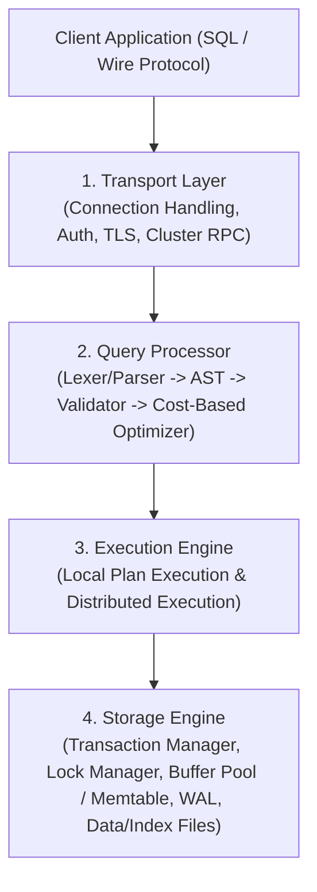
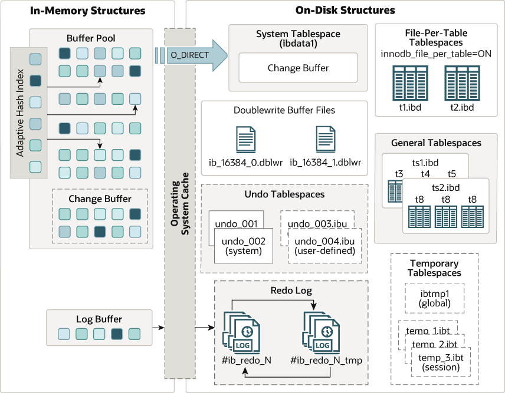
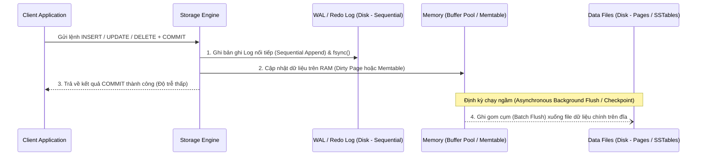
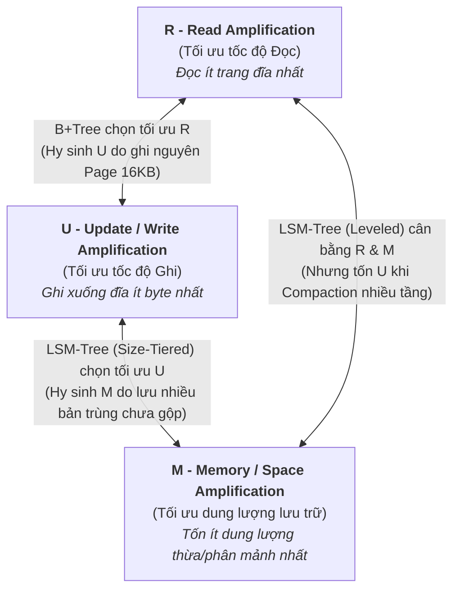
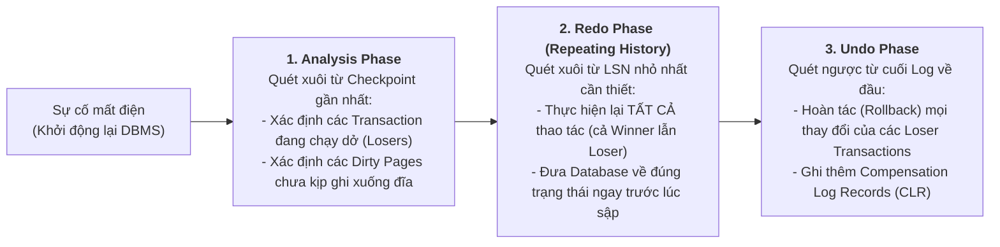
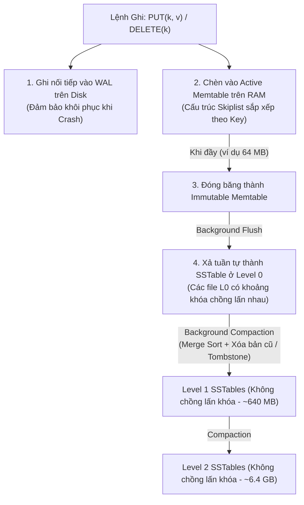

## Table of Contents
1. [Nhiệm vụ cốt lõi của Database: Tại sao không lưu thẳng vào file CSV/JSON?](#database-missions)
2. [Kiến trúc phân tầng của một DBMS](#database-architecture)
3. [Giải phẫu Storage Engine: Luồng Ghi (Write Path) & Luồng Đọc (Read Path)](#storage-engines)
4. [Ví dụ chạy tay (Dry Run): Hành trình của một câu lệnh UPDATE trên B+Tree vs LSM-Tree](#dry-run-update-btree-vs-lsm)
5. [Hai trường phái Storage Engine & Định lý RUM Conjecture](#b-tree-vs-lsm-tree)
6. [Transactional Processing & Recovery (ACID, WAL, ARIES, MVCC)](#transactional-processing-and-recovery)
7. [Các biến thể B-Tree hiện đại (CoW, Lazy-Adaptive, Bw-Tree)](#b-tree-variants)
8. [Log-Structured Storage (LSM-Tree, SSTable, Compaction, Bloom Filter)](#log-structured-storage)
9. [Tiêu chí lựa chọn Database & Benchmark thực tế](#compare-databases)
10. [Tóm tắt & Ghi nhớ cốt lõi (Key Takeaways)](#key-takeaways)

---

## Nhiệm vụ cốt lõi của Database: Tại sao không lưu thẳng vào file CSV/JSON? {#database-missions}

### Bài toán thực tế & Thiết kế ngây thơ (Naive Design)
Giả sử cần xây dựng hệ thống quản lý tài khoản ngân hàng với `10.000.000` người dùng. Một cách tiếp cận ngây thơ là lưu toàn bộ danh sách tài khoản vào một file `accounts.csv` hoặc `accounts.json` trên ổ đĩa. Khi vận hành thực tế, thiết kế này lập tức sụp đổ vì 4 vấn đề chí mạng:

1. **Độ trễ tìm kiếm và cập nhật tuyến tính $\mathcal{O}(N)$**:
   - Để tìm tài khoản `id = 42` trong file CSV nặng `2 GB`, hệ thống phải đọc tuần tự từ đầu file đến cuối file (`Full Scan`).
   - Tệ hơn, nếu muốn sửa số dư của tài khoản nằm ở giữa file từ `90` thành `500` (số byte thay đổi từ 2 chữ số lên 3 chữ số), hệ điều hành không hỗ trợ "chèn thêm 1 byte vào giữa file" mà buộc phải dịch chuyển toàn bộ hàng triệu dòng phía sau lùi lại 1 byte — tức phải ghi lại gần như cả file `2 GB` chỉ vì một giao dịch nhỏ.
2. **Hỏng dữ liệu khi mất điện giữa chừng (Partial Write / Torn Write)**:
   - Giả sử đang ghi đè 100 bytes dữ liệu mới xuống ổ đĩa thì server mất điện ở byte thứ 40. Khi khởi động lại, bản ghi đó chứa 40 bytes mới ghép với 60 bytes cũ — tạo ra dữ liệu rác (corrupted state) không thể khôi phục.
3. **Xung đột truy cập đồng thời (Race Conditions)**:
   - Khi 2 tiến trình cùng đọc số dư `100`, cùng cộng thêm `50` và cùng ghi đè xuống file ở một vị trí byte, một giao dịch sẽ bị ghi đè mất dấu (**Lost Update**), hoặc một luồng đọc phải dòng dữ liệu đang được luồng khác ghi dở một nửa (**Dirty Read**).
4. **Chi phí lập trình truy vấn thủ công**:
   - Mỗi khi nghiệp vụ thay đổi (lọc theo chi nhánh, gộp nhóm tính tổng số dư, kết nối với bảng lịch sử giao dịch), lập trình viên phải tự viết lại các vòng lặp `for`, tự quản lý bộ nhớ đệm (cache) và tự chọn thuật toán sắp xếp/kết nối.

### Bốn trụ cột giải pháp của DBMS
Một **Database Management System (DBMS)** ra đời để giải quyết triệt để các bài toán hạ tầng trên, cung cấp 4 đảm bảo cốt lõi:

- **Độ tin cậy & Bền vững dữ liệu (Durability & Crash Recovery)**: Đảm bảo mọi giao dịch đã báo `COMMIT` thành công sẽ không bao giờ bị mất hay hỏng cấu trúc, ngay cả khi sập nguồn đột ngột ngay mili-giây tiếp theo (nhờ cơ chế `Write-Ahead Log` và `Checkpointing`).
- **Truy xuất hiệu năng cao (Indexing & Caching)**: Thay vì quét tuần tự toàn bộ file ($\mathcal{O}(N)$), DBMS chia file thành các khối cố định (**Page**) và tổ chức theo cấu trúc chỉ mục ($\mathcal{O}(\log N)$ với B+Tree hoặc LSM-Tree), kết hợp tầng bộ nhớ đệm thông minh trên RAM (`Buffer Pool` / `Memtable`).
- **Kiểm soát truy cập đồng thời (Concurrency Control)**: Cho phép hàng ngàn kết nối cùng đọc và ghi vào cùng một bảng dữ liệu mà vẫn cô lập an toàn (nhờ sự kết hợp giữa `Lock`, `Latch` và `MVCC - Multi-Version Concurrency Control`).
- **Tối ưu hóa truy vấn tự động (Query Optimization)**: Chuyển câu lệnh khai báo (Declarative SQL — chỉ mô tả *cần lấy dữ liệu gì*) thành kế hoạch thực thi vật lý (Execution Plan — quyết định *cách lấy dữ liệu như thế nào*) có chi phí Disk I/O và CPU thấp nhất.

### Từ điển thuật ngữ nhanh cho người mới (Beginner's Visual Glossary)
Trước khi đi vào chi tiết kiến trúc bên dưới, người mới bắt đầu có thể tra cứu nhanh bảng đối chiếu các thuật ngữ cốt lõi của **Part 1 — Storage Engines**:

| Thuật ngữ trong sách | Hiểu nôm na cho người mới (Ẩn dụ đời thực) | Trong Database thực tế (PostgreSQL / MySQL InnoDB / RocksDB) là gì? |
| :--- | :--- | :--- |
| **`Page` / `Block`** | Một "thùng carton tiêu chuẩn" có kích thước cố định (`8 KB` hoặc `16 KB`). Database không bao giờ bê từng món đồ lẻ từ kho (Disk) lên bàn làm việc (RAM) mà luôn bê nguyên từng thùng carton. | Đơn vị đọc/ghi nhỏ nhất giữa Disk và RAM (`8 KB` trong PostgreSQL, `16 KB` trong MySQL InnoDB). Một Page chứa khoảng vài chục đến vài trăm dòng dữ liệu. |
| **`Buffer Pool`** | Chiếc "bàn làm việc rộng rãi trên RAM" nơi đặt tạm các thùng carton (`Page`) vừa lấy từ dưới kho lên để nhân viên đọc/sửa thật nhanh. | Vùng bộ nhớ RAM được cấp phát riêng cho Database (`shared_buffers` trong PostgreSQL, `innodb_buffer_pool_size` trong MySQL). |
| **`Dirty Page`** | Một tờ hồ sơ nằm trên bàn làm việc (RAM) vừa được lấy bút sửa lại số liệu mới, nhưng **chưa kịp mang xuống kho (Disk) cất vào tủ chính**. | Trang dữ liệu trong `Buffer Pool` đã bị sửa bởi lệnh `INSERT/UPDATE/DELETE` trên RAM nhưng chưa được luồng chạy ngầm ghi đè xuống file dữ liệu trên đĩa. |
| **`WAL` (*Write-Ahead Log*)** | Cuốn "sổ nhật ký trực ban" đặt ngay cạnh tay. Trước khi sửa bất kỳ tờ hồ sơ nào trên bàn, nhân viên bắt buộc ghi 1 dòng nối đuôi vào cuốn sổ này để lỡ mất điện làm bay mất giấy trên bàn thì mở sổ ra làm lại được. | File nhật ký ghi tuần tự trên đĩa (`pg_wal` trong PostgreSQL, `ib_logfile / Redo Log` trong InnoDB) giúp đảm bảo tính bền vững (**Durability**) mà không cần chờ ghi file dữ liệu chính. |
| **`B+Tree Engine`** | Cuốn từ điển/tủ hồ sơ phân tầng: mỗi bản ghi có một ngăn cố định; khi sửa dữ liệu thì mở đúng ngăn đó ra tẩy xóa và viết đè lên (**Update-in-place**). | Trường phái lưu trữ tối ưu cho **Đọc (Read-heavy)**: MySQL InnoDB, PostgreSQL, SQLite, Oracle, SQL Server. |
| **`LSM-Tree Engine`** | Ghi chép nhanh vào "sổ nháp trên bàn" (**`Memtable`**), khi đầy cuốn nháp thì đem in thành một "cuốn tập nhỏ chỉ đọc" (**`SSTable`**) xếp chồng dưới kho, định kỳ nhờ trợ lý gom nhiều cuốn nhỏ gộp thành cuốn lớn (**`Compaction`**). | Trường phái lưu trữ tối ưu cho **Ghi tốc độ cao (Write-heavy)**: RocksDB, LevelDB, Apache Cassandra, ScyllaDB, HBase. |
| **`Tombstone`** | Vì các cuốn tập `SSTable` đã in ra không được phép lấy bút xóa, khi muốn xóa một dòng, hệ thống dán một "tờ giấy báo tử" (`Tombstone`) đè lên trên để báo rằng khóa đó đã bị xóa. | Bản ghi đánh dấu xóa logic `(key, TOMBSTONE, timestamp)` trong LSM-Tree; dữ liệu chỉ thực sự biến mất khỏi ổ cứng khi chạy `Compaction`. |
| **`Bloom Filter`** | Tờ "danh sách điểm danh nhanh bằng bit" dán ngoài bìa mỗi cuốn `SSTable`, giúp biết ngay cuốn đó **chắc chắn 100% không chứa từ khóa đang tìm** để khỏi mất công mở sách ra đọc. | Mảng bit kết hợp $k$ hàm băm nằm trên RAM, giúp LSM-Tree tránh đọc đĩa oan uổng khi tìm các khóa không tồn tại. |

---

## Kiến trúc phân tầng của một DBMS {#database-architecture}

### Mental Model: DBMS như một nhà máy xử lý đơn hàng
Để dễ hình dung, có thể coi một DBMS giống như một trung tâm phân phối hàng hóa tự động:
- **Transport Layer** là quầy lễ tân kiểm tra giấy tờ và nhận phiếu yêu cầu từ khách hàng.
- **Query Processor** là bộ phận kế hoạch: kiểm tra xem mặt hàng trong phiếu có hợp lệ không, sau đó tính toán lộ trình đi lấy hàng trong kho sao cho tốn ít bước chân nhất.
- **Execution Engine** là đội ngũ nhân viên điều phối thực hiện đúng lộ trình đã vạch ra.
- **Storage Engine** là hệ thống kho bãi vật lý ở tầng hầm: nơi quản lý các kệ hàng trên mặt đất (RAM) và kho lưu trữ dưới lòng đất (Disk), đảm bảo hàng hóa luôn có sổ nhật ký xuất/nhập kho an toàn.

Một hệ quản trị cơ sở dữ liệu hiện đại không được viết như một khối monolithic đặc quánh mà tách biệt thành 4 tầng (layers) giao tiếp qua API rõ ràng:



1. **Transport Layer (Tầng giao vận)**:
   - Tiếp nhận kết nối TCP/IP hoặc Unix Domain Socket từ ứng dụng Client, quản lý trạng thái kết nối, xác thực người dùng (Authentication) và giải mã gói tin nhị phân theo giao thức riêng (như *MySQL Wire Protocol* hay *PostgreSQL Frontend/Backend Protocol*).
   - Trong các hệ cơ sở dữ liệu phân tán (Distributed Databases), tầng này còn bao gồm **Cluster Subsystem** đảm nhiệm truyền thông liên nút (Inter-node RPC), phát hiện nút chết (Failure Detection) và đồng thuận phân tán (Consensus).
2. **Query Processor (Bộ xử lý truy vấn)**:
   - **Query Parser & Validator**: Phân tích chuỗi văn bản SQL thành cây cú pháp trừu tượng (**AST - Abstract Syntax Tree**), sau đó đối chiếu với **System Catalog** (Metadata Schema) để kiểm tra xem bảng, cột, kiểu dữ liệu và quyền truy cập (Authorization) có hợp lệ hay không.
   - **Query Optimizer (Cost-Based Optimizer - CBO)**: Tối ưu hóa cây logic (loại bỏ điều kiện thừa, đẩy phép lọc `WHERE` xuống sớm — *Predicate Pushdown*) và dựa trên dữ liệu thống kê (**Statistics / Histograms**) để ước lượng chi phí I/O + CPU của nhiều phương án vật lý khác nhau (ví dụ: chọn `Index Scan` hay `Sequential Scan`, chọn `Hash Join`, `Merge Join` hay `Nested Loop Join`).
3. **Execution Engine (Bộ máy thực thi)**:
   - Nhận kế hoạch thực thi vật lý (**Execution Plan** — thường được tổ chức theo mô hình **Volcano Iterator Model** với hàm `Next()` hoặc **Vectorized Execution**) và điều phối việc lấy dữ liệu bằng cách gọi các hàm API cấp thấp của tầng Storage Engine (như `scan()`, `get()`, `put()`).
4. **Storage Engine (Bộ máy lưu trữ)**:
   - Thành phần cốt lõi nằm ở đáy kiến trúc, trực tiếp quản lý cách biểu diễn từng byte trên ổ đĩa (Disk) và bộ nhớ khả biến (RAM). Sự tách biệt rõ ràng giữa Execution Engine và Storage Engine giải thích tại sao cùng một hệ thống MySQL có thể cắm (plug-in) nhiều Storage Engine khác nhau như **InnoDB** (B+Tree) hay **MyRocks** (LSM-Tree).
   - Toàn bộ **Part 1 (Chương 1 – Chương 7)** của cuốn sách *Database Internals* tập trung giải phẫu chi tiết tầng Storage Engine này.

> [!NOTE]
> **Cách đọc sơ đồ cho người mới (*Hình 1.1* bên dưới):**
> 1. **Nửa bên trái (In-Memory Structures — Vùng nằm trên RAM)**: Hãy nhìn vào khối lớn nhất tên là **Buffer Pool**. Khi ứng dụng đọc/sửa dữ liệu, MySQL InnoDB nạp các trang `16 KB` từ đĩa lên `Buffer Pool` này để thao tác ở tốc độ nano-giây. Phía dưới là **Log Buffer** — bộ đệm gom các dòng nhật ký trước khi đẩy xuống file log trên đĩa.
> 2. **Nửa bên phải (On-Disk Structures — Vùng nằm trên ổ cứng)**: Gồm các file dữ liệu bảng thực tế (**System Tablespace `ibdata1`**, **File-Per-Table Tablespaces `.ibd`**) và đặc biệt là khối **Redo Log (`ib_logfile0`, `ib_logfile1`)** ở góc dưới bên phải — chính là cuốn sổ nhật ký `WAL` giúp cứu dữ liệu khi mất điện.
> 3. **Các mũi tên nối từ Trái sang Phải**: Cho thấy dữ liệu luôn được xử lý trên RAM trước, sau đó mới được các luồng chạy ngầm xả xuống các file trên đĩa.


*Hình 1.1: Kiến trúc tổng quan của MySQL InnoDB Storage Engine — phân tách rõ rệt giữa cấu trúc trong bộ nhớ (In-Memory Structures: Buffer Pool, Change Buffer, Log Buffer) và cấu trúc trên đĩa (On-Disk Structures: Tablespaces, Redo Logs)*

---

## Giải phẫu Storage Engine: Luồng Ghi (Write Path) & Luồng Đọc (Read Path) {#storage-engines}

### Bài toán vật lý cốt lõi: Khoảng cách mênh mông giữa RAM và Disk
Mọi thiết kế trong Storage Engine đều xoay quanh việc giải quyết mâu thuẫn vật lý giữa hai tầng phần cứng:
- **RAM (Random Access Memory)**: Truy cập cực nhanh ($\approx 50 - 100\text{ ns}$), đọc/ghi ngẫu nhiên tại bất kỳ vị trí nào cũng nhanh như nhau, nhưng có **tính khả biến (Volatile)** — mất nguồn điện là toàn bộ dữ liệu biến mất sạch.
- **Disk (HDD / NVMe SSD)**: Lưu trữ **bền vững (Non-volatile)** nhưng chậm hơn RAM từ hàng nghìn đến hàng trăm nghìn lần ($\approx 10 - 100\ \mu\text{s}$ với SSD và $\approx 5 - 10\text{ ms}$ với HDD). Đặc biệt, trên cả HDD lẫn SSD, thao tác **ghi ngẫu nhiên (Random Write)** vào nhiều vị trí rải rác luôn chậm hơn và gây hao mòn phần cứng nhiều hơn hẳn so với **ghi tuần tự nối tiếp (Sequential Append Write)**.

> [!IMPORTANT]
> **Nguyên lý vàng của Storage Engine**: Không bao giờ ghi trực tiếp vào cấu trúc dữ liệu chính trên đĩa một cách đồng bộ ngay trong luồng xử lý giao dịch của người dùng. Thay vào đó: **Cập nhật dữ liệu trên RAM để lấy tốc độ + Ghi nối tiếp vào nhật ký `WAL` trên đĩa để đảm bảo độ bền vững (`Durability`) + Xả dữ liệu từ RAM xuống file dữ liệu chính bất đồng bộ ở chế độ chạy ngầm (`Background Flush`)**.

### 1. Quá trình Ghi (Write Path)
Khi ứng dụng gửi lệnh thay đổi dữ liệu (`INSERT`, `UPDATE`, `DELETE`):

> [!NOTE]
> **Cách đọc sơ đồ cho người mới (Sơ đồ tuần tự Write Path bên dưới):**
> 1. **Theo dõi mũi tên số `1` và `2`**: Khi người dùng bấm nút Thanh toán (`COMMIT`), Storage Engine chỉ làm đúng 2 việc cực nhanh: ghi nối tiếp 1 dòng vào sổ nhật ký **WAL** trên đĩa (`Bước 1`) và sửa dữ liệu trên **RAM** (`Bước 2`).
> 2. **Mũi tên nét đứt số `3`**: Ngay sau Bước 2, hệ thống lập tức báo "Thành công" về cho người dùng mà **chưa hề ghi vào file dữ liệu chính (`Data Files`)**!
> 3. **Mũi tên số `4` ở đáy**: Việc ghi xuống file dữ liệu chính nặng nề được đẩy ra chạy ngầm (`Background Flush`), giúp người dùng không phải chờ đợi.



1. **Bước 1 — Ghi nhật ký Write-Ahead Log (WAL / Redo Log)**:
   - Trước khi dữ liệu kịp chạm vào file dữ liệu chính trên đĩa, Storage Engine tạo một bản ghi nhật ký nhỏ gọn mô tả thay đổi (ví dụ: *"Transaction 105 sửa Page #8, tại Offset 120, giá trị cũ = 100, giá trị mới = 500"*).
   - Bản ghi này được nối vào cuối file **WAL** (**Append-only Sequential Write**) và ép xuống đĩa cứng bằng lời gọi hệ thống `fsync()`. Nhờ ghi tuần tự nối đuôi ở một vị trí duy nhất trên đĩa, thao tác này diễn ra cực nhanh mà vẫn đảm bảo: nếu mất điện ngay sau đó, hệ thống chỉ cần đọc lại file WAL để dựng lại trạng thái dữ liệu.
2. **Bước 2 — Cập nhật trên bộ nhớ RAM (`Buffer Pool` hoặc `Memtable`)**:
   - Với **B-Tree Storage Engine** (PostgreSQL, MySQL InnoDB): Nếu trang dữ liệu (`Page`) cần sửa chưa có trên RAM, hệ thống nạp trang đó từ đĩa lên vùng đệm **`Buffer Pool`**, sửa trực tiếp nội dung byte trên trang RAM đó, và gắn cờ đánh dấu trang là **`Dirty Page`** (trang đã bị sửa trên RAM nhưng chưa đồng bộ xuống file dữ liệu trên đĩa).
   - Với **LSM-Tree Storage Engine** (RocksDB, Cassandra): Hệ thống không cần đọc trang cũ từ đĩa lên mà chèn thẳng cặp `(Key, NewValue, Timestamp)` vào cấu trúc cây tìm kiếm trong RAM gọi là **`Memtable`** (thường cài đặt bằng **Skiplist**).
3. **Bước 3 — Xác nhận `COMMIT` cho Client**:
   - Ngay khi bản ghi WAL đã nằm an toàn trên đĩa (`fsync` hoàn tất) và bộ nhớ RAM đã được cập nhật, Storage Engine lập tức báo `COMMIT` thành công cho ứng dụng mà không cần chờ ghi vào file dữ liệu chính.
4. **Bước 4 — Xả dữ liệu ngầm xuống đĩa (Background Flush / Checkpointing)**:
   - Định kỳ ở hậu trường, các tiến trình chạy ngầm (**Background Writer / Checkpointer / Flusher Threads**) sẽ gom các `Dirty Pages` trong `Buffer Pool` để ghi đè xuống file dữ liệu chính (`Tablespace`), hoặc đóng băng `Memtable` đã đầy để xả tuần tự thành một file `SSTable` mới trên đĩa. Sau khi dữ liệu đã nằm an toàn trên file chính, phần không gian WAL cũ tương ứng mới được phép thu hồi (recycle).

### 2. Quá trình Đọc (Read Path)
Khi ứng dụng gửi lệnh truy vấn `SELECT`:
1. **Kiểm tra bộ nhớ đệm trên RAM (Cache Lookup)**:
   - Hệ thống kiểm tra xem trang dữ liệu cần tìm đã nằm trong `Buffer Pool` (với B-Tree) hay bản ghi mới nhất đang nằm trong `Memtable` (với LSM-Tree) hay chưa.
2. **Cache Hit (Trúng bộ nhớ đệm)**:
   - Nếu dữ liệu đã nằm sẵn trên RAM (thậm chí là một `Dirty Page` vừa được sửa nhưng chưa kịp flush xuống đĩa), Storage Engine đọc trực tiếp từ RAM và trả kết quả về ngay lập tức với độ trễ tính bằng micro-giây ($\text{Disk I/O} = 0$).
3. **Cache Miss (Trượt bộ nhớ đệm)**:
   - Nếu dữ liệu chưa có trên RAM, Storage Engine tra cứu cấu trúc chỉ mục để xác định tọa độ khối dữ liệu trên đĩa (`Page ID` hoặc `SSTable Block Offset`), phát lệnh đọc khối đó (thường từ `4 KB` đến `16 KB`) từ ổ đĩa nạp lên `Buffer Pool` / `Block Cache`.
   - Nếu vùng đệm RAM đã đầy, bộ quản lý bộ nhớ sẽ kích hoạt thuật toán **Page Replacement / Eviction** (như `LRU`, `2Q`, `CLOCK-Sweep`, `TinyLFU`) để đuổi một trang ít được truy cập ra khỏi RAM, nhường chỗ cho trang mới vừa đọc lên.

---

## Ví dụ chạy tay (Dry Run): Hành trình của một câu lệnh UPDATE trên B+Tree vs LSM-Tree {#dry-run-update-btree-vs-lsm}

Để thấy rõ sự khác biệt bản chất giữa hai trường phái Storage Engine, hãy theo dõi từng bước vật lý khi thực thi cùng một câu lệnh cập nhật và đọc lại dữ liệu:

```sql
-- Trạng thái ban đầu: Tài khoản id = 42 đang có balance = 100 trên ổ đĩa
UPDATE accounts SET balance = 500 WHERE id = 42;
COMMIT;

-- Ngay sau đó thực thi lệnh đọc:
SELECT balance FROM accounts WHERE id = 42;
```

### Trường hợp A: Chạy trên B+Tree Storage Engine (ví dụ: MySQL InnoDB / PostgreSQL)
Giả sử kích thước mỗi trang dữ liệu là `Page Size = 16 KB`, và bản ghi `id = 42` nằm ở **Page #85** trên đĩa (hiện chưa được nạp vào RAM).

#### 1. Khi thực thi `UPDATE accounts SET balance = 500 WHERE id = 42`:
- **Bước A1 (Đọc trang cũ từ Disk lên RAM — Random Read)**:
  - Vì B+Tree cập nhật dữ liệu tại chỗ (**Update-in-place**), Storage Engine phải biết trang chứa `id = 42` đang có nội dung gì để sửa đúng vị trí byte đó.
  - Hệ thống duyệt cây B+Tree (các node nội bộ thường đã nằm sẵn trong RAM) để biết `id = 42` thuộc **Page #85**, sau đó thực hiện **1 lần Random Read (`16 KB`)** nạp **Page #85** từ file `accounts.ibd` trên đĩa lên một khung trống (frame) trong **`Buffer Pool`**.
- **Bước A2 (Ghi Undo Log & Redo Log / WAL)**:
  - Để hỗ trợ `ROLLBACK` và `MVCC` (cho các giao dịch khác đang đọc phiên bản cũ), giá trị cũ `balance = 100` được ghi vào **Undo Log**.
  - Thay đổi vật lý (`Page #85, Slot #3: balance 100 -> 500, LSN = 9001`) được ghi nối tiếp vào **`WAL / Redo Log`** và gọi `fsync()` xuống đĩa (**Sequential Write**).
- **Bước A3 (Sửa trực tiếp trên RAM)**:
  - Bên trong `Buffer Pool`, giá trị tại **Page #85** được sửa thành `balance = 500`.
  - **Page #85** trong RAM được gắn cờ **`Dirty = true`**. Lúc này trên đĩa cứng, file dữ liệu `accounts.ibd` tại vị trí Page #85 vẫn đang chứa giá trị cũ `100`!
- **Bước A4 (Background Checkpoint)**:
  - Vài giây sau, luồng nền (Background Flusher) mới đem toàn bộ khung nhớ `16 KB` của **Page #85** ghi đè ngược xuống đúng vị trí byte của Page #85 trong file `accounts.ibd` trên đĩa (**1 lần Random Write `16 KB`**), rồi xóa cờ `Dirty`.

#### 2. Khi thực thi `SELECT balance FROM accounts WHERE id = 42`:
- Hệ thống duyệt từ Root Page xuống Leaf Page của cây B+Tree duy nhất:
  - Nếu **Page #85** vẫn còn nằm trong `Buffer Pool` -> đọc thẳng giá trị `500` trên RAM (**0 Disk I/O**).
  - Kể cả khi **Page #85** đã bị đẩy ra khỏi RAM sau khi flush -> hệ thống cũng chỉ cần đọc đúng **1 Leaf Page duy nhất (Page #85)** từ đĩa lên là lấy được kết quả chính xác `500`.

---

### Trường hợp B: Chạy trên LSM-Tree Storage Engine (ví dụ: RocksDB / Apache Cassandra)
Giả sử bản ghi cũ `(id = 42, balance = 100, ts = 10)` đang nằm sâu dưới một file **`SSTable_L1_01.sst`** trên ổ đĩa.

#### 1. Khi thực thi `UPDATE accounts SET balance = 500 WHERE id = 42`:
- **Bước B1 (Không cần đọc đĩa! Ghi thẳng WAL)**:
  - LSM-Tree hoạt động theo nguyên lý **Append-only / Blind Write**: nó không quan tâm giá trị cũ nằm ở trang nào trên đĩa.
  - Hệ thống ghi ngay bản ghi `(OP=PUT, key=42, balance=500, ts=25)` nối tiếp vào cuối file **`WAL`** trên đĩa và gọi `fsync()` (**Sequential Write**, tốn `0` lần đọc đĩa!).
- **Bước B2 (Chèn vào `Memtable` trên RAM)**:
  - Cặp khóa-giá trị mới `(key=42, balance=500, ts=25)` được chèn vào cấu trúc **`Memtable`** (cây `Skiplist` trong RAM).
  - Giao dịch báo `COMMIT` hoàn tất ngay lập tức! Lúc này, dữ liệu của `id = 42` xuất hiện ở **2 nơi**: bản mới (`balance = 500, ts = 25`) trên `Memtable` (RAM) và bản cũ (`balance = 100, ts = 10`) trong file `SSTable_L1_01.sst` (Disk).
- **Bước B3 (Flush Memtable & Compaction ngầm)**:
  - Khi `Memtable` đầy (ví dụ đạt `64 MB`), nó được xả tuần tự thành một file bất biến mới **`SSTable_L0_05.sst`** trên đĩa (**Sequential Write**). Bản cũ trong `SSTable_L1_01.sst` vẫn chưa bị xóa cho tới khi tiến trình **Compaction** chạy ngầm trộn 2 file lại và vứt bỏ bản ghi có timestamp cũ `ts = 10`.

#### 2. Khi thực thi `SELECT balance FROM accounts WHERE id = 42`:
- Hệ thống phải tìm từ tầng mới nhất xuống tầng cũ nhất (vì bản ghi mới nhất mang `ts = 25` có hiệu lực):
  - **Tình huống 1 (Dữ liệu mới vẫn còn trên `Memtable`)**: Tìm thấy ngay `(key=42, balance=500, ts=25)` trong `Memtable` trên RAM -> trả về `500` ngay lập tức.
  - **Tình huống 2 (`Memtable` đã flush xuống đĩa và có nhiều file `SSTable` ở Level 0 chưa kịp Compaction)**: Để đảm bảo không bỏ sót bản cập nhật mới nhất, luồng Đọc phải kiểm tra `Memtable`, sau đó kiểm tra lần lượt qua `SSTable_L0_05.sst`, `SSTable_L0_04.sst`... cho đến `SSTable_L1_01.sst` (nhờ có **Bloom Filter** và **Sparse Index** nên giảm bớt số lần đọc, nhưng trong trường hợp xấu vẫn phải đọc qua nhiều file khác nhau trên đĩa rồi chọn bản có `ts` lớn nhất).

```text
+---------------------------------------------------------------------------------------------------+
| ĐỐI CHIẾU TỔNG QUAN CÙNG MỘT LỆNH: UPDATE accounts SET balance = 500 WHERE id = 42               |
+------------------------+------------------------------------+-------------------------------------+
| Khía cạnh vật lý       | B+Tree Engine (InnoDB/PostgreSQL)  | LSM-Tree Engine (RocksDB/Cassandra) |
+------------------------+------------------------------------+-------------------------------------+
| Đọc đĩa khi UPDATE?    | CÓ (Phải đọc Page #85 lên RAM      | KHÔNG (Ghi mù - Blind Write thẳng   |
|                        | nếu chưa có trong Buffer Pool)     | vào WAL + Memtable)                 |
+------------------------+------------------------------------+-------------------------------------+
| Nơi lưu trên RAM       | Sửa đè vào Page #85 (Dirty Page)   | Chèn node mới vào Memtable          |
|                        | trong Buffer Pool                  | (Skiplist)                          |
+------------------------+------------------------------------+-------------------------------------+
| Kiểu I/O khi xả đĩa    | Random I/O (Ghi đè lại Page 16 KB  | Sequential I/O (Ghi tuần tự ra      |
|                        | tại đúng vị trí cũ trên đĩa)       | file SSTable bất biến mới)          |
+------------------------+------------------------------------+-------------------------------------+
| Số nơi chứa bản ghi    | Đúng 1 vị trí duy nhất (Page #85)  | Có thể nằm rải rác ở nhiều SSTable  |
| khi SELECT lại         | -> Đọc rất nhanh và ổn định        | với các timestamp khác nhau         |
+------------------------+------------------------------------+-------------------------------------+
```

---

## Hai trường phái Storage Engine & Định lý RUM Conjecture {#b-tree-vs-lsm-tree}

### 1. Bảng so sánh toàn diện B-Tree vs LSM-Tree

| Tiêu chí | Họ B-Tree (`B+Tree`) | Họ LSM-Tree (`Log-Structured Merge-Tree`) |
| :--- | :--- | :--- |
| **Triết lý cập nhật** | **Update-in-place (Mutable Pages)**: Sửa trực tiếp đúng trang dữ liệu chứa bản ghi đó. | **Append-only / Out-of-place (Immutable Files)**: Không bao giờ sửa file cũ; mọi thao tác ghi/sửa/xóa đều tạo bản ghi mới và trộn ngầm (`Compaction`). |
| **Đặc tính I/O khi Ghi** | **Random I/O** (khi flush các dirty pages nằm rải rác trên đĩa và khi tách trang `Page Split`). | **Sequential I/O** (chỉ ghi nối tiếp vào WAL và flush/compact các file `SSTable` tuần tự). |
| **Thế mạnh chính** | **Tốc độ Đọc (Read-heavy)** ổn định, độ trễ đuôi (`p99 latency`) thấp; tìm kiếm điểm (`Point Lookup`) và quét khoảng (`Range Scan`) chỉ cần đi qua 1 cây chỉ mục duy nhất. | **Thông lượng Ghi (Write-heavy)** cực cao, tỷ lệ nén dữ liệu vượt trội, không bị phân mảnh trang (Page Fragmentation). |
| **Điểm yếu chính** | **Write Amplification** cao (sửa vài chục bytes phải ghi lại cả Page `16 KB` + WAL) và lãng phí khoảng trống trong trang ($\approx 20\% - 30\%$ do Page Split). | **Read Amplification** cao hơn (đặc biệt với `Range Scan` phải gộp nhiều `SSTable` bằng Merge Iterator) và hiện tượng nghẽn CPU/Disk I/O khi chạy `Compaction`. |
| **Đại diện tiêu biểu** | **InnoDB** (MySQL), **PostgreSQL**, **WiredTiger** (MongoDB), **SQLite**, **Oracle**, **SQL Server**. | **RocksDB**, **LevelDB**, **Apache Cassandra**, **ScyllaDB**, **HBase**, **Pebble** (CockroachDB). |

### 2. Định lý RUM Conjecture & Bài toán tính hệ số khuếch đại (Amplification Factors)

Năm 2016, nhóm nghiên cứu tại Harvard Data Systems Lab đã phát biểu **Định lý RUM Conjecture**: khi thiết kế một cấu trúc lưu trữ (Access Method), luôn tồn tại 3 chi phí khuếch đại cạnh tranh trực tiếp với nhau:
- **R — Read Amplification (Khuếch đại Đọc)**: Tỷ lệ giữa tổng số byte thực tế phải đọc từ ổ đĩa chia cho số byte dữ liệu logic mà ứng dụng yêu cầu.
- **U — Update / Write Amplification (Khuếch đại Ghi)**: Tỷ lệ giữa tổng số byte thực tế bị ghi xuống ổ đĩa chia cho số byte dữ liệu logic được ứng dụng cập nhật.
- **M — Memory / Space Amplification (Khuếch đại Không gian lưu trữ)**: Tỷ lệ giữa tổng dung lượng file vật lý chiếm dụng trên đĩa chia cho tổng kích thước dữ liệu logic thực sự đang còn hiệu lực.



> [!WARNING]
> **Nội dung cốt lõi của RUM Conjecture**: Không một Storage Engine nào có thể tối ưu hóa đồng thời cả 3 yếu tố **R**, **U** và **M**. Việc giảm thiểu 1 hoặc 2 yếu tố bắt buộc phải trả giá bằng việc làm tăng yếu tố còn lại!

#### Ví dụ tính toán con số cụ thể cho 3 hệ số khuếch đại:

1. **Tính Write Amplification ($\text{WA}$) trên B+Tree khi sửa `100 bytes`**:
   - Giả sử ứng dụng chạy lệnh `UPDATE` làm thay đổi đúng $\text{Logical Bytes Written} = 100\text{ bytes}$ của một dòng dữ liệu trên MySQL InnoDB (`Page Size = 16 KB = 16.384 bytes`).
   - Để thực hiện thay đổi này một cách an toàn:
     - Ghi bản ghi vào `Redo Log (WAL)`: khoảng $200\text{ bytes}$.
     - Ghi vào `Doublewrite Buffer` (cơ chế chống lỗi ghi rách trang *Torn Page* của InnoDB): $16.384\text{ bytes}$.
     - Ghi đè chính `Data Page` đó xuống file Tablespace: $16.384\text{ bytes}$.
   - Tổng số byte vật lý ghi xuống SSD là: $200 + 16.384 + 16.384 = 32.968\text{ bytes}$.
   - Hệ số khuếch đại ghi:

$$
\text{Write Amplification (B+Tree)} = \frac{\text{Physical Bytes Written}}{\text{Logical Bytes Written}} = \frac{32.968}{100} \approx 329,7\text{ lần!}
$$

   - Ngay cả khi không tính Doublewrite Buffer và chỉ tính việc flush 1 Page `16 KB` cho 1 lần sửa `100 bytes`, hệ số $\text{WA}$ cũng đã là $\frac{16.384}{100} \approx \mathbf{163,8\text{ lần}}$. Trong khi đó, LSM-Tree gom hàng ngàn thay đổi `100 bytes` trong `Memtable` rồi mới ghi tuần tự một lần xuống `SSTable` (dù phải ghi đi ghi lại qua các vòng Compaction, tổng $\text{WA}$ của LSM-Tree thường chỉ dao động từ **10x đến 30x**).

2. **Tính Read Amplification ($\text{RA}$) khi đọc `100 bytes`**:
   - Trên **B+Tree**: Giả sử các Internal Nodes đã nằm trong RAM, để đọc 1 dòng dữ liệu nặng `100 bytes` bị Cache Miss ở tầng lá, hệ thống phải đọc nguyên 1 Leaf Page `16 KB` ($16.384\text{ bytes}$) từ đĩa:

$$
\text{Read Amplification (B+Tree)} = \frac{16.384\text{ bytes}}{100\text{ bytes}} \approx \mathbf{163,8\text{ lần}}
$$

   - Trên **LSM-Tree**: Giả sử chưa kịp Compaction và một câu truy vấn (hoặc khi Bloom Filter rơi vào *False Positive*) buộc phải đọc 1 Block `4 KB` ở 5 file `SSTable` khác nhau ($5 \times 4.096 = 20.480\text{ bytes}$):

$$
\text{Read Amplification (LSM-Tree)} = \frac{20.480\text{ bytes}}{100\text{ bytes}} \approx \mathbf{204,8\text{ lần}}
$$

3. **Tính Space Amplification ($\text{SA}$)**:
   - Giả sử dữ liệu logic thực tế của bảng là $\text{Logical Data} = 10\text{ GB}$.
   - Trên **B+Tree**: Do quá trình tách trang (`Page Split`) khi chèn ngẫu nhiên, các trang lá thường chỉ đầy trung bình khoảng $67\%$ (tức ~33% dung lượng mỗi Page là khoảng trống dự phòng `Free Space` bị phân mảnh). Dung lượng đĩa thực tế chiếm khoảng $15\text{ GB} \implies \text{SA} = \frac{15}{10} = \mathbf{1,5\text{x}}$.
   - Trên **LSM-Tree (Leveled Compaction + Compression)**: Vì các file `SSTable` được ghi tuần tự kín đặc $100\%$ không có khoảng trống thừa và rất dễ nén theo block, dù có $\approx 10\%$ dữ liệu trùng lặp ở các tầng cũ chưa kịp dọn, dung lượng trên đĩa sau khi nén có thể chỉ còn $6\text{ GB} \implies \text{SA} = \frac{6}{10} = \mathbf{0,6\text{x}}$.

---

## Transactional Processing & Recovery (ACID, WAL, ARIES, MVCC) {#transactional-processing-and-recovery}

Chương 5 của cuốn sách đi sâu vào cách Storage Engine bảo vệ tính toàn vẹn của dữ liệu trước hai mối đe dọa lớn nhất: **Sự cố sập nguồn (System Crash)** và **Truy cập đồng thời từ hàng ngàn luồng (Concurrency)**.

### 1. Quản lý Buffer Pool & Bài toán Cache Pollution
- **Bài toán**: Vùng nhớ `Buffer Pool` trên RAM có dung lượng hữu hạn (ví dụ `64 GB` RAM cho database `2 TB`). Khi một trang đang được một luồng đọc hoặc sửa dở dang, làm sao ngăn bộ dọn dẹp (`Eviction`) đuổi nhầm trang đó ra khỏi RAM? Và điều gì xảy ra nếu có ai đó chạy một câu lệnh báo cáo `SELECT * FROM large_logs` quét qua `500 GB` dữ liệu lịch sử — liệu nó có đẩy toàn bộ các trang dữ liệu "nóng" (Hot Pages) của khách hàng đang giao dịch ra khỏi RAM hay không?
- **Cơ chế giải quyết**:
  - **Pinning / Reference Counting**: Trước khi đọc/ghi một Page trong `Buffer Pool`, luồng thực thi phải tăng biến đếm **`pin_count`** của trang đó lên (`Pin`). Trang có `pin_count > 0` tuyệt đối không bao giờ bị ứng cử làm nạn nhân để đuổi khỏi RAM. Khi thao tác xong, luồng giảm `pin_count` xuống (`Unpin`).
  - **Thuật toán chống Cache Pollution (`2Q`, `LRU-K`, `CLOCK-Sweep`, `Midpoint Insertion`)**: Thay vì dùng `LRU` (Least Recently Used) thuần túy — vốn sẽ đưa mọi trang vừa đọc vào đầu danh sách, khiến một lệnh `Full Table Scan` cuốn trôi toàn bộ RAM — các DBMS như MySQL InnoDB chia danh sách LRU thành **Young Sublist (Hot)** và **Old Sublist (Cold)**. Trang mới đọc từ đĩa chỉ được chèn vào điểm giữa (**Midpoint / đầu vùng Cold**); chỉ khi trang đó được truy cập lặp lại sau một khoảng thời gian nhất định thì mới được thăng hạng lên vùng **Hot**.

### 2. Chính sách STEAL / NO-FORCE & Thuật toán phục hồi ARIES
Để hiểu tại sao Database vừa cần **Undo Log** vừa cần **Redo Log**, cần nắm rõ hai quyết định thiết kế giữa `Buffer Pool` và `Disk`:

| Chính sách | Định nghĩa kỹ thuật | Hệ quả nếu xảy ra sập nguồn (Crash) |
| :--- | :--- | :--- |
| **STEAL** *(vs NO-STEAL)* | Cho phép `Buffer Pool` **ghi cả các Dirty Pages của một Transaction CHƯA `COMMIT` xuống đĩa** nếu RAM đang bị đầy và cần thu hồi khung nhớ. | Trên đĩa có chứa dữ liệu "rác" của giao dịch chưa hoàn tất -> Bắt buộc phải có **Undo Log** để khôi phục lại giá trị cũ (**đảm bảo Atomicity**). |
| **NO-FORCE** *(vs FORCE)* | Khi một Transaction gọi `COMMIT`, hệ thống **KHÔNG bắt buộc phải flush ngay các Dirty Pages của nó xuống file dữ liệu**, mà chỉ cần `fsync` bản ghi WAL. | Trên đĩa thiếu mất dữ liệu mới của giao dịch đã `COMMIT` -> Bắt buộc phải có **Redo Log (WAL)** để làm lại các thay đổi đó (**đảm bảo Durability**). |

Hầu hết các DBMS thương mại và mã nguồn mở hiện đại đều chọn tổ hợp **STEAL + NO-FORCE** vì nó mang lại hiệu năng runtime cao nhất. Khi khởi động lại sau sự cố mất điện, thuật toán **ARIES (*Algorithms for Recovery and Isolation Exploiting Semantics*)** khôi phục cơ sở dữ liệu qua đúng **3 pha tuần tự**:

> [!NOTE]
> **Cách đọc sơ đồ cho người mới (Ba pha phục hồi ARIES bên dưới):**
> 1. **Pha 1 (`Analysis` — Kiểm kê hiện trường)**: Đọc nhật ký từ điểm lưu an toàn gần nhất (`Checkpoint`) về cuối để lập 2 danh sách: những giao dịch nào đang chạy dở lúc mất điện (**Losers** — cần hủy bỏ) và những trang nào trên đĩa đang bị cũ (**Dirty Pages**).
> 2. **Pha 2 (`Redo` — Dựng lại toàn bộ hiện trường)**: Làm lại **tất cả** mọi thay đổi có trong nhật ký WAL để đưa ổ cứng về đúng trạng thái ngay tích tắc trước khi mất điện.
> 3. **Pha 3 (`Undo` — Hoàn tác các giao dịch dở dang)**: Đi ngược từ cuối nhật ký về đầu để trả lại giá trị cũ cho các giao dịch **Losers** chưa kịp `COMMIT`.



### 3. Kiểm soát đồng thời: Phân biệt `Lock` vs `Latch` và Cơ chế `MVCC`
Một nhầm lẫn rất phổ biến khi đọc tài liệu Database là đánh đồng **Lock** và **Latch**:

| Thuộc tính đối chiếu | **Lock (Khóa giao dịch logic)** | **Latch (Khóa bộ nhớ vật lý — Mutex / RWLock)** |
| :--- | :--- | :--- |
| **Đối tượng bảo vệ** | Bảo vệ **nội dung dữ liệu logic của Database** (một dòng `Row`, một khoảng khóa `Key Range`, hoặc một bảng `Table`). | Bảo vệ **cấu trúc dữ liệu nội bộ trên RAM** (một `Page` trong Buffer Pool, nút cây B-Tree đang tách đôi, hoặc bảng băm). |
| **Ai giữ và giữ bao lâu?** | Giữ bởi một **Transaction**, thường giữ cho đến tận khi Transaction kết thúc (`COMMIT` / `ROLLBACK` — có thể kéo dài vài chục millisecond). | Giữ bởi một **OS Thread**, chỉ giữ trong suốt một thao tác bộ nhớ cực ngắn (vài chục nanosecond đến vài microsecond) rồi nhả ngay. |
| **Xử lý Deadlock** | Có cơ chế phát hiện Deadlock (**Wait-for Graph** hoặc Timeout) và tự động `ROLLBACK` một giao dịch nạn nhân. | **Không có bộ dò Deadlock** — lập trình viên viết Storage Engine buộc phải tuân thủ thứ tự lấy Latch nghiêm ngặt (như *Latch Crabbing* từ trên xuống dưới). |

- **MVCC (*Multi-Version Concurrency Control*)**:
  - Nếu chỉ dùng khóa đọc/ghi truyền thống (**Two-Phase Locking - 2PL**), một giao dịch đang sửa dòng `id = 42` sẽ chặn đứng mọi giao dịch khác muốn đọc dòng `id = 42`.
  - Với **MVCC**, mỗi khi cập nhật một dòng, Storage Engine không xóa đè mất dữ liệu cũ ngay mà giữ lại phiên bản cũ (thông qua chuỗi **Undo Log Version Chain** trong InnoDB hoặc tạo một **Tuple mới kèm `xmin/xmax` Transaction ID** trong PostgreSQL).
  - Nhờ đó, khi một câu lệnh `SELECT` bắt đầu tại thời điểm $T_1$, nó được cấp một **ReadView / Snapshot** và chỉ đọc phiên bản dữ liệu đã `COMMIT` trước thời điểm $T_1$: **Đọc không bao giờ chặn Ghi, và Ghi không bao giờ chặn Đọc!**

---

## Các biến thể B-Tree hiện đại (CoW, Lazy-Adaptive, Bw-Tree) {#b-tree-variants}

Chương 6 phân tích các biến thể B-Tree được thiết kế để khắc phục 3 cổ chai của B+Tree truyền thống: (1) tốn Random I/O khi cập nhật tại chỗ, (2) nguy cơ hỏng trang khi đang ghi dở (*Torn Page*), và (3) nghẽn CPU do các luồng tranh chấp `Latch` khi tách node.

### 1. Copy-on-Write (CoW) B-Tree — Đại diện: LMDB, Btrfs, ZFS
- **Tại sao cần?**: Trong B+Tree truyền thống, vì sửa đè trực tiếp lên trang cũ (`Update-in-place`), hệ thống bắt buộc phải có `WAL` và `Doublewrite Buffer` để chống hỏng dữ liệu nếu mất điện giữa lúc đang ghi.
- **Cơ chế hoạt động (Shadow Paging / Path Copying)**:
  - CoW B-Tree **tuyệt đối không bao giờ ghi đè lên Page đang tồn tại**.
  - Khi cần sửa một Leaf Page `C`, hệ thống cấp phát một trang mới `C'`, chép nội dung đã sửa sang `C'`. Vì địa chỉ vật lý của con đã đổi từ `C -> C'`, trang cha `B` cũng phải tạo bản sao mới `B'` trỏ tới `C'`, và lan truyền lên tới tận gốc tạo thành một **Root Page mới `A'`**.
- **Ưu điểm & Đánh đổi**:
  - Ngay cả khi mất điện lúc đang ghi `C'` hay `B'`, cây gốc cũ đứng đầu bởi `A` vẫn nguyên vẹn $100\%$ — **không cần file WAL riêng**!
  - Các luồng Đọc (`Readers`) đi theo con trỏ `Root A` cũ hoàn toàn **không cần bất kỳ Lock hay Latch nào** (Wait-free Reads) vì các trang cũ là bất biến.
  - Đánh đổi: Write Amplification cao hơn vì sửa 1 lá kéo theo việc phải ghi mới toàn bộ các trang tổ tiên dọc theo đường dẫn lên Root, và tại một thời điểm thường chỉ cho phép **1 luồng Ghi duy nhất (Single Writer)**.

### 2. Lazy-Adaptive B-Trees — Đại diện: Fractal Tree (TokuDB), B$^\varepsilon$-Tree, WiredTiger
- **Tại sao cần?**: Trên B+Tree truyền thống, việc chèn 1 bản ghi nhỏ vào một Leaf Page trên đĩa buộc phải đọc và ghi lại cả Page `16 KB` chỉ vì 1 phần tử duy nhất.
- **Cơ chế hoạt động (Update Buffering in Internal Nodes)**:
  - Thay vì đẩy phần tử mới đi một mạch từ Root xuống tận Leaf ngay lập tức, mỗi Internal Node của cây được gắn thêm một **vùng đệm thông điệp (Message / Update Buffer)**.
  - Các thao tác `INSERT`, `UPDATE`, `DELETE` được gom tạm vào Buffer của các node phía trên. Chỉ khi Buffer của một node đầy, hệ thống mới xả cả một lô (batch) hàng trăm thay đổi cùng thuộc một nhánh con xuống tầng tiếp theo trong **1 lần I/O duy nhất** — giúp biến Random I/O thành Sequential/Batched I/O.

### 3. Bw-Tree (Latch-Free B-Tree) — Đại diện: Microsoft Hekaton (SQL Server In-Memory)
- **Tại sao cần?**: Trên các máy chủ nhiều nhân CPU (64–128 cores), khi nhiều luồng cùng cập nhật một trang B-Tree trong RAM, việc khóa `Latch (RWLock)` làm vô hiệu hóa bộ nhớ đệm CPU (**CPU Cache-line Invalidation**) và gây chuyển ngữ cảnh (**Context Switch**) làm sụt giảm hiệu năng.
- **Cơ chế hoạt động**:
  - **Mapping Table**: Mọi con trỏ trong cây không dùng địa chỉ vật lý hay Page Offset trực tiếp mà dùng **Logical Page ID (`LPID`)** tra cứu qua một bảng ánh xạ `Mapping Table`.
  - **Delta Chains + CAS (Compare-and-Swap)**: Khi sửa một Page, luồng thực thi không sửa trực tiếp vào mảng byte của Page đó mà tạo một bản ghi thay đổi nhỏ (**Delta Record**) trỏ vào đầu Page hiện tại, sau đó dùng lệnh nguyên tử phần cứng **`CAS` (`Compare-and-Swap`)** của CPU để cập nhật địa chỉ trong `Mapping Table` sang đầu `Delta Record` mới mà **không cần giữ bất kỳ Latch nào**. Khi chuỗi Delta dài quá ngưỡng, một luồng sẽ gộp (**Consolidate**) chuỗi Delta và Base Page thành một Base Page mới gọn gàng.

---

## Log-Structured Storage (LSM-Tree, SSTable, Compaction, Bloom Filter) {#log-structured-storage}

Chương 7 giải phẫu chi tiết cách họ **LSM-Tree** biến mọi thao tác ghi ngẫu nhiên thành ghi tuần tự tốc độ cao:

> [!NOTE]
> **Cách đọc sơ đồ cho người mới (Kiến trúc LSM-Tree và Luồng chảy dữ liệu bên dưới):**
> 1. **Tầng trên cùng (`C0 / Memtable` trên RAM)**: Mọi lệnh thêm/sửa/xóa mới đều rơi vào cái phễu nhỏ trên RAM trước (đồng thời ghi nối tiếp vào `WAL`).
> 2. **Tầng đĩa đầu tiên (`Level 0 SSTables`)**: Khi phễu RAM đầy (`64 MB`), nó được đổ nguyên khối xuống đĩa tạo thành các file `SSTable` ở `Level 0`.
> 3. **Các tầng sâu hơn (`Level 1`, `Level 2`...)**: Tiến trình chạy ngầm **Compaction** liên tục trộn các file ở tầng trên xuống tầng dưới rộng gấp 10 lần, vừa sắp xếp lại khóa vừa vứt bỏ các bản ghi cũ đã lỗi thời.

 trên RAM rồi xả và trộn dần (Compaction) xuống các tầng C1, C2 (SSTables) trên đĩa — Nguồn: Wikimedia Commons")
*Hình 1.2: Mô hình thác nước của LSM-Tree — dữ liệu mới được gom trên bộ nhớ đệm `C0` (`Memtable`) và định kỳ hợp nhất tuần tự (`Rolling Merge / Compaction`) xuống các tầng `C1` (`SSTable`) trên ổ đĩa*



### 1. Memtable -> Immutable Memtable -> SSTable (Sorted String Table)
- **`Memtable`**: Cấu trúc dữ liệu nằm trên RAM (thường dùng **Concurrent Skiplist** vì dễ cài đặt truy cập đồng thời lock-free hơn Balanced Binary Tree), giữ mọi bản ghi mới được chèn vào theo đúng thứ tự sắp xếp của `Key`.
- **`SSTable` (*Sorted String Table*)**: Khi `Memtable` đạt ngưỡng dung lượng (ví dụ `64 MB`), nó chuyển sang trạng thái chỉ đọc (`Immutable Memtable`) và được một luồng nền ghi tuần tự từ đầu đến cuối xuống đĩa thành một file `SSTable`.
- Bên trong một file `SSTable` gồm 2 phần chính:
  1. **Data Blocks**: Các cặp `(Key, Value)` đã được sắp xếp tăng dần theo `Key` và nén theo từng khối (`4 KB` – `64 KB`).
  2. **Index Block & Footer**: Nằm ở cuối file, lưu khóa đầu tiên của mỗi Data Block kèm vị trí Byte Offset của Block đó. Nhờ các khóa đã sắp xếp sẵn, hệ thống chỉ cần giữ một **Sparse Index (Chỉ mục thưa)** nhỏ gọn trên RAM là nhảy thẳng tới đúng Data Block trên đĩa.

### 2. Xóa dữ liệu bất biến với `Tombstone` & Quá trình `Compaction`
- **Bài toán**: Vì các file `SSTable` trên đĩa là **bất biến (Immutable)** — tuyệt đối không được phép mở ra sửa hay xóa bớt dòng — vậy khi người dùng chạy lệnh `DELETE FROM users WHERE id = 42`, dữ liệu được xóa bằng cách nào?
- **Giải pháp `Tombstone` (Bia mộ đánh dấu xóa)**:
  - Lệnh `DELETE` trong LSM-Tree thực chất cũng là **một thao tác Ghi (Append)**: hệ thống ghi một bản ghi đặc biệt `(key = 42, value = TOMBSTONE, ts = 99)` vào `Memtable` (và `WAL`).
  - Khi thực hiện lệnh Đọc (`SELECT`), nếu bắt gặp bản ghi `TOMBSTONE` có timestamp mới hơn các bản ghi cũ ở tầng dưới, hệ thống dừng tìm kiếm ngay và kết luận khóa `42` đã bị xóa!
- **Quá trình `Compaction` (Dọn dẹp và hợp nhất ngầm)**:
  - Nếu cứ xả `Memtable` mãi, số lượng file `SSTable` trên đĩa sẽ tăng lên hàng ngàn file, làm chậm tốc độ Đọc và làm đầy ổ cứng bởi các phiên bản cũ đã lỗi thời.
  - Các luồng **Compaction** chạy ngầm sử dụng thuật toán **Multi-way Merge Sort** (tương tự trộn nhiều băng từ đã sắp xếp): đọc tuần tự nhiều file `SSTable` cùng lúc, đối chiếu từng khóa, **chỉ giữ lại phiên bản có timestamp mới nhất**, loại bỏ hoàn toàn các phiên bản cũ và thu hồi dung lượng của các khóa đã bị gắn `Tombstone`.
  - Hai chiến lược Compaction phổ biến nhất:
    - **Size-Tiered Compaction Strategy (STCS — mặc định trong Cassandra)**: Gom nhiều file `SSTable` có kích thước xấp xỉ nhau trộn thành một file lớn hơn. Tối ưu cho **Ghi** ($\text{Write Amplification}$ thấp), nhưng tốn tạm thời tới $50\%$ dung lượng đĩa trống để chứa file mới trong lúc đang trộn ($\text{Space Amplification}$ cao).
    - **Leveled Compaction Strategy (LCS — mặc định trong RocksDB/LevelDB)**: Chia đĩa thành các tầng $L_0, L_1, L_2, \dots$ với dung lượng tăng theo cấp số nhân $\times 10$ ($L_1 = 100\text{ MB}, L_2 = 1\text{ GB}, L_3 = 10\text{ GB}\dots$). Từ tầng $L_1$ trở xuống, các file `SSTable` trong cùng một tầng được chia nhỏ và **đảm bảo không bao giờ chồng lấn khoảng khóa (Non-overlapping Key Ranges)**. Nhờ vậy ở mỗi tầng từ $L_1$ trở đi, một khóa chỉ có thể nằm ở **tối đa 1 file `SSTable` duy nhất**, giúp giảm mạnh **Read Amplification** và **Space Amplification** (đổi lại tốn nhiều I/O Compaction hơn).

### 3. Tăng tốc tìm kiếm với `Bloom Filter`
- **Bài toán**: Giả sử người dùng truy vấn một khóa `id = 999999` không hề tồn tại trong hệ thống, hoặc nằm ở tận tầng đáy $L_4$. Nếu không có cơ chế lọc sớm, LSM-Tree phải đọc đĩa ở từng file thuộc $L_0, L_1, L_2, L_3$ rồi mới phát hiện khóa đó không có trong các file này.
- **Giải pháp `Bloom Filter`**:
  - Gắn kèm mỗi file `SSTable` một mảng bit nhỏ gọn trên RAM gọi là **Bloom Filter** cùng $k$ hàm băm độc lập ($h_1, h_2, \dots, h_k$).
  - Khi tạo file `SSTable`, mọi khóa trong file đều được băm qua $k$ hàm để bật các vị trí bit tương ứng lên `1`.
  - Khi cần tìm khóa `X`, hệ thống kiểm tra $k$ vị trí bit của `X` trên RAM trước khi chạm vào đĩa:
    - Nếu **có bất kỳ 1 bit nào bằng `0`** $\implies$ Khóa `X` **chắc chắn $100\%$ KHÔNG có mặt** trong file `SSTable` này! Hệ thống bỏ qua ngay file đó mà không tốn một thao tác Disk I/O nào.
    - Nếu **tất cả $k$ bit đều bằng `1`** $\implies$ Khóa `X` **có khả năng có mặt** trong file (có một tỷ lệ nhỏ dương tính giả — *False Positive*, ví dụ $\approx 1\%$ khi dùng `10 bits/key`), lúc này hệ thống mới thực hiện đọc đĩa.

---

## Tiêu chí lựa chọn Database & Benchmark thực tế {#compare-databases}

Khi thiết kế kiến trúc hệ thống thực tế, việc chọn Storage Engine hay DBMS cần căn cứ vào đặc trưng tải (**Workload Profile**) và định lượng qua các bộ chuẩn Benchmark tiêu chuẩn:

### 1. Chọn Storage Engine theo Workload Profile
- **Chọn họ B+Tree (`PostgreSQL`, `MySQL InnoDB`) khi**:
  - Ứng dụng có tỷ lệ **Đọc nhiều hơn hoặc ngang bằng Ghi** (Read-heavy / Balanced OLTP), yêu cầu độ trễ truy vấn (`p95`, `p99`) cực kỳ ổn định và không chấp nhận hiện tượng giật cục (latency spikes) do Compaction.
  - Thường xuyên thực hiện cập nhật các dòng dữ liệu đơn lẻ theo khóa chính và thực hiện các truy vấn quét khoảng (`Range Scan`) ngắn hoặc vừa.
- **Chọn họ LSM-Tree (`RocksDB`, `Cassandra`, `ScyllaDB`) khi**:
  - Ứng dụng có tải **Ghi cực lớn liên tục (Write-heavy / High-ingestion)**: lưu trữ chuỗi thời gian (Time-series metrics), nhật ký sự kiện (Event Logs, Audit Trail), IoT telemetry, lịch sử tin nhắn chat, hoặc dữ liệu chuỗi khối.
  - Cần tối ưu chi phí lưu trữ SSD nhờ tỷ lệ nén cao và tránh hao mòn ổ SSD do ghi ngẫu nhiên.
- **Chọn họ Column-Oriented (`ClickHouse`, `DuckDB`, `Apache Druid`, `BigQuery`) khi**:
  - Bài toán thuộc nhóm **OLAP / Data Warehouse / Real-time Analytics**: dữ liệu được nạp theo lô (Batch / Micro-batch Append) và truy vấn chủ yếu tính toán tổng hợp (`SUM`, `COUNT`, `AVG`, `GROUP BY`) trên một vài cột trong tổng số hàng trăm cột của hàng tỷ bản ghi.

### 2. Các bộ chuẩn Benchmark đánh giá Database
- **TPC-C**: Chuẩn công nghiệp đo lường hiệu năng xử lý giao dịch trực tuyến (**OLTP**) mô phỏng hệ thống quản lý kho hàng và đơn hàng phức tạp (đơn vị đo: `tpmC` — số giao dịch đơn hàng mới mỗi phút).
- **TPC-H & TPC-DS**: Chuẩn công nghiệp đánh giá hiệu năng hệ thống hỗ trợ quyết định và kho dữ liệu phân tích (**OLAP**) với các câu truy vấn nhiều phép `JOIN`, `Subquery` và `Window Function` phức tạp.
- **YCSB (*Yahoo! Cloud Serving Benchmark*)**: Bộ công cụ chuẩn hóa phổ biến nhất để đánh giá và so sánh các hệ thống NoSQL / Key-Value / Storage Engines theo 6 kịch bản tải thực tế:
  - *Workload A (Update heavy)*: `50% Read`, `50% Update`.
  - *Workload B (Read mostly)*: `95% Read`, `5% Update`.
  - *Workload C (Read only)*: `100% Read`.
  - *Workload D (Read latest)*: Đọc các bản ghi vừa mới được chèn gần nhất (kiểm tra hiệu quả của `Memtable` / `Buffer Pool`).
  - *Workload E (Short ranges)*: Quét khoảng ngắn (`Range Scan` — nơi B+Tree thường thắng thế nhưng LSM-Tree cần dùng *Prefix Bloom Filter* để bám đuổi).
  - *Workload F (Read-Modify-Write)*: Đọc bản ghi, sửa đổi và ghi lại trong cùng một thao tác.

---

## Tóm tắt & Ghi nhớ cốt lõi (Key Takeaways) {#key-takeaways}

1. **Tại sao mọi Storage Engine đều cần cả RAM (`Buffer Pool` / `Memtable`) lẫn `WAL` trên đĩa?**
   - Ghi trực tiếp vào cấu trúc chỉ mục trên đĩa ngay lúc giao dịch tốn Random I/O rất chậm. Việc cập nhật dữ liệu trên RAM giúp đạt tốc độ phản hồi micro-giây, trong khi việc ghi nối tiếp tuần tự (`append-only`) vào file `WAL` giúp bảo toàn dữ liệu khi mất điện với chi phí Sequential I/O tối thiểu.
2. **Sự đánh đổi căn bản giữa B+Tree và LSM-Tree theo định lý RUM Conjecture là gì?**
   - Không có cấu trúc lưu trữ nào tối ưu đồng thời cả 3 yếu tố: **Read Amplification (Đọc)**, **Update/Write Amplification (Ghi)** và **Memory/Space Amplification (Dung lượng)**.
   - **B+Tree** cập nhật tại chỗ (`Update-in-place`) nên tối ưu cho **Read** (bản ghi chỉ nằm ở 1 trang duy nhất), nhưng chịu **Write Amplification** rất cao (sửa `100 bytes` vẫn phải flush cả Page `16 KB`, hệ số khuếch đại ghi lên tới hàng trăm lần).
   - **LSM-Tree** chỉ ghi nối tiếp (`Append-only`) nên tối ưu cho **Write** và **Space**, nhưng phải đánh đổi bằng **Read Amplification** (một khóa có thể nằm rải rác qua nhiều file `SSTable`) và chi phí CPU/I/O cho quá trình **Compaction** ngầm.
3. **Khi nào dữ liệu bị xóa (`DELETE`) thực sự giải phóng dung lượng ổ đĩa?**
   - Cả B-Tree và LSM-Tree đều **không xóa vật lý và không thu hồi dung lượng đĩa ngay lập tức** khi chạy lệnh `DELETE`. B-Tree chỉ đánh dấu ô dữ liệu trong `Slotted Page` là đã xóa (`DEAD`) để tái sử dụng cho các bản ghi sau hoặc chờ tiến trình `VACUUM`; còn LSM-Tree ghi thêm một bản ghi đánh dấu xóa gọi là `Tombstone` và chỉ thực sự loại bỏ dữ liệu khi các file `SSTable` được trộn lại trong pha `Compaction`.

### Tài liệu & Nguồn tham khảo
- [Alex Petrov — *Database Internals: A Deep Dive into How Distributed Data Systems Work* (O'Reilly)](https://www.databass.dev/)
- [Athanassoulis, M., et al. (2016) — *Designing Access Methods: The RUM Conjecture* (Harvard Data Systems Lab)](http://daslab.seas.harvard.edu/rum-conjecture/)
- [CMU 15-445/645 — Database Systems Course Notes & Lectures (Andy Pavlo)](https://15445.courses.cs.cmu.edu/)
