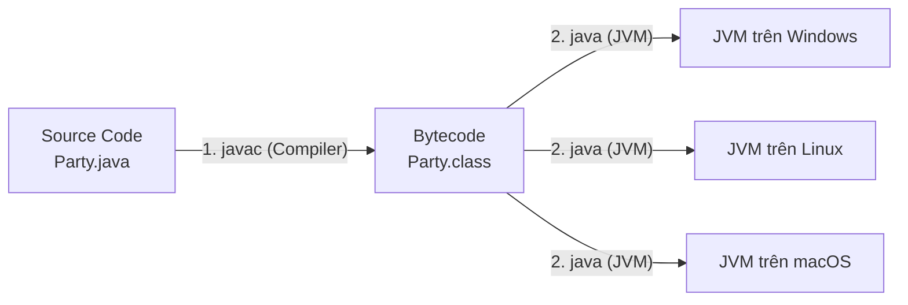
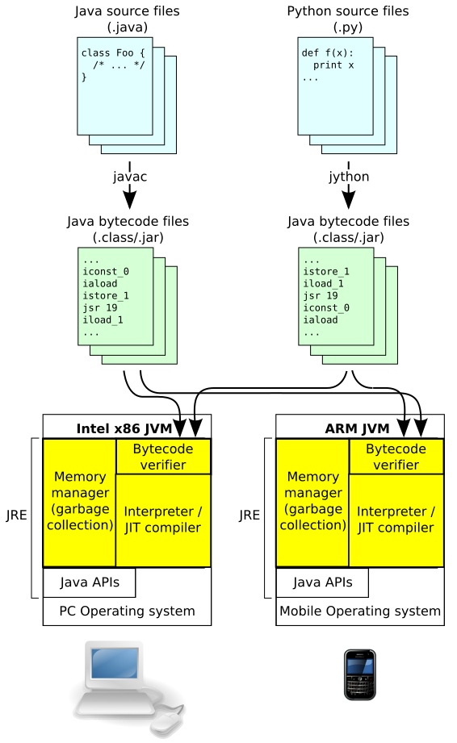

## Table of Contents
1. [Cách Java hoạt động: Write Once, Run Anywhere](#how-java-works)
2. [Phân biệt JDK, JRE và JVM](#jdk-jre-jvm)
3. [Giải phẫu một file source code Java](#anatomy-of-a-class)
4. [Giải mã hàm `public static void main(String[] args)`](#the-main-method)
5. [Điều khiển luồng & Điểm khác biệt của Boolean trong Java](#flow-control)
6. [Ví dụ kinh điển: Máy ghép từ PhraseOMatic](#phrase-o-matic)
7. [Tóm tắt & Ghi nhớ cốt lõi (Key Takeaways)](#key-takeaways)

---

## Cách Java hoạt động: Write Once, Run Anywhere {#how-java-works}

Trong C/C++, compiler dịch thẳng source code ra mã máy (Machine Code) gắn chặt với hệ điều hành và kiến trúc CPU đích (file `.exe` trên Windows không thể đem sang macOS hay Linux chạy trực tiếp).

Java giải quyết bài toán này bằng triết lý **WORA (Write Once, Run Anywhere)**: thay vì dịch thẳng ra mã máy, Java thêm một bước trung gian gọi là **Bytecode** và giao việc thực thi chương trình cho **Máy ảo Java (JVM)**.



Quy trình 4 bước từ lúc viết code đến khi chạy:
1. **Source Document (`Party.java`)**: Viết source code Java thuần túy.
2. **Compiler (`javac Party.java`)**: Compiler kiểm tra cú pháp và kiểu dữ liệu cực kỳ khắt khe. Nếu không có lỗi, `javac` sinh ra file `Party.class`.
3. **Output (`Party.class` - Bytecode)**: Đây không phải mã máy của riêng dòng CPU nào, mà là mã lệnh trung gian đã được tối ưu hóa dành riêng cho JVM. Bytecode hoàn toàn **độc lập với nền tảng (Platform-independent)**.
4. **Virtual Machine (`java Party`)**: JVM trên máy đích đọc Bytecode và dịch sang mã máy thực tế (thông qua **Interpreter** kết hợp **JIT Compiler - Just-In-Time**) để CPU thực thi.

> [!IMPORTANT]
> **Bytecode độc lập nền tảng, nhưng JVM phụ thuộc nền tảng!** Một file `.class` có thể chạy ở bất kỳ đâu, miễn là hệ điều hành đích đã cài sẵn bản JVM tương thích.

---

## Phân biệt JDK, JRE và JVM {#jdk-jre-jvm}

Ba khái niệm nền tảng cần phân biệt rõ khi làm việc với hệ sinh thái Java:

| Thành phần | Tên đầy đủ | Vai trò thực tế | Công thức dễ nhớ |
| :--- | :--- | :--- | :--- |
| **JVM** | Java Virtual Machine | Nơi trực tiếp nạp `.class`, quản lý bộ nhớ (Stack/Heap), dọn rác (GC) và thực thi Bytecode. | Trái tim chạy code |
| **JRE** | Java Runtime Environment | Môi trường để **chạy** ứng dụng Java (gồm JVM + các thư viện chuẩn `java.lang`, `java.util`...). | `JRE = JVM + Core Libraries` |
| **JDK** | Java Development Kit | Bộ công cụ cho **developer** (gồm JRE + compiler `javac`, debugger, `jar`, `jconsole`...). | `JDK = JRE + Dev Tools` |


*Hình 1.1: Kiến trúc bên trong của JVM gồm Class Loader Subsystem, Runtime Data Areas (Heap, Stack, Method Area) và Execution Engine (Interpreter + JIT Compiler + Garbage Collector)*

---

## Giải phẫu một file source code Java {#anatomy-of-a-class}

Trong Java, **mọi thứ bắt buộc phải nằm trong một Class**. Không thể khai báo một hàm "trôi nổi" tự do bên ngoài như trong Python hay JavaScript.

Cấu trúc lồng nhau từ ngoài vào trong luôn tuân theo thứ tự:
- **Source File (`.java`)** chứa **Class** (đại diện cho một mảnh ghép của chương trình).
- **Class** chứa các **Methods** (định nghĩa hành vi).
- **Method** chứa các **Statements** (từng câu lệnh thực thi cụ thể, kết thúc bằng dấu `;`).

```java
// Tên file bắt buộc phải là Dog.java (khớp 100% chữ hoa/thường với public class)
public class Dog {

    // Instance variables (trạng thái của object)
    int size;
    String name;

    // Method (hành vi của object)
    void bark() {
        System.out.println("Gâu! Gâu!"); // Statement
    }
}
```

---

## Giải mã hàm `public static void main(String[] args)` {#the-main-method}

Một chương trình Java có thể gồm hàng trăm class, nhưng để biết bắt đầu chạy từ đâu, JVM sẽ tìm đúng hàm `main()`. Mỗi từ khóa trong signature này đều có lý do tồn tại rõ ràng:

```java
public static void main(String[] args) {
    // Điểm khởi đầu của chương trình (Entry Point)
}
```

- **`public`**: Access modifier rộng nhất để JVM (vốn nằm ngoài class) có thể truy cập và gọi hàm này.
- **`static`**: Gắn method này vào bản thân **Class** chứ không gắn vào một **Object** cụ thể. Nhờ có `static`, JVM gọi thẳng `MyApp.main()` để khởi động chương trình mà **không cần `new MyApp()` trước**.
- **`void`**: Hàm `main` không trả về giá trị nào cho JVM sau khi chạy xong.
- **`main`**: Tên định danh cố định mà JVM tìm kiếm (nếu viết hoa thành `Main`, JVM sẽ không nhận diện đây là entry point).
- **`String[] args`**: Mảng chuỗi nhận các tham số truyền từ dòng lệnh khi khởi chạy (ví dụ: chạy `java MyApp prod 8080` thì `args[0]` là `"prod"`, `args[1]` là `"8080"`).

---

## Điều khiển luồng & Điểm khác biệt của Boolean trong Java {#flow-control}

Trong C/C++ hay JavaScript, có thể viết `if (1)` hoặc `while (x)` với `x` là số nguyên vì `0` được hiểu ngầm là `false`, khác `0` là `true`.

**Trong Java thì tuyệt đối KHÔNG!** Kiểu `int` và `boolean` hoàn toàn tách biệt:

```java
int x = 3;

// SAI - Lỗi compile ngay lập tức (Incompatible types: int cannot be converted to boolean)
// if (x) { ... }
// if (x = 3) { ... }

// ĐÚNG - Biểu thức trong if/while bắt buộc phải trả về boolean (true hoặc false)
if (x == 3) {
    System.out.println("x đúng bằng 3");
}
```

> [!TIP]
> Việc cấm ép kiểu ngầm từ `int` sang `boolean` giúp tránh được lỗi kinh điển: gõ nhầm phép so sánh `if (x == 3)` thành phép gán `if (x = 3)`. Trường hợp đặc biệt cần dè chừng là khi biến kiểm tra vốn có kiểu `boolean`: `boolean isTest = false; if (isTest = true)` sẽ **không báo lỗi compile** mà âm thầm gán `isTest` thành `true` rồi luôn chạy vào nhánh `if`!

### Ba cấu trúc điều khiển luồng cơ bản:
- **`while (condition)`**: Kiểm tra điều kiện trước, miễn còn `true` thì còn lặp. Dùng khi chưa biết trước số vòng lặp.
- **`for (int i = 0; i < 10; i++)`**: Gom khởi tạo, điều kiện dừng và bước nhảy vào 1 dòng. Dùng khi đã biết rõ số lần lặp.
- **`if / else`**: Rẽ nhánh thực thi dựa trên điều kiện logic.

---

## Ví dụ kinh điển: Máy ghép từ PhraseOMatic {#phrase-o-matic}

Ví dụ đầu tiên trong sách kết hợp mảng `String[]`, lấy độ dài mảng qua thuộc tính `.length`, và sinh số ngẫu nhiên bằng `java.util.Random`:

```java
import java.util.Random;

public class PhraseOMatic {
    public static void main(String[] args) {
        String[] wordListOne = {"Kiến trúc", "Hệ thống", "Giải pháp", "Nền tảng"};
        String[] wordListTwo = {"phân tán", "hướng sự kiện", "đa luồng", "bất đồng bộ"};
        String[] wordListThree = {"chịu tải cao", "thời gian thực", "chuẩn doanh nghiệp"};

        // Lấy số lượng phần tử trong mỗi mảng
        int oneLength = wordListOne.length;
        int twoLength = wordListTwo.length;
        int threeLength = wordListThree.length;

        // nextInt(n) trả về số nguyên ngẫu nhiên từ 0 đến (n - 1)
        Random randomGenerator = new Random();
        int rand1 = randomGenerator.nextInt(oneLength);
        int rand2 = randomGenerator.nextInt(twoLength);
        int rand3 = randomGenerator.nextInt(threeLength);

        String phrase = wordListOne[rand1] + " " + wordListTwo[rand2] + " " + wordListThree[rand3];
        System.out.println("Đề xuất kiến trúc mới: " + phrase + ".");
    }
}
```

---

## Tóm tắt & Ghi nhớ cốt lõi (Key Takeaways) {#key-takeaways}

1. **Tại sao nói Java vừa là ngôn ngữ biên dịch (Compiled), vừa là ngôn ngữ thông dịch (Interpreted)?**
   - **Compile-time**: Compiler `javac` dịch source code `.java` sang mã trung gian Bytecode `.class`.
   - **Runtime (Interpreter & JIT)**: Khi chạy, JVM thông dịch Bytecode ra mã máy, đồng thời dùng **JIT (Just-In-Time) Compiler** phát hiện các đoạn code chạy lặp đi lặp lại nhiều lần (hot spots) để compile thẳng sang native machine code và lưu cache giúp tối ưu hiệu năng.
2. **Tại sao hàm `main` bắt buộc phải là `static`?**
   - Để JVM gọi hàm khởi chạy chương trình trực tiếp thông qua tên Class mà không cần khởi tạo instance (nếu phải khởi tạo instance, JVM không thể biết cần truyền tham số gì vào Constructor).
3. **Nếu xóa từ khóa `static` hoặc đổi tên `main` thì lỗi xảy ra ở Compile-time hay Runtime?**
   - **Compile-time vẫn thành công 100%**! Vì đối với `javac`, đó chỉ là một method bình thường trùng tên `main`. Lỗi chỉ xảy ra ở **Runtime** khi chạy lệnh `java MyApp` và JVM báo không tìm thấy entry point hợp lệ.
4. **Một file `.java` có thể chứa nhiều class không?**
   - **Có**, nhưng chỉ được phép có **tối đa 1 `public class`**, và tên file `.java` bắt buộc phải trùng khớp hoàn toàn với tên của `public class` đó.

### Tài liệu & Nguồn tham khảo
- [Oracle Java SE Documentation — The Java Virtual Machine Specification (Java SE 17 Edition)](https://docs.oracle.com/javase/specs/jvms/se17/html/index.html)
- [Dev.java — Getting Started with Java & JVM Architecture](https://dev.java/learn/getting-started/)
- [Kathy Sierra, Bert Bates, Trisha Gee — *Head First Java, 3rd Edition* (O'Reilly)](https://www.oreilly.com/library/view/head-first-java/9781492091646/)
