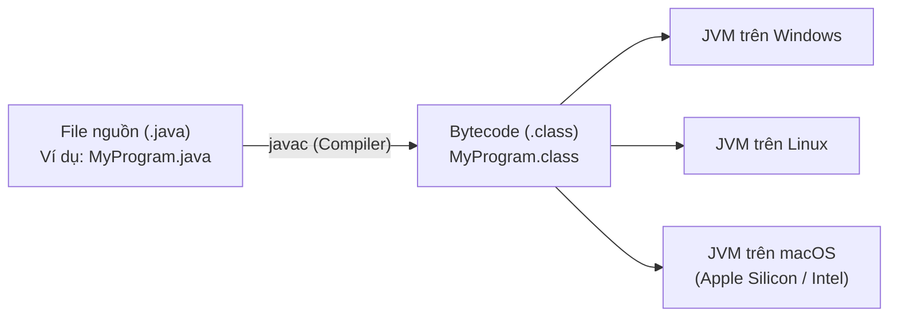

## Table of Contents
1. [Cách thức hoạt động của Java: Write Once, Run Anywhere](#how-java-works)
2. [Giải phẫu một tập tin mã nguồn Java](#anatomy-of-a-class)
3. [Giải mã hàm: `public static void main(String[] args)`](#the-main-method)
4. [Điều khiển luồng: Biến, Vòng lặp và Rẽ nhánh](#flow-control)
5. [Ví dụ thực tế kinh điển: Máy tạo cụm từ PhraseOMatic](#phrase-o-matic)
6. [Những cái bẫy người mới bắt đầu thường gặp](#common-pitfalls)
7. [Tóm tắt ghi nhớ cốt lõi (Key Takeaways)](#key-takeaways)

---

## Cách thức hoạt động của Java: Write Once, Run Anywhere {#how-java-works}

Khẩu hiệu nổi tiếng nhất của Java là **WORA** (*Write Once, Run Anywhere* - Viết một lần, chạy mọi nơi). Để đạt được điều này, Java không biên dịch mã nguồn thẳng ra mã máy (Machine Code nhị phân của từng loại CPU cụ thể như x86 hay ARM), mà sử dụng kiến trúc hai bước qua máy ảo:



### Các giai đoạn:
1. **Viết mã nguồn**: Bạn tạo một file văn bản chứa code Java có đuôi mở rộng là `.java` (ví dụ `MyFirstApp.java`).
2. **Biên dịch (Compile)**: Sử dụng trình biên dịch `javac`:
   ```bash
   javac MyFirstApp.java
   ```
   Nếu code không có lỗi cú pháp, `javac` sẽ tạo ra một file `MyFirstApp.class` chứa **Bytecode** — tập lệnh trung gian độc lập với phần cứng.
3. **Thực thi trên Máy ảo (Run via JVM)**: Gọi lệnh `java`:
   ```bash
   java MyFirstApp
   ```
   **JVM (Java Virtual Machine)** đọc các chỉ lệnh Bytecode và dịch chúng sang mã máy gốc (Machine Language) của hệ điều hành mà nó đang chạy theo thời gian thực (JIT - Just-In-Time Compilation).

---

## Giải phẫu một tập tin mã nguồn Java {#anatomy-of-a-class}

Trong thế giới Java, **mọi thứ đều phải nằm bên trong một Class** (Lớp). Cấu trúc phân cấp từ ngoài vào trong như sau:

```
Source File (.java)
└── Class declaration
    └── Methods
        └── Statements
```

```java
// Tên file PHẢI trùng với tên class công khai (MyFirstApp.java)
public class MyFirstApp {

    // Phương thức (Method) chứa các hành vi thực thi
    public static void main(String[] args) {

        // Các câu lệnh (Statements) kết thúc bằng dấu chấm phẩy (;)
        System.out.println("Hello, World from Head First Java!");
        System.out.println("Java runs everywhere!");
    }
}
```

---

## Giải mã hàm: `public static void main(String[] args)` {#the-main-method}

Khi bạn gõ lệnh `java MyFirstApp`, JVM sẽ bắt đầu tìm kiếm phương thức này để làm **điểm khởi đầu (Entry Point)** của chương trình:

- `public`: Cho phép bất kỳ ai (kể cả JVM bên ngoài) có thể gọi phương thức này.
- `static`: Phương thức thuộc về Class, cho phép JVM gọi hàm này ngay lập tức mà **không cần tạo instance/object** của class trước.
- `void`: Phương thức không trả về giá trị nào sau khi hoàn tất.
- `main`: Tên hàm chuẩn được JVM quy ước.
- `String[] args`: Mảng các chuỗi tham số truyền từ dòng lệnh (Command Line Arguments).

---

## Điều khiển luồng: Biến, Vòng lặp và Rẽ nhánh {#flow-control}

### 1. Khai báo biến cơ bản
Java là ngôn ngữ **Strongly Typed** (định kiểu tĩnh và nghiêm ngặt), bạn phải khai báo kiểu dữ liệu cho biến trước khi sử dụng:

```java
int x = 3;
String name = "Dirk";
x = x * 17;
double d = Math.random();
```

### 2. Vòng lặp `while`
```java
int x = 1;
while (x < 4) {
    System.out.println("Giá trị x: " + x);
    x = x + 1;
}
```

### 3. Cấu trúc rẽ nhánh `if / else`
Trong Java, điều kiện trong `if` **bắt buộc phải là một biểu thức logic boolean** (trả về `true` hoặc `false`):

```java
int x = 3;
if (x == 3) {
    System.out.println("x đúng bằng 3!");
} else {
    System.out.println("x khác 3!");
}
```

---

## Ví dụ thực tế kinh điển: Máy tạo cụm từ PhraseOMatic {#phrase-o-matic}

```java
public class PhraseOMatic {
    public static void main(String[] args) {
        String[] wordListOne = {
            "kiến trúc", "mô hình", "nền tảng", "hệ sinh thái", "công nghệ",
            "microservices", "serverless", "cloud-native", "phân tán"
        };

        String[] wordListTwo = {
            "linh hoạt", "tối ưu", "mở rộng cao", "hướng sự kiện",
            "đa tầng", "bền vững", "tăng tốc", "thời gian thực"
        };

        String[] wordListThree = {
            "cho doanh nghiệp", "AI-driven", "thế hệ mới", "tự động hóa",
            "bảo mật zero-trust", "hiệu năng cao", "đột phá"
        };

        int oneLength = wordListOne.length;
        int twoLength = wordListTwo.length;
        int threeLength = wordListThree.length;

        java.util.Random randomGenerator = new java.util.Random();
        int rand1 = randomGenerator.nextInt(oneLength);
        int rand2 = randomGenerator.nextInt(twoLength);
        int rand3 = randomGenerator.nextInt(threeLength);

        String phrase = wordListOne[rand1] + " " + wordListTwo[rand2] + " " + wordListThree[rand3];
        System.out.println("Những gì chúng ta cần xây dựng là: " + phrase);
    }
}
```

---

## Những cái bẫy người mới bắt đầu thường gặp {#common-pitfalls}

1. Nhầm lẫn giữa phép so sánh (`==`) và phép gán (`=`).
2. Tên file không khớp chính xác với tên public class (`MyClass.java` vs `myclass.java`).
3. Quên dấu chấm phẩy `;` kết thúc câu lệnh.

---

## Tóm tắt ghi nhớ cốt lõi (Key Takeaways) {#key-takeaways}

- **Source Code (`.java`) -> Compiler (`javac`) -> Bytecode (`.class`) -> Virtual Machine (`java/JVM`)**.
- JVM trừu tượng hóa phần cứng, mang lại khả năng chạy đa nền tảng.
- Entry point của ứng dụng luôn là `public static void main(String[] args)`.
