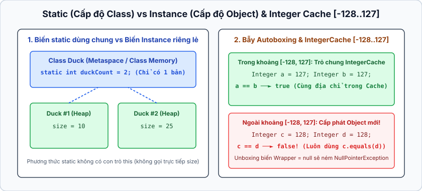
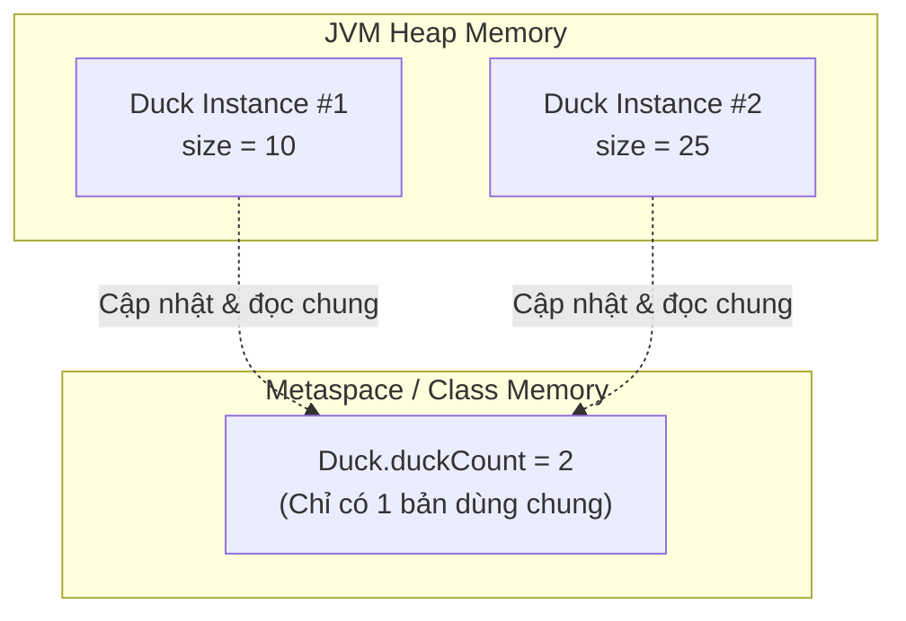

## Table of Contents
1. [Phương thức `static` vs Phương thức Non-Static](#static-vs-non-static)
2. [Biến `static`, Hằng số `static final` và 3 ý nghĩa của `final`](#static-variables-and-final)
3. [Wrapper Classes cùng cơ chế Autoboxing / Unboxing](#wrapper-classes)
4. [Hai cái bẫy kinh điển với Wrapper Classes](#wrapper-traps)
5. [Định dạng số (Formatting) và Chuyển đổi kiểu (Parsing)](#number-formatting-parsing)
6. [Tóm tắt & Ghi nhớ cốt lõi (Key Takeaways)](#key-takeaways)

---

## Phương thức `static` vs Phương thức Non-Static {#static-vs-non-static}

Tại sao khi tính toán với class `Math`, chỉ cần viết `Math.min(42, 36)` hoặc `Math.abs(-243)` mà không bao giờ phải khởi tạo `new Math()`? Thậm chí nếu cố tình viết `Math myMath = new Math();`, compiler sẽ báo lỗi ngay lập tức: `Math() has private access in java.lang.Math`!

Nguyên nhân là các method trong `Math` không cần bất kỳ trạng thái riêng lẻ (instance variables) nào của object để hoạt động. Chúng được đánh dấu là **`static`** — nghĩa là gắn liền với **bản thiết kế Class**, chứ không phụ thuộc vào bất kỳ **Instance (Object)** cụ thể nào. Ngoài ra, việc đặt constructor thành `private Math() {}` là mẫu thiết kế chuẩn để ngăn chặn việc dùng từ khóa `new` với các lớp tiện ích (Utility Classes).

| Tiêu chí | Phương thức Non-Static (Instance Method) | Phương thức `static` (Class Method) |
| :--- | :--- | :--- |
| **Cách gọi chuẩn** | Gọi thông qua **biến reference của object**: `mySong.play()` | Gọi trực tiếp thông qua **Tên Class**: `Math.min(42, 36)` |
| **Dữ liệu sử dụng** | Hành xử khác nhau dựa trên các biến instance (`this.title`) của từng object cụ thể. | Chỉ chạy dựa trên tham số truyền vào hoặc các biến `static` dùng chung của cả class. |
| **Truy cập chéo** | Có thể gọi trực tiếp cả biến/method non-static lẫn biến/method `static`. | **KHÔNG THỂ** truy cập trực tiếp biến hoặc method non-static! |

### Tại sao method `static` không thể gọi biến Non-Static?

Hãy xem đoạn code gây lỗi compile kinh điển sau:

```java
public class Duck {
    private int size; // Biến non-static (mỗi instance Duck có size riêng)

    public static void main(String[] args) {
        // LỖI COMPILE: non-static variable size cannot be referenced from a static context
        // System.out.println("Size is " + size);

        // LỖI COMPILE: non-static method getSize() cannot be referenced from a static context
        // System.out.println("Size is " + getSize());
    }

    public int getSize() {
        return size;
    }
}
```

> [!IMPORTANT]
> **Bản chất kỹ thuật:** Khi một method `static` thực thi, có thể **chưa có bất kỳ instance `Duck` nào được tạo ra trên Heap**, hoặc đã có tới hàng nghìn instance `Duck` trên Heap. Vì method `static` không gắn với object cụ thể nào nên bên trong nó **không tồn tại con trỏ ngầm `this`**. Do đó, JVM không thể xác định biến `size` thuộc về instance nào!

---

## Biến `static`, Hằng số `static final` và 3 ý nghĩa của `final` {#static-variables-and-final}





### 1. Biến `static` (Static Variables): Dùng chung một vùng nhớ cho cả Class

Nếu biến instance được cấp phát **mỗi object một bản riêng**, thì biến `static` **chỉ có đúng 1 bản cho toàn bộ Class**, được chia sẻ chung bởi tất cả các instances thuộc class đó.

```java
public class Duck {
    private int size;                    // Mỗi đối tượng Duck có 1 biến size riêng biệt
    private static int duckCount = 0;    // Cả class Duck dùng chung 1 biến duckCount

    public Duck() {
        duckCount++; // Mỗi lần new Duck() được gọi, bộ đếm chung tăng lên 1
    }
}
```

Các biến `static` được khởi tạo ngay khi **Class được nạp (loaded) vào JVM lần đầu tiên**, trước cả khi bất kỳ constructor hay method `static` nào của class đó thực thi.

### 2. Hằng số `public static final` (Constants)

Khi kết hợp `static` (dùng chung cho cả class) và `final` (không bao giờ thay đổi giá trị sau khi gán), ta tạo ra **hằng số trong Java**. Theo quy ước đặt tên, hằng số luôn viết **IN_HOA_NGĂN_CÁCH_BẰNG_GẠCH_DƯỚI**.

Có **2 cách hợp lệ** để khởi tạo một biến `static final`:

```java
public class ConstantDemo {
    // Cách 1: Gán giá trị trực tiếp ngay lúc khai báo
    public static final double PI = 3.141592653589793;

    // Cách 2: Gán giá trị bên trong khối khởi tạo tĩnh (static initializer block)
    // Khối này chạy tự động ngay khi Class vừa được JVM nạp vào bộ nhớ
    public static final double RANDOM_SEED;
    static {
        RANDOM_SEED = Math.random();
    }
}
```

Nếu quên khởi tạo biến `static final` ở cả hai vị trí trên, compiler sẽ lập tức báo lỗi!

### 3. Bảng tổng hợp 3 ý nghĩa của từ khóa `final`

Từ khóa `final` xuất hiện ở vị trí nào sẽ mang ý nghĩa "khóa chặt" ở vị trí đó:

| Vị trí đặt `final` | Ý nghĩa cốt lõi | Ví dụ minh họa |
| :--- | :--- | :--- |
| **Biến (`final variable`)** | **Không thể gán lại giá trị khác** sau khi đã khởi tạo. (Lưu ý: với biến reference trỏ tới object, không thể đổi biến sang trỏ object khác, nhưng trạng thái dữ liệu bên trong object đó vẫn có thể thay đổi!). | `final int size = 42;` |
| **Phương thức (`final method`)** | **Cấm subclass ghi đè (`override`)** method này để bảo vệ logic cốt lõi. | `public final void validate() {}` |
| **Lớp (`final class`)** | **Cấm kế thừa (`extends`)** class này hoàn toàn (ví dụ điển hình là class `java.lang.String`). | `public final class String {}` |

---

## Wrapper Classes cùng cơ chế Autoboxing / Unboxing {#wrapper-classes}

Trong Java, các cấu trúc dữ liệu Generics như `ArrayList<T>` hay `HashMap<K, V>` **chỉ chấp nhận kiểu tham chiếu đối tượng (Object references)**, không nhận trực tiếp kiểu nguyên thủy (`int`, `double`, `boolean`). Để giải quyết vấn đề này, mỗi kiểu nguyên thủy đều có một **Wrapper Class** tương ứng nằm trong gói `java.lang`:

- `boolean` -> `Boolean`
- `char` -> `Character` *(chú ý viết đầy đủ)*
- `byte` -> `Byte`
- `short` -> `Short`
- `int` -> `Integer` *(chú ý viết đầy đủ)*
- `long` -> `Long`
- `float` -> `Float`
- `double` -> `Double`

Từ Java 5 trở đi, tính năng **Autoboxing** (tự động đóng gói primitive thành Wrapper object) và **Unboxing** (tự động mở hộp Wrapper object ra primitive) giúp thao tác với Collections gọn gàng:

```java
import java.util.ArrayList;

public class AutoboxingDemo {
    public static void main(String[] args) {
        ArrayList<Integer> nums = new ArrayList<>();

        // Autoboxing: compiler tự chuyển int 42 thành Integer.valueOf(42)
        nums.add(42);

        // Unboxing: compiler tự chuyển Integer thành nums.get(0).intValue()
        int firstNum = nums.get(0);

        // Dùng trực tiếp trong phép toán và gán lại
        Integer count = 10;
        count++; // Mở hộp ra 10 -> cộng 1 thành 11 -> đóng hộp lại vào đối tượng Integer mới!
    }
}
```

---

## Hai cái bẫy kinh điển với Wrapper Classes {#wrapper-traps}

Autoboxing rất tiện lợi nhưng ẩn chứa **2 cái bẫy nghiêm trọng** cần đặc biệt lưu ý trong thực tế:

### Bẫy 1: Bộ nhớ đệm `Integer` Cache (`-128` đến `127`) và toán tử `==`

Hãy quan sát kết quả của hai phép so sánh dưới đây:

```java
public class IntegerCacheTrap {
    public static void main(String[] args) {
        Integer a = 100;
        Integer b = 100;
        System.out.println(a == b);      // Kết quả: true

        Integer x = 200;
        Integer y = 200;
        System.out.println(x == y);      // Kết quả: false

        System.out.println(x.equals(y)); // Kết quả: true (Luôn an toàn!)
    }
}
```

> [!WARNING]
> **Giải mã cơ chế `Integer` Cache:**
> - Toán tử `==` khi dùng với hai biến `Integer` sẽ so sánh **địa chỉ tham chiếu của hai Object**, chứ không so giá trị số bên trong!
> - Tuy nhiên, để tối ưu bộ nhớ, method `Integer.valueOf(int)` (được Autoboxing gọi ngầm) **cache sẵn các đối tượng `Integer` có giá trị từ `-128` đến `127`**.
> - Do `100` nằm trong khoảng `[-128, 127]`, cả `a` và `b` đều trỏ chung vào **cùng 1 object trong cache**, nên `a == b` trả về `true`.
> - Còn `200` nằm ngoài khoảng cache, nên JVM tạo ra **hai object `Integer` riêng biệt trên Heap** cho `x` và `y`, khiến `x == y` trả về `false`.
> - **Nguyên tắc bắt buộc:** Luôn dùng `.equals()` khi so sánh giá trị của hai đối tượng Wrapper!

### Bẫy 2: Lỗi `NullPointerException` bất ngờ khi Unboxing giá trị `null`

Một biến nguyên thủy `int` không bao giờ nhận giá trị `null`, nhưng biến tham chiếu `Integer` hoàn toàn có thể mang giá trị `null`. Chuyện gì xảy ra khi Java thực hiện unboxing trên một tham chiếu `null`?

```java
public class NullUnboxingTrap {
    public static void main(String[] args) {
        Integer totalScore = null; // Hợp lệ vì Integer là kiểu tham chiếu Object

        // Ném ra NullPointerException ngay tại dòng này lúc Runtime!
        // Vì compiler dịch ngầm thành: int score = totalScore.intValue();
        int score = totalScore;
    }
}
```

Lỗi này thường phát sinh khi ánh xạ dữ liệu từ Database (cột số cho phép `NULL`) hoặc JSON payload vào trường `Integer` trong DTO rồi gán thẳng sang biến `int` để tính toán mà chưa kiểm tra `null`.

---

## Định dạng số (Formatting) và Chuyển đổi kiểu (Parsing) {#number-formatting-parsing}

### 1. Chuyển đổi qua lại giữa `String` và Số (Parsing)

Mỗi Wrapper Class đều cung cấp một method `static` dạng `parseXxx(String)` để chuyển chuỗi văn bản thành số nguyên thủy:

```java
// Chuyển String thành số nguyên thủy
int quantity = Integer.parseInt("42");
double price = Double.parseDouble("420.24");
boolean isActive = Boolean.parseBoolean("true");

// Lưu ý: Nếu chuỗi không phải số hợp lệ, method sẽ ném ra NumberFormatException:
// int bad = Integer.parseInt("two"); // Ném NumberFormatException!

// Chuyển ngược từ số sang String:
String s1 = Integer.toString(42);
String s2 = String.valueOf(42);
String s3 = "" + 42; // Ngắn gọn nhưng kém tối ưu hơn hai cách trên
```

### 2. Định dạng số với `String.format()`

Để hiển thị số tiền, phần trăm hoặc số lớn có dấu phân cách hàng nghìn dễ đọc, sử dụng `String.format(formatSpecifier, value)`:

```java
public class NumberFormattingDemo {
    public static void main(String[] args) {
        // %,d : Số nguyên thập phân (decimal integer) có dấu phân tách hàng nghìn
        String billion = String.format("%,d", 1_000_000_000);
        System.out.println(billion); // Output: 1,000,000,000

        // %,.2f : Số thực dấu phẩy động (floating point), làm tròn 2 chữ số thập phân
        String balance = String.format("Số dư tài khoản: $%,.2f", 1234567.895);
        System.out.println(balance); // Output: Số dư tài khoản: $1,234,567.90
    }
}
```

Các ký hiệu định dạng (`%`) thường gặp:
- **`%d`** (Decimal integer): Dùng cho các kiểu số nguyên (`int`, `long`, `byte`, `short`).
- **`%f`** (Floating point): Dùng cho số thực (`float`, `double`). Thường đi kèm `.2f` để lấy 2 chữ số thập phân.
- **`%x`** (Hexadecimal): Hiển thị số ở hệ thập lục phân (Hex).
- **`%c`** (Character): Hiển thị ký tự tương ứng với mã số.

---

## Tóm tắt & Ghi nhớ cốt lõi (Key Takeaways) {#key-takeaways}

- **Ý nghĩa của từ khóa `final` ở 3 cấp độ (biến, method, class):**
  1. Biến `final`: Không thể gán lại giá trị (với primitive) hoặc không thể đổi sang trỏ object khác (với reference).
  2. Phương thức `final`: Không thể bị ghi đè (`override`) ở lớp con.
  3. Lớp `final`: Không thể được kế thừa (`extends`).
- **Tại sao `Integer a = 127, b = 127; (a == b)` là `true`, nhưng `Integer x = 128, y = 128; (x == y)` lại là `false`?**
  - Do Autoboxing gọi `Integer.valueOf()`, mà JVM cache sẵn các instance `Integer` trong dải từ **`-128` đến `127`**. Với `128`, hai object `Integer` mới được cấp phát riêng biệt trên Heap nên phép so sánh địa chỉ `==` trả về `false`.
- **Tại sao không thể dùng từ khóa `this` hoặc gọi biến instance bên trong một method `static`?**
  - Vì method `static` thuộc về Class chứ không gắn với bất kỳ instance cụ thể nào. Khi method `static` chạy, không có tham chiếu đối tượng hiện hành (`this`) được truyền ngầm vào hàm.
- **Cách chặn việc khởi tạo object từ một Utility Class (như class `Math`):**
  - Khai báo một constructor không tham số với phạm vi truy cập `private` (ví dụ: `private MyUtils() {}`).

### Tài liệu & Nguồn tham khảo
- [Dev.java — Understanding Class Members (`static` Fields & Methods)](https://dev.java/learn/classes-objects/more-on-classes/)
- [Java SE 17 API Javadoc — `java.lang.Integer#valueOf(int)` (`IntegerCache` `-128..127`)](https://docs.oracle.com/en/java/javase/17/docs/api/java.base/java/lang/Integer.html#valueOf(int))
