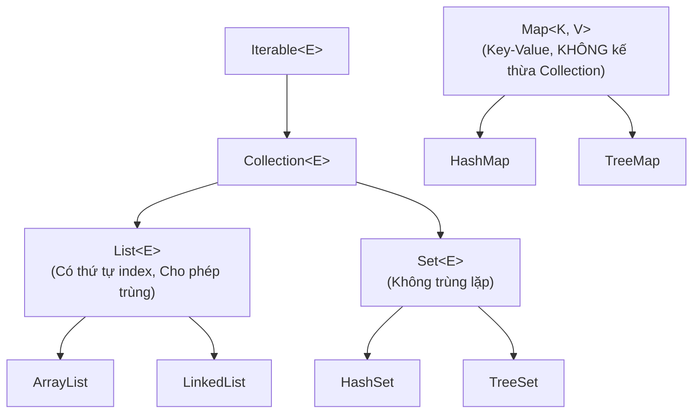
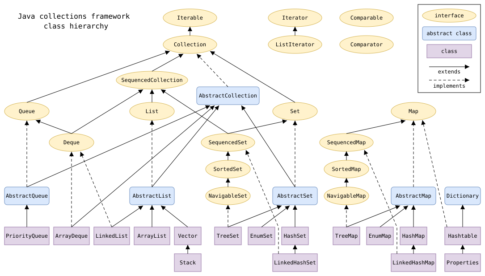
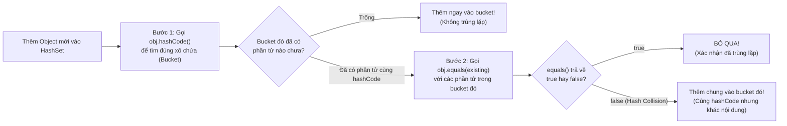

## Table of Contents
1. [Bức tranh tổng quan Java Collections Framework](#collections-overview)
2. [Tham số kiểu Generics `<T>` và An toàn kiểu lúc Compile](#generics-intro)
3. [Sắp xếp đối tượng: `Comparable` vs `Comparator`](#sorting-objects)
4. [Sự bằng nhau của Object: Quy ước sống còn giữa `equals()` và `hashCode()`](#equals-hashcode)
5. [Bẫy Đa hình trong Generics: Mảng vs `List<? extends Animal>`](#generics-polymorphism-trap)
6. [Tóm tắt & Ghi nhớ cốt lõi (Key Takeaways)](#key-takeaways)

---

## Bức tranh tổng quan Java Collections Framework {#collections-overview}

`ArrayList` rất tiện dụng nhưng không phải là công cụ phù hợp cho mọi bài toán dữ liệu. Khi cần loại bỏ phần tử trùng lặp với tốc độ `O(1)`, giữ danh sách luôn tự động sắp xếp, hoặc tra cứu theo khóa (Key) trong thời gian hằng số, cần sử dụng đúng cấu trúc trong **Java Collections Framework**.

Ba nhánh interface trụ cột cần nắm vững:
1. **`List` (Khi thứ tự vị trí là quan trọng)**: Các phần tử được lưu theo chỉ mục (index `0, 1, 2...`), giữ nguyên thứ tự chèn vào và **cho phép phần tử trùng lặp**.
2. **`Set` (Khi tính không trùng lặp là quan trọng)**: **Không cho phép các phần tử trùng lặp** (mỗi giá trị chỉ xuất hiện 1 lần).
3. **`Map` (Khi việc tra cứu bằng Khóa là quan trọng)**: Lưu trữ theo cặp **Khóa - Giá trị (`Key -> Value`)**. Các giá trị (`Value`) có thể trùng nhau, nhưng khóa (`Key`) không được trùng lặp.

> [!IMPORTANT]
> **Điểm kiến trúc cần lưu ý:** Interface `Map` **KHÔNG kế thừa** từ interface `Collection`! Dù `Map` vẫn thuộc hệ sinh thái Collections Framework, nhưng `List` và `Set` mở rộng từ `java.util.Collection` (chứa các phần tử đơn lẻ), còn `Map` là một nhánh độc lập vì làm việc với cặp `Key-Value`.




*Hình 11.1: Sơ đồ tổng thể các Interface (`Iterable`, `Collection`, `List`, `Set`, `Queue`, `Map`) và các Class cài đặt cụ thể trong Java Collections Framework*

### Bảng so sánh 5 cấu trúc dữ liệu thông dụng

| Cấu trúc dữ liệu | Interface gốc | Cho phép trùng lặp? | Thứ tự lưu trữ | Khi nào nên sử dụng? |
| :--- | :--- | :--- | :--- | :--- |
| **`ArrayList`** | `List` | Có | Theo thứ tự chèn (Index) | Truy xuất ngẫu nhiên theo index (`get(i)`) đạt tốc độ `O(1)`. Mặc định cho hầu hết danh sách. |
| **`LinkedList`** | `List`, `Deque` | Có | Theo thứ tự chèn | Khi cần thêm/xóa phần tử liên tục ở **đầu hoặc cuối** danh sách (Hàng đợi Queue/Deque). |
| **`HashSet`** | `Set` | **Không** | Không đảm bảo thứ tự | Kiểm tra sự tồn tại của phần tử (`contains`) và lọc trùng với tốc độ trung bình `O(1)` nhờ hash code. |
| **`TreeSet`** | `NavigableSet` (`Set`) | **Không** | **Tự động sắp xếp** (Sorted) | Khi cần một tập hợp không trùng lặp và **luôn được sắp xếp tự động** theo thứ tự tăng dần. |
| **`HashMap`** | `Map` | Key: **Không**<br/>Value: Có | Không đảm bảo thứ tự | Lưu trữ và tra cứu tốc độ `O(1)` theo cặp `Key -> Value` (ví dụ: tìm `User` theo `userId`). |

---

## Tham số kiểu Generics `<T>` và An toàn kiểu lúc Compile {#generics-intro}

Mục tiêu cốt lõi của **Generics** là **Type Safety (An toàn kiểu dữ liệu ngay tại thời điểm compile)**. Trước khi có Generics, một `ArrayList` chỉ lưu kiểu `Object`, dẫn đến nguy cơ đưa nhầm kiểu dữ liệu khác vào danh sách và chỉ phát sinh lỗi `ClassCastException` lúc Runtime.

Với Generics `List<Song>`, compiler kiểm soát kiểu ngay lúc biên dịch và chặn mọi kiểu dữ liệu không hợp lệ lọt vào danh sách.

### Cách đọc hiểu cú pháp Generics nâng cao

Trong thư viện chuẩn Java, ký hiệu `<E>` đại diện cho Element và `<T>` đại diện cho Type. Dưới đây là hai cách khai báo một method Generic có ràng buộc kiểu (**Bounded Type Parameter**):

```java
// Cách 1: Khai báo kiểu <T extends Animal> ngay trước kiểu trả về 'void'
public <T extends Animal> void takeThing(ArrayList<T> list) {
    for (Animal a : list) {
        a.eat();
    }
}

// Cách 2: Dùng ký tự đại diện Wildcard (?) mang ý nghĩa tương đương
public void takeThingWildcard(ArrayList<? extends Animal> list) {
    for (Animal a : list) {
        a.eat();
    }
}
```

**Lưu ý về từ khóa `extends` trong Generics:** Trong ngữ cảnh khai báo `<T extends Pet>`, từ khóa **`extends` mang nghĩa là "là kiểu con của"** — dùng chung cho **cả trường hợp kế thừa Class lẫn triển khai Interface (`implements`)**! Không bao giờ viết `<T implements Pet>` trong ngoặc nhọn Generics.

---

## Sắp xếp đối tượng: `Comparable` vs `Comparator` {#sorting-objects}

Khi gọi `Collections.sort(stringList)` trên một `List<String>`, hàm chạy trơn tru vì class `String` đã cài đặt sẵn quy tắc so sánh bảng chữ cái. Nhưng nếu tự tạo class `Song` và gọi `Collections.sort(songList)`, compiler sẽ báo lỗi ngay vì chưa biết tiêu chí so sánh hai object `Song` (theo tên bài, tên ca sĩ, hay nhịp độ BPM).

Java cung cấp **2 cơ chế** để giải quyết bài toán sắp xếp:

| Tiêu chí | `java.lang.Comparable<T>` | `java.util.Comparator<T>` |
| :--- | :--- | :--- |
| **Triết lý thiết kế** | Định nghĩa **thứ tự tự nhiên mặc định (Natural Ordering)** ngay **bên trong** bản thân class cần sắp xếp. | Định nghĩa **nhiều tiêu chí sắp xếp tùy chỉnh (Custom Ordering)** tách biệt **bên ngoài** class. |
| **Method cần cài đặt** | `int compareTo(T other)` | `int compare(T o1, T o2)` |
| **Có cần sửa code của Class gốc không?** | **Có.** Class phải trực tiếp `implements Comparable<T>`. | **Không.** Có thể truyền dưới dạng biểu thức Lambda từ bên ngoài vào. |
| **Số cách sắp xếp hỗ trợ** | Chỉ hỗ trợ **đúng 1 cách mặc định** (ví dụ: mặc định xếp theo `title`). | **Nhiều cách linh hoạt** (xếp theo `title`, theo `artist`, theo `bpm` giảm dần...). |

### Quy tắc giá trị trả về của `compareTo` / `compare`
- Trả về **số âm (`< 0`)**: Object hiện tại (hoặc `o1`) **nhỏ hơn** (đứng trước) object kia.
- Trả về **số `0`**: Hai object **ngang hàng nhau** về thứ tự sắp xếp.
- Trả về **số dương (`> 0`)**: Object hiện tại (hoặc `o1`) **lớn hơn** (đứng sau) object kia.

### Code minh họa thực tế với `Song`

```java
import java.util.*;

// 1. Cài đặt Comparable<Song> để định nghĩa thứ tự mặc định theo Title (A -> Z)
public class Song implements Comparable<Song> {
    private String title;
    private String artist;
    private int bpm;

    public Song(String title, String artist, int bpm) {
        this.title = title;
        this.artist = artist;
        this.bpm = bpm;
    }

    public String getTitle() { return title; }
    public String getArtist() { return artist; }
    public int getBpm() { return bpm; }

    @Override
    public int compareTo(Song other) {
        // Tận dụng luôn hàm compareTo() có sẵn của class String!
        return this.title.compareTo(other.getTitle());
    }
}
```

Khi cần sắp xếp theo nhiều tiêu chí khác nhau bằng `Comparator` (kết hợp Lambda):

```java
// Cách 1: Sắp xếp theo thứ tự tự nhiên (Comparable -> theo Title)
Collections.sort(songList);

// Cách 2: Truyền Comparator bằng Lambda để sắp xếp theo Artist
songList.sort((s1, s2) -> s1.getArtist().compareTo(s2.getArtist()));

// Cách 3: Dùng hàm tiện ích Comparator.comparingInt để xếp theo BPM tăng dần
songList.sort(Comparator.comparingInt(Song::getBpm));
```

---

## Sự bằng nhau của Object: Quy ước sống còn giữa `equals()` và `hashCode()` {#equals-hashcode}

Khi đưa danh sách các đối tượng `Song` vào một `HashSet<Song>` để lọc bỏ các bài hát trùng lặp, nếu chưa cấu hình đúng, **các bài hát có cùng tên vẫn xuất hiện trùng lặp trong `HashSet`**! Nguyên nhân nằm ở sự khác biệt giữa **Reference Equality** và **Object Value Equality**:

- **Reference Equality (`song1 == song2`)**: Hai biến reference cùng trỏ vào **cùng 1 object** trên Heap. Đây cũng chính là hành vi mặc định của method `Object.equals()` nếu không được ghi đè!
- **Object Equality (`song1.equals(song2)`)**: Hai object **nằm ở hai vùng nhớ khác nhau** trên Heap, nhưng có nội dung dữ liệu bên trong tương đương nhau (cùng `title`, cùng `artist`).

### Cách `HashSet` và `HashMap` kiểm tra trùng lặp qua 2 bước

Khi thêm một object vào `HashSet` (hoặc làm Key trong `HashMap`), cấu trúc này không so sánh `.equals()` tuần tự từng phần tử từ đầu đến cuối (vì làm vậy sẽ tốn độ phức tạp `O(n)` như `ArrayList`). Thay vào đó, `HashSet` / `HashMap` thực hiện quy trình **2 bước**:



> [!WARNING]
> **Quy ước bắt buộc (Contract) giữa `equals()` và `hashCode()`:**
> 1. Nếu hai object bằng nhau theo `.equals()` (`a.equals(b) == true`), thì chúng **BẮT BUỘC phải trả về cùng giá trị `hashCode()`** (`a.hashCode() == b.hashCode()`).
> 2. Ngược lại, nếu hai object có **cùng `hashCode()`**, chúng **KHÔNG BẮT BUỘC phải bằng nhau** theo `.equals()` (hiện tượng đụng độ mã băm - *Hash Collision*).
>
> **Hệ quả nếu chỉ override `equals()` mà quên override `hashCode()`:**
> Hai object `Song` có cùng tên `"Somersault"` sẽ được hàm `Object.hashCode()` mặc định cấp cho **2 mã băm khác nhau** (dựa trên địa chỉ vùng nhớ). Khi đưa vào `HashSet`, chúng rơi vào **2 buckets khác nhau** ngay từ Bước 1, nên `HashSet` không bao giờ gọi đến `.equals()` ở Bước 2 -> Phần tử trùng lặp vẫn lọt vào tập hợp!

```java
@Override
public boolean equals(Object o) {
    if (this == o) return true;
    if (!(o instanceof Song other)) return false;
    return Objects.equals(this.title, other.title) &&
           Objects.equals(this.artist, other.artist);
}

@Override
public int hashCode() {
    // Luôn tính mã băm dựa trên đúng các trường đã dùng trong equals()!
    return Objects.hash(title, artist);
}
```

### Lưu ý đặc biệt với `TreeSet`

Khác với `HashSet`, **`TreeSet` không sử dụng `hashCode()` hay `equals()`** để kiểm tra phần tử trùng lặp! Thay vào đó, `TreeSet` dựa hoàn toàn vào kết quả của **`compareTo()` (hoặc `Comparator.compare()`)**: nếu phép so sánh trả về **`0`**, `TreeSet` coi hai phần tử đó là trùng nhau và bỏ qua phần tử mới!

---

## Bẫy Đa hình trong Generics: Mảng vs `List<? extends Animal>` {#generics-polymorphism-trap}

Giả sử class `Dog` và `Cat` cùng kế thừa từ `Animal`. Hãy quan sát sự khác biệt giữa **Mảng thường (Arrays)** và **Generics (`List`)** khi truyền vào method:

```java
// 1. Với Mảng (Array): Compile THÀNH CÔNG, nhưng nổ lỗi lúc chạy (Runtime)!
Animal[] animals = new Dog[3];
animals[0] = new Dog();
animals[1] = new Cat(); // Ném ArrayStoreException lúc Runtime vì mảng thực tế trên Heap là Dog[]!

// 2. Với Generics (List): LỖI COMPILE NGAY LẬP TỨC!
// List<Animal> myAnimals = new ArrayList<Dog>(); // KHÔNG THỂ COMPILE!
```

### Tại sao `List<Animal> list = new ArrayList<Dog>()` lại bị chặn lúc Compile?

Vì Generics được thiết kế để đảm bảo an toàn kiểu ngay tại thời điểm compile. Nếu compiler cho phép gán một `ArrayList<Dog>` vào biến kiểu `List<Animal>`, thì dòng tiếp theo hoàn toàn có thể gọi `list.add(new Cat())` — dẫn đến việc chèn một đối tượng `Cat` vào danh sách vốn chỉ dành cho `Dog`!

### Giải pháp chuẩn: Ký tự đại diện Wildcard `<? extends Animal>`

Khi cần viết một method chấp nhận `List<Animal>`, `List<Dog>`, hoặc `List<Cat>` để đọc dữ liệu, hãy dùng **Upper-Bounded Wildcard** `List<? extends Animal>`:

```java
public void checkAnimals(List<? extends Animal> animals) {
    for (Animal a : animals) {
        a.checkup(); // Đọc phần tử và gọi method của Animal hoàn toàn an toàn!
    }

    // KHÓA CHẶT VIỆC THÊM MỚI: Compiler CẤM add bất kỳ phần tử nào vào danh sách này!
    // animals.add(new Cat()); // LỖI COMPILE!
}
```

Khi sử dụng `List<? extends Animal>`, compiler áp dụng quy tắc: chấp nhận mọi danh sách có kiểu phần tử thuộc nhánh con của `Animal`, đồng thời **chặn thao tác thêm mới (`add`) phần tử** (trừ `null`) vào danh sách đó để bảo toàn tính an toàn kiểu.

---

## Tóm tắt & Ghi nhớ cốt lõi (Key Takeaways) {#key-takeaways}

- **Phân biệt `Comparable` và `Comparator`:**
  - `Comparable` nằm trong `java.lang`, cài đặt method `compareTo(T o)` ngay bên trong class để định nghĩa **thứ tự sắp xếp tự nhiên mặc định**.
  - `Comparator` nằm trong `java.util`, cài đặt method `compare(T o1, T o2)` tách biệt bên ngoài (thường viết bằng Lambda) để định nghĩa **nhiều chiến lược sắp xếp tùy chỉnh** mà không cần sửa class gốc.
- **Quy trình bên trong khi gọi `map.put(key, value)` hoặc `set.add(obj)` trong `HashMap`/`HashSet`:**
  - Bước 1: Gọi `key.hashCode()` để xác định vị trí bucket. Nếu bucket trống, thêm node mới vào ngay.
  - Bước 2: Nếu trong bucket đã có phần tử (trùng mã băm), duyệt qua các phần tử trong bucket đó và gọi `key.equals()` để kiểm tra: nếu `equals()` trả về `true` thì ghi đè value (trong `HashMap`) hoặc bỏ qua (trong `HashSet`); nếu `false` thì nối thêm node mới vào cùng bucket đó (xử lý đụng độ bằng danh sách liên kết hoặc cây đỏ đen).
- **Tại sao `List<Object>` không phải là kiểu cha của `List<String>`?**
  - Vì Generics trong Java có tính **bất biến (invariant)** nhằm đảm bảo an toàn kiểu lúc compile, ngăn chặn việc thêm một `Integer` vào `List<String>` thông qua reference `List<Object>`. Muốn nhận danh sách các kiểu con chỉ để đọc, cần dùng Wildcard `List<? extends Object>` (hoặc `List<?>`).

### Tài liệu & Nguồn tham khảo
- [Dev.java — The Collections Framework (`List`, `Set`, `Map`, `Comparable` & `Comparator`)](https://dev.java/learn/api/collections-framework/)
- [JEP 269 — Convenience Factory Methods for Collections (`List.of`, `Set.of`, `Map.of`)](https://openjdk.org/jeps/269)
