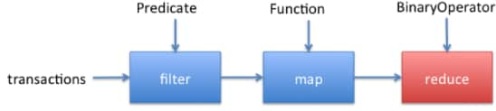
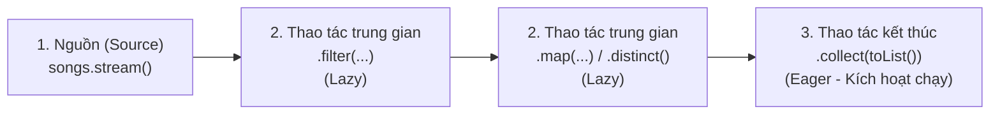

## Table of Contents
1. [Tư duy Khai báo ("What") vs Tư duy Mệnh lệnh ("How")](#declarative-vs-imperative)
2. [Biểu thức Lambda và Giao diện hàm (Functional Interfaces)](#lambdas-functional-interfaces)
3. [Dây chuyền xử lý dữ liệu: Streams API Pipeline](#streams-pipeline)
4. [Bản chất Lazy Evaluation và Luật bất biến của Stream](#lazy-evaluation-and-rules)
5. [Lớp bọc `Optional<T>`: Xử lý kết quả vắng mặt an toàn](#optional-handling)
6. [Tóm tắt & Ghi nhớ cốt lõi (Key Takeaways)](#key-takeaways)

---

## Tư duy Khai báo ("What") vs Tư duy Mệnh lệnh ("How") {#declarative-vs-imperative}

Trước Java 8, để lọc ra danh sách các bài hát thuộc thể loại `"Rock"` từ danh sách Jukebox, lập trình viên phải viết vòng lặp `for` truyền thống — tức là chỉ định chi tiết **TỪNG BƯỚC THỰC HIỆN NHƯ THẾ NÀO (Imperative - How)**: khởi tạo một danh sách rỗng tạm thời, duyệt qua từng phần tử, kiểm tra điều kiện `if`, rồi gọi `.add()` vào danh sách kết quả.

Với **Streams API** và **Lambda**, cách tiếp cận chuyển sang **MÔ TẢ KẾT QUẢ MONG MUỐN LÀ GÌ (Declarative - What)**:

```java
// CÁCH CŨ (Imperative - "How"): Dài dòng, dễ sai sót, lộ chi tiết cài đặt vòng lặp
List<Song> rockSongs = new ArrayList<>();
for (Song song : songs) {
    if (song.getGenre().equals("Rock")) {
        rockSongs.add(song);
    }
}

// CÁCH HIỆN ĐẠI (Declarative - "What"): Ngắn gọn, trực quan theo luồng dữ liệu!
List<Song> rockSongsModern = songs.stream()
    .filter(song -> song.getGenre().equals("Rock"))
    .collect(Collectors.toList());
```

---

## Biểu thức Lambda và Giao diện hàm (Functional Interfaces) {#lambdas-functional-interfaces}

Về bản chất, **Lambda Expression** là một hàm ẩn danh (không có tên) có thể truyền đi như một giá trị hoặc đối số của method. Thay vì phải khởi tạo cả một đối tượng lớp ẩn danh (Anonymous Inner Class) rườm rà chỉ để truyền một hành vi, chỉ cần viết phần tham số và thân biểu thức:

```java
// 1. Lambda rút gọn tối đa (1 tham số, 1 biểu thức trả về ngay):
song -> song.getGenre().equals("Rock")

// 2. Lambda có nhiều tham số (bắt buộc bọc trong ngoặc tròn):
(str1, str2) -> str1.compareToIgnoreCase(str2)

// 3. Lambda nhiều dòng lệnh (bắt buộc có ngoặc nhọn {} và từ khóa return;):
(s1, s2) -> {
    int result = Integer.compare(s1.getBpm(), s2.getBpm());
    return result;
}
```

### Quy tắc SAM (Single Abstract Method) và `@FunctionalInterface`

Làm sao compiler nhìn vào `song -> song.getGenre().equals("Rock")` mà tự suy luận (type inference) được `song` thuộc kiểu `Song` và kết quả trả về là `boolean`?

Cơ chế này dựa trên **Functional Interface (Giao diện hàm)**:
- Một interface được gọi là **Functional Interface** khi và chỉ khi interface đó có **ĐÚNG MỘT method trừu tượng chưa được cài đặt (Single Abstract Method - SAM)**.
- Lưu ý: Một Functional Interface vẫn có thể chứa nhiều method `default` hoặc `static`, miễn là chỉ có **đúng 1 method `abstract`**.
- Annotation `@FunctionalInterface` giúp compiler kiểm tra và báo lỗi compile ngay nếu có ai vô tình thêm method `abstract` thứ hai vào interface.

### Bộ tứ Functional Interfaces cốt lõi trong `java.util.function`

Khi làm việc với Streams API, phần lớn các biểu thức Lambda sẽ khớp vào 1 trong 4 Functional Interfaces chuẩn sau đây:

| Functional Interface | Chữ ký hàm trừu tượng | Hình dáng Lambda | Vai trò trong Stream Pipeline |
| :--- | :--- | :--- | :--- |
| **`Predicate<T>`** | `boolean test(T t)` | `T -> boolean` | Kiểm tra điều kiện đúng/sai. Dùng trong **`.filter(...)`**, `.anyMatch(...)`. |
| **`Function<T, R>`** | `R apply(T t)` | `T -> R` | Biến đổi dữ liệu từ kiểu `T` sang kiểu `R`. Dùng trong **`.map(...)`**. |
| **`Consumer<T>`** | `void accept(T t)` | `T -> void` | Tiêu thụ một đối tượng mà không trả về kết quả. Dùng trong **`.forEach(...)`**. |
| **`Supplier<T>`** | `T get()` | `() -> T` | Không nhận tham số, chuyên khởi tạo/cung cấp đối tượng mới. Dùng trong `.orElseGet(...)`. |

### Tham chiếu phương thức (Method References `::`)

Nếu một biểu thức Lambda chỉ đơn thuần **gọi thẳng một method có sẵn**, có thể thay thế Lambda bằng cú pháp **Method Reference (`::`)** ngắn gọn hơn:

```java
// Lambda thông thường                  --->   Tương đương với Method Reference
song -> song.getArtist()                //     Song::getArtist
str -> System.out.println(str)          //     System.out::println
(s1, s2) -> s1.compareToIgnoreCase(s2)  //     String::compareToIgnoreCase
```

---

## Dây chuyền xử lý dữ liệu: Streams API Pipeline {#streams-pipeline}

Một **Stream Pipeline** luôn được cấu thành từ **3 phần**:





### 1. Các thao tác trung gian thường gặp (Intermediate Operations)
Mỗi thao tác trung gian đều nhận vào một Stream và **trả về một Stream mới**, cho phép nối chuỗi (chaining) liên tiếp:
- **`.filter(Predicate<T>)`**: Giữ lại các phần tử thỏa mãn điều kiện (`true`).
- **`.map(Function<T, R>)`**: Ánh xạ (biến đổi) từng phần tử từ kiểu `T` sang kiểu `R` theo tỷ lệ 1-đổi-1 (ví dụ: từ `Stream<Song>` -> `.map(Song::getGenre)` -> `Stream<String>`).
- **`.distinct()`**: Loại bỏ các phần tử trùng lặp (dựa trên `.equals()` của phần tử đó).
- **`.sorted()` / `.sorted(Comparator)`**: Sắp xếp các phần tử trên dòng chảy.
- **`.limit(n)` / `.skip(n)`**: Chỉ lấy tối đa `n` phần tử đầu tiên / Bỏ qua `n` phần tử đầu tiên (hữu ích khi phân trang dữ liệu).

### 2. Các thao tác kết thúc thường gặp (Terminal Operations)
Đóng lại dây chuyền xử lý và xuất ra kết quả cuối cùng:
- **`.collect(...)`**: Gom kết quả về một cấu trúc dữ liệu hoặc chuỗi:
  - `Collectors.toList()` (hoặc viết gọn `.toList()` từ Java 16+): Gom về một `List`.
  - `Collectors.toUnmodifiableList()`: Gom về một `List` **bất biến** (không thể `.add()` hay `.remove()` sau khi tạo).
  - `Collectors.toSet()`: Gom về một `Set` không trùng lặp.
  - `Collectors.joining(", ")`: Nối các chuỗi trong `Stream<String>` lại thành 1 chuỗi chung ngăn cách bởi dấu phẩy.
- **`.count()`**: Đếm số lượng phần tử còn lại trên dòng chảy (trả về `long`).
- **`.anyMatch(Predicate)` / `.allMatch(Predicate)` / `.noneMatch(Predicate)`**: Trả về `boolean` kiểm tra điều kiện.
- **`.findFirst()` / `.findAny()`**: Tìm phần tử đầu tiên khớp điều kiện, trả về kết quả bọc trong **`Optional<T>`**.

---

## Bản chất Lazy Evaluation và Luật bất biến của Stream {#lazy-evaluation-and-rules}

### 1. Tại sao các thao tác trung gian hoạt động theo cơ chế Lazy Evaluation?

Các thao tác trung gian (`filter`, `map`, `limit`) đóng vai trò như **bản thiết kế quy trình xử lý**. Hãy xét đoạn code sau:

```java
Stream<String> genres = songs.stream()
    .map(song -> {
        System.out.println("Đang xử lý bài: " + song.getTitle());
        return song.getGenre();
    })
    .distinct();
// TẠI ĐÂY: Màn hình console hoàn toàn TRỐNG! Chưa có dòng nào được in ra!
```

Chừng nào **chưa gọi thao tác kết thúc (Terminal Operation)** như `.collect()` hay `.count()`, Stream sẽ **KHÔNG thực hiện bất kỳ vòng lặp hay phép biến đổi nào**! Nhờ cơ chế **Lazy Evaluation**, JVM có thể kết hợp các bước để tối ưu hóa hiệu năng (short-circuiting: ví dụ nếu cuối chuỗi có `.limit(5)`, ngay khi tìm đủ 5 kết quả thỏa mãn, Stream sẽ dừng duyệt phần còn lại của danh sách).

### 2. Stream KHÔNG BAO GIỜ được phép tái sử dụng!

> [!WARNING]
> Một đối tượng `Stream` không phải là cấu trúc lưu trữ dữ liệu; nó chỉ là một luồng xử lý dùng **đúng một lần**. Ngay khi gọi một Terminal Operation (hoặc nối thêm thao tác mới lên cùng một biến Stream đã qua sử dụng), Stream đó sẽ bị đóng lại. Nếu cố tình dùng lại biến Stream đó lần thứ 2, chương trình sẽ ném lỗi lúc Runtime:
> `java.lang.IllegalStateException: stream has already been operated upon or closed`

```java
Stream<Song> songStream = songs.stream();
long total = songStream.count(); // Lần 1: Hợp lệ, Stream đã đóng lại sau dòng này!

// Lần 2: NÉM LỖI IllegalStateException lúc Runtime!
// List<Song> list = songStream.collect(Collectors.toList());
```

Muốn chạy truy vấn mới, cần tạo lại Stream mới bằng cách gọi `songs.stream()` từ collection nguồn `songs` (bản thân Stream không bao giờ làm thay đổi dữ liệu của danh sách nguồn ban đầu).

---

## Lớp bọc `Optional<T>`: Xử lý kết quả vắng mặt an toàn {#optional-handling}

Khi tìm kiếm một bài hát phát hành năm 1995 bằng `.findFirst()`, hoàn toàn có khả năng danh sách không chứa bài hát nào thỏa mãn. Thay vì trả về `null` (dễ dẫn tới `NullPointerException` nếu quên kiểm tra), Streams API trả về một đối tượng bọc **`Optional<Song>`**.

`Optional<T>` thể hiện rõ ngay trên kiểu trả về của method rằng kết quả có thể tồn tại hoặc vắng mặt:

```java
Optional<Song> result = songs.stream()
    .filter(s -> s.getYear() == 1995)
    .findFirst();

// Cách 1: Kiểm tra bằng isPresent() trước khi lấy giá trị
if (result.isPresent()) {
    System.out.println("Tìm thấy: " + result.get().getTitle());
} else {
    System.out.println("Không tìm thấy bài hát nào năm 1995");
}

// Cách 2: Phong cách hàm hiện đại với ifPresent() hoặc cung cấp giá trị mặc định với orElse()
result.ifPresent(song -> System.out.println(song.getTitle()));

Song safeSong = result.orElse(new Song("Default Song", "Unknown", 100));
```

> [!TIP]
> Không nên gọi `result.get()` trực tiếp khi chưa kiểm tra `result.isPresent()`, vì nếu `Optional` đang rỗng, `.get()` sẽ ném ra `NoSuchElementException`. Hãy ưu tiên dùng `.orElse(...)`, `.orElseGet(...)`, hoặc `.orElseThrow(...)`.

---

## Tóm tắt & Ghi nhớ cốt lõi (Key Takeaways) {#key-takeaways}

- **Sự khác nhau giữa Intermediate Operations và Terminal Operations trong Java Stream:**
  - **Intermediate Operations** (`filter`, `map`, `sorted`): Trả về một `Stream` mới để nối chuỗi và có tính chất **Lazy (trì hoãn)** — không thực thi logic cho đến khi gặp Terminal Operation.
  - **Terminal Operations** (`collect`, `count`, `forEach`, `findFirst`): Kích hoạt toàn bộ pipeline chạy thực sự (**Eager**), trả về kết quả cuối cùng (hoặc `void`), và đóng Stream đó lại.
- **Phân biệt `.map()` và `.flatMap()` trong Stream:**
  - `.map()` biến đổi **1 phần tử đầu vào thành 1 phần tử đầu ra** (`T -> R`). Nếu mỗi phần tử lại trả về một `List` hoặc `Stream`, kết quả sẽ bị lồng nhau dạng `Stream<List<String>>`.
  - `.flatMap()` vừa biến đổi vừa **làm phẳng (flatten)** các cấu trúc lồng nhau thành một luồng đơn cấp: chuyển `Stream<List<String>>` thành `Stream<String>`.
- **Quy tắc SAM của Functional Interface:**
  - Một Functional Interface chỉ được phép có **đúng 1 method trừu tượng (`abstract`)**. Ngoài method `abstract` đó, interface vẫn có thể chứa thêm các method `default`, method `static`, hoặc khai báo lại các method `public` của `java.lang.Object` (như `equals`, `toString`).

### Tài liệu & Nguồn tham khảo
- [Dev.java — Lambda Expressions & Functional Interfaces (`java.util.function`)](https://dev.java/learn/lambdas/)
- [Dev.java — Processing Data with Java SE Streams (`java.util.stream`)](https://dev.java/learn/api/streams/)
