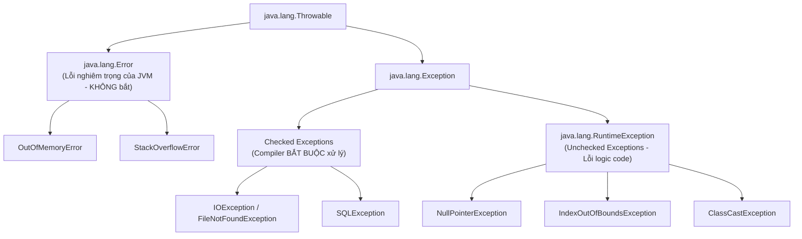
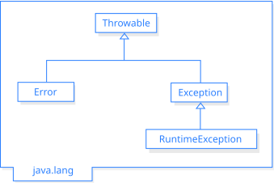

## Table of Contents
1. [Tại sao cần Exception và Cây phân cấp `Throwable`](#throwable-hierarchy)
2. [Quy tắc của Compiler: "Handle or Declare" (`try-catch` vs `throws`)](#handle-or-declare)
3. [Tính Đa hình trong Exception và Thứ tự khối `catch`](#polymorphic-exceptions)
4. [Khối lệnh `finally` và Chuẩn hiện đại `try-with-resources`](#finally-and-try-with-resources)
5. [Tóm tắt & Ghi nhớ cốt lõi (Key Takeaways)](#key-takeaways)

---

## Tại sao cần Exception và Cây phân cấp `Throwable` {#throwable-hierarchy}

Khi gọi một method tiềm ẩn rủi ro (như mở một file trên ổ đĩa, kết nối tới Database qua mạng, hay khởi tạo bộ phát âm thanh MIDI), không thể đảm bảo mọi tác vụ bên ngoài đều luôn thành công lúc Runtime.

Trong Java, **Exception là một object thuộc nhánh `Exception`** được ném ra lúc Runtime để báo hiệu có sự cố bất thường xảy ra. Mọi Exception và Error trong Java đều kế thừa từ class gốc **`java.lang.Throwable`**:




*Hình 13.1: Cây phân cấp `Throwable` trong thư viện chuẩn Java gồm nhánh `Error` và nhánh `Exception` (`RuntimeException` vs Checked Exceptions)*

### Bảng phân biệt 3 nhánh trong cây `Throwable`

| Phân loại | Bản chất là gì? | Compiler có kiểm tra không? | Cách xử lý chuẩn trong thực tế |
| :--- | :--- | :--- | :--- |
| **`Error`** (`OutOfMemoryError`, `StackOverflowError`) | Sự cố nghiêm trọng cấp độ hệ thống / JVM (cạn bộ nhớ Heap, đệ quy vô tận gây tràn Stack). | **Không** (Unchecked) | **Không dùng `try-catch` để bắt `Error`** vì ứng dụng không thể tự phục hồi khi JVM gặp lỗi hệ thống. |
| **Checked Exceptions** (`IOException`, `SQLException`, `MidiUnavailableException`) | Rủi ro từ môi trường bên ngoài (mạng đứt, thiếu file, lỗi kết nối DB) nằm ngoài tầm kiểm soát của code. | **CÓ!** Bắt buộc tuân thủ quy tắc *"Handle or Declare"*. | Bắt bằng `try-catch` để xử lý phục hồi, hoặc khai báo `throws` chuyển lên tầng gọi phía trên xử lý. |
| **Unchecked Exceptions** (`RuntimeException` và các lớp con: `NullPointerException`, `ClassCastException`) | **Lỗi logic trong code** (gọi method trên biến `null`, truy cập vượt quá chỉ mục mảng). | **Không** (Không bắt buộc khai báo) | **Sửa lại logic code** (kiểm tra `!= null`, kiểm tra biên mảng) thay vì bọc `try-catch` tràn lan. |

---

## Quy tắc của Compiler: "Handle or Declare" (`try-catch` vs `throws`) {#handle-or-declare}

Khi một method gọi tới hàm có khả năng ném ra **Checked Exception** (ví dụ hàm đó khai báo `public void openFile() throws IOException`), compiler sẽ kiểm tra và yêu cầu tuân thủ **1 trong 2 cách xử lý bắt buộc** (Quy tắc **Handle or Declare**):

### Cách 1: Handle (Xử lý tại chỗ bằng `try / catch`)

Bọc đoạn code có nguy cơ phát sinh lỗi vào khối `try` và đặt kịch bản xử lý trong khối `catch`:

```java
public void playMusic() {
    try {
        Sequencer player = MidiSystem.getSequencer(); // Method có thể ném MidiUnavailableException
        System.out.println("Đã khởi tạo thành công bộ phát nhạc!");
    } catch (MidiUnavailableException e) {
        // Chỉ chạy vào đây NẾU dòng getSequencer() bên trên ném ra Exception!
        System.out.println("Thiết bị âm thanh đang bận hoặc lỗi: " + e.getMessage());
        e.printStackTrace();
    }
}
```

### Cách 2: Declare / Duck it (Chuyển tiếp trách nhiệm bằng từ khóa `throws`)

Nếu method hiện tại không đủ ngữ cảnh để xử lý lỗi, có thể **"né" (duck)** trách nhiệm xử lý cho nơi gọi hàm (caller) bằng cách khai báo `throws` ngay trên chữ ký method:

```java
// Khai báo throws: chuyển trách nhiệm xử lý IOException cho method gọi readData()
public void readData() throws IOException {
    FileReader reader = new FileReader("config.txt");
}
```

> [!WARNING]
> **Điều gì xảy ra nếu ngay cả hàm `main()` cũng khai báo `throws Exception`?**
> Khi một Exception bị ném ra mà method hiện tại không bắt lại, method đó bị đẩy (pop) ngay lập tức khỏi Call Stack và Exception được truyền xuống method gọi nó bên dưới. Nếu ngay cả hàm `main()` ở đáy Stack cũng khai báo `throws`, **không còn tầng nào xử lý Exception đó nữa — JVM sẽ in ra Stack Trace và dừng thread đang chạy!**

---

## Tính Đa hình trong Exception và Thứ tự khối `catch` {#polymorphic-exceptions}

Vì các lớp Exception cũng là Object tuân theo tính kế thừa OOP, nguyên lý **Đa hình (Polymorphism)** hoàn toàn áp dụng được cho Exception:
- Một method có thể khai báo `throws ClothingException` (superclass) nhưng bên trong lại thực tế ném ra `throw new TeeShirtException()` (subclass).
- Một khối `catch (ClothingException e)` có thể bắt được mọi Exception là lớp con của `ClothingException` (`TeeShirtException`, `LingerieException`, `PantsException`).

### Quy tắc sắp xếp nhiều khối `catch`: Từ Cụ thể đến Tổng quát (Specific -> General)

Mặc dù có thể dùng một khối `catch (Exception e)` để bắt mọi loại Exception, nhưng trong thực tế mỗi loại lỗi cụ thể thường cần hướng xử lý riêng. Khi xếp chồng nhiều khối `catch`, **BẮT BUỘC phải đặt subclass (cụ thể) ở trên, superclass (tổng quát) ở dưới**:

```java
// ĐÚNG CHUẨN: Xếp từ lớp con cụ thể (TeeShirtException) -> lớp cha (ShirtException) -> lớp ông (ClothingException)
try {
    laundry.doLaundry();
} catch (TeeShirtException tex) {
    // Xử lý riêng cho TeeShirtException
} catch (ShirtException sex) {
    // Bắt các loại ShirtException khác (không phải TeeShirt)
} catch (ClothingException cex) {
    // Bắt tất cả các loại ClothingException còn lại
}
```

```java
// LỖI COMPILE: Đặt lớp cha ClothingException lên trên lớp con!
try {
    laundry.doLaundry();
} catch (ClothingException cex) {
    // Khối này đã chặn đứng MỌI lỗi thuộc nhánh ClothingException!
} catch (TeeShirtException tex) {
    // LỖI COMPILE: Unreachable catch block for TeeShirtException!
    // (Đoạn code không bao giờ có cơ hội chạy tới)
}
```

### Gộp các khối `catch` có cùng logic xử lý (Multi-catch từ Java 7+)

Nếu hai Exception khác nhau có chung một kịch bản xử lý giống hệt nhau, có thể dùng toán tử `|` (Multi-catch) để gộp lại:

```java
try {
    processFile();
} catch (FileNotFoundException | ParseException e) {
    // Xử lý chung cho cả 2 loại Exception trên cùng 1 khối catch
    logError(e);
}
```

---

## Khối lệnh `finally` và Chuẩn hiện đại `try-with-resources` {#finally-and-try-with-resources}

### 1. Vai trò của khối `finally`: Luôn thực thi để dọn dẹp tài nguyên

Khi mở tài nguyên trong khối `try` (như bật lò nướng, mở kết nối Database, mở File hoặc Socket), dù logic xử lý **thành công** hay **gặp Exception** (nhảy vào `catch`), tài nguyên đó **bắt buộc phải được đóng lại**. Đó là nhiệm vụ của khối **`finally`**:

```java
try {
    turnOvenOn();
    x.bake(); // Có thể thành công hoặc ném BakingException
} catch (BakingException e) {
    e.printStackTrace();
} finally {
    turnOvenOff(); // LUÔN LUÔN CHẠY dù có lỗi hay không có lỗi!
}
```

> [!IMPORTANT]
> **Trường hợp khối `try` hoặc `catch` có lệnh `return;` thì `finally` có chạy không?**
> **VẪN CHẠY!** Khi gặp lệnh `return` trong `try` hoặc `catch`, JVM sẽ tạm hoãn việc trả về, **chuyển sang thực thi xong toàn bộ khối `finally` trước**, rồi mới quay lại hoàn tất lệnh `return`!
> Chỉ có **2 tình huống đặc biệt** khiến `finally` không chạy:
> 1. Gọi lệnh dừng máy ảo `System.exit(...)` bên trong `try` hoặc `catch`.
> 2. Tiến trình JVM bị dừng đột ngột từ bên ngoài (mất điện, bị hệ điều hành `kill -9`).

### 2. Cú pháp `try-with-resources`: Đóng tài nguyên tự động

Trước Java 7, việc đóng một `BufferedReader` hay `Connection` bên trong khối `finally` khá cồng kềnh vì chính method `.close()` cũng có thể ném ra `IOException`, buộc phải viết thêm một cặp `try-catch` lồng bên trong `finally`.

Từ Java 7 trở đi, mọi class tài nguyên cài đặt interface **`AutoCloseable`** (hoặc `Closeable`) đều có thể khai báo trực tiếp trong ngoặc tròn của câu lệnh **`try (...)`** (**try-with-resources**):

```java
// Chuẩn hiện đại: Khai báo tài nguyên ngay trong ngoặc tròn sau từ khóa try
public String readFirstLine(String path) {
    try (BufferedReader reader = new BufferedReader(new FileReader(path))) {
        return reader.readLine();
    } catch (IOException e) {
        System.out.println("Lỗi đọc file: " + e.getMessage());
        return "";
    }
    // KHÔNG CẦN viết finally { reader.close(); }!
    // JVM tự động gọi reader.close() ngay khi thoát khỏi khối try (dù thành công hay gặp lỗi)!
}
```

Nếu khai báo nhiều tài nguyên cùng lúc trong `try (Res1 r1 = ...; Res2 r2 = ...)`, JVM sẽ tự động đóng chúng theo **thứ tự ngược lại với lúc khởi tạo** (`r2.close()` chạy trước, sau đó đến `r1.close()`).

---

## Tóm tắt & Ghi nhớ cốt lõi (Key Takeaways) {#key-takeaways}

- **Phân biệt từ khóa `throw` và `throws` trong Java:**
  - **`throw`** (không có *s*): Đặt **bên trong thân method**, dùng để **trực tiếp ném ra một instance Exception cụ thể** (ví dụ: `throw new IllegalArgumentException("Tham số không hợp lệ");`).
  - **`throws`** (có *s*): Đặt **ở chữ ký khai báo method (method signature)**, dùng để khai báo các loại Exception mà method đó có thể chuyển tiếp lên tầng gọi (ví dụ: `void loadFile() throws IOException`).
- **Phân biệt Checked Exception và Unchecked Exception:**
  - **Checked Exception**: Các class kế thừa từ `Exception` nhưng **không kế thừa từ `RuntimeException`** (ví dụ: `IOException`, `SQLException`). Compiler kiểm tra lúc compile và bắt buộc phải bắt (`try-catch`) hoặc khai báo (`throws`).
  - **Unchecked Exception**: Kế thừa từ `RuntimeException` (ví dụ: `NullPointerException`, `IllegalArgumentException`, `IndexOutOfBoundsException`). Compiler không ép buộc phải bắt hay khai báo; thường phản ánh lỗi logic lập trình cần được khắc phục trong code.
- **Nếu cả khối `try` có `return 1;` và khối `finally` có `return 2;`, hàm sẽ trả về giá trị nào?**
  - Method sẽ trả về **`2`** (đồng thời nếu trong `try` có ném ra Exception thì Exception đó cũng bị nuốt mất!). Do đó, **không bao giờ viết lệnh `return` hoặc `throw` bên trong khối `finally`** trong code thực tế.

### Tài liệu & Nguồn tham khảo
- [Dev.java — Exceptions: Catching and Handling Exceptions (`try-with-resources`)](https://dev.java/learn/exceptions/)
- [Java SE 17 API Javadoc — `java.lang.AutoCloseable`](https://docs.oracle.com/en/java/javase/17/docs/api/java.base/java/lang/AutoCloseable.html)
