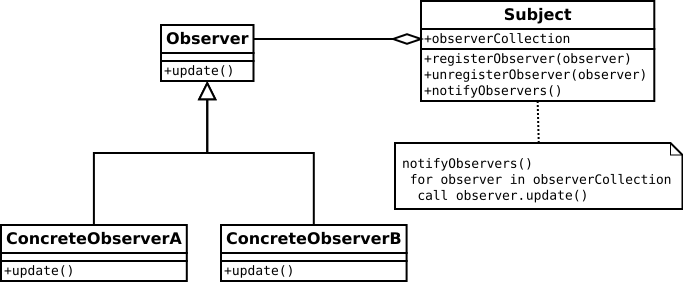
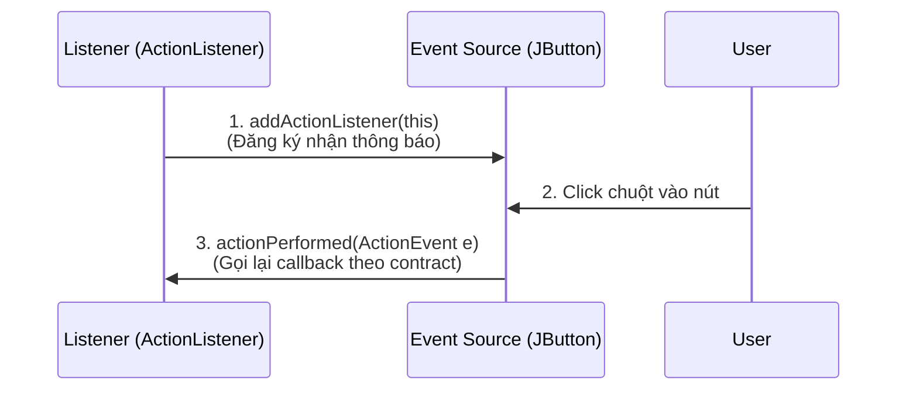

## Table of Contents
1. [Khung cửa sổ `JFrame` và Vẽ đồ họa trên `JPanel`](#first-gui)
2. [Lập trình hướng sự kiện: Observer Pattern trong thực tế](#event-driven)
3. [Lớp nội bộ (Inner Classes) vs Biểu thức Lambda](#inner-classes)
4. [Tóm tắt & Ghi nhớ cốt lõi (Key Takeaways)](#key-takeaways)

---

## Khung cửa sổ `JFrame` và Vẽ đồ họa trên `JPanel` {#first-gui}

Mọi ứng dụng giao diện desktop trong Swing đều bắt đầu bằng một khung cửa sổ **`JFrame`**. Tuy nhiên, có hai quy tắc vàng mà Head First Java nhấn mạnh ngay từ đầu:

1. **Không thêm thành phần trực tiếp vào `JFrame`**: Cần đặt các nút bấm, nhãn chữ hay khung vẽ lên `contentPane` của nó (`frame.getContentPane().add(...)`). Hãy hình dung `JFrame` là khung cửa sổ gỗ, còn `contentPane` mới là tấm kính nơi dán các thành phần giao diện lên.
2. **Không vẽ trực tiếp lên `JFrame`**: Để tự vẽ hình khối, màu chuyển sắc (gradient) hay ảnh động, ta tạo một class kế thừa **`JPanel`** (tấm toan vẽ - canvas) và override method `paintComponent(Graphics g)`.

```java
import javax.swing.*;
import java.awt.*;

public class MyDrawPanel extends JPanel {
    @Override
    public void paintComponent(Graphics g) {
        // Luôn gọi super hoặc tự tô nền để xóa phần vẽ cũ
        super.paintComponent(g);

        // Ép kiểu sang Graphics2D để dùng các công cụ vẽ nâng cao (như Gradient)
        Graphics2D g2d = (Graphics2D) g;

        GradientPaint gradient = new GradientPaint(70, 70, Color.BLUE, 150, 150, Color.ORANGE);
        g2d.setPaint(gradient);
        g2d.fillOval(70, 70, 100, 100);
    }
}
```

> [!IMPORTANT]
> **Không bao giờ tự gọi `paintComponent()` bằng tay!** Tham số `Graphics g` đại diện cho bề mặt phần cứng màn hình thực tế, chỉ có hệ thống đồ họa của JVM mới nắm giữ và truyền vào được. Khi cần cập nhật hoặc vẽ lại màn hình, chỉ cần gọi **`frame.repaint()`** (hoặc `panel.repaint()`), và JVM sẽ tự động lên lịch gọi `paintComponent(g)`.

---

## Lập trình hướng sự kiện: Observer Pattern trong thực tế {#event-driven}

Trong lập trình hướng sự kiện (Event-driven programming), chương trình không chạy một mạch từ trên xuống dưới rồi thoát, mà chờ tương tác từ người dùng. Cơ chế sự kiện của Java Swing chính là hình mẫu điển hình của **Observer Design Pattern**, xoay quanh 3 thành phần:

1. **Event Source (Nguồn phát sự kiện)**: Các thành phần giao diện như `JButton`, `JCheckBox`, `JTextField`. Nó biết khi nào người dùng click chuột hay gõ phím và chịu trách nhiệm thông báo cho các đối tượng đã đăng ký lắng nghe.
2. **Listener (Bộ lắng nghe)**: Đối tượng quan tâm đến sự kiện. Để nhận thông báo, class lắng nghe phải thực thi một **Listener Interface** tương ứng (ví dụ: `ActionListener`, `MouseListener`, `KeyListener`) — đây chính là bản quy ước (contract) đảm bảo có hàm xử lý sự kiện.
3. **Event Object (Đối tượng sự kiện)**: Gói tin chứa chi tiết về sự kiện vừa xảy ra (như `ActionEvent` mang theo thời điểm bấm nút, `MouseEvent` mang tọa độ chuột `x, y`), được truyền làm tham số vào method của Listener.





Quy trình kết nối hoàn chỉnh:
- **Phía Listener**: `implements ActionListener` và cài đặt method `public void actionPerformed(ActionEvent event)`.
- **Phía Event Source**: Gọi `button.addActionListener(listener)` để lưu đối tượng lắng nghe vào danh sách thông báo.

---

## Lớp nội bộ (Inner Classes) vs Biểu thức Lambda {#inner-classes}

### Bài toán kinh điển: Hai nút bấm trên cùng một cửa sổ
Giả sử giao diện có 2 nút bấm:
- Nút 1 (`colorButton`): Đổi màu hình tròn trên `frame` (cần gọi `frame.repaint()`).
- Nút 2 (`labelButton`): Đổi dòng chữ trên `label` (cần gọi `label.setText("Đã đổi!")`).

Nếu cho class chính `TwoButtons implements ActionListener`, class này chỉ có **đúng 1** method `actionPerformed(ActionEvent e)`. Dùng `if (e.getSource() == colorButton)` sẽ khiến code bị trộn lẫn lộn xộn, kém tính gắn kết (low cohesion). Ngược lại, nếu tách thành 2 class độc lập bên ngoài (`ColorButtonListener` và `LabelButtonListener`), chúng lại **không truy cập được** các biến `private JFrame frame` và `private JLabel label` của class giao diện chính!

### Giải pháp 1: Inner Class và "Thẻ VIP hậu trường"
**Inner Class** (Lớp nội bộ non-static) là một class được khai báo nằm bên trong lòng một class khác (Outer Class).

```java
public class TwoButtons {
    private JFrame frame;
    private JLabel label;

    public void go() {
        frame = new JFrame();
        label = new JLabel("Ban đầu");

        JButton labelButton = new JButton("Đổi chữ");
        labelButton.addActionListener(new LabelListener());

        JButton colorButton = new JButton("Đổi màu");
        colorButton.addActionListener(new ColorListener());
        // ... thiết lập bố cục JFrame ...
    }

    // Inner Class 1: Có toàn quyền chạm vào biến private 'label' của lớp ngoài
    class LabelListener implements ActionListener {
        @Override
        public void actionPerformed(ActionEvent event) {
            label.setText("Đã đổi chữ mới!");
        }
    }

    // Inner Class 2: Có toàn quyền chạm vào biến private 'frame' của lớp ngoài
    class ColorListener implements ActionListener {
        @Override
        public void actionPerformed(ActionEvent event) {
            frame.repaint();
        }
    }
}
```

Tại sao Inner Class làm được điều này? Vì mỗi instance của Inner Class luôn gắn chặt với một instance cụ thể của Outer Class tạo ra nó (`compiler` ngầm truyền một tham chiếu ẩn `OuterClass.this` vào bên trong Inner Class). Nhờ chiếc **"thẻ VIP hậu trường"** này, Inner Class được quyền đọc và sửa mọi biến `private` cũng như gọi mọi method `private` của class bao ngoài.

### Giải pháp 2: Biểu thức Lambda (Từ Java 8+)
Vì `ActionListener` là một **Functional Interface** (Interface chỉ có đúng 1 method trừu tượng - SAM: Single Abstract Method), ta không cần viết cả một Inner Class dài dòng mà chỉ cần truyền trực tiếp hành vi bằng **Lambda Expression**:

```java
labelButton.addActionListener(event -> label.setText("Đã đổi chữ mới!"));
colorButton.addActionListener(event -> frame.repaint());
```

> [!TIP]
> **Khi nào dùng Lambda, khi nào vẫn cần Inner Class?**
> - **Dùng Lambda**: Khi interface mục tiêu là **Functional Interface** (chỉ có 1 hàm trừu tượng như `ActionListener`, `Runnable`, `Callable`). Code ngắn gọn và không sinh thêm file `.class` phụ lúc compile.
> - **Dùng Inner Class**: Khi cần **kế thừa một Class** (ví dụ `class MyDrawPanel extends JPanel` cần đọc biến của class ngoài), hoặc thực thi một interface có **nhiều hơn 1 method trừu tượng** (như `MouseListener` có tới 5 method `mouseClicked`, `mousePressed`, `mouseReleased`...), hoặc khi logic xử lý cần tự lưu trữ trạng thái (instance fields) riêng.

### Bảng so sánh: Các loại lớp lồng nhau và Lambda

| Tiêu chí | Inner Class (Non-static) | Static Nested Class (`static class`) | Anonymous Inner Class | Lambda Expression |
| :--- | :--- | :--- | :--- | :--- |
| **Tham chiếu tới instance lớp ngoài?** | **Có** (giữ tham chiếu ẩn `Outer.this`) | **Không** (độc lập với instance lớp ngoài) | **Có** (nếu tạo trong method non-static) | Chỉ giữ nếu có dùng biến/method của lớp ngoài |
| **Truy cập thành phần `private` lớp ngoài?** | Mọi biến/method `private` (cả static và instance) | Chỉ các biến/method `static private` của lớp ngoài | Mọi biến/method `private` + biến cục bộ *effectively final* | Mọi biến/method `private` + biến cục bộ *effectively final* |
| **Kế thừa Class / Đa phương thức?** | Có thể `extends` class và `implements` nhiều hàm | Có thể `extends` class và `implements` nhiều hàm | Có thể `extends` 1 class hoặc `implements` 1 interface | **Chỉ áp dụng cho Functional Interface** (1 hàm trừu tượng) |
| **Ý nghĩa của từ khóa `this`** | Trỏ tới chính instance **Inner Class** | Trỏ tới chính instance **Static Nested Class** | Trỏ tới chính instance **Anonymous Class** | Trỏ tới instance **Lớp bao ngoài (Enclosing Class)** |

---

## Tóm tắt & Ghi nhớ cốt lõi (Key Takeaways) {#key-takeaways}

- **Observer Pattern trong Event Handling**: Tách rời hoàn toàn bên phát sự kiện (`JButton`) khỏi bên xử lý sự kiện (`ActionListener`). `JButton` không cần biết class nào đang lắng nghe mình, nó chỉ cần gọi hàm `actionPerformed()` thông qua interface chung (Loose Coupling).
- **Sự khác biệt cốt lõi giữa `Inner Class` và `Static Nested Class`**:
  - **Inner Class** (không có `static`) bắt buộc phải gắn với một instance cụ thể của class ngoài (`Outer.Inner in = new Outer().new Inner();`) và luôn giữ một tham chiếu ẩn tới đối tượng class ngoài đó.
  - **Static Nested Class** (có `static`) không cần instance của class ngoài để khởi tạo (`Outer.StaticNested sn = new Outer.StaticNested();`) và không giữ tham chiếu ẩn tới đối tượng class ngoài.
- **Nguy cơ rò rỉ bộ nhớ (Memory Leak) với Inner Class**: Vì một non-static Inner Class (hoặc Anonymous Inner Class) luôn ngầm giữ tham chiếu tới instance Outer Class, nếu đối tượng Inner Class có vòng đời sống lâu hơn (ví dụ được đăng ký vào một hệ thống sự kiện toàn cục hoặc chạy trên một thread nền dài hạn), Garbage Collector sẽ **không thể thu hồi** đối tượng Outer Class dù giao diện đã đóng. **Best practice**: Nếu class lồng bên trong không cần đụng tới biến instance của class ngoài, hãy luôn khai báo nó là `static class`!
- **Tại sao Lambda ưu việt hơn Anonymous Inner Class?**: Bên cạnh cú pháp súc tích, Anonymous Class buộc `compiler` phải sinh ra một file bytecode riêng trên đĩa (như `TwoButtons$1.class`) và cấp phát object mới mỗi lần chạy. Ngược lại, Lambda sử dụng chỉ thị `invokedynamic` của JVM ở runtime, giúp tối ưu bộ nhớ và tốc độ khởi tạo.

### Tài liệu & Nguồn tham khảo
- [Oracle Java Tutorials — Writing Event Listeners in Swing (Observer Pattern)](https://docs.oracle.com/javase/tutorial/uiswing/events/index.html)
- [Dev.java — Nested Classes (Inner Classes vs Static Nested Classes)](https://dev.java/learn/classes-objects/nested-classes/)
