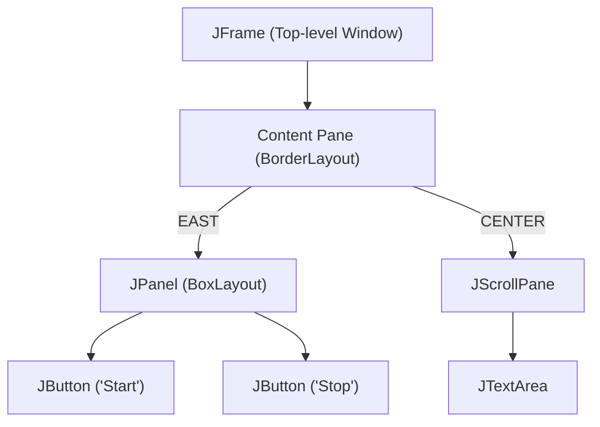
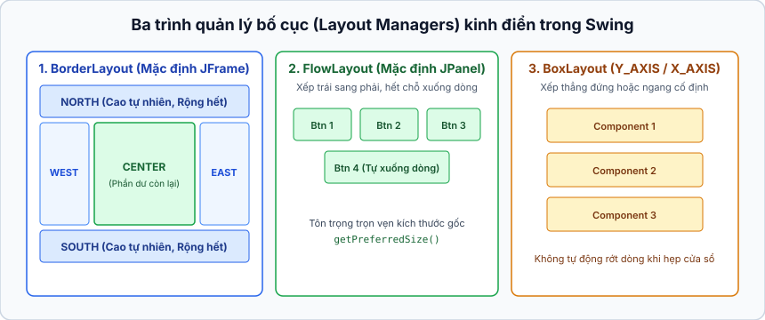

## Table of Contents
1. [Components vs Containers: Cấu trúc cây phân cấp giao diện](#layout-managers)
2. [Bộ ba Layout Managers kinh điển (The Big Three)](#the-big-three)
3. [Kết hợp nhiều Layout Managers: Sức mạnh của `JPanel` lồng nhau](#combining-layouts)
4. [Các thành phần Swing thường gặp trong thực tế](#common-components)
5. [Tóm tắt & Ghi nhớ cốt lõi (Key Takeaways)](#key-takeaways)

---

## Components vs Containers: Cấu trúc cây phân cấp giao diện {#layout-managers}

Trong Java Swing, mọi thành phần hiển thị trên màn hình đều kế thừa từ class gốc **`javax.swing.JComponent`**. Xét về mặt vai trò thiết kế, các thành phần này được chia làm hai nhóm nhưng đều nằm chung trong một cây phân cấp kế thừa:

- **Interactive Components (Thành phần tương tác)**: Các phần tử đầu cuối mà người dùng trực tiếp thao tác như `JButton`, `JCheckBox`, `JTextField`, `JTextArea`, `JList`.
- **Background Containers (Khung chứa nền)**: Các thành phần dùng để gom nhóm và sắp xếp các thành phần khác, tiêu biểu là `JFrame` (khung cửa sổ cấp cao) và `JPanel` (khung chứa trung gian).

Điểm đáng chú ý là một `JPanel` vừa là nơi chứa các `JButton`, vừa có thể được đặt vào bên trong một `JPanel` lớn hơn!



### Layout Manager làm việc như thế nào?
Mỗi Container (`JFrame`, `JPanel`) đều gắn với một bộ quản lý bố cục riêng gọi là **Layout Manager**. Khi gọi `panel.add(button)`, Layout Manager của `panel` sẽ hỏi `button` về kích thước mong muốn của nó thông qua method `button.getPreferredSize()` (kích thước vừa đủ để hiển thị trọn vẹn chữ trên nút), sau đó áp dụng chính sách riêng của Layout Manager để quyết định xem có giữ nguyên kích thước đó hay kéo giãn ra.

---

## Bộ ba Layout Managers kinh điển (The Big Three) {#the-big-three}



### 1. `BorderLayout` (Mặc định của `JFrame`) {#border-layout}
Chia khung chứa thành 5 vùng riêng biệt: **`NORTH`**, **`SOUTH`**, **`EAST`**, **`WEST`**, và **`CENTER`**. Mỗi vùng chỉ chứa được **đúng 1 component** (nếu muốn đặt nhiều nút vào một vùng, cần gom chúng vào một `JPanel` trước).

Quy tắc tính kích thước quan trọng của `BorderLayout`:
- **`NORTH` và `SOUTH`**: Được tôn trọng **chiều cao ưa thích (`preferred height`)**, nhưng bị kéo giãn **chiều rộng (`width`)** cho bằng toàn bộ bề ngang của khung chứa.
- **`EAST` và `WEST`**: Được tôn trọng **chiều rộng ưa thích (`preferred width`)**, nhưng bị kéo giãn **chiều cao (`height`)** lấp đầy khoảng giữa North và South.
- **`CENTER`**: Nhận **toàn bộ phần không gian còn thừa lại** ở cả chiều rộng lẫn chiều cao. Nếu gọi `frame.getContentPane().add(button)` mà không chỉ định vùng, mặc định component sẽ được đưa vào `CENTER`.

```java
import javax.swing.*;
import java.awt.*;

public class BorderLayoutDemo {
    public static void main(String[] args) {
        JFrame frame = new JFrame("BorderLayout Rules");
        // Font chữ to ở NORTH sẽ làm vùng NORTH cao lên (vì chiều cao được tôn trọng!)
        JButton northBtn = new JButton("NORTH (Chiều cao đúng chuẩn, rộng kéo hết cỡ)");
        northBtn.setFont(new Font("sanserif", Font.BOLD, 24));

        frame.getContentPane().add(BorderLayout.NORTH, northBtn);
        frame.getContentPane().add(BorderLayout.EAST, new JButton("EAST (Rộng chuẩn)"));
        frame.getContentPane().add(BorderLayout.CENTER, new JButton("CENTER (Lấy phần thừa)"));

        frame.setSize(500, 300);
        frame.setVisible(true);
    }
}
```

### 2. `FlowLayout` (Mặc định của `JPanel`) {#flow-layout}
Sắp xếp các thành phần giống cơ chế gõ văn bản (word-wrap): xếp lần lượt **từ trái sang phải** theo thứ tự được thêm vào; khi hết chỗ trên một hàng, nó tự động đẩy thành phần tiếp theo **xuống dòng mới**.

- **Quy tắc kích thước**: Mọi component nằm trong `FlowLayout` đều được giữ **nguyên vẹn cả chiều rộng lẫn chiều cao ưa thích (`getPreferredSize()`)** của mình, không bị kéo biến dạng.

### 3. `BoxLayout` (Xếp chồng thẳng hàng ngang hoặc dọc) {#box-layout}
Khác với `FlowLayout`, **`BoxLayout`** cho phép ép các thành phần phải xếp thành một cột dọc (`BoxLayout.Y_AXIS`) ngay cả khi bề ngang vẫn còn thừa chỗ để nằm chung một dòng.

- **Quy tắc kích thước**: Giống `FlowLayout`, nó tôn trọng kích thước ưa thích của từng thành phần, nhưng buộc các thành phần xếp nối tiếp theo trục đã chọn (`X_AXIS` hoặc `Y_AXIS`).

```java
JPanel panel = new JPanel();
// Đổi Layout mặc định (FlowLayout) của JPanel sang BoxLayout xếp dọc:
panel.setLayout(new BoxLayout(panel, BoxLayout.Y_AXIS));

panel.add(new JButton("Nút A"));
panel.add(new JButton("Nút B dài hơn"));
```

### Bảng so sánh nhanh The Big Three

| Layout Manager | Mặc định của | Cách sắp xếp | Chiều rộng (`Width`) | Chiều cao (`Height`) |
| :--- | :--- | :--- | :--- | :--- |
| **`BorderLayout`** | `JFrame` (`contentPane`) | 5 vùng (`NORTH`, `SOUTH`, `EAST`, `WEST`, `CENTER`) | Chỉ tôn trọng ở `EAST` và `WEST` | Chỉ tôn trọng ở `NORTH` và `SOUTH` |
| **`FlowLayout`** | `JPanel` | Trái sang phải, tự xuống dòng khi tràn | Tôn trọng `preferred width` | Tôn trọng `preferred height` |
| **`BoxLayout`** | *(Phải tự gán)* | Xếp thẳng hàng ngang (`X_AXIS`) hoặc cột dọc (`Y_AXIS`) | Tôn trọng `preferred width` | Tôn trọng `preferred height` |

---

## Kết hợp nhiều Layout Managers: Sức mạnh của `JPanel` lồng nhau {#combining-layouts}

Trong thực tế, một giao diện phức tạp không chỉ dùng một Layout Manager đơn lẻ. Cách xây dựng bố cục chuẩn trong Swing là:
1. Giữ nguyên `BorderLayout` cho `JFrame` ngoài cùng để chia các khu vực chính.
2. Tạo các `JPanel` phụ, đổi layout cho từng `JPanel` (sang `BoxLayout` hoặc giữ `FlowLayout`), thêm các nút bấm vào `JPanel`, rồi gắn cả `JPanel` đó vào một vùng (như `BorderLayout.EAST` hoặc `BorderLayout.SOUTH`) của `JFrame`.

> [!TIP]
> Tại sao nút bấm bỏ trực tiếp vào `BorderLayout.EAST` của `JFrame` lại bị kéo dài từ trên xuống dưới, nhưng khi bọc nó vào một `JPanel` rồi mới bỏ `JPanel` vào `BorderLayout.EAST` thì nút bấm lại giữ nguyên kích thước chuẩn?
> Vì `BorderLayout` chỉ kéo giãn cái `JPanel` trực tiếp nằm trong vùng `EAST`, còn bản thân cái nút nằm bên trong `JPanel` được quản lý bởi `FlowLayout` của `JPanel` nên được bảo toàn nguyên vẹn kích thước `getPreferredSize()`!

---

## Các thành phần Swing thường gặp trong thực tế {#common-components}

- **`JTextField`**: Ô nhập văn bản 1 dòng. Lấy chữ bằng `field.getText()`, gán chữ bằng `field.setText("")`, bắt sự kiện khi người dùng nhấn phím Enter bằng `field.addActionListener(...)`.
- **`JTextArea` & `JScrollPane`**: `JTextArea` là khung văn bản nhiều dòng, nhưng bản thân nó **không tự có thanh cuộn (scrollbar)**. Cần bọc nó vào trong một **`JScrollPane`**, và lưu ý: **thêm `JScrollPane` vào `panel` chứ không thêm `JTextArea` trực tiếp!**

```java
JTextArea text = new JTextArea(10, 20); // 10 dòng, rộng 20 cột
text.setLineWrap(true);                 // Tự động xuống dòng

JScrollPane scroller = new JScrollPane(text);
scroller.setVerticalScrollBarPolicy(ScrollPaneConstants.VERTICAL_SCROLLBAR_ALWAYS);
scroller.setHorizontalScrollBarPolicy(ScrollPaneConstants.HORIZONTAL_SCROLLBAR_NEVER);

panel.add(scroller); // Quan trọng: Thêm scroller vào panel, KHÔNG thêm text!
```

- **`JCheckBox` & `JList`**: Dùng `ItemListener` (với `JCheckBox`) hoặc `ListSelectionListener` (với `JList`) để kiểm tra trạng thái chọn qua `check.isSelected()` hay `list.getSelectedValue()`.

---

## Tóm tắt & Ghi nhớ cốt lõi (Key Takeaways) {#key-takeaways}

- **Hai Design Patterns cốt lõi ẩn sau kiến trúc Swing/UI**:
  1. **Composite Pattern**: Mọi thành phần giao diện đều kế thừa chung từ `Component` / `JComponent`. Một `Container` (`JPanel`) vừa là một `Component`, vừa chứa một danh sách các `Component` con bên trong (`List<Component>`). Nhờ vậy khi hệ thống gọi `repaint()` hoặc sắp xếp bố cục ở nút gốc (`JFrame`), lời gọi được đệ quy tự động xuống toàn bộ cây phân cấp giao diện mà không cần phân biệt đâu là nút đơn lẻ, đâu là khung chứa phức hợp.
  2. **Strategy Pattern**: Thay vì viết cứng thuật toán tính tọa độ vào trong `JPanel`, Swing tách rời thuật toán dàn trang thành interface `LayoutManager`. Ta có thể hoán đổi thuật toán bố cục ngay tại runtime bằng method `panel.setLayout(new BoxLayout(...))` mà không cần sửa đổi code của `JPanel`.
- **Quy tắc ghi nhớ nhanh cho `BorderLayout`**:
  - Bắc - Nam (`NORTH`/`SOUTH`): Chuẩn **Cao**, Giãn **Rộng**.
  - Đông - Tây (`EAST`/`WEST`): Chuẩn **Rộng**, Giãn **Cao**.
  - Trung tâm (`CENTER`): Nhận hết phần dư còn lại.
- **Decorator / Wrapper trong UI (`JScrollPane`)**: `JScrollPane` bọc lấy `JTextArea` hoặc `JList` để bổ sung tính năng cuộn màn hình mà không làm phình to class `JTextArea` gốc.

### Tài liệu & Nguồn tham khảo
- [Oracle Java Tutorials — Laying Out Components Within a Container (`BorderLayout`, `FlowLayout`, `BoxLayout`)](https://docs.oracle.com/javase/tutorial/uiswing/layout/visual.html)
- [Java SE 17 API Javadoc — Package `javax.swing`](https://docs.oracle.com/en/java/javase/17/docs/api/java.desktop/javax/swing/package-summary.html)
