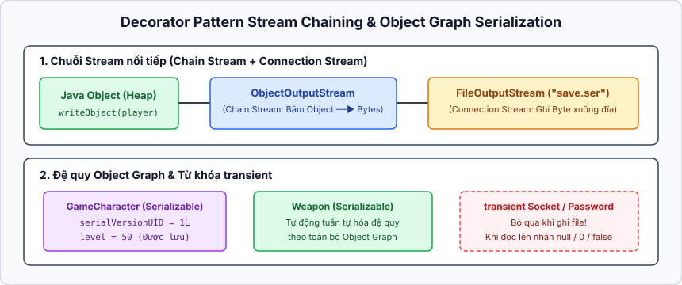
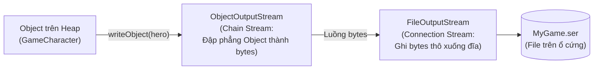

## Table of Contents
1. [Lưu trữ trạng thái: Khi nào dùng Serialization vs Plain Text?](#serialization-overview)
2. [Connection Streams vs Chain Streams (Decorator Pattern)](#streams-architecture)
3. [Cơ chế Tuần tự hóa (`Serializable`) hoạt động như thế nào?](#serialization)
4. [Từ khóa `transient`, Deserialization và `serialVersionUID`](#transient-keyword)
5. [Đọc/Ghi Text hiệu năng cao và NIO.2 (`java.nio.file`)](#modern-nio2)
6. [Tóm tắt & Ghi nhớ cốt lõi (Key Takeaways)](#key-takeaways)

---

## Lưu trữ trạng thái: Khi nào dùng Serialization vs Plain Text? {#serialization-overview}

Khi chương trình tắt đi, toàn bộ các object trên vùng nhớ Heap đều biến mất. Để lưu lại trạng thái (ví dụ lưu nhân vật game đang chơi dở), có hai hướng tiếp cận chính:

| Phương pháp | Khi nào nên sử dụng? | Cách thức hoạt động |
| :--- | :--- | :--- |
| **Object Serialization** (Tuần tự hóa đối tượng) | Khi dữ liệu đó **chỉ được đọc lại bởi một chương trình Java khác** (hoặc gửi qua mạng giữa các dịch vụ Java). | Đập phẳng (flatten) toàn bộ object trên Heap cùng các object liên kết thành luồng byte nhị phân rồi ghi ra file/mạng. |
| **Plain Text / CSV / JSON** (Văn bản thuần túy) | Khi dữ liệu cần **con người đọc hiểu được** hoặc cần chia sẻ cho **ngôn ngữ lập trình khác** (Python, JavaScript, Go...). | Chuyển đổi các thuộc tính thành chuỗi ký tự có quy ước phân tách (dấu phẩy, xuống dòng, hoặc định dạng JSON). |

---

## Connection Streams vs Chain Streams (Decorator Pattern) {#streams-architecture}

API I/O truyền thống của Java (`java.io`) được thiết kế dựa trên sự kết hợp giữa hai loại luồng (Streams):



1. **Connection Stream (Luồng kết nối mức thấp)**: Đại diện cho kết nối vật lý trực tiếp tới nguồn hoặc đích (ổ cứng, socket mạng) và chỉ biết đọc/ghi từng byte thô. Ví dụ: `FileOutputStream`, `FileInputStream`, `FileWriter`, `FileReader`.
2. **Chain Stream (Luồng mắc xích mức cao)**: Không thể tự kết nối trực tiếp tới file, mà phải **mắc nối (chain)** vào một luồng khác. Nó cung cấp các thao tác mức cao (như biến object thành byte, hoặc gom buffer dữ liệu để đọc từng dòng chữ). Ví dụ: `ObjectOutputStream`, `BufferedReader`, `BufferedWriter`.




```java
import java.io.*;

// Kết hợp Chain Stream bọc ngoài Connection Stream cùng try-with-resources:
try (FileOutputStream fileStream = new FileOutputStream("MyGame.ser");
     ObjectOutputStream os = new ObjectOutputStream(fileStream)) {

    os.writeObject(characterOne);
    os.writeObject(characterTwo);
} // Tự động gọi os.close() -> tự động đóng luôn fileStream bên trong!
```

---

## Cơ chế Tuần tự hóa (`Serializable`) hoạt động như thế nào? {#serialization}

### 1. `Serializable` là một Marker Interface
Để cho phép một class được serialize, class đó chỉ cần khai báo `implements Serializable` (thuộc gói `java.io`). Điểm đặc biệt là interface `Serializable` **không có bất kỳ method nào** cần phải override! Nó đóng vai trò là một **Marker Interface** (Interface đánh dấu) — giống như một con dấu xác nhận với JVM rằng các trường dữ liệu bên trong class này an toàn để đóng băng thành luồng byte.

### 2. Tự động lưu toàn bộ Đồ thị Đối tượng (Object Graph)
Khi gọi `os.writeObject(hero)`, chuyện gì xảy ra nếu object `GameCharacter` bên trong lại chứa một mảng `Weapon[] weapons`, và mỗi `Weapon` lại tham chiếu tới một object `Gem`?

Ta **không cần** phải tự lưu từng `Weapon` hay `Gem`! `ObjectOutputStream` sẽ tự động lần theo toàn bộ **đồ thị tham chiếu (Object Graph)** và lưu đệ quy tất cả các object mà `hero` trỏ tới để khi khôi phục lại, cấu trúc đối tượng được tái tạo nguyên vẹn như lúc ban đầu.

> [!WARNING]
> **Điều kiện sống còn (All-or-Nothing)**: Mọi object nằm trong đồ thị tham chiếu đều bắt buộc phải `implements Serializable`. Nếu chỉ cần **một** object con bên trong (ví dụ class `Weapon`) quên không `implements Serializable`, toàn bộ quá trình ghi sẽ thất bại ngay lập tức tại runtime với Exception **`java.io.NotSerializableException`** — trừ khi biến tham chiếu đó được đánh dấu là `transient`!

---

## Từ khóa `transient`, Deserialization và `serialVersionUID` {#transient-keyword}

### 1. Từ khóa `transient`: Bỏ qua trường không thể hoặc không nên lưu
Có hai lý do không nên lưu một biến instance khi serialize:
- **Lý do bảo mật**: Biến chứa thông tin nhạy cảm như mật khẩu (`password`), mã PIN, token.
- **Lý do kỹ thuật**: Biến phụ thuộc vào tài nguyên runtime sống động như kết nối mạng (`Socket`), luồng thực thi (`Thread`), hoặc kết nối cơ sở dữ liệu (`Connection`) — những thứ này không thể đóng băng và cũng vô nghĩa khi khôi phục lại ở lần chạy sau.

Chỉ cần thêm từ khóa **`transient`**, cơ chế Serialization sẽ bỏ qua biến đó:

```java
import java.io.Serializable;

public class GameCharacter implements Serializable {
    // Khuyến nghị khai báo tường minh định danh phiên bản của class:
    private static final long serialVersionUID = 1L;

    private final int power;
    private final String type;
    private transient String secretToken;      // Không lưu vì bảo mật
    private transient MyNetworkConnection net; // Không lưu vì không Serializable

    public GameCharacter(int power, String type, String secretToken) {
        this.power = power;
        this.type = type;
        this.secretToken = secretToken;
    }
}
```

Khi object được khôi phục lại (Deserialized), các trường `transient` sẽ nhận **giá trị mặc định** của kiểu dữ liệu (`null` đối với tham chiếu Object, `0` đối với số nguyên, `false` đối với `boolean`). Ngoài ra, các biến **`static`** cũng **không bao giờ được serialize** vì `static` thuộc về bản thân Class chứ không thuộc về từng instance riêng lẻ!

### 2. Quá trình Deserialization (`readObject()`) diễn ra như thế nào?
Khi đọc lại object từ file bằng `ObjectInputStream.readObject()`:
1. JVM đọc luồng byte và cấp phát vùng nhớ mới cho object trên Heap.
2. **Constructor của class Serializable KHÔNG được chạy!** Lý do: nếu chạy lại hàm khởi tạo, các câu lệnh gán ban đầu trong Constructor sẽ ghi đè và xóa sạch trạng thái đã lưu vừa đọc từ file lên.
3. Tuy nhiên, nếu class kế thừa từ một **lớp cha (Superclass) KHÔNG thực thi `Serializable`**, thì Constructor không tham số của lớp cha đó (và các lớp tổ tiên phía trên nó) **SẼ được chạy**.
4. Các trường dữ liệu được khôi phục lại giá trị tại thời điểm lưu; các trường `transient` được gán về giá trị mặc định.

### 3. Quản lý phiên bản lớp với `serialVersionUID`
Chuyện gì xảy ra nếu lưu object `GameCharacter` xuống file hôm nay, nhưng ngày mai lại sửa code class `GameCharacter` (xóa một biến hoặc đổi kiểu dữ liệu từ `int` sang `String`), rồi cố đọc lại file cũ?

Mỗi khi serialize, JVM tự tính một mã băm 64-bit gọi là **`serialVersionUID`** dựa trên cấu trúc class (tên class, các trường, chữ ký method) và đóng dấu vào file. Khi đọc lên bằng `readObject()`, JVM so sánh `serialVersionUID` của object trong file với `serialVersionUID` của class hiện tại trên máy. Nếu lệch nhau, JVM ném ngay **`java.io.InvalidClassException`**.

**Best practice**: Nếu dự kiến class có thể tiến hóa (như thêm thuộc tính mới) mà vẫn cần đọc được các object cũ đã lưu, hãy chủ động khai báo hằng số cố định:
`private static final long serialVersionUID = 1L;`
Khi đó, những thay đổi tương thích (như thêm trường mới — trường mới sẽ nhận giá trị mặc định khi đọc file cũ) sẽ không làm phát sinh `InvalidClassException`.

---

## Đọc/Ghi Text hiệu năng cao và NIO.2 (`java.nio.file`) {#modern-nio2}

### 1. Tại sao phải dùng `BufferedWriter` và `BufferedReader`?
Head First Java dùng hình ảnh ẩn dụ **Đi siêu thị bằng xe đẩy (Shopping Cart)**:
- Nếu dùng trực tiếp `FileWriter` mà không có `buffer`, mỗi lần gọi `writer.write(line)` là một lần hệ điều hành phải truy cập ổ cứng vật lý — giống như cần mua 20 món đồ ở siêu thị nhưng lại chạy từ nhà ra siêu thị 20 chuyến, mỗi chuyến chỉ xách về đúng 1 món!
- Khi bọc `BufferedWriter` bên ngoài, dữ liệu được gom vào một vùng nhớ đệm (`buffer`) trên RAM (chiếc xe đẩy). Chỉ khi nào xe đẩy đầy (hoặc khi gọi `writer.flush()` / `writer.close()`), hệ thống mới thực hiện **1 lần ghi xuống đĩa**, giúp tốc độ I/O nhanh hơn hàng chục đến hàng trăm lần.

### 2. Thế hệ I/O hiện đại: `java.nio.file` (`Path` và `Files`)
Trong Java hiện đại (Java 7+ và Java 11+), thay vì dùng class `java.io.File` cũ kỹ nhiều hạn chế, ta sử dụng bộ đôi **`Path`** (đại diện cho đường dẫn file/thư mục) và **`Files`** (class tiện ích chứa các method `static` thao tác file).

```java
import java.io.*;
import java.nio.file.*;
import java.util.List;
import java.util.stream.Stream;

public class ModernFileIO {
    public static void main(String[] args) throws IOException {
        Path path = Path.of("quiz-cards.txt");

        // 1. Ghi file với BufferedWriter kết hợp try-with-resources:
        try (BufferedWriter writer = Files.newBufferedWriter(path)) {
            writer.write("Serializable có bao nhiêu method? / Không có method nào (Marker Interface)\n");
            writer.write("Từ khóa nào bỏ qua biến khi serialize? / transient\n");
        }

        // 2. Đọc file lớn theo kiểu Stream (Lazy-loading từng dòng, không lo tràn RAM):
        try (Stream<String> lines = Files.lines(path)) {
            lines.filter(line -> line.contains("transient"))
                 .forEach(System.out::println);
        }

        // 3. Với file nhỏ, đọc/ghi nhanh chỉ bằng 1 dòng:
        List<String> allLines = Files.readAllLines(path);
    }
}
```

> [!TIP]
> Khi dùng **`Files.lines(path)`**, luồng Stream được nối trực tiếp với một kết nối file bên dưới để đọc từng dòng theo nhu cầu (lazy evaluation). Vì vậy, **bắt buộc phải đặt `Files.lines(path)` bên trong khối `try-with-resources`** để đảm bảo file descriptor của hệ điều hành được đóng lại sau khi duyệt xong Stream!

---

## Tóm tắt & Ghi nhớ cốt lõi (Key Takeaways) {#key-takeaways}

- **Decorator Design Pattern trong `java.io`**: Cách Java nối chuỗi `new BufferedReader(new InputStreamReader(new FileInputStream("a.txt")))` hoặc `new ObjectOutputStream(new FileOutputStream("a.ser"))` chính là ví dụ tiêu biểu của **Decorator Pattern** trong JDK. Các class bọc ngoài bổ sung thêm hành vi mới (buffering, chuyển đổi byte sang ký tự, serialize object) một cách linh hoạt tại runtime mà không làm thay đổi class luồng kết nối bên dưới.
- **Tóm tắt nhanh 4 điểm cốt lõi về Serialization**:
  1. *Quá trình Deserialization có gọi Constructor của class không?* **Không** đối với class `Serializable`, nhưng **Có** gọi Constructor không tham số của class cha đầu tiên không thực thi `Serializable`.
  2. *Biến `static` và `transient` có được lưu khi Serialize không?* **Không**. Khi Deserialize, biến `transient` về giá trị mặc định (`null`, `0`, `false`), còn biến `static` giữ nguyên giá trị hiện hành của Class trong JVM đang chạy.
  3. *Chuyện gì xảy ra nếu một thuộc tính Object bên trong không `implements Serializable`?* Ném **`NotSerializableException`** lúc chạy method `writeObject()`, trừ khi thuộc tính đó được khai báo là `transient` (hoặc đang mang giá trị `null`).
  4. *`serialVersionUID` dùng để làm gì?* Kiểm tra tính tương thích phiên bản giữa dữ liệu đã đóng băng và định nghĩa Class hiện tại; nếu không khớp sẽ ném **`InvalidClassException`**.
- **Tại sao nên ưu tiên `java.nio.file.Path` hơn `java.io.File`?**:
  - `File.delete()` hay `File.renameTo()` khi thất bại chỉ trả về `false` mà không cho biết lý do (do không có quyền, do file không tồn tại hay đang bị lock?). Ngược lại, `Files.delete(path)` ném `IOException` tường minh (`NoSuchFileException`, `AccessDeniedException`).
  - `Files` hỗ trợ đầy đủ Symbolic Links, thao tác atomic (`ATOMIC_MOVE`), quản lý metadata/permissions của hệ điều hành và tích hợp trực tiếp với Stream API (`Files.lines()`, `Files.walk()`).

### Tài liệu & Nguồn tham khảo
- [Oracle Java Object Serialization Specification (`Serializable`, `transient`, `serialVersionUID`)](https://docs.oracle.com/en/java/javase/17/docs/specs/serialization/index.html)
- [Dev.java — File I/O (Featuring NIO.2 `Path` and `Files`)](https://dev.java/learn/io/file-io/)
