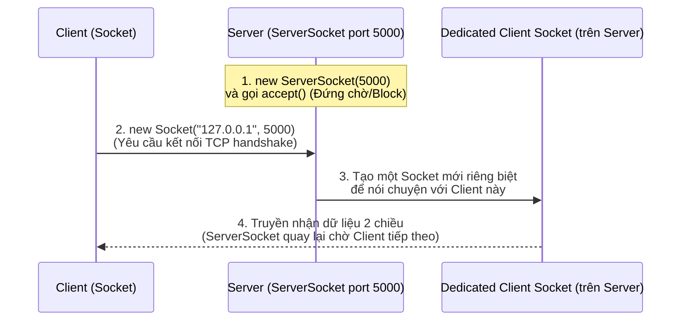
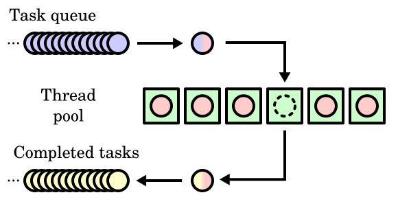
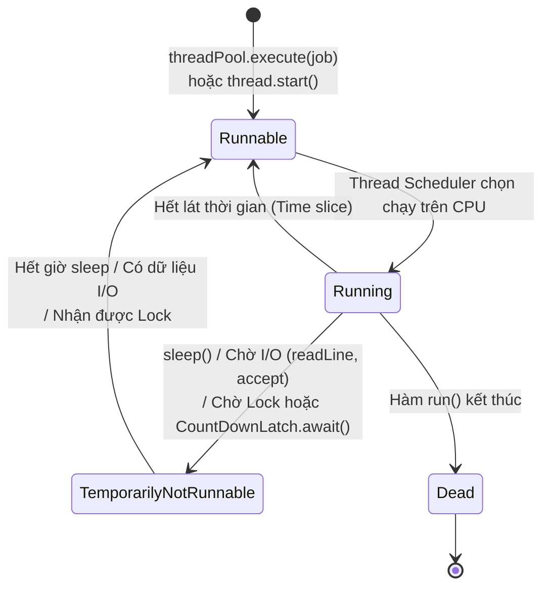

## Table of Contents
1. [Kết nối mạng qua TCP Sockets: IP Address và TCP Port](#sockets-intro)
2. [Giao tiếp hai chiều giữa Client và Server (`ServerSocket`)](#client-server)
3. [Nền tảng Đa luồng: `Runnable` (Job) vs `Thread` (Worker)](#why-threads)
4. [Bộ lập lịch luồng (Thread Scheduler) và Thread Pools (`ExecutorService`)](#runnable-thread)
5. [Tóm tắt & Ghi nhớ cốt lõi (Key Takeaways)](#key-takeaways)

---

## Kết nối mạng qua TCP Sockets: IP Address và TCP Port {#sockets-intro}

Để một chương trình Java trên máy khách (Client) giao tiếp được với một chương trình khác trên máy chủ (Server), cần thiết lập một kết nối **`java.net.Socket`**. Một kết nối Socket luôn đòi hỏi **2 mảnh thông tin**:

1. **IP Address (Địa chỉ IP)**: Xác định **cỗ máy vật lý/ảo nào** trên mạng Internet hay mạng nội bộ (ví dụ `127.0.0.1` hoặc `localhost` là chính máy hiện tại).
2. **TCP Port Number (Số hiệu cổng TCP - 16-bit từ `0` đến `65535`)**: Xác định **ứng dụng cụ thể nào** đang chạy bên trong cỗ máy đó.

Hãy hình dung **IP Address** là địa chỉ tòa nhà chung cư công ty, còn **TCP Port** là số máy lẻ nội bộ (extension) của từng phòng ban bên trong tòa nhà:
- **Các port từ `0` đến `1023` (Well-known Ports)**: Đã được quy hoạch cứng cho các dịch vụ chuẩn toàn cầu (như HTTP dùng port `80`, HTTPS dùng port `443`, SSH port `22`, SMTP port `25`). Không sử dụng dải port này cho ứng dụng tự viết!
- **Các port từ `1024` đến `65535`**: Dành cho các ứng dụng người dùng tự định nghĩa (ví dụ `5000`, `8080`).

### Đọc và Ghi dữ liệu qua Socket
Bản thân `Socket` chỉ cung cấp luồng byte mức thấp (`InputStream` và `OutputStream`). Để truyền nhận văn bản dòng chữ dễ dàng, ta nối chuỗi (chain) với **`BufferedReader`** (để đọc từng dòng) và **`PrintWriter`** (để gửi từng dòng):

```java
import java.io.*;
import java.net.Socket;

public class SimpleChatClient {
    public static void main(String[] args) {
        // Kết nối tới Server tại localhost, cổng 5000:
        try (Socket socket = new Socket("127.0.0.1", 5000);
             // Chiều ĐỌC từ Server: Socket InputStream -> InputStreamReader -> BufferedReader
             BufferedReader reader = new BufferedReader(
                     new InputStreamReader(socket.getInputStream()));
             // Chiều GHI lên Server: Socket OutputStream -> PrintWriter (autoFlush = true)
             PrintWriter writer = new PrintWriter(socket.getOutputStream(), true)) {

            // Gửi tin nhắn lên Server:
            writer.println("Xin chào Server từ Java Client!");

            // Đọc phản hồi từ Server:
            String response = reader.readLine();
            System.out.println("Server trả lời: " + response);

        } catch (IOException e) {
            e.printStackTrace();
        }
    }
}
```

*(Lưu ý: Trong Java hiện đại, ngoài `Socket`, ta cũng có thể dùng `SocketChannel` trong gói `java.nio.channels` kết hợp với `Channels.newReader(channel, StandardCharsets.UTF_8)` và `Channels.newWriter(...)`).*

---

## Giao tiếp hai chiều giữa Client và Server (`ServerSocket`) {#client-server}

Ở phía Server, làm sao có thể phục vụ hàng chục Client kết nối tới cùng lúc trên một port `5000`? Câu trả lời nằm ở sự phối hợp giữa **`ServerSocket`** (tổng đài tiếp nhận kết nối) và **`Socket`** (đường dây đàm thoại riêng):



1. Server khởi tạo `new ServerSocket(5000)` để lắng nghe ở port `5000`.
2. Server gọi **`serverSocket.accept()`**. Method này sẽ **chặn (block)** thread hiện tại — tức là đứng im chờ đợi cho tới khi có một Client kết nối tới.
3. Ngay khi một Client kết nối, `accept()` trả về một object **`Socket` hoàn toàn mới** trên Server dành riêng để giao tiếp với Client đó, còn `ServerSocket` lập tức rảnh tay để quay lại vòng lặp gọi `accept()` đón kết nối tiếp theo!

---

## Nền tảng Đa luồng: `Runnable` (Job) vs `Thread` (Worker) {#why-threads}

Tại sao khi viết ứng dụng mạng (như Chat Client/Server), bắt buộc phải dùng **Đa luồng (Multithreading)**?
Vì hàm đọc dữ liệu từ mạng (`reader.readLine()`) và hàm chờ kết nối (`serverSocket.accept()`) là các thao tác **Blocking I/O**. Nếu chạy `reader.readLine()` ngay trên thread giao diện chính, toàn bộ cửa sổ ứng dụng sẽ bị treo cứng cho tới khi có tin nhắn mới gửi về!

### Mỗi Thread là một Call Stack độc lập
Mỗi khi chương trình Java khởi chạy, JVM tạo ra một thread chính có method `main()` nằm dưới đáy ngăn xếp lời gọi hàm (**Call Stack**). Khi khởi tạo một thread mới, JVM sẽ cấp phát một **Call Stack hoàn toàn mới và độc lập** cho thread đó, cho phép các công việc diễn ra đồng thời.

### Tách biệt Công việc (`Runnable`) và Người làm (`Thread`)
Trong thiết kế hướng đối tượng của Java, việc chạy đa luồng được tách làm 2 khái niệm rõ ràng:
- **`Runnable` (The Job - Bản mô tả công việc)**: Là một Functional Interface chỉ có đúng 1 method `public void run()`. Đây là nơi định nghĩa các câu lệnh sẽ nằm ở đáy của Call Stack mới.
- **`Thread` (The Worker - Người thực thi)**: Là object quản lý luồng thực thi. Ta truyền bản mô tả công việc (`Runnable`) vào `Thread`, rồi kích hoạt cho thread bắt đầu chạy.

> [!IMPORTANT]
> **Phân biệt `thread.start()` và `thread.run()`:**
> - Gọi **`thread.start()`**: Yêu cầu JVM và Hệ điều hành cấp phát một **Call Stack mới (thread thực thi mới)**, sau đó JVM sẽ tự động gọi hàm `run()` bên trong Call Stack mới đó. Đây mới thực sự là chạy đa luồng!
> - Gọi trực tiếp **`thread.run()`**: **KHÔNG có bất kỳ thread mới nào được tạo ra!** Nó chỉ đơn thuần là một lời gọi hàm bình thường ngay trên Call Stack hiện tại (giống như gọi bất kỳ method nào khác), khiến thread hiện tại phải tự chạy xong hàm `run()` rồi mới đi tiếp.

---

## Bộ lập lịch luồng (Thread Scheduler) và Thread Pools (`ExecutorService`) {#runnable-thread}

### 1. Tại sao dùng `ExecutorService` thay vì `new Thread(job).start()`?
Việc tạo mới một object `new Thread()` không hề rẻ: nó đòi hỏi cấp phát bộ nhớ riêng cho Call Stack (thường từ vài trăm KB đến 1MB mỗi thread) và tốn chi phí chuyển ngữ cảnh (context switching) của hệ điều hành. Nếu một Server tạo mới `new Thread()` cho mỗi request khi có `10000` người dùng truy cập cùng lúc, máy chủ sẽ nhanh chóng sập vì `OutOfMemoryError`.

Từ Java 5+, cách tiếp cận tiêu chuẩn là sử dụng **Thread Pool (`ExecutorService`)** thuộc gói `java.util.concurrent`:


*Hình 17.1: Kiến trúc hoạt động của một Thread Pool: các Task mới được đẩy vào Task Queue, và một tập cố định các Worker Threads liên tục lấy Task ra xử lý rồi tái sử dụng*

```java
import java.util.concurrent.ExecutorService;
import java.util.concurrent.Executors;

public class ThreadPoolDemo {
    public static void main(String[] args) {
        // Tạo Thread Pool gồm 2 worker thread được tái sử dụng liên tục:
        ExecutorService threadPool = Executors.newFixedThreadPool(2);

        // Giao 2 công việc bằng Lambda (vì Runnable là Functional Interface):
        threadPool.execute(() -> runJob("Job 1"));
        threadPool.execute(() -> runJob("Job 2"));

        // Ngừng nhận việc mới và đóng pool sau khi các việc đang chạy hoàn tất:
        threadPool.shutdown();
    }

    private static void runJob(String jobName) {
        String threadName = Thread.currentThread().getName();
        System.out.println(jobName + " đang chạy trên thread: " + threadName);
    }
}
```

Các loại Thread Pool thường gặp từ `Executors`:
- **`Executors.newFixedThreadPool(int n)`**: Giới hạn số lượng thread tối đa là `n`. Nếu mọi thread đều bận, công việc mới sẽ xếp hàng trong một `BlockingQueue` chờ tới lượt. Phù hợp cho Server chịu tải cao cần kiểm soát tài nguyên.
- **`Executors.newCachedThreadPool()`**: Tự động tái sử dụng các thread đang rảnh rỗi hoặc tạo thêm thread mới nếu cần, và tự hủy các thread không dùng tới sau 60 giây. Cần cẩn thận nếu số lượng tác vụ tăng đột biến không giới hạn.
- **`Executors.newSingleThreadExecutor()`**: Chỉ sử dụng đúng 1 thread chạy tuần tự từng việc trong hàng đợi.

### 2. Sự bất định của Bộ lập lịch luồng (Thread Scheduler)
Ai quyết định thread nào được chạy trên CPU, chạy trong bao lâu rồi bị tạm dừng để nhường chỗ cho thread khác? Đó là **Thread Scheduler** của hệ điều hành.

Lập trình viên **không thể kiểm soát** và **không bao giờ được viết code phụ thuộc vào thứ tự chạy ngẫu nhiên của Thread Scheduler**! Cùng một đoạn code chạy 10 lần có thể cho ra 10 thứ tự in ra màn hình khác nhau.



Để điều phối thứ tự giữa các thread (ví dụ bắt thread A phải đợi thread B chuẩn bị xong môi trường):
- **`Thread.sleep(millis)`**: Đưa thread hiện tại vào trạng thái ngủ trong tối thiểu `millis` mili-giây để nhường CPU cho thread khác, nhưng **vẫn không đảm bảo tuyệt đối** mặt thời gian khi hệ thống quá tải.
- **`CountDownLatch` (`java.util.concurrent`)**: Công cụ đồng bộ hóa chuẩn xác kiểu "rào chắn đếm ngược". Các thread gọi `latch.await()` sẽ đứng chờ tại vạch xuất phát cho tới khi các thread khác gọi `latch.countDown()` đủ số lần làm bộ đếm về `0`, giúp kiểm soát thứ tự thực thi một cách tất định (deterministic).

---

## Tóm tắt & Ghi nhớ cốt lõi (Key Takeaways) {#key-takeaways}

- **Tại sao nên implement `Runnable` thay vì kế thừa `extends Thread`?**:
  1. **Đơn kế thừa trong Java**: Java chỉ cho phép một class `extends` tối đa 1 class cha. Nếu `extends Thread`, class đó mất đi cơ hội kế thừa một class nghiệp vụ khác; trong khi `implements Runnable` vẫn hoàn toàn tự do.
  2. **Tách biệt trách nhiệm (Separation of Concerns / Composition over Inheritance)**: `Runnable` đại diện cho *công việc cần làm* (Task), còn `Thread` hay `ExecutorService` đại diện cho *cơ chế thực thi công việc đó* (Runner). Một `Runnable` có thể dễ dàng đưa vào `ExecutorService`, điều mà việc kế thừa cứng `Thread` làm mất đi tính linh hoạt.
- **`thread.start()` vs `thread.run()`**: Luôn nhớ `start()` mới tạo Call Stack mới; `run()` chỉ chạy đồng bộ ngay trên Call Stack hiện tại. Ngoài ra, một object `Thread` sau khi đã chạy xong (`Dead`), nếu gọi `start()` lần thứ hai sẽ ném ngay Exception **`IllegalThreadStateException`**.
- **Quy trình `ServerSocket` đa Client**: Server dùng 1 thread chính chạy vòng lặp `while` gọi `Socket clientSocket = serverSocket.accept()`, và mỗi khi có một `clientSocket` mới trả về, Server lập tức giao `clientSocket` đó cho một `ExecutorService` (`threadPool.execute(new ClientHandler(clientSocket))`) để xử lý đọc/ghi độc lập mà không làm nghẽn các Client khác đang chờ kết nối.
- **Đóng `ExecutorService` đúng cách**:
  - `pool.shutdown()`: Ngừng nhận thêm việc mới, nhưng vẫn chờ các việc đã giao chạy cho đến khi hoàn thành.
  - `pool.shutdownNow()`: Cố gắng ngắt (`interrupt`) các thread đang chạy và trả về danh sách các công việc đang chờ trong hàng đợi nhưng chưa được bắt đầu.

### Tài liệu & Nguồn tham khảo
- [Java SE 17 API Javadoc — `java.nio.channels.SocketChannel` & `java.util.concurrent.Executors`](https://docs.oracle.com/en/java/javase/17/docs/api/java.base/java/util/concurrent/Executors.html)
- [JEP 444 — Virtual Threads (Project Loom in Java 21)](https://openjdk.org/jeps/444)
