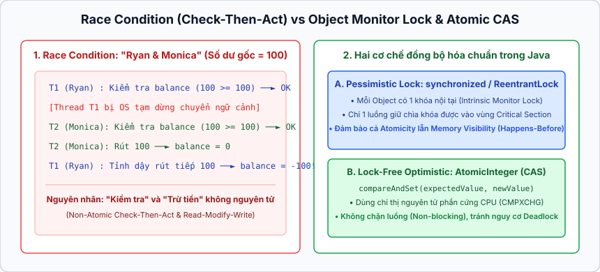
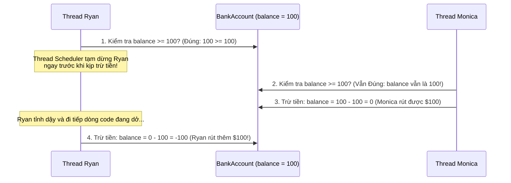

## Table of Contents
1. [Bài toán "Ryan và Monica": Race Conditions & Lost Updates](#race-conditions)
2. [Khóa đối tượng với `synchronized` và Hiểm họa Deadlock](#synchronized-keyword)
3. [Dữ liệu bất biến (Immutable Objects) và Biến nguyên tử (`Atomic*`)](#immutable-data)
4. [Thread-Safe Collections trong `java.util.concurrent`](#modern-concurrency)
5. [Tóm tắt & Ghi nhớ cốt lõi (Key Takeaways)](#key-takeaways)

---

## Bài toán "Ryan và Monica": Race Conditions & Lost Updates {#race-conditions}

Head First Java mở đầu chương này bằng câu chuyện kinh điển về cặp đôi **Ryan và Monica**:
- Cả hai dùng chung **1 tài khoản ngân hàng (`BankAccount`)** có số dư đúng **`$100`**, với quy định không bao giờ được rút âm tiền (overdrawn).
- Mỗi người là một thread thực thi (`Thread`) độc lập cùng gọi vào method rút tiền `spend(100)`:

```java
public class BankAccount {
    private int balance = 100;

    public void spend(int amount) {
        if (balance >= amount) { // Bước 1: Kiểm tra số dư
            // Giả sử đúng lúc này Thread Scheduler tạm dừng thread của Ryan!
            balance = balance - amount; // Bước 2: Trừ tiền
        }
    }
}
```

Kịch bản thảm họa (**Race Condition** dạng *Check-Then-Act*) diễn ra như sau:





### Tại sao phép toán `balance -= amount` hay `balance++` KHÔNG phải là nguyên tử (Non-atomic)?
Dù trên code Java chỉ viết đúng 1 dòng `balance++` (hoặc `balance = balance - amount`), nhưng ở tầng bytecode và CPU, thao tác này bị tách thành **3 bước riêng biệt** (Read - Modify - Write):
1. **Read**: Đọc giá trị hiện tại của `balance` từ bộ nhớ RAM vào thanh ghi CPU.
2. **Modify**: Cộng/trừ giá trị trong thanh ghi CPU.
3. **Write**: Ghi kết quả mới từ thanh ghi CPU ngược trở lại biến `balance` trên RAM.

Nếu hai thread cùng đọc thấy `balance = 0` ở bước 1, cả hai cùng cộng `1` ở bước 2 và cùng ghi `1` xuống ở bước 3, thì sau 2 lần tăng, kết quả cuối cùng chỉ là `1` thay vì `2`! Hiện tượng mất mát dữ liệu này được gọi là **Lost Update**.

---

## Khóa đối tượng với `synchronized` và Hiểm họa Deadlock {#synchronized-keyword}

### 1. Biến khối lệnh thành Nguyên tử (Atomic) với `synchronized`
Để giải quyết bài toán của Ryan và Monica, kiểm tra số dư và trừ tiền phải hợp nhất thành một **thao tác nguyên tử (Atomic operation)** — tức là một khi thread của Ryan đã bước vào hàm `spend()`, nó phải chạy một mạch đến hết hàm mới được phép có thread khác bước vào:

```java
public class BankAccount {
    private int balance = 100;

    // Thêm từ khóa synchronized: Chỉ 1 thread được vào tại một thời điểm!
    public synchronized void spend(String name, int amount) {
        if (balance >= amount) {
            balance = balance - amount;
        } else {
            System.out.println("Xin lỗi " + name + ", tài khoản không đủ tiền!");
        }
    }
}
```

### 2. Cơ chế hoạt động của Khóa (`Intrinsic Lock` / `Monitor`)
Một hiểu lầm thường gặp là nghĩ rằng từ khóa `synchronized` khóa *method* lại. Thực tế: **Chiếc khóa thuộc về Đối tượng trên Heap (Object), KHÔNG thuộc về method!**

- Mỗi object Java trên Heap đều có sẵn **đúng 1 chiếc khóa nội tại (Intrinsic Lock / Monitor)** đi kèm với **1 chiếc chìa khóa**.
- Chiếc khóa này chỉ phát huy tác dụng khi object có các method (hoặc khối lệnh) đánh dấu `synchronized`.
- Khi một thread bước vào **bất kỳ** method `synchronized` nào của đối tượng `account`, nó lấy mất chiếc chìa khóa riêng của `account` đó.
- Trong lúc chiếc chìa khóa đang bị giữ, **không một thread nào khác** có thể bước vào **bất kỳ** method `synchronized` nào trên cùng đối tượng `account` đó (chúng phải đứng đợi cho tới khi thread kia thoát khỏi hàm `synchronized` và trả lại chìa khóa). Các method bình thường (không có `synchronized`) vẫn được truy cập tự do.

> [!IMPORTANT]
> **Không phải cứ `synchronized` càng nhiều càng tốt!** Việc lấy và nhả lock tốn chi phí hiệu năng, đồng thời ép các thread phải xếp hàng chờ đợi tuần tự (làm mất đi lợi thế song song của đa luồng). Tệ hơn, lạm dụng lock lồng nhau có thể dẫn tới thảm họa **Deadlock**.

### 3. Deadlock (Khóa chết): Khi hai luồng chờ nhau mãi mãi
**Deadlock** xảy ra khi hai (hoặc nhiều) thread cùng giữ chiếc chìa khóa mà thread kia đang cần để đi tiếp:
1. **Thread A** bước vào hàm `foo()` của **Object X** (giữ chìa khóa **X**), và bên trong đó gọi tiếp hàm đồng bộ của **Object Y** (đang cần chìa khóa **Y**).
2. Cùng lúc đó, **Thread B** bước vào hàm `bar()` của **Object Y** (giữ chìa khóa **Y**), và bên trong đó lại gọi hàm đồng bộ của **Object X** (đang cần chìa khóa **X**).
3. Kết quả: Thread A ngồi chờ Thread B nhả khóa Y, còn Thread B ngồi chờ Thread A nhả khóa X. Cả hai bị treo cứng vĩnh viễn và JVM không có cơ chế tự động phá vỡ Deadlock!

**Cách phòng tránh Deadlock**:
- Tránh gọi một method `synchronized` của object khác từ bên trong một khối `synchronized`.
- Nếu bắt buộc phải lấy nhiều lock, mọi thread trong chương trình phải tuân thủ **cùng một thứ tự lấy khóa cố định (Lock Ordering)** (ví dụ: luôn lấy khóa X trước rồi mới lấy khóa Y).

---

## Dữ liệu bất biến (Immutable Objects) và Biến nguyên tử (`Atomic*`) {#immutable-data}

Điều kiện cần và đủ để xảy ra Race Condition là: **Chia sẻ dữ liệu (Shared)** + **Dữ liệu đó có thể bị sửa đổi (Mutable)**. Nếu loại bỏ yếu tố *Mutable* hoặc sử dụng các thao tác atomic ở tầng phần cứng, ta sẽ không cần tới khóa `synchronized`!

### 1. Đối tượng Bất biến (Immutable Objects)
Một object được gọi là **Bất biến (Immutable)** nếu trạng thái bên trong của nó **không thể thay đổi** sau khi hàm khởi tạo (Constructor) chạy xong (tiêu biểu là `String`, `Integer`, `LocalDate`, và các class `record` từ Java 16+).

- Khi hàng trăm thread cùng đọc một object Immutable, **không bao giờ có Race Condition, không có Lost Update, và không bao giờ cần `synchronized` hay sợ Deadlock!**
- Để tạo một class Immutable:
  1. Khai báo tất cả các trường dữ liệu là `private final`.
  2. Không cung cấp bất kỳ method `setter` nào làm biến đổi dữ liệu.
  3. Nếu cần thay đổi giá trị, hãy trả về một **object mới** chứa giá trị đã cập nhật.
  4. Nếu class có chứa tham chiếu tới một object khả biến (như `List` hay mảng), phải tạo bản sao bảo vệ (Defensive Copy) hoặc bọc bằng `Collections.unmodifiableList(...)`.

```java
// Sử dụng Java Record (Java 16+) để tạo lớp Immutable cực kỳ ngắn gọn:
public record CustomerBalance(String name, int balance) {}
```

### 2. Biến nguyên tử (`AtomicInteger`, `AtomicLong`, `AtomicReference`)
Nếu chỉ cần đếm số lượng hoặc cập nhật một biến đơn lẻ giữa nhiều thread (như bộ đếm lượt truy cập hay số dư tài khoản), dùng `synchronized` là quá nặng nề. Gói `java.util.concurrent.atomic` cung cấp các class **`Atomic*`** sử dụng cơ chế **CAS (Compare-And-Swap)** được hỗ trợ trực tiếp bởi tập lệnh phần cứng CPU (Lock-free):

```java
import java.util.concurrent.atomic.AtomicInteger;

public class AtomicBankAccount {
    private final AtomicInteger balance = new AtomicInteger(100);

    public void spend(String name, int amount) {
        int initialBalance = balance.get();
        if (initialBalance >= amount) {
            // compareAndSet(giá_trị_kỳ_vọng, giá_trị_mới):
            // Chỉ trừ tiền thành công nếu số dư hiện tại VẪN đúng bằng initialBalance lúc nãy vừa đọc!
            boolean success = balance.compareAndSet(initialBalance, initialBalance - amount);
            if (!success) {
                System.out.println("Xin lỗi " + name + ", có người khác vừa rút tiền trước đó!");
            }
        }
    }
}
```

Các method atomic thông dụng trên `AtomicInteger`:
- `incrementAndGet()` / `decrementAndGet()`: Tương đương `++i` và `--i` nhưng an toàn đa luồng 100%.
- `addAndGet(int delta)`: Cộng thêm `delta` một cách nguyên tử.
- `compareAndSet(int expectedValue, int newValue)`: Trọng tâm của thuật toán CAS — so sánh giá trị hiện tại trong bộ nhớ với `expectedValue`; nếu khớp thì cập nhật sang `newValue` và trả về `true`, nếu đã bị thread khác sửa mất thì bỏ qua và trả về `false`.

---

## Thread-Safe Collections trong `java.util.concurrent` {#modern-concurrency}

Các cấu trúc dữ liệu chuẩn như `ArrayList`, `HashMap`, `HashSet` hoàn toàn **không an toàn đa luồng (Not Thread-Safe)**. Nếu một thread đang duyệt danh sách trong khi một thread khác thêm hoặc xóa phần tử, chương trình sẽ ném Exception **`ConcurrentModificationException`** (cơ chế *fail-fast*) hoặc làm hỏng cấu trúc dữ liệu bên trong.

Thay vì dùng các class cổ điển chậm chạp khóa toàn bộ tập hợp như `Vector`, `Hashtable` hay `Collections.synchronizedList()`, Java hiện đại cung cấp các Collection chuyên dụng:

| Cấu trúc dữ liệu | Cơ chế hoạt động | Khi nào nên sử dụng? |
| :--- | :--- | :--- |
| **`CopyOnWriteArrayList`** / **`CopyOnWriteArraySet`** | Mỗi khi có thao tác **Ghi** (`add`, `set`, `remove`), nó tạo ra một **bản sao hoàn toàn mới** của mảng bên dưới. Thao tác **Đọc** không cần bất kỳ lock nào vì luôn đọc trên mảng bất biến tại thời điểm đó. | Khi tần suất **Đọc rất nhiều nhưng Ghi/Sửa rất hiếm** (ví dụ: danh sách các `ActionListener` đã đăng ký nhận sự kiện!). |
| **`ConcurrentHashMap`** | Chia nhỏ việc lock ở mức từng nhóm phần tử (bucket/node) kết hợp với thao tác CAS thay vì khóa cứng toàn bộ bảng băm như `Hashtable`. | Khi cần một `Map` hiệu năng cao cho cả **Đọc và Ghi đồng thời** từ nhiều thread. |

---

## Tóm tắt & Ghi nhớ cốt lõi (Key Takeaways) {#key-takeaways}

- **`synchronized` trên instance method vs `static synchronized` method**:
  - Method `public synchronized void doStuff()` khóa trên **instance đối tượng hiện tại (`this`)**. Hai thread gọi trên 2 object khác nhau (`acc1.doStuff()` và `acc2.doStuff()`) sẽ không chặn nhau.
  - Method `public static synchronized void doStatic()` khóa trên **object `Class` đại diện cho lớp đó (`BankAccount.class`)** trên vùng nhớ Metaspace. Chỉ 1 thread trong toàn bộ JVM được chạy hàm `static synchronized` của class đó tại một thời điểm, và lock này hoàn toàn tách biệt với lock của các instance!
- **Bảng phân biệt 3 công cụ đồng bộ hóa (`volatile` vs `AtomicInteger` vs `synchronized`)**:

| Tiêu chí | `volatile` | `AtomicInteger` / `AtomicReference` | `synchronized` |
| :--- | :--- | :--- | :--- |
| **Tính nhìn thấy (Visibility)** | **Có** (Đọc/ghi trực tiếp RAM, không giữ bản cũ ở CPU cache) | **Có** (Bên trong dùng biến `volatile`) | **Có** (Khi nhả lock sẽ đẩy dữ liệu mới xuống bộ nhớ chính) |
| **Tính nguyên tử (Atomicity)** | **Không** (`count++` trên biến `volatile` vẫn bị Race Condition!) | **Có** cho biến đơn lẻ (dựa trên phần cứng **CAS**) | **Có** cho cả một khối lệnh phức tạp và nhiều biến cùng lúc |
| **Cơ chế khóa (Blocking)** | Non-blocking (Không khóa) | Non-blocking (Lock-free, thử lại nếu CAS thất bại) | Blocking (Thread khác phải ngủ chờ lấy lock, có nguy cơ Deadlock) |
| **Trường hợp sử dụng chuẩn** | Biến cờ trạng thái 1 thread ghi, nhiều thread đọc (`volatile boolean running = true`) | Bộ đếm đa luồng (`incrementAndGet`), cập nhật trạng thái đơn bằng `compareAndSet` | Giao dịch phức hợp liên quan đến nhiều biến hoặc logic có điều kiện phức tạp |

- **Tại sao `CopyOnWriteArrayList` không ném `ConcurrentModificationException`?**: Vì Iterator của nó duyệt trên một bản chụp (snapshot) mảng không bao giờ thay đổi tại thời điểm tạo Iterator, trong khi mọi thao tác thêm/xóa của thread khác đều tạo ra một mảng mới ở vùng nhớ khác. Đổi lại, nếu dùng `CopyOnWriteArrayList` cho bài toán ghi liên tục, bộ nhớ sẽ bị cấp phát mảng mới liên tục gây quá tải Garbage Collector.

### Tài liệu & Nguồn tham khảo
- [Java SE 17 API Javadoc — Package `java.util.concurrent.atomic` (Lock-Free CAS)](https://docs.oracle.com/en/java/javase/17/docs/api/java.base/java/util/concurrent/atomic/package-summary.html)
- [JEP 395 — Records (Immutable Data Carriers in Java 16+)](https://openjdk.org/jeps/395)
- [Brian Goetz et al. — *Java Concurrency in Practice*](https://jcip.net/)
