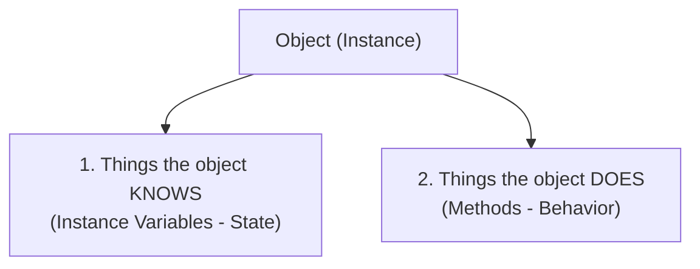

## Table of Contents
1. [Câu chuyện Brad (Procedural) vs Larry (OOP)](#brad-vs-larry)
2. [Class không phải là Object: Khuôn bánh vs Chiếc bánh](#class-vs-object)
3. [Hai nửa của một Object: State (Trạng thái) & Behavior (Hành vi)](#state-and-behavior)
4. [Tạo Object đầu tiên và vùng nhớ Garbage-Collectible Heap](#creating-first-object)
5. [Thực hành thiết kế OOP: Trò chơi đoán số GuessGame](#guess-game-project)
6. [Tóm tắt & Ghi nhớ cốt lõi (Key Takeaways)](#key-takeaways)

---

## Câu chuyện Brad (Procedural) vs Larry (OOP) {#brad-vs-larry}

Mở đầu chương 2, sách kể câu chuyện kinh điển về cuộc đua thiết kế phần mềm giữa **Brad** (lập trình thủ tục - Procedural) và **Larry** (lập trình hướng đối tượng - OOP):

- **Đề bài ban đầu**: Viết chương trình xoay các hình `Square`, `Circle`, `Triangle` trên màn hình và phát âm thanh `.aif` khi click vào.
  - **Cách của Brad (Procedural)**: Viết 2 hàm lớn `rotate(shapeNum)` và `playSound(shapeNum)` dùng `if/else` hoặc `switch` kiểm tra xem `shapeNum` là hình gì để xoay và phát nhạc.
  - **Cách của Larry (OOP)**: Tạo 3 class riêng biệt `Square`, `Circle`, `Triangle`. Mỗi hình tự đóng gói logic `rotate()` và `playSound()` của riêng nó.
- **Khi phát sinh thay đổi yêu cầu (Change Request)**: *"Thêm hình `Amoeba` (trùng biến hình), nhưng khi xoay nó sẽ xoay quanh một tọa độ ở đầu mút, và phát file âm thanh `.hif` thay vì `.aif`!"*
  - **Vấn đề của Brad**: Phải mở lại hàm `rotate()` và `playSound()` vốn đang chạy ổn định để sửa code, thêm tham số tọa độ `x, y` và thêm nhánh `if (shapeNum == 4)`. Sửa 1 chỗ dễ làm phát sinh regression bug ở nhiều chỗ khác.
  - **Lợi thế của Larry**: Không chạm vào bất kỳ dòng code nào của `Square`, `Circle`, `Triangle` đã test kỹ. Chỉ cần viết thêm một class `Amoeba` mới có method `rotate()` và `playSound()` riêng.

> [!IMPORTANT]
> **Bài học cốt lõi của OOP**: Phần mềm luôn thay đổi. OOP cho phép **mở rộng tính năng mới bằng cách viết thêm class mới thay vì sửa chữa code cũ đang chạy ổn định** (nền tảng của nguyên lý **Open/Closed Principle** trong SOLID).

---

## Class không phải là Object: Khuôn bánh vs Chiếc bánh {#class-vs-object}

Người mới học thường dễ đánh đồng Class và Object, nhưng hình ảnh ẩn dụ trong sách giúp phân tách rất rõ:


| Khái niệm | Hình ảnh ẩn dụ | Bản chất trong Java |
| :--- | :--- | :--- |
| **Class** | **Khuôn cắt bánh quy** (hoặc Bản thiết kế ngôi nhà) | Chỉ là bản thiết kế tĩnh (file `.class`), quy định mọi object thuộc kiểu này sẽ có những dữ liệu gì và thực hiện được hành vi gì. |
| **Object** | **Chiếc bánh quy thực tế** (hoặc Ngôi nhà đã xây xong) | Là thực thể sống (instance) được khởi tạo từ Class lúc Runtime, chiếm vùng nhớ thực sự trên **Heap**. Từ 1 Class có thể tạo ra hàng ngàn Object độc lập. |

---

## Hai nửa của một Object: State (Trạng thái) & Behavior (Hành vi) {#state-and-behavior}

Mỗi object trong thế giới OOP luôn xoay quanh 2 câu hỏi: **"Object biết gì?"** và **"Object làm được gì?"**



1. **Things an object knows about itself -> Instance Variables (State)**:
   - Đại diện cho dữ liệu, thuộc tính riêng của từng instance (ví dụ: mỗi object `Dog` có `size`, `breed`, `name` riêng).
2. **Things an object can do -> Methods (Behavior)**:
   - Đại diện cho các thao tác mà object thực hiện được (ví dụ: `bark()`, `eat()`, `chaseCat()`). Thông thường, **Methods sẽ đọc và cập nhật các Instance Variables**.

```java
public class Dog {
    // 1. STATE (Instance Variables) - Mỗi instance Dog giữ một bản sao riêng
    int size;
    String breed;
    String name;

    // 2. BEHAVIOR (Methods) - Hành vi của object
    void bark() {
        System.out.println(name + " sủa: Gâu! Gâu!");
    }
}
```

---

## Tạo Object đầu tiên và vùng nhớ Garbage-Collectible Heap {#creating-first-object}

Để kiểm thử một class, thông lệ trong sách là tách thêm một class chạy thử (thường đặt hậu tố `TestDrive` chứa hàm `main`):

```java
public class DogTestDrive {
    public static void main(String[] args) {
        // Bước 1: Dùng toán tử 'new' để cấp phát một instance Dog trên vùng nhớ Heap
        Dog d = new Dog();

        // Bước 2: Dùng toán tử dấu chấm (Dot operator '.') để gán trạng thái
        d.size = 40;
        d.name = "Milu";

        // Bước 3: Dùng dấu chấm '.' để gọi method trên object
        d.bark();
    }
}
```

### Chuyện gì xảy ra trong bộ nhớ khi gọi `new Dog()`?
- Mỗi khi toán tử `new` thực thi, JVM cấp phát một vùng nhớ trên **Garbage-Collectible Heap** để chứa instance `Dog` cùng các biến instance (`size`, `breed`, `name`) của riêng nó.
- Vùng nhớ này được gọi là **Garbage-Collectible Heap** vì developer chỉ cần `new` object ra sử dụng mà không phải tự giải phóng bộ nhớ thủ công (`free`/`delete` như C/C++). Khi JVM phát hiện một Object không còn bất kỳ reference nào trỏ tới, **Garbage Collector (GC)** sẽ tự động thu hồi RAM.

---

## Thực hành thiết kế OOP: Trò chơi đoán số GuessGame {#guess-game-project}

Thay vì dồn toàn bộ logic vào hàm `main()` (viết hết logic vào `main()` thực chất vẫn là lập trình thủ tục), bài toán được tách thành 3 class tương tác với nhau: `GuessGame` (điều phối ván chơi), `Player` (người chơi), và `GameLauncher` (chỉ chứa `main()` để kích hoạt).

```java
import java.util.Random;

// 1. Class Người chơi
class Player {
    int number = 0; // State: lưu con số người chơi đoán

    public void guess() {
        number = new Random().nextInt(10);
        System.out.println("Người chơi đoán số: " + number);
    }
}

// 2. Class Trò chơi
class GuessGame {
    // GuessGame giữ 3 biến instance đại diện cho 3 người chơi
    Player p1;
    Player p2;
    Player p3;

    public void startGame() {
        p1 = new Player();
        p2 = new Player();
        p3 = new Player();

        int targetNumber = new Random().nextInt(10);
        System.out.println("Hệ thống đang chọn một số từ 0 đến 9...");

        while (true) {
            System.out.println("Số cần đoán là: " + targetNumber);

            // Yêu cầu từng object Player thực hiện hành vi đoán số
            p1.guess();
            p2.guess();
            p3.guess();

            boolean p1isRight = (p1.number == targetNumber);
            boolean p2isRight = (p2.number == targetNumber);
            boolean p3isRight = (p3.number == targetNumber);

            if (p1isRight || p2isRight || p3isRight) {
                System.out.println("Đã tìm ra người chiến thắng!");
                System.out.println("Player 1 đoán đúng? " + p1isRight);
                System.out.println("Player 2 đoán đúng? " + p2isRight);
                System.out.println("Player 3 đoán đúng? " + p3isRight);
                break; // Kết thúc ván chơi
            } else {
                System.out.println("Chưa ai đoán trúng, tiếp tục vòng sau!\n");
            }
        }
    }
}

// 3. Điểm kích hoạt ứng dụng
public class GameLauncher {
    public static void main(String[] args) {
        GuessGame game = new GuessGame();
        game.startGame();
    }
}
```

> [!TIP]
> Trong một ứng dụng OOP chuẩn chỉnh, hàm `main()` chỉ nên làm đúng 2 việc: **khởi tạo object ban đầu** và **gọi method kích hoạt**, sau đó để các Object tự tương tác với nhau.

---

## Tóm tắt & Ghi nhớ cốt lõi (Key Takeaways) {#key-takeaways}

1. **Sự khác biệt cốt lõi giữa Procedural Programming và OOP là gì?**
   - **Procedural** tập trung vào *các hàm xử lý*, dữ liệu và hàm tách rời nhau (dữ liệu bị truyền qua lại giữa nhiều hàm nên khi cấu trúc dữ liệu thay đổi, hàng loạt hàm phải sửa theo).
   - **OOP** đóng gói *dữ liệu (State)* và *hành vi xử lý dữ liệu đó (Behavior)* vào chung một đơn vị khép kín là **Object**, giúp dễ bảo trì và mở rộng mà không làm hỏng code cũ.
2. **Phân biệt Class và Object trong 1 câu ngắn gọn?**
   - **Class** là bản thiết kế tĩnh (không chiếm RAM lưu trữ instance state), còn **Object** là một instance cụ thể được cấp phát trên vùng nhớ **Heap** lúc Runtime thông qua từ khóa `new`.
3. **Global variable hay Global function có tồn tại trong Java không?**
   - **Không có biến hay hàm đứng độc lập ngoài Class trong Java.** Khi cần hằng số hoặc hàm tiện ích dùng chung toàn cục (như `Math.random()`), Java khai báo chúng với từ khóa `public static` bên trong một Class.

### Tài liệu & Nguồn tham khảo
- [Dev.java — Classes and Objects in Java](https://dev.java/learn/classes-objects/)
- [Oracle Java Tutorials — Object-Oriented Programming Concepts](https://docs.oracle.com/javase/tutorial/java/concepts/index.html)
