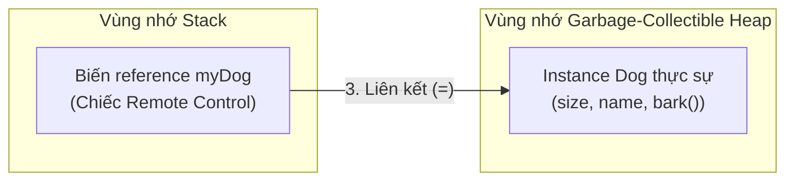
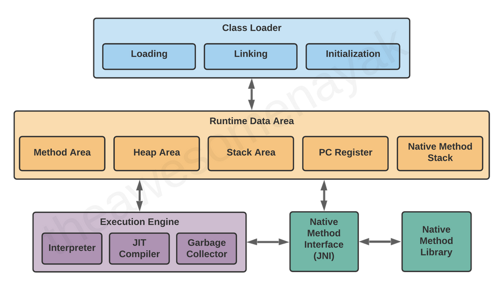
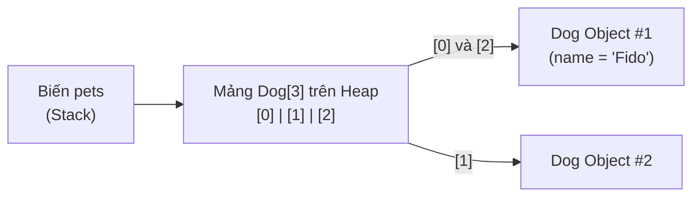

## Table of Contents
1. [Hình ảnh ẩn dụ kinh điển: Biến là những chiếc cốc (Cups)](#variables-as-cups)
2. [8 kiểu dữ liệu nguyên thủy (Primitives) & Quy tắc "Tràn cốc"](#primitives)
3. [Biến tham chiếu (Object References): Chiếc điều khiển từ xa](#object-references)
4. [Vòng đời của Reference, Object và Garbage Collector](#reference-lifecycle)
5. [Mảng (Arrays) luôn là Object: Khay đựng cốc trên Heap](#arrays)
6. [Tóm tắt & Ghi nhớ cốt lõi (Key Takeaways)](#key-takeaways)

---

## Hình ảnh ẩn dụ kinh điển: Biến là những chiếc cốc (Cups) {#variables-as-cups}

Head First Java đưa ra một hình ảnh rất trực quan: **Mỗi biến trong Java giống như một chiếc cốc có kích thước cố định và có dán nhãn tên.**

Java là ngôn ngữ kiểm tra kiểu nghiêm ngặt (**Type-safe**). Mỗi chiếc cốc phải khai báo rõ hai thông tin: **Kiểu dữ liệu (kích cỡ cốc)** và **Tên biến (nhãn dán trên cốc)**.

Trong Java chỉ có **đúng 2 loại biến**:
1. **Primitives (Kiểu nguyên thủy)**: Chiếc cốc chứa **trực tiếp các bit giá trị thực tế** (như số `5`, ký tự `'a'`, `true`).
2. **Object References (Kiểu tham chiếu)**: Chiếc cốc **KHÔNG chứa bản thân Object**, mà chỉ chứa **chiếc điều khiển từ xa (Remote Control / địa chỉ reference)** trỏ tới Object đang nằm trên vùng nhớ Heap.

> [!IMPORTANT]
> **Không có bất kỳ biến nào trong Java chứa trực tiếp một Object bên trong nó!** Mọi Object luôn sống trên vùng nhớ **Heap**, còn biến chỉ giữ các bit địa chỉ (reference) để trỏ tới Object đó.

---

## 8 kiểu dữ liệu nguyên thủy (Primitives) & Quy tắc "Tràn cốc" {#primitives}

Java có 8 kiểu primitive với kích thước bit cố định trên mọi nền tảng:

| Nhóm | Kiểu | Kích thước | Khoảng giá trị | Ví dụ khai báo |
| :--- | :--- | :--- | :--- | :--- |
| **Logic** | `boolean` | Phụ thuộc JVM | `true` hoặc `false` | `boolean isFun = true;` |
| **Ký tự** | `char` | 16 bits (2 bytes) | Unicode `0` đến `65535` | `char c = 'J';` |
| **Số nguyên** | `byte` | 8 bits (1 byte) | `-128` đến `127` | `byte b = 90;` |
| **Số nguyên** | `short` | 16 bits (2 bytes) | `-32768` đến `32767` | `short s = 1000;` |
| **Số nguyên** | `int` | 32 bits (4 bytes) | `-2147483648` đến `2147483647` | `int x = 42000;` |
| **Số nguyên** | `long` | 64 bits (8 bytes) | Rất lớn (`-9 * 10^18` đến `9 * 10^18`) | `long big = 5000000000L;` |
| **Số thực** | `float` | 32 bits (4 bytes) | Số thực đơn (bắt buộc có hậu tố `f`) | `float f = 32.5f;` |
| **Số thực** | `double` | 64 bits (8 bytes) | Số thực kép (mặc định cho số thập phân) | `double d = 3.14159;` |

### Quy tắc "Đổ nước giữa các cốc" (Type Conversion):
- **Đổ từ cốc nhỏ sang cốc lớn (Widening - An toàn)**: Compiler tự động cho phép vì không có nguy cơ mất mát dữ liệu (`byte` -> `short` -> `int` -> `long` -> `float` -> `double`).
- **Đổ từ cốc lớn sang cốc nhỏ (Narrowing - Nguy cơ tràn cốc)**: Compiler sẽ **báo lỗi compile ngay lập tức** trừ khi chủ động ép kiểu tường minh `(type)`:

```java
int x = 24;
// byte b = x; // LỖI COMPILE! Cốc int (32-bit) không thể tự đổ vào cốc byte (8-bit), dù giá trị 24 rất nhỏ!
byte b = (byte) x; // Hợp lệ vì đã ép kiểu tường minh (explicit cast)

// Tại sao viết float f = 32.5; lại lỗi?
// Vì mọi literal số thập phân mặc định trong Java đều mang kiểu double (64-bit).
// Muốn gán vào biến float (32-bit), phải thêm hậu tố 'f':
float f = 32.5f;
```

---

## Biến tham chiếu (Object References): Chiếc điều khiển từ xa {#object-references}

Câu lệnh khởi tạo quen thuộc dưới đây thực hiện đúng 3 bước trong bộ nhớ:

```java
Dog myDog = new Dog();
```




*Hình 3.1: Các phân vùng bộ nhớ trong JVM — Stack lưu trữ lời gọi hàm và biến cục bộ/reference, còn Heap lưu trữ toàn bộ các Object instances*

1. **`Dog myDog` (Tạo chiếc Remote)**: Yêu cầu JVM cấp một biến reference kiểu `Dog` tên là `myDog` (chiếc điều khiển từ xa được thiết kế chỉ để điều khiển kiểu `Dog`).
2. **`new Dog()` (Cấp phát Object trên Heap)**: Yêu cầu JVM cấp phát bộ nhớ cho một instance `Dog` mới trên vùng nhớ **Heap**.
3. **`=` (Gắn kết Remote với Object)**: Nối chiếc điều khiển `myDog` vào instance `Dog` vừa tạo trên Heap.

Khi gọi `myDog.bark()`, tín hiệu đi theo reference tới đúng instance `Dog` trên Heap để thực thi. Nếu biến reference đang mang giá trị `myDog = null;` (chiếc điều khiển chưa trỏ vào object nào) mà gọi `myDog.bark()`, JVM sẽ ném ra runtime exception kinh điển: **`NullPointerException` (NPE)**.

---

## Vòng đời của Reference, Object và Garbage Collector {#reference-lifecycle}

Bài toán kinh điển khi phân tích bộ nhớ: *Đoạn code dưới đây tạo ra mấy Object và khi nào Object đủ điều kiện để Garbage Collector thu hồi?*

```java
Book b = new Book(); // Object 1 được tạo trên Heap, remote 'b' trỏ vào Object 1
Book c = new Book(); // Object 2 được tạo trên Heap, remote 'c' trỏ vào Object 2

Book d = c;          // KHÔNG có Object mới nào được tạo!
                     // Chỉ copy địa chỉ từ remote 'c' sang remote 'd'.
                     // Lúc này cả 'c' và 'd' cùng điều khiển chung Object 2!

c = b;               // Remote 'c' chuyển sang trỏ vào Object 1 (cùng với 'b').
                     // Object 2 vẫn sống vì vẫn còn remote 'd' trỏ vào.

b = null;            // Ngắt kết nối remote 'b' (không trỏ đi đâu nữa).
c = null;            // Ngắt kết nối remote 'c'.
                     // -> Object 1 lúc này KHÔNG CÒN REFERENCE NÀO TRỎ TỚI (Unreachable)!
                     // -> Object 1 chính thức đủ điều kiện để Garbage Collector (GC) thu hồi!
```

---

## Mảng (Arrays) luôn là Object: Khay đựng cốc trên Heap {#arrays}

> [!WARNING]
> **Mảng trong Java LUÔN LUÔN là một Object nằm trên Heap**, bất kể mảng đó khai báo chứa kiểu nguyên thủy (`int[]`) hay chứa object reference (`Dog[]`).

Đặc biệt lưu ý với **mảng chứa đối tượng (`Dog[]`)**: khi gọi `new Dog[3]`, **chưa có bất kỳ instance `Dog` nào được tạo ra**, mà chỉ mới tạo một khay gồm 3 biến reference kiểu `Dog` đang mang giá trị mặc định `null`.

```java
// Bước 1: Tạo biến reference mảng 'pets' trỏ tới một Array Object gồm 3 ô trên Heap.
// Lúc này cả 3 ô pets[0], pets[1], pets[2] đều mang giá trị mặc định là null!
Dog[] pets = new Dog[3];

// Nếu gọi pets[0].bark() ngay lúc này -> Ném NullPointerException ngay lập tức!

// Bước 2: Khởi tạo từng instance Dog thực sự và gán vào từng ô reference trong mảng:
pets[0] = new Dog();
pets[1] = new Dog();
pets[2] = pets[0]; // Ô số 2 và ô số 0 cùng trỏ chung vào 1 instance Dog đầu tiên!

pets[0].name = "Fido";
System.out.println(pets[2].name); // In ra: "Fido"
```



---

## Tóm tắt & Ghi nhớ cốt lõi (Key Takeaways) {#key-takeaways}

1. **Biến reference có kích thước bao nhiêu byte?**
   - Mọi biến reference trên cùng một JVM đều có **kích thước bằng nhau** (trên JVM 64-bit bật *Compressed OOPs*, mỗi biến reference chiếm **4 bytes (32 bits)**; nếu tắt thì chiếm **8 bytes (64 bits)**), bất kể nó trỏ tới một object `Byte` nhỏ gọn hay một object `User` nặng hàng chục MB trên Heap.
2. **Khi khai báo `Dog[] myDogs = new Dog[5];`, có bao nhiêu Object được tạo trên Heap?**
   - **Chỉ có đúng 1 Object được tạo ra**, đó là bản thân mảng `Dog[5]`. Bên trong mảng này là 5 biến reference kiểu `Dog` đang mang giá trị `null`. Chưa có instance `Dog` nào tồn tại cho đến khi gọi `new Dog()` cho từng phần tử.
3. **Khi nào một Object đủ điều kiện để Garbage Collector (GC) thu hồi?**
   - Khi và chỉ khi object đó trở thành **Unreachable** (không còn bất kỳ chuỗi reference sống nào từ GC Roots/Stack trỏ tới nó).
4. **Quy tắc đặt tên định danh (Identifier rules) trong Java?**
   - Bắt đầu bằng chữ cái (`a-z`, `A-Z`), ký hiệu tiền tệ (`$`) hoặc dấu gạch dưới (`_`). **Không được bắt đầu bằng chữ số** và không được trùng với Java Keywords (`int`, `class`, `public`, `static`...). Lưu ý: từ Java 9 trở đi, dấu `_` đứng riêng lẻ một mình không còn hợp lệ làm tên biến.

### Tài liệu & Nguồn tham khảo
- [Oracle Java Language Specification — Chapter 4: Types, Values, and Variables](https://docs.oracle.com/javase/specs/jls/se17/html/jls-4.html)
- [Dev.java — Primitive Data Types & Arrays](https://dev.java/learn/language-basics/primitive-types/)
