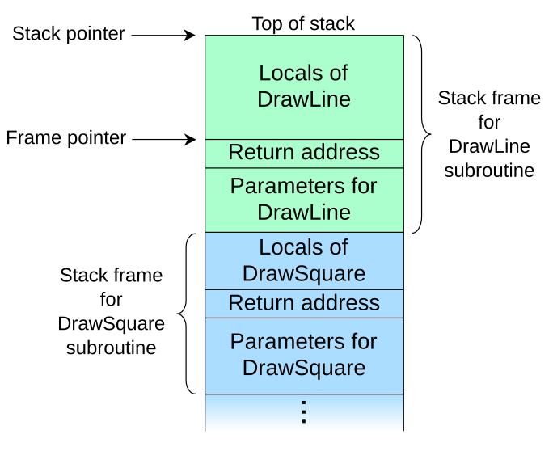
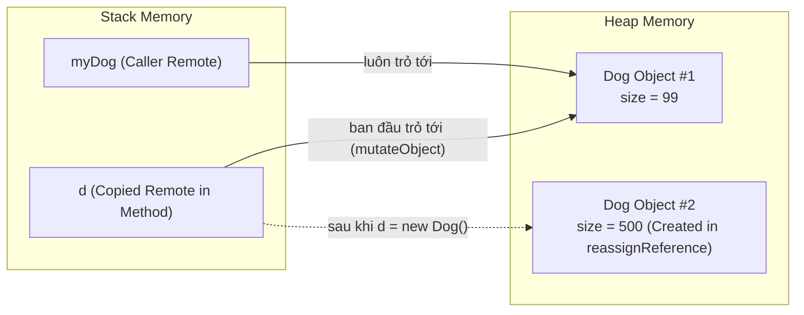
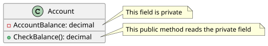

## Table of Contents
1. [State quyết định Behavior: Dữ liệu điều khiển hành động](#state-affects-behavior)
2. [Parameters vs Arguments và Return Values](#parameters-and-return-types)
3. [Cơ chế truyền tham số: Java là Pass-by-Value 100%](#pass-by-value)
4. [Nguyên tắc cốt lõi: Đóng gói dữ liệu (Encapsulation)](#encapsulation)
5. [Instance Variables vs Local Variables](#instance-vs-local)
6. [So sánh biến: Toán tử `==` vs Method `.equals()`](#comparing-variables)
7. [Tóm tắt & Ghi nhớ cốt lõi (Key Takeaways)](#key-takeaways)

---

## State quyết định Behavior: Dữ liệu điều khiển hành động {#state-affects-behavior}

Một `class` là bản thiết kế chung, nên mọi `object` sinh ra từ cùng một `class` đều có **cùng các `method`**. Tuy nhiên, mỗi `object` lại có thể hành xử khác nhau dựa vào **trạng thái hiện tại (`instance variables`)** của riêng nó.

Trong *Head First Java*, ví dụ kinh điển là `class Dog`: mọi chú chó đều biết sủa (`bark()`), nhưng tiếng sủa trầm ấm hay chói tai lại phụ thuộc hoàn toàn vào cân nặng (`size`) của từng `object` tại thời điểm đó:

```java
public class Dog {
    int size;
    String name;

    void bark() {
        if (size > 60) {
            System.out.println(name + " sủa: Gâu! Gâu! (Trầm và vang)");
        } else if (size > 14) {
            System.out.println(name + " sủa: Ẳng! Ẳng! (Vừa phải)");
        } else {
            System.out.println(name + " sủa: Yip! Yip! (Chói tai)");
        }
    }
}
```

- **Class định nghĩa**: `Object` biết làm gì (`methods`) và lưu trữ những gì (`instance variables`).
- **Object quyết định**: Hành vi cụ thể sẽ diễn ra thế nào dựa trên giá trị dữ liệu mà nó đang nắm giữ trên vùng nhớ Heap.

---

## Parameters vs Arguments và Return Values {#parameters-and-return-types}

Hai thuật ngữ **Parameter** và **Argument** thường bị dùng lẫn lộn, nhưng về mặt kỹ thuật lại mang ý nghĩa khác nhau tại hai thời điểm:

- **Parameter (Tham số hình thức)**: Là biến local được khai báo trong signature của `method` để đón dữ liệu vào (ví dụ: `void bark(int numOfBarks)` thì `numOfBarks` là parameter).
- **Argument (Đối số thực tế)**: Là giá trị hoặc biến thực sự được truyền vào khi gọi `method` (ví dụ: `d.bark(3)` thì số `3` là argument).

### Quy tắc về Parameters và Return Values
1. Nếu khai báo `method` trả về một kiểu dữ liệu (khác `void`), bắt buộc phải dùng từ khóa `return` kèm giá trị tương thích trên mọi nhánh thực thi.
2. Một `method` có thể nhận không, một hoặc nhiều tham số (ngăn cách bởi dấu phẩy), nhưng chỉ có thể trả về **đúng một giá trị đơn lẻ** (nếu cần trả về nhiều giá trị, ta đóng gói chúng vào một mảng hoặc một `object`).
3. Kiểu dữ liệu truyền vào hoặc trả về có thể được **ép kiểu ngầm định (implicit widening)** nếu kích thước nhỏ hơn kiểu khai báo (ví dụ truyền `byte` vào parameter `int`, hoặc trả về `int` cho `method` có return type là `double`). Ngược lại, từ kiểu lớn sang kiểu nhỏ bắt buộc phải ép kiểu tường minh (explicit cast).

---

## Cơ chế truyền tham số: Java là Pass-by-Value 100% {#pass-by-value}

> [!IMPORTANT]
> **Java LUÔN LUÔN là Pass-by-Value (Truyền theo giá trị / Pass-by-Copy)**. Java hoàn toàn KHÔNG có Pass-by-Reference như C++ hay C# (`ref`/`out`). Khi truyền bất kỳ biến nào vào `method`, JVM luôn **sao chép các bit** nằm trong chiếc cốc (biến) của nơi gọi sang chiếc cốc mới (parameter) của `method`.



Sự nhầm lẫn thường gặp xuất phát từ việc không phân biệt rõ giữa **sao chép giá trị nguyên thủy (primitive)** và **sao chép chiếc điều khiển từ xa (`reference`)**:

### Trường hợp 1: Truyền biến nguyên thủy (Primitive)
Chiếc cốc chứa trực tiếp giá trị số. `Method` nhận được một bản copy độc lập trên Stack, mọi thay đổi bên trong `method` không hề chạm tới biến gốc ở nơi gọi:

```java
public class PrimitivePassDemo {
    public static void main(String[] args) {
        int x = 7;
        modifyPrimitive(x);
        System.out.println("x sau khi gọi method: " + x); // Vẫn in ra 7
    }

    static void modifyPrimitive(int z) {
        z = 0; // Chỉ thay đổi bản sao z trên Stack frame của method này
    }
}
```

### Trường hợp 2: Truyền biến tham chiếu đối tượng (Object Reference)
Chiếc cốc của biến `reference` **không chứa bản thân `object`**, mà chỉ chứa các bit địa chỉ (chiếc điều khiển từ xa - remote control) trỏ tới `object` trên Heap. Khi truyền vào `method`, Java **copy chiếc điều khiển từ xa thành một chiếc điều khiển thứ hai** cùng điều khiển chung một chiếc TV (`object`) trên Heap!

Cần phân biệt rõ sự khác biệt giữa **thay đổi trạng thái thông qua remote** và **trỏ remote sang `object` mới**:

```java
public class ReferencePassDemo {
    public static void main(String[] args) {
        Dog myDog = new Dog();
        myDog.size = 10;

        mutateObject(myDog);
        System.out.println("Sau mutateObject: " + myDog.size); // In ra 99 (BỊ THAY ĐỔI!)

        reassignReference(myDog);
        System.out.println("Sau reassignReference: " + myDog.size); // Vẫn in ra 99 (KHÔNG ĐỔI!)
    }

    // 1. Dùng remote bản sao để bấm nút thay đổi dữ liệu trên cùng Object ở Heap
    static void mutateObject(Dog d) {
        d.size = 99; // Tác động trực tiếp lên Object mà myDog cũng đang trỏ tới
    }

    // 2. Gán remote bản sao sang một Object hoàn toàn mới
    static void reassignReference(Dog d) {
        d = new Dog(); // Remote local 'd' giờ điều khiển chú chó mới trên Heap
        d.size = 500;  // Thay đổi trên chú chó mới, không liên quan gì đến myDog ở main()
    }
}
```



---

## Nguyên tắc cốt lõi: Đóng gói dữ liệu (Encapsulation) {#encapsulation}

Nếu để lộ các biến `instance` (như `dog.size = -10;`), bất kỳ đoạn code nào bên ngoài cũng có thể gán những giá trị vô lý (chó nặng âm 10 kg!) làm hỏng trạng thái của hệ thống.



**Encapsulation (Đóng gói)** giúp xây một bức tường bảo vệ xung quanh dữ liệu của `object` và bắt buộc mọi giao tiếp phải đi qua cổng kiểm soát:

1. Đánh dấu các biến `instance` là `private` để chặn truy cập trực tiếp bằng toán tử dấu chấm (`.`) từ bên ngoài `class`.
2. Cung cấp các `method` `public` **Getter** (để đọc) và **Setter** (để ghi) có kèm theo logic kiểm tra hợp lệ (validation).

```java
public class GoodDog {
    private int size; // Ẩn giấu hoàn toàn với bên ngoài

    public int getSize() {
        return size;
    }

    public void setSize(int s) {
        if (s <= 0) {
            throw new IllegalArgumentException("Kích thước phải lớn hơn 0!");
        }
        this.size = s;
    }
}
```

> [!TIP]
> Ngay cả khi hiện tại hàm Setter chưa có điều kiện `if` nào (chỉ đơn giản là `this.size = s;`), việc viết Getter/Setter ngay từ đầu vẫn rất đáng giá. Sau này nếu nghiệp vụ thay đổi (cần thêm validation, ghi log, hoặc đổi cách tính toán nội bộ), chỉ cần sửa đúng 1 chỗ trong Setter mà không làm gãy (break) hàng trăm file code đang gọi tới.

---

## Instance Variables vs Local Variables {#instance-vs-local}

Một điểm khác biệt quan trọng khi đọc code hoặc kiểm tra lỗi compile trong Java là: **Biến nào được tự động gán giá trị mặc định, biến nào không?**

| Tiêu chí | Instance Variables (Biến thuộc tính của Object) | Local Variables (Biến cục bộ trong Method) |
| :--- | :--- | :--- |
| **Vị trí khai báo** | Khai báo bên trong `class`, nhưng nằm **ngoài** mọi `method`. | Khai báo bên trong thân một `method` hoặc là parameter của `method`. |
| **Vùng nhớ lưu trữ** | Sống bên trong bản thân `object` trên **Heap**. | Sống bên trong Stack Frame của `method` trên **Stack**. |
| **Vòng đời (Lifecycle)** | Tồn tại chừng nào `object` còn sống trên Heap. | Sinh ra khi gọi `method`, bị xóa sạch ngay khi `method` chạy xong. |
| **Giá trị mặc định (Default Value)** | **CÓ**. Tự động khởi tạo nếu không gán:<br/>- Số nguyên (`byte`, `short`, `int`, `long`): `0`<br/>- Số thực (`float`, `double`): `0.0`<br/>- `boolean`: `false`<br/>- `char`: `'\u0000'`<br/>- Reference (`Object`/Array): `null` | **KHÔNG CÓ** giá trị mặc định! (Lưu ý: Parameter của `method` thì luôn được khởi tạo bởi argument truyền vào khi gọi `method`). |
| **Nếu dùng trước khi gán giá trị?** | Chạy bình thường với giá trị mặc định. | **Compile Error**: `variable might not have been initialized`. |

```java
public class VariableScopeDemo {
    private int instanceCount; // Mặc định = 0
    private String title;      // Mặc định = null

    public void calculate() {
        int localSum; // Chưa khởi tạo!
        // System.out.println(localSum); // LỖI COMPILE NGAY LẬP TỨC!

        localSum = instanceCount + 10; // Hợp lệ: instanceCount có sẵn giá trị 0
        System.out.println(localSum);  // In ra 10
    }
}
```

---

## So sánh biến: Toán tử `==` vs Method `.equals()` {#comparing-variables}

Khi cần kiểm tra hai thứ có "bằng nhau" không, cần xác định rõ mục tiêu: *Đang muốn so sánh các bit nằm trong chiếc cốc (Stack), hay muốn so sánh ý nghĩa dữ liệu bên trong hai `object` trên Heap?*

### 1. Toán tử `==` (So sánh các bit trong cốc)
Toán tử `==` không quan tâm biến là kiểu primitive hay `reference`; nó chỉ đơn thuần **so sánh mẫu bit nằm bên trong hai biến**:
- **Với kiểu nguyên thủy (Primitives)**: So sánh giá trị thực tế (`3 == 3` là `true`, `'a' == 'a'` là `true`).
- **Với biến tham chiếu (References)**: So sánh xem hai chiếc remote có chứa **cùng một địa chỉ bộ nhớ** hay không — tức là cả hai biến có đang trỏ tới **cùng một `object` trên Heap** hay không.

### 2. Method `.equals()` (So sánh sự tương đương về mặt logic)
Khi có hai `object` riêng biệt trên Heap (ví dụ hai tờ tiền mệnh giá 500.000đ khác số seri, hoặc hai chuỗi `"Java"` được tạo độc lập bằng `new String("Java")`), chúng là hai thực thể vật lý khác nhau (`==` trả về `false`), nhưng có giá trị nội dung tương đương nhau (`.equals()` trả về `true`).

```java
Dog d1 = new Dog();
Dog d2 = new Dog();
Dog d3 = d1;

System.out.println(d1 == d2); // false (Hai chú chó khác nhau nằm ở 2 ô nhớ khác nhau trên Heap)
System.out.println(d1 == d3); // true  (Cả d1 và d3 cùng trỏ vào chú chó thứ nhất)

String s1 = new String("Hello");
String s2 = new String("Hello");
System.out.println(s1 == s2);      // false (Hai Object String khác nhau trên Heap)
System.out.println(s1.equals(s2)); // true  (Nội dung chuỗi ký tự bên trong giống hệt nhau)
```

---

## Tóm tắt & Ghi nhớ cốt lõi (Key Takeaways) {#key-takeaways}

**1. Java là Pass-by-Value hay Pass-by-Reference? Tại sao truyền `object` vào `method` lại sửa được dữ liệu bên trong `object` đó?**
- **Giải thích**: Java là **100% Pass-by-Value** đối với mọi loại biến. Khi truyền một `object` vào `method`, thứ thực sự được truyền đi là **giá trị của biến `reference`** (địa chỉ bộ nhớ / chiếc remote control được copy sang parameter của `method`). Vì cả biến gốc lẫn parameter trong `method` đều giữ địa chỉ trỏ về cùng một `object` trên Heap, nên việc gọi `method` hoặc sửa thuộc tính qua parameter sẽ tác động trực tiếp lên `object` chung đó. Tuy nhiên, nếu trong `method` ta gán parameter đó bằng `new Object()`, biến ở nơi gọi hoàn toàn không bị đổi hướng.

**2. Điều gì xảy ra nếu khai báo một biến local `int x;` hoặc `Object obj;` trong `method` rồi in ra ngay mà chưa gán giá trị?**
- **Giải thích**: `Compiler` (`javac`) sẽ báo lỗi ngay lập tức (`variable might not have been initialized`). Khác với biến `instance` trên Heap được JVM cấp giá trị mặc định (`0`, `false`, `null`), biến local trên Stack không được tự động khởi tạo để tối ưu hiệu năng và ngăn ngừa lỗi sử dụng rác bộ nhớ.

**3. Sự khác nhau cốt lõi giữa `==` và `.equals()` là gì? Nếu một `class` tự viết không `override` `.equals()` thì sao?**
- **Giải thích**: `==` so sánh giá trị bit trực tiếp trong biến (với `reference` là so sánh địa chỉ vùng nhớ trên Heap). `.equals()` dùng để so sánh sự bằng nhau về mặt nội dung/logic giữa hai `object`. Tuy nhiên, nếu `class` không tự `override` lại `equals()`, nó sẽ kế thừa hành vi mặc định từ `java.lang.Object` — mà mặc định của `Object.equals()` chính là dùng `==` để so sánh địa chỉ!

**4. Tại sao nên dùng Encapsulation (`private` field + `public` getter/setter) thay vì để `public` field trực tiếp?**
- **Giải thích**: Để bảo vệ tính toàn vẹn dữ liệu (Data Integrity) của `object` thông qua việc kiểm tra điều kiện (validation) trước khi gán, cho phép tạo thuộc tính chỉ đọc (chỉ viết getter) hoặc chỉ ghi, ẩn giấu cấu trúc lưu trữ nội bộ và giúp việc bảo trì/thay đổi logic tính toán sau này không làm ảnh hưởng tới code của các `class` khác đang gọi tới.

### Tài liệu & Nguồn tham khảo
- [Dev.java — Passing Information to a Method or a Constructor (Pass-by-Value)](https://dev.java/learn/classes-objects/defining-methods/)
- [Oracle Java Tutorials — Controlling Access to Members of a Class (Encapsulation)](https://docs.oracle.com/javase/tutorial/java/javaOO/accesscontrol.html)
