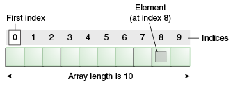
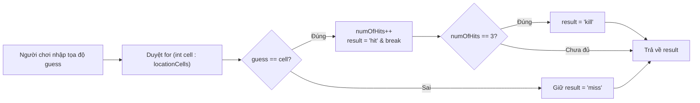

## Table of Contents
1. [Phương pháp xây dựng Class từ con số 0 (Prep -> Test -> Real)](#class-development-process)
2. [Phân tích logic game: Simple Startup (Sink a Startup)](#startup-game)
3. [So sánh các loại vòng lặp: `while` vs `for` thường vs `for-each`](#for-each-loop)
4. [Toán tử tăng giảm, Điều khiển vòng lặp & Ép kiểu (Casting)](#casting-primitives)
5. [Tóm tắt & Ghi nhớ cốt lõi (Key Takeaways)](#key-takeaways)

---

## Phương pháp xây dựng Class từ con số 0 (Prep -> Test -> Real) {#class-development-process}

Khi thiết kế một chương trình mới, thay vì lao vào gõ code Java ngay và dễ bị rối cú pháp, *Head First Java* đưa ra quy trình 3 bước thực chiến (tương đồng với tư duy **TDD - Test-Driven Development** hiện đại):

1. **Prep Code (Mã giả / Pseudocode)**: Tập trung 100% vào logic thuật toán bằng ngôn ngữ tự nhiên, chưa cần bận tâm đến dấu chấm phẩy hay cú pháp Java. Gồm 3 phần: khai báo biến trạng thái (`instance variables`), khai báo `method` và mô tả từng bước xử lý.
2. **Test Code (Mã kiểm thử)**: Viết một `class` kiểm thử (hoặc unit test) giả lập các tình huống đầu vào và định nghĩa sẵn kết quả kỳ vọng (bao gồm cả trường hợp chuẩn lẫn trường hợp biên) **trước khi** viết code xử lý thật.
3. **Real Code (Mã Java thực tế)**: Chuyển hóa bản thiết kế từ Prep Code sang cú pháp Java chuẩn và chạy Test Code liên tục cho đến khi pass toàn bộ các test.

---

## Phân tích logic game: Simple Startup (Sink a Startup) {#startup-game}

Để áp dụng quy trình trên, chương này xây dựng phiên bản rút gọn của trò chơi bắn tàu (**Simple Startup**):
- Bàn cờ là một mảng 1 chiều gồm 7 ô liên tiếp (từ chỉ số `0` đến `6`).
- Con tàu (`SimpleStartup`) chiếm **3 ô liên tiếp** trên mảng (ví dụ: `[2, 3, 4]`).
- Người chơi nhập vào một tọa độ dự đoán (`userGuess`), `method` `checkYourself(int userGuess)` sẽ kiểm tra và trả về `"miss"` (trượt), `"hit"` (trúng), hoặc `"kill"` (chìm tàu khi bắn trúng đủ 3 lần).





### Triển khai Test Code và Real Code

```java
// 1. TEST CODE: Kiểm tra logic trước
public class SimpleStartupTestDrive {
    public static void main(String[] args) {
        SimpleStartup dot = new SimpleStartup();
        int[] locations = {2, 3, 4};
        dot.setLocationCells(locations);

        int userGuess = 2;
        String result = dot.checkYourself(userGuess);

        String testResult = "failed";
        if (result.equals("hit")) {
            testResult = "passed";
        }
        System.out.println(testResult);
    }
}
```

```java
// 2. REAL CODE: Class SimpleStartup
public class SimpleStartup {
    private int[] locationCells;
    private int numOfHits = 0;

    public void setLocationCells(int[] locs) {
        locationCells = locs;
    }

    public String checkYourself(int guess) {
        String result = "miss";

        for (int cell : locationCells) {
            if (guess == cell) {
                result = "hit";
                numOfHits++;
                break; // Trúng rồi thì thoát vòng lặp ngay, không cần xét các ô còn lại
            }
        }

        if (numOfHits == locationCells.length) {
            result = "kill";
        }

        System.out.println(result);
        return result;
    }
}
```

> [!WARNING]
> Đoạn code `SimpleStartup` trên có một **bug nghiêm trọng** nếu người chơi cố tình nhập đi nhập lại cùng một tọa độ trúng (ví dụ bắn vào ô số `2` cả 3 lần): biến `numOfHits` vẫn tăng lên 3 và báo `"kill"`! Đây chính là lý do ở Chương 6 cần nâng cấp từ mảng cố định `int[]` sang `ArrayList` để xóa ngay ô đã bị bắn trúng.

---

## So sánh các loại vòng lặp: `while` vs `for` thường vs `for-each` {#for-each-loop}

Java cung cấp 3 cấu trúc lặp thông dụng, mỗi loại phù hợp với một mục đích rõ ràng:

| Loại vòng lặp | Cú pháp mẫu | Khi nào nên sử dụng? | Hạn chế cần lưu ý |
| :--- | :--- | :--- | :--- |
| **`while`** | `while (isAlive) { ... }` | Khi **không biết trước số lần lặp**, chỉ biết vòng lặp sẽ chạy chừng nào điều kiện boolean còn đúng. | Dễ gây vòng lặp vô tận (`infinite loop`) nếu quên cập nhật biến điều kiện bên trong thân vòng lặp. |
| **Regular `for`** | `for (int i = 0; i < arr.length; i++)` | Khi **biết rõ số lần lặp**, cần biết chính xác chỉ số `index` hiện tại, muốn duyệt ngược, nhảy bước (`i += 2`), hoặc **muốn gán lại giá trị trực tiếp vào ô nhớ của mảng** (`arr[i] = newVal`). | Cú pháp dài hơn, dễ mắc lỗi lệch 1 đơn vị (*Off-by-one error*: dùng `<=` thay vì `<` gây `ArrayIndexOutOfBoundsException`). |
| **Enhanced `for` (`for-each`)** | `for (int cell : locationCells)` | Khi chỉ cần **đọc tuần tự từ đầu đến cuối** mọi phần tử trong một mảng hoặc `Iterable` Collection. Code cực gọn và không lo lỗi tràn chỉ số. | **Không có biến chỉ số `index`**, chỉ duyệt xuôi từng bước một, và **không thể thay đổi trực tiếp giá trị phần tử trong mảng gốc** thông qua biến lặp. |

### Tại sao `for-each` không thể sửa trực tiếp phần tử mảng?
Trong vòng lặp `for (int x : numbers)`, biến `x` chỉ là một **bản sao cục bộ (local copy)** nhận giá trị của từng phần tử mỗi vòng lặp. Khi gán `x = 100;`, thao tác đó chỉ sửa biến tạm `x`, còn mảng `numbers` gốc hoàn toàn đứng im:

```java
int[] nums = {1, 2, 3};

for (int n : nums) {
    n = n * 10; // Vô tác dụng với mảng nums gốc!
}
// Mảng nums lúc này vẫn là {1, 2, 3}
```

---

## Toán tử tăng giảm, Điều khiển vòng lặp & Ép kiểu (Casting) {#casting-primitives}

### 1. Pre-increment (`++x`) vs Post-increment (`x++`)
Nếu đứng độc lập trên một dòng lệnh (`x++;` hoặc `++x;`), cả hai đều tăng `x` thêm 1 đơn vị. Nhưng khi nằm **bên trong một biểu thức gán hoặc truyền tham số**, thứ tự thực thi sẽ khác biệt hoàn toàn:

- **`++x` (Pre-increment - Tăng trước, dùng sau)**: Tăng giá trị của `x` lên 1 trước, rồi mới lấy giá trị mới đó đưa vào biểu thức.
- **`x++` (Post-increment - Dùng trước, tăng sau)**: Lấy giá trị hiện tại của `x` đưa vào biểu thức trước, sau đó mới âm thầm tăng `x` lên 1.

```java
int a = 5;
int res1 = ++a; // a tăng lên 6 trước -> res1 = 6, a = 6

int b = 5;
int res2 = b++; // lấy giá trị cũ của b (5) gán cho res2 trước -> res2 = 5, sau đó b mới lên 6
```

### 2. Từ khóa `break` và `continue`
- **`break`**: Lập tức thoát hẳn ra khỏi vòng lặp gần kề chứa nó (chuyển sang câu lệnh ngay sau dấu đóng ngoặc `}` của vòng lặp).
- **`continue`**: Bỏ qua phần code còn lại của **lượt lặp hiện tại** và nhảy thẳng sang kiểm tra điều kiện cho **lượt lặp kế tiếp**.

### 3. Ép kiểu nguyên thủy (Primitive Casting) & Chuyển đổi dữ liệu
Khi gán một kiểu dữ liệu lớn (như `double` hoặc `long`) vào một biến có kiểu nhỏ hơn (như `int`), `compiler` sẽ báo lỗi vì nguy cơ tràn số hoặc mất phần thập phân. Bắt buộc phải dùng toán tử ép kiểu `(type)` để xác nhận chấp nhận phần dữ liệu bị cắt bỏ:

```java
long bigVal = 40002L;
int x = (int) bigVal;   // Ép kiểu thu hẹp (Narrowing): hợp lệ vì 40002 nằm gọn trong tầm của int

double price = 3.99;
int y = (int) price;    // Cắt bỏ phần thập phân (Truncation), KHÔNG làm tròn! -> y = 3
```

### 4. Parse chuỗi sang số & Sinh số ngẫu nhiên
- **Chuyển `String` sang `int`**: Không thể ép kiểu `(int) "3"`, mà phải dùng `static method` của lớp Wrapper: `int guess = Integer.parseInt("3");`. Nếu chuỗi chứa ký tự không phải số (ví dụ `"3a"` hoặc `"three"`), JVM sẽ ném `NumberFormatException` tại `runtime`.
- **Sinh số ngẫu nhiên**:
  - Cách trực quan với `java.util.Random`:
    ```java
    java.util.Random rand = new java.util.Random();
    int randomNum = rand.nextInt(5); // Trả về số nguyên ngẫu nhiên từ 0 đến 4 (cận trên 5 không bao gồm)
    ```
  - Cách cổ điển dùng `Math.random()`: Trả về một số `double` từ `0.0` (bao gồm) đến sát `1.0` (không bao gồm). Cần nhân với khoảng giá trị và ép kiểu về `(int)`:
    ```java
    int randomNum = (int) (Math.random() * 5); // Kết quả từ 0 đến 4
    ```

---

## Tóm tắt & Ghi nhớ cốt lõi (Key Takeaways) {#key-takeaways}

**1. Kết quả của biểu thức `int i = 0; i = i++;` trong Java là bao nhiêu?**
- **Giải thích**: Kết quả cuối cùng của `i` vẫn là **`0`**! Toán tử hậu tố `i++` giữ lại giá trị cũ (`0`) làm kết quả của biểu thức bên phải, tăng `i` lên `1`, nhưng ngay sau đó phép gán `=` lại ghi đè giá trị cũ (`0`) của biểu thức vào lại biến `i`.

**2. Khi nào bắt buộc phải dùng vòng lặp `for` truyền thống thay vì `for-each`?**
- **Giải thích**: Có 3 trường hợp chính không thể dùng `for-each`:
  1. Cần thay đổi (ghi đè) giá trị tại vị trí phần tử trong mảng hoặc xóa phần tử khỏi danh sách trong lúc đang duyệt (nếu gọi `list.remove()` trực tiếp trong `for-each` sẽ gặp lỗi `ConcurrentModificationException`).
  2. Cần biết chỉ số `index` hiện tại hoặc cần truy cập đồng thời 2 phần tử liền kề (`arr[i]` và `arr[i+1]`).
  3. Cần duyệt ngược từ cuối về đầu hoặc nhảy cóc qua các phần tử.

**3. Sự khác biệt giữa Widening Primitive Conversion và Narrowing Primitive Conversion là gì?**
- **Giải thích**:
  - **Widening (Mở rộng)**: Chuyển từ kiểu có phạm vi lưu trữ nhỏ sang kiểu lớn hơn (`byte` -> `short` -> `int` -> `long` -> `float` -> `double`). Quá trình này an toàn nên Java tự động thực hiện ngầm định (implicit cast).
  - **Narrowing (Thu hẹp)**: Chuyển ngược lại từ kiểu lớn về kiểu nhỏ hơn (ví dụ `double` về `int` hoặc `long` về `short`). Có nguy cơ mất dữ liệu (mất phần thập phân hoặc tràn bit dấu), nên `compiler` bắt buộc phải viết cú pháp ép kiểu tường minh `(int) myDouble`.

**4. Tại sao `(int) (Math.random() * 5)` luôn trả về từ `0` đến `4`, còn nếu viết `(int) Math.random() * 5` thì lại luôn bằng `0`?**
- **Giải thích**: Do độ ưu tiên toán tử (Operator Precedence)! Toán tử ép kiểu `(int)` có độ ưu tiên cao hơn phép nhân `*`. Nếu không có ngoặc đơn bao quanh `Math.random() * 5`, Java sẽ ép kiểu kết quả của `Math.random()` (vốn luôn nằm trong khoảng `0.0` đến `0.999...`) về `int` trước — dẫn đến kết quả luôn bị cắt thành `0`, rồi `0 * 5` luôn bằng `0`.

### Tài liệu & Nguồn tham khảo
- [Dev.java — Control Flow Statements (`for`, Enhanced `for-each`, `while`)](https://dev.java/learn/language-basics/controlling-flow/)
- [Oracle Java Language Specification — Chapter 5: Conversions and Contexts (Casting)](https://docs.oracle.com/javase/specs/jls/se17/html/jls-5.html)
