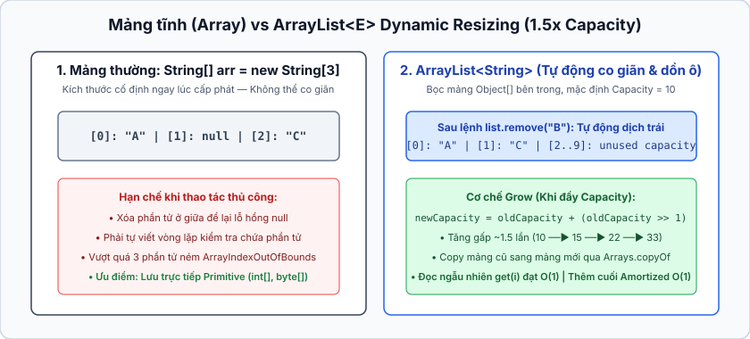
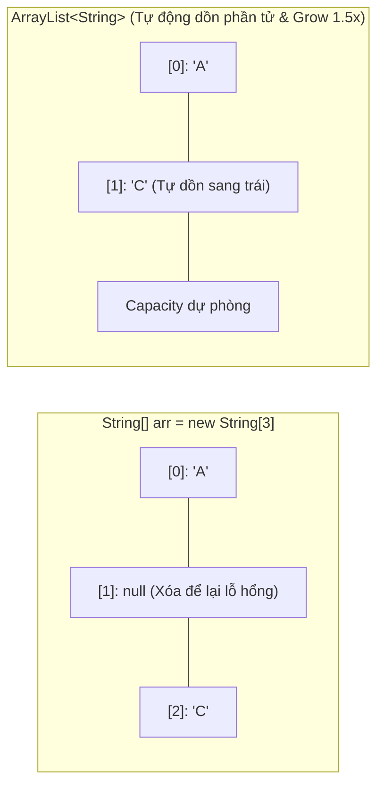

## Table of Contents
1. [Tại sao mảng thường thất bại trong game thực tế và giải pháp `ArrayList<T>`](#arraylist-intro)
2. [Các Method cốt lõi của `ArrayList`](#arraylist-methods)
3. [Bảng so sánh chi tiết: Mảng thường (`String[]`) vs `ArrayList<String>`](#array-vs-arraylist)
4. [Toán tử logic: Short-Circuit (`&&`, `||`) vs Non-Short-Circuit (`&`, `|`)](#boolean-operators)
5. [Thư viện chuẩn Java API, Packages và bản chất của lệnh `import`](#packages-and-import)
6. [Tóm tắt & Ghi nhớ cốt lõi (Key Takeaways)](#key-takeaways)

---

## Tại sao mảng thường thất bại trong game thực tế và giải pháp `ArrayList<T>` {#arraylist-intro}

Ở Chương 5, khi viết game *Simple Startup* bằng mảng thường (`int[] locationCells`), có một lỗi nghiêm trọng: nếu con tàu nằm ở ô `[2, 3, 4]` và người chơi đoán số `2` liên tiếp 3 lần, chương trình vẫn đếm đủ 3 lần trúng (`numOfHits == 3`) và tuyên bố tàu chìm!

Tại sao mảng thường lại bất tiện khi xử lý bài toán này?
1. **Kích thước cố định cứng (Fixed Size)**: Ngay lúc khởi tạo `new int[3]`, mảng đã đóng đinh 3 ô nhớ. Không thể thu nhỏ mảng xuống còn 2 ô sau khi 1 ô bị bắn trúng.
2. **Xóa phần tử thủ công rất dễ sinh bug**: Nếu dùng mảng thường, để đánh dấu ô đã bắn, phải gán giá trị đặc biệt (như `-1`) hoặc tự tạo một mảng mới nhỏ hơn rồi copy từng phần tử còn sống sang.
3. **Phải tự duy trì biến đếm `numOfHits`**: Dễ lệch trạng thái so với dữ liệu thực tế.

### Giải pháp từ thư viện chuẩn: `java.util.ArrayList`
Thay vì tự viết lại logic co giãn mảng, Java cung cấp sẵn `class` `ArrayList` trong thư viện chuẩn. Khi một tọa độ bị bắn trúng, chỉ cần gọi `locationCells.remove(index)` — `ArrayList` sẽ tự động xóa phần tử đó và thu hẹp kích thước. Khi `locationCells.isEmpty()` trả về `true`, con tàu chính thức bị tiêu diệt!

```java
import java.util.ArrayList;

public class Startup {
    private ArrayList<String> locationCells;
    private String name;

    public void setLocationCells(ArrayList<String> loc) {
        locationCells = loc;
    }

    public String checkYourself(String userInput) {
        String result = "miss";
        int index = locationCells.indexOf(userInput); // Tìm vị trí ô bị bắn (trả về -1 nếu không có)

        if (index >= 0) {
            locationCells.remove(index); // Xóa ngay ô đã trúng khỏi danh sách!
            if (locationCells.isEmpty()) {
                result = "kill";
            } else {
                result = "hit";
            }
        }
        return result;
    }
}
```

---

## Các Method cốt lõi của `ArrayList` {#arraylist-methods}

Khác với mảng thường dùng cú pháp ngoặc vuông `[]` đặc thù, `ArrayList` là một **`class` chuẩn** trong Java, nên mọi thao tác với nó đều thông qua lời gọi `method`:

| Method | Mô tả hoạt động | Độ phức tạp (Trung bình) |
| :--- | :--- | :--- |
| `add(E element)` | Thêm một phần tử vào cuối danh sách. | `O(1)` (Amortized) |
| `add(int index, E element)` | Chèn phần tử vào vị trí `index` (đẩy các phần tử phía sau lùi lại 1 bậc). | `O(n)` |
| `get(int index)` | Lấy phần tử tại vị trí `index` (bắt đầu từ `0`). | `O(1)` |
| `remove(int index)` | Xóa phần tử tại vị trí `index` và trả về phần tử vừa xóa. | `O(n)` |
| `remove(Object elem)` | Tìm và xóa lần xuất hiện đầu tiên của `elem` (trả về `true` nếu tìm thấy và xóa thành công). | `O(n)` |
| `contains(Object elem)` | Kiểm tra xem `elem` có mặt trong danh sách không (sử dụng `.equals()` bên dưới). | `O(n)` |
| `indexOf(Object elem)` | Trả về chỉ số `index` đầu tiên của `elem`, hoặc trả về **`-1`** nếu không tìm thấy. | `O(n)` |
| `size()` | Trả về số lượng phần tử hiện đang có trong danh sách. | `O(1)` |
| `isEmpty()` | Trả về `true` nếu danh sách không chứa phần tử nào (`size() == 0`). | `O(1)` |

```java
ArrayList<String> list = new ArrayList<>();
list.add("A");
list.add("B");

System.out.println(list.size());        // 2
System.out.println(list.contains("B")); // true
System.out.println(list.indexOf("C"));  // -1 (không tồn tại)

list.remove("A");                       // Xóa "A", phần tử "B" tự động dồn lên index 0
System.out.println(list.get(0));        // "B"
```

---

## Bảng so sánh chi tiết: Mảng thường (`String[]`) vs `ArrayList<String>` {#array-vs-arraylist}





| Tiêu chí so sánh | Mảng thường (`String[]`) | `ArrayList<String>` |
| :--- | :--- | :--- |
| **Khai báo & Khởi tạo** | `String[] arr = new String[2];`<br/>*(Bắt buộc phải chỉ định kích thước ngay lúc tạo)* | `ArrayList<String> list = new ArrayList<>();`<br/>*(Không cần biết trước kích thước)* |
| **Khả năng co giãn** | **Cố định (Fixed)**. Không thể tăng hay giảm kích thước sau khi `new`. | **Động (Dynamic)**. Tự động cấp phát mảng mới lớn hơn khi đầy và dồn phần tử khi xóa. |
| **Gán / Lấy phần tử** | Dùng toán tử ngoặc vuông: `arr[0] = "A";` | Dùng `method`: `list.add("A");`, `list.get(0);`, `list.set(0, "B");` |
| **Kiểm tra độ dài** | Dùng thuộc tính: `arr.length` *(không có ngoặc tròn)* | Dùng `method`: `list.size()` *(có ngoặc tròn)* |
| **Hỗ trợ kiểu nguyên thủy (Primitives)** | Chứa trực tiếp các kiểu nguyên thủy: `int[]`, `double[]`, `boolean[]`. | **Không chứa trực tiếp primitive**. Phải dùng kiểu **Wrapper Class** trong Generics: `ArrayList<Integer>`, `ArrayList<Double>` (nhờ cơ chế Autoboxing). |
| **Hiệu năng & Bộ nhớ** | Tốc độ truy cập cao `O(1)` và tiết kiệm RAM (đặc biệt với mảng nguyên thủy `int[]`). | Tốn thêm chút overhead khi phải resize mảng ngầm bên dưới hoặc khi Autoboxing từ `int` sang `object` `Integer`. |

---

## Toán tử logic: Short-Circuit (`&&`, `||`) vs Non-Short-Circuit (`&`, `|`) {#boolean-operators}

Trong các biểu thức điều kiện `if`, Java cung cấp hai nhóm toán tử kết hợp `boolean` trông khá giống nhau nhưng hành xử khác biệt hoàn toàn:

### 1. Short-Circuit Operators (`&&` và `||` - Toán tử đoản mạch)
- Đánh giá biểu thức từ trái sang phải và **dừng lại ngay lập tức** ngay khi kết quả chung cuộc đã được định đoạt:
  - Với `A && B`: Nếu vế trái `A` đã là `false`, cả biểu thức chắc chắn `false` -> Java **bỏ qua không chạy vế phải `B`**.
  - Với `A || B`: Nếu vế trái `A` đã là `true`, cả biểu thức chắc chắn `true` -> Java **bỏ qua không chạy vế phải `B`**.
- **Ứng dụng quan trọng**: Bảo vệ code khỏi lỗi `NullPointerException` hoặc chia cho 0:

```java
// AN TOÀN TUYỆT ĐỐI với &&:
// Nếu ref == null, vế trái là false -> JVM dừng ngay, không gọi ref.isValid()
if (ref != null && ref.isValid()) {
    ref.doSomething();
}
```

### 2. Non-Short-Circuit Operators (`&` và `|` - Toán tử không đoản mạch)
- Khi dùng với biểu thức `boolean`, `&` và `|` **ép buộc JVM phải chạy và tính toán CẢ HAI VẾ** trái và phải trong mọi trường hợp, bất kể vế trái đã đủ kết luận hay chưa.
- Nếu viết `if (ref != null & ref.isValid())` mà `ref` đang là `null`, JVM vẫn cố chạy vế phải `ref.isValid()` và gây dừng chương trình với `NullPointerException`! (Ngoài ra, khi dùng trên các số nguyên, `&` và `|` đóng vai trò là toán tử thao tác bit - bitwise operators).

---

## Thư viện chuẩn Java API, Packages và bản chất của lệnh `import` {#packages-and-import}

### 1. Package trong Java là gì?
Trong thư viện chuẩn Java API (cũng như các dự án thực tế), hàng nghìn `class` được gom nhóm vào các **Packages** (ví dụ `java.util`, `java.io`, `java.net`, `javax.swing`). Package giải quyết 3 mục tiêu lớn:
- Gom các `class` có liên quan chức năng vào cùng một chỗ để dễ tìm kiếm và quản lý.
- **Tránh xung đột tên (Namespace collision)**: Hai thư viện khác nhau có thể cùng đặt tên `class` là `Date` mà không đụng hàng (`java.util.Date` vs `java.sql.Date`).
- Kiểm soát quyền truy cập ở mức package (package-private access).

### 2. Tại sao dùng `String` hay `System` không cần `import`, còn `ArrayList` thì phải `import`?
- Toàn bộ các `class` nền tảng cốt lõi của ngôn ngữ như `String`, `System`, `Object`, `Math`, `Integer`, `Thread`, `Exception`... đều nằm trong package đặc biệt tên là **`java.lang`**.
- `Compiler` Java luôn tự động chèn ngầm dòng `import java.lang.*;` vào đầu mọi file `.java`. Mọi `class` thuộc các package khác (như `java.util.ArrayList`) đều phải được khai báo tên đầy đủ hoặc `import`.

### 3. Bản chất của lệnh `import`: Có làm chương trình nặng hơn hay chậm đi không?

> [!IMPORTANT]
> **Lệnh `import` hoàn toàn KHÔNG nhúng code của thư viện vào file `.class`, KHÔNG làm chương trình nặng thêm dù chỉ 1 byte, và KHÔNG làm chậm tốc độ chạy!** (Khác hẳn với `#include` trong C/C++).

Bản chất của `import` chỉ là **một tiện ích giúp rút gọn việc gõ code (Syntactic Sugar cho `compiler`)**:
- Nếu không dùng `import`, phải gõ tên đầy đủ (Fully Qualified Name) mỗi lần sử dụng:
  ```java
  java.util.ArrayList<String> list = new java.util.ArrayList<String>();
  ```
- Khi khai báo `import java.util.ArrayList;` ở đầu file, chỉ đơn giản là báo cho `compiler` `javac` biết: bất cứ chỗ nào trong file viết chữ `ArrayList` ngắn gọn, hãy tự quy đổi thành `java.util.ArrayList`. Lúc compile xong ra bytecode, mọi tên rút gọn đều được quy đổi lại thành tên đầy đủ.

---

## Tóm tắt & Ghi nhớ cốt lõi (Key Takeaways) {#key-takeaways}

**1. Bên dưới `ArrayList` hoạt động như thế nào? Làm sao nó có thể tự co giãn kích thước trong khi mảng của Java là cố định?**
- **Giải thích**: Thực chất bên trong `ArrayList` vẫn sử dụng một mảng thường (`Object[] elementData`) để lưu trữ. Khi khởi tạo mặc định và thêm phần tử đầu tiên, mảng này có sức chứa (capacity) mặc định là `10`. Khi gọi `add()` làm mảng bị đầy, `ArrayList` sẽ tự động tạo ra một mảng mới lớn hơn (thường tăng thêm **50%** kích thước cũ: `newCapacity = oldCapacity + (oldCapacity >> 1)`), sau đó dùng `Arrays.copyOf()` để chép toàn bộ phần tử từ mảng cũ sang mảng mới, rồi để Garbage Collector dọn dẹp mảng cũ.

**2. Khi nào nên chọn `Array` (`T[]`), khi nào nên chọn `ArrayList<T>`?**
- **Giải thích**:
  - Chọn **`ArrayList<T>`** trong hầu hết trường hợp phát triển ứng dụng thông thường vì số lượng dữ liệu thường biến động, cần sẵn các `method` tiện ích (`contains`, `remove`, `indexOf`) và tích hợp trực tiếp với Java Collections / Streams.
  - Chọn **`Array` (`T[]` hoặc `int[]`)** khi số lượng phần tử cố định tuyệt đối đã biết trước (như các ngày trong tuần, ma trận tọa độ cố định) hoặc khi cần xử lý hàng triệu số nguyên thủy (`int[]`, `double[]`, `byte[]`) đòi hỏi hiệu năng tính toán cao và tránh tốn bộ nhớ cho việc tạo `object` Wrapper (`Integer`, `Double`).

**3. Điều gì xảy ra trong đoạn code sau: `int x = 5; if (x > 2 || ++x > 10) { ... }`? Giá trị của `x` sau câu lệnh `if` là bao nhiêu?**
- **Giải thích**: Giá trị của `x` vẫn là **`5`**! Vì toán tử `||` là **Short-Circuit OR**: vế trái `x > 2` (`5 > 2`) đã là `true`, nên kết quả của cả mệnh đề `if` chắc chắn là `true`. Do đó, JVM bỏ qua hoàn toàn vế phải `++x > 10`, khiến lệnh `++x` không bao giờ được thực thi. Nếu đổi `||` thành `|` (Non-short-circuit), vế phải sẽ vẫn chạy và `x` sẽ tăng lên `6`.

**4. Nếu trong cùng một `class`, cần dùng cả `java.util.Date` và `java.sql.Date` thì xử lý thế nào?**
- **Giải thích**: Không thể `import` trực tiếp cả hai cùng lúc vì `compiler` sẽ báo lỗi trùng tên (ambiguous reference). Giải pháp là chỉ `import` một loại (ví dụ `import java.util.Date;`), còn loại kia khi sử dụng trong code thì viết trực tiếp bằng tên đầy đủ có kèm package (`java.sql.Date sqlDate = new java.sql.Date(...);`).

### Tài liệu & Nguồn tham khảo
- [Java SE 17 API Javadoc — `java.util.ArrayList<E>`](https://docs.oracle.com/en/java/javase/17/docs/api/java.base/java/util/ArrayList.html)
- [Dev.java — Creating and Using Packages](https://dev.java/learn/packages/)
