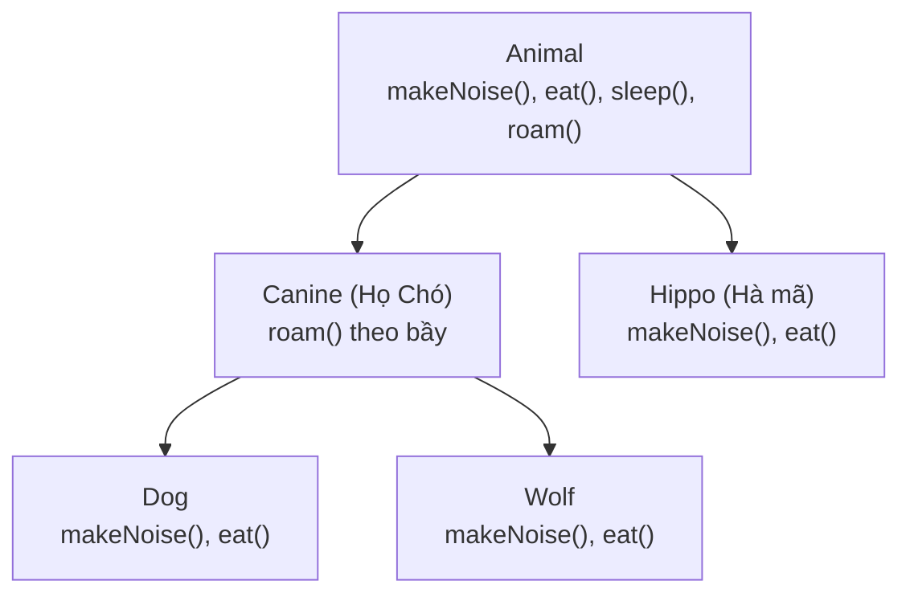
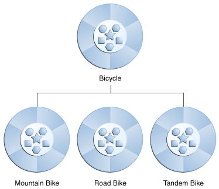

## Table of Contents
1. [Kế thừa (Inheritance): Tránh lặp code bằng cây phân cấp](#inheritance-concept)
2. [Thiết kế chuẩn: Quy tắc IS-A vs HAS-A](#is-a-vs-has-a)
3. [Overriding (Ghi đè) vs Overloading (Nạp chồng)](#overriding-vs-overloading)
4. [Đa hình (Polymorphism): Biến cha trỏ tới đối tượng con](#polymorphism-power)
5. [Từ khóa `super` và cách chặn kế thừa bằng `final`](#super-and-final)
6. [Tóm tắt & Ghi nhớ cốt lõi (Key Takeaways)](#key-takeaways)

---

## Kế thừa (Inheritance): Tránh lặp code bằng cây phân cấp {#inheritance-concept}

Giả sử cần viết các `class` `Lion`, `Tiger`, `Hippo`, `Dog`, `Wolf`. Tất cả chúng đều có các thuộc tính chung (`picture`, `food`, `hunger`, `location`) và các hành vi chung (`makeNoise()`, `eat()`, `sleep()`, `roam()`).

Thay vì copy-paste code vào từng `class`, ta đưa phần chung lên lớp cha (**Superclass**) `Animal`, rồi cho các lớp con (**Subclass**) kế thừa bằng từ khóa `extends`:



Khi một `method` được gọi trên `object` `Wolf`, JVM sẽ **tìm từ dưới lên trên cây kế thừa (Lowest One Wins)**:
1. Tìm trong `class` `Wolf` trước: Có `makeNoise()` không? Có -> Chạy ngay bản của `Wolf`!
2. Tìm `roam()` trong `Wolf`: Không có -> Leo lên `superclass` trực tiếp là `Canine`: Có `roam()` -> Chạy bản của `Canine`!
3. Tìm `sleep()` trong `Wolf` và `Canine`: Không có -> Leo tiếp lên `Animal`: Có `sleep()` -> Chạy bản của `Animal`!

---

## Thiết kế chuẩn: Quy tắc IS-A vs HAS-A {#is-a-vs-has-a}

Để xác định khi nào nên dùng kế thừa (`extends`), *Head First Java* đưa ra bài kiểm tra đơn giản với hình ảnh **Phòng tắm (Bathroom)** và **Bồn tắm (Tub)**:

- **Quan hệ IS-A (Là một -> Dùng Kế thừa `extends`)**:
  - *"Dog IS-A Animal"* (Chó là một loài Động vật) -> Hợp lý! `class Dog extends Animal`.
  - *"Surgeon IS-A Doctor"* (Bác sĩ phẫu thuật là một Bác sĩ) -> Hợp lý! `class Surgeon extends Doctor`.
  - Lưu ý: Quan hệ IS-A chỉ đi theo **1 chiều** (`Dog` là `Animal`, nhưng không phải mọi `Animal` đều là `Dog`).
- **Quan hệ HAS-A (Có một -> Dùng Thành phần / Composition)**:
  - *"Bathroom IS-A Tub"* (Phòng tắm là một cái Bồn tắm)? Hoàn toàn vô lý!
  - *"Bathroom HAS-A Tub"* (Phòng tắm **có một** cái Bồn tắm) -> Chuẩn xác! Lúc này `Bathroom` không `extends Tub`, mà chứa một biến `reference` `Tub myTub;` bên trong nó.

> [!IMPORTANT]
> **Không nên kế thừa chỉ để tái sử dụng vài dòng code!** Nếu hai `class` không vượt qua bài kiểm tra **"B IS-A A"**, hãy dùng **HAS-A (Composition)** thay vì `extends`.

---

## Overriding (Ghi đè) vs Overloading (Nạp chồng) {#overriding-vs-overloading}

Đây là cặp khái niệm cốt lõi nhưng rất dễ nhầm lẫn trong OOP:

| Tiêu chí | Method Overriding (Ghi đè) | Method Overloading (Nạp chồng) |
| :--- | :--- | :--- |
| **Bản chất** | `Subclass` định nghĩa lại hành vi đã có ở `superclass`. | Nhiều `method` trùng tên nhưng nhận danh sách tham số khác nhau (trong cùng 1 `class` hoặc `subclass`). |
| **Danh sách tham số** | **Bắt buộc giống hệt** `superclass`. | **Bắt buộc phải khác** (về số lượng, kiểu, hoặc thứ tự kiểu). |
| **Kiểu trả về (Return type)** | Phải giống hệt hoặc là `subclass` (**Covariant return**) của kiểu trả về ở `superclass`. | Tự do thay đổi, nhưng **chỉ đổi mỗi kiểu trả về thì không được tính là Overload** (sẽ lỗi compile). |
| **Phạm vi truy cập (Access)** | **Không được thu hẹp** hơn `superclass` (cha là `public` thì con không được đổi thành `protected` hay `private`). | Tự do thay đổi (`public`, `private`, `protected` tùy ý). |
| **Thời điểm quyết định** | **Runtime** (Dynamic Polymorphism - dựa vào `object` thực tế trên Heap). | **Compile-time** (Static Binding - dựa vào kiểu tham số truyền vào lúc gọi `method`). |

```java
class Animal {
    protected void eat() {
        System.out.println("Động vật đang ăn...");
    }
}

class Dog extends Animal {
    // 1. OVERRIDING: Giữ nguyên tên và tham số, mở rộng quyền từ protected -> public (Hợp lệ!)
    @Override
    public void eat() {
        System.out.println("Chó đang gặm xương...");
    }

    // 2. OVERLOADING: Cùng tên 'eat' nhưng khác tham số đầu vào
    public void eat(String food, int count) {
        System.out.println("Chó ăn " + count + " miếng " + food);
    }
}
```

---

## Đa hình (Polymorphism): Biến cha trỏ tới đối tượng con {#polymorphism-power}

Thông thường khi khởi tạo `object`, kiểu của biến `reference` và kiểu của `object` giống hệt nhau (`Dog myDog = new Dog();`).

Nhưng với **Đa hình (Polymorphism)**, **kiểu của biến `reference` có thể là `Superclass`, còn `object` thực tế trên Heap là bất kỳ `Subclass` nào của nó**:



```java
// Chiếc điều khiển mang nhãn Animal, nhưng điều khiển đối tượng Dog trên Heap!
Animal myPet = new Dog();
```

Nhờ cơ chế này, code trở nên rất linh hoạt với **Mảng đa hình** và **Tham số đa hình**:

```java
class Vet {
    // Tham số đa hình: Method này nhận BẤT KỲ con vật nào extends từ Animal!
    // Khi thêm mới class Elephant extends Animal, method giveShot() vẫn hoạt động mà không cần sửa!
    public void giveShot(Animal a) {
        a.makeNoise(); // Lúc Runtime, JVM tự biết 'a' thực sự là Dog hay Cat trên Heap để gọi đúng tiếng kêu!
    }
}

public class PetOwner {
    public static void main(String[] args) {
        Vet vet = new Vet();
        Dog d = new Dog();
        Hippo h = new Hippo();

        vet.giveShot(d); // In ra: "Gâu! Gâu!"
        vet.giveShot(h); // In ra: "Ột! Ột!"
    }
}
```

---

## Từ khóa `super` và cách chặn kế thừa bằng `final` {#super-and-final}

### 1. Dùng `super` khi cần giữ lại phần code của `superclass`:
Đôi khi khi `override`, ta không muốn xóa sạch hành vi của `superclass` mà chỉ muốn **chạy code của `superclass` trước, rồi bổ sung thêm logic của `subclass` sau**:

```java
class Canine extends Animal {
    @Override
    public void roam() {
        super.roam(); // Gọi logic roam() gốc của superclass Animal trước
        System.out.println("Đi tuần theo bầy đàn."); // Bổ sung hành vi riêng của Canine
    }
}
```

### 2. Ba cách khóa kế thừa/ghi đè:
- **`private` members**: Các biến và `method` `private` của `superclass` **không được kế thừa** xuống `subclass`.
- **`final` method**: Đánh dấu một `method` là `final void eat()` để **cấm `subclass` `override`** `method` đó.
- **`final` class**: Đánh dấu cả `class` là `final class String` để **cấm mọi `class` khác `extends` nó** (bảo toàn tính bất biến và an toàn).

---

## Tóm tắt & Ghi nhớ cốt lõi (Key Takeaways) {#key-takeaways}

1. **Cho `Animal a = new Dog();`. Nếu `class` `Dog` có thêm `method` riêng `fetch()` mà `class` `Animal` không có, gọi `a.fetch()` có chạy được không?**
   - **Không! Lỗi compile ngay lập tức.**
   - **Quy tắc vàng**: **`Compiler`** chỉ nhìn vào **kiểu của biến `reference` (`Animal`)** để kiểm tra xem trên chiếc điều khiển đó có nút `fetch()` hay không. Còn **JVM lúc `runtime`** mới nhìn vào **`object` thực tế trên Heap (`Dog`)** để quyết định chạy phiên bản `override` nào.
2. **Có thể `override` một `static` hoặc `private` `method` không?**
   - **Không!** `Method` `private` không hề được kế thừa xuống `subclass`. Còn `static method` gắn liền với `class` (được quyết định ngay lúc compile), nên nếu `subclass` khai báo một `static method` trùng tên thì đó gọi là **Method Hiding (Che khuất)** chứ không phải Overriding (không có tính đa hình).
3. **Tại sao khi `override` `method`, luôn nên gắn annotation `@Override`?**
   - Giúp `compiler` kiểm tra xem tên `method` hoặc kiểu tham số có khớp với `superclass` hay không. Nếu không có `@Override` mà vô tình gõ sai tên như `public void makeNiose()`, `compiler` sẽ hiểu nhầm là đang viết một `method` mới thay vì báo lỗi!

### Tài liệu & Nguồn tham khảo
- [Dev.java — Inheritance, Overriding, and Polymorphism](https://dev.java/learn/inheritance/)
- [JEP 394 — Pattern Matching for `instanceof` (Java 16+)](https://openjdk.org/jeps/394)
