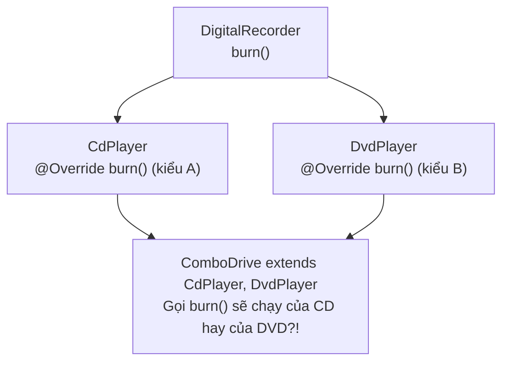
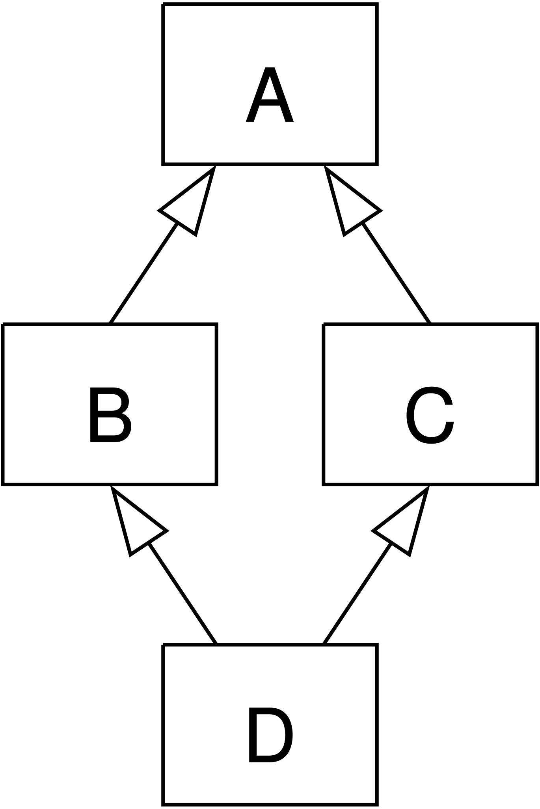

## Table of Contents
1. [Lớp trừu tượng (Abstract Class): Khi không thể `new` một khái niệm chung chung](#abstract-classes)
2. [Phương thức trừu tượng (Abstract Method): Bản giao kèo bắt buộc](#abstract-methods)
3. [Lớp tổ tiên của vạn vật: `java.lang.Object` và phép kiểm tra `instanceof`](#object-class)
4. [Bài toán "Viên kim cương chết chóc" (Deadly Diamond of Death)](#diamond-problem)
5. [Giao diện (Interface): Hợp đồng năng lực đa kế thừa](#interfaces)
6. [Bảng so sánh: Concrete Class vs Abstract Class vs Interface](#comparison-table)
7. [Tóm tắt & Ghi nhớ cốt lõi (Key Takeaways)](#key-takeaways)

---

## Lớp trừu tượng (Abstract Class): Khi không thể `new` một khái niệm chung chung {#abstract-classes}

Quay lại cây kế thừa `Animal` ở Chương 7: Khi viết `new Dog()` hay `new Hippo()`, có thể hình dung ngay con chó, con hà mã trông thế nào. Nhưng nếu viết `new Animal()` thì sao? Một "Động vật chung chung" trông hình thù ra sao, kêu tiếng gì? Hoàn toàn mơ hồ!

Tuy nhiên, vẫn rất cần `class` `Animal` để làm kiểu `reference` đa hình (`Animal[] animals`) và chứa code dùng chung. Giải pháp là đánh dấu nó bằng từ khóa **`abstract`**:

```java
abstract class Canine extends Animal {
    public void roam() {
        System.out.println("Di chuyển theo bầy");
    }
}

// Canine c = new Canine(); // LỖI COMPILE! Canine is abstract; cannot be instantiated!
Canine c = new Dog();       // HỢP LỆ 100%! Dùng làm kiểu reference đa hình cho concrete subclass.
```

- **Concrete Class (Lớp cụ thể)**: `Class` đủ chi tiết để đúc ra `object` bằng từ khóa `new` (như `Dog`, `Wolf`, `Hippo`).
- **Abstract Class (Lớp trừu tượng)**: Không được phép `new` trực tiếp, chỉ dùng để cho `class` khác `extends` và làm kiểu `reference` đa hình.

---

## Phương thức trừu tượng (Abstract Method): Bản giao kèo bắt buộc {#abstract-methods}

Bên cạnh việc đánh dấu `class` là `abstract`, còn có thể đánh dấu các `method` là `abstract`: nghĩa là *"Mọi con vật đều phải biết `eat()` và `makeNoise()`, nhưng ở cấp độ `Animal` thì chưa biết cụ thể ăn gì hay kêu thế nào, các `subclass` phải tự định nghĩa!"*

```java
public abstract class Animal {
    // Abstract method KHÔNG CÓ THÂN HÀM {}, kết thúc ngay bằng dấu chấm phẩy ';'
    public abstract void makeNoise();
    public abstract void eat();

    // Abstract class VẪN CÓ THỂ chứa các concrete method có sẵn code!
    public void sleep() {
        System.out.println("Nhắm mắt ngủ ngon lành...");
    }
}
```

> [!IMPORTANT]
> **Hai quy tắc cốt lõi của `abstract`:**
> 1. Nếu một `class` có chứa dù chỉ **1 `abstract method`**, thì bản thân `class` đó **bắt buộc phải khai báo là `abstract class`**.
> 2. Lớp cụ thể đầu tiên (**First Concrete Subclass**) kế thừa từ một `abstract class` **bắt buộc phải triển khai (`implement`/`override`) TẤT CẢ các `abstract method`** của `superclass`, nếu không `compiler` sẽ báo lỗi.

---

## Lớp tổ tiên của vạn vật: `java.lang.Object` và phép kiểm tra `instanceof` {#object-class}

Trong Java, mọi `class` được viết ra mà không ghi từ khóa `extends` nào thì `compiler` đều âm thầm biến nó thành `extends java.lang.Object`.

Nói cách khác, **`Object` là `superclass` gốc (Mother of all classes)** của mọi thứ trong Java. Mọi `object` đều thừa hưởng các `method` nền tảng từ `Object`:
- `equals(Object obj)`: Kiểm tra hai đối tượng có tương đương về mặt logic không.
- `hashCode()`: Trả về mã băm phục vụ cho `HashMap`/`HashSet`.
- `toString()`: Trả về chuỗi mô tả `object` (mặc định là `TênClass@MãHex`).
- `getClass()`: Cho biết `object` này thực chất được khởi tạo từ `class` nào lúc `runtime`.

### Giới hạn của việc dùng `reference` `Object` và cách ép kiểu với `instanceof`:
Nếu đưa một đối tượng `Dog` vào `ArrayList<Object>`, khi lấy ra chỉ nhận lại chiếc điều khiển đa năng kiểu `Object`. Chiếc điều khiển `Object` này chỉ có mấy nút cơ bản (`toString()`, `equals()`...) chứ **không có nút `bark()` của riêng `Dog`**!

Muốn gọi `bark()`, phải kiểm tra bằng `instanceof` và ép kiểu ngược về `Dog` (**Downcasting**):

```java
Object o = new Dog();
// o.bark(); // LỖI COMPILE! Class Object không có method bark()

// Kiểm tra an toàn trước khi ép kiểu (Pattern Matching cho instanceof từ Java 16+):
if (o instanceof Dog d) {
    d.bark(); // Hợp lệ và an toàn khỏi lỗi ClassCastException!
}
```

---

## Bài toán "Viên kim cương chết chóc" (Deadly Diamond of Death) {#diamond-problem}

Giả sử cần thêm các hành vi của thú cưng (`beFriendly()`, `play()`) cho `Dog` và `Cat` (nhưng không cho `Lion` hay `Hippo`). Tại sao Java không cho phép `class Dog extends Canine, Pet` (Đa kế thừa nhiều `class` như C++)?

Hãy nhìn vào bài toán **Deadly Diamond of Death**:




*Hình 8.1: Mô hình kế thừa hình thoi (Diamond Inheritance): Class D kế thừa từ cả B và C (vốn cùng kế thừa từ A), gây xung đột trạng thái và cài đặt hàm*

Nếu `ComboDrive` được phép `extends` cả hai `class` `CdPlayer` và `DvdPlayer`, mà cả hai `superclass` này lại có biến trạng thái và cách cài đặt `burn()` khác nhau, thì khi gọi `combo.burn()`, JVM sẽ rơi vào trạng thái nhập nhằng không biết phải chạy `method` của `superclass` nào! Vì vậy, **Java cấm một `class` `extends` nhiều hơn 1 `class`**.

---

## Giao diện (Interface): Hợp đồng năng lực đa kế thừa {#interfaces}

Để giải quyết nhu cầu đóng nhiều vai trò mà không dính bẫy Kim cương, Java cung cấp **`interface`**.
Nếu `Class` định nghĩa **"Thực thể là gì" (IS-A)**, thì `Interface` định nghĩa **"Năng lực làm được gì" (CAN-DO / Role)**:

```java
// Interface là bản hợp đồng (contract): mặc định mọi method không thân hàm đều là 'public abstract'
public interface Pet {
    void beFriendly();
    void play();
}

public interface Saveable {
    void saveToDb();
}

// Một class chỉ được extends 1 superclass, nhưng được implements NHIỀU interface!
public class Dog extends Canine implements Pet, Saveable {
    @Override
    public void beFriendly() {
        System.out.println("Vẫy đuôi mừng chủ!");
    }

    @Override
    public void play() {
        System.out.println("Chạy đi nhặt bóng!");
    }

    @Override
    public void saveToDb() {
        System.out.println("Lưu thông tin chú chó vào Database.");
    }
}
```

> [!TIP]
> **Cập nhật từ Java 8+**: `Interface` được phép có thêm **`default` method** (`method` có sẵn thân hàm để mở rộng thư viện mà không làm gãy các `class` cũ đang `implements` nó) và **`static` method**. Tuy nhiên, `Interface` vẫn **không được có biến trạng thái (`instance variables`)** — mọi biến khai báo trong `Interface` đều tự động là hằng số `public static final`.

---

## Bảng so sánh: Concrete Class vs Abstract Class vs Interface {#comparison-table}

| Tiêu chí | Concrete Class | Abstract Class | Interface |
| :--- | :--- | :--- | :--- |
| **Khởi tạo bằng `new`?** | Có | **Không** | **Không** |
| **Mục đích thiết kế** | Đúc ra `object` cụ thể. | Chia sẻ code và trạng thái chung cho các `class` có quan hệ họ hàng gần (**IS-A**). | Định nghĩa bản hợp đồng hành vi/vai trò xuyên suốt các nhánh không cùng họ hàng (**CAN-DO**). |
| **Biến trạng thái (`instance` vars)** | Có đầy đủ | Có đầy đủ | **Không được phép** (chỉ có hằng số `public static final`). |
| **Constructor** | Có | **Có** (được gọi khi `subclass` khởi tạo qua chuỗi `super()`). | **Không có Constructor**. |
| **Đa kế thừa** | Chỉ `extends` được 1 `class`. | Chỉ `extends` được 1 `class`. | Một `class` có thể `implements` **nhiều** `interface` cùng lúc. |

---

## Tóm tắt & Ghi nhớ cốt lõi (Key Takeaways) {#key-takeaways}

1. **Từ Java 8 trở đi, `Interface` đã có `default` method (chứa được code), vậy sự khác biệt thực sự giữa `Abstract Class` và `Interface` là gì?**
   - **Trạng thái (State)**: `Abstract Class` có thể chứa **`instance variables`** (biến trạng thái riêng của từng `object`) và có **Constructor** để khởi tạo trạng thái đó. `Interface` thì hoàn toàn không có trạng thái (stateless) và không có Constructor.
   - **Đa kế thừa**: Một `class` chỉ `extends` được đúng 1 `Abstract Class`, nhưng `implements` được vô số `Interface`.
   - **Phạm vi truy cập**: `Abstract Class` có thể có `method`/biến `private`, `protected`, package-private; trong khi các `method` trong contract của `Interface` mặc định luôn là `public`.
2. **Nếu một `class` `implements` 2 `Interface` mà cả 2 `Interface` đó đều có `default void log()` trùng tên nhau thì sao?**
   - `Compiler` sẽ **báo lỗi bắt buộc `class` đó phải tự `override` lại `log()`** để chỉ định rõ logic (bên trong có thể gọi `InterfaceA.super.log()` nếu cần chọn một trong hai). Nhờ đó Java vẫn tránh được hoàn toàn lỗi Diamond Problem!
3. **`Abstract class` có Constructor không khi mà không thể `new` nó?**
   - **Có!** Dù không thể viết `new Animal()`, nhưng khi gọi `new Dog()`, constructor của `superclass` `Animal` vẫn luôn được chạy ngầm thông qua lệnh `super()` để khởi tạo các biến thuộc tính được kế thừa từ `Animal`.

### Tài liệu & Nguồn tham khảo
- [Dev.java — Interfaces and Abstract Classes](https://dev.java/learn/interfaces/)
- [Oracle Java Tutorials — Default Methods & Multiple Inheritance of State vs Type](https://docs.oracle.com/javase/tutorial/java/IandI/defaultmethods.html)
