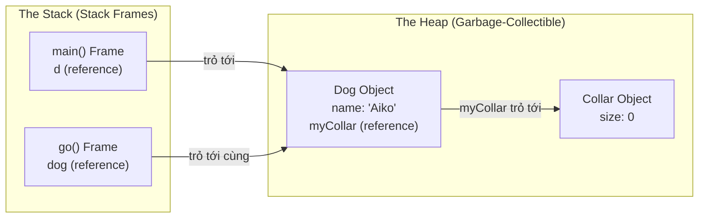
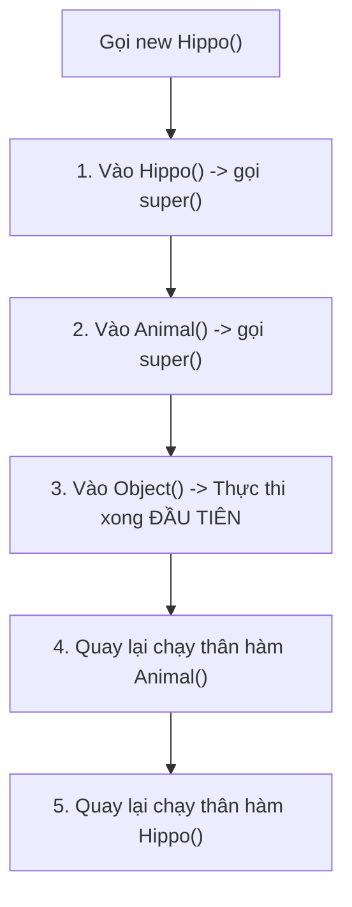

## Table of Contents
1. [Bức tranh bộ nhớ: Ngăn xếp Stack và Vùng nhớ Heap](#stack-vs-heap)
2. [Hàm khởi tạo (Constructors): Khoảnh khắc Object chào đời](#constructors)
3. [Chuỗi khởi tạo kế thừa: `super()` và `this()`](#constructor-chaining)
4. [Tuổi thọ biến vs Tuổi thọ Object và Garbage Collection](#garbage-collection)
5. [Tóm tắt & Ghi nhớ cốt lõi (Key Takeaways)](#key-takeaways)

---

## Bức tranh bộ nhớ: Ngăn xếp Stack và Vùng nhớ Heap {#stack-vs-heap}

Trong JVM, hai vùng nhớ quyết định vòng đời của mọi thành phần trong chương trình là **Stack** (Ngăn xếp) và **Heap** (Vùng nhớ tự do / Garbage-Collectible Heap).

| Tiêu chí | Ngăn xếp (The Stack) | Vùng nhớ tự do (The Heap) |
| :--- | :--- | :--- |
| **Lưu trữ cái gì?** | Các lời gọi hàm (**Stack Frames**) và **biến cục bộ (local variables)** (gồm cả primitive lẫn biến reference / remote control). | **Tất cả các đối tượng (Objects)** và các **biến thực thể (instance variables)** nằm bên trong chúng. |
| **Cách cấp phát** | Theo cơ chế **LIFO** (Last-In, First-Out): method nào được gọi sau sẽ xếp chồng lên đỉnh Stack và giải phóng trước khi chạy xong. | Cấp phát động bất cứ khi nào từ khóa `new` xuất hiện. Không theo thứ tự xếp chồng cố định. |
| **Ai dọn dẹp?** | Tự động giải phóng ngay lập tức khi method kết thúc (Stack Frame bị pop ra khỏi đỉnh Stack). | Do **Garbage Collector (GC)** quét và thu hồi khi object không còn reference nào trỏ tới. |

> [!IMPORTANT]
> **Quy tắc cốt lõi cần nắm vững:** Vị trí lưu biến phụ thuộc vào **nơi biến được khai báo**, không phụ thuộc vào kiểu dữ liệu của biến!
> - Khai báo **bên trong một method** -> Biến cục bộ (local variable) -> Nằm trên **Stack**.
> - Khai báo **bên trong class nhưng ngoài mọi method** -> Biến thực thể (instance variable) -> Nằm gọn bên trong bản thân Object đó trên **Heap**.

### Điều gì xảy ra khi một Object chứa một Object khác?

Hãy xem đoạn code kinh điển sau:

```java
public class Collar {
    private int size;
}

public class Dog {
    private Collar myCollar; // Biến instance (Reference nằm ngay trong Dog trên Heap)
    private String name;

    public static void main(String[] args) {
        Dog d;               // Biến cục bộ 'd' nằm trên Stack frame của main()
        d = new Dog();       // Object Dog nằm trên Heap
        d.go(d);
    }

    void go(Dog dog) {       // Tham số 'dog' là biến cục bộ trên Stack frame của go()
        myCollar = new Collar(); // Object Collar nằm trên Heap, được trỏ bởi biến instance myCollar
        dog.setName("Aiko");
    }

    void setName(String dogName) {
        name = dogName;
    }
}
```

Ngay cả khi gọi `new Collar()` **bên trong method** `go()`, bản thân object `Collar` vẫn luôn được cấp phát trên **Heap**. Trên **Stack** chỉ lưu giữ các Stack Frame của `main()`, `go()`, `setName()` và các biến điều khiển từ xa (reference) cục bộ.



---

## Hàm khởi tạo (Constructors): Khoảnh khắc Object chào đời {#constructors}

Khi viết `new Duck(42)`, câu lệnh này không chỉ cấp phát bộ nhớ trên Heap mà còn kích hoạt **Constructor** của class `Duck`. Constructor có hình thức giống một method nhưng thực chất là khối code khởi tạo chạy ngay thời điểm toán tử `new` thực thi.

```java
public class Duck {
    private int size;

    // 1. Constructor không tham số (No-arg constructor)
    public Duck() {
        this.size = 27; // Giá trị mặc định nếu không truyền tham số
    }

    // 2. Constructor nạp chồng (Overloaded constructor)
    public Duck(int duckSize) {
        this.size = duckSize; // Gán ngay trạng thái ban đầu khi khởi tạo
    }

    // CẢNH BÁO BẪY: Đây KHÔNG PHẢI là constructor vì có kiểu trả về 'void'!
    // Đây chỉ là một method bình thường vô tình trùng tên với Class.
    public void Duck() {
        System.out.println("Method bình thường, chỉ chạy khi gọi myDuck.Duck()");
    }
}
```

### 3 quy tắc cốt lõi về Constructor

1. **Tên trùng khớp hoàn toàn với tên Class và KHÔNG có kiểu trả về (No return type)**: Nếu thêm `void` hay bất kỳ kiểu trả về nào vào trước `Duck()`, compiler sẽ coi đó là một method thông thường chứ không phải Constructor.
2. **Quy tắc "Constructor mặc định từ compiler"**:
   - Nếu **không viết bất kỳ constructor nào** trong class, compiler sẽ tự động sinh một constructor rỗng không tham số: `public Duck() {}`.
   - Nhưng chỉ cần **tự định nghĩa dù chỉ 1 constructor** (ví dụ `public Duck(int size)`), compiler sẽ **không tự sinh constructor mặc định nữa**! Lúc này nếu gọi `new Duck()` mà chưa tự viết bản không tham số, code sẽ báo lỗi compile.
3. **Overloaded Constructors (Nạp chồng hàm khởi tạo)**: Một class có thể có nhiều constructors miễn là danh sách tham số (số lượng, kiểu dữ liệu, hoặc thứ tự kiểu) khác nhau.

---

## Chuỗi khởi tạo kế thừa: `super()` và `this()` {#constructor-chaining}

Trong lập trình hướng đối tượng (OOP), một subclass phụ thuộc vào trạng thái kế thừa từ superclass. Vì vậy, **phần lõi của lớp cha phải được khởi tạo hoàn chỉnh trước khi lớp con hình thành**.

Khi khởi tạo một object lớp con `new Hippo()`, một chuỗi kích hoạt dây chuyền (**Constructor Chaining**) lập tức diễn ra trên Stack:

```java
public class Animal {
    public Animal() {
        System.out.println("1. Đang tạo một Animal");
    }
}

public class Hippo extends Animal {
    public Hippo() {
        // Nếu không viết super(), compiler tự động chèn ngầm ở dòng đầu tiên:
        // super();
        System.out.println("2. Đang tạo một Hippo");
    }
}
```

Khi chạy `new Hippo()`, thứ tự thực thi diễn ra như sau:
1. `Hippo()` được đẩy vào Stack -> Dòng đầu tiên của nó gọi `super()` (tức `Animal()`).
2. `Animal()` được đẩy lên đỉnh Stack -> Dòng đầu tiên của nó gọi `super()` (tức `Object()`).
3. `Object()` chạy xong đầu tiên và rút khỏi Stack -> Sau đó thân hàm `Animal()` chạy tiếp và in ra `"1. Đang tạo một Animal"` -> Cuối cùng thân hàm `Hippo()` mới chạy và in ra `"2. Đang tạo một Hippo"`.



### Dùng `this(...)` để tránh lặp code giữa các Constructors

Khi một class có nhiều overloaded constructors, thay vì lặp lại logic khởi tạo ở từng nơi, có thể dùng `this(...)` để chuyển hướng sang một "constructor trung tâm" (**Real Constructor**) làm nhiệm vụ gọi `super(...)`:

```java
import java.awt.Color;

public class Mini extends Car {
    private Color color;

    // Constructor 1: Không tham số -> ủy quyền cho Constructor 2
    public Mini() {
        this(Color.RED);
    }

    // Constructor 2: Nhận Color -> ủy quyền cho Constructor 3 (Real Constructor)
    public Mini(Color c) {
        this(c, "Mini Cooper");
    }

    // Constructor 3: Real Constructor trực tiếp gọi super() và gán biến
    public Mini(Color c, String modelName) {
        super(modelName);
        this.color = c;
    }
}
```

> [!WARNING]
> **Quy tắc bắt buộc của `super()` và `this()`:**
> - Lệnh gọi `super(...)` hoặc `this(...)` **BẮT BUỘC phải là câu lệnh đầu tiên** trong constructor.
> - Một constructor **không bao giờ** chứa cả `super()` lẫn `this()` cùng lúc (vì cả hai đều bắt buộc đặt ở dòng đầu tiên!).

---

## Tuổi thọ biến vs Tuổi thọ Object và Garbage Collection {#garbage-collection}

Trong quản lý bộ nhớ JVM, cần tách bạch rõ ràng giữa **Biến cục bộ (trên Stack)** và **Đối tượng (trên Heap)**.


*Hình 9.1: Cách Garbage Collector (GC) duyệt đồ thị tham chiếu từ Stack/GC Roots và tự động thu hồi các Object không còn đường dẫn trỏ tới (Unreachable Objects)*

### 1. Scope (Phạm vi) vs Life (Tuổi thọ) của biến cục bộ

- **Life (Tuổi thọ)**: Một biến cục bộ còn **tồn tại (alive)** chừng nào Stack Frame của method chứa nó còn nằm trên Stack (tức là method đó chưa chạy xong).
- **Scope (Phạm vi truy cập)**: Biến cục bộ chỉ nằm trong **phạm vi truy cập (in scope)** khi method khai báo nó đang nằm **ngay trên đỉnh của Stack** (đang thực thi trực tiếp).

```java
public class StackLifeDemo {
    public void doStuff() {
        boolean b = true;
        go(4); // Khi nhảy vào go(), biến 'b' vẫn SỐNG (alive) nhưng TẠM NGOÀI PHẠM VI (out of scope)
    }

    public void go(int x) {
        int z = x + 24; // Tại đây chỉ nhìn thấy 'x' và 'z', không thể truy cập 'b'
    }
}
```

### 2. Khi nào một Object đủ điều kiện được dọn rác (Eligible for GC)?

Một object trên Heap sẽ tồn tại chừng nào còn **ít nhất một tham chiếu sống (live reference)** trỏ tới nó. Khoảnh khắc tham chiếu cuối cùng bị ngắt kết nối, object trở thành đối tượng không còn khả năng truy cập (**unreachable / eligible for Garbage Collection**).

Có **3 cách điển hình** làm đứt liên kết tham chiếu khiến Object đủ điều kiện được GC thu hồi:

```java
public class GarbageCollectionWays {

    // Cách 1: Biến reference vĩnh viễn ra khỏi phạm vi khi method kết thúc
    void wayOne() {
        Life z = new Life();
    } // Method kết thúc -> Stack frame bị pop -> biến 'z' biến mất -> Object Life thành rác!

    // Cách 2: Gán biến reference sang một object khác (Reassign reference)
    void wayTwo() {
        Life z = new Life(); // Object 1
        z = new Life();      // 'z' chuyển sang trỏ vào Object 2 -> Object 1 bị bỏ rơi thành rác!
    }

    // Cách 3: Chủ động gán biến reference bằng null (Set reference to null)
    void wayThree() {
        Life z = new Life();
        z = null;            // Ngắt kết nối reference -> Object Life không còn biến nào trỏ tới!
    }
}
```

---

## Tóm tắt & Ghi nhớ cốt lõi (Key Takeaways) {#key-takeaways}

- **Khởi tạo Object bên trong method thì nằm ở Stack hay Heap?**
  - Bản thân **Object luôn luôn nằm trên Heap**. Chỉ có biến reference khai báo trong method đó là biến cục bộ nên nằm trên **Stack**.
- **Thứ tự chạy của Constructor khi khởi tạo subclass:**
  - Lời gọi đi ngược từ con lên cha (`Child` -> `Parent` -> `Object`), nhưng **thân hàm constructor thực thi hoàn tất theo chiều từ trên xuống**: `Object()` chạy xong trước -> `Parent()` -> cuối cùng mới đến `Child()`.
- **Trường hợp lớp cha chỉ có constructor có tham số `Animal(String name)`:**
  - Nếu constructor của lớp con không gọi tường minh `super("Tên")`, code sẽ gặp **lỗi compile**! Nguyên nhân là compiler tự động chèn `super();` (không tham số) vào dòng đầu của constructor lớp con, nhưng lớp cha `Animal` đã tự định nghĩa `Animal(String)` nên không còn constructor không tham số mặc định nữa.
- **Bản chất của việc gán `obj = null`:**
  - Thao tác này không xóa object khỏi bộ nhớ ngay lập tức, mà chỉ đánh dấu object đó là **unreachable (eligible for GC)** nếu không còn reference nào khác trỏ tới. Thời điểm thu hồi bộ nhớ thực sự do thuật toán của **JVM Garbage Collector** quyết định.

### Tài liệu & Nguồn tham khảo
- [Oracle HotSpot Virtual Machine Garbage Collection Tuning Guide (Java SE 17)](https://docs.oracle.com/en/java/javase/17/gctuning/introduction-garbage-collection-tuning.html)
- [Dev.java — Creating Objects & Constructor Chaining (`this()` and `super()`)](https://dev.java/learn/classes-objects/creating-objects/)
